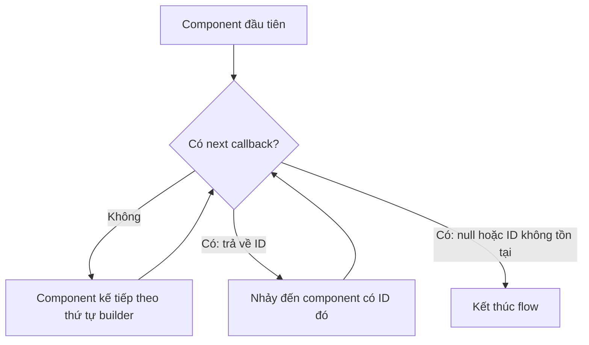
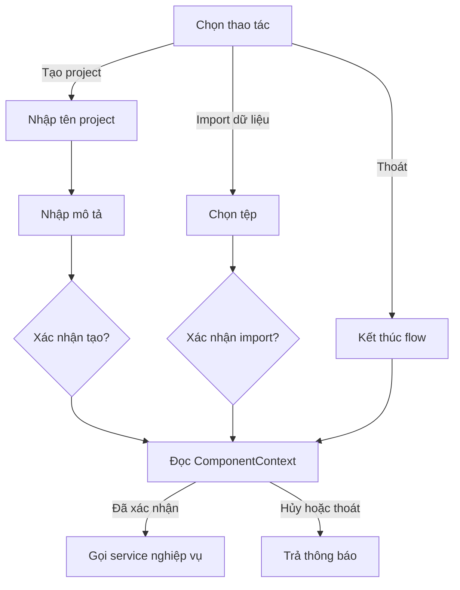

# Nhập nhiều bước bằng ComponentFlow trên nhánh hỗ trợ

## 1. Bài toán nhập liệu nhiều bước

Một command CLI đôi khi cần nhiều thông tin trước khi thực hiện nghiệp vụ. Ví dụ, thao tác cấu hình project có thể cần tên, mô tả và xác nhận; thao tác import cần chọn tệp rồi xác nhận. Nếu gom tất cả vào một dòng lệnh, cú pháp sẽ dài và khó nhớ. Nếu tự viết nhiều vòng đọc input, code phải quản lý prompt, trạng thái, điều hướng, hủy và hiển thị lỗi.

Spring Shell cung cấp các UI component như `StringInput`, `PathInput`, `ConfirmationInput`, `SingleItemSelector` và `MultiItemSelector`. `ComponentFlow` kết nối các component thành một wizard có thứ tự và có thể rẽ nhánh theo kết quả của bước trước.

Bài này sử dụng API ổn định của Spring Shell 3.4.3 trong package `org.springframework.shell.component.flow`. Ví dụ thực hiện một wizard cấu hình project: người dùng chọn tạo mới, import dữ liệu hoặc thoát; mỗi lựa chọn dẫn đến một nhánh nhập liệu khác nhau.

## 2. ComponentFlow hoạt động như thế nào?

Mỗi component đảm nhiệm một tương tác cụ thể. Khi chạy, component nhận input, tạo context chứa kết quả và hiển thị trạng thái cuối. `ComponentFlow` ghép các lần chạy đó thành một luồng.

Các thành phần chính:

| Thành phần | Vai trò |
|---|---|
| `ComponentFlow.Builder` | Khai báo các component, ID, tên hiển thị, giá trị mặc định và điều hướng. |
| `ComponentFlow` | Wizard được tạo từ builder và thực thi bằng `run()`. |
| `ComponentFlow.ComponentFlowResult` | Kết quả trả về sau khi flow kết thúc. |
| `ComponentContext` | Context key/value chứa kết quả của các component. |
| `next(...)` | Chọn ID component tiếp theo hoặc dừng flow. |
| `storeResult(...)` | Quyết định có tự lưu kết quả vào context theo ID component hay không. |

Luồng thông thường đi theo thứ tự component được thêm vào builder. Khi một component khai báo `next(...)`, giá trị trả về sẽ quyết định bước tiếp theo. Nếu callback trả về `null` hoặc ID không tồn tại, flow dừng tại đó.

Điểm quan trọng là ID dùng trong `next(...)` phải trùng với ID truyền vào `withStringInput(...)`, `withPathInput(...)`, `withConfirmationInput(...)` hoặc selector tương ứng. Tên hiển thị trong `.name(...)` chỉ dành cho người dùng, không phải ID điều hướng.

## 3. Các component có thể đưa vào flow

Spring Shell 3.4.3 cung cấp các loại component thường dùng sau:

| Builder method | Dữ liệu nhận được | Trường hợp sử dụng |
|---|---|---|
| `withStringInput(id)` | `String` | Tên, mô tả, mã định danh hoặc ghi chú. |
| `withPathInput(id)` | `Path` | Chọn đường dẫn tệp hoặc thư mục. |
| `withConfirmationInput(id)` | `Boolean` | Xác nhận trước thao tác có side effect. |
| `withSingleItemSelector(id)` | Một giá trị được chọn | Chọn một thao tác, môi trường hoặc loại cấu hình. |
| `withMultiItemSelector(id)` | Nhiều giá trị được chọn | Chọn nhiều module, tính năng hoặc tệp. |

Ví dụ một flow tuyến tính có thể hỏi tên project, thư mục đích rồi xác nhận:

~~~java
ComponentFlow flow = componentFlowBuilder.clone().reset()
        .withStringInput("project-name")
            .name("Tên project")
            .and()
        .withPathInput("target-directory")
            .name("Thư mục đích")
            .and()
        .withConfirmationInput("confirm")
            .name("Tạo project với thông tin trên?")
            .defaultValue(false)
            .and()
        .build();

ComponentFlow.ComponentFlowResult result = flow.run();
~~~

Mỗi `with...Input(id)` trả về một spec builder. Gọi `.and()` để quay lại `ComponentFlow.Builder` và khai báo component tiếp theo. Sau khi khai báo xong, `.build()` tạo flow và `.run()` bắt đầu tương tác.

## 4. Đăng ký ComponentFlow.Builder trong ứng dụng

Trong Spring Shell 3.4.3, auto-configuration cung cấp `ComponentFlow.Builder` để inject vào bean. Tài liệu chính thức sử dụng builder được inject, sau đó gọi `clone().reset()` trước khi tạo flow.

~~~java
import org.springframework.shell.component.flow.ComponentFlow;
import org.springframework.shell.standard.ShellComponent;
import org.springframework.shell.standard.ShellMethod;

@ShellComponent
public class SetupCommands {

    private final ComponentFlow.Builder componentFlowBuilder;

    public SetupCommands(ComponentFlow.Builder componentFlowBuilder) {
        this.componentFlowBuilder = componentFlowBuilder;
    }

    @ShellMethod(key = "setup demo", value = "Chạy wizard cấu hình demo")
    public String setup() {
        ComponentFlow flow = componentFlowBuilder.clone().reset()
                .withStringInput("environment")
                    .name("Môi trường")
                    .defaultValue("dev")
                    .and()
                .withConfirmationInput("confirm")
                    .name("Áp dụng cấu hình?")
                    .defaultValue(false)
                    .and()
                .build();

        ComponentFlow.ComponentFlowResult result = flow.run();
        return "Đã thu thập cấu hình";
    }
}
~~~

Đây là ví dụ cấu trúc rút gọn; trong ứng dụng thật cần đọc `result.getContext()` và chỉ gọi service khi người dùng xác nhận. `clone().reset()` tạo builder mới cho lần chạy hiện tại, tránh để cấu hình của một lần gọi ảnh hưởng lần gọi tiếp theo.

## 5. Khai báo các bước và đọc kết quả

Mỗi component có một ID. Theo mặc định, component tự lưu kết quả vào `ComponentContext` bằng ID đó (`storeResult` mặc định là `true`). Sau khi flow kết thúc, lấy context từ `ComponentFlowResult` rồi đọc giá trị theo ID:

~~~java
ComponentFlow.ComponentFlowResult result = flow.run();
ComponentContext<?> values = result.getContext();

String environment = values.get("environment", String.class);
Boolean confirmed = values.get("confirm", Boolean.class);
~~~

Với `PathInput`, kiểu kết quả là `Path`:

~~~java
Path target = values.get("target-directory", Path.class);
~~~

Có thể kiểm tra một nhánh đã chạy hay chưa bằng `containsKey(...)`:

~~~java
if (values.containsKey("environment")) {
    // Nhánh có bước nhập environment đã được thực hiện.
}
~~~

Không nên giả định tất cả key đều tồn tại. Với flow có rẽ nhánh, các component thuộc nhánh không được chọn sẽ không chạy và vì vậy không có kết quả tương ứng trong context.

## 6. Rẽ nhánh bằng next callback

Một selector có thể trả về ID của bước cần chạy tiếp. Ví dụ, người dùng chọn một trong ba hành động:

- Tạo project: chuyển đến `project-name`.
- Import dữ liệu: chuyển đến `import-path`.
- Thoát: kết thúc flow.

Khai báo selector:

~~~java
import java.util.List;
import org.springframework.shell.component.flow.SelectItem;

builder.withSingleItemSelector("operation")
        .name("Bạn muốn thực hiện thao tác nào?")
        .selectItems(List.of(
                SelectItem.of("Tạo project", "project-name"),
                SelectItem.of("Import dữ liệu", "import-path"),
                SelectItem.of("Thoát", "exit")))
        .next(context -> context.getValue()
                .filter(value -> !"exit".equals(value))
                .orElse(null))
        .and();
~~~

`SingleItemSelectorContext.getValue()` trả về `Optional<String>`. Trong ví dụ, giá trị được chọn chính là ID của component tiếp theo. Giá trị `exit` được chuyển thành `null`, nên flow kết thúc ngay sau selector.

Nếu muốn đọc đối tượng lựa chọn đầy đủ, dùng `context.getResultItem()`. API này trả về `Optional` của item đã chọn; có thể lấy giá trị bằng `getResultItem().map(item -> item.getItem())`.

## 7. Sơ đồ wizard có hai nhánh

Ví dụ tổng hợp dưới đây tạo hai nhánh độc lập. Nhánh tạo project hỏi tên, mô tả và xác nhận. Nhánh import hỏi tệp dữ liệu và xác nhận. Chỉ sau khi flow kết thúc, command mới gọi service nghiệp vụ.

## 8. Ví dụ hoàn chỉnh: wizard tạo project hoặc import tệp

Ví dụ sau dùng Spring Shell 3.4.3 với legacy command annotation để tập trung vào `ComponentFlow`. `ProjectService` và `ImportService` là service nghiệp vụ của ứng dụng; chúng cần được đăng ký thành Spring bean.

~~~java
package com.example.cli.commands;

import java.nio.file.Files;
import java.nio.file.Path;
import java.util.List;

import org.springframework.shell.component.context.ComponentContext;
import org.springframework.shell.component.flow.ComponentFlow;
import org.springframework.shell.component.flow.SelectItem;
import org.springframework.shell.component.support.AbstractTextComponent.TextComponentContext.MessageLevel;
import org.springframework.shell.context.ShellContext;
import org.springframework.shell.standard.ShellComponent;
import org.springframework.shell.standard.ShellMethod;

@ShellComponent
public class ProjectWizardCommands {

    private final ComponentFlow.Builder componentFlowBuilder;
    private final ShellContext shellContext;
    private final ProjectService projectService;
    private final ImportService importService;

    public ProjectWizardCommands(
            ComponentFlow.Builder componentFlowBuilder,
            ShellContext shellContext,
            ProjectService projectService,
            ImportService importService) {
        this.componentFlowBuilder = componentFlowBuilder;
        this.shellContext = shellContext;
        this.projectService = projectService;
        this.importService = importService;
    }

    @ShellMethod(key = "project wizard", value = "Cấu hình project qua nhiều bước")
    public String runWizard() {
        if (!shellContext.hasPty()) {
            return "Wizard cần terminal tương tác. Hãy chạy trong REPL.";
        }

        ComponentFlow flow = componentFlowBuilder.clone().reset()
                .withSingleItemSelector("operation")
                    .name("Bạn muốn thực hiện thao tác nào?")
                    .selectItems(List.of(
                            SelectItem.of("Tạo project", "project-name"),
                            SelectItem.of("Import dữ liệu", "import-path"),
                            SelectItem.of("Thoát", "exit")))
                    .next(context -> context.getValue()
                            .filter(value -> !"exit".equals(value))
                            .orElse(null))
                    .and()

                .withStringInput("project-name")
                    .name("Tên project")
                    .next(context -> {
                        String name = context.getResultValue();
                        if (name == null || name.isBlank()) {
                            context.setMessage(
                                    "Tên project không được để trống",
                                    MessageLevel.ERROR);
                            return "project-name";
                        }
                        return "project-description";
                    })
                    .and()

                .withStringInput("project-description")
                    .name("Mô tả project")
                    .defaultValue("")
                    .next(context -> "confirm-create")
                    .and()

                .withConfirmationInput("confirm-create")
                    .name("Tạo project với thông tin trên?")
                    .defaultValue(false)
                    .next(context -> null)
                    .and()

                .withPathInput("import-path")
                    .name("Chọn tệp cần import")
                    .next(context -> {
                        Path path = context.getResultValue();
                        if (path == null || !Files.isRegularFile(path)
                                || !Files.isReadable(path)) {
                            context.setMessage(
                                    "Tệp không tồn tại hoặc không đọc được",
                                    MessageLevel.ERROR);
                            return "import-path";
                        }
                        return "confirm-import";
                    })
                    .and()

                .withConfirmationInput("confirm-import")
                    .name("Import tệp này?")
                    .defaultValue(false)
                    .next(context -> null)
                    .and()
                .build();

        ComponentFlow.ComponentFlowResult flowResult = flow.run();
        ComponentContext<?> values = flowResult.getContext();

        if (values.containsKey("project-name")) {
            Boolean confirmed = values.get("confirm-create", Boolean.class);
            if (!Boolean.TRUE.equals(confirmed)) {
                return "Đã hủy thao tác tạo project";
            }

            String name = values.get("project-name", String.class).trim();
            String description = values.get("project-description", String.class);
            projectService.create(name, description == null ? "" : description.trim());
            return "Đã tạo project " + name;
        }

        if (values.containsKey("import-path")) {
            Boolean confirmed = values.get("confirm-import", Boolean.class);
            if (!Boolean.TRUE.equals(confirmed)) {
                return "Đã hủy thao tác import";
            }

            Path path = values.get("import-path", Path.class);
            importService.importFrom(path);
            return "Đã import dữ liệu từ " + path;
        }

        return "Đã thoát wizard";
    }
}
~~~

Các điểm cần quan sát:

1. `ShellContext.hasPty()` kiểm tra shell có terminal PTY thật hay không. Nếu command chạy trong CI hoặc input/output bị redirect, wizard trả thông báo thay vì chờ input.
2. Selector trả về ID của bước đầu tiên thuộc nhánh được chọn. Nhánh còn lại không chạy.
3. `project-name` kiểm tra tên ngay sau khi người dùng nhập. Nếu rỗng, callback đặt thông báo lỗi và trả lại chính ID `project-name` để hỏi lại.
4. `import-path` xác nhận tệp tồn tại, là tệp thường và đọc được trước khi chuyển đến bước xác nhận.
5. Các bước xác nhận mặc định là `false`. Người dùng phải chọn đồng ý thì service mới được gọi.
6. `ComponentContext` chỉ có kết quả của những bước đã chạy. Command kiểm tra `containsKey(...)` để nhận biết nhánh.

Trong dự án thật, `ProjectService.create(...)` và `ImportService.importFrom(...)` phải tự kiểm tra quy tắc nghiệp vụ lần cuối. Validation ở wizard cải thiện trải nghiệm nhập liệu; service vẫn là nơi bảo vệ tính đúng đắn của nghiệp vụ.

## 9. Hiểu thứ tự mặc định và điều hướng tường minh

Nếu không khai báo `next(...)`, flow đi tới component tiếp theo theo thứ tự builder. Điều này tiện cho form tuyến tính:

~~~java
builder.withStringInput("first")
        .name("Bước 1")
        .and()
    .withStringInput("second")
        .name("Bước 2")
        .and()
    .withConfirmationInput("finish")
        .name("Hoàn tất?")
        .and();
~~~

Khi có nhánh, nên khai báo `next(...)` tường minh cho những bước quan trọng. Một component có thể nhảy qua nhiều component hoặc quay lại một component trước đó. Nếu trả về ID không tồn tại, flow dừng; điều này có thể dùng làm lối thoát nhưng cần ghi rõ ý nghĩa trong code.

Không phụ thuộc vào thứ tự ngầm khi một flow có nhiều nhánh. Khi thêm component mới, thứ tự builder có thể thay đổi đường đi mặc định. Việc khai báo `next(...)` làm ý định điều hướng rõ ràng hơn.

## 10. Lưu kết quả và kiểm soát ResultMode

Mỗi input spec có `storeResult(boolean)`. Mặc định là `true`, nghĩa là kết quả component được lưu vào `ComponentContext` bằng ID đã khai báo. Nếu đặt `storeResult(false)`, component vẫn chạy nhưng không tự ghi kết quả vào context. Khi đó cần xử lý kết quả bằng handler hoặc context riêng.

`resultValue(...)` và `resultMode(...)` hữu ích khi ứng dụng đã có một giá trị đề xuất:

| ResultMode | Hành vi |
|---|---|
| `VERIFY` | Hiển thị giá trị như mặc định để người dùng kiểm tra hoặc thay đổi. |
| `ACCEPT` | Tự chấp nhận `resultValue`, bỏ qua tương tác của component. |

Ví dụ:

~~~java
import org.springframework.shell.component.flow.ResultMode;

builder.withStringInput("region")
        .name("Region")
        .resultValue("ap-southeast-1")
        .resultMode(ResultMode.VERIFY)
        .and();
~~~

Khi cần người dùng xác nhận một giá trị đã tính sẵn, `VERIFY` thường phù hợp. Chỉ dùng `ACCEPT` khi ứng dụng thực sự muốn bỏ qua bước hỏi người dùng.

## 11. Dùng preHandler và postHandler đúng mục đích

Các spec có `preHandler(...)` và `postHandler(...)`:

- `preHandler` chạy trước khi component bắt đầu tương tác, phù hợp chuẩn bị dữ liệu hoặc thay đổi context ban đầu.
- `postHandler` chạy sau khi component hoàn tất, phù hợp ghi nhận kết quả, bổ sung metadata hoặc thực hiện xử lý nhẹ.

Ví dụ gắn handler để ghi nhận giá trị đã nhập:

~~~java
builder.withStringInput("project-name")
        .name("Tên project")
        .postHandler(context -> {
            String value = context.getResultValue();
            if (value != null) {
                context.put("normalized-name", value.trim());
            }
        })
        .and();
~~~

`postHandler` không thay thế logic điều hướng. Nếu cần kiểm tra dữ liệu và hỏi lại, dùng `next(...)` để quay lại component hoặc kiểm tra kết quả sau `flow.run()` trước khi gọi service.

Không đặt thao tác ghi dữ liệu quan trọng vào handler chỉ vì nó chạy sau một bước nhập. Hãy giữ side effect nghiệp vụ ở nơi có thể kiểm tra đầy đủ kết quả của flow và trạng thái xác nhận cuối cùng.

## 12. Xử lý hủy và xác nhận trước side effect

Wizard nhiều bước thường thu thập dữ liệu trước khi thực hiện thay đổi. Nên tách hai giai đoạn:

1. Thu thập và xác thực dữ liệu trong flow.
2. Sau khi flow kết thúc, kiểm tra kết quả xác nhận rồi mới gọi service.

Ví dụ với thao tác xóa hoặc import:

- Không xóa tệp ngay sau khi người dùng chọn đường dẫn.
- Không import dữ liệu ngay sau khi chọn file.
- Không tạo project ngay sau khi nhập tên.
- Chỉ gọi service khi kết quả xác nhận là `Boolean.TRUE`.

Nếu người dùng chọn không đồng ý, command trả thông báo hủy và không thực hiện mutation. Nếu họ chọn Thoát ở selector đầu tiên, flow kết thúc mà không có key dữ liệu của các nhánh.

Với tác vụ có nhiều side effect, nên tạo một request object từ kết quả flow, validate request rồi gọi một service method duy nhất. Cách này giúp dễ đặt transaction và kiểm thử hơn.

## 13. ComponentFlow cần terminal tương tác

`ComponentFlow` là UI wizard cho người dùng tương tác. Nó cần terminal có khả năng nhận phím và render giao diện. Khi chạy trong script hoặc CI không có PTY, không nên gọi flow rồi chờ người dùng.

Trong Spring Shell 3.4.x, interactive runner cần được bật nếu ứng dụng mặc định chạy non-interactive. Có thể bật trong `application.properties`:

~~~properties
spring.shell.interactive.enabled=true
~~~

Khi chạy ứng dụng trong môi trường automation, truyền dữ liệu qua option/argument hoặc tạo command non-interactive riêng. Ví dụ `project create --name demo --description "Demo project"` có thể gọi cùng service với wizard mà không cần prompt.

Nếu muốn command hỗ trợ cả hai trường hợp, kiểm tra `ShellContext.hasPty()` trước khi chạy flow. Đừng chỉ kiểm tra `Terminal` có tồn tại: một terminal có thể được kết nối với pipe hoặc môi trường CI mà không có người dùng tương tác.

## 14. Kiểm thử flow bằng ShellTestClient

Spring Shell 3.4.3 cung cấp `ShellTestClient` với `interactive()` để mô phỏng phiên REPL. `InteractiveShellSession` có `write(...)`, `writeSequence()` và `screen()` để gửi input, tạo chuỗi phím và đọc màn hình.

Ví dụ khởi động phiên interactive:

~~~java
import org.junit.jupiter.api.Test;
import org.springframework.beans.factory.annotation.Autowired;
import org.springframework.shell.test.ShellTestClient;
import org.springframework.shell.test.ShellTestClient.InteractiveShellSession;
import org.springframework.shell.test.autoconfigure.ShellTest;

@ShellTest
class ProjectWizardTests {

    @Autowired
    private ShellTestClient shellTestClient;

    @Test
    void wizardCanBeStarted() {
        InteractiveShellSession session = shellTestClient
                .interactive()
                .run();

        session.write(session.writeSequence()
                .text("project wizard")
                .carriageReturn()
                .build());

        // Chờ màn hình cập nhật rồi kiểm tra prompt của selector.
        // Dùng Awaitility trong test để tránh giả định cập nhật là đồng bộ.
    }
}
~~~

Để kiểm thử đầy đủ một nhánh, gửi lần lượt phím chọn, giá trị nhập và phím xác nhận bằng `writeSequence()`. Selector có thể cần phím lên/xuống trước Enter tùy item mặc định và cấu hình giao diện. Dùng `ShellAssertions.assertThat(session.screen())` để kiểm tra nội dung màn hình sau khi chờ output ổn định.

Nên mock `ProjectService` và `ImportService` rồi xác nhận:

| Kịch bản | Kết quả cần kiểm tra |
|---|---|
| Chọn tạo project và xác nhận | `projectService.create(...)` được gọi đúng một lần. |
| Chọn tạo project nhưng từ chối | Service không được gọi. |
| Tên project để trống | Wizard yêu cầu nhập lại, service chưa được gọi. |
| Chọn import và tệp hợp lệ | `importService.importFrom(...)` chỉ được gọi sau xác nhận. |
| Chọn import nhưng đường dẫn sai | Wizard yêu cầu chọn lại tệp. |
| Từ chối import | Service không được gọi. |
| Chọn Thoát | Flow kết thúc, không gọi service. |
| Không có PTY | Command trả thông báo hướng dẫn, không bắt đầu wizard. |

`ShellTestClient` mô phỏng terminal nhưng không thay thế hoàn toàn terminal emulator thật. Với selector nhiều phím hoặc giao diện tùy biến, nên có thêm smoke test trên terminal thực tế.

## 15. Lỗi thường gặp khi xây ComponentFlow

**ID trong `next(...)` không khớp:** flow dừng sớm vì ID trả về không tồn tại. So sánh chuỗi trong callback với ID của `with...Input(...)`.

**Dùng `.name(...)` làm ID:** `.name(...)` chỉ là nhãn hiển thị. Dùng ID truyền vào `withStringInput`, `withPathInput` hoặc selector.

**Quên `.and()`:** builder chưa quay về `ComponentFlow.Builder`, khiến chuỗi khai báo tiếp theo không đúng API. Gọi `.and()` sau mỗi spec.

**Dùng chung builder đã bị thay đổi:** cấu hình flow cũ có thể ảnh hưởng lần chạy tiếp theo. Dùng `componentFlowBuilder.clone().reset()` cho mỗi lần tạo wizard.

**Đọc kết quả của nhánh chưa chạy:** context không chứa key của component bị bỏ qua. Kiểm tra `containsKey(...)` trước khi gọi `get(...)`.

**Không kiểm tra kết quả xác nhận:** service có thể thực hiện thao tác dù người dùng đã từ chối. Chỉ tiếp tục khi giá trị xác nhận là `Boolean.TRUE`.

**Để command prompt trong CI:** flow chờ input vô hạn hoặc thất bại vì terminal không có PTY. Kiểm tra `ShellContext.hasPty()` và cung cấp command nhận option cho automation.

**Đưa side effect vào từng bước nhập:** nếu người dùng thoát ở bước sau, dữ liệu đã bị thay đổi một phần. Thu thập, xác thực, xác nhận rồi mới gọi service.

**Dùng nhầm package giữa 3.4 và 4.x:** API ComponentFlow được chuyển package trong Spring Shell 4.0.3. Cập nhật import theo đúng major version.

## 16. Khác biệt package trong Spring Shell 4.x

Các ví dụ trong bài nhắm đến Spring Shell 3.4.3. Khi chuyển lên Spring Shell 4.0.x, ComponentFlow vẫn tồn tại nhưng package đã được chuyển sang nhánh JLine TUI:

| Spring Shell 3.4.x | Spring Shell 4.0.x |
|---|---|
| `org.springframework.shell.component.flow.ComponentFlow` | `org.springframework.shell.jline.tui.component.flow.ComponentFlow` |
| `org.springframework.shell.component.flow.StringInputSpec` | `org.springframework.shell.jline.tui.component.flow.StringInputSpec` |
| `org.springframework.shell.component.context.ComponentContext` | `org.springframework.shell.jline.tui.component.context.ComponentContext` |
| `org.springframework.shell.component.PathInput` | `org.springframework.shell.jline.tui.component.PathInput` |

Đừng trộn import của hai major version trong cùng một ví dụ. Khi nâng cấp, dùng API docs của đúng phiên bản và kiểm tra dependency cung cấp JLine/TUI component. Phần logic về flow, component ID, `next(...)` và context vẫn là mô hình cần giữ lại, nhưng package và một số API xung quanh có thể thay đổi.

## 17. Quy trình xây một wizard có nhánh

1. Liệt kê các thao tác người dùng có thể chọn ở bước đầu.
2. Gán một ID riêng cho mỗi bước nhập liệu.
3. Vẽ sơ đồ nhánh trước khi viết builder.
4. Khai báo selector đầu tiên và trả về ID của nhánh được chọn.
5. Thêm các component theo từng nhánh; dùng `next(...)` để nối hoặc kết thúc nhánh.
6. Thêm bước xác nhận cuối cho mỗi thao tác có side effect.
7. Chạy flow và lấy `ComponentFlowResult.getContext()`.
8. Kiểm tra key của nhánh đã chạy, validate toàn bộ dữ liệu và xác nhận.
9. Gọi service nghiệp vụ sau khi xác nhận thành công.
10. Kiểm thử từng nhánh, đường thoát, input sai và môi trường không có PTY.

## 18. Checklist trước khi đưa wizard vào ứng dụng

- [ ] Đã xác định phiên bản Spring Shell mục tiêu và dùng đúng package.
- [ ] Mỗi component có ID duy nhất, ổn định.
- [ ] Tên hiển thị không bị nhầm với ID điều hướng.
- [ ] Các nhánh trong `next(...)` trả về đúng ID hoặc `null` để dừng.
- [ ] Đã dùng `clone().reset()` khi tạo flow cho từng lần gọi.
- [ ] Kết quả cần dùng được lưu vào `ComponentContext`.
- [ ] Đã kiểm tra `containsKey(...)` trước khi đọc kết quả của nhánh.
- [ ] Input bắt buộc được xác thực; đường dẫn được kiểm tra trước khi xử lý.
- [ ] Mỗi thao tác có side effect đều có bước xác nhận.
- [ ] Service chỉ được gọi sau khi flow kết thúc và xác nhận thành công.
- [ ] Command có kiểm tra PTY hoặc có phương án non-interactive.
- [ ] Đã kiểm thử từng nhánh bằng `ShellTestClient`.
- [ ] Đã kiểm tra hành vi trên terminal thực tế.

## Kết luận

`ComponentFlow` giúp tổ chức nhiều bước nhập liệu thành một wizard có thứ tự và có nhánh. Trong Spring Shell 3.4.3, inject `ComponentFlow.Builder`, tạo flow bằng `clone().reset()`, thêm component bằng `with...Input(id)` rồi nối các bước qua `.and()`. Dùng `next(...)` để chọn ID tiếp theo; trả về `null` hoặc ID không tồn tại để dừng. Sau `run()`, đọc `ComponentFlowResult.getContext()` và chỉ gọi service khi dữ liệu hợp lệ, nhánh phù hợp đã hoàn tất và người dùng xác nhận. Với script hoặc CI không có PTY, cung cấp command non-interactive thay vì chờ wizard.

## Tài liệu tham khảo

- [Spring Shell 3.4.3 – Flow](https://docs.spring.io/spring-shell/reference/3.4/components/flow/index.html)
- [Spring Shell 3.4.3 – Flow Components](https://docs.spring.io/spring-shell/reference/3.4/components/ui/)
- [Spring Shell 3.4.3 API – ComponentFlow.Builder](https://docs.spring.io/spring-shell/reference/3.4/api/java/org/springframework/shell/component/flow/ComponentFlow.Builder.html)
- [Spring Shell 3.4.3 API – StringInputSpec](https://docs.spring.io/spring-shell/reference/3.4/api/java/org/springframework/shell/component/flow/StringInputSpec.html)
- [Spring Shell 3.4.3 API – SingleItemSelectorSpec](https://docs.spring.io/spring-shell/reference/3.4/api/java/org/springframework/shell/component/flow/SingleItemSelectorSpec.html)
- [Spring Shell 3.4.3 API – ConfirmationInputSpec](https://docs.spring.io/spring-shell/reference/3.4/api/java/org/springframework/shell/component/flow/ConfirmationInputSpec.html)
- [Spring Shell 3.4.3 API – ComponentContext](https://docs.spring.io/spring-shell/reference/3.4/api/java/org/springframework/shell/component/context/ComponentContext.html)
- [Spring Shell 3.4.3 API – PathInput.PathInputContext](https://docs.spring.io/spring-shell/reference/3.4/api/java/org/springframework/shell/component/PathInput.PathInputContext.html)
- [Spring Shell 3.4.3 API – ConfirmationInput.ConfirmationInputContext](https://docs.spring.io/spring-shell/reference/3.4/api/java/org/springframework/shell/component/ConfirmationInput.ConfirmationInputContext.html)
- [Spring Shell 3.4.3 API – ShellContext](https://docs.spring.io/spring-shell/reference/3.4/api/java/org/springframework/shell/context/ShellContext.html)
- [Spring Shell 3.4.3 – Testing Basics](https://docs.spring.io/spring-shell/reference/3.4/testing/basics.html)
- [Spring Shell 3.4.3 – Test Terminal Settings](https://docs.spring.io/spring-shell/reference/3.4/testing/settings.html)
- [Spring Shell 4.0.3 API – ComponentFlow](https://docs.spring.io/spring-shell/reference/api/org/springframework/shell/jline/tui/component/flow/ComponentFlow.html)
- [Spring Shell 4.0.3 API – ComponentFlow package](https://docs.spring.io/spring-shell/reference/api/org/springframework/shell/jline/tui/component/flow/package-summary.html)
