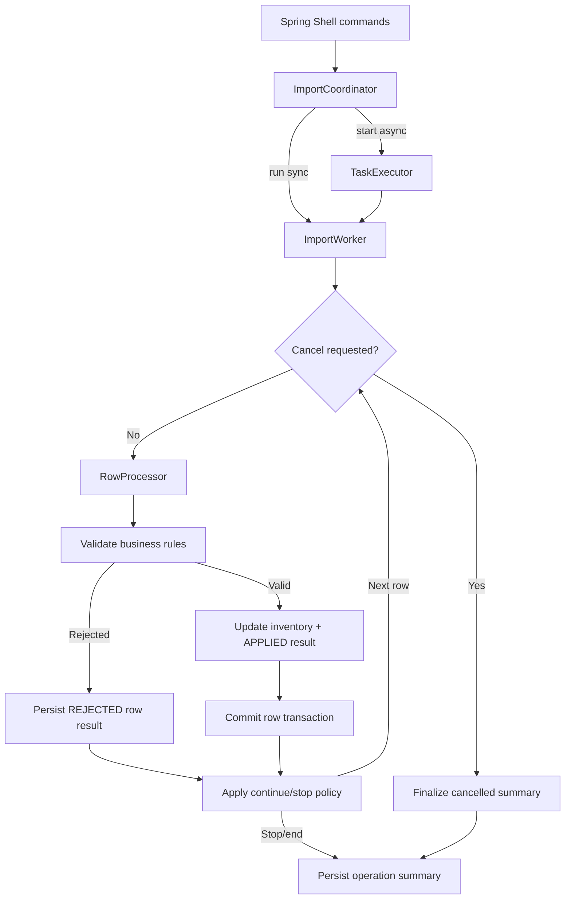

# Xử lý lỗi nghiệp vụ, hủy thao tác và cập nhật một phần

Trong thực tế, một command có thể xử lý hàng trăm hoặc hàng nghìn dòng dữ liệu. Một dòng sai không nhất thiết phải làm mất kết quả hợp lệ đã ghi trước đó; người vận hành cũng cần biết tiến độ và có cách yêu cầu dừng một tác vụ dài. Bài thực hành này xây dựng CLI nhập dữ liệu tồn kho từ CSV, phân biệt lỗi nghiệp vụ với lỗi kỹ thuật, cho phép tiếp tục hoặc dừng khi gặp lỗi, hủy tác vụ an toàn và báo cáo phần đã cập nhật.

Ta dùng Spring Shell 3.x với mô hình annotation legacy (`@ShellComponent`, `@ShellMethod`, `@ShellOption`) để tập trung vào luồng nghiệp vụ. Spring Shell 4 đã loại bỏ các annotation legacy này; khi dùng 4.x cần chuyển command sang `@Command`, `@Option` và API tương ứng. Các nguyên tắc transaction, operation state và cancellation vẫn áp dụng.

## Mục tiêu và tình huống thực hành

Một nhân viên vận hành chạy lệnh nhập tồn kho từ file CSV. Mỗi dòng chứa mã SKU, đơn giá và số lượng mới. Một số dòng có thể sai vì mã SKU không tồn tại, sản phẩm đã ngừng kinh doanh, đơn giá âm hoặc số lượng âm. Trong lúc chạy, người dùng cần xem tiến độ hoặc yêu cầu dừng.

Sau bài thực hành, ứng dụng có các khả năng:

- Khởi chạy một operation nhập dữ liệu và nhận `operation-id` để tra cứu.
- Chọn chính sách `continue` hoặc `stop` khi gặp lỗi của từng dòng.
- Phân biệt lỗi nghiệp vụ có thể dự đoán với lỗi kỹ thuật bất ngờ.
- Commit từng dòng hợp lệ trong transaction riêng để các dòng trước không bị rollback bởi dòng sau.
- Ghi kết quả từng dòng cùng transaction với thay đổi tồn kho.
- Cho phép gửi yêu cầu hủy và dừng tại ranh giới giữa hai dòng.
- Báo cáo số dòng đã đọc, thành công, bị từ chối, lỗi và bị bỏ qua.
- Cung cấp chế độ chạy đồng bộ phù hợp cho script/CI.

### Hợp đồng command

| Command | Mục đích | Ví dụ |
|---|---|---|
| `inventory-import-start` | Khởi chạy tác vụ nền trong REPL | `inventory-import-start --file data/stock.csv --on-error continue` |
| `inventory-import-run` | Chạy đồng bộ, đợi tới khi hoàn tất | `inventory-import-run --file data/stock.csv --on-error stop` |
| `inventory-import-status` | Xem trạng thái và số liệu operation | `inventory-import-status --operation-id op-123` |
| `inventory-import-cancel` | Yêu cầu hủy operation đang chạy | `inventory-import-cancel --operation-id op-123` |
| `inventory-import-results` | Xem kết quả theo từng dòng | `inventory-import-results --operation-id op-123` |

`start` phù hợp với người dùng đang ở REPL vì command trả về nhanh để họ có thể gọi `status` hoặc `cancel`. `run` phù hợp với script và CI vì process đợi tới khi có summary cuối cùng. Nếu chạy `run` trực tiếp trong REPL, phiên shell đang bận trong lúc xử lý nên người dùng không thể nhập command `cancel` ở cùng phiên đó.

## Chuẩn bị dữ liệu CSV

Tạo file `data/stock.csv`:

```csv
sku,unit_price,quantity
SKU-001,125000,10
SKU-002,-500,4
SKU-404,80000,2
SKU-003,95000,0
SKU-004,72000,-3
```

Giả sử database có `SKU-001`, `SKU-002`, `SKU-003`, `SKU-004`; `SKU-404` không tồn tại. Quy tắc nghiệp vụ:

1. `sku` bắt buộc và phải trỏ tới một sản phẩm đang hoạt động.
2. `unit_price` phải lớn hơn hoặc bằng 0.
3. `quantity` phải lớn hơn hoặc bằng 0.
4. Một dòng vi phạm quy tắc bị đánh dấu `REJECTED` và không thay đổi sản phẩm.
5. Lỗi kết nối database hoặc lỗi lập trình được ghi là lỗi kỹ thuật (`FAILED`), không biến thành lỗi validation.

Với dữ liệu mẫu, `SKU-001` và `SKU-003` có thể được cập nhật; `SKU-002`, `SKU-404` và `SKU-004` bị từ chối. Kết quả cuối cùng phụ thuộc chính sách `continue` hay `stop`.

## Kiến trúc xử lý

Tách command adapter, điều phối operation, worker và transaction xử lý từng dòng:



Operation và kết quả từng dòng cần được lưu bền vững trong database. Không chỉ giữ tiến độ trong biến của worker, vì người dùng cần tra cứu sau khi command kết thúc và ứng dụng có thể bị restart.

### Trạng thái operation và trạng thái dòng

Operation có thể dùng các trạng thái:

| Trạng thái | Ý nghĩa |
|---|---|
| `QUEUED` | Đã nhận yêu cầu, chờ worker |
| `RUNNING` | Worker đang xử lý |
| `CANCEL_REQUESTED` | Người vận hành đã yêu cầu dừng; worker sẽ kiểm tra ở ranh giới an toàn |
| `COMPLETED` | Tất cả dòng cần xử lý đã hoàn tất và không có lỗi |
| `PARTIAL` | Một phần dòng đã cập nhật, một phần bị từ chối/lỗi hoặc bị bỏ qua do policy stop |
| `CANCELLED` | Đã dừng theo yêu cầu và chưa có dòng nào được áp dụng |
| `CANCELLED_PARTIAL` | Đã dừng theo yêu cầu sau khi một hoặc nhiều dòng đã commit |
| `FAILED` | Operation không thể tiếp tục do lỗi kỹ thuật nghiêm trọng |

Mỗi dòng có một kết quả độc lập:

| Trạng thái dòng | Ý nghĩa |
|---|---|
| `APPLIED` | Thay đổi tồn kho đã commit |
| `REJECTED` | Dữ liệu hoặc quy tắc nghiệp vụ không hợp lệ |
| `FAILED` | Lỗi kỹ thuật làm transaction của dòng rollback |
| `SKIPPED` | Chưa xử lý vì policy `stop` hoặc operation đã bị hủy |

`CANCELLED_PARTIAL` vẫn là trạng thái hủy, không phải thất bại toàn bộ. Summary cần cho biết rõ bao nhiêu dòng đã commit trước khi dừng.

Quy tắc finalize nên thống nhất:

- `COMPLETED`: tất cả dòng hợp lệ đã được áp dụng, không có dòng bị từ chối hoặc bỏ qua.
- `PARTIAL`: operation đã xử lý ít nhất một dòng nhưng có dòng bị `REJECTED`, `FAILED` hoặc `SKIPPED`; trạng thái này vẫn phù hợp khi chưa có dòng nào `APPLIED` nhưng file có các kết quả nghiệp vụ bị từ chối.
- `FAILED`: operation không thể bắt đầu hoặc gặp lỗi kỹ thuật nghiêm trọng trước khi có kết quả dòng nào được ghi nhận.
- `CANCELLED`/`CANCELLED_PARTIAL`: yêu cầu hủy đã được chấp nhận; phân biệt theo số dòng `APPLIED`.

Nếu lỗi kỹ thuật xảy ra sau khi đã có dòng commit, giữ các thay đổi đó và finalize thành `PARTIAL`. Không gán `FAILED` toàn bộ rồi khiến người vận hành hiểu nhầm rằng không có dữ liệu nào đã thay đổi.

## Thiết kế lưu trữ để hỗ trợ cập nhật một phần

Tối thiểu cần hai nhóm dữ liệu:

**Import operation** lưu `operation_id`, file name hoặc file checksum, policy, trạng thái, thời điểm bắt đầu/kết thúc và actor đã yêu cầu chạy.

**Import row result** lưu `operation_id`, `row_number`, SKU, trạng thái, error code, thông báo đã lọc và thời điểm xử lý. Tạo unique constraint trên `(operation_id, row_number)` để cùng một dòng không được áp dụng hai lần khi worker phục hồi hoặc nhận lại task.

Ví dụ schema rút gọn:

```sql
CREATE TABLE inventory_import_operation (
    operation_id   VARCHAR(80) PRIMARY KEY,
    file_name      VARCHAR(255) NOT NULL,
    file_sha256    VARCHAR(64) NOT NULL,
    error_policy   VARCHAR(16) NOT NULL,
    status         VARCHAR(32) NOT NULL,
    requested_by   VARCHAR(120) NOT NULL,
    created_at     TIMESTAMP NOT NULL,
    finished_at    TIMESTAMP
);

CREATE TABLE inventory_import_row_result (
    operation_id  VARCHAR(80) NOT NULL,
    row_number    INTEGER NOT NULL,
    sku           VARCHAR(80),
    status        VARCHAR(16) NOT NULL,
    error_code    VARCHAR(80),
    message       VARCHAR(500),
    processed_at  TIMESTAMP NOT NULL,
    PRIMARY KEY (operation_id, row_number)
);
```

Đây là schema minh họa; kiểu dữ liệu timestamp và khóa ngoại cần điều chỉnh theo database. File checksum giúp xác nhận file không bị thay đổi nếu operation được phục hồi sau restart. Không lưu nội dung dòng CSV nhạy cảm nếu chỉ cần SKU và mã lỗi để đối soát.

## Phân biệt lỗi nghiệp vụ và lỗi kỹ thuật

Lỗi nghiệp vụ là kết quả dự đoán được khi kiểm tra dữ liệu hoặc trạng thái miền. Ví dụ: SKU không tồn tại, sản phẩm đã ngừng bán, giá âm hoặc số lượng không hợp lệ. Những lỗi này nên trở thành `REJECTED` với error code ổn định.

Lỗi kỹ thuật là sự cố hạ tầng hoặc lỗi không dự kiến: database timeout, mất kết nối, lỗi serialization, file không đọc được giữa chừng hoặc bug. Những lỗi này nên được ghi là `FAILED`, giữ exception trong log kỹ thuật đã lọc dữ liệu và áp dụng chính sách dừng/tiếp tục phù hợp.

| Tình huống | Phân loại | Xử lý |
|---|---|---|
| SKU không tồn tại | Nghiệp vụ | `REJECTED / SKU_NOT_FOUND` |
| Giá âm | Nghiệp vụ | `REJECTED / PRICE_MUST_BE_NON_NEGATIVE` |
| Sản phẩm đã ngừng kinh doanh | Nghiệp vụ | `REJECTED / PRODUCT_INACTIVE` |
| Trùng mã SKU trong cùng file nếu policy không cho phép | Nghiệp vụ | `REJECTED / DUPLICATE_SKU` |
| Database timeout | Kỹ thuật | Rollback dòng hiện tại, ghi `FAILED` nếu có thể |
| Không đọc được file | Kỹ thuật | Operation `FAILED` hoặc `PARTIAL` nếu đã xử lý một phần |
| `NullPointerException` do bug | Kỹ thuật | Log stack trace, dừng hoặc chuyển manual review |

Không bắt mọi `RuntimeException` rồi ghi thành `REJECTED`. Làm vậy che giấu lỗi hệ thống và khiến người vận hành tưởng dữ liệu đầu vào sai.

## Chọn transaction boundary cho từng dòng

Nếu đặt một transaction lớn bao quanh toàn bộ file, một lỗi ở dòng cuối có thể rollback tất cả dòng trước đó. Bài thực hành chọn một transaction cho mỗi dòng:

1. Đọc một dòng và kiểm tra định dạng cơ bản.
2. Mở transaction của dòng.
3. Kiểm tra quy tắc nghiệp vụ.
4. Nếu hợp lệ, cập nhật sản phẩm và lưu kết quả `APPLIED`.
5. Nếu không hợp lệ, lưu kết quả `REJECTED` mà không cập nhật sản phẩm.
6. Commit transaction của dòng.
7. Sang dòng tiếp theo.

Điều quan trọng là thay đổi tồn kho và bản ghi `APPLIED` phải commit trong cùng transaction. Nếu update sản phẩm thành công nhưng ghi row result thất bại, transaction rollback cả hai. Nhờ vậy operation ledger không báo `APPLIED` khi thay đổi chưa được lưu, và không mất checkpoint khi mutation đã commit.

Spring hỗ trợ `Propagation.REQUIRES_NEW` để mỗi lần gọi tạo transaction vật lý độc lập với transaction bên ngoài. Dùng một bean `RowProcessor` riêng và gọi qua Spring proxy; không tự gọi method `@Transactional` khác trong cùng object vì self-invocation không đi qua proxy transaction mặc định.

### Ví dụ RowProcessor

```java
import org.springframework.stereotype.Service;
import org.springframework.transaction.annotation.Propagation;
import org.springframework.transaction.annotation.Transactional;

@Service
class InventoryRowProcessor {

    private final InventoryRepository inventoryRepository;
    private final ImportRowResultRepository resultRepository;
    private final InventoryRowValidator validator;

    InventoryRowProcessor(
            InventoryRepository inventoryRepository,
            ImportRowResultRepository resultRepository,
            InventoryRowValidator validator) {
        this.inventoryRepository = inventoryRepository;
        this.resultRepository = resultRepository;
        this.validator = validator;
    }

    @Transactional(propagation = Propagation.REQUIRES_NEW)
    public RowOutcome apply(String operationId, InventoryRow row) {
        var existing = resultRepository.findByOperationIdAndRowNumber(
                operationId, row.rowNumber());
        if (existing.isPresent()) {
            return RowOutcome.from(existing.get());
        }

        try {
            validator.validate(row);
            InventoryItem item = inventoryRepository.findBySku(row.sku())
                    .orElseThrow(() -> new BusinessRuleException(
                            "SKU_NOT_FOUND", "Không tìm thấy SKU."));

            if (!item.isActive()) {
                throw new BusinessRuleException(
                        "PRODUCT_INACTIVE", "Sản phẩm đã ngừng kinh doanh.");
            }

            item.updateStock(row.unitPrice(), row.quantity());
            inventoryRepository.save(item);

            return RowOutcome.from(resultRepository.save(ImportRowResult.applied(
                    operationId, row.rowNumber(), row.sku())));
        } catch (BusinessRuleException ex) {
            return RowOutcome.from(resultRepository.save(ImportRowResult.rejected(
                    operationId, row.rowNumber(), row.sku(),
                    ex.code(), ex.safeMessage())));
        }
    }
}
```

`InventoryRowValidator`, `InventoryRepository`, `ImportRowResultRepository`, `InventoryItem` và `ImportRowResult` là các thành phần miền cần triển khai trong project. `BusinessRuleException` chỉ chứa mã lỗi và thông báo an toàn dành cho người dùng. Lỗi kỹ thuật không bị bắt ở đây nên transaction rollback và worker có thể ghi nhận thất bại bằng một transaction khác.

Validation phải hoàn tất trước khi thay đổi entity. Phương thức `updateStock()` nên kiểm tra toàn bộ precondition trước khi gán field để không thể ném `BusinessRuleException` sau khi đã sửa một phần object trong persistence context.

Việc kiểm tra row result trước khi áp dụng giúp worker không cập nhật lại cùng một dòng khi phục hồi operation. Unique constraint `(operation_id, row_number)` vẫn cần thiết để bảo vệ trước race condition; kiểm tra `find` đơn thuần không thay thế constraint.

## Chính sách continue và stop

Chính sách `continue` xử lý tất cả dòng có thể đọc được khi gặp lỗi nghiệp vụ như validation hoặc SKU không hợp lệ. Dòng sai được đánh dấu `REJECTED`, worker tiếp tục dòng sau. Kết quả cuối là `PARTIAL` nếu có dòng bị từ chối. Lỗi kỹ thuật bất ngờ dừng worker theo mặc định; chỉ retry lỗi kỹ thuật đã phân loại là transient với số lần thử và deadline giới hạn.

Chính sách `stop` dừng ở dòng đầu tiên có kết quả `REJECTED`. Các dòng chưa xử lý được ghi `SKIPPED` hoặc được biểu diễn rõ bằng phạm vi chưa xử lý trong operation summary. Không được đánh dấu những dòng chưa chạy thành `REJECTED` vì chúng chưa được validation.

| Chính sách | Khi gặp lỗi dòng | Các dòng sau |
|---|---|---|
| `continue` | Ghi `REJECTED` rồi tiếp tục | Tiếp tục xử lý |
| `stop` | Ghi `REJECTED` rồi dừng | Đánh dấu `SKIPPED` |

Chỉ chấp nhận hai giá trị `continue` và `stop`; từ chối giá trị khác trước khi tạo operation. Không tự mặc định một chuỗi bất kỳ thành `continue`.

## Hủy operation tại ranh giới an toàn

Hủy operation là một yêu cầu điều phối, không phải lệnh rollback toàn bộ những dòng đã commit. Command `inventory-import-cancel` chỉ cập nhật trạng thái operation thành `CANCEL_REQUESTED`. Worker kiểm tra cờ này trước khi bắt đầu dòng tiếp theo.

Quy ước hủy:

- Nếu worker chưa bắt đầu dòng tiếp theo, nó dừng ngay.
- Nếu worker đang xử lý một dòng, transaction của dòng hiện tại được phép hoàn tất hoặc rollback.
- Sau khi dòng hiện tại kết thúc, worker kiểm tra lại cờ hủy và không bắt đầu dòng tiếp theo.
- Các dòng đã `APPLIED` vẫn được giữ nguyên.
- Operation kết thúc `CANCELLED` hoặc `CANCELLED_PARTIAL` tùy số dòng đã commit.

Không gọi `Thread.stop()` hoặc hủy cưỡng bức transaction đang ghi database. Hủy hợp tác tại ranh giới giữa các dòng giúp dữ liệu không bị dừng ở trạng thái cập nhật nửa chừng.

### State transition

```text
QUEUED --> RUNNING --> COMPLETED
   |          |
   |          +------> PARTIAL
   |          |
   |          +------> FAILED
   |          |
   +----------+------> CANCEL_REQUESTED --> CANCELLED
                                      |
                                      +----> CANCELLED_PARTIAL
```

Chuyển trạng thái phải được thực hiện bằng update có điều kiện để không ghi đè trạng thái terminal. Lệnh cancel cập nhật `QUEUED` hoặc `RUNNING` thành `CANCEL_REQUESTED`; nếu operation đã terminal, yêu cầu hủy bị từ chối hoặc trả thông báo operation đã kết thúc. `tryMarkRunning()` chỉ đổi `QUEUED` thành `RUNNING`. `claimNextRowUnlessCancelled()` dùng cùng cơ chế khóa/CAS để cấp quyền bắt đầu dòng kế tiếp nếu state vẫn là `RUNNING`. Như vậy, cancel xảy ra sau khi row đã được claim sẽ chờ row đó hoàn tất, còn cancel xảy ra trước claim sẽ ngăn worker bắt đầu row mới.

### Worker kiểm tra hủy giữa các dòng

```java
@Service
class InventoryImportWorker {

    private final ImportOperationRepository operationRepository;
    private final InventoryRowProcessor rowProcessor;
    private final ImportResultRecorder resultRecorder;
    private final CsvInventoryReader csvReader;

    InventoryImportWorker(
            ImportOperationRepository operationRepository,
            InventoryRowProcessor rowProcessor,
            ImportResultRecorder resultRecorder,
            CsvInventoryReader csvReader) {
        this.operationRepository = operationRepository;
        this.rowProcessor = rowProcessor;
        this.resultRecorder = resultRecorder;
        this.csvReader = csvReader;
    }

    public void execute(String operationId, ImportRequest request) {
        if (!operationRepository.tryMarkRunning(operationId)) {
            if (operationRepository.isCancelRequested(operationId)) {
                operationRepository.finishCancelledBeforeStart(operationId);
            }
            return;
        }
        boolean stoppedByPolicy = false;
        boolean cancelled = false;
        boolean technicalFailure = false;

        try (var rows = csvReader.read(request.file())) {
            var iterator = rows.iterator();
            while (iterator.hasNext()) {
                if (!operationRepository.claimNextRowUnlessCancelled(operationId)) {
                    cancelled = true;
                    break;
                }

                InventoryRow row = iterator.next();
                RowOutcome outcome;
                try {
                    outcome = rowProcessor.apply(operationId, row);
                } catch (RuntimeException ex) {
                    resultRecorder.recordTechnicalFailure(
                            operationId, row.rowNumber(), row.sku(), ex);
                    resultRecorder.markRemainingSkipped(
                            operationId, row.rowNumber() + 1);
                    technicalFailure = true;
                    break;
                }

                if (request.errorPolicy() == ErrorPolicy.STOP
                        && outcome.isRejected()) {
                    stoppedByPolicy = true;
                    resultRecorder.markRemainingSkipped(
                            operationId, row.rowNumber() + 1);
                    break;
                }
            }

            ImportSummary summary = resultRecorder.summarize(operationId);
            operationRepository.finishFromCurrentState(
                    operationId, summary, cancelled, stoppedByPolicy, technicalFailure);
        } catch (Exception ex) {
            operationRepository.markFatalFailure(operationId, ex);
        }
    }
}
```

Đây là skeleton điều phối; phần đọc CSV, lưu operation và xử lý lỗi cần hoàn thiện theo schema thật. `recordTechnicalFailure` phải ghi bằng transaction riêng sau khi transaction dòng rollback. Trong ví dụ này, lỗi kỹ thuật dừng worker; `--on-error continue|stop` điều khiển lỗi nghiệp vụ của từng dòng. Chỉ retry lỗi kỹ thuật đã được phân loại là transient, có giới hạn lần thử và deadline. Nếu database đang mất kết nối và không thể lưu row result, ghi log kỹ thuật với operation ID và để operation ở trạng thái cần đối soát; không giả vờ rằng checkpoint đã được lưu.

`tryMarkRunning()` chỉ chuyển `QUEUED` sang `RUNNING`; nếu cancel đã chuyển operation sang `CANCEL_REQUESTED` khi task còn trong queue, worker kết thúc mà không đọc dòng nào. `claimNextRowUnlessCancelled()` phải khóa/cập nhật operation atomically để chỉ cấp quyền bắt đầu dòng mới khi state vẫn là `RUNNING`. Nếu cancel xảy ra sau khi row đã được claim, dòng đó được xem là dòng hiện tại và được phép hoàn tất/rollback. `finishFromCurrentState()` cũng phải đọc state và ghi trạng thái cuối trong cùng transaction để không ghi đè một yêu cầu cancel đến sát thời điểm kết thúc.

`markFatalFailure()` ở nhánh catch ngoài cùng cần tính lại summary trước khi chọn trạng thái cuối: dùng `FAILED` nếu chưa có kết quả dòng nào được ghi, hoặc `PARTIAL` nếu đã có dòng commit/kết quả trước khi lỗi đọc file hay lỗi hệ thống xảy ra.

## Tạo TaskExecutor cho operation nền

Để người dùng có thể gọi `status` và `cancel` trong khi import đang chạy, command `start` gửi công việc tới `TaskExecutor` có giới hạn số thread và queue:

```java
import org.springframework.context.annotation.Bean;
import org.springframework.context.annotation.Configuration;
import org.springframework.scheduling.concurrent.ThreadPoolTaskExecutor;

@Configuration
class ImportTaskConfiguration {

    @Bean("importTaskExecutor")
    ThreadPoolTaskExecutor importTaskExecutor() {
        ThreadPoolTaskExecutor executor = new ThreadPoolTaskExecutor();
        executor.setCorePoolSize(2);
        executor.setMaxPoolSize(4);
        executor.setQueueCapacity(20);
        executor.setThreadNamePrefix("inventory-import-");
        executor.setWaitForTasksToCompleteOnShutdown(true);
        executor.setAwaitTerminationSeconds(30);
        return executor;
    }
}
```

Pool và queue ở đây chỉ là ví dụ cho một CLI nội bộ; chọn giới hạn theo thời gian xử lý, connection pool và số operation đồng thời. Không dùng queue vô hạn. Khi ứng dụng đóng, executor có thời gian chờ hữu hạn; operation chưa hoàn tất cần được đối soát khi process khởi động lại.

`TaskExecutor` là abstraction nhận `Runnable`; `ThreadPoolTaskExecutor` cung cấp cấu hình core/max pool và queue. Không cần `@EnableAsync` nếu coordinator gọi trực tiếp `taskExecutor.execute(...)`; `@EnableAsync` chỉ cần khi dùng cơ chế proxy `@Async`.

## Coordinator: tạo operation và gửi worker

Coordinator lưu operation trước rồi mới submit task. Nếu executor từ chối task vì queue đầy hoặc đang shutdown, cập nhật operation thành `FAILED`/`REJECTED` thay vì để lại record `QUEUED` vô thời hạn.

```java
import org.springframework.beans.factory.annotation.Qualifier;
import org.springframework.core.task.TaskExecutor;
import org.springframework.core.task.TaskRejectedException;
import org.springframework.stereotype.Service;

@Service
class InventoryImportCoordinator {

    private final ImportOperationRepository operationRepository;
    private final InventoryImportWorker worker;
    private final TaskExecutor taskExecutor;

    InventoryImportCoordinator(
            ImportOperationRepository operationRepository,
            InventoryImportWorker worker,
            @Qualifier("importTaskExecutor") TaskExecutor taskExecutor) {
        this.operationRepository = operationRepository;
        this.worker = worker;
        this.taskExecutor = taskExecutor;
    }

    String start(ImportRequest request, String requestedBy) {
        ImportOperation operation = operationRepository.create(request, requestedBy);
        try {
            taskExecutor.execute(() -> worker.execute(operation.id(), request));
            return operation.id();
        } catch (TaskRejectedException ex) {
            operationRepository.markSubmissionFailed(operation.id());
            throw new ImportSubmissionException(
                    "Không thể xếp operation vào hàng đợi. Hãy thử lại sau.", ex);
        }
    }

    ImportSummary run(ImportRequest request, String requestedBy) {
        ImportOperation operation = operationRepository.create(request, requestedBy);
        worker.execute(operation.id(), request);
        return operationRepository.getSummary(operation.id());
    }
}
```

`ImportOperationRepository` phải tạo ID duy nhất, lưu checksum file và policy. `ImportSubmissionException` là lỗi kỹ thuật dành cho command adapter. Không trả stack trace hoặc đường dẫn nội bộ nhạy cảm cho người dùng; log chi tiết ở tầng vận hành.

## Tạo command Spring Shell

Các command sau dùng annotation legacy của Spring Shell 3.x:

```java
import org.springframework.shell.standard.ShellComponent;
import org.springframework.shell.standard.ShellMethod;
import org.springframework.shell.standard.ShellOption;

@ShellComponent
class InventoryImportCommands {

    private final InventoryImportCoordinator coordinator;
    private final ImportOperationService operationService;

    InventoryImportCommands(
            InventoryImportCoordinator coordinator,
            ImportOperationService operationService) {
        this.coordinator = coordinator;
        this.operationService = operationService;
    }

    @ShellMethod(
            key = "inventory-import-start",
            value = "Khởi chạy nhập tồn kho ở chế độ nền.")
    public String start(
            @ShellOption(value = {"--file"}, help = "Đường dẫn file CSV.") String file,
            @ShellOption(value = {"--on-error"}, defaultValue = "continue",
                    help = "Chính sách khi gặp lỗi: continue hoặc stop.") String onError) {
        ImportRequest request = ImportRequest.from(file, onError);
        String operationId = coordinator.start(request, currentActor());
        return "Đã nhận operation " + operationId
                + ". Dùng inventory-import-status --operation-id " + operationId;
    }

    @ShellMethod(
            key = "inventory-import-run",
            value = "Chạy nhập tồn kho đồng bộ và chờ kết quả.")
    public String run(
            @ShellOption(value = {"--file"}, help = "Đường dẫn file CSV.") String file,
            @ShellOption(value = {"--on-error"}, defaultValue = "continue",
                    help = "Chính sách khi gặp lỗi: continue hoặc stop.") String onError) {
        ImportRequest request = ImportRequest.from(file, onError);
        return operationService.format(coordinator.run(request, currentActor()));
    }

    @ShellMethod(
            key = "inventory-import-status",
            value = "Xem trạng thái một operation nhập tồn kho.")
    public String status(
            @ShellOption(value = {"--operation-id"}) String operationId) {
        return operationService.format(operationService.getSummary(operationId));
    }

    @ShellMethod(
            key = "inventory-import-cancel",
            value = "Yêu cầu dừng operation nhập tồn kho.")
    public String cancel(
            @ShellOption(value = {"--operation-id"}) String operationId) {
        return operationService.requestCancel(operationId)
                ? "Đã gửi yêu cầu hủy " + operationId
                : "Operation đã kết thúc hoặc không thể hủy: " + operationId;
    }

    @ShellMethod(
            key = "inventory-import-results",
            value = "Xem kết quả từng dòng của operation.")
    public String results(
            @ShellOption(value = {"--operation-id"}) String operationId) {
        return operationService.formatRows(operationId);
    }

    private String currentActor() {
        // Lấy actor từ cơ chế xác thực của ứng dụng; không nhận actor tùy ý từ command.
        return "operator-from-security-context";
    }
}
```

`currentActor()` là chỗ tích hợp với cơ chế xác thực thực tế; chuỗi minh họa không phải danh tính dùng trong production. Command adapter không trực tiếp sửa database hay quyết định transaction boundary. Nó chuyển input đã parse sang coordinator/service và trình bày kết quả.

`ImportRequest.from()` phải parse policy thành enum và validate file trước khi tạo operation:

```java
import java.util.Locale;

enum ErrorPolicy {
    CONTINUE, STOP;

    static ErrorPolicy parse(String value) {
        try {
            return ErrorPolicy.valueOf(value.trim().toUpperCase(Locale.ROOT));
        } catch (IllegalArgumentException ex) {
            throw new IllegalArgumentException(
                    "--on-error chỉ nhận continue hoặc stop.");
        }
    }
}
```

Kiểm tra file tồn tại, là regular file, đọc được, có giới hạn kích thước và nằm trong thư mục import được phép. Chuẩn hóa đường dẫn để tránh path traversal nếu người dùng không được phép đọc mọi file trên máy.

## Hiển thị summary và kết quả từng dòng

Ví dụ summary khi dùng `continue`:

```text
Operation: op-123
Status: PARTIAL
File: stock.csv
Read: 5
Applied: 2
Rejected: 3
Failed: 0
Skipped: 0
Duration: 1.42s
```

Ví dụ bảng kết quả:

| Dòng | SKU | Status | Error code |
|---:|---|---|---|
| 2 | SKU-001 | APPLIED | — |
| 3 | SKU-002 | REJECTED | PRICE_MUST_BE_NON_NEGATIVE |
| 4 | SKU-404 | REJECTED | SKU_NOT_FOUND |
| 5 | SKU-003 | APPLIED | — |
| 6 | SKU-004 | REJECTED | QUANTITY_MUST_BE_NON_NEGATIVE |

Không đưa stack trace vào bảng kết quả người dùng. Error code ổn định giúp script hoặc hệ thống hỗ trợ phân loại lỗi; thông báo ngắn giải thích cách sửa dữ liệu. Stack trace và thông tin kết nối chỉ nằm trong log đã được lọc secret.

## Hành vi theo từng kịch bản

### Kịch bản A: continue

```text
inventory-import-run --file data/stock.csv --on-error continue
```

Worker xử lý mọi dòng. Dòng hợp lệ được commit; dòng không hợp lệ lưu `REJECTED`. Operation kết thúc `PARTIAL` vì có cả kết quả thành công và bị từ chối. Không rollback các dòng đã `APPLIED`.

### Kịch bản B: stop

```text
inventory-import-run --file data/stock.csv --on-error stop
```

Worker dừng sau lỗi đầu tiên. Với dữ liệu mẫu, dòng 2 được áp dụng, dòng 3 bị từ chối và các dòng còn lại được đánh dấu `SKIPPED`. Operation kết thúc `PARTIAL` vì đã có cập nhật trước khi dừng.

### Kịch bản C: hủy operation đang chạy

Trong REPL:

```text
inventory-import-start --file data/large-stock.csv --on-error continue
inventory-import-status --operation-id op-123
inventory-import-cancel --operation-id op-123
inventory-import-status --operation-id op-123
inventory-import-results --operation-id op-123
```

Worker hoàn tất transaction của dòng hiện tại rồi dừng trước dòng tiếp theo. Nếu đã có dòng commit, trạng thái cuối là `CANCELLED_PARTIAL`; nếu chưa có dòng nào commit, là `CANCELLED`.

Không dùng `Ctrl+C` làm cơ chế hủy duy nhất cho operation chạy nền. Khi `start` đã trả về, worker là tác vụ riêng; `Ctrl+C` có thể chỉ ngắt thao tác nhập của shell. Dùng command cancel để gửi yêu cầu có trạng thái và có thể audit.

### Kịch bản D: lỗi kỹ thuật giữa operation

Giả sử dòng 4 gặp database timeout. Transaction của dòng 4 rollback; worker ghi `FAILED` nếu database còn hoạt động để lưu kết quả. Với policy `continue`, dòng sau có thể tiếp tục nếu lỗi được phân loại là tạm thời và chính sách retry cho phép. Với policy `stop`, worker dừng và đánh dấu các dòng còn lại `SKIPPED`.

Không retry vô hạn. Nếu retry một dòng, dùng cùng operation ID và row number; kiểm tra row result hiện có trước khi áp dụng lại. Nếu không thể xác định transaction trước đã commit hay chưa, chuyển operation sang trạng thái cần đối soát thay vì đoán.

## Kiểm thử tích hợp

Test cần chứng minh transaction boundary, policy và cancellation behavior. Chỉ mock repository sẽ không chứng minh được row mutation và row result thực sự commit/rollback cùng nhau.

| Kịch bản test | Điều cần xác nhận |
|---|---|
| Tất cả dòng hợp lệ | Tất cả `APPLIED`, operation `COMPLETED` |
| Một dòng sai nghiệp vụ, policy continue | Dòng sai `REJECTED`; các dòng sau vẫn xử lý |
| Một dòng sai nghiệp vụ, policy stop | Dòng sai `REJECTED`; dòng sau `SKIPPED` |
| Lỗi kỹ thuật trong một dòng | Transaction dòng đó rollback; dòng trước đã commit vẫn còn |
| Lưu row result thất bại sau update | Cả update sản phẩm và row result rollback cùng transaction |
| Yêu cầu cancel trước dòng đầu | Không có dòng nào được áp dụng; operation `CANCELLED` |
| Yêu cầu cancel trong khi dòng đang chạy | Dòng hiện tại hoàn tất/rollback; dòng kế tiếp không bắt đầu |
| Cancel sau khi operation terminal | Yêu cầu bị từ chối hoặc báo đã kết thúc |
| Cùng operation/row được xử lý lại | Unique key và row result ngăn áp dụng trùng |
| Executor queue đầy | Operation không bị treo ở `QUEUED` vô thời hạn |
| File bị thay đổi trước khi resume | Checksum không khớp; yêu cầu đối soát hoặc tạo operation mới |
| Người dùng không có quyền hủy operation | Request bị từ chối và không thay đổi state |

### Kiểm thử transaction cho từng dòng

Dùng database test thực tế hoặc Testcontainers để xác minh:

1. Gọi `rowProcessor.apply()` với dòng hợp lệ và kiểm tra sản phẩm cùng row result được commit.
2. Gọi với dòng sai nghiệp vụ và kiểm tra row result `REJECTED`, sản phẩm không đổi.
3. Mô phỏng lỗi kỹ thuật sau khi thay đổi entity nhưng trước khi lưu row result; xác nhận cả hai thay đổi rollback.
4. Gọi lại cùng `operationId` và `rowNumber`; xác nhận không cập nhật lần hai.

Đảm bảo test gọi `InventoryRowProcessor` qua Spring bean/proxy để `@Transactional(REQUIRES_NEW)` thực sự được áp dụng. Không tạo object bằng `new` rồi mong đợi transaction annotation hoạt động.

### Kiểm thử command bằng ShellTestClient

Với Spring Shell 3.x, `@ShellTest` và `ShellTestClient` giúp kiểm tra command adapter mà không cần mở terminal thật:

```java
import static org.assertj.core.api.Assertions.assertThat;
import static org.mockito.ArgumentMatchers.any;
import static org.mockito.ArgumentMatchers.anyString;
import static org.mockito.Mockito.when;

import org.junit.jupiter.api.BeforeEach;
import org.junit.jupiter.api.Test;
import org.springframework.beans.factory.annotation.Autowired;
import org.springframework.boot.test.mock.mockito.MockBean;
import org.springframework.shell.test.ShellTestClient;
import org.springframework.shell.test.autoconfigure.ShellTest;

@ShellTest
class InventoryImportCommandTests {

    @Autowired
    ShellTestClient client;

    @MockBean
    InventoryImportCoordinator coordinator;

    @MockBean
    ImportOperationService operationService;

    @BeforeEach
    void setUp() {
        when(coordinator.start(any(ImportRequest.class), anyString()))
                .thenReturn("op-123");
    }

    @Test
    void startCommandReturnsOperationId() {
        var session = client.nonInterative("inventory-import-start",
                "--file", "data/stock.csv",
                "--on-error", "continue").run();

        assertThat(session.screen().lines())
                .anyMatch(line -> line.contains("Đã nhận operation"));
        assertThat(session.screen().lines())
                .anyMatch(line -> line.contains("inventory-import-status"));
    }
}
```

Trong Spring Shell 3.4.2 trở lên, method được đổi tên thành `nonInteractive(...)`; các minor version trước đó dùng tên `nonInterative(...)` (chính tả API cũ). Mock coordinator hoặc dùng test fixture riêng để test command adapter không khởi chạy worker thật. Dùng integration test riêng để kiểm tra executor, transaction và database.

## Xử lý shutdown và phục hồi sau restart

`TaskExecutor` trong process CLI không phải durable job queue. Nếu process bị kill, máy mất điện hoặc container bị xóa, task đang chạy có thể dừng giữa hai dòng. Vì vậy:

- Lưu operation và row result trong database, không chỉ giữ trong heap.
- Ghi row result `APPLIED` cùng transaction với thay đổi tồn kho.
- Khi khởi động lại, tìm operation còn `RUNNING` hoặc `CANCEL_REQUESTED` quá thời hạn và đánh dấu cần đối soát.
- Chỉ tiếp tục khi file checksum khớp và row result cho biết rõ dòng nào đã commit.
- Nếu tác vụ cần chạy xuyên restart hoặc nhiều instance, dùng durable queue/job scheduler thay vì executor trong CLI process.

Khi đóng ứng dụng, executor có thể chờ một khoảng thời gian hữu hạn. Nếu worker chưa hoàn tất sau deadline, process vẫn có thể bị dừng. Không tuyên bố graceful shutdown bảo đảm mọi operation hoàn tất; hãy có quy trình phục hồi dựa trên operation ledger.

## Bảo mật và vận hành

- Chỉ người có quyền phù hợp mới được xem kết quả hoặc hủy operation.
- Kiểm tra quyền truy cập file và thư mục import; không cho phép path traversal.
- Giới hạn dung lượng file, số dòng và số operation đồng thời.
- Không ghi toàn bộ CSV, dữ liệu cá nhân hoặc secret vào log.
- Ghi actor, operation ID, file checksum, policy và thời điểm hủy vào audit record.
- Không để thông báo nghiệp vụ chứa SQL, stack trace hoặc chi tiết hạ tầng.
- Không cho phép cancel một operation terminal hoặc operation thuộc actor/tenant khác nếu policy không cho phép.
- Đặt retention cho operation và row result; giữ đủ lâu cho đối soát và audit.

## Lỗi thường gặp

| Biểu hiện | Nguyên nhân có thể | Cách xử lý |
|---|---|---|
| Một dòng lỗi làm rollback toàn file | Một transaction bao quanh toàn bộ batch | Tách transaction theo dòng hoặc theo batch nhỏ có chủ đích |
| Dòng bị từ chối nhưng không có kết quả | Exception nghiệp vụ thoát khỏi transaction mà không ghi row result | Bắt business exception và lưu `REJECTED` trong transaction dòng |
| Lỗi database bị ghi thành validation | Catch mọi exception và coi là lỗi nghiệp vụ | Phân loại business exception và technical exception riêng |
| Cancel nhưng worker vẫn cập nhật nhiều dòng | Chỉ kiểm tra cờ hủy ở đầu operation | Kiểm tra giữa các dòng và trước khi finalize |
| Cancel làm mất các dòng đã commit | Cố rollback transaction lớn hoặc xóa kết quả cũ | Hủy hợp tác; giữ nguyên row transaction đã commit |
| Hai worker áp dụng cùng dòng | Thiếu unique constraint/claim operation | Unique key theo operation/row và atomic claim |
| Operation hiển thị RUNNING sau khi process chết | Trạng thái chỉ được cập nhật trong memory | Persist operation ledger và có reconciliation khi restart |
| `@Transactional` không có tác dụng | Self-invocation hoặc object tạo bằng `new` | Gọi qua Spring proxy/bean riêng |
| Executor từ chối task nhưng operation vẫn QUEUED | Không xử lý `TaskRejectedException` | Đánh dấu submission failed và trả thông báo rõ |
| Command start trả về rồi process script thoát | Tác vụ nền gắn với vòng đời process CLI | Dùng command `run` đồng bộ cho script hoặc durable worker riêng |
| Ctrl+C không hủy operation nền | Interrupt shell không đồng nghĩa cancel worker | Dùng `inventory-import-cancel` |
| Kết quả file thay đổi khi phục hồi | Không lưu checksum/identity của input | Lưu SHA-256 và yêu cầu file khớp khi resume |

## Bài tập mở rộng

1. Thêm `--dry-run` để validation toàn bộ file nhưng không cập nhật tồn kho.
2. Thêm `--max-errors` để dừng khi số lỗi vượt ngưỡng.
3. Thêm command `inventory-import-export-errors` để xuất CSV các dòng `REJECTED`/`FAILED`.
4. Thêm retry có giới hạn cho lỗi transient, giữ nguyên operation ID và row number.
5. Thêm optimistic locking cho sản phẩm để tránh ghi đè thay đổi của người dùng khác trong lúc import.
6. Thêm command `inventory-import-reconcile` cho operation bị gián đoạn khi process dừng.
7. Thêm audit log cho actor gửi yêu cầu cancel và kết quả cuối cùng.
8. Viết test cạnh tranh khi hai operation cùng cập nhật một SKU.

## Tiêu chí hoàn thành

- [ ] Có thể chạy import bằng `inventory-import-start` trong REPL và nhận operation ID.
- [ ] Có thể chạy `inventory-import-run` đồng bộ cho script/CI.
- [ ] Chấp nhận `continue` và `stop`; từ chối policy không hợp lệ.
- [ ] Phân biệt lỗi nghiệp vụ (`REJECTED`) và lỗi kỹ thuật (`FAILED`).
- [ ] Mỗi dòng hợp lệ được commit độc lập; lỗi dòng sau không rollback dòng trước.
- [ ] Inventory update và row result `APPLIED` nằm trong cùng transaction.
- [ ] Có thể xem trạng thái, summary và kết quả từng dòng.
- [ ] Cancel dừng ở ranh giới an toàn; các dòng đã commit được giữ nguyên.
- [ ] Có test cho partial update, stop policy, cancellation, executor rejection và duplicate row processing.
- [ ] Có cơ chế đối soát operation còn dang dở sau restart.

## Tài liệu tham khảo

- [Spring Shell 3.3 — Legacy Annotation](https://docs.spring.io/spring-shell/reference/3.3/commands/registration/legacyannotation.html): đăng ký command bằng `@ShellComponent`, `@ShellMethod` và `@ShellOption`.
- [Spring Shell 3.4 — Options](https://docs.spring.io/spring-shell/reference/3.4/options/index.html): option, positional parameter và binding cho command method.
- [Spring Framework — Transaction Propagation](https://docs.spring.io/spring-framework/reference/data-access/transaction/declarative/tx-propagation.html): semantics của `REQUIRED`, `REQUIRES_NEW` và transaction độc lập.
- [Spring Framework 6.2 — Propagation API](https://docs.spring.io/spring-framework/docs/6.2.7/javadoc-api/org/springframework/transaction/annotation/Propagation.html): enum `Propagation` dùng trong `@Transactional`.
- [Spring Framework — Task Execution and Scheduling](https://docs.spring.io/spring-framework/reference/integration/scheduling.html): `TaskExecutor`, `ThreadPoolTaskExecutor`, cấu hình pool và lifecycle.
- [Spring Framework 6.2 — ThreadPoolTaskExecutor API](https://docs.spring.io/spring-framework/docs/6.2.5/javadoc-api/org/springframework/scheduling/concurrent/ThreadPoolTaskExecutor.html): core/max pool, queue capacity, task submission và monitoring.
- [Spring Framework — Transaction Management](https://docs.spring.io/spring-framework/reference/data-access/transaction.html): transaction abstraction và declarative transaction management.
