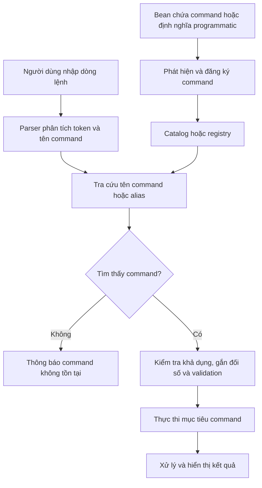

# Tra cứu lệnh trong catalog hoặc registry tương ứng phiên bản

Khi người dùng nhập một lệnh, Spring Shell cần xác định lệnh đó tương ứng với command nào đã được đăng ký trong ứng dụng. Việc tra cứu này diễn ra sau khi shell nhận và phân tích dòng lệnh, nhưng trước khi gọi logic xử lý. Command có thể được khai báo bằng annotation, tạo dưới dạng bean hoặc đăng ký động; Spring Shell tập hợp chúng vào cấu trúc quản lý command để parser và các thành phần khác sử dụng.

Tên cấu trúc quản lý này thay đổi theo phiên bản Spring Shell. Các dòng 2.x và 3.x sử dụng `CommandCatalog` cùng `CommandRegistration`. Tài liệu Spring Shell 4.0.x sử dụng `CommandRegistry` cùng `Command`. Khi đọc mã nguồn, viết extension hoặc nâng cấp dự án, cần xác định đúng phiên bản trước khi tìm class và method tương ứng.

## Catalog hoặc registry có vai trò gì?

Một command đã đăng ký thường mang theo nhiều thông tin hơn tên lệnh: mô tả hiển thị trong trợ giúp, alias, các đối số và tùy chọn, quy tắc chuyển đổi/validation, điều kiện khả dụng và mục tiêu thực thi. Catalog hoặc registry quản lý tập hợp command mà shell biết đến để các thành phần khác có thể tra cứu.

Không nên nhầm cấu trúc này với Spring `ApplicationContext` hoặc bean registry. Application context quản lý bean của ứng dụng. Spring Shell phát hiện hoặc nhận các bean/định nghĩa command, chuyển chúng thành biểu diễn command phù hợp với phiên bản, rồi đưa vào catalog hoặc registry. Khi người dùng nhập lệnh, parser làm việc với mô hình command của Spring Shell thay vì tự quét tất cả bean trong ứng dụng ở mỗi lần nhập.



Sơ đồ mô tả luồng khái niệm. Chi tiết parser, cấu trúc dữ liệu và tên API cụ thể phụ thuộc phiên bản. Điểm cốt lõi là command phải được đăng ký để shell có thể tìm thấy; sau khi tìm được command, shell mới tiếp tục xử lý đối số và thực thi.

## Xác định API theo phiên bản

| Dòng phiên bản | Cấu trúc quản lý command | Mô hình đăng ký thường gặp | Ghi chú |
|---|---|---|---|
| Spring Shell 2.1.x | `CommandCatalog` | `CommandRegistration`, annotation legacy `@ShellComponent` và `@ShellMethod` | Catalog quản lý các đăng ký và hỗ trợ đăng ký/hủy đăng ký động |
| Spring Shell 3.0.x–3.4.x | `CommandCatalog` | `CommandRegistration`; từ 3.1 có annotation model mới `@Command`, đồng thời còn mô hình legacy | Có thể khai báo `CommandRegistration` thành bean hoặc đăng ký trực tiếp với catalog |
| Spring Shell 4.0.x | `CommandRegistry` | `Command` bean hoặc phương thức `@Command` trong component | Registry giữ tập hợp command và hỗ trợ tra cứu theo tên, alias hoặc prefix |

Bảng này giúp định hướng khi đọc tài liệu, không thay thế việc kiểm tra phiên bản thực tế trong dự án. Khi dùng bản phát hành khác hoặc nhánh snapshot, hãy mở tài liệu API đúng phiên bản thay vì giả định một class tồn tại ở mọi major version.

### Spring Shell 2.1.x và 3.x: `CommandCatalog`

`CommandCatalog` là interface quản lý các `CommandRegistration`. Trong API của dòng 3.x, catalog có các thao tác chính:

- `register(...)`: thêm một hoặc nhiều `CommandRegistration`.
- `unregister(...)`: gỡ đăng ký theo tên command hoặc theo đối tượng registration.
- `getRegistrations()`: lấy map các registration theo tên command.

Map trả về từ `getRegistrations()` là bản sao. Thay đổi map này không đăng ký hoặc gỡ command khỏi catalog; hãy gọi `register()` hoặc `unregister()` để cập nhật catalog.

Ví dụ tạo một registration bằng API programmatic trong Spring Shell 3.x:

```java
import org.springframework.context.annotation.Bean;
import org.springframework.shell.command.CommandRegistration;

@Bean
CommandRegistration findCustomerCommand() {
    return CommandRegistration.builder()
            .command("customer-find")
            .withTarget()
                .function(context -> {
                    String id = context.getOptionValue("id");
                    return "Đang tra cứu khách hàng " + id;
                })
            .and()
            .withOption()
                .longNames("id")
            .and()
            .build();
}
```

Khi `CommandRegistration` được khai báo thành bean, cơ chế auto-configuration của Spring Shell đăng ký nó vào catalog. Nếu ứng dụng cần thêm hoặc gỡ command trong lúc chạy, có thể thao tác trực tiếp với `CommandCatalog`:

```java
catalog.register(registration);

CommandRegistration found = catalog.getRegistrations()
        .get("customer-find");

catalog.unregister("customer-find");
```

`found` là registration được tra cứu theo khóa tên command. Nếu khóa không tồn tại, kết quả là `null`; cần kiểm tra trước khi sử dụng. Đây là ví dụ về thao tác với catalog, giả định `catalog` và `registration` đã được cung cấp bởi cấu hình ứng dụng.

#### CommandResolver và CommandCatalogCustomizer

Khi tập command cần được xác định động, Spring Shell 3.x cung cấp `CommandResolver`. Một resolver trả về danh sách `CommandRegistration` cần được đưa vào quá trình phân giải command. Cách này hữu ích khi command phụ thuộc cấu hình hoặc trạng thái của ứng dụng.

```java
import java.util.List;
import org.springframework.shell.command.CommandRegistration;
import org.springframework.shell.command.CommandResolver;

class FeatureCommandResolver implements CommandResolver {

    private final List<CommandRegistration> registrations;

    FeatureCommandResolver(List<CommandRegistration> registrations) {
        this.registrations = registrations;
    }

    @Override
    public List<CommandRegistration> resolve() {
        return registrations;
    }
}
```

Đoạn mã minh họa hợp đồng của resolver; trong ứng dụng, danh sách có thể được tạo theo cấu hình hoặc trạng thái đã được chuẩn bị trước. Tài liệu Spring Shell lưu ý resolver được gọi mỗi khi command được phân giải. Nếu `resolve()` thực hiện truy vấn mạng, đọc dữ liệu chậm hoặc tính toán nặng, thao tác nhập lệnh có thể bị trễ. Hãy tránh công việc tốn thời gian trong resolver; có thể chuẩn bị/cập nhật dữ liệu trước, dùng cache có quy tắc làm mới rõ ràng hoặc đăng ký/hủy đăng ký khi trạng thái thay đổi.

`CommandCatalogCustomizer` cho phép tùy chỉnh catalog trong giai đoạn cấu hình, ví dụ thêm registration hoặc điều chỉnh tập command mặc định. Hãy dùng customizer cho thay đổi cấu hình tập trung lúc khởi tạo; dùng cơ chế đăng ký động khi tập command thực sự cần thay đổi trong thời gian chạy.

### Spring Shell 4.0.x: `CommandRegistry`

Trong tài liệu Spring Shell 4.0.x, `CommandRegistry` là class quản lý các `Command` mà shell biết đến. Theo API của dòng này, có thể:

- `getCommandByName(name)`: tìm command theo tên.
- `getCommandByAlias(name)`: tìm command theo alias.
- `getCommands()`: lấy tập command đã đăng ký.
- `getCommandsByPrefix(prefix)`: lấy các command có tên bắt đầu bằng prefix.
- `registerCommand(command)` và `unregisterCommand(command)`: đăng ký hoặc gỡ command.

Mặc định, Spring Shell nạp các command được định nghĩa trong application context vào registry. Vì thế, một lỗi component scan hoặc cấu hình đăng ký có thể khiến command không xuất hiện trong registry, dù phương thức command đã được viết trong mã nguồn.

Ví dụ tra cứu theo tên và alias trong Spring Shell 4.0.x:

```java
import org.springframework.shell.core.command.Command;
import org.springframework.shell.core.command.CommandRegistry;
import org.springframework.stereotype.Component;

@Component
class CustomerCommandLookup {

    private final CommandRegistry registry;

    CustomerCommandLookup(CommandRegistry registry) {
        this.registry = registry;
    }

    Command findByName(String name) {
        return registry.getCommandByName(name);
    }

    Command findByAlias(String alias) {
        return registry.getCommandByAlias(alias);
    }

    boolean exists(String name) {
        return registry.getCommandByName(name) != null;
    }
}
```

Các phương thức tra cứu có thể trả về `null` khi không có kết quả, do đó caller cần xử lý trường hợp không tìm thấy. Ví dụ này minh họa cách dùng API registry; trong phần lớn command thông thường, parser và shell runner đã thực hiện việc tra cứu khi xử lý dòng lệnh. Không cần tự viết một lớp lookup như vậy chỉ để gọi command thông thường.

Prefix lookup phục vụ những tình huống cần tìm danh sách ứng viên, chẳng hạn gợi ý hoặc hoàn thành lệnh:

```java
List<Command> candidates = registry.getCommandsByPrefix("customer-");
```

Kết quả có thể chứa nhiều command. Prefix lookup không có nghĩa là shell sẽ tự chọn và thực thi một lệnh bất kỳ trong số đó. Khi thực thi, cần phân giải đúng tên command hoặc alias theo quy tắc parser của phiên bản đang dùng.

## Từ dòng lệnh đến command được chọn

Giả sử ứng dụng đăng ký command `customer-find` với tùy chọn `--id`. Người dùng nhập:

```text
shell:>customer-find --id C1024
```

Quá trình xử lý có thể chia thành các bước:

1. **Đọc và phân tích dòng:** shell tách dòng thành tên command, tùy chọn và giá trị. Parser nhận diện phần tên cần dùng để tìm command.
2. **Tra cứu:** shell tìm registration hoặc command có tên khớp trong catalog/registry tương ứng phiên bản. Nếu có alias, alias được xử lý theo metadata đã đăng ký.
3. **Xác nhận command:** nếu không tìm thấy, shell trả thông báo command không tồn tại và không gọi target. Nếu tìm thấy, shell tiếp tục kiểm tra khả dụng và xử lý tham số.
4. **Gắn đối số:** tùy chọn `--id` được liên kết với tham số tương ứng, chuyển đổi kiểu và kiểm tra validation.
5. **Thực thi:** Spring Shell gọi target đã đăng ký, sau đó chuyển kết quả đến cơ chế hiển thị.

Catalog hoặc registry vì thế là cầu nối giữa tên người dùng nhập và hành vi Java được khai báo. Nếu việc tra cứu thất bại, sửa logic service sẽ không giải quyết được; cần kiểm tra tên đăng ký, alias và bước phát hiện/đăng ký command.

## Phân biệt không tìm thấy và chưa khả dụng

Hai trạng thái này có ý nghĩa khác nhau:

- **Không tìm thấy:** command không có trong catalog/registry hoặc tên người dùng nhập không khớp tên/alias đã đăng ký. Shell không có target để gọi.
- **Đã đăng ký nhưng chưa khả dụng:** command tồn tại, nhưng điều kiện nghiệp vụ hiện tại chưa cho phép chạy. Ví dụ, `download` chỉ hoạt động sau khi người dùng kết nối đến máy chủ.

Với trường hợp thứ hai, Spring Shell hỗ trợ cơ chế availability provider ở các phiên bản có API tương ứng. Provider trả trạng thái khả dụng hoặc lý do command chưa thể chạy. Shell có thể giải thích rằng command tồn tại nhưng hiện không khả dụng, thay vì báo sai rằng command không tồn tại.

Nếu command luôn thuộc về ứng dụng nhưng chỉ có thể chạy khi thỏa điều kiện, hãy biểu diễn điều kiện đó bằng availability. Nếu command thực sự được thêm hoặc gỡ theo tính năng đã bật, tài khoản hoặc trạng thái phiên, hãy cân nhắc đăng ký/hủy đăng ký động theo API của phiên bản. Phân biệt hai trường hợp giúp trợ giúp và thông báo lỗi phản ánh đúng trạng thái ứng dụng.

## Catalog/registry liên quan đến trợ giúp và tự hoàn thành

Danh sách command đã đăng ký là nguồn dữ liệu quan trọng cho các chức năng khám phá:

- Lệnh `help` có thể liệt kê command và mô tả đã đăng ký, cùng thông tin về tùy chọn.
- Cơ chế hoàn thành có thể lấy tên command và tùy chọn để gợi ý khi người dùng nhấn Tab.
- Các công cụ liệt kê hoặc tài liệu runtime có thể dùng metadata trong catalog/registry để trình bày lệnh theo nhóm.
- Command động cần được cập nhật trong catalog/registry để các chức năng khám phá nhìn thấy thay đổi tương ứng.

Trong Spring Shell 3.x, API liên quan đến gợi ý command có thể nhận `CommandCatalog`; trong Spring Shell 4.0.x, các thành phần như command completer làm việc với `CommandRegistry`. Đây là một ví dụ nữa cho thấy không nên sao chép class hoặc cấu hình giữa các phiên bản mà chưa kiểm tra API.

## Lỗi thường gặp khi tra cứu command

| Biểu hiện | Nguyên nhân có thể | Cách kiểm tra |
|---|---|---|
| Gõ lệnh nhưng shell báo không tìm thấy | Tên đăng ký khác tên đang nhập; command chưa được phát hiện hoặc đăng ký | Kiểm tra annotation, tên/key, component scan và tập command trong catalog/registry |
| Command có trong mã nguồn nhưng không có trong trợ giúp | Bean không được tạo, class bị loại khỏi scan hoặc target chưa được enable | Kiểm tra cấu hình Spring và cơ chế đăng ký đúng phiên bản |
| Alias không hoạt động | Alias chưa được khai báo hoặc không được đưa vào registration | Kiểm tra metadata alias và cách lookup của phiên bản |
| Command xuất hiện sau khi đăng nhập nhưng vẫn không chạy | Command đã đăng ký nhưng availability chưa đạt | Kiểm tra provider, trạng thái kết nối và lý do unavailable |
| Gợi ý Tab chậm | Resolver hoặc nguồn gợi ý thực hiện công việc tốn thời gian mỗi lần phân giải | Đo thời gian resolver, cache dữ liệu hoặc cập nhật command theo sự kiện |
| Lệnh mới không xuất hiện sau khi bật tính năng | Registry/catalog chưa được cập nhật hoặc cache gợi ý chưa phản ánh thay đổi | Kiểm tra thao tác register/unregister và vòng đời thành phần hoàn thành |
| Code biên dịch không tìm thấy `CommandCatalog` hoặc `CommandRegistry` | Ví dụ dùng API của phiên bản khác | Kiểm tra dependency và mở tài liệu đúng phiên bản |

Khi có command trùng tên hoặc alias, cần thiết kế tên ổn định và kiểm tra xung đột ngay trong cấu hình. Không dựa vào thứ tự scan bean hoặc thứ tự đăng ký để đoán command nào sẽ được chọn; cách xử lý xung đột là chi tiết cần xác minh theo API của phiên bản cụ thể.

## Kiểm thử quá trình tra cứu

Một bộ kiểm thử command nên bao phủ cả đăng ký, tra cứu và thực thi:

1. Khởi tạo shell context và xác nhận command mong đợi đã được đăng ký.
2. Gọi command bằng tên chính xác, kiểm tra target được gọi và kết quả đúng.
3. Nếu có alias, gọi bằng alias và xác nhận cùng command được chọn.
4. Gọi một tên không tồn tại, xác nhận shell trả thông báo phù hợp và không gọi target khác.
5. Kiểm tra prefix completion trả về các ứng viên mong đợi, nhưng không xem danh sách ứng viên là một lần thực thi.
6. Với command động, xác nhận command xuất hiện sau khi đăng ký và biến mất sau khi hủy đăng ký.
7. Với command có availability, kiểm tra cả trạng thái khả dụng và thông báo khi chưa thỏa điều kiện.
8. Chạy kiểm thử với đúng phiên bản dependency mà ứng dụng sẽ đóng gói để phát hiện sớm khác biệt API.

Nên kiểm thử target/service độc lập để xác nhận nghiệp vụ, rồi kiểm thử tích hợp với Spring Shell để xác nhận parser thực sự tìm đúng command. Việc chỉ gọi trực tiếp phương thức Java không kiểm tra được catalog, registry, alias hay quá trình phân giải tên.

## Quy trình tra cứu khi làm việc với dự án

Khi cần đọc hoặc tùy chỉnh cơ chế tra cứu command, hãy xác định phiên bản Spring Shell trước:

1. Kiểm tra phiên bản dependency trực tiếp hoặc BOM quản lý `spring-shell` trong Maven/Gradle.
2. Mở tài liệu reference và API đúng phiên bản đó.
3. Tìm tên cấu trúc quản lý command: `CommandCatalog` ở các dòng 2.x/3.x hoặc `CommandRegistry` trong tài liệu 4.0.x.
4. Kiểm tra nơi command được phát hiện và đăng ký: annotation, bean programmatic, resolver hoặc thao tác động.
5. Theo dõi parser và command execution để hiểu cách tên được phân giải và target được gọi.
6. Kiểm thử tên chính, alias, trường hợp không tìm thấy và command động trước khi thay đổi cấu hình.

Không nên lấy một ví dụ API từ tài liệu major version khác rồi chỉ đổi tên import cho vừa biên dịch. Mô hình registration, loại đối tượng lưu trữ và các extension point có thể thay đổi cùng phiên bản. Khi dùng abstraction công khai phù hợp với phiên bản, ứng dụng sẽ giữ được luồng tra cứu rõ ràng và giảm phụ thuộc vào chi tiết nội bộ.

## Tài liệu tham khảo theo phiên bản

- [Spring Shell 2.1.1 Reference Documentation](https://docs.spring.io/spring-shell/docs/2.1.1/site/reference/htmlsingle/) — phần Technical Introduction, Command Catalog.
- [Spring Shell 3.1.5 Reference Documentation](https://docs.spring.io/spring-shell/docs/3.1.5/docs/index.html) — phần Registration, Command Parser và Command Catalog; có cả annotation legacy và annotation model mới.
- [Spring Shell 3.0.8 API: CommandCatalog](https://docs.spring.io/spring-shell/docs/3.0.8/api/org/springframework/shell/command/CommandCatalog.html) — các method `getRegistrations`, `register` và `unregister`.
- [Spring Shell 4.0.x: Command Registration](https://docs.spring.io/spring-shell/reference/commands/registration.html) — mô hình annotation/programmatic và `CommandRegistry`.
