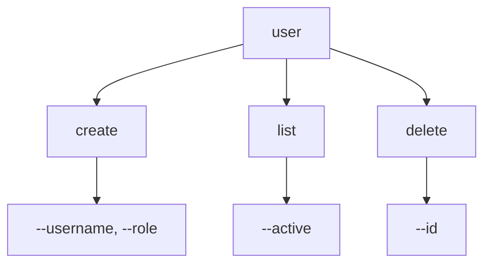

# Phân giải lệnh nhiều từ và lệnh con

Khi CLI có nhiều chức năng, tên lệnh một từ như `create`, `delete` hoặc `list` nhanh chóng trở nên khó quản lý vì không cho biết đối tượng nào đang được thao tác. Spring Shell cho phép tổ chức command thành những tên nhiều từ như `user create`, `user delete` và `user list`. Với API command hiện hành, bạn còn có thể khai báo một tiền tố ở cấp lớp rồi định nghĩa các command con ở cấp phương thức.

Trong module `SPRING_SHELL`, cách tổ chức này hỗ trợ việc xây dựng command dễ khám phá, xử lý đối số và validation nhất quán, cung cấp trợ giúp và tự hoàn thành, đồng thời giữ cho CLI phù hợp cả khi chạy tương tác lẫn khi được gọi từ script hoặc chương trình tự động.

## 1. Phân biệt tên lệnh nhiều từ và lệnh con

Hai khái niệm này có liên quan nhưng không hoàn toàn giống nhau:

- **Tên lệnh nhiều từ (multi-word command):** một command được đăng ký bằng một tên gồm nhiều từ, ví dụ `user create`. Trong API `@ShellMethod`, toàn bộ chuỗi này là một command key.
- **Lệnh con (subcommand):** một command nằm dưới một tiền tố chung trong cấu trúc lệnh, ví dụ `user` là nhánh và `create`, `delete`, `list` là các thao tác bên dưới. API `@Command` hiện hành hỗ trợ khai báo tiền tố ở cấp lớp và tên lệnh con ở cấp phương thức.

Với người dùng CLI, cả hai cách đều tạo ra cú pháp dễ đọc:

```text
user create --username linh --role editor
user list --active true
user delete --id 42
```

Từ `user` cho biết nhóm đối tượng, còn từ tiếp theo mô tả thao tác. Những từ này là thành phần của đường dẫn command; chúng không phải đối số của phương thức xử lý.



## 2. Đăng ký command nhiều từ bằng `@ShellMethod`

Trong standard annotation API, thường dùng ở các dự án Spring Shell 2.x và vẫn có mặt dưới dạng legacy API ở Spring Shell 3.x, `@ShellComponent` đánh dấu bean chứa command còn `@ShellMethod` đăng ký từng phương thức. Thuộc tính `key` đặt tên command. Giá trị của `key` có thể chứa dấu cách và có thể khai báo nhiều key để tạo bí danh cho cùng một phương thức.

Ví dụ sau đăng ký ba command quản lý người dùng:

```java
import org.springframework.shell.standard.ShellComponent;
import org.springframework.shell.standard.ShellMethod;
import org.springframework.shell.standard.ShellOption;

@ShellComponent
public class UserCommands {

    @ShellMethod(key = "user create", value = "Tạo người dùng mới.")
    public String create(
            @ShellOption("--username") String username,
            @ShellOption(value = "--role", defaultValue = "viewer") String role) {
        return "Đã tạo người dùng " + username + " với vai trò " + role;
    }

    @ShellMethod(key = {"user list", "users"}, value = "Liệt kê người dùng.")
    public String list() {
        return "Danh sách người dùng";
    }

    @ShellMethod(key = "user delete", value = "Xóa người dùng theo mã.")
    public String delete(@ShellOption("--id") long id) {
        return "Đã yêu cầu xóa người dùng có mã " + id;
    }
}
```

Các lời gọi tương ứng:

```text
shell:> user create --username linh --role editor
Đã tạo người dùng linh với vai trò editor

shell:> user create --username minh
Đã tạo người dùng minh với vai trò viewer

shell:> user list
Danh sách người dùng

shell:> users
Danh sách người dùng

shell:> user delete --id 42
Đã yêu cầu xóa người dùng có mã 42
```

Ở ví dụ này, `user create`, `user list` và `user delete` là ba command được đăng ký độc lập. Bí danh `users` gọi cùng phương thức với `user list`. Từ `user` không tự trở thành một command có thể thực thi; muốn người dùng gọi riêng `user`, bạn phải đăng ký thêm command mang key đó.

Nên dùng cùng một quy ước đặt tên cho toàn bộ CLI. Chẳng hạn, nếu đã chọn dạng `user create`, hãy dùng nhất quán `user list` và `user delete` thay vì trộn thêm các cách viết như `create-user`, `user-remove` hoặc `deleteUser` nếu không có lý do tương thích cụ thể.

## 3. Khai báo nhánh và command con bằng API `@Command`

API command hiện hành cung cấp cách khai báo cấu trúc rõ hơn. Có thể đặt `@Command(command = "user")` trên lớp để tạo tiền tố chung; các phương thức bên trong khai báo phần command con như `create`, `list` hoặc `delete`. Spring Shell kết hợp tiền tố của lớp với tên ở phương thức để tạo đường dẫn command đầy đủ.

Ví dụ theo API `@Command`:

```java
import org.springframework.shell.command.annotation.Command;
import org.springframework.shell.command.annotation.Option;
import org.springframework.stereotype.Component;

@Component
@Command(command = "user")
public class UserCommands {

    @Command(command = "create", description = "Tạo người dùng mới.")
    public String create(
            @Option(longName = "username") String username,
            @Option(longName = "role", defaultValue = "viewer") String role) {
        return "Đã tạo người dùng " + username + " với vai trò " + role;
    }

    @Command(command = "list", description = "Liệt kê người dùng.")
    public String list() {
        return "Danh sách người dùng";
    }

    @Command(command = "delete", description = "Xóa người dùng theo mã.")
    public String delete(@Option(longName = "id") long id) {
        return "Đã yêu cầu xóa người dùng có mã " + id;
    }
}
```

Với Spring Boot và cơ chế auto-configuration của Spring Shell, command target được phát hiện theo cấu hình của ứng dụng. Nếu dùng ứng dụng không dựa trên Spring Boot, cần khai báo các command target bằng cơ chế đăng ký tương ứng, chẳng hạn `@EnableCommand` trên cấu hình ứng dụng.

Người dùng gọi các command đã ghép tiền tố như sau:

```text
shell:> user create --username linh --role editor
shell:> user list
shell:> user delete --id 42
```

Tên thuộc tính annotation của hai mô hình khác nhau: standard API dùng `@ShellMethod(key = ...)` và `@ShellOption(...)`; API mới dùng `@Command(command = ...)` và `@Option(...)`. Khi triển khai, hãy chọn mô hình được phiên bản Spring Shell của dự án hỗ trợ và dùng nhất quán các annotation tương ứng. Không ghép annotation của hai mô hình vào cùng một ví dụ với giả định chúng thay thế trực tiếp cho nhau.

## 4. Spring Shell phân giải dòng lệnh như thế nào?

Khi nhận một dòng lệnh, shell cần xác định phần nào là đường dẫn command, phần nào là option và phần nào là đối số. Với cú pháp command hiện hành, có thể hình dung cấu trúc tổng quát như sau:

```text
CommandName [SubCommandName ...] [Option | Argument ...]
```

Ví dụ:

```text
user create --username linh --role editor
```

được hiểu theo các phần:

| Thành phần | Giá trị trong ví dụ | Ý nghĩa |
| --- | --- | --- |
| Command name | `user` | Tiền tố hoặc command gốc |
| Subcommand name | `create` | Thao tác cần thực hiện dưới tiền tố `user` |
| Option | `--username linh` | Tham số có tên được gắn với phương thức command |
| Option | `--role editor` | Tham số có tên khác của cùng command |

Luồng xử lý khái quát gồm các bước:

1. **Tách từ:** shell phân tích dòng nhập thành các token dựa trên khoảng trắng và quy tắc trích dẫn.
2. **Nhận diện đường dẫn:** shell đối chiếu các từ đầu với command đã đăng ký để xác định command hoặc nhánh con tương ứng.
3. **Phân tích tham số:** phần còn lại được phân loại thành option có tên hoặc argument theo vị trí.
4. **Chuyển đổi và kiểm tra:** giá trị văn bản được chuyển sang kiểu tham số của phương thức; các ràng buộc validation được áp dụng nếu đã khai báo.
5. **Gọi command:** phương thức xử lý được thực thi với các giá trị đã liên kết.
6. **Trả kết quả:** kết quả hoặc lỗi được chuyển tới cơ chế output và xử lý lỗi của shell.

Nếu đường dẫn không khớp command đã đăng ký, shell không thể gọi phương thức mong muốn. Nếu command đã được nhận diện nhưng thiếu option bắt buộc hoặc giá trị không chuyển đổi được, lỗi xảy ra ở bước liên kết tham số hoặc validation.

## 5. Option, argument và giá trị có dấu cách

Option là tham số có tên, thường bắt đầu bằng `--`; argument là tham số theo vị trí. Khi command có nhiều cấp, nên ưu tiên option có tên cho các giá trị quan trọng để lời gọi dễ đọc và tránh nhầm thứ tự.

Trong API command hiện hành, option dài có thể được viết theo hai dạng:

```text
user create --username linh --role editor
user create --username=linh --role=editor
```

Giá trị chứa khoảng trắng phải được đặt trong dấu nháy để shell coi toàn bộ cụm là một giá trị:

```text
user create --username "Nguyen Van Linh" --role editor
user create --username="Nguyen Van Linh" --role=editor
```

Spring Shell hỗ trợ dấu nháy đơn và dấu nháy kép cho giá trị có khoảng trắng. Dấu nháy bao ngoài được loại bỏ khi liên kết giá trị. Nếu cần chứa chính ký tự nháy đang dùng để bao chuỗi, hãy escape ký tự đó theo quy tắc parser. Một chuỗi không đóng dấu nháy đúng cách sẽ bị từ chối khi phân tích.

Ví dụ một lệnh có argument theo vị trí:

```text
user rename 42 --display-name "Linh Nguyen"
```

Ở đây `42` là argument định danh, còn `--display-name` là option. Khi có nhiều argument, thứ tự của chúng phải khớp với chỉ số hoặc khai báo tham số của command. Với các command con có nhiều tham số, option có tên thường dễ đọc và ít nhập nhằng hơn argument thuần vị trí.

Lưu ý: trong parser của Spring Shell 4, mỗi option được kỳ vọng có một giá trị, kể cả option biểu diễn boolean; cách viết chỉ có cờ như `--force` không tương đương với việc truyền giá trị `true` theo quy tắc này. Hãy kiểm tra cú pháp option và cách biểu diễn boolean theo phiên bản đang dùng.

## 6. Tiền tố command khác với nhóm hiển thị trong trợ giúp

Khi tổ chức nhiều command, cần phân biệt hai mục đích:

- **Tiền tố (prefix):** là một phần của đường dẫn gọi command. Ví dụ `user` + `create` tạo thành `user create`.
- **Nhóm (group):** dùng để gom các command liên quan trong màn hình trợ giúp. Tên nhóm không tự trở thành từ mà người dùng phải nhập khi gọi command.

Trong API `@Command` hiện hành, khai báo `@Command(command = "user")` ở cấp lớp tạo tiền tố cho các phương thức command con. Thuộc tính `group` chỉ định nhóm hiển thị. Ví dụ, các command `user create` và `user delete` có thể cùng thuộc nhóm `User Management` trong trợ giúp mà vẫn giữ nguyên đường dẫn gọi.

Với API standard, `@ShellMethod` có thuộc tính `group` để phân loại command trong danh sách trợ giúp. Việc gán cùng một group cho `user create` và `user delete` không tự động tạo ra tiền tố `user`; nếu muốn người dùng nhập hai từ, hãy đặt `key` chứa cả hai từ.

Phân biệt rõ hai khái niệm giúp tránh một lỗi thiết kế thường gặp: nhìn thấy các command nằm chung một nhóm trong `help` rồi cho rằng nhóm đó cũng là một nhánh command có thể gọi từ terminal.

## 7. Tránh xung đột và nhập nhằng khi thiết kế cây lệnh

Một cấu trúc command dễ dùng cần có quy ước nhất quán và đường dẫn đủ rõ để người dùng nhận diện thao tác. Khi thêm command mới, hãy rà soát các điểm sau:

- Không đăng ký hai phương thức khác nhau bằng cùng một command key hoặc cùng một đường dẫn command.
- Tránh dùng bí danh quá ngắn hoặc trùng với tên command có ý nghĩa khác.
- Dùng danh từ làm tiền tố và động từ làm command con, ví dụ `user create`, `user disable`, `user list`.
- Giữ cách đặt tên thống nhất giữa command tương tác, hướng dẫn sử dụng và script tự động.
- Không dùng giá trị argument làm từ phân cấp nếu nó có thể bị nhầm với tên command con.
- Khi có nhiều cấp lệnh, dùng option có tên cho các giá trị quan trọng và mô tả rõ chúng trong trợ giúp.

Ví dụ, nếu có cả `user show` và `user show history`, hãy cân nhắc liệu hai thao tác có thật sự cần cùng tiền tố hay có thể đặt tên rõ hơn như `user history`. Nếu một từ vừa có thể là tên command con vừa có thể là argument đầu tiên, người dùng sẽ khó đoán shell đang diễn giải theo cách nào; hãy thiết kế cú pháp để loại bỏ sự nhập nhằng đó.

## 8. Kiểm tra và xử lý lỗi phân giải

Khi một lệnh không chạy như mong đợi, hãy kiểm tra theo đúng thứ tự phân giải:

| Hiện tượng | Nguyên nhân có thể có | Hướng xử lý |
| --- | --- | --- |
| `user create` không được nhận diện | Command chưa được đăng ký, sai tiền tố hoặc sai tên command con | Kiểm tra bean command, annotation đăng ký và chính tả của toàn bộ đường dẫn |
| `user` chạy nhưng không có thao tác phù hợp | Tiền tố chỉ dùng làm nhánh, chưa có command xử lý riêng cho `user` | Gọi một command con đã đăng ký hoặc đăng ký command gốc nếu nghiệp vụ cần nó |
| Command đúng nhưng báo thiếu tham số | Thiếu option bắt buộc hoặc argument theo vị trí | Đối chiếu chữ ký phương thức và phần trợ giúp của command |
| Giá trị có dấu cách bị tách thành nhiều phần | Giá trị chưa được bao trong dấu nháy | Đặt toàn bộ giá trị trong dấu nháy đơn hoặc kép |
| Giá trị không chuyển đổi được | Giá trị không phù hợp kiểu tham số, ví dụ chuỗi không phải số được truyền cho `long` | Kiểm tra kiểu dữ liệu, converter và nội dung đầu vào |
| Command xuất hiện sai nhóm trong `help` | Thuộc tính group chưa được khai báo hoặc bị ghi đè ở cấp phương thức | Kiểm tra group ở cấp lớp và cấp command |

Nên thử command từ terminal theo cả ba tình huống: nhập đúng đường dẫn và tham số; bỏ thiếu một tham số; nhập sai tên command con. Với các command có option nhận chuỗi, hãy kiểm tra thêm giá trị có khoảng trắng và ký tự nháy. Nếu CLI được gọi từ script, dùng nguyên văn cú pháp trong script để phát hiện khác biệt do cách shell bên ngoài xử lý dấu nháy.

## 9. Checklist thiết kế command nhiều cấp

- Đường dẫn command thể hiện rõ đối tượng và hành động, ví dụ `user create`.
- Mỗi đường dẫn được đăng ký duy nhất; bí danh không tạo ra xung đột.
- Tiền tố command và nhóm hiển thị trong trợ giúp được cấu hình đúng mục đích.
- Option và argument có tên, kiểu dữ liệu, giá trị mặc định và validation rõ ràng.
- Giá trị có khoảng trắng được trích dẫn đúng cách.
- Trợ giúp mô tả cú pháp đầy đủ và có ví dụ gọi command con.
- Các trường hợp sai đường dẫn, thiếu tham số và sai kiểu dữ liệu đã được thử.

## Tài liệu tham khảo

- [Spring Shell — Command Syntax](https://docs.spring.io/spring-shell/reference/commands/syntax.html)
- [Spring Shell — Legacy Annotation](https://docs.spring.io/spring-shell/reference/3.3/commands/registration/legacyannotation.html)
- [Spring Shell — Organizing Commands](https://docs.spring.io/spring-shell/reference/commands/organize.html)
- [Spring Shell — `@Command` API](https://docs.spring.io/spring-shell/docs/current/api/org/springframework/shell/command/annotation/Command.html)
