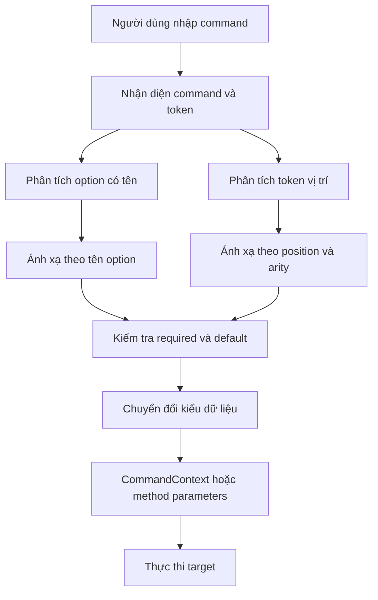

# Liên kết tùy chọn và đối số với tham số thực thi

Khi người dùng nhập một command, Spring Shell phải chuyển các token trong dòng lệnh thành giá trị mà phần xử lý có thể sử dụng. Một token có thể là giá trị của option được đặt tên như `--username`, hoặc là đối số vị trí như `lan`. Việc khai báo đúng tên, kiểu dữ liệu, vị trí và số lượng giá trị giúp Spring Shell ánh xạ input vào `CommandContext` hoặc tham số của method xử lý.

Bài học thuộc chương **Luồng thực thi** của Spring Shell. Nội dung tập trung vào cách liên kết option và đối số với execution target trong Spring Shell 3.x, từ khai báo `CommandRegistration` đến lúc target nhận dữ liệu.

Sau bài học, bạn có thể:

- Phân biệt option được đặt tên và đối số vị trí trong command line.
- Khai báo option bằng `CommandRegistration` với tên dài, tên ngắn, kiểu và vị trí.
- Ánh xạ option vào tham số của method target hoặc đọc giá trị từ `CommandContext`.
- Cấu hình option bắt buộc, mặc định và arity cho input có một hoặc nhiều giá trị.
- Nhận biết lỗi phát sinh khi tên, kiểu, vị trí hoặc số lượng giá trị không khớp.

## Từ dòng lệnh đến tham số thực thi

Giả sử ứng dụng có lệnh hiển thị thông tin người dùng:

```text
user show --username lan
```

Trong dòng lệnh này:

- `user show` là tên command.
- `--username` là tên option.
- `lan` là giá trị được truyền cho option.

Người dùng cũng có thể nhập đối số theo vị trí:

```text
user show lan
```

Ở cách gọi thứ hai, `lan` không đi kèm tên option. Registration phải cho parser biết token vị trí đó được gán vào option nào. Khi parser đã phân tích input, Spring Shell chuyển các giá trị đã ánh xạ và chuyển đổi kiểu cho execution target.

Luồng xử lý tổng quát:



Điểm cần nhớ là registration mô tả hợp đồng input của command. Parser sử dụng hợp đồng đó để diễn giải token; target nhận các giá trị đã được phân tích. Target không cần tự tách chuỗi dòng lệnh.

## Option và đối số vị trí

Spring Shell phân biệt option với positional parameter:

| Loại input | Cách viết | Ý nghĩa |
| --- | --- | --- |
| Option dài | `--username lan` | Giá trị được gắn với tên `username`. |
| Option ngắn | `-u lan` | Bí danh ngắn của option, thường dùng một ký tự. |
| Option dạng gán | `--username=lan` | Giá trị được viết cùng token với option. |
| Đối số vị trí | `lan` | Giá trị không có tên option; parser cần quy tắc vị trí để ánh xạ. |

Option phù hợp với input có ý nghĩa rõ ràng và có thể xuất hiện ở nhiều vị trí trong câu lệnh. Đối số vị trí phù hợp với các giá trị chính của command, chẳng hạn tên file hoặc tên người dùng, khi thứ tự truyền vào đã rõ ràng.

Trong mô hình `CommandRegistration` của Spring Shell 3.x, builder dùng `withOption()` để khai báo các đầu vào. Đối số vị trí được liên kết với một option thông qua `position(index)`. Vì vậy, `position(0)` có nghĩa là option đó nhận token vị trí đầu tiên; đây không phải chỉ số của tham số Java trong mọi trường hợp.

## Khai báo option bằng CommandRegistration

Mỗi lần gọi `withOption()` mở một cấu hình option mới. Một option thường được mô tả bằng:

- `longNames(...)`: tên dài, được gọi bằng tiền tố `--`.
- `shortNames(...)`: bí danh ngắn, được gọi bằng tiền tố `-`.
- `type(...)`: kiểu dữ liệu mong muốn sau khi chuyển đổi.
- `required()`: yêu cầu người dùng phải cung cấp option.
- `defaultValue(...)`: giá trị dùng khi người dùng không truyền option.
- `position(...)`: vị trí nhận token không có tên option.
- `arity(...)`: số lượng giá trị mà option có thể nhận.

Ví dụ, khai báo một option có tên dài `username` và tên ngắn `u`:

```java
CommandRegistration.builder()
    .command("user show")
    .withOption()
        .longNames("username")
        .shortNames('u')
        .type(String.class)
        .required()
        .and()
    .build();
```

Với cấu hình này, parser nhận diện `--username lan` hoặc `-u lan`. Option được khai báo là bắt buộc, vì vậy lời gọi thiếu cả hai cách viết sẽ không vượt qua bước phân tích input để thực thi target.

### Liên kết đối số vị trí

Nếu muốn cho phép người dùng nhập `user show lan`, hãy thêm `position(0)` vào cùng option:

```java
CommandRegistration.builder()
    .command("user show")
    .withOption()
        .longNames("username")
        .shortNames('u')
        .type(String.class)
        .required()
        .position(0)
        .and()
    .build();
```

Lúc này hai cách gọi đều có thể đưa giá trị `lan` vào option `username`:

```text
user show --username lan
user show -u lan
user show lan
```

`position(0)` chỉ rõ cách diễn giải token trần đầu tiên. Nếu command có nhiều token vị trí, cần xác định vị trí cho từng option và cân nhắc thứ tự để người dùng không phải đoán ý nghĩa của input. Khi có nhiều giá trị hoặc nhiều command con, option có tên thường dễ đọc và ít mơ hồ hơn.

## Đưa option vào tham số của method target

Một execution target có thể là method trên một đối tượng Java. Khi đăng ký method bằng `.method(bean, "methodName")`, Spring Shell liên kết các option đã khai báo với tham số method. Cách đơn giản nhất là đặt tên option trùng với tên tham số.

Ví dụ, handler có method nhận tham số `username`:

```java
import org.springframework.stereotype.Component;

@Component
class UserCommandHandler {

    String show(String username) {
        return "Thông tin người dùng: " + username;
    }
}
```

Đăng ký method này làm target và khai báo option có cùng tên:

```java
import org.springframework.context.annotation.Bean;
import org.springframework.context.annotation.Configuration;
import org.springframework.shell.command.CommandRegistration;

@Configuration
class UserCommandConfiguration {

    @Bean
    CommandRegistration userShowCommand(UserCommandHandler handler) {
        return CommandRegistration.builder()
            .command("user show")
            .description("Hiển thị thông tin người dùng")
            .withTarget()
                .method(handler, "show")
                .and()
            .withOption()
                .longNames("username")
                .shortNames('u')
                .type(String.class)
                .required()
                .position(0)
                .and()
            .build();
    }
}
```

Khi người dùng chạy:

```text
shell:>user show --username lan
Thông tin người dùng: lan

shell:>user show lan
Thông tin người dùng: lan
```

Spring Shell lấy giá trị của option `username`, chuyển đổi thành `String` rồi truyền vào tham số `username` của method `show`. Handler tập trung vào xử lý nghiệp vụ và không cần biết người dùng đã dùng tên dài, tên ngắn hay đối số vị trí.

Khi method có nhiều tham số, hãy khai báo option tương ứng và giữ tên nhất quán:

```java
String update(String username, String email, boolean active) {
    // Cập nhật người dùng bằng các giá trị đã được ánh xạ.
    return "Đã nhận yêu cầu cập nhật " + username;
}
```

Ví dụ registration có thể khai báo `username`, `email` và `active` thành ba option riêng. Tên option cần khớp với tên tham số mà method target nhận. Nếu tên option trên CLI khác tên tham số nghiệp vụ, dùng Function target để ánh xạ tường minh hoặc điều chỉnh tên option theo hợp đồng CLI.

## Đọc giá trị qua CommandContext

Khi target là `Function` hoặc `Consumer`, Spring Shell truyền `CommandContext` vào target. Cách này hữu ích khi muốn chủ động ánh xạ tên option CLI sang tên tham số của service, hoặc khi target cần đọc thêm thông tin về lần gọi.

Ví dụ command nhận đường dẫn nguồn, đường dẫn đích và cờ ghi đè:

```java
@Bean
CommandRegistration copyCommand(FileCopyService fileCopyService) {
    return CommandRegistration.builder()
        .command("file copy")
        .description("Sao chép một file")
        .withOption()
            .longNames("source")
            .type(String.class)
            .required()
            .and()
        .withOption()
            .longNames("destination")
            .type(String.class)
            .required()
            .and()
        .withOption()
            .longNames("overwrite")
            .type(boolean.class)
            .defaultValue("false")
            .and()
        .withTarget()
            .function(ctx -> {
                String source = ctx.getOptionValue("source");
                String destination = ctx.getOptionValue("destination");
                boolean overwrite = ctx.getOptionValue("overwrite");
                return fileCopyService.copy(source, destination, overwrite);
            })
            .and()
        .build();
}
```

Lời gọi tương ứng:

```text
file copy --source ./input.csv --destination ./backup/input.csv
file copy --source ./input.csv --destination ./backup/input.csv --overwrite
```

`ctx.getOptionValue("source")` đọc giá trị theo tên option đã khai báo. Với option có giá trị mặc định, target có thể đọc trực tiếp giá trị sau khi parser áp dụng default. Function target trả về kết quả để Spring Shell xử lý và hiển thị theo cơ chế output của shell.

`CommandContext` cũng phù hợp khi target cần xử lý theo nhiều nhánh hoặc muốn gọi nhiều service. Tuy nhiên, nên giữ phần ánh xạ input ngắn gọn và chuyển nghiệp vụ sang service để dễ kiểm thử.

## Kiểu dữ liệu và chuyển đổi giá trị

Input người dùng nhập ban đầu là chuỗi. Spring Shell sử dụng cơ chế chuyển đổi để đưa giá trị về kiểu được khai báo trong option hoặc tham số target.

| Kiểu dữ liệu | Ví dụ | Lưu ý |
| --- | --- | --- |
| `String` | `--username lan` | Phù hợp với văn bản, đường dẫn và mã định danh. |
| `int`, `long`, `double` | `--limit 20` | Giá trị phải chuyển đổi được sang kiểu số tương ứng. |
| `boolean` / `Boolean` | `--overwrite` hoặc giá trị boolean theo cấu hình | Kiểu primitive không biểu diễn `null`; kiểu wrapper có thể biểu diễn trạng thái chưa được cung cấp trong một số cấu hình. |
| `enum` | `--format JSON` | Giá trị phải khớp một hằng enum; khả năng so khớp không phân biệt hoa thường phụ thuộc conversion được cấu hình. |
| Mảng như `String[]` | `--tag java spring` | Kết hợp với arity để nhận nhiều giá trị. |

Ví dụ option số trong một registration hoàn chỉnh:

```java
CommandRegistration.builder()
    .command("report list")
    .withOption()
        .longNames("limit")
        .type(Integer.class)
        .defaultValue("10")
        .and()
    .withTarget()
        .function(ctx -> {
            Integer limit = ctx.getOptionValue("limit");
            return "Hiển thị tối đa " + limit + " báo cáo";
        })
        .and()
    .build();
```

Khi người dùng nhập `--limit 25`, target nhận giá trị kiểu `Integer` là `25`. Khi không truyền option, parser sử dụng chuỗi mặc định `10` rồi chuyển đổi sang kiểu đã khai báo. Nếu người dùng nhập `--limit many`, bước chuyển đổi thất bại và target không nên được gọi với một giá trị không hợp lệ.

Với enum, hãy khai báo kiểu enum cụ thể thay vì nhận chuỗi rồi tự so sánh ở nhiều nơi:

```java
enum ExportFormat {
    CSV, JSON
}

CommandRegistration.builder()
    .command("report export")
    .withOption()
        .longNames("format")
        .type(ExportFormat.class)
        .defaultValue("CSV")
        .and()
    .withTarget()
        .function(ctx -> {
            ExportFormat format = ctx.getOptionValue("format");
            return "Định dạng xuất: " + format;
        })
        .and()
    .build();
```

Target có thể nhận trực tiếp `ExportFormat` hoặc đọc giá trị đã chuyển đổi từ `CommandContext`.

## Validation trước khi thực thi

Ánh xạ và chuyển đổi kiểu xác định giá trị mà target sẽ nhận. Nếu cần kiểm tra quy tắc nghiệp vụ đơn giản ngay trên tham số, Spring Shell tích hợp Bean Validation để thực hiện validation trước khi gọi command method. Ví dụ, với một method target có thể đặt constraint lên tham số:

```java
import jakarta.validation.constraints.Size;

String changePassword(@Size(min = 8, max = 40) String password) {
    return "Đã nhận mật khẩu mới";
}
```

Khi giá trị không thỏa constraint, Spring Shell báo lỗi validation và không gọi phần thân method. Ứng dụng cần có implementation Bean Validation trên classpath để các constraint được thực thi. Hãy dùng validation cho quy tắc về dữ liệu đầu vào; các kiểm tra phụ thuộc vào trạng thái hệ thống hoặc quyền truy cập vẫn nên được thực hiện trong service nghiệp vụ.

## Arity: số lượng giá trị của một option

Arity xác định số lượng token giá trị mà parser tiêu thụ cho một option. Với option nhận đúng một giá trị, cấu hình mặc định thường đủ dùng. Khi option nhận nhiều giá trị, hãy khai báo kiểu mảng hoặc kiểu phù hợp và giới hạn arity.

Ví dụ command `tag add` nhận từ một đến ba tag:

```java
CommandRegistration.builder()
    .command("tag add")
    .withOption()
        .longNames("tags")
        .type(String[].class)
        .required()
        .arity(1, 3)
        .and()
    .withTarget()
        .function(ctx -> {
            String[] tags = ctx.getOptionValue("tags");
            return "Tags: " + String.join(", ", tags);
        })
        .and()
    .build();
```

Một số dạng arity thường dùng:

| Arity | Số giá trị tối thiểu / tối đa | Trường hợp sử dụng |
| --- | --- | --- |
| `ZERO` | 0 / 0 | Option chỉ đóng vai trò cờ. |
| `ZERO_OR_ONE` | 0 / 1 | Giá trị tùy chọn. |
| `EXACTLY_ONE` | 1 / 1 | Option cần đúng một giá trị. |
| `ZERO_OR_MORE` | 0 / không giới hạn thực tế | Danh sách có thể rỗng. |
| `ONE_OR_MORE` | 1 / không giới hạn thực tế | Danh sách phải có ít nhất một phần tử. |

Có thể dùng `arity(min, max)` hoặc các hằng `CommandRegistration.OptionArity` tương ứng. Khi số lượng token ít hơn hoặc nhiều hơn giới hạn, parser báo lỗi arity trước khi gọi target.

## Required và default value

`required()` và `defaultValue(...)` quyết định cách xử lý khi người dùng bỏ qua một option.

| Cấu hình | Hành vi |
| --- | --- |
| `.required()` | Người dùng phải truyền option hoặc cung cấp giá trị qua vị trí đã ánh xạ. |
| `.required(false)` | Option có thể vắng mặt; target cần có cách xử lý trường hợp không có giá trị. |
| `.defaultValue("...")` | Parser cung cấp giá trị mặc định khi người dùng không truyền option. |

Không nên dùng giá trị mặc định để che giấu dữ liệu bắt buộc. Ví dụ, `destination` của lệnh sao chép file thường phải được cung cấp rõ ràng, trong khi `overwrite` có thể mặc định là `false`.

Với option tùy chọn, hãy phân biệt “người dùng không truyền” với “người dùng truyền một giá trị rỗng” nếu nghiệp vụ cần phân biệt hai trường hợp. Kiểu wrapper như `Boolean` có thể hữu ích khi cần biểu diễn trạng thái chưa có giá trị; kiểu primitive như `boolean` luôn phải có một giá trị thực.

## Khai báo qua annotation

Spring Shell 3.x cũng hỗ trợ mô hình annotation cho command method. Trong mô hình legacy, `@ShellMethod` đánh dấu method là command và `@ShellOption` điều chỉnh cách ánh xạ tham số.

```java
import org.springframework.shell.standard.ShellComponent;
import org.springframework.shell.standard.ShellMethod;
import org.springframework.shell.standard.ShellOption;

@ShellComponent
class UserCommands {

    @ShellMethod(key = "user-show", value = "Hiển thị người dùng")
    String show(
            @ShellOption(value = {"--username", "-u"}) String username) {
        return "Thông tin người dùng: " + username;
    }
}
```

Tham số method `username` nhận giá trị từ `--username` hoặc `-u`. Nếu không chỉ định alias bằng `@ShellOption`, tên tham số method được dùng để hình thành tên option theo quy tắc của mô hình annotation. Hãy nhớ đây là mô hình annotation legacy trong Spring Shell 3.x; với cấu hình chi tiết và command được tạo bằng Java, `CommandRegistration` cung cấp cách mô tả trực tiếp.

## Lỗi ánh xạ thường gặp

| Hiện tượng | Nguyên nhân | Hướng kiểm tra |
| --- | --- | --- |
| Báo thiếu option bắt buộc | Tên option sai hoặc token vị trí chưa được ánh xạ. | Kiểm tra `longNames`, `shortNames`, `required()` và `position(...)`. |
| Method nhận sai hoặc thiếu giá trị | Tên option không khớp tên tham số method target. | Đồng bộ tên option với tên tham số hoặc chuyển sang Function target để đọc rõ bằng `getOptionValue(...)`. |
| Giá trị không chuyển đổi được | Input không phù hợp với `type(...)` hoặc kiểu tham số. | Kiểm tra kiểu khai báo, format input và conversion service. |
| Báo thiếu hoặc thừa đối số | Arity không phù hợp với số token được truyền. | Kiểm tra `.arity(min, max)` và kiểu mảng nếu nhận nhiều giá trị. |
| Đối số vị trí bị gán nhầm | Nhiều option cùng có thể nhận token trần hoặc vị trí chưa rõ ràng. | Thiết kế thứ tự vị trí đơn giản; ưu tiên option có tên khi câu lệnh phức tạp. |
| Giá trị tùy chọn gây lỗi null | Target giả định option luôn có mặt dù option không bắt buộc và không có default. | Xử lý trường hợp vắng mặt hoặc đặt giá trị mặc định phù hợp. |

Khi debug, hãy xem lần lượt ba phần: input người dùng thực sự nhập, metadata option trong registration và chữ ký của target. Kiểm tra ở đúng lớp giúp xác định lỗi thuộc parser, chuyển đổi kiểu hay ánh xạ tham số.

## Checklist thiết kế input cho command

Trước khi hoàn tất một command, hãy kiểm tra:

1. Tên option có rõ nghĩa và nhất quán với tài liệu trợ giúp không?
2. Option có tên ngắn khi cần thao tác nhanh không?
3. Kiểu dữ liệu đã khớp với kiểu target cần nhận chưa?
4. Option nào bắt buộc, option nào có default value?
5. Option nhiều giá trị đã khai báo đúng kiểu mảng và arity chưa?
6. Đối số vị trí có được gán rõ bằng `position(...)` và có tránh mơ hồ không?
7. Tên option có khớp tên tham số method target không, hoặc Function target đã đọc đúng key chưa?
8. Các trường hợp thiếu, sai kiểu, sai arity và giá trị hợp lệ đã được kiểm tra chưa?

Khi các quy tắc ánh xạ được khai báo nhất quán, Spring Shell có thể chuyển input thành tham số thực thi theo một hợp đồng rõ ràng. Handler nhận dữ liệu đã được phân tích và chuyển đổi, nhờ đó tập trung vào hành vi của command thay vì tự xử lý cú pháp dòng lệnh.

## Tài liệu tham khảo

- [Spring Shell 3.0.10 — Options](https://docs.spring.io/spring-shell/docs/3.0.10/docs/index.html#options): cách khai báo option, arity, vị trí, giá trị mặc định và validation.
- [Spring Shell 3.0.10 — Command Registration](https://docs.spring.io/spring-shell/docs/3.0.10/docs/index.html#appendix-a-command-registration): target dạng method, Function và Consumer.
- [Spring Shell 3.3.4 — Types](https://docs.spring.io/spring-shell/reference/3.3/options/types.html): chuyển đổi kiểu cho String, boolean, số, enum và mảng.
- [Spring Shell 3.3 — Options](https://docs.spring.io/spring-shell/reference/3.3/options/): phân biệt option và positional parameter trong dòng 3.3.x.
