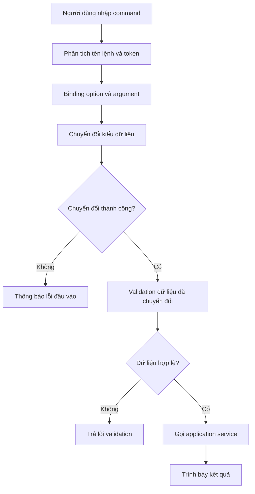

# Chuyển đổi kiểu và kiểm tra tính hợp lệ trước khi gọi nghiệp vụ

Khi người dùng nhập command, Spring Shell nhận các token văn bản từ terminal. Phương thức xử lý thường cần những kiểu dữ liệu rõ ràng như số nguyên, ngày tháng, enum hoặc kiểu định danh của ứng dụng. Trước khi gọi nghiệp vụ, ứng dụng cần chuyển đầu vào thành đúng kiểu và kiểm tra các điều kiện cần thiết để tránh đưa dữ liệu sai vào ca sử dụng.

Chuyển đổi kiểu và validation giải quyết hai câu hỏi khác nhau. **Chuyển đổi kiểu** trả lời đầu vào có biểu diễn được thành kiểu dữ liệu mà command yêu cầu hay không. **Validation** trả lời giá trị đã chuyển đổi có đáp ứng các ràng buộc của thao tác hay không. Một chuỗi `abc` không thể chuyển thành số nguyên; giá trị `-3` chuyển được thành số nguyên nhưng có thể không hợp lệ với thao tác yêu cầu số lượng dương.

Đặt hai bước này trước lời gọi nghiệp vụ giúp command đưa ra phản hồi sớm và rõ ràng. Lớp nghiệp vụ vẫn phải bảo vệ các bất biến quan trọng của miền, bởi cùng một ca sử dụng có thể được gọi từ REST API, tiến trình nền hoặc một adapter khác ngoài Spring Shell.

## Luồng xử lý đầu vào

Một command thường đi qua các bước sau:



Nếu phân tích cú pháp, binding hoặc chuyển đổi thất bại, phương thức command có thể chưa được gọi. Nếu chuyển đổi thành công nhưng validation thất bại, command có thể trả lỗi tại ranh giới giao diện và không gọi application service. Chỉ khi dữ liệu vượt qua các bước đầu vào, command mới chuyển request cho ca sử dụng.

## Chuyển đổi kiểu dữ liệu

### Các kiểu dữ liệu cơ bản

Spring Shell dựa trên cơ chế chuyển đổi kiểu của Spring để ánh xạ văn bản nhập vào thành kiểu tham số của command. Các kiểu phổ biến như `String`, số nguyên, số thực, boolean, enum và một số kiểu ngày giờ có thể được chuyển đổi theo converter tương ứng có trong ứng dụng.

Ví dụ:

```java
@ShellComponent
public class ReportCommands {

    @ShellMethod(key = "report summary", value = "Hiển thị báo cáo")
    public String summary(
            @ShellOption(value = "--year") int year,
            @ShellOption(value = "--month") int month,
            @ShellOption(value = "--format") ReportFormat format) {

        return "Báo cáo " + format + " cho tháng " + month + "/" + year;
    }
}

public enum ReportFormat {
    TEXT,
    CSV,
    JSON
}
```

Một lệnh hợp lệ có thể là:

```text
report summary --year 2026 --month 11 --format CSV
```

Trong ví dụ, `year` và `month` được chuyển thành `int`; `format` được chuyển thành một giá trị của `ReportFormat`. Nếu người dùng truyền `--month eleven`, Spring Shell không thể chuyển chuỗi đó thành số nguyên. Nếu truyền một giá trị không khớp enum, việc chuyển đổi enum cũng thất bại. Các lỗi này xảy ra trước khi command có thể sử dụng những tham số đã chuyển đổi.

Kiểu tham số nên phản ánh đúng dữ liệu mà command cần. Nếu một giá trị là số lượng, dùng kiểu số phù hợp thay vì nhận `String` rồi tự phân tích ở nhiều nơi. Cách này làm rõ hợp đồng đầu vào và để cơ chế chuyển đổi chung xử lý lỗi cú pháp.

### Giá trị mặc định và đầu vào tùy chọn

Một option có thể được khai báo với giá trị mặc định nếu thao tác có một lựa chọn mặc định hợp lý:

```java
@ShellMethod(key = "report recent", value = "Xem báo cáo gần đây")
public String recent(
        @ShellOption(value = "--limit", defaultValue = "10") int limit) {
    return "Hiển thị tối đa " + limit + " báo cáo";
}
```

Khi người dùng bỏ qua `--limit`, Spring Shell sử dụng giá trị mặc định được khai báo. Giá trị mặc định cũng cần được chuyển đổi sang kiểu tham số. Chọn mặc định có ý nghĩa nghiệp vụ và ghi rõ trong trợ giúp để người dùng hiểu hành vi khi không truyền option.

Không nên dùng một giá trị mặc định để che giấu dữ liệu bắt buộc bị thiếu. Nếu thao tác cần mã khách hàng hoặc định danh giao dịch, hãy khai báo đầu vào bắt buộc theo API của phiên bản Spring Shell đang dùng và báo lỗi khi người dùng không cung cấp.

### Chuyển đổi kiểu miền tùy chỉnh

Các kiểu dữ liệu đặc thù của ứng dụng có thể được chuyển đổi bằng converter của Spring. Ví dụ, thay vì truyền mã khách hàng dưới dạng chuỗi ở mọi nơi, ứng dụng có thể định nghĩa một kiểu `CustomerCode`:

```java
public record CustomerCode(String value) {}
```

Converter chịu trách nhiệm kiểm tra định dạng văn bản và tạo kiểu miền:

```java
@Component
public class CustomerCodeConverter implements Converter<String, CustomerCode> {

    @Override
    public CustomerCode convert(String source) {
        String normalized = source == null ? "" : source.trim().toUpperCase();

        if (!normalized.matches("CUS-[0-9]{6}")) {
            throw new IllegalArgumentException(
                    "Mã khách hàng phải có dạng CUS-123456");
        }

        return new CustomerCode(normalized);
    }
}
```

Command có thể khai báo trực tiếp kiểu đích:

```java
@ShellMethod(key = "customer show", value = "Xem thông tin khách hàng")
public String show(@ShellOption(value = "--code") CustomerCode code) {
    return customerService.describe(code);
}
```

Converter chỉ nên xử lý việc phân tích và chuyển đổi biểu diễn đầu vào, ví dụ loại bỏ khoảng trắng, chuẩn hóa chữ hoa và kiểm tra cấu trúc mã. Việc mã khách hàng có tồn tại hay người dùng có quyền xem khách hàng đó hay không là quy tắc nghiệp vụ hoặc kiểm tra quyền ở lớp ứng dụng.

Đảm bảo converter được đăng ký vào `ConversionService` mà Spring Shell sử dụng. Khai báo converter thành bean là cách tổ chức thường gặp trong ứng dụng Spring, nhưng cơ chế thu thập và cấu hình conversion service có thể khác giữa các phiên bản. Hãy kiểm tra tài liệu release đang dùng và xác minh bằng kiểm thử command rằng converter thực sự được gọi.

## Validation sau khi chuyển đổi

Chuyển đổi thành công không đồng nghĩa dữ liệu phù hợp với thao tác. Ví dụ, `--quantity -2` là số nguyên hợp lệ về mặt kiểu dữ liệu nhưng không hợp lệ nếu số lượng phải lớn hơn không. Validation kiểm tra các ràng buộc như:

- Giá trị bắt buộc không được rỗng.
- Số lượng, tuổi hoặc giới hạn phải nằm trong khoảng cho phép.
- Email, mã bưu chính hoặc mã tham chiếu phải đúng định dạng.
- Hai trường có quan hệ với nhau phải nhất quán.
- Một tổ hợp option không được dùng đồng thời nếu thao tác không hỗ trợ.

### Dùng Jakarta Bean Validation

Có thể mô tả các ràng buộc dữ liệu trên request bằng annotation của Jakarta Bean Validation. Ví dụ:

```java
public record RegisterCustomerRequest(
        @NotBlank
        @Size(max = 80)
        String name,

        @NotBlank
        @Email
        String email,

        @Min(18)
        @Max(120)
        int age) {
}
```

Ứng dụng cần có implementation của Jakarta Bean Validation trên classpath, thường được đưa vào qua dependency validation phù hợp với phiên bản Spring Boot. Có thể inject `jakarta.validation.Validator` để kiểm tra request trước khi gọi service:

```java
@ShellComponent
public class CustomerCommands {

    private final Validator validator;
    private final CustomerService customerService;

    public CustomerCommands(
            Validator validator,
            CustomerService customerService) {
        this.validator = validator;
        this.customerService = customerService;
    }

    @ShellMethod(key = "customer register", value = "Đăng ký khách hàng")
    public String register(
            @ShellOption(value = "--name") String name,
            @ShellOption(value = "--email") String email,
            @ShellOption(value = "--age") int age) {

        var request = new RegisterCustomerRequest(name, email, age);
        var violations = validator.validate(request);

        if (!violations.isEmpty()) {
            return violations.stream()
                    .map(v -> v.getPropertyPath() + ": " + v.getMessage())
                    .collect(Collectors.joining(
                            System.lineSeparator(),
                            "Dữ liệu không hợp lệ:" + System.lineSeparator(),
                            ""));
        }

        Customer customer = customerService.register(request);
        return "Đã tạo khách hàng " + customer.getCode();
    }
}
```

Trong ví dụ, `Validator` kiểm tra request đã được tạo từ các tham số đã chuyển đổi. Nếu có vi phạm, command liệt kê trường và thông điệp tương ứng rồi kết thúc nhánh xử lý trước lời gọi `customerService.register(...)`. Khi dữ liệu hợp lệ, ca sử dụng mới được gọi.

Đoạn code minh họa cách kiểm tra tường minh. Trong ứng dụng thực tế, có thể gom phần tạo thông báo validation vào một helper hoặc một thành phần chuyên trách để nhiều command dùng chung cách trình bày. Nếu cần pipeline hoặc script nhận biết lỗi bằng mã thoát khác không, hãy ánh xạ lỗi validation sang cơ chế lỗi và mã thoát phù hợp của phiên bản Spring Shell; chỉ in một chuỗi lỗi chưa đủ để bảo đảm tiến trình trả mã thất bại.

### Validation ở ranh giới phương thức

Spring hỗ trợ method validation thông qua Jakarta Bean Validation và cơ chế proxy của Spring. Trong cấu hình phù hợp, có thể đánh dấu bean bằng `@Validated` và đặt constraint trên tham số phương thức. Ví dụ:

```java
@ShellComponent
@Validated
public class InventoryCommands {

    private final InventoryService inventoryService;

    public InventoryCommands(InventoryService inventoryService) {
        this.inventoryService = inventoryService;
    }

    @ShellMethod(key = "inventory reserve", value = "Giữ số lượng hàng")
    public String reserve(
            @ShellOption(value = "--quantity") @Min(1) @Max(1000) int quantity) {
        return inventoryService.reserve(quantity);
    }
}
```

Cách này yêu cầu provider validation, cấu hình method validation và lời gọi đi qua proxy Spring. Cần xác minh command bean được Spring Shell gọi theo cách tương thích với proxy trong phiên bản đang dùng. Nếu chưa chắc chắn về cấu hình hoặc cần kiểm soát chính xác phản hồi cho người dùng CLI, validation tường minh trên request là cách dễ nhìn thấy luồng hơn.

Không nên giả định chỉ cần thêm `@Min` hoặc `@NotBlank` lên tham số là mọi ứng dụng Spring Shell tự động thực hiện validation. Annotation chỉ có hiệu lực khi cơ chế validation tương ứng đã được cấu hình và được kích hoạt.

## Phân biệt lỗi chuyển đổi, lỗi validation và lỗi nghiệp vụ

Ba nhóm lỗi thường xuất hiện gần nhau nhưng có ý nghĩa khác nhau:

| Nhóm lỗi | Ví dụ | Thời điểm phát hiện | Nơi xử lý phù hợp |
| --- | --- | --- | --- |
| Phân tích hoặc chuyển đổi | `abc` không chuyển được thành `int`; chuỗi không đúng định dạng mã | Khi Spring Shell bind và chuyển tham số | Conversion service và phản hồi đầu vào của CLI |
| Validation đầu vào | Số lượng bằng `0`; email sai định dạng; tên vượt giới hạn | Sau khi có giá trị đã chuyển đổi, trước lời gọi use case | Validator hoặc lớp kiểm tra request ở adapter/application boundary |
| Lỗi nghiệp vụ | Khách hàng không tồn tại; tồn kho không đủ; thao tác bị từ chối | Trong khi thực hiện ca sử dụng | Application service và domain model |

Ví dụ với command `inventory reserve --quantity ...`:

- `--quantity abc`: không thể chuyển thành số nguyên; command handler thường không được gọi.
- `--quantity 0`: chuyển đổi thành công nhưng vi phạm ràng buộc số lượng dương; validation từ chối trước khi gọi nghiệp vụ.
- `--quantity 5`: hợp lệ về kiểu và ràng buộc đầu vào; use case được gọi, nhưng có thể trả lỗi nghiệp vụ nếu kho chỉ còn hai sản phẩm.

Sự phân biệt này giúp chọn đúng nơi sửa lỗi. Không nên truy vấn cơ sở dữ liệu trong converter chỉ để kiểm tra một mã có tồn tại; cũng không nên để command tự quyết định các quy tắc như tồn kho có đủ hay không nếu quy tắc đó thuộc nghiệp vụ.

## Thiết kế thông báo lỗi hữu ích

Thông báo lỗi cần chỉ ra người dùng đã nhập sai điều gì và cách sửa. Thay vì chỉ báo `Invalid input`, hãy nêu rõ tên option và định dạng được chấp nhận, ví dụ:

```text
Lỗi đầu vào:
- --month: phải nằm trong khoảng từ 1 đến 12.
- --format: chỉ chấp nhận TEXT, CSV hoặc JSON.
```

Một thông báo tốt nên:

- Gắn lỗi với tên option hoặc trường dữ liệu liên quan.
- Nêu giới hạn hoặc định dạng hợp lệ khi có thể.
- Không hiển thị stack trace hoặc chi tiết nội bộ cho lỗi đầu vào thông thường.
- Không làm lộ dữ liệu nhạy cảm mà người dùng đã nhập.
- Giữ thông tin đủ cấu trúc để có thể kiểm thử và ghi log khi cần.

Nếu một request có nhiều vi phạm, hiển thị nhiều lỗi cùng lúc thường giúp người dùng sửa trong một lần. Với lỗi chuyển đổi xảy ra trước khi command chạy, hãy cấu hình hoặc sử dụng thông báo của Spring Shell sao cho người dùng biết option nào không hợp lệ.

## Kiểm thử chuyển đổi và validation

Kiểm thử nên bao phủ các ranh giới khác nhau thay vì chỉ kiểm tra một trường hợp thành công.

| Trường hợp | Đầu vào mẫu | Điều cần xác minh |
| --- | --- | --- |
| Chuyển đổi thành công | `--year 2026` | Handler nhận được giá trị số nguyên `2026` |
| Sai kiểu | `--year abc` | Lỗi chuyển đổi xuất hiện và use case không được gọi |
| Enum không hợp lệ | `--format XML` | Người dùng nhận thông báo về các giá trị được hỗ trợ |
| Converter tùy chỉnh | `--code cus-123456` | Mã được chuẩn hóa và tạo đúng kiểu `CustomerCode` |
| Sai định dạng mã | `--code customer-one` | Converter từ chối trước khi gọi command handler |
| Vi phạm constraint | `--age 15` | Validator báo tuổi ngoài giới hạn và service không được gọi |
| Đầu vào hợp lệ | Tên, email và tuổi hợp lệ | Service được gọi đúng một lần với request mong đợi |
| Lỗi nghiệp vụ | Mã hợp lệ nhưng khách hàng không tồn tại | Lỗi được xử lý ở lớp nghiệp vụ và hiển thị phù hợp |

Với converter, kiểm thử trực tiếp các chuỗi hợp lệ, không hợp lệ, rỗng và có khoảng trắng. Với validator, kiểm tra từng constraint và trường hợp có nhiều vi phạm. Với command, dùng mock hoặc spy cho application service để xác minh service không được gọi khi chuyển đổi hoặc validation thất bại.

Kiểm thử tích hợp nên xác nhận converter đã được đăng ký trong conversion service thực tế mà Spring Shell sử dụng. Một unit test converter chạy độc lập không chứng minh rằng Spring Shell đã dùng converter đó khi phân tích command.

## Những lỗi thiết kế thường gặp

| Cách làm | Vấn đề | Cách điều chỉnh |
| --- | --- | --- |
| Nhận mọi tham số dưới dạng `String` rồi parse lặp lại trong service | Lỗi chuyển đổi bị phân tán và khó thống nhất | Khai báo kiểu tham số rõ ràng hoặc converter chuyên biệt |
| Đặt truy vấn cơ sở dữ liệu trong converter | Converter phụ thuộc hạ tầng và khó dự đoán | Chỉ chuyển đổi định dạng; kiểm tra tồn tại trong use case |
| Gọi service trước rồi mới kiểm tra dữ liệu | Nghiệp vụ có thể đã thực hiện tác dụng phụ trước khi phát hiện đầu vào sai | Validation request trước lời gọi use case |
| Chỉ validation ở command | Adapter khác có thể bỏ qua quy tắc quan trọng | Giữ bất biến nghiệp vụ trong domain/application layer |
| Thêm annotation constraint nhưng thiếu provider hoặc method validation | Constraint không được thực thi như dự kiến | Kiểm tra dependency và cơ chế kích hoạt validation |
| Trả thông báo lỗi nhưng luôn kết thúc với mã thoát thành công | Script có thể hiểu nhầm command đã thành công | Ánh xạ lỗi validation sang mã thoát phù hợp |

## Quy trình áp dụng cho command mới

1. Xác định kiểu dữ liệu đúng cho từng option và argument; ưu tiên kiểu cụ thể thay vì nhận tất cả dưới dạng chuỗi.
2. Dùng converter tùy chỉnh khi đầu vào cần chuyển sang kiểu miền hoặc có quy tắc phân tích riêng.
3. Tạo request thể hiện dữ liệu mà ca sử dụng cần và khai báo các constraint có thể kiểm tra độc lập.
4. Thực hiện validation trước lời gọi application service; gom và trình bày lỗi theo tên trường hoặc option.
5. Để application service và domain model bảo vệ các quy tắc nghiệp vụ mà mọi adapter đều phải tuân theo.
6. Kiểm thử thành công, lỗi chuyển đổi, lỗi validation, lỗi nghiệp vụ và việc không gọi service khi đầu vào bị từ chối.

Khi chuyển đổi kiểu và validation được đặt đúng vị trí, command nhận được dữ liệu có cấu trúc, người dùng hiểu cách sửa đầu vào sai và nghiệp vụ chỉ bắt đầu sau khi dữ liệu vượt qua kiểm tra ở ranh giới CLI. Điều này làm luồng thực thi dễ kiểm soát hơn trong cả terminal tương tác lẫn các quy trình tự động.
