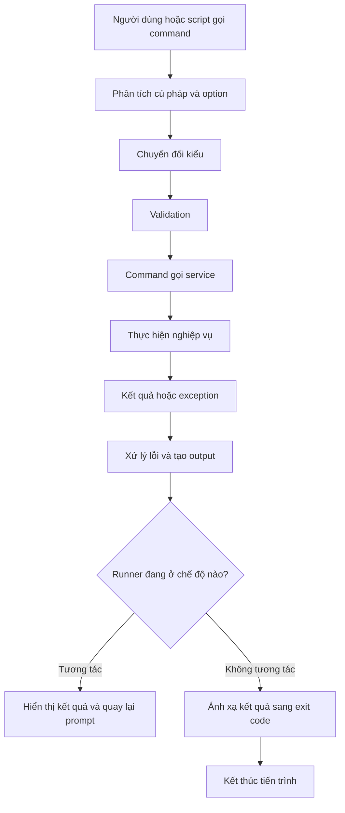

# Luồng xử lý lỗi và ánh xạ sang trạng thái kết thúc

Một CLI đáng tin cậy cần cho người dùng biết lệnh đã thành công hay thất bại, vì sao thất bại và bước tiếp theo nên làm gì. Khi chạy trong terminal, kết quả còn phải được thể hiện bằng mã thoát để script hoặc hệ thống CI quyết định có tiếp tục hay dừng. Với Spring Shell, cần phân biệt lỗi của một command, lỗi của phiên shell và trạng thái kết thúc của toàn bộ tiến trình. Ba phạm vi này liên quan với nhau nhưng không đồng nhất.

Bài học này theo dõi một lệnh hoàn thành công việc trong ứng dụng Spring Shell. Bạn sẽ phân loại lỗi từ lúc nhận tham số đến khi gọi nghiệp vụ, tổ chức exception handler, chuẩn hóa thông báo, thiết kế mã thoát và kiểm thử hành vi ở cả chế độ tương tác lẫn chạy tự động.

## 1. Nhìn toàn bộ luồng thực thi

Khi người dùng nhập một dòng lệnh, ứng dụng phải đi qua nhiều bước trước khi tạo ra kết quả:

1. Spring Shell đọc dòng lệnh và xác định command.
2. Bộ phân tích cú pháp nhận diện option, đối số và giá trị được truyền.
3. Cơ chế chuyển đổi chuyển giá trị văn bản thành kiểu Java tương ứng.
4. Các điều kiện đầu vào được kiểm tra.
5. Phương thức command gọi service thực hiện nghiệp vụ.
6. Kết quả hoặc exception được xử lý và chuyển thành output.
7. Runner quyết định tiếp tục chờ lệnh tiếp theo hay kết thúc tiến trình.

Luồng khái quát:



Lỗi có thể xuất hiện ở bất kỳ bước nào. Ví dụ, tên command sai được phát hiện trước khi phương thức command chạy; chuỗi `abc` không chuyển được thành `long` cũng có thể bị từ chối trước khi vào thân phương thức; còn lỗi không tìm thấy công việc chỉ xuất hiện khi service tra cứu dữ liệu.

Vì vậy, không nên xử lý mọi lỗi tại một `try/catch` duy nhất trong command. Hãy để mỗi tầng chịu trách nhiệm cho loại lỗi mà nó hiểu rõ, rồi chuẩn hóa kết quả tại ranh giới giao tiếp với người dùng.

## 2. Phân loại lỗi theo nguyên nhân

Phân loại lỗi giúp quyết định thông báo, mức log và mã thoát. Một bảng quy ước ban đầu có thể như sau:

| Nhóm lỗi | Ví dụ | Phản hồi phù hợp |
| --- | --- | --- |
| Cú pháp | Tên command không tồn tại, thiếu option bắt buộc | Hiển thị cách dùng hoặc trợ giúp liên quan |
| Chuyển đổi | Truyền `abc` cho option kiểu số | Nêu option sai và kiểu giá trị mong đợi |
| Validation | Mức ưu tiên nằm ngoài khoảng cho phép | Nêu quy tắc và giá trị hợp lệ |
| Nghiệp vụ | Công việc không tồn tại hoặc đã hoàn thành | Giải thích trạng thái nghiệp vụ và cách xử lý |
| Xác thực/phân quyền | Người dùng chưa đăng nhập hoặc không có quyền | Hướng dẫn đăng nhập hoặc yêu cầu quyền phù hợp |
| Phụ thuộc | Cơ sở dữ liệu hoặc dịch vụ từ xa không khả dụng | Nêu dịch vụ gặp lỗi; chỉ đề xuất thử lại khi phù hợp |
| Hệ thống không dự kiến | Lỗi lập trình, trạng thái dữ liệu bất thường | Thông báo chung, ghi log để điều tra |
| Khởi động/cấu hình | Thiếu biến môi trường hoặc cấu hình sai | Dừng khởi động với thông tin cấu hình cần sửa |

Không phải mọi trường hợp “không tìm thấy” đều là lỗi. Ví dụ, `task-list` trả về danh sách rỗng có thể là kết quả thành công; `task-done --id 42` không tìm thấy công việc thường là yêu cầu không thể thực hiện. Hãy xác định ý nghĩa theo hợp đồng của từng command thay vì chỉ dựa vào tên exception.

## 3. Kiểm tra đầu vào trước khi gọi nghiệp vụ

Spring Shell nhận option và chuyển đổi giá trị theo kiểu tham số được khai báo. Ví dụ, một command nhận mã công việc dạng số:

```java
@ShellComponent
public class TaskCommands {

    private final TaskService taskService;

    public TaskCommands(TaskService taskService) {
        this.taskService = taskService;
    }

    @ShellMethod(key = "task-done", value = "Đánh dấu công việc đã hoàn thành")
    public String complete(
            @ShellOption(value = "--id") long id) {
        Task task = taskService.complete(id);
        return "Đã hoàn thành công việc " + task.getId();
    }
}
```

Nếu người dùng truyền giá trị không thể chuyển thành `long`, Spring Shell có thể từ chối ngay ở bước binding và command không được gọi. Điều này khác với trường hợp `id` hợp lệ về kiểu nhưng không tồn tại trong hệ thống.

Validation nên diễn ra ở nơi có đủ thông tin để kiểm tra:

- **Cú pháp và kiểu dữ liệu:** để Spring Shell xử lý thông qua khai báo option và cơ chế chuyển đổi.
- **Quy tắc của giao diện command:** kiểm tra những ràng buộc gắn với cách gọi, chẳng hạn `--from` phải trước `--to`.
- **Quy tắc nghiệp vụ:** kiểm tra trong service hoặc domain, chẳng hạn công việc đã hoàn thành thì không thể hoàn thành lần nữa.
- **Quyền truy cập:** kiểm tra ở tầng nghiệp vụ hoặc security phù hợp, không chỉ ẩn command khỏi phần trợ giúp.

Nếu sử dụng Jakarta Bean Validation, có thể khai báo constraint trên DTO hoặc tham số và cấu hình method validation. Cần xác minh validator thực sự được kích hoạt trong application context; chỉ thêm annotation không bảo đảm mọi đường gọi đều tự động được kiểm tra.

Thông báo validation nên chỉ ra tên option, giá trị hoặc quy tắc bị vi phạm. Tránh hiển thị stack trace cho lỗi nhập liệu thông thường.

## 4. Dùng exception có ý nghĩa nghiệp vụ

Service nên biểu diễn những tình huống thất bại mà tầng nghiệp vụ hiểu được. Ví dụ:

```java
public class TaskNotFoundException extends RuntimeException {

    public TaskNotFoundException(long id) {
        super("Không tìm thấy công việc có mã " + id);
    }
}

public class TaskAlreadyCompletedException extends RuntimeException {

    public TaskAlreadyCompletedException(long id) {
        super("Công việc " + id + " đã hoàn thành");
    }
}

public class CliAuthorizationException extends RuntimeException {

    public CliAuthorizationException(String message) {
        super(message);
    }
}
```

Service ném exception phù hợp với trạng thái dữ liệu:

```java
@Service
public class TaskService {

    private final TaskRepository repository;

    public TaskService(TaskRepository repository) {
        this.repository = repository;
    }

    public Task complete(long id) {
        Task task = repository.findById(id)
                .orElseThrow(() -> new TaskNotFoundException(id));

        if (task.isCompleted()) {
            throw new TaskAlreadyCompletedException(id);
        }

        task.markCompleted();
        return repository.save(task);
    }
}
```

Nhờ vậy, service không cần biết người gọi là Spring Shell, REST API hay một tác vụ nền. Lớp command nhận exception và quyết định cách trình bày phù hợp với CLI. Nếu có nhiều giao diện gọi chung nghiệp vụ, mỗi giao diện có thể chuyển cùng exception thành thông báo hoặc mã trạng thái riêng.

Không dùng một exception chung như `RuntimeException("Error")` cho mọi tình huống. Tên và loại exception nên giúp người xử lý phân biệt được lỗi có thể dự đoán với lỗi bất ngờ.

## 5. Xử lý exception ở ranh giới Spring Shell

Spring Shell có cơ chế xử lý exception của command. Với mô hình annotation có hỗ trợ `@ExceptionHandler`, có thể khai báo handler trong component command để chuyển một số exception đã biết thành thông báo dễ hiểu. Ví dụ minh họa:

```java
@ShellComponent
public class TaskCommands {

    // Các command gọi TaskService được khai báo tại đây.

    @ExceptionHandler
    public String handleTaskNotFound(TaskNotFoundException exception) {
        return exception.getMessage();
    }

    @ExceptionHandler
    public String handleAlreadyCompleted(TaskAlreadyCompletedException exception) {
        return exception.getMessage();
    }
}
```

Đây là ví dụ theo mô hình annotation có `@ShellComponent` và `@ExceptionHandler`. Spring Shell có các mô hình khai báo command và API khác nhau giữa những thế hệ phiên bản; package import, phạm vi tìm handler, cách chọn handler và cách render giá trị trả về cần khớp với phiên bản dự án. Nếu dự án dùng mô hình `@Command` mới, hãy dùng cơ chế exception handling tương ứng của phiên bản đó thay vì trộn annotation từ hai mô hình.

Nên ưu tiên handler cụ thể cho exception đã biết và có một cách xử lý cuối cùng cho lỗi không dự kiến. Khi xử lý lỗi không dự kiến:

- Ghi log exception đầy đủ ở phía ứng dụng để có stack trace và thông tin chẩn đoán.
- Hiển thị thông báo ngắn, không tiết lộ SQL, đường dẫn nội bộ, token, mật khẩu hoặc dữ liệu nhạy cảm.
- Gắn mã tham chiếu cho lỗi nếu hệ thống có cơ chế correlation ID để người vận hành tra log.
- Không chuyển exception thành thông báo thành công hoặc tiếp tục nghiệp vụ trong trạng thái không nhất quán.

Không ghi log cùng một exception ở mọi tầng. Hãy chọn một tầng chịu trách nhiệm log đầy đủ; tầng khác có thể bổ sung ngữ cảnh rồi ném tiếp để tránh log trùng nhiều lần.

## 6. Phân biệt lỗi command, lỗi phiên shell và lỗi tiến trình

Đây là ranh giới quan trọng nhất khi thiết kế CLI:

**Lỗi command** xảy ra trong lúc thực hiện một lệnh. Trong phiên tương tác, người dùng thường cần nhận thông báo rồi tiếp tục nhập lệnh khác. Ví dụ, `task-done --id 404` không tìm thấy dữ liệu nhưng shell vẫn có thể quay lại prompt.

**Lỗi phiên shell** ảnh hưởng đến khả năng tiếp tục sử dụng shell, chẳng hạn lỗi nghiêm trọng trong thành phần tương tác hoặc terminal không còn khả dụng. Ứng dụng có thể cần kết thúc phiên thay vì tiếp tục nhận lệnh.

**Lỗi tiến trình** là kết quả cuối cùng mà hệ điều hành và script nhận được khi chương trình kết thúc. Nó được biểu diễn bằng exit code. Một lỗi command đã được handler bắt và hiển thị không tự động có nghĩa tiến trình phải kết thúc với mã khác `0`; điều đó phụ thuộc runner và chính sách của ứng dụng.

| Tình huống | Phiên tương tác | Chạy một lệnh bằng script |
| --- | --- | --- |
| Nhập sai tham số | Báo lỗi và trở lại prompt | Kết thúc với mã lỗi cú pháp theo quy ước |
| Lỗi nghiệp vụ có thể dự đoán | Báo lỗi, cho phép nhập lệnh khác | Trả mã lỗi nghiệp vụ nếu script cần phân biệt |
| Dịch vụ phụ thuộc tạm thời không khả dụng | Báo lỗi; phiên có thể tiếp tục | Trả mã lỗi để script quyết định thử lại hoặc dừng |
| Lỗi hệ thống nghiêm trọng | Có thể phải kết thúc shell | Kết thúc với mã lỗi hệ thống |

Không nên để một command gọi `System.exit(...)` trực tiếp. Lệnh đó có thể đang chạy bên trong một phiên shell dài hạn; gọi `System.exit` sẽ đóng toàn bộ ứng dụng và có thể làm mất cơ hội xử lý các lệnh tiếp theo. Hãy để runner hoặc lớp điều phối tiến trình quyết định khi nào kết thúc ứng dụng.

## 7. Thiết kế quy ước exit code

Mã thoát là một phần của hợp đồng CLI. Quy ước tối thiểu thường dùng `0` cho thành công và số khác `0` cho thất bại. Với công cụ có nhiều loại lỗi, có thể thống nhất một bảng mã riêng:

| Mã | Tên quy ước | Ý nghĩa |
| --- | --- | --- |
| `0` | `SUCCESS` | Command hoặc kịch bản hoàn tất thành công |
| `1` | `GENERAL_ERROR` | Lỗi không dự kiến hoặc lỗi thực thi chung |
| `2` | `USAGE_ERROR` | Cú pháp, option hoặc giá trị đầu vào không hợp lệ |
| `3` | `BUSINESS_ERROR` | Yêu cầu không thể thực hiện theo trạng thái nghiệp vụ |
| `4` | `DEPENDENCY_ERROR` | Dịch vụ hoặc tài nguyên phụ thuộc không khả dụng |
| `5` | `AUTHORIZATION_ERROR` | Chưa xác thực hoặc không đủ quyền |

Đây là quy ước do ứng dụng chọn, không phải bộ mã bắt buộc của Spring Shell hay hệ điều hành. Hãy giữ bảng mã nhỏ, ổn định và ghi rõ trong README. Tránh thay đổi ý nghĩa một mã giữa các phiên bản vì script bên ngoài có thể đang phụ thuộc vào nó.

Có thể biểu diễn mã trong Java bằng enum:

```java
public enum CliExitCode {
    SUCCESS(0),
    GENERAL_ERROR(1),
    USAGE_ERROR(2),
    BUSINESS_ERROR(3),
    DEPENDENCY_ERROR(4),
    AUTHORIZATION_ERROR(5);

    private final int value;

    CliExitCode(int value) {
        this.value = value;
    }

    public int value() {
        return value;
    }
}
```

Một hàm ánh xạ tập trung giúp tránh việc mỗi command tự chọn mã tùy ý:

```java
public final class CliExitCodes {

    private CliExitCodes() {
    }

    public static int from(Throwable error) {
        if (error instanceof CliUsageException) {
            return CliExitCode.USAGE_ERROR.value();
        }
        if (error instanceof TaskNotFoundException
                || error instanceof TaskAlreadyCompletedException) {
            return CliExitCode.BUSINESS_ERROR.value();
        }
        if (error instanceof DependencyUnavailableException) {
            return CliExitCode.DEPENDENCY_ERROR.value();
        }
        if (error instanceof CliAuthorizationException) {
            return CliExitCode.AUTHORIZATION_ERROR.value();
        }
        return CliExitCode.GENERAL_ERROR.value();
    }
}
```

Các exception trong ví dụ là kiểu do ứng dụng định nghĩa hoặc chọn từ thư viện phù hợp. Trong code thực tế, cần kiểm tra cả nguyên nhân lồng bên trong (`cause`) nếu thư viện bọc exception, đồng thời tránh ánh xạ quá rộng khiến lỗi lập trình bị hiểu nhầm là lỗi đầu vào.

## 8. Ánh xạ kết quả command thành trạng thái kết thúc ứng dụng

Có hai lớp điều phối cần quan tâm:

- **Spring Shell runner:** điều phối phiên tương tác hoặc thực thi command không tương tác. Runner có thể xử lý exception của command và quyết định tiếp tục hay kết thúc tùy chế độ.
- **Spring Boot/application lifecycle:** quản lý khởi động và đóng application context. Spring Boot cung cấp các cơ chế như `ExitCodeGenerator`, `ExitCodeExceptionMapper` và `SpringApplication.exit(...)` để tạo mã thoát khi ứng dụng kết thúc.

Không nên giả định `ExitCodeExceptionMapper` của Spring Boot sẽ tự động nhìn thấy mọi exception của command. Nếu Spring Shell đã bắt exception để hiển thị rồi tiếp tục phiên, exception đó không còn thoát ra ngoài vòng đời `SpringApplication` để mapper xử lý. Muốn script nhận mã khác `0`, ứng dụng cần nối kết quả thất bại của runner hoặc command không tương tác với chính sách exit code của tiến trình.

Ở mức khái niệm, luồng điều phối một lần chạy có thể được tổ chức như sau:

```java
public int runOneShotCommand(CommandInvocation invocation) {
    try {
        invocation.execute();
        return CliExitCode.SUCCESS.value();
    } catch (Exception exception) {
        int code = CliExitCodes.from(exception);
        reportFailure(exception, code);
        return code;
    }
}
```

Đây là pseudocode minh họa ranh giới điều phối, không phải API runner có sẵn của Spring Shell. Khi triển khai, dùng extension point hoặc runner phù hợp với phiên bản Spring Shell của dự án để thu nhận kết quả thực thi. Nếu command đã được xử lý bởi `@ExceptionHandler` và handler chỉ trả về một chuỗi thông báo, cần có một kết quả có cấu trúc hoặc một chính sách khác để runner vẫn biết command thất bại.

Với lỗi xảy ra trong lúc khởi động, ví dụ cấu hình bắt buộc thiếu hoặc không thể tạo application context, có thể cấu hình `ExitCodeExceptionMapper` hoặc exception triển khai `ExitCodeGenerator` theo cơ chế Spring Boot. Với kết thúc chủ động, `SpringApplication.exit(context, ...)` có thể tạo mã thoát dựa trên các `ExitCodeGenerator` được cung cấp. Việc gọi `System.exit` nên nằm ở điểm vào tiến trình sau khi đã đóng context và xác định mã cuối cùng, không nằm trong service hay command.

## 9. Chính sách khi chạy nhiều command trong script

Nếu ứng dụng hỗ trợ chạy nhiều lệnh theo một kịch bản, cần quy định rõ điều gì xảy ra khi một lệnh thất bại. Ba chính sách thường gặp:

| Chính sách | Hành vi | Khi phù hợp |
| --- | --- | --- |
| Fail fast | Dừng ngay ở command lỗi đầu tiên và trả mã lỗi đó | Các bước phụ thuộc tuần tự, lỗi trước khiến bước sau không an toàn |
| Continue | Ghi nhận lỗi rồi tiếp tục các command độc lập | Báo cáo nhiều mục hoặc tác vụ có thể xử lý riêng |
| Aggregate | Tiếp tục theo quy tắc nhưng tổng hợp kết quả cuối cùng | Batch cần xử lý hết đầu vào và trả một trạng thái tổng |

Nếu chọn aggregate, hãy xác định cách chọn mã cuối: mã lỗi đầu tiên, lỗi nghiêm trọng nhất hay một mã tổng hợp riêng. Đừng dùng “mã của command cuối cùng” một cách ngẫu nhiên vì một command thành công ở cuối có thể che mất lỗi trước đó.

Một script gọi CLI có thể kiểm tra mã thoát và quyết định hành động tiếp theo:

```bash
java -jar task-cli.jar task-done --id 42
status=$?

if [ "$status" -eq 0 ]; then
    echo "Hoàn tất"
elif [ "$status" -eq 3 ]; then
    echo "Không thể thực hiện do trạng thái nghiệp vụ"
else
    echo "CLI thất bại với mã $status" >&2
    exit "$status"
fi
```

Mã thoát chỉ nên truyền những thông tin hữu ích cho chương trình gọi. Chi tiết lỗi, nguyên nhân kỹ thuật và mã tham chiếu nên nằm trong output hoặc log phù hợp.

## 10. Output lỗi, logging và bảo mật

Thông báo cho người dùng và log cho người vận hành phục vụ hai mục đích khác nhau. Thông báo CLI cần ngắn gọn, có thể hành động; log cần đủ ngữ cảnh để điều tra.

Ví dụ thông báo tốt:

```text
Không tìm thấy công việc có mã 42. Kiểm tra mã bằng lệnh task-list.
```

Ví dụ log nội bộ có thể chứa loại exception, mã công việc, correlation ID và stack trace. Không ghi token, mật khẩu, dữ liệu cá nhân không cần thiết hoặc toàn bộ nội dung đầu vào nhạy cảm.

Khi command xuất dữ liệu máy đọc được như JSON hoặc CSV, giữ stdout dành cho dữ liệu theo hợp đồng. Gửi thông báo lỗi và chẩn đoán sang stderr/log theo cấu hình. Nếu shell tương tác, có thể dùng renderer hoặc terminal writer của Spring Shell để hiển thị thông báo; tránh trộn nội dung trình bày vào luồng dữ liệu mà script đang đọc.

Không trả stack trace đầy đủ cho lỗi validation hoặc lỗi nghiệp vụ có thể dự đoán. Với lỗi hệ thống không mong đợi, cung cấp thông báo chung và mã tham chiếu; stack trace nằm trong log có kiểm soát quyền truy cập.

## 11. Kiểm thử luồng lỗi và exit code

Kiểm thử cần xác nhận cả thông báo lẫn trạng thái tiến trình. Chia thành các phạm vi:

**Unit test cho service** kiểm tra exception được ném đúng theo trạng thái nghiệp vụ:

```java
@Test
void throwsWhenTaskDoesNotExist() {
    when(repository.findById(42L)).thenReturn(Optional.empty());

    assertThrows(TaskNotFoundException.class, () -> service.complete(42L));
}
```

**Unit test cho bộ ánh xạ** kiểm tra từng loại exception trả đúng mã:

```java
@Test
void mapsTaskNotFoundToBusinessError() {
    assertEquals(
            CliExitCode.BUSINESS_ERROR.value(),
            CliExitCodes.from(new TaskNotFoundException(42L)));
}
```

**Integration test với Spring Shell** khởi động application context và thực thi command qua test support của phiên bản đang dùng, chẳng hạn `ShellTestClient` khi có trong release đó. Xác nhận command được đăng ký, handler chọn đúng exception, thông báo hiển thị phù hợp và shell tương tác vẫn nhận lệnh tiếp theo sau một lỗi có thể phục hồi.

**End-to-end test** chạy executable JAR như một tiến trình con bằng `ProcessBuilder`. Thu thập stdout, stderr và exit code; kiểm tra một command thành công trả `0`, một lỗi nghiệp vụ trả mã đã quy định, lỗi cú pháp trả mã riêng và lỗi khởi động trả mã cấu hình phù hợp. Cần test riêng chế độ interactive và non-interactive vì hai runner có thể có hành vi kết thúc khác nhau.

Ma trận kiểm thử nên bao gồm:

| Trường hợp | Điều cần xác nhận |
| --- | --- |
| Command không tồn tại | Trợ giúp/cách dùng phù hợp và trạng thái lỗi đúng |
| Option thiếu hoặc sai kiểu | Command không chạy; thông báo chỉ rõ đầu vào |
| Validation thất bại | Không ghi dữ liệu; mã lỗi theo quy ước |
| Không tìm thấy dữ liệu | Exception nghiệp vụ được xử lý đúng |
| Người dùng không có quyền | Không tiết lộ tài nguyên; mã quyền truy cập phù hợp |
| Dịch vụ phụ thuộc lỗi | Có log chẩn đoán; script nhận mã lỗi phụ thuộc |
| Lỗi không dự kiến | Không lộ stack trace ra output người dùng; có log điều tra |
| Command lỗi trong shell tương tác | Shell tiếp tục nếu chính sách cho phép |
| Command lỗi ở chế độ một lần | Tiến trình kết thúc với exit code khác `0` |
| Nhiều command trong script | Chính sách fail-fast/continue/aggregate được tuân thủ |

Không chỉ assert rằng có chuỗi “Error” trong output. Hãy xác minh dữ liệu không bị thay đổi khi validation thất bại, stdout/stderr được dùng đúng, và tiến trình trả đúng mã mà script sẽ nhận.

## 12. Bài thực hành tổng hợp

Hoàn thiện luồng lỗi cho CLI quản lý công việc:

1. Tạo `TaskNotFoundException`, `TaskAlreadyCompletedException` và một exception biểu diễn dịch vụ phụ thuộc không khả dụng.
2. Đảm bảo `TaskService` ném đúng exception khi không tìm thấy công việc hoặc công việc đã hoàn thành.
3. Thêm exception handler của Spring Shell theo mô hình annotation và phiên bản dự án; hiển thị thông báo tiếng Việt dễ hiểu.
4. Định nghĩa bảng exit code ổn định cho thành công, lỗi cú pháp, lỗi nghiệp vụ, lỗi phụ thuộc và lỗi hệ thống.
5. Nối kết quả thất bại của chế độ non-interactive với exit code của tiến trình. Xác minh lỗi command đã được handler hiển thị không bị biến thành mã thành công ngoài ý muốn.
6. Quy định cách xử lý khi một script chạy nhiều command: dừng ngay, tiếp tục hay tổng hợp.
7. Viết unit test cho service và bộ ánh xạ, integration test cho shell handler, end-to-end test cho exit code.
8. Ghi bảng mã thoát và ví dụ sử dụng trong README.

Khi hoàn thành, hãy chạy một command thành công và một command thất bại từ terminal. Kiểm tra thông báo, log, stdout, stderr và mã thoát của tiến trình. Sau đó chạy lại trong shell tương tác để xác nhận một lỗi command không làm đóng phiên ngoài ý muốn.

## 13. Tiêu chí hoàn thành

| Năng lực | Tiêu chí |
| --- | --- |
| Phân loại lỗi | Phân biệt lỗi cú pháp, chuyển đổi, validation, nghiệp vụ, phụ thuộc và hệ thống |
| Exception | Service ném exception có ý nghĩa; command chuyển thành phản hồi phù hợp |
| Xử lý trong shell | Handler không che giấu lỗi và không làm lộ thông tin nhạy cảm |
| Phạm vi kết thúc | Phân biệt command failure, session failure và process exit |
| Exit code | Có bảng mã ổn định và ánh xạ tập trung |
| Script | Chính sách nhiều command và trạng thái cuối được định nghĩa rõ |
| Kiểm thử | Kiểm tra thông báo, dữ liệu, streams và exit code ở cấp tiến trình |

Khi luồng lỗi được thiết kế rõ, người dùng có thể sửa đầu vào hoặc tiếp tục phiên shell, còn script có thể dựa vào exit code để điều phối công việc. Đó là điều giúp CLI Spring Shell hoạt động dự đoán được trong cả terminal tương tác lẫn quy trình tự động hóa.
