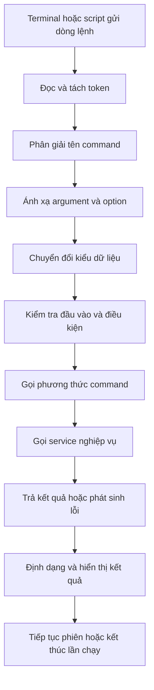

# Theo dõi một lần gọi hoàn chỉnh để hiểu thứ tự xử lý

Khi người dùng nhập một lệnh Spring Shell, ứng dụng thực hiện nhiều bước trước và sau khi gọi phương thức Java. Shell tiếp nhận dòng nhập, phân tích cú pháp, tìm command, ánh xạ tham số, chuyển đổi kiểu, kiểm tra điều kiện rồi mới chạy logic nghiệp vụ. Cuối cùng, kết quả được chuyển tới terminal hoặc lỗi được xử lý theo chế độ chạy.

Hiểu thứ tự này giúp xác định lỗi đang nằm ở đâu. Nếu người dùng nhập `--id abc` cho tham số `long`, phương thức command có thể chưa được gọi vì chuyển đổi kiểu thất bại. Nếu `--id 0` chuyển đổi thành công nhưng không hợp lệ theo quy tắc ứng dụng, lỗi xuất hiện ở bước validation. Nếu command chạy nhưng không tìm thấy bản ghi, vấn đề nằm trong xử lý nghiệp vụ hoặc dữ liệu.

Spring Shell hỗ trợ xây dựng CLI bằng cách khai báo command, xử lý đối số, validation, trợ giúp và tự hoàn thành; đồng thời cho phép chạy tương tác hoặc chạy lệnh trong quy trình script. Bài này theo dõi một lần gọi từ lúc nhập đến lúc nhận kết quả để bạn biết mỗi giai đoạn chịu trách nhiệm cho điều gì và nên kiểm tra ở đâu.

Sau bài này, bạn có thể:

- Mô tả các giai đoạn chính của một lần gọi command.
- Phân biệt phân tích cú pháp, ánh xạ tham số, chuyển đổi kiểu và validation.
- Xác định thời điểm phương thức command và service nghiệp vụ được gọi.
- Theo dõi kết quả, exception và mã thoát ở chế độ tương tác hoặc tự động hóa.
- Thiết kế log và kiểm thử để khoanh vùng lỗi theo từng giai đoạn.

> Ví dụ sử dụng API annotation `org.springframework.shell.standard` như `@ShellComponent`, `@ShellMethod` và `@ShellOption`, có trong các ứng dụng Spring Shell 2.x/3.x. Phiên bản mới cũng hỗ trợ mô hình khai báo command khác. Tên lớp nội bộ và chi tiết runner có thể thay đổi giữa phiên bản, nhưng các ranh giới quan sát được trong luồng xử lý vẫn hữu ích khi phân tích một lần gọi.

## 1. Nhìn toàn bộ luồng thực thi

Giả sử người dùng nhập:

```text
order show --id 42 --verbose
```

Ứng dụng cần tìm command `order show`, lấy giá trị `42` cho tham số `id`, bật chế độ hiển thị chi tiết, kiểm tra đầu vào, truy vấn đơn hàng rồi hiển thị kết quả. Luồng tổng quát:



Đây là mô hình để theo dõi hành vi. Một số chi tiết như kiểm tra availability, interceptor, xử lý exception và chuyển mã thoát được thực hiện bởi thành phần framework hoặc cấu hình runner; vị trí nội bộ chính xác có thể khác theo phiên bản và chế độ chạy.

## 2. Chuẩn bị command để theo dõi

Ta dùng một command đơn giản để xem thông tin đơn hàng. Command nhận mã đơn hàng và một cờ tùy chọn để chọn mức chi tiết:

```java
import java.util.Optional;

import org.springframework.shell.standard.ShellComponent;
import org.springframework.shell.standard.ShellMethod;
import org.springframework.shell.standard.ShellOption;

@ShellComponent
public class OrderCommands {

    private final OrderService orderService;

    public OrderCommands(OrderService orderService) {
        this.orderService = orderService;
    }

    @ShellMethod(key = "order show", value = "Hiển thị thông tin đơn hàng.")
    public String show(
            @ShellOption(value = {"-i", "--id"}, help = "Mã đơn hàng.") long id,
            @ShellOption(value = {"-v", "--verbose"}, arity = 0, defaultValue = "false",
                    help = "Hiển thị thông tin chi tiết.") boolean verbose) {

        if (id <= 0) {
            throw new IllegalArgumentException("Mã đơn hàng phải lớn hơn 0.");
        }

        Order order = orderService.findById(id)
                .orElseThrow(() -> new IllegalArgumentException(
                        "Không tìm thấy đơn hàng #" + id));

        if (verbose) {
            return "Đơn hàng #" + order.id()
                    + " | Khách hàng: " + order.customer()
                    + " | Trạng thái: " + order.status();
        }
        return "Đơn hàng #" + order.id() + " | " + order.status();
    }
}
```

Đối tượng và service trong ví dụ có thể được định nghĩa như sau:

```java
import java.util.Optional;

public class Order {
    private final long id;
    private final String customer;
    private final String status;

    public Order(long id, String customer, String status) {
        this.id = id;
        this.customer = customer;
        this.status = status;
    }

    public long id() { return id; }
    public String customer() { return customer; }
    public String status() { return status; }
}

public interface OrderService {
    Optional<Order> findById(long id);
}
```

`OrderCommands` chịu trách nhiệm nhận đầu vào CLI, kiểm tra điều kiện đơn giản và chuyển công việc sang `OrderService`. Service đảm nhận việc lấy dữ liệu và các quy tắc nghiệp vụ. Trong ứng dụng thực tế, service thường là bean Spring được inject; phần lưu trữ có thể là repository hoặc API bên ngoài.

## 3. Giai đoạn 1: tiếp nhận dòng lệnh

Ở chế độ tương tác, terminal reader nhận nội dung người dùng nhập. Spring Shell thường sử dụng JLine để đọc dòng, hiển thị dấu nhắc, xử lý phím và hỗ trợ các tính năng terminal. Ở chế độ không tương tác, command có thể đến từ đối số khởi chạy, script hoặc một cơ chế runner khác.

Ở bước này, shell có được một dòng đầu vào như:

```text
order show --id 42 --verbose
```

Nếu người dùng chỉ gõ một phần lệnh rồi nhấn Enter, shell vẫn nhận dòng đó và bước phân tích sau sẽ quyết định liệu cú pháp có hợp lệ hay không. Nếu terminal không đọc được đầu vào hoặc runner không chuyển dòng lệnh tới shell, phương thức command chưa thể được gọi.

## 4. Giai đoạn 2: phân tích cú pháp và tách token

Parser tách dòng nhập thành các thành phần mà shell có thể hiểu: tên command, tên option, giá trị option và argument vị trí. Dấu nháy giúp một chuỗi có dấu cách được coi là một giá trị:

```text
customer create --name "Nguyễn An" --note "Khách hàng ưu tiên"
```

Giá trị `Nguyễn An` là một token logic dù chứa dấu cách. Nếu bỏ dấu nháy, parser có thể tách thành nhiều token và ánh xạ sai.

Parser cũng cần xử lý dấu nháy, ký tự escape, dấu phân cách và cú pháp của option theo cấu hình của phiên bản. Không nên giả định mọi shell terminal có quy tắc quoting giống nhau; hãy thử cú pháp trên terminal thực tế mà ứng dụng hỗ trợ.

Lỗi ở giai đoạn này thường gồm:

- Cú pháp dòng lệnh không đầy đủ.
- Tên option được viết sai hoặc thiếu giá trị.
- Giá trị có dấu cách chưa được đặt trong dấu nháy.
- Số lượng token không phù hợp với arity của tham số.

## 5. Giai đoạn 3: phân giải command

Sau khi phân tích token, Spring Shell xác định command mà người dùng muốn gọi. Command được đăng ký trong command catalog thông qua cơ chế khai báo của ứng dụng. Với API annotation cũ, `@ShellComponent` giúp phát hiện lớp và `@ShellMethod` công bố phương thức thành command.

Trong ví dụ, tên command chính là `order show`. Nếu phương thức khai báo nhiều key, người dùng có thể gọi bằng một bí danh hợp lệ:

```java
@ShellMethod(
        key = {"order show", "order get"},
        value = "Hiển thị thông tin đơn hàng.")
public String show(@ShellOption(value = {"-i", "--id"}) long id) {
    return "Đang hiển thị đơn hàng #" + id;
}
```

Các tên `order show` và `order get` cùng dẫn tới một phương thức. Nếu tên không tồn tại, shell báo không nhận diện được command; phần thân phương thức không được chạy.

Khi điều tra lỗi phân giải, hãy so sánh tên người dùng nhập với key đã đăng ký và kiểm tra lớp command có được Spring quét hay không. Lệnh `help` là cách nhanh để quan sát command catalog.

## 6. Giai đoạn 4: ánh xạ argument và option vào tham số

Khi đã xác định command, Spring Shell ghép các giá trị đầu vào với tham số phương thức. Đối số vị trí được ghép theo thứ tự; option có tên được ghép theo tên khai báo và bí danh.

Với chữ ký:

```java
public String show(
        @ShellOption(value = {"-i", "--id"}) long id,
        @ShellOption(value = {"-v", "--verbose"}, arity = 0,
                defaultValue = "false") boolean verbose)
```

Dòng lệnh:

```text
order show --id 42 --verbose
```

được ánh xạ thành:

| Tham số Java | Giá trị nhận được | Nguồn |
|---|---:|---|
| `id` | `42` | `--id 42` |
| `verbose` | `true` | Cờ `--verbose` được cung cấp |

Nếu người dùng bỏ `--verbose`, giá trị mặc định là `false`. Nếu bỏ `--id` trong khi tham số này bắt buộc, shell báo thiếu đầu vào và không gọi phương thức command.

Với đối số vị trí, thứ tự tham số rất quan trọng. Với option có tên, tên dài giúp script dễ đọc và ít phụ thuộc thứ tự:

```text
order show 42
order show --id 42
```

Hãy thiết kế một kiểu cú pháp nhất quán cho từng command. Nếu dùng kết hợp argument vị trí và option, tài liệu trợ giúp phải làm rõ phần nào người dùng cần cung cấp.

## 7. Giai đoạn 5: chuyển đổi kiểu dữ liệu

Token từ terminal ban đầu là văn bản. Spring Shell sử dụng cơ chế chuyển đổi để đưa giá trị vào kiểu tham số Java. Ví dụ, chuỗi `42` được chuyển thành `long`, còn `true` hoặc sự hiện diện của cờ boolean được ánh xạ thành `boolean` theo cú pháp được hỗ trợ.

Một số ví dụ:

| Token đầu vào | Kiểu tham số | Kết quả |
|---|---|---|
| `42` | `long` | `42L` |
| `20` | `int` | `20` |
| `true` | `boolean` | `true` |
| `2026-11-26` | `LocalDate` | Ngày 26-11-2026 nếu converter tương ứng được đăng ký |
| `abc` | `long` | Chuyển đổi thất bại |

Các kiểu phổ biến thường được framework hỗ trợ; kiểu miền riêng của ứng dụng có thể cần converter tùy chỉnh. Nếu chuyển đổi thất bại, shell có thể báo lỗi trước khi gọi phương thức command.

Phân biệt hai tình huống:

```text
order show --id abc
order show --id -1
```

Ở dòng đầu, `abc` không thể chuyển thành `long`, nên lỗi nằm ở chuyển đổi kiểu. Ở dòng thứ hai, `-1` là một số nguyên hợp lệ về mặt kiểu dữ liệu; ứng dụng phải kiểm tra quy tắc `id` dương ở bước validation.

## 8. Giai đoạn 6: validation và điều kiện khả dụng

Chuyển đổi thành công chỉ chứng minh giá trị có thể biểu diễn bằng kiểu Java. Nó không chứng minh giá trị hợp lệ theo nghiệp vụ. Ví dụ `id = -1` là `long` hợp lệ nhưng có thể không phải mã đơn hàng được chấp nhận.

Có thể kiểm tra quy tắc đầu vào ngay trong command khi quy tắc đơn giản:

```java
if (id <= 0) {
    throw new IllegalArgumentException("Mã đơn hàng phải lớn hơn 0.");
}
```

Với quy tắc thuộc nghiệp vụ, nên đặt kiểm tra trong service để các kênh gọi khác như REST API, batch job hoặc command đều dùng chung một quy tắc. Nếu dự án tích hợp Bean Validation hoặc method validation, cần cấu hình đúng cơ chế validation tương ứng; không nên mặc định rằng mọi annotation constraint trên tham số đều tự chạy nếu ứng dụng chưa bật tích hợp đó.

### Kiểm tra khả dụng của command

Một command có thể chỉ được phép gọi khi ứng dụng ở trạng thái phù hợp. Spring Shell cung cấp `Availability` và `@ShellMethodAvailability` trong mô hình annotation cũ:

```java
import org.springframework.shell.Availability;
import org.springframework.shell.standard.ShellMethodAvailability;

private boolean exportReady;

@ShellMethod(key = "order export", value = "Xuất dữ liệu đơn hàng.")
@ShellMethodAvailability("exportAvailability")
public String export() {
    return "Đang xuất dữ liệu đơn hàng.";
}

public Availability exportAvailability() {
    return exportReady
            ? Availability.available()
            : Availability.unavailable("chưa cấu hình nguồn dữ liệu");
}
```

Availability cho biết command có thể được gọi ở trạng thái hiện tại hay không và có thể được framework truy vấn trong các hoạt động như trợ giúp, tự hoàn thành hoặc thực thi. Vì vậy, không nên giả định provider chỉ được gọi đúng một lần trong một lần nhập lệnh. Provider nên nhanh, không có side effect và chỉ đọc trạng thái cần thiết.

Availability cũng không thay thế validation hoặc kiểm tra quyền nghiệp vụ. Trạng thái có thể thay đổi giữa lúc kiểm tra và lúc service thực hiện thao tác; service vẫn phải xác nhận các điều kiện quan trọng trước khi thay đổi dữ liệu.

## 9. Giai đoạn 7: gọi phương thức command và service

Khi command đã được phân giải, tham số được ánh xạ và các điều kiện cần thiết được đáp ứng, Spring Shell gọi phương thức Java. Từ đây, mã ứng dụng bắt đầu thực hiện logic command.

Trong ví dụ `order show`, phương thức thực hiện ba việc:

1. Kiểm tra `id` lớn hơn 0.
2. Gọi `orderService.findById(id)` để lấy đơn hàng.
3. Tạo chuỗi kết quả theo giá trị của `verbose`.

Service có thể truy cập repository, gọi API, kiểm tra quyền, áp dụng quy tắc miền hoặc thực hiện giao dịch. Nếu thao tác cần transaction, hãy đặt ranh giới transaction ở service phù hợp, ví dụ bằng `@Transactional`; việc một phương thức được gọi từ shell không tự động làm toàn bộ xử lý trở thành một giao dịch.

Nên giữ command method mỏng để dễ hiểu luồng gọi. Những quy tắc nghiệp vụ cần tái sử dụng thuộc về service. Điều này cũng giúp unit test service mà không cần dựng terminal hoặc command parser.

## 10. Giai đoạn 8: xử lý kết quả và hiển thị

Phương thức command trả về một giá trị. Với ví dụ trên, kiểu trả về là `String`, vì vậy shell có thể hiển thị nội dung đó trong terminal. Với dữ liệu có cấu trúc hoặc bảng, ứng dụng có thể sử dụng kiểu kết quả và cơ chế rendering phù hợp với phiên bản Spring Shell.

Ví dụ kết quả:

```text
my-shell:> order show --id 42
Đơn hàng #42 | SHIPPED

my-shell:> order show --id 42 --verbose
Đơn hàng #42 | Khách hàng: Nguyễn An | Trạng thái: SHIPPED
```

Giá trị trả về và cách hiển thị là hai khái niệm liên quan nhưng không hoàn toàn giống nhau. Command tạo kết quả; shell hoặc renderer quyết định cách đưa kết quả ra terminal. Nếu output là một phần giao diện ổn định mà script hoặc người dùng cần xử lý, hãy giữ format nhất quán và cân nhắc cung cấp định dạng máy đọc được như JSON hoặc CSV.

## 11. Giai đoạn 9: xử lý exception và mã thoát

Lỗi có thể xuất hiện ở nhiều giai đoạn và không phải lỗi nào cũng đi qua phương thức command:

| Giai đoạn | Ví dụ lỗi | Phương thức command đã chạy? |
|---|---|---|
| Đọc/phân tích dòng lệnh | Cú pháp không hợp lệ, quote không đóng | Chưa |
| Phân giải command | Không tồn tại `order show` | Chưa |
| Ánh xạ tham số | Thiếu `--id`, option không được hỗ trợ | Chưa |
| Chuyển đổi kiểu | `--id abc` không chuyển thành `long` | Chưa |
| Validation trong command | `id <= 0` | Đã vào phương thức |
| Service/nghiệp vụ | Không tìm thấy đơn hàng hoặc database lỗi | Đã vào phương thức |
| Rendering output | Renderer không xử lý được kiểu kết quả | Phương thức có thể đã hoàn tất |

Spring Shell xử lý exception để đưa lỗi tới người dùng theo cơ chế của phiên bản và cấu hình. Trong ứng dụng thật, nên phân biệt lỗi cú pháp/đầu vào, lỗi nghiệp vụ dự kiến và lỗi hệ thống bất ngờ. Thông báo cần đủ rõ để người dùng biết cách sửa, nhưng không làm lộ stack trace, thông tin kết nối hoặc dữ liệu nhạy cảm trong môi trường sử dụng thực tế.

Ở chế độ tương tác, sau khi hiển thị kết quả hoặc lỗi, shell thường tiếp tục chờ lệnh tiếp theo. Ở chế độ script hoặc non-interactive, runner có thể kết thúc sau khi xử lý; mã thoát của tiến trình cần phản ánh thành công hay thất bại theo chính sách ứng dụng. Đừng suy ra mã thoát chỉ từ nội dung chuỗi được in ra. Hãy kiểm tra cơ chế trả exit code của runner đang dùng và viết test cho cả trường hợp thành công lẫn thất bại.

## 12. Theo dõi luồng bằng log

Log có cấu trúc giúp nối các sự kiện của một lần gọi. Có thể ghi nhận lúc bắt đầu command, lúc service kết thúc và kết quả tổng thể:

```java
import org.slf4j.Logger;
import org.slf4j.LoggerFactory;

private static final Logger log = LoggerFactory.getLogger(OrderCommands.class);

@ShellMethod(key = "order show", value = "Hiển thị thông tin đơn hàng.")
public String show(
        @ShellOption(value = {"-i", "--id"}) long id) {
    long startedAt = System.nanoTime();
    log.info("Bắt đầu order show, id={}", id);
    try {
        Order order = orderService.findById(id)
                .orElseThrow(() -> new IllegalArgumentException(
                        "Không tìm thấy đơn hàng #" + id));
        return "Đơn hàng #" + order.id() + " | " + order.status();
    } catch (RuntimeException ex) {
        log.warn("order show thất bại, id={}, reason={}", id, ex.getMessage());
        throw ex;
    } finally {
        long elapsedMs = (System.nanoTime() - startedAt) / 1_000_000;
        log.info("Kết thúc order show, id={}, elapsedMs={}", id, elapsedMs);
    }
}
```

Đoạn log minh họa thời gian thực thi phần thân command và service được gọi đồng bộ bên trong. Nó không đo thời gian người dùng gõ lệnh hoặc toàn bộ công đoạn parser trước khi phương thức bắt đầu. Muốn quan sát toàn bộ vòng đời, có thể kết hợp log của runner, command, service và các thành phần tích hợp.

Khi ghi log:

- Dùng mã tương quan hoặc request ID nếu ứng dụng có nhiều lần gọi đồng thời.
- Ghi tên command, định danh tài nguyên phù hợp và thời gian thực thi.
- Tránh ghi mật khẩu, token, dữ liệu cá nhân hoặc toàn bộ dòng lệnh nếu dòng lệnh có thể chứa bí mật.
- Không ghi cùng một exception ở mọi tầng nếu điều đó tạo log lặp; chọn tầng chịu trách nhiệm ghi nhận lỗi.
- Dùng mức `DEBUG` cho thông tin phân tích chi tiết và mức `WARN`/`ERROR` cho tình huống cần chú ý.

## 13. Kiểm thử từng ranh giới trong luồng

Một bài kiểm thử tốt xác định rõ mục tiêu: kiểm tra command method, service hay toàn bộ tích hợp shell. Không cần dựng terminal cho mọi unit test.

| Loại kiểm thử | Phạm vi | Ví dụ |
|---|---|---|
| Unit test service | Quy tắc nghiệp vụ và truy cập dữ liệu qua dependency giả | `findById` trả về đơn hàng, không tìm thấy, hoặc repository phát sinh lỗi. |
| Unit test command | Kiểm tra validation và cách command gọi service | `id <= 0` bị từ chối; `id` hợp lệ được chuyển tới service. |
| Integration test shell | Parser, đăng ký command, binding, converter và output | Gọi `order show --id 42` qua test client hoặc test harness của phiên bản. |
| Test non-interactive | Kết quả và mã thoát khi chạy tự động | Lệnh thành công trả mã 0; lỗi được ánh xạ sang mã khác 0 theo cấu hình. |

Một số tình huống nên có trong bộ kiểm thử:

1. Lệnh hợp lệ với đầy đủ option.
2. Lệnh hợp lệ khi bỏ option có giá trị mặc định.
3. Thiếu option bắt buộc.
4. Giá trị không chuyển đổi được sang kiểu tham số.
5. Giá trị chuyển đổi được nhưng vi phạm validation.
6. Command chưa khả dụng.
7. Service không tìm thấy dữ liệu hoặc phát sinh lỗi hạ tầng.
8. Output và mã thoát ở chế độ script.

Test tích hợp nên dùng cơ chế test client/harness được tài liệu của đúng phiên bản Spring Shell cung cấp. Tên API kiểm thử có thể thay đổi; hãy kiểm tra dependency và phiên bản dự án trước khi chọn lớp test cụ thể.

## 14. Bài tập thực hành

Tạo command `invoice show` để hiển thị hóa đơn. Yêu cầu:

1. Nhận `--id` kiểu `long` và `--detail` kiểu boolean, mặc định `false`.
2. Chạy thử với mã hợp lệ, mã âm, mã không tồn tại và giá trị không phải số.
3. Ghi nhận rõ trường hợp nào phương thức command được gọi và trường hợp nào parser hoặc converter từ chối trước đó.
4. Tách thao tác đọc hóa đơn sang `InvoiceService`.
5. Thêm một điều kiện availability để chỉ cho phép xuất hóa đơn khi nguồn dữ liệu sẵn sàng.
6. Ghi log thời gian xử lý và mã hóa đơn, tránh ghi thông tin nhạy cảm.
7. Viết unit test cho service và integration test cho cú pháp command.
8. Chạy command qua chế độ tương tác và script, xác nhận output và mã thoát.

Khi xem kết quả, hãy giải thích được lỗi phát sinh ở bước nào, thành phần nào đã chạy và bước kế tiếp có được thực hiện hay không.

## Tài liệu tham khảo

- [Spring Shell 3.3 – Getting Started](https://docs.spring.io/spring-shell/reference/3.3/getting-started.html): khai báo và thực thi command.
- [Spring Shell 3.3 – Command Availability](https://docs.spring.io/spring-shell/reference/3.3/commands/availability.html): kiểm soát khả dụng của command theo trạng thái.
- [Spring Shell 3.3 – Command Syntax](https://docs.spring.io/spring-shell/reference/3.3/commands/syntax.html): cú pháp argument, option và phân tích đầu vào trong mô hình command mới.
- [Spring Framework – Validation](https://docs.spring.io/spring-framework/reference/core/validation/beanvalidation.html): tích hợp Bean Validation trong ứng dụng Spring.
- [Spring Framework – Declarative Transaction Management](https://docs.spring.io/spring-framework/reference/data-access/transaction/declarative.html): đặt ranh giới transaction ở tầng service.
