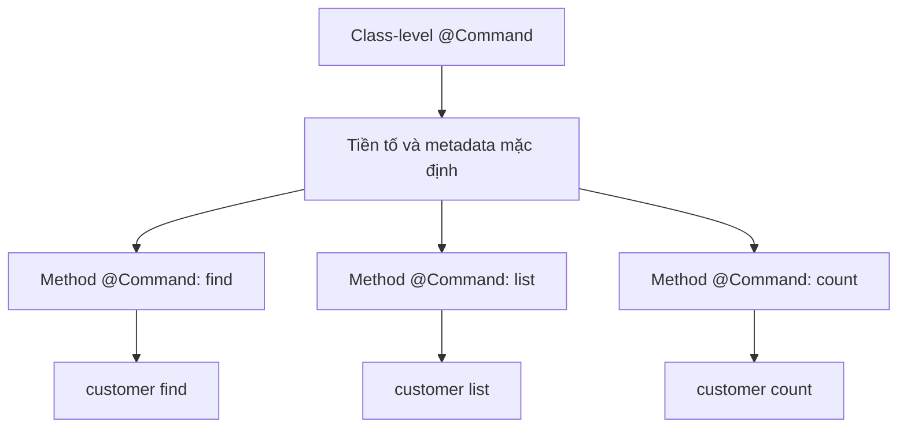

# Thiết lập dùng chung trên @Command ở cấp lớp trong 3.x

Trong Spring Shell 3.x, annotation `@Command` thuộc mô hình khai báo command mới. Khi đặt trên một phương thức, annotation đánh dấu phương thức đó là một command có thể được đăng ký. Khi đặt trên lớp, `@Command` cung cấp tiền tố và các thiết lập mặc định được dùng chung cho những phương thức `@Command` trong chính lớp đó.

Cách khai báo ở cấp lớp giúp nhóm các command liên quan thành một bộ lệnh có cấu trúc nhất quán. Ví dụ, một lớp quản lý khách hàng có thể khai báo tiền tố `customer`, nhóm trợ giúp `Quản lý khách hàng` và chế độ tương tác chung; các phương thức bên trong lần lượt định nghĩa `find`, `list` và `count`. Người dùng gọi `customer find` hoặc `customer list` thay vì phải ghi một tên dài riêng cho từng thao tác.

Nội dung này tập trung vào annotation model mới của Spring Shell 3.1.x và các bản 3.x tiếp theo có hỗ trợ class-level `@Command`. Spring Shell 3.x còn có mô hình annotation legacy như `@ShellComponent`, `@ShellMethod` và `@ShellOption`; các annotation đó có quy tắc cấu hình riêng và không nên trộn lẫn với ví dụ `@Command` dưới đây.

## Hai phạm vi của @Command

`@Command` trong API 3.1.x có thể đặt ở hai vị trí:

- **Cấp lớp (`TYPE`):** cung cấp tiền tố command, tiền tố alias và các metadata dùng chung cho các command method trong lớp.
- **Cấp phương thức (`METHOD`):** xác định một command cụ thể, tên command con và metadata riêng của command đó.

Annotation ở cấp lớp không tự tạo ra một command có thể thực thi. Một command vẫn cần phương thức được đánh dấu `@Command` ở cấp method. Lớp chứa các method đó phải được đưa vào quá trình đăng ký command bằng `@EnableCommand` hoặc `@CommandScan`.



Ví dụ trên thể hiện việc kết hợp tiền tố ở cấp lớp với tên command ở cấp phương thức. Các method có thể ghi đè một số metadata như `group` hoặc `description` khi cần khác biệt.

## Những thuộc tính có thể dùng chung

API `org.springframework.shell.command.annotation.Command` trong Spring Shell 3.1.x có các thuộc tính sau. Những thuộc tính được hỗ trợ ở cấp lớp có ý nghĩa như metadata mặc định cho các method `@Command` trong cùng lớp.

| Thuộc tính | Ý nghĩa ở cấp lớp | Cách method-level sử dụng |
|---|---|---|
| `command` | Tiền tố chung của tên command | Tên command method được nối sau tiền tố này |
| `alias` | Tiền tố chung cho alias | Alias khai báo ở method được ghép với tiền tố alias của lớp |
| `group` | Nhóm trợ giúp mặc định | Các method kế thừa nhóm; method có thể ghi đè |
| `description` | Mô tả mặc định | Các method kế thừa mô tả; method có thể ghi đè |
| `hidden` | Giá trị ẩn mặc định trong metadata annotation | API mô tả giá trị ở lớp được kế thừa bởi các mapping method; xem lưu ý hỗ trợ bên dưới |
| `interactionMode` | Chế độ tương tác mặc định | Các mapping method kế thừa chế độ này; có thể khai báo chế độ cho method cụ thể |

### Tiền tố command

Thuộc tính `command` nhận một mảng chuỗi. Có thể viết một chuỗi có dấu cách hoặc nhiều phần tử; các phần được tách và loại bỏ khoảng trắng. Khi khai báo ở cấp lớp, giá trị này trở thành tiền tố cho tên command ở cấp method.

```java
@Command(command = "customer")
class CustomerCommands {

    @Command(command = "find")
    public String find() {
        return "Tra cứu khách hàng";
    }

    @Command(command = "list")
    public String list() {
        return "Danh sách khách hàng";
    }
}
```

Hai command được tạo có tên `customer find` và `customer list`. Lớp chỉ đặt tiền tố chung; tên thao tác cuối cùng vẫn được xác định ở method.

Với tiền tố nhiều phần, có thể viết:

```java
@Command(command = { "customer", "manage" })
class CustomerManagementCommands {

    @Command(command = "find")
    public String find() {
        return "Tra cứu khách hàng";
    }
}
```

Tên command kết quả là `customer manage find`. Cách tổ chức này hữu ích khi CLI có nhiều miền chức năng và cần nhóm tên theo cấu trúc phân cấp.

### Tiền tố alias

Thuộc tính `alias` ở cấp lớp hoạt động như tiền tố alias. Nó kết hợp với alias được khai báo ở method để tạo alias cho command. Chỉ đặt `alias` ở cấp lớp mà không khai báo alias ở method sẽ không tự tạo alias cho tất cả command.

```java
@Command(command = "customer", alias = "cust")
class CustomerCommands {

    @Command(command = "find", alias = "f")
    public String find() {
        return "Tra cứu khách hàng";
    }
}
```

Command chính là `customer find`; alias được ghép là `cust f`. Một method có thể khai báo nhiều alias dưới dạng mảng. Trong trường hợp đó, mỗi alias là một lựa chọn riêng theo quy tắc alias của Spring Shell.

Tiền tố alias hữu ích khi command chính có tên dài nhưng người dùng thường xuyên gọi lệnh. Hãy giữ alias ngắn, dễ nhớ và tránh tạo alias trùng với command khác.

### Nhóm trợ giúp dùng chung

Thuộc tính `group` xác định nhóm mà command xuất hiện trong danh sách trợ giúp. Khi đặt `group` ở cấp lớp, các method `@Command` trong lớp kế thừa nhóm này. Nếu một command thuộc nhóm khác, có thể ghi đè ngay tại method.

```java
@Command(command = "customer", group = "Quản lý khách hàng")
class CustomerCommands {

    @Command(command = "find")
    public String find() {
        return "Tra cứu khách hàng";
    }

    @Command(command = "count", group = "Báo cáo")
    public long count() {
        return 0L;
    }
}
```

`customer find` thuộc nhóm `Quản lý khách hàng`, trong khi `customer count` thuộc nhóm `Báo cáo`. Thuộc tính `group` chỉ ảnh hưởng cách tổ chức command trong trợ giúp; nó không tự thêm tiền tố vào tên command.

### Mô tả mặc định

`description` ở cấp lớp là mô tả mặc định được kế thừa bởi các method command trong lớp. Một method có thể khai báo mô tả riêng để trợ giúp giải thích đúng chức năng cụ thể.

```java
@Command(
        command = "customer",
        description = "Các thao tác quản lý khách hàng"
)
class CustomerCommands {

    @Command(command = "list")
    public String list() {
        return "Danh sách khách hàng";
    }

    @Command(
            command = "find",
            description = "Tìm một khách hàng theo mã định danh"
    )
    public String find() {
        return "Thông tin khách hàng";
    }
}
```

`customer list` kế thừa mô tả ở cấp lớp. `customer find` dùng mô tả riêng của method. Nên viết mô tả ngắn, rõ hành động và kết quả để người dùng hiểu lệnh khi xem `help`.

### Chế độ tương tác

`interactionMode` chỉ ra command phù hợp với chế độ chạy nào của shell. API 3.x định nghĩa các giá trị:

- `InteractionMode.ALL`: command phù hợp với cả hai chế độ.
- `InteractionMode.INTERACTIVE`: command dành cho phiên tương tác, nơi shell tiếp tục chờ người dùng nhập lệnh.
- `InteractionMode.NONINTERACTIVE`: command dành cho lần chạy không tương tác, thường xử lý đầu vào được truyền khi khởi chạy rồi kết thúc.

Ví dụ đặt chế độ tương tác chung cho một nhóm command:

```java
import org.springframework.shell.context.InteractionMode;

@Command(
        command = "session",
        interactionMode = InteractionMode.INTERACTIVE
)
class SessionCommands {

    @Command(command = "status")
    public String status() {
        return "Trạng thái phiên hiện tại";
    }

    @Command(command = "reset")
    public String reset() {
        return "Đã đặt lại phiên";
    }
}
```

Hai command thuộc nhóm `session` kế thừa chế độ tương tác. Đây là gợi ý để shell quyết định command phù hợp với mode đang chạy; nó không thay thế kiểm tra trạng thái nghiệp vụ như người dùng đã đăng nhập hay đã kết nối máy chủ hay chưa.

### Thuộc tính hidden và giới hạn cần biết

API annotation 3.1.x có thuộc tính `hidden`, và tài liệu API mô tả metadata cấp lớp được kế thừa bởi các mapping method. Tuy nhiên, tài liệu tính năng Hidden Command của dòng Spring Shell 3.x nêu rõ việc ẩn command chưa được hỗ trợ với cấu hình dựa trên annotation. Vì vậy, không nên dựa vào `@Command(hidden = true)` để bảo đảm một command bị ẩn trong mọi bản 3.x. Nếu yêu cầu ẩn command thực sự cần thiết, hãy kiểm tra đúng bản phát hành và dùng đăng ký programmatic với `CommandRegistration` cùng cấu hình `hidden` mà phiên bản hỗ trợ.

Ngay cả khi command được ẩn khỏi danh sách trợ giúp và tự hoàn thành, ẩn không phải là cơ chế phân quyền. Nếu người dùng biết tên lệnh, họ có thể vẫn gọi được command trong những cấu hình hỗ trợ hidden command. Quyền truy cập cần được kiểm tra trong lớp bảo mật hoặc logic nghiệp vụ.

## Ví dụ tổng hợp: nhóm lệnh khách hàng

Ví dụ sau kết hợp tiền tố, alias, nhóm trợ giúp, mô tả và chế độ tương tác ở cấp lớp. Các method cung cấp thao tác riêng và có thể ghi đè mô tả hoặc nhóm khi cần.

```java
import org.springframework.shell.command.annotation.Command;
import org.springframework.shell.command.annotation.Option;
import org.springframework.shell.context.InteractionMode;

@Command(
        command = "customer",
        alias = "cust",
        group = "Quản lý khách hàng",
        description = "Các thao tác quản lý khách hàng",
        interactionMode = InteractionMode.INTERACTIVE
)
class CustomerCommands {

    private final CustomerService customerService;

    CustomerCommands(CustomerService customerService) {
        this.customerService = customerService;
    }

    @Command(
            command = "find",
            alias = "f",
            description = "Tìm khách hàng theo mã"
    )
    public String find(@Option(longNames = "id") String id) {
        return customerService.findById(id)
                .map(Customer::toString)
                .orElse("Không tìm thấy khách hàng: " + id);
    }

    @Command(command = "list")
    public String list() {
        return customerService.findAll().toString();
    }

    @Command(command = "count", group = "Báo cáo")
    public long count() {
        return customerService.count();
    }
}
```

`CustomerService` và `Customer` là các kiểu nghiệp vụ do ứng dụng định nghĩa. Constructor injection cung cấp service cho command class; phần truy vấn dữ liệu nằm trong service để có thể tái sử dụng và kiểm thử độc lập.

Kết quả khai báo:

| Command | Alias | Nhóm | Mô tả |
|---|---|---|---|
| `customer find` | `cust f` | Quản lý khách hàng | Tìm khách hàng theo mã |
| `customer list` | Không có alias từ tiền tố lớp | Quản lý khách hàng | Các thao tác quản lý khách hàng |
| `customer count` | Không có alias từ tiền tố lớp | Báo cáo | Các thao tác quản lý khách hàng |

Lưu ý rằng alias cấp lớp chỉ đóng vai trò tiền tố cho alias ở method. `customer list` và `customer count` không tự có alias `cust list` hoặc `cust count` nếu các method đó không khai báo alias riêng.

## Đăng ký các lớp command

Khai báo `@Command` không tự động làm cho mọi lớp có annotation được đăng ký. Ứng dụng cần chọn các target class cho Spring Shell bằng `@EnableCommand` hoặc `@CommandScan`.

### Chọn lớp cụ thể bằng @EnableCommand

```java
import org.springframework.context.annotation.Configuration;
import org.springframework.shell.command.annotation.EnableCommand;

@Configuration
@EnableCommand(CustomerCommands.class)
class ShellCommandConfiguration {
}
```

Cách này phù hợp khi muốn chỉ rõ lớp command nào được đưa vào shell. Có thể liệt kê nhiều class trong `@EnableCommand` khi ứng dụng có nhiều nhóm lệnh.

### Quét package bằng @CommandScan

```java
import org.springframework.boot.autoconfigure.SpringBootApplication;
import org.springframework.shell.command.annotation.CommandScan;

@SpringBootApplication
@CommandScan
public class Application {
    public static void main(String[] args) {
        org.springframework.boot.SpringApplication.run(Application.class, args);
    }
}
```

Khi không chỉ định package, `@CommandScan` quét từ package của lớp được đánh dấu và các package con. Có thể chỉ định `basePackages` hoặc `basePackageClasses` để giới hạn phạm vi quét. Hãy đặt lớp ứng dụng ở package gốc phù hợp để các command class được phát hiện.

Nếu command không xuất hiện, kiểm tra trước cấu hình `@EnableCommand`/`@CommandScan`, phạm vi package và các điều kiện scan. Việc chỉ nhìn thấy một lớp có `@Command` trong mã nguồn chưa chứng minh Spring Shell đã đăng ký các method của lớp đó.

## Quan hệ giữa class-level và method-level

| Trường hợp | Kết quả |
|---|---|
| Chỉ có `@Command` ở lớp | Cung cấp metadata mặc định; chưa có method command để thực thi |
| Chỉ có `@Command` ở method | Đăng ký command theo cấu hình method, không có tiền tố từ lớp |
| Cả lớp và method có `command` | Tên lớp trở thành tiền tố, tên method được nối phía sau |
| Cả lớp và method có `alias` | Alias method được ghép với tiền tố alias lớp |
| Cả lớp và method có `group` | Method dùng group riêng nếu khai báo, nếu không thì kế thừa group lớp |
| Cả lớp và method có `description` | Method dùng mô tả riêng nếu khai báo, nếu không thì kế thừa mô tả lớp |
| Class-level `interactionMode` | Các mapping method trong lớp kế thừa chế độ tương tác đã khai báo |

Đừng nhầm `group` với `command`: group tổ chức trợ giúp, còn command tạo cấu trúc tên dùng để gọi. Tương tự, alias là tên gọi thay thế, không phải một nhóm trợ giúp mới.

## So sánh với annotation legacy trong Spring Shell 3.x

Spring Shell 3.x duy trì hai mô hình annotation trong giai đoạn chuyển tiếp:

| Nội dung | Annotation model mới | Annotation legacy |
|---|---|---|
| Đánh dấu method command | `@Command` | `@ShellMethod` |
| Đối số/tùy chọn | `@Argument`, `@Option` | Tham số method và `@ShellOption` |
| Thiết lập tiền tố ở cấp lớp | `@Command(command = "...")` | Không dùng class-level `@Command`; khai báo key trên method |
| Nhóm trợ giúp | `group` trong `@Command` | `@ShellCommandGroup` ở lớp/package hoặc `group` trong `@ShellMethod` |
| Đăng ký target | `@EnableCommand`, `@CommandScan` | Cơ chế phát hiện bean legacy, thường dùng `@ShellComponent` |

Nếu dự án đang dùng `@ShellComponent` và `@ShellMethod`, không thể chỉ thêm một `@Command(command = "customer")` lên lớp để biến các method legacy thành command con. Hãy chuyển các method sang annotation model mới theo từng nhóm hoặc tiếp tục dùng cơ chế legacy tương ứng.

## Kiểm thử cấu hình dùng chung

Nên kiểm tra kết quả command thực tế trong shell thay vì chỉ kiểm tra annotation bằng reflection. Một bộ kiểm thử tích hợp có thể xác minh:

1. Lớp command đã được đăng ký và các method có `@Command` xuất hiện trong trợ giúp.
2. Tên đầy đủ có tiền tố, ví dụ `customer find`, được gọi thành công.
3. Alias kết hợp, ví dụ `cust f`, gọi đúng cùng thao tác.
4. Method kế thừa `group` và `description` ở cấp lớp.
5. Method có `group` hoặc `description` riêng sử dụng metadata ghi đè.
6. Các command chỉ định `interactionMode` phù hợp với chế độ shell đang chạy.
7. Lớp ngoài phạm vi `@EnableCommand` hoặc `@CommandScan` không bị đăng ký ngoài dự kiến.

Ví dụ phiên shell kỳ vọng:

```text
shell:>customer find --id C1024
Thông tin khách hàng C1024

shell:>cust f --id C1024
Thông tin khách hàng C1024

shell:>customer list
[Danh sách khách hàng]

shell:>help customer find
NAME
    customer find - Tìm khách hàng theo mã
```

Khi kiểm thử metadata nhóm và mô tả, có thể kiểm tra output của `help` hoặc API kiểm thử của Spring Shell theo phiên bản. Nếu chỉ gọi trực tiếp `CustomerCommands.find()` thì chưa kiểm tra được bước phát hiện target, ghép tiền tố, đăng ký alias hay cách trợ giúp hiển thị metadata.

## Lỗi thường gặp và cách xử lý

| Biểu hiện | Nguyên nhân có thể | Cách xử lý |
|---|---|---|
| Chỉ chạy được `find`, không chạy `customer find` | Method không nằm trong lớp có tiền tố hoặc class-level annotation không được xử lý | Kiểm tra import `org.springframework.shell.command.annotation.Command` và vị trí annotation |
| Không có command nào từ lớp | Lớp chưa được chọn bởi `@EnableCommand`/`@CommandScan` | Kiểm tra cấu hình đăng ký target và phạm vi package |
| Alias `cust f` không hoạt động | Method chưa khai báo alias hoặc tiền tố alias không kết hợp như mong đợi | Khai báo alias ở cả lớp và method; xác minh trong `help`/completion |
| Mọi command có mô tả chung dù muốn mô tả riêng | Method không khai báo `description` riêng | Bổ sung mô tả ở từng method cần khác biệt |
| Command nằm sai nhóm trợ giúp | Method-level `group` ghi đè group cấp lớp hoặc class-level group không được áp dụng | Kiểm tra metadata ở hai cấp và output `help` |
| Lệnh chỉ hoạt động ở một chế độ | `interactionMode` giới hạn mode chạy | Kiểm tra mode hiện tại và metadata kế thừa |
| Import không tìm thấy `@Command` | Đang dùng nhầm package legacy hoặc API của major version khác | Kiểm tra dependency và import của Spring Shell 3.1.x+ |

## Lưu ý về phiên bản

Mô hình `@Command` mới được bổ sung từ dòng Spring Shell 3.1.x. Các ví dụ trong bài dùng tên thuộc tính `command` và package `org.springframework.shell.command.annotation`. Trong Spring Shell 4.x, API annotation được tổ chức lại; ví dụ hiện hành có thể dùng thuộc tính `name` và package `org.springframework.shell.core.command.annotation`. Không sao chép nguyên ví dụ 4.x vào dự án 3.x nếu chưa kiểm tra API.

Khi nâng phiên bản, hãy xác định dependency Spring Shell thực tế, mở Javadoc đúng phiên bản và chạy kiểm thử tích hợp cho tên command, alias, trợ giúp và chế độ tương tác. Đặc biệt, đừng xem một thuộc tính xuất hiện trong Javadoc là bảo đảm rằng mọi tính năng đã được triển khai cho annotation model ở mọi bản 3.x; trường hợp `hidden` là ví dụ cần kiểm tra ghi chú trong tài liệu tính năng.

## Tài liệu tham khảo

- [Spring Shell 3.1.x API — Command annotation](https://docs.spring.io/spring-shell/docs/3.1.x/api/org/springframework/shell/command/annotation/Command.html): phạm vi TYPE/METHOD và ý nghĩa từng thuộc tính.
- [Spring Shell 3.1.3 Reference Documentation](https://docs.spring.io/spring-shell/docs/3.1.3/docs/index.html): annotation model mới, `@EnableCommand` và `@CommandScan`.
- [Spring Shell 3.2 Annotation](https://docs.spring.io/spring-shell/reference/3.2/commands/registration/annotation.html): cách đặt `@Command` trên lớp và phương thức.
- [Spring Shell 3.2 Alias](https://docs.spring.io/spring-shell/reference/3.2/commands/alias.html): cách kết hợp alias ở cấp lớp và method.
- [Spring Shell 3.2 Hidden Command](https://docs.spring.io/spring-shell/reference/3.2/commands/hidden.html): giới hạn của hidden command trong annotation model.
