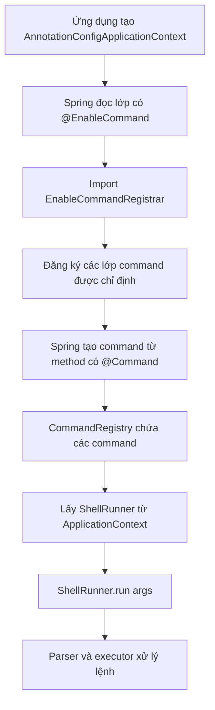

# Vai trò của @EnableCommand khi dùng Spring Shell 4.x không kèm Boot

Spring Shell 4.x có thể chạy trong một ứng dụng Spring Framework thuần mà không cần Spring Boot. Trong trường hợp này, ứng dụng phải chủ động kích hoạt cơ chế phát hiện và đăng ký command. Annotation `@EnableCommand` đảm nhiệm vai trò đó: nó nhập registrar của Spring Shell và chỉ định những lớp có các method được đánh dấu `@Command` cần tham gia vào shell.

Bài học thuộc chương **Khai báo bằng annotation** của Spring Shell. Nội dung tập trung vào lý do cần `@EnableCommand` khi không dùng Boot, cách khai báo candidate command classes, cách khởi tạo `ApplicationContext` và cách chạy `ShellRunner`.

Sau bài học, bạn có thể:

- Giải thích vì sao `@Command` chưa đủ để đăng ký command trong ứng dụng Spring Shell 4.x không dùng Boot.
- Mô tả vai trò của `@EnableCommand` và `EnableCommandRegistrar`.
- Khai báo một hoặc nhiều lớp command trong `@EnableCommand`.
- Khởi tạo Spring context bằng `AnnotationConfigApplicationContext` và chạy shell qua `ShellRunner`.
- Phân biệt cách kích hoạt command discovery giữa ứng dụng Spring Framework thuần và Spring Boot.

## Bối cảnh: khai báo command chưa đồng nghĩa với đăng ký command

Trong mô hình annotation của Spring Shell 4.x, `@Command` đánh dấu một method là ứng viên command. Ví dụ:

```java
@Component
class GreetingCommands {

    @Command(name = "hello")
    public String hello() {
        return "Xin chào!";
    }
}
```

Method `hello()` đã mô tả một command có tên `hello`. Tuy nhiên, annotation `@Command` chỉ cung cấp metadata để Spring Shell nhận diện method. Ứng dụng vẫn cần một cơ chế đăng ký để các command được đưa vào registry và có thể được parser, trợ giúp cùng shell runner sử dụng.

Trong ứng dụng Spring Boot, cấu hình tự động của Spring Shell đảm nhiệm việc phát hiện command. Khi ứng dụng chỉ dùng Spring Framework, không có Boot auto-configuration để thực hiện bước đó. Ta cần bật rõ ràng bằng `@EnableCommand` trên một lớp cấu hình hoặc lớp khởi tạo context.

Đây là điểm khác biệt quan trọng khi thiết kế ứng dụng Spring Shell 4.x không kèm Boot: **`@Command` mô tả command; `@EnableCommand` kích hoạt việc đăng ký các lớp chứa command đó.**

## `@EnableCommand` làm gì?

`@EnableCommand` nằm trong package:

```java
org.springframework.shell.core.command.annotation.EnableCommand
```

Ở Spring Shell 4.x, annotation này có các đặc điểm chính:

| Đặc điểm | Ý nghĩa |
| --- | --- |
| `@Target(TYPE)` | Đặt trên khai báo kiểu, thường là lớp cấu hình hoặc lớp ứng dụng. |
| `@Retention(RUNTIME)` | Metadata còn tồn tại lúc chạy để Spring đọc và xử lý. |
| `@Import(EnableCommandRegistrar.class)` | Đưa registrar vào quá trình cấu hình Spring. |
| `@Component` | Cho phép annotation tham gia mô hình cấu hình component của Spring. |
| `value` kiểu `Class<?>[]` | Liệt kê các lớp ứng viên chứa command cần đăng ký. |

Khi Spring xử lý lớp có `@EnableCommand`, `EnableCommandRegistrar` tham gia đăng ký các bean definition cần thiết cho những lớp command được chỉ định. Registrar là một `ImportBeanDefinitionRegistrar`, tức thành phần mở rộng cơ chế `@Import` để đăng ký bean definition trong lúc Spring xây dựng application context.

Có thể hiểu trách nhiệm theo ba phần:

- `@Command` đánh dấu method nào là command và cung cấp tên, mô tả, nhóm cùng các metadata khác.
- `@EnableCommand` xác định những lớp command cần được đưa vào cơ chế đăng ký.
- `EnableCommandRegistrar` kết nối metadata của annotation với quá trình đăng ký bean definition để Spring Shell tạo command runtime.

`value` nhận một mảng class. Ví dụ:

```java
@EnableCommand({GreetingCommands.class, ReportCommands.class})
class ShellConfiguration {
}
```

Đoạn khai báo trên chỉ định hai lớp ứng viên command. Nếu ứng dụng có nhiều nhóm lệnh, có thể liệt kê từng lớp tại đây để phạm vi đăng ký rõ ràng.

## Luồng kích hoạt command trong ứng dụng không dùng Boot

Khi không có Spring Boot, luồng khởi tạo thường diễn ra như sau:



`@EnableCommand` được xử lý trong lúc application context được tạo. Vì vậy, khi gọi `context.getBean(ShellRunner.class)`, các thành phần cần thiết của Spring Shell đã được cấu hình và runner có thể sử dụng command registry.

## Ví dụ hoàn chỉnh: ứng dụng Hello World

Ví dụ sau dùng Spring Framework thuần, không dùng `SpringApplication`, `@SpringBootApplication` hoặc Boot auto-configuration.

```java
import org.springframework.context.annotation.AnnotationConfigApplicationContext;
import org.springframework.shell.core.ShellRunner;
import org.springframework.shell.core.command.annotation.Command;
import org.springframework.shell.core.command.annotation.EnableCommand;
import org.springframework.shell.core.command.annotation.Option;

@EnableCommand(SpringShellApplication.class)
public class SpringShellApplication {

    public static void main(String[] args) throws Exception {
        try (var context = new AnnotationConfigApplicationContext(
                SpringShellApplication.class)) {
            ShellRunner runner = context.getBean(ShellRunner.class);
            runner.run(args);
        }
    }

    @Command(
            name = "hello",
            description = "Gửi lời chào",
            group = "Greetings")
    public void sayHello(
            @Option(
                    shortName = 'n',
                    longName = "name",
                    description = "Tên người nhận lời chào",
                    defaultValue = "World") String name) {
        System.out.println("Hello " + name + "!");
    }
}
```

Các thành phần quan trọng:

1. `@EnableCommand(SpringShellApplication.class)` chỉ định chính lớp ứng dụng là lớp chứa command cần đăng ký.
2. `@Command` đánh dấu method `sayHello()` là command có tên `hello`.
3. `@Option` khai báo option `--name`, bí danh `-n` và giá trị mặc định `World`.
4. `AnnotationConfigApplicationContext` tạo container Spring từ lớp cấu hình được truyền vào constructor.
5. `context.getBean(ShellRunner.class)` lấy runner mà cấu hình Spring Shell cung cấp.
6. `runner.run(args)` bắt đầu shell hoặc thực thi lệnh dựa trên các đối số khởi chạy.

Chạy ứng dụng không kèm đối số command sẽ mở shell tương tác theo runner mặc định. Tại dấu nhắc, có thể nhập:

```text
help
hello
Hello World!
hello --name Lan
Hello Lan!
exit
```

Khi truyền command ngay lúc khởi chạy, runner có thể thực thi theo chế độ không tương tác, tùy các đối số được truyền:

```bash
java -cp "<classpath>" com.example.SpringShellApplication hello --name Lan
```

`<classpath>` ở ví dụ là classpath đã được build tool hoặc môi trường chạy chuẩn bị. Cách đóng gói và tạo classpath thuộc cấu hình build của dự án; vai trò của `@EnableCommand` vẫn là kích hoạt đăng ký command trong Spring context.

## Đăng ký nhiều lớp command

Khi command được chia theo miền chức năng, nên tổ chức mỗi nhóm trong một lớp Spring bean riêng. Lớp cấu hình liệt kê các nhóm cần kích hoạt:

```java
import org.springframework.context.annotation.Configuration;
import org.springframework.shell.core.command.annotation.EnableCommand;

@Configuration
@EnableCommand({UserCommands.class, ReportCommands.class})
class ShellConfiguration {
}
```

Một lớp command có thể chứa nhiều method:

```java
import org.springframework.stereotype.Component;
import org.springframework.shell.core.command.annotation.Command;

@Component
class UserCommands {

    @Command(name = "user list", description = "Liệt kê người dùng")
    public String list() {
        return "Danh sách người dùng";
    }

    @Command(name = "user count", description = "Đếm số người dùng")
    public int count() {
        return 3;
    }
}
```

Trong ví dụ, `UserCommands` và `ReportCommands` là các lớp command được chọn cho shell. Các lớp này cần được Spring quản lý để method command có thể sử dụng dependency injection và các service của ứng dụng. Có thể dùng component scan hoặc cách đăng ký bean phù hợp với cấu trúc context đang xây dựng. Tránh loại trừ package command khỏi component scan khi ứng dụng dựa vào component scan để tạo các bean này.

Nếu một lớp command cần dùng service, hãy inject service qua constructor như một Spring bean thông thường:

```java
@Component
class ReportCommands {

    private final ReportService reportService;

    ReportCommands(ReportService reportService) {
        this.reportService = reportService;
    }

    @Command(name = "report summary")
    public String summary() {
        return reportService.createSummary();
    }
}
```

Nhờ vậy, command method đóng vai trò adapter giữa CLI và service. Việc đăng ký command không làm thay đổi cách Spring quản lý dependency của ứng dụng.

## `@EnableCommand` và Spring Boot khác nhau thế nào?

Hai kiểu ứng dụng dùng cùng mô hình khai báo `@Command`, nhưng cách kích hoạt đăng ký khác nhau:

| Nội dung | Spring Framework thuần | Spring Boot |
| --- | --- | --- |
| Tạo application context | `AnnotationConfigApplicationContext` hoặc context Spring phù hợp | `SpringApplication.run(...)` |
| Phát hiện command | Kích hoạt rõ ràng bằng `@EnableCommand` | Spring Shell auto-configuration đảm nhiệm |
| Đăng ký lớp command | Liệt kê candidate class trong `@EnableCommand` | Theo cơ chế discovery của cấu hình Boot/Spring Shell |
| Chạy shell | Lấy `ShellRunner` và gọi `run(args)` trong mã khởi động | Runner được tích hợp vào vòng đời khởi động ứng dụng theo auto-configuration |

Trong Spring Shell 4.x, nếu dùng Spring Boot thì không cần thêm `@EnableCommand` chỉ để kích hoạt command discovery. Với ứng dụng không có Boot, phải bật cơ chế này để các command được đăng ký. Không nên sao chép cấu hình auto-configuration của Boot sang ứng dụng Spring Framework thuần rồi giả định các bean tương ứng tự xuất hiện.

## Runner mặc định và lựa chọn JLine

Spring Shell 4.x cung cấp `ShellRunner` làm giao diện chạy shell. Khi dùng mô hình `@EnableCommand`, runner tương tác mặc định là `SystemShellRunner`, dựa trên `java.io.Console` của JDK. Cách này cho phép chạy shell cơ bản mà không cần thêm JLine.

Nếu ứng dụng cần các tính năng terminal nâng cao như lịch sử lệnh, tab completion phong phú và giao diện terminal do JLine cung cấp, cần thêm module `spring-shell-jline` và cấu hình runner JLine phù hợp. Đây là lựa chọn về giao diện nhập liệu; nó không thay đổi vai trò của `@EnableCommand` trong việc đăng ký command.

Hãy phân biệt hai nhiệm vụ:

- `@EnableCommand` kích hoạt việc đăng ký các method command.
- `ShellRunner` quyết định cách đọc input và điều phối việc thực thi command.

Nếu context có command nhưng không có `ShellRunner`, hãy kiểm tra cấu hình runner và dependency shell đang dùng. Nếu runner chạy nhưng không thấy command, hãy kiểm tra `@EnableCommand` và danh sách candidate classes.

## Dependency và phiên bản khi không dùng Boot

Spring Shell 4.x dựa trên Spring Framework 7. Module `spring-shell-core` không còn phụ thuộc Spring Boot; vì vậy có thể dùng các thành phần core trong ứng dụng Spring Framework thuần.

Về nguyên tắc, dự án cần:

- Module `spring-shell-core` ở phiên bản Spring Shell 4.x.
- Spring Context và các module Spring Framework tương thích để tạo application context.
- `spring-shell-jline` nếu muốn sử dụng runner dựa trên JLine.

Không cần thêm Spring Boot starter chỉ để dùng `@EnableCommand`. Nếu ứng dụng có sử dụng các thư viện Spring khác, hãy đồng bộ chúng theo bộ phiên bản Spring Framework 7 mà dự án lựa chọn. Khi nâng phiên bản Spring Shell, đối chiếu BOM hoặc tài liệu phát hành để giữ tương thích giữa Spring Shell và Spring Framework.

## Lỗi thường gặp khi thiếu hoặc cấu hình sai `@EnableCommand`

| Hiện tượng | Nguyên nhân thường gặp | Cách kiểm tra |
| --- | --- | --- |
| Command không xuất hiện trong `help` | Chưa đặt `@EnableCommand` trong ứng dụng Spring Framework thuần. | Kiểm tra lớp cấu hình được truyền vào `AnnotationConfigApplicationContext`. |
| Command method có `@Command` nhưng không được gọi | Lớp chứa method không nằm trong danh sách candidate hoặc không được Spring quản lý. | Kiểm tra `value` của `@EnableCommand` và bean definition của lớp command. |
| `ShellRunner` không lấy được từ context | Cấu hình shell chưa được kích hoạt hoặc dependency core không đúng. | Kiểm tra annotation import, phiên bản `spring-shell-core` và lỗi khởi tạo context. |
| Không tìm thấy annotation khi biên dịch | Import nhầm package API cũ. | Dùng package `org.springframework.shell.core.command.annotation` của Spring Shell 4.x. |
| Ví dụ dùng `@ShellComponent` hoặc `@ShellMethod` không biên dịch | Đang dùng annotation legacy đã bị loại bỏ trong Spring Shell 4.x. | Chuyển sang `@Command`, `@Option`, `@Argument` và các annotation mới. |
| Command không được phát hiện dù đã bật annotation | Lớp command bị loại khỏi component scan hoặc bean chưa được đăng ký. | Kiểm tra `@Component`, `@ComponentScan`, `excludeFilters` và candidate classes. |
| Shell không có các tính năng JLine mong muốn | Ứng dụng chỉ dùng runner mặc định dựa trên Console. | Thêm `spring-shell-jline` và cấu hình JLine runner. |

## Quy trình kiểm tra cấu hình

Khi một command không xuất hiện hoặc shell không khởi động, kiểm tra theo thứ tự:

1. Xác nhận dependency Spring Shell 4.x và Spring Framework 7 đã được phân giải tương thích.
2. Xác nhận lớp khởi tạo context có `@EnableCommand`.
3. Xác nhận các lớp chứa method `@Command` được liệt kê trong `@EnableCommand`.
4. Xác nhận các lớp command là bean trong application context.
5. Tạo `AnnotationConfigApplicationContext` và kiểm tra context khởi tạo thành công.
6. Lấy `ShellRunner` từ context rồi chạy `runner.run(args)`.
7. Dùng lệnh `help` để xác nhận command đã được đưa vào registry.

Nếu các bước đầu thành công nhưng command vẫn không xuất hiện, hãy kiểm tra log khởi tạo và package import của annotation. Trong Spring Shell 4.x, dùng đúng package `org.springframework.shell.core.command.annotation` để tránh nhầm API với các phiên bản cũ.

## Ghi nhớ

Trong ứng dụng Spring Shell 4.x không dùng Spring Boot, `@EnableCommand` là điểm kích hoạt command discovery và registration. Annotation này nhập `EnableCommandRegistrar` và chỉ định các lớp ứng viên chứa method `@Command`. Sau khi application context được tạo, `ShellRunner` sử dụng các command đã đăng ký để nhận input và điều phối thực thi.

Spring Boot tự cấu hình bước discovery này khi có auto-configuration phù hợp. Với Spring Framework thuần, lập trình viên chủ động khai báo `@EnableCommand`, khởi tạo context và gọi `ShellRunner`. Hiểu đúng ranh giới giữa khai báo command, đăng ký command và chạy shell giúp cấu hình ứng dụng rõ ràng và dễ chẩn đoán hơn.

## Tài liệu tham khảo

- [Spring Shell 4.0.4 — Getting Started](https://docs.spring.io/spring-shell/reference/getting-started.html): ví dụ Spring Framework thuần với `@EnableCommand`, `AnnotationConfigApplicationContext` và `ShellRunner`.
- [Spring Shell 4.0.4 — Command Registration](https://docs.spring.io/spring-shell/reference/commands/registration.html): cách đăng ký command bằng annotation và vai trò của `@EnableCommand`.
- [Spring Shell 4.0.3 API — EnableCommand](https://docs.spring.io/spring-shell/reference/api/org/springframework/shell/core/command/annotation/EnableCommand.html): target, retention, registrar và thuộc tính `value`.
- [Spring Shell v4 Migration Guide](https://github.com/spring-projects/spring-shell/wiki/v4-migration-guide): khác biệt giữa Spring Shell 3.x và 4.x, auto-registration trong Boot và yêu cầu `@EnableCommand` khi không dùng Boot.
