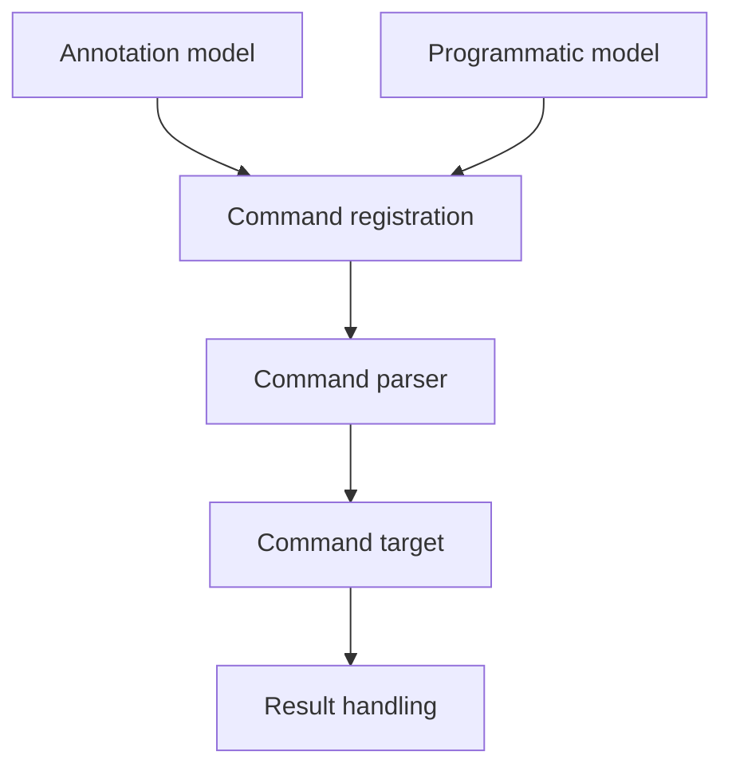

# Khi nào mô hình lập trình phù hợp hơn annotation

Spring Shell cho phép khai báo command bằng annotation hoặc đăng ký command bằng mã Java. Với cách dùng annotation, ta đặt `@ShellComponent` và `@ShellMethod` trên lớp, phương thức; các tham số được mô tả bằng `@ShellOption` hoặc annotation tương ứng. Với mô hình lập trình (programmatic model), ta tạo một `CommandRegistration` bằng builder rồi cung cấp nó cho Spring Shell dưới dạng bean hoặc đăng ký vào `CommandCatalog`.

Mô hình lập trình phù hợp khi cấu trúc command cần được tạo hoặc thay đổi theo trạng thái ứng dụng, khi metadata của command đến từ cấu hình hoặc plugin, hoặc khi cần kiểm soát chi tiết cách phân tích option, gọi target, xử lý lỗi và mã thoát. Với tập command cố định, đơn giản và gắn trực tiếp với các phương thức nghiệp vụ, annotation thường ngắn gọn và dễ đọc hơn.

Các ví dụ trong bài dùng Spring Shell 3.1.3 và API thuộc package `org.springframework.shell.command`. Đây là API của nhánh 3.x; khi nâng lên Spring Shell 4.x, cần đọc migration guide và tài liệu đúng phiên bản vì API đăng ký command đã được tổ chức lại.

## 1. Hai cách khai báo, một cơ chế đăng ký

Spring Shell 3.1.x có hai cách mô tả command:

- **Annotation model:** khai báo command trên lớp và phương thức Java. Spring Shell đọc metadata annotation rồi chuyển thành đăng ký command.
- **Programmatic model:** tạo trực tiếp đối tượng `CommandRegistration` bằng `CommandRegistration.builder()`, mô tả tên command, option, target và các hành vi liên quan.

Điểm quan trọng là mô hình lập trình cũng là lớp đăng ký nền tảng mà Spring Shell sử dụng khi xử lý command. Ngay cả khi ta dùng annotation, framework vẫn chuyển mô tả đó thành dữ liệu đăng ký. Vì vậy, hai cách khai báo không phải hai bộ máy thực thi độc lập; chúng là hai cách tạo metadata cho command.



Ở annotation model, metadata nằm gần phương thức được gọi. Ở programmatic model, metadata được tạo bằng builder và có thể được giữ trong bean, sinh từ dữ liệu cấu hình hoặc đăng ký vào catalog trong lúc ứng dụng chạy.

## 2. Chọn mô hình theo tình huống

| Nhu cầu | Annotation phù hợp khi | Programmatic phù hợp khi |
|---|---|---|
| Vòng đời command | Command luôn có từ lúc ứng dụng khởi động | Command cần xuất hiện hoặc biến mất khi plugin/tính năng được bật hoặc tắt |
| Nguồn metadata | Tên, option và mô tả được xác định trong mã nguồn | Metadata được đọc từ cấu hình, schema, plugin hoặc nguồn dữ liệu khác |
| Cách gọi xử lý | Một phương thức Java thể hiện rõ hành động | Cần target dạng `Function`, `Consumer`, hoặc đăng ký một phương thức có sẵn bằng API |
| Cấu hình parser | Option thông thường, alias và giá trị mặc định | Cần kiểm soát chi tiết arity, vị trí, label, completion hoặc quy tắc tên option |
| Vận hành | Muốn code ngắn, gần nghiệp vụ và dễ đọc | Cần điều khiển registry, availability, exception resolver hoặc exit code theo từng command |
| Số lượng command | Ít command hoặc command có cấu trúc ổn định | Nhiều command có cấu trúc sinh từ dữ liệu hoặc dùng chung quy tắc builder |

Một vài ví dụ thực tế giúp đưa ra quyết định:

- Một ứng dụng có năm command quản lý người dùng, tất cả luôn tồn tại và mỗi command tương ứng một phương thức service rõ ràng: annotation là lựa chọn tự nhiên.
- Một ứng dụng có module xuất báo cáo được nạp hoặc gỡ trong thời gian chạy: `CommandCatalog` có thể đăng ký hoặc hủy đăng ký command khi vòng đời module thay đổi.
- Một ứng dụng tạo command từ metadata của plugin hoặc từ một schema do quản trị viên cấu hình: programmatic model cho phép xây dựng `CommandRegistration` từ dữ liệu đó.
- Một command cần quy định arity tối thiểu/tối đa, vị trí của option, completion resolver và exit code riêng: builder cung cấp các điểm cấu hình trực tiếp.

Đừng chọn programmatic chỉ vì nó có nhiều phương thức cấu hình. Nếu command cố định và chỉ gọi một service, builder dài dòng có thể làm luồng nghiệp vụ khó theo dõi hơn.

## 3. Tạo CommandRegistration bằng builder

`CommandRegistration` mô tả giao diện command mà người dùng nhìn thấy và cách framework chuyển đầu vào đến target. Một đăng ký thường có các thành phần:

1. Tên command và các từ con.
2. Mô tả, nhóm hiển thị và trạng thái ẩn.
3. Các option: tên dài, tên ngắn, kiểu dữ liệu, tính bắt buộc, giá trị mặc định, arity, vị trí và completion.
4. Target thực thi: một phương thức, `Function<CommandContext, ?>` hoặc `Consumer<CommandContext>`.
5. Các cấu hình availability, trợ giúp, xử lý exception và exit code.

Ví dụ nhỏ nhất:

```java
CommandRegistration registration = CommandRegistration.builder()
        .command("hello")
        .description("Hiển thị lời chào.")
        .withTarget()
            .function(context -> "Xin chào từ Spring Shell!")
            .and()
        .build();
```

Builder dùng các lời gọi `withOption()` và `withTarget()` để mở phần cấu hình tương ứng. Sau khi cấu hình xong, gọi `and()` để quay lại builder chính và gọi `build()` để tạo `CommandRegistration` hoàn chỉnh.

## 4. Đăng ký command cố định dưới dạng Spring bean

Trong ứng dụng Spring Boot, một bean kiểu `CommandRegistration` được tự động đưa vào command catalog. Đây là cách phù hợp khi muốn dùng builder nhưng command vẫn cố định trong suốt vòng đời ứng dụng.

Giả sử ứng dụng có `InventoryService` xử lý tra cứu tồn kho:

```java
import org.springframework.context.annotation.Bean;
import org.springframework.context.annotation.Configuration;
import org.springframework.shell.command.CommandRegistration;

@Configuration
public class InventoryCommandConfiguration {

    @Bean
    CommandRegistration showStockCommand(InventoryService inventoryService) {
        return CommandRegistration.builder()
                .command("stock show")
                .description("Tra cứu tồn kho theo mã sản phẩm.")
                .group("Quản lý kho")
                .withOption()
                    .longNames("sku")
                    .shortNames('s')
                    .type(String.class)
                    .required()
                    .description("Mã sản phẩm cần tra cứu")
                    .and()
                .withOption()
                    .longNames("warehouse")
                    .type(String.class)
                    .defaultValue("HN")
                    .description("Mã kho")
                    .and()
                .withTarget()
                    .function(context -> {
                        String sku = context.getOptionValue("sku");
                        String warehouse = context.getOptionValue("warehouse");
                        return inventoryService.showStock(sku, warehouse);
                    })
                    .and()
                .build();
    }
}
```

Người dùng có thể gọi command theo hai cách:

```text
shell:>stock show --sku SKU-123
shell:>stock show -s SKU-123 --warehouse HCM
```

Option `sku` là bắt buộc, có tên dài `--sku` và bí danh ngắn `-s`. Option `warehouse` có giá trị mặc định `HN`, nên người dùng không cần truyền nếu tra cứu kho mặc định. `type(String.class)` chỉ rõ kiểu mà parser phải chuyển đổi trước khi target nhận giá trị.

Trong ví dụ này, `Function` trả về một kết quả. Spring Shell chuyển kết quả đó đến bộ xử lý output để hiển thị trên shell. Builder không cần tạo một lớp `@ShellComponent` hoặc đánh dấu phương thức bằng `@ShellMethod`.

## 5. Chọn target: method, function hoặc consumer

`CommandRegistration.TargetSpec` hỗ trợ ba dạng target. Việc chọn target quyết định nơi đặt logic thực thi và cách trả kết quả.

### 5.1. Function: nhận CommandContext và trả kết quả

`function` nhận một `CommandContext` và trả về một giá trị bất kỳ. Giá trị trả về được hiển thị trên shell. Đây là lựa chọn linh hoạt khi cần tự đọc option, phối hợp nhiều service hoặc xử lý dữ liệu trước khi trả kết quả.

```java
.withTarget()
    .function(context -> {
        String sku = context.getOptionValue("sku");
        Integer quantity = context.getOptionValue("quantity");

        if (quantity == null || quantity < 1) {
            throw new IllegalArgumentException("Số lượng phải lớn hơn 0.");
        }

        return inventoryService.adjust(sku, quantity);
    })
    .and()
```

`CommandContext` cho phép lấy giá trị option qua `getOptionValue(name)` và kiểm tra option đã được ánh xạ bằng `hasMappedOption(name)`. Kiểu trả về của `getOptionValue` được quyết định bởi `type(...)` trong cấu hình option. Khi option có thể vắng mặt, hãy kiểm tra sự tồn tại hoặc dùng giá trị mặc định phù hợp.

### 5.2. Consumer: thực thi và tự ghi output

`consumer` nhận `CommandContext` nhưng không trả kết quả. Nếu cần in ra shell, có thể lấy writer từ terminal:

```java
.withTarget()
    .consumer(context -> {
        String sku = context.getOptionValue("sku");
        InventoryReport report = inventoryService.createReport(sku);

        context.getTerminal().writer().println(report.toText());
        context.getTerminal().writer().flush();
    })
    .and()
```

Dùng `Consumer` khi command cần ghi nhiều dòng, chủ động định dạng output hoặc không có một giá trị kết quả duy nhất. Hãy flush writer sau khi ghi nếu cần đảm bảo nội dung được đẩy ra terminal ngay.

### 5.3. Method: đăng ký phương thức của một POJO có sẵn

Nếu logic đã nằm trong một object Java, có thể dùng `method(bean, methodName, parameterTypes...)` hoặc truyền trực tiếp `Method` để làm target. Cách này giúp tái sử dụng một phương thức có sẵn mà không phải bọc nó trong lambda.

```java
CommandRegistration registration = CommandRegistration.builder()
        .command("stock show")
        .withTarget()
            .method(inventoryCommandHandler, "showStock", String.class)
            .and()
        .withOption()
            .longNames("sku")
            .type(String.class)
            .required()
            .and()
        .build();
```

Trong ví dụ, `inventoryCommandHandler` là object có phương thức `showStock(String sku)`. Cần bảo đảm method name và kiểu tham số khớp với phương thức thật. Với overload, truyền rõ các kiểu tham số để tránh chọn nhầm method.

## 6. Cấu hình option chi tiết

Một lợi thế quan trọng của builder là mô tả parser trực tiếp bằng `OptionSpec`. Có thể khai báo nhiều option bằng cách gọi `withOption()` nhiều lần.

| Cấu hình | Ý nghĩa |
|---|---|
| `longNames("file")` | Tạo option dài `--file` |
| `shortNames('f')` | Tạo option ngắn `-f` |
| `type(Path.class)` | Khai báo kiểu dữ liệu đích |
| `required()` / `required(false)` | Bắt buộc hoặc tùy chọn |
| `defaultValue("...")` | Giá trị sử dụng khi người dùng bỏ qua option |
| `description("...")` | Mô tả option trong trợ giúp |
| `label("FILE")` | Nhãn hiển thị cho giá trị option trong trợ giúp |
| `arity(min, max)` | Số lượng giá trị tối thiểu và tối đa |
| `position(0)` | Gợi ý vị trí để ánh xạ đối số không có tên option |
| `completion(resolver)` | Cung cấp gợi ý hoàn thành cho giá trị option |
| `nameModifier(function)` | Chuyển đổi tên option theo quy tắc đặt tên |

### 6.1. Option nhận nhiều giá trị và đối số vị trí

Khi một option nhận danh sách giá trị, dùng kiểu mảng hoặc kiểu phù hợp và khai báo arity. Ví dụ sau yêu cầu tối thiểu một và tối đa ba mã kho:

```java
CommandRegistration registration = CommandRegistration.builder()
        .command("stock report")
        .withOption()
            .longNames("warehouses")
            .type(String[].class)
            .required()
            .arity(1, 3)
            .and()
        .withTarget()
            .function(context -> {
                String[] warehouses = context.getOptionValue("warehouses");
                return reportService.createFor(warehouses);
            })
            .and()
        .build();
```

Người dùng có thể truyền:

```text
shell:>stock report --warehouses HN
shell:>stock report --warehouses HN HCM DN
```

`position(0)` cho parser biết option có thể nhận một đối số không gắn tên ở vị trí đầu tiên. Nếu không khai báo vị trí trong tình huống có đối số mơ hồ, parser có thể không biết phải ánh xạ token tự do vào option nào.

### 6.2. Gợi ý hoàn thành giá trị

Với programmatic model, completion resolver được cấu hình trực tiếp trên option. Không cần tạo một lớp `ValueProvider` rồi tham chiếu bằng annotation.

```java
.withOption()
    .longNames("warehouse")
    .type(String.class)
    .completion(context -> Stream.of("HN", "HCM", "DN")
            .map(CompletionProposal::new)
            .collect(Collectors.toList()))
    .and()
```

`CompletionContext` cung cấp ngữ cảnh hiện tại, chẳng hạn command registration và option đang được hoàn thành. Resolver có thể lấy danh sách động từ service, nhưng cần trả kết quả nhanh vì nó được gọi trong lúc người dùng tương tác với shell.

### 6.3. Validation và chuyển đổi kiểu

Builder mô tả kiểu dữ liệu, tính bắt buộc và arity để parser kiểm tra đầu vào. Tuy nhiên, khi target nhận `CommandContext`, không có chữ ký tham số Java để đặt trực tiếp Bean Validation constraint như `@Min` hoặc `@NotBlank` lên tham số command. Hãy kiểm tra quy tắc đầu vào trong target hoặc, tốt hơn, trong service/use case được target gọi.

Ví dụ, khai báo `quantity` là `Integer.class` giúp parser chuyển chuỗi thành số nguyên. Quy tắc `quantity` phải lớn hơn 0 vẫn cần được kiểm tra ở tầng nghiệp vụ. Quy tắc liên quan dữ liệu như mã SKU có tồn tại, người dùng có quyền điều chỉnh hay tồn kho không âm phải được service bảo vệ dù command được gọi từ CLI hay từ kênh khác.

## 7. Tạo command động bằng CommandCatalog

Một bean `CommandRegistration` phù hợp với command có cấu trúc cố định. Khi command cần được thêm hoặc gỡ trong lúc ứng dụng chạy, có thể dùng `CommandCatalog`.

`CommandCatalog` quản lý các đăng ký command hiện có và cung cấp các thao tác `register(...)`, `unregister(...)` cùng `getRegistrations()`. Trong ứng dụng Spring Shell đã được auto-configure, có thể inject catalog rồi cập nhật khi vòng đời plugin hoặc tính năng thay đổi.

```java
import org.springframework.shell.command.CommandCatalog;
import org.springframework.shell.command.CommandRegistration;
import org.springframework.stereotype.Component;

@Component
public class ReportCommandLifecycle {

    private final CommandCatalog commandCatalog;
    private final ReportService reportService;

    public ReportCommandLifecycle(
            CommandCatalog commandCatalog,
            ReportService reportService) {
        this.commandCatalog = commandCatalog;
        this.reportService = reportService;
    }

    public void enableExportFeature() {
        commandCatalog.register(exportRegistration());
    }

    public void disableExportFeature() {
        commandCatalog.unregister("report export");
    }

    private CommandRegistration exportRegistration() {
        return CommandRegistration.builder()
                .command("report export")
                .description("Xuất báo cáo tồn kho.")
                .withOption()
                    .longNames("format")
                    .type(String.class)
                    .defaultValue("csv")
                    .and()
                .withTarget()
                    .function(context -> reportService.export(
                            context.getOptionValue("format")))
                    .and()
                .build();
    }
}
```

Khi plugin xuất báo cáo được nạp, gọi `enableExportFeature()` để đăng ký command. Khi plugin bị gỡ, gọi `disableExportFeature()` để hủy đăng ký. Command catalog giúp thay đổi danh sách command mà không cần khởi động lại toàn bộ ứng dụng.

Chỉ nên dùng việc thêm/gỡ command để phản ánh trạng thái tính năng hoặc module. Việc command không xuất hiện không phải là cơ chế phân quyền đầy đủ: service vẫn phải kiểm tra quyền của người gọi trước khi đọc hoặc thay đổi dữ liệu.

Nếu command luôn tồn tại nhưng chỉ có thể chạy khi một điều kiện được đáp ứng, dùng `availability(Supplier<Availability>)` thường rõ ràng hơn việc liên tục đăng ký và hủy đăng ký:

```java
.availability(() -> connectionService.isConnected()
        ? Availability.available()
        : Availability.unavailable("bạn chưa kết nối máy chủ"))
```

Như vậy command vẫn có trong trợ giúp, còn shell giải thích lý do khi người dùng gọi command trong lúc chưa khả dụng.

## 8. Tùy biến dùng chung cho nhiều command

Khi có nhiều command programmatic cùng tuân theo quy ước, Spring Shell cung cấp `CommandRegistration.BuilderSupplier`. Supplier mặc định tạo builder mới; có thể inject nó để dùng chung cấu hình nền.

```java
@Bean
CommandRegistration exportCommand(
        CommandRegistration.BuilderSupplier builderSupplier,
        ExportService exportService) {

    return builderSupplier.get()
            .command("report export")
            .description("Xuất báo cáo.")
            .withTarget()
                .function(context -> exportService.export())
                .and()
            .build();
}
```

Nếu cần chỉnh sửa builder được supplier cung cấp theo một quy tắc tập trung, có thể khai báo bean `CommandRegistrationCustomizer`:

```java
import org.springframework.context.annotation.Bean;
import org.springframework.shell.boot.CommandRegistrationCustomizer;

@Bean
CommandRegistrationCustomizer commandRegistrationCustomizer() {
    return builder -> {
        // Đặt các quy tắc chung cho builder tại đây.
    };
}
```

Spring Shell dùng customizer để áp dụng thay đổi chung lên builder do supplier cung cấp. Nếu tự định nghĩa bean `BuilderSupplier`, auto-configuration sẽ nhường quyền cấu hình mặc định cho ứng dụng. Chỉ nên tùy biến supplier khi thực sự cần thay cách tạo builder ở cấp ứng dụng; nếu chỉ cần một vài command riêng lẻ, gọi `CommandRegistration.builder()` thường dễ hiểu hơn.

## 9. Kiểm soát alias, nhóm, availability và command ẩn

Builder cho phép đặt các thuộc tính command mà không cần annotation:

```java
CommandRegistration registration = CommandRegistration.builder()
        .command("stock show")
        .description("Tra cứu tồn kho.")
        .group("Quản lý kho")
        .hidden(false)
        .availability(() -> inventoryService.isReady()
                ? Availability.available()
                : Availability.unavailable("dịch vụ tồn kho đang bảo trì"))
        .withAlias()
            .command("stock detail")
            .and()
        .withTarget()
            .function(context -> inventoryService.showStock(
                    context.getOptionValue("sku")))
            .and()
        .withOption()
            .longNames("sku")
            .type(String.class)
            .required()
            .and()
        .build();
```

`withAlias()` khai báo một tên gọi khác cho command; `group(...)` sắp xếp command trong trợ giúp; `hidden()` loại command khỏi danh sách trợ giúp và completion thông thường; `availability(...)` cung cấp điều kiện chạy. Một command ẩn vẫn có thể được gọi nếu người dùng biết tên và option của nó, vì vậy `hidden()` chỉ phục vụ tổ chức giao diện, không phải kiểm soát truy cập.

## 10. Xử lý exception và mã thoát theo command

Khi ứng dụng chạy command ở chế độ non-interactive, mã thoát giúp script hoặc hệ điều hành nhận biết thành công và thất bại. Spring Shell 3.1.3 cho phép định nghĩa exception resolver và ánh xạ exit code ngay trên từng `CommandRegistration`.

Ví dụ ánh xạ một exception nghiệp vụ sang mã thoát riêng:

```java
CommandRegistration registration = CommandRegistration.builder()
        .command("stock import")
        .withExitCode()
            .map(InvalidImportException.class, 3)
            .and()
        .withTarget()
            .function(context -> importService.run(
                    context.getOptionValue("file")))
            .and()
        .withOption()
            .longNames("file")
            .type(String.class)
            .required()
            .and()
        .build();
```

Có thể cung cấp một `CommandExceptionResolver` riêng cho command bằng `withErrorHandling().resolver(...).and()`. Resolver gắn với command được xử lý trước resolver toàn cục. Cách này phù hợp khi command cần chuyển một số exception thành thông báo thân thiện hoặc mã thoát đặc thù.

Tài liệu Spring Shell 3.1.3 ghi nhận mã thoát mặc định là `2` cho lỗi phân tích option, `1` cho lỗi chung và `0` khi thành công. Exit code có ý nghĩa khi chạy non-interactive; nó không thay thế thông báo lỗi trong phiên REPL. Đặc biệt, tài liệu nêu rõ cấu hình exit code theo command không có trong annotation-based configuration. Đây là một lý do cụ thể để chọn programmatic model khi script cần phân biệt lỗi nghiệp vụ bằng mã thoát ổn định.

## 11. CommandResolver và khi nào nên tránh

Ngoài `CommandCatalog`, Spring Shell có `CommandResolver` để cung cấp danh sách đăng ký command khi framework cần phân giải tên command. Cách này có thể hữu ích khi muốn tính danh sách đăng ký từ trạng thái hoặc nguồn dữ liệu riêng.

Tuy nhiên, resolver được gọi mỗi khi command được phân giải. Nếu việc truy vấn dữ liệu hoặc tạo registration trong resolver tốn thời gian, shell sẽ có cảm giác chậm. Với tính năng chỉ cần thêm hoặc gỡ command khi có sự kiện, `CommandCatalog.register(...)` và `unregister(...)` thường dễ kiểm soát hơn.

`CommandCatalogCustomizer` là một điểm mở rộng khác để chỉnh sửa catalog trong quá trình auto-configuration, ví dụ bổ sung một nhóm command đã được tạo. Hãy chọn đúng cơ chế theo vòng đời:

| Cơ chế | Thời điểm phù hợp |
|---|---|
| `@Bean CommandRegistration` | Command cố định, đăng ký cùng Spring context |
| `CommandCatalog.register/unregister` | Thêm hoặc gỡ command khi tính năng/module thay đổi |
| `CommandRegistrationCustomizer` | Áp dụng quy tắc chung cho builder do `BuilderSupplier` cung cấp |
| `CommandCatalogCustomizer` | Điều chỉnh catalog trong quá trình auto-configuration |
| `CommandResolver` | Tính danh sách đăng ký từ resolver riêng; cần giữ thao tác phân giải nhanh |

## 12. Những chi phí và giới hạn của programmatic model

Programmatic model cung cấp quyền kiểm soát lớn hơn, nhưng ứng dụng phải tự quản lý nhiều chi tiết hơn:

- **Nhiều mã cấu hình hơn:** tên command, mô tả, option và target đều phải được mô tả bằng builder. Với command đơn giản, annotation thường dễ đọc hơn.
- **Ít liên kết trực tiếp với chữ ký nghiệp vụ:** target dạng `Function<CommandContext, ?>` đọc option bằng tên chuỗi. Sai tên option có thể không bị phát hiện tại thời điểm biên dịch.
- **Validation phải có chủ đích:** parser chuyển đổi kiểu và kiểm tra required/arity; quy tắc nghiệp vụ nên nằm trong service. Không có tham số method để gắn trực tiếp constraint Bean Validation theo cách của annotation method.
- **Phải quản lý vòng đời registry:** khi command được thêm hoặc gỡ động, cần tránh đăng ký trùng, hủy nhầm tên hoặc để command còn tồn tại sau khi module đã bị gỡ.
- **Phải giữ builder nhất quán:** nếu nhiều command dùng chung convention, hãy cân nhắc `BuilderSupplier` và customizer để tránh lặp cấu hình.

Khi dùng `CommandContext`, có thể giảm rủi ro bằng cách gom tên option vào hằng số, viết hàm tạo registration riêng cho từng nhóm command và kiểm thử parser/target với các trường hợp option thiếu, sai kiểu, giá trị mặc định và arity không hợp lệ.

## 13. Quy trình lựa chọn và triển khai

Trước khi viết command, hãy trả lời các câu hỏi sau:

1. Command có luôn tồn tại khi ứng dụng khởi động không? Nếu có, annotation hoặc bean `CommandRegistration` đều có thể phù hợp. Nếu vòng đời command phụ thuộc plugin hoặc tính năng, ưu tiên catalog.
2. Metadata có cố định trong mã nguồn không? Nếu không, builder giúp chuyển dữ liệu cấu hình thành registration.
3. Target có thể biểu diễn tự nhiên bằng một phương thức không? Nếu có, annotation hoặc method target thường dễ theo dõi. Nếu cần đọc nhiều option, gọi nhiều service và trả kết quả tùy ngữ cảnh, Function/Consumer có thể phù hợp.
4. Có yêu cầu parser hoặc vận hành nào mà annotation không biểu đạt được rõ ràng không? Kiểm tra arity, position, label, completion, error resolver, exit code và availability.
5. Có thể giữ logic nghiệp vụ độc lập với Spring Shell không? Hãy để command chỉ chuyển dữ liệu vào service/use case; không đặt quy tắc miền trong lambda builder.

Sau khi chọn programmatic model, triển khai theo thứ tự: tạo `CommandRegistration`, mô tả command và option, chọn target, cấu hình availability/error/exit/completion nếu cần, sau đó đăng ký bean hoặc cập nhật catalog. Cuối cùng kiểm tra `help`, command invocation, option mapping, default, lỗi phân tích, availability và exit code trong chế độ chạy phù hợp.

## 14. Ranh giới phiên bản

Ví dụ trong bài dựa trên Spring Shell 3.1.3, nơi `CommandRegistration`, `CommandCatalog`, `CommandRegistration.BuilderSupplier` và các spec builder nằm trong package `org.springframework.shell.command`. Annotation model mới dựa trên `@Command` được bổ sung để cung cấp trải nghiệm khai báo hiện đại hơn, trong khi legacy annotation model vẫn tồn tại trong nhánh 3.x.

Spring Shell 4.x có thay đổi lớn về cấu trúc API. Không nên lấy ví dụ `CommandRegistration` của 3.1.x rồi giả định import, builder hoặc cơ chế đăng ký sẽ giữ nguyên. Khi nâng phiên bản, mở migration guide và Javadoc của đúng nhánh trước khi chuyển đổi.

## 15. Tổng kết

Hãy chọn programmatic model khi command cần được tạo từ dữ liệu, thêm hoặc gỡ trong lúc ứng dụng chạy, dùng target linh hoạt hoặc cần kiểm soát parser, completion, exception và exit code ở mức chi tiết. `CommandRegistration` mô tả một command; bean registration phù hợp với command cố định; `CommandCatalog` phù hợp với vòng đời command động; `BuilderSupplier` và customizer giúp áp dụng quy tắc chung.

Với command cố định, ngắn gọn và gắn trực tiếp với phương thức nghiệp vụ, annotation vẫn là lựa chọn dễ đọc. Dù chọn cách nào, hãy giữ logic nghiệp vụ trong service, xác thực quyền ở tầng nghiệp vụ và kiểm tra cả hành vi tương tác lẫn chế độ script.

## Tài liệu tham khảo

- [Spring Shell 3.1.3 Reference Documentation](https://docs.spring.io/spring-shell/docs/3.1.3/docs/index.html) — mục 3.1 Reading Docs, 4.1 Registration, 4.4 Exception Handling, chương 5 Options, chương 6 Completion và Appendix A.
- [CommandRegistration API 3.1.x](https://docs.spring.io/spring-shell/docs/3.1.x/api/org/springframework/shell/command/CommandRegistration.html) — builder, option, target, alias, availability, error handling và exit code.
- [CommandRegistration.Builder API 3.1.x](https://docs.spring.io/spring-shell/docs/3.1.x/api/org/springframework/shell/command/CommandRegistration.Builder.html) — các thuộc tính command và điểm mở rộng builder.
- [CommandRegistration.OptionSpec API 3.1.x](https://docs.spring.io/spring-shell/docs/3.1.x/api/org/springframework/shell/command/CommandRegistration.OptionSpec.html) — kiểu, tên, arity, default, completion và vị trí option.
- [CommandRegistration.TargetSpec API 3.1.x](https://docs.spring.io/spring-shell/docs/3.1.x/api/org/springframework/shell/command/CommandRegistration.TargetSpec.html) — method, function và consumer target.
- [CommandCatalog API 3.1.x](https://docs.spring.io/spring-shell/docs/3.1.x/api/org/springframework/shell/command/CommandCatalog.html) — đăng ký, hủy đăng ký và truy vấn command registrations.
- [Spring Shell 4.x Migration Guide](https://github.com/spring-projects/spring-shell/wiki/v4-migration-guide) — các thay đổi cần xem xét khi chuyển từ 3.x sang 4.x.
