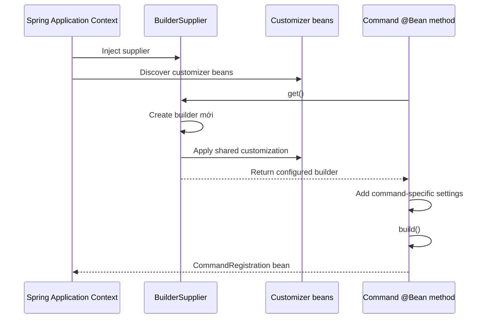

# BuilderSupplier và tùy biến builder dùng chung ở 3.x

Khi đăng ký command theo cách lập trình trong Spring Shell 3.x, mỗi command thường được tạo bằng `CommandRegistration.Builder`. Nếu nhiều command có chung quy ước như nhóm hiển thị, cách đặt tên option hoặc tùy chọn trợ giúp, việc lặp lại cùng cấu hình trong từng bean khiến mã dài và dễ lệch nhau.

Spring Shell cung cấp `CommandRegistration.BuilderSupplier` để lấy builder đã được cấu hình chung và `CommandRegistrationCustomizer` để áp dụng các quy tắc đó tập trung. Supplier là điểm truy cập dùng chung trong application context, còn mỗi lần gọi `get()` trả về một builder mới. Vì vậy, các command có thể dùng chung chính sách mà không chia sẻ một builder mutable duy nhất.

Spring Shell hỗ trợ cả khai báo command bằng annotation và đăng ký theo chương trình. Bài này tập trung vào mô hình programmatic registration trong dòng 3.x, nơi một bean `CommandRegistration` được tạo từ builder và tự động được đưa vào command catalog.

Sau bài này, bạn có thể:

- Phân biệt `CommandRegistration.Builder`, `BuilderSupplier` và `CommandRegistrationCustomizer`.
- Inject supplier để tạo nhiều command với cùng quy ước cấu hình.
- Viết customizer bean để thiết lập mặc định cho các builder.
- Hiểu khi nào auto-configuration cung cấp supplier mặc định và khi nào nó nhường quyền cho bean tùy chỉnh.
- Tránh dùng chung một builder mutable giữa nhiều command hoặc vô tình bỏ qua cấu hình tập trung.

## 1. Ba thành phần và trách nhiệm của chúng

Trong Spring Shell 3.x, ba thành phần có vai trò khác nhau:

| Thành phần | Vai trò | Cách sử dụng |
|---|---|---|
| `CommandRegistration.Builder` | Đối tượng builder dùng để khai báo một command, option, target và các thuộc tính liên quan | Gọi các phương thức như `command()`, `description()`, `withOption()`, `withTarget()` rồi `build()`. |
| `CommandRegistration.BuilderSupplier` | Cung cấp builder đã đi qua cơ chế cấu hình chung | Inject vào các phương thức `@Bean` và gọi `get()` cho mỗi command. |
| `CommandRegistrationCustomizer` | Callback sửa builder trước khi phần cấu hình riêng của command được thêm vào | Đăng ký một hoặc nhiều bean customizer để áp dụng chính sách dùng chung. |

Luồng tổng quát:

```mermaid
flowchart TD
    A[Spring Boot auto-configuration] --> B[BuilderSupplier]
    C[CommandRegistrationCustomizer beans] --> B
    B -->|get()| D[Builder mới]
    D --> E[Áp dụng cấu hình chung]
    E --> F[Thêm tên, option và target của command]
    F --> G[build()]
    G --> H[CommandRegistration bean]
    H --> I[Command catalog]
```

Điểm quan trọng là supplier cung cấp một builder mới cho mỗi lần đăng ký. Bạn có thể dùng cùng supplier để tạo nhiều command; cấu hình chung được áp dụng trên từng builder trước khi command bổ sung các chi tiết riêng.

## 2. Tạo command trực tiếp bằng Builder

Trước khi dùng supplier, hãy xem cách tạo một command cơ bản bằng API programmatic:

```java
import org.springframework.context.annotation.Bean;
import org.springframework.context.annotation.Configuration;
import org.springframework.shell.command.CommandRegistration;

@Configuration
public class ShellCommandsConfiguration {

    @Bean
    CommandRegistration helloCommand() {
        return CommandRegistration.builder()
                .command("hello")
                .description("Hiển thị lời chào.")
                .withTarget()
                    .function(context -> "Xin chào từ Spring Shell!")
                    .and()
                .build();
    }
}
```

`CommandRegistration.builder()` tạo một builder mới. `command()` đặt tên lệnh, `description()` cung cấp mô tả, `withTarget()` khai báo phần xử lý, `function()` dùng một hàm nhận `CommandContext` và trả về kết quả, còn `build()` tạo `CommandRegistration` hoàn chỉnh.

Một bean kiểu `CommandRegistration` được Spring Shell tự động đăng ký trong command catalog. Cách này phù hợp khi số command ít và mỗi command có cấu hình riêng. Khi số lượng command tăng, các quy tắc lặp lại nên được chuyển sang supplier và customizer.

## 3. BuilderSupplier mặc định trong application context

Spring Shell 3.x auto-configuration cung cấp một bean `CommandRegistration.BuilderSupplier` nếu ứng dụng chưa định nghĩa bean cùng kiểu. Có thể inject supplier vào phương thức tạo command:

```java
import org.springframework.context.annotation.Bean;
import org.springframework.context.annotation.Configuration;
import org.springframework.shell.command.CommandRegistration;

@Configuration
public class OrderCommandsConfiguration {

    @Bean
    CommandRegistration orderListCommand(
            CommandRegistration.BuilderSupplier builderSupplier) {
        return builderSupplier.get()
                .command("order list")
                .description("Liệt kê đơn hàng.")
                .withTarget()
                    .function(context -> "Danh sách đơn hàng.")
                    .and()
                .build();
    }

    @Bean
    CommandRegistration orderCountCommand(
            CommandRegistration.BuilderSupplier builderSupplier) {
        return builderSupplier.get()
                .command("order count")
                .description("Đếm số đơn hàng.")
                .withTarget()
                    .function(context -> "Có 0 đơn hàng trong ví dụ.")
                    .and()
                .build();
    }
}
```

Hai bean cùng inject một supplier. Mỗi phương thức gọi `get()` một lần để nhận builder riêng, sau đó khai báo command tương ứng. Không lưu builder vào field dùng chung rồi gọi `build()` nhiều lần; builder là đối tượng có trạng thái và dùng để tạo một registration cụ thể.

### Vì sao supplier trả về builder mới?

Giả sử ứng dụng có hai command:

```text
order list
order count
```

Nếu tái sử dụng cùng một builder mutable, cấu hình `command("order list")` có thể còn tồn tại khi bắt đầu khai báo `order count`. Điều này tạo nguy cơ command nhận nhầm tên, option, target hoặc metadata của command trước. Supplier mặc định của Spring Shell giải quyết vấn đề này bằng cách trả về một builder mới ở mỗi lần gọi `get()`.

Có thể hình dung như sau:

```text
builderSupplier.get() -> builder A -> order list -> build()
builderSupplier.get() -> builder B -> order count -> build()
```

Supplier được dùng chung; builder không được dùng chung. Cách thiết kế này cho phép mỗi command có vòng đời cấu hình độc lập.

## 4. Tùy biến builder tập trung bằng CommandRegistrationCustomizer

Nếu tất cả command cần cùng một quy ước, hãy định nghĩa bean `CommandRegistrationCustomizer`. Callback nhận builder do supplier cung cấp và sửa các thuộc tính dùng chung.

Ví dụ, ứng dụng muốn đưa các command vào nhóm `Lệnh ứng dụng` và chuẩn hóa tên option dài theo dạng chữ thường, dấu gạch nối:

```java
import java.util.Locale;

import org.springframework.context.annotation.Bean;
import org.springframework.context.annotation.Configuration;
import org.springframework.shell.boot.CommandRegistrationCustomizer;

@Configuration
public class SharedCommandBuilderConfiguration {

    @Bean
    CommandRegistrationCustomizer sharedCommandDefaults() {
        return builder -> {
            builder.group("Lệnh ứng dụng");
            builder.defaultOptionNameModifier(name ->
                    name.toLowerCase(Locale.ROOT).replace('_', '-'));
        };
    }
}
```

Customizer không tạo command và cũng không gọi `build()`. Nó chỉ thay đổi builder. Khi một phương thức bean gọi `builderSupplier.get()`, builder đi qua cơ chế customizer của supplier trước khi phần cấu hình riêng của command được nối tiếp.

`group()` đặt nhóm hiển thị cho command. `defaultOptionNameModifier()` cung cấp một hàm biến đổi tên option dài, hữu ích khi dự án muốn thống nhất cách viết option trên toàn bộ CLI. Ví dụ tên `page_size` có thể được chuẩn hóa thành `page-size`.

### Tách cấu hình chung và cấu hình riêng

Customizer nên chứa các quy ước thực sự dùng chung. Tên command, mô tả cụ thể, option riêng, target và điều kiện availability vẫn nên được khai báo tại bean của command:

```java
@Bean
CommandRegistration orderListCommand(
        CommandRegistration.BuilderSupplier builderSupplier) {
    return builderSupplier.get()
            .command("order list")
            .description("Liệt kê đơn hàng theo giới hạn.")
            .withOption()
                .longNames("limit")
                .type(Integer.class)
                .defaultValue("20")
                .and()
            .withTarget()
                .function(context -> "Giới hạn: " + context.getOptionValue("limit"))
                .and()
            .build();
}
```

Trong ví dụ, nhóm command và quy tắc chuẩn hóa tên option đến từ customizer. Tên `order list`, mô tả, option `limit`, giá trị mặc định và target thuộc riêng command này. Khi command khác cũng dùng `limit`, nó nhận cùng chính sách chuẩn hóa mà không cần viết lại hàm chuyển đổi.

Nếu customizer đặt một thuộc tính mà command sau đó cũng đặt lại, giá trị cuối cùng phụ thuộc thứ tự các thao tác trên builder. Hãy xác định rõ đâu là mặc định chung và đâu là cấu hình riêng có quyền ghi đè. Tránh nhiều customizer cùng sửa một thuộc tính theo những quy ước xung đột.

## 5. Customizer được áp dụng ở đâu trong quá trình tạo command?

Ở cấu hình mặc định, auto-configuration tạo `BuilderSupplier` với danh sách các `CommandRegistrationCustomizer`. Khi `get()` tạo builder, các customizer được dùng để cấu hình builder đó. Sau đó, mã ứng dụng nối các thông tin của command và gọi `build()`.



Nhìn theo thứ tự này sẽ dễ chẩn đoán hơn:

1. Không có builder supplier: kiểm tra auto-configuration và điều kiện tạo bean.
2. Customizer không chạy: kiểm tra bean customizer có được component scan hoặc configuration import không và có đúng kiểu interface không.
3. Cấu hình chung có nhưng bị thay đổi: kiểm tra các lệnh gọi builder phía sau `get()` và các customizer khác.
4. Registration không xuất hiện: kiểm tra phương thức `@Bean` có trả về `CommandRegistration` và bean có được tạo trong application context không.

## 6. Khi nào nên định nghĩa BuilderSupplier riêng?

Trong đa số ứng dụng, hãy giữ supplier mặc định và thêm `CommandRegistrationCustomizer` bean. Đây là cách ít mã nhất để thiết lập cấu hình chung.

Spring Shell có điều kiện auto-configuration: nếu ứng dụng tự định nghĩa bean kiểu `CommandRegistration.BuilderSupplier`, cấu hình mặc định sẽ nhường quyền và không tạo supplier mặc định. Điều đó cho phép thay đổi cách builder được cấp phát, nhưng đồng nghĩa ứng dụng chịu trách nhiệm với hành vi của supplier tùy chỉnh.

Ví dụ đơn giản về supplier tự định nghĩa:

```java
import org.springframework.context.annotation.Bean;
import org.springframework.context.annotation.Configuration;
import org.springframework.shell.command.CommandRegistration;

@Configuration
public class CustomBuilderSupplierConfiguration {

    @Bean
    CommandRegistration.BuilderSupplier customBuilderSupplier() {
        return CommandRegistration::builder;
    }
}
```

Supplier này luôn gọi `CommandRegistration.builder()` để tạo builder mới. Tuy nhiên, nó không tự kế thừa cơ chế customizer mà auto-config mặc định gắn vào supplier. Nếu thay thế supplier chỉ để đặt nhóm hoặc đổi tên option, bạn đã chọn một điểm mở rộng quá rộng và có thể vô tình bỏ qua cấu hình chung đang có.

Chỉ nên thay supplier khi cần điều khiển sâu việc cấp phát builder hoặc tích hợp một cơ chế tạo builder riêng. Nếu cần tự áp dụng các customizer hiện có, supplier tùy chỉnh phải chủ động thu thập và gọi chúng trên mỗi builder mới. Hãy giữ nguyên nguyên tắc mỗi lần `get()` trả về một builder độc lập.

Ví dụ dưới đây minh họa cách duy trì chuỗi customizer khi thực sự cần thay supplier. `ObjectProvider.orderedStream()` lấy các bean customizer theo thứ tự Spring đã sắp xếp; mỗi lần `get()` tạo builder mới rồi áp dụng từng callback:

```java
import org.springframework.beans.factory.ObjectProvider;
import org.springframework.context.annotation.Bean;
import org.springframework.context.annotation.Configuration;
import org.springframework.shell.boot.CommandRegistrationCustomizer;
import org.springframework.shell.command.CommandRegistration;

@Configuration
public class CustomBuilderSupplierConfiguration {

    @Bean
    CommandRegistration.BuilderSupplier customBuilderSupplier(
            ObjectProvider<CommandRegistrationCustomizer> customizers) {
        return () -> {
            CommandRegistration.Builder builder = CommandRegistration.builder();
            customizers.orderedStream()
                    .forEach(customizer -> customizer.customize(builder));
            return builder;
        };
    }
}
```

Đây là ví dụ cho trường hợp mở rộng nâng cao; nếu không cần thay cơ chế cấp phát, hãy dùng supplier mặc định. Khi có nhiều customizer cùng sửa một thuộc tính, có thể dùng `@Order`/`Ordered` để quy định thứ tự và cần kiểm tra kết quả cấu hình cuối cùng.

## 7. BuilderSupplier không thay thế CommandRegistrationCustomizer

Hai điểm mở rộng giải quyết hai nhu cầu khác nhau:

| Nhu cầu | Nên dùng |
|---|---|
| Mỗi command cần cùng nhóm hoặc quy tắc đặt tên option | `CommandRegistrationCustomizer` |
| Mỗi command cần builder mới theo cùng một cơ chế | `CommandRegistration.BuilderSupplier` mặc định |
| Cần thay thế hoàn toàn cách tạo builder | Bean `BuilderSupplier` tùy chỉnh |
| Chỉ một command cần option, target hoặc availability riêng | Cấu hình builder trong bean `CommandRegistration` tương ứng |
| Command được khai báo bằng annotation | Mô hình annotation tương ứng; không cần tự tạo `CommandRegistration` builder cho từng phương thức |

Không nên định nghĩa supplier riêng chỉ để gọi `CommandRegistration.builder()` trong từng bean. Việc inject supplier giúp ứng dụng đi qua cấu hình chung của Spring Shell. Nếu chủ động thay thế supplier, cần kiểm tra lại các hành vi mặc định mà auto-configuration trước đó cung cấp.

## 8. Các lỗi thường gặp

| Hiện tượng | Nguyên nhân có thể | Cách xử lý |
|---|---|---|
| Không inject được `BuilderSupplier` | Đang dùng sai phiên bản, thiếu auto-configuration hoặc tự thay đổi cấu hình bean | Kiểm tra Spring Shell 3.x dependency và điều kiện auto-configuration. |
| Customizer không tác động lên command | Command được tạo bằng builder tĩnh hoặc supplier tùy chỉnh không gọi customizer | Dùng supplier được inject từ context hoặc tự áp dụng customizer trong supplier riêng. |
| Hai command có tên hoặc option bị lẫn | Tái sử dụng một builder mutable | Gọi `get()` cho từng command và không lưu builder để dùng lại. |
| Một thuộc tính chung bị ghi đè | Command đặt lại thuộc tính sau khi supplier trả builder hoặc customizer khác sửa cùng thuộc tính | Xác định thứ tự cấu hình và một nguồn chịu trách nhiệm cho từng quy tắc. |
| Help option hoặc option naming khác mặc định | Supplier tùy chỉnh khiến auto-configuration không tạo supplier mặc định với customizer mặc định | Kiểm tra các `CommandRegistrationCustomizer` cần thiết và cấu hình help options. |
| Command không xuất hiện trong `help` | Bean registration chưa được tạo hoặc command catalog không nhận bean | Kiểm tra `@Bean`, điều kiện tạo cấu hình và command catalog. |

## 9. Checklist khi thiết kế cấu hình builder dùng chung

- Dùng Spring Shell 3.x và import đúng package `org.springframework.shell.command` cùng `org.springframework.shell.boot`.
- Inject `CommandRegistration.BuilderSupplier` trong từng phương thức tạo command programmatic.
- Gọi `get()` đúng một lần cho mỗi command registration.
- Đặt các quy ước dùng chung trong `CommandRegistrationCustomizer`.
- Giữ tên, mô tả, option, target và availability riêng tại command bean.
- Không lưu hoặc tái sử dụng builder mutable giữa nhiều command.
- Chỉ thay supplier khi thật sự cần thay đổi cơ chế cấp phát builder.
- Nếu thay supplier, xác minh lại các customizer mặc định như help options và option-name modifier.
- Kiểm tra danh mục bằng `help` và trợ giúp chi tiết của từng command sau khi ứng dụng khởi động.

## 10. Bài tập thực hành

Tạo hai command programmatic `customer list` và `customer count` với yêu cầu:

1. Cả hai command đều được tạo bằng `CommandRegistration.BuilderSupplier` inject từ Spring context.
2. Viết một `CommandRegistrationCustomizer` để đặt nhóm chung `Khách hàng`.
3. Thiết lập quy tắc chuẩn hóa option dài về chữ thường và dấu gạch nối.
4. `customer list` khai báo option `page_size` với giá trị mặc định `20`; sau khi chuẩn hóa, người dùng gọi bằng `--page-size`. Target trả về chuỗi mô tả giới hạn.
5. `customer count` có target trả về số lượng khách hàng giả lập.
6. Xác minh mỗi lần gọi `get()` tạo builder độc lập bằng cách kiểm tra hai command có tên, target và option riêng.
7. Chạy `help` và kiểm tra cả hai command xuất hiện trong nhóm dự kiến.
8. Thử tạm thay supplier mặc định bằng một supplier tùy chỉnh, quan sát customizer mặc định nào không còn được áp dụng, sau đó khôi phục cấu hình chuẩn.

Khi hoàn thành, hãy giải thích vì sao supplier được dùng chung nhưng builder phải mới cho từng command, và vì sao customizer là nơi phù hợp để đặt chính sách chung.

## Tài liệu tham khảo

- [Spring Shell 3.3 – Programmatic Registration](https://docs.spring.io/spring-shell/reference/3.3/commands/registration/programmatic.html): đăng ký `CommandRegistration`, sử dụng `BuilderSupplier` và `CommandRegistrationCustomizer`.
- [Spring Shell 3.3 – CommandRegistration.Builder API](https://docs.spring.io/spring-shell/docs/3.3.0/api/org/springframework/shell/command/CommandRegistration.Builder.html): các phương thức cấu hình builder.
- [Spring Shell 3.3 – CommandCatalogAutoConfiguration API](https://docs.spring.io/spring-shell/docs/3.3.0/api/org/springframework/shell/boot/CommandCatalogAutoConfiguration.html): auto-configuration của supplier và các customizer mặc định.
- [Spring Shell 3.1 – CommandRegistrationCustomizer API](https://docs.spring.io/spring-shell/docs/3.1.x/api/org/springframework/shell/boot/CommandRegistrationCustomizer.html): callback tùy biến `CommandRegistration.Builder`.
- [Spring Shell 4 Migration Guide](https://github.com/spring-projects/spring-shell/wiki/v4-migration-guide): thay đổi mô hình đăng ký command khi nâng cấp lên 4.x.
