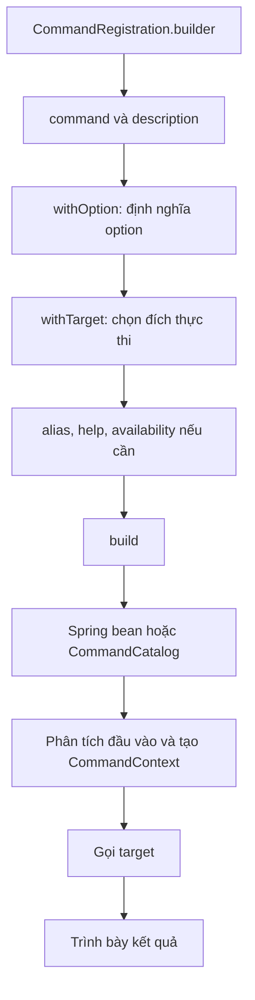

# Khai báo tên, mô tả, tùy chọn và đích thực thi bằng builder 3.x

Spring Shell 3.x cho phép khai báo command bằng API lập trình thông qua `CommandRegistration`. Thay vì mô tả lệnh trên một phương thức bằng annotation, ứng dụng tạo một đối tượng đăng ký bằng builder. Đối tượng này mô tả tên command, nội dung trợ giúp, option, alias và đích thực thi. Spring Shell dùng metadata đó để phân tích dòng lệnh và gọi đúng phần xử lý khi người dùng chạy command.

Mô hình builder phù hợp khi muốn tạo command trong cấu hình Spring, khi danh sách command được lắp ghép theo điều kiện hoặc khi cần kiểm soát metadata ở một nơi. Ví dụ trong bài dùng API của Spring Shell 3.4.x; các bản 3.x cũ hơn có thể khác một số khả năng hoặc chữ ký API, vì vậy cần đối chiếu tài liệu đúng minor version của dự án.

## `CommandRegistration` mô tả một command

`CommandRegistration` là bản mô tả command mà Spring Shell có thể đưa vào command catalog. Nó xác định:

- Tên command và các từ con trong tên lệnh.
- Mô tả và nhóm hiển thị trong trợ giúp.
- Những option được chấp nhận, kiểu dữ liệu, tính bắt buộc và giá trị mặc định.
- Đích thực thi được gọi sau khi dòng lệnh được phân tích.
- Các alias, tùy chọn trợ giúp, trạng thái khả dụng và cách xử lý lỗi nếu cần.

Builder được tạo bằng `CommandRegistration.builder()`. Các phương thức như `command(...)`, `description(...)` và `group(...)` thiết lập thông tin cấp command. Những phần có cấu trúc riêng được mở bằng `withOption()`, `withTarget()`, `withAlias()` hoặc `withHelpOptions()`. Mỗi phần con cung cấp `and()` để quay lại builder chính; `build()` tạo đối tượng `CommandRegistration` hoàn chỉnh.



Sự tách biệt giữa metadata và target có ý nghĩa quan trọng. `CommandRegistration` mô tả giao diện mà người dùng nhìn thấy; target chịu trách nhiệm thực hiện công việc. Nhờ vậy, có thể thay đổi option hoặc tên lệnh mà không cần viết lại nghiệp vụ, miễn là hợp đồng đầu vào và kết quả vẫn được giữ tương thích.

## Khai báo tên và mô tả command

Tên command được khai báo bằng `command(String... commands)`. Có thể truyền một chuỗi nhiều từ hoặc truyền từng từ:

```java
CommandRegistration.builder()
        .command("customer show")
        .description("Hiển thị thông tin khách hàng")
        .group("Customer Management")
        .build();
```

Hai cách viết sau tương đương:

```java
.command("customer show")
```

```java
.command("customer", "show")
```

Spring Shell tách các từ và chuẩn hóa khoảng trắng để tạo tên command đầy đủ. Tên nhiều từ giúp tổ chức command theo nhóm chức năng, ví dụ `customer list`, `customer show` và `customer disable`.

Các thuộc tính cấp command thường dùng:

| Phương thức builder | Tác dụng | Ví dụ |
| --- | --- | --- |
| `command(...)` | Đặt tên command gồm một hoặc nhiều từ | `.command("customer show")` |
| `description(...)` | Mô tả ngắn trong danh sách trợ giúp | `.description("Hiển thị khách hàng")` |
| `group(...)` | Phân loại command trong trợ giúp | `.group("Customer Management")` |
| `hidden()` hoặc `hidden(true)` | Ẩn command khỏi danh sách trợ giúp thông thường | `.hidden()` |
| `availability(...)` | Cung cấp trạng thái khả dụng tại thời điểm gọi | `.availability(this::availability)` |
| `interactionMode(...)` | Giới hạn chế độ tương tác mà command hỗ trợ | Chọn `InteractionMode` phù hợp |

Tên command là một phần giao diện công khai của CLI. Nếu script hoặc người dùng đã quen với `customer show`, đổi thành `customer get` có thể làm hỏng quy trình hiện có. Khi đổi tên, cân nhắc giữ alias trong một giai đoạn chuyển tiếp.

Spring Shell 3.x mô hình hóa command dưới dạng các từ trong một tên đầy đủ. Theo giới hạn được tài liệu 3.4 nêu rõ, không thể đồng thời đăng ký một command và một command con nằm sâu hơn dưới chính tên đầy đủ của nó, ví dụ vừa có `customer show` vừa có `customer show details`. Hãy thiết kế tên lệnh theo cấu trúc mà parser hỗ trợ.

## Khai báo option bằng `withOption()`

Mỗi lần gọi `withOption()` bắt đầu mô tả một option. Một command có thể khai báo nhiều option bằng cách gọi phương thức này nhiều lần. Các tên option được khai báo không có dấu gạch đầu dòng; Spring Shell tự dùng `--` cho tên dài và `-` cho tên ngắn.

```java
CommandRegistration.builder()
        .command("customer show")
        .withOption()
            .longNames("code")
            .shortNames('c')
            .type(String.class)
            .required()
            .description("Mã khách hàng")
            .and()
        .build();
```

Lệnh tương ứng:

```text
customer show --code CUS-123456
customer show -c CUS-123456
```

Các phương thức quan trọng của `OptionSpec`:

| Phương thức | Tác dụng | Ví dụ |
| --- | --- | --- |
| `longNames(...)` | Đặt một hoặc nhiều tên dài | `.longNames("code")` tạo `--code` |
| `shortNames(...)` | Đặt tên ngắn dạng ký tự | `.shortNames('c')` tạo `-c` |
| `description(...)` | Mô tả option trong trợ giúp | `.description("Mã khách hàng")` |
| `type(...)` | Khai báo kiểu dữ liệu đích để chuyển đổi | `.type(Integer.class)` |
| `required()` hoặc `required(true)` | Bắt buộc người dùng cung cấp option | `.required()` |
| `required(false)` | Cho phép bỏ qua option | `.required(false)` |
| `defaultValue(...)` | Đặt giá trị mặc định nếu không truyền option | `.defaultValue("20")` |
| `arity(min, max)` | Giới hạn số giá trị option nhận | `.arity(1, 3)` |
| `position(...)` | Gợi ý vị trí khi ánh xạ token không có tên thành option | `.position(0)` |
| `completion(...)` | Cung cấp gợi ý giá trị khi tự hoàn thành | Dùng một `CompletionResolver` |

### Kiểu dữ liệu và chuyển đổi

Đầu vào từ terminal ban đầu là văn bản. Khai báo `type(...)` để Spring Shell biết kiểu cần chuyển đổi trước khi gọi target. Các kiểu thường dùng gồm `String`, số nguyên, số thực, `Boolean`, enum và mảng. Với kiểu miền riêng, ứng dụng có thể đăng ký converter trong `ConversionService` mà Spring Shell sử dụng.

Ví dụ khai báo một option số nguyên và một option enum:

```java
enum ReportFormat {
    TEXT, CSV, JSON
}

CommandRegistration.builder()
        .command("report export")
        .withOption()
            .longNames("year")
            .type(Integer.class)
            .required()
            .description("Năm báo cáo")
            .and()
        .withOption()
            .longNames("format")
            .type(ReportFormat.class)
            .defaultValue("CSV")
            .description("Định dạng đầu ra")
            .and()
        .build();
```

Khi người dùng nhập `--year 2026`, giá trị được chuyển thành `Integer`. Với `--format JSON`, chuỗi được chuyển thành `ReportFormat.JSON`. Nếu giá trị không thể chuyển đổi, lỗi xảy ra ở giai đoạn phân tích đầu vào trước khi target thực thi.

Nên khai báo `type(...)` tường minh, kể cả khi kiểu là `String`. Điều này làm rõ hợp đồng của option và tránh phụ thuộc vào suy luận kiểu trong những tình huống phức tạp. Với kiểu generic, API cho phép sử dụng `ResolvableType` thay cho `Class<?>` để mô tả kiểu đầy đủ.

### Option bắt buộc, tùy chọn và giá trị mặc định

Option bắt buộc dùng `.required()` hoặc `.required(true)`. Nếu thiếu option, Spring Shell từ chối lời gọi và thông báo option nào đang thiếu. Option tùy chọn có thể dùng `.required(false)` hoặc được cung cấp một giá trị mặc định.

```java
CommandRegistration.builder()
        .command("report list")
        .withOption()
            .longNames("limit")
            .type(Integer.class)
            .defaultValue("20")
            .description("Số bản ghi tối đa")
            .and()
        .build();
```

Trong ví dụ, nếu không truyền `--limit`, target nhận giá trị `20` sau khi chuyển đổi. `defaultValue` được khai báo dưới dạng chuỗi, sau đó được chuyển sang kiểu đã đặt bằng `type(...)`.

Chỉ đặt giá trị mặc định khi nó có ý nghĩa rõ ràng với thao tác. Nếu command cần một mã khách hàng cụ thể, không nên dùng một mã giả định để né việc khai báo bắt buộc. Hãy để parser báo lỗi thiếu dữ liệu.

### Option nhận nhiều giá trị và vị trí

Một option có thể nhận nhiều giá trị. `arity(min, max)` xác định số lượng tối thiểu và tối đa; kiểu dữ liệu thường là mảng hoặc kiểu collection phù hợp.

```java
CommandRegistration.builder()
        .command("label add")
        .withOption()
            .longNames("labels")
            .type(String[].class)
            .required()
            .arity(1, 5)
            .description("Từ một đến năm nhãn")
            .and()
        .build();
```

Option có thể được truyền như `label add --labels urgent review`. `position(...)` có ý nghĩa khác với việc khai báo tên option: nó là gợi ý để parser ánh xạ những token vị trí chưa gắn với tên option vào option tương ứng. Không nên thêm `position` tùy tiện vì khi command có nhiều option dạng mảng hoặc nhiều argument, việc ánh xạ token có thể trở nên khó đoán. Hãy ưu tiên tên option tường minh khi giao diện lệnh có nhiều dữ liệu đầu vào.

## Chọn đích thực thi bằng `withTarget()`

Target xác định việc gì sẽ được gọi khi command đã được phân tích. Spring Shell 3.x hỗ trợ ba dạng chính: `method`, `function` và `consumer`.

### Target dạng `Function`

`function(...)` nhận một `CommandContext` và trả về một giá trị. Giá trị trả về được chuyển tới shell output. Đây là lựa chọn thuận tiện cho command trả kết quả:

```java
CommandRegistration.builder()
        .command("customer show")
        .withOption()
            .longNames("code")
            .type(String.class)
            .required()
            .and()
        .withTarget()
            .function(context -> {
                String code = context.getOptionValue("code");
                return customerService.describe(code);
            })
            .and()
        .build();
```

`CommandContext` cung cấp giá trị option đã được chuyển đổi. Kiểu generic của `getOptionValue(...)` được suy ra từ nơi sử dụng hoặc có thể gán vào biến có kiểu cụ thể. Target dạng function thích hợp khi cần biến dữ liệu đầu vào thành kết quả trả về và để Spring Shell xử lý việc hiển thị.

### Target dạng `Consumer`

`consumer(...)` nhận `CommandContext` nhưng không trả về giá trị. Dùng dạng này khi command cần chủ động ghi output, thực hiện thao tác không có kết quả trả về hoặc làm việc với terminal:

```java
CommandRegistration.builder()
        .command("system refresh")
        .withTarget()
            .consumer(context -> {
                refreshService.refresh();
                context.getTerminal().writer()
                        .println("Đã làm mới dữ liệu hệ thống.");
            })
            .and()
        .build();
```

Với target consumer, phần hiển thị do code target đảm nhiệm. Hãy lấy writer từ `CommandContext` để ghi vào terminal của phiên hiện tại; tránh ghi trực tiếp ra `System.out`, vì làm như vậy có thể bỏ qua cấu hình I/O của shell và gây khó khăn khi kiểm thử.

### Target dạng `Method`

`method(...)` trỏ đến một phương thức trên một đối tượng Java đã có. Cách này hữu ích khi muốn giữ phần xử lý trong một bean/service riêng:

```java
import org.springframework.stereotype.Component;

@Component
public class CustomerCommandHandler {

    private final CustomerService customerService;

    public CustomerCommandHandler(CustomerService customerService) {
        this.customerService = customerService;
    }

    public String show(String code) {
        return customerService.describe(code);
    }
}
```

Đăng ký phương thức làm target:

```java
@Bean
CommandRegistration customerShowCommand(CustomerCommandHandler handler) {
    return CommandRegistration.builder()
            .command("customer show")
            .withOption()
                .longNames("code")
                .type(String.class)
                .required()
                .and()
            .withTarget()
                .method(handler, "show", String.class)
                .and()
            .build();
}
```

Có thể truyền một đối tượng `Method` đã lấy bằng reflection, hoặc tên phương thức kèm kiểu tham số. Khi dùng tên phương thức, truyền kiểu tham số giúp xác định đúng overload nếu lớp có nhiều phương thức cùng tên. Các option phải tương thích với tham số mà target method nhận; kiểm thử tích hợp để xác nhận việc binding trong phiên bản đang dùng.

### Chọn dạng target nào?

| Dạng target | Khi phù hợp | Cách trả kết quả |
| --- | --- | --- |
| `function(...)` | Command xử lý context và trả một giá trị | Giá trị trả về được Spring Shell hiển thị |
| `consumer(...)` | Command ghi output trực tiếp hoặc chỉ tạo tác dụng phụ | Target ghi qua terminal writer |
| `method(...)` | Muốn ủy quyền cho một phương thức của bean/POJO | Giá trị trả về của phương thức được xử lý như kết quả command |

Không cần đưa toàn bộ logic nghiệp vụ vào lambda. Nếu target thực hiện nhiều quy tắc hoặc phối hợp nhiều thành phần, hãy inject application service và gọi service từ function, consumer hoặc method target. Builder chỉ là cách đăng ký giao diện command.

## Alias và trợ giúp cho command

### Khai báo alias

`withAlias()` tạo một bí danh cho command. Mỗi alias là một tên lệnh hoàn chỉnh:

```java
CommandRegistration.builder()
        .command("customer show")
        .withAlias()
            .command("cust show")
            .and()
        .withAlias()
            .command("customer get")
            .and()
        .build();
```

Người dùng có thể gọi bằng tên chính hoặc alias. Nếu đổi tên command, alias giúp duy trì khả năng tương thích cho script cũ trong thời gian chuyển tiếp. Mỗi lần gọi `withAlias()` tạo một alias; truyền nhiều từ vào `.command("...")` bên trong alias để tạo alias nhiều từ, không phải để tạo nhiều alias độc lập.

### Tùy chỉnh option trợ giúp

Spring Shell có command `help` tích hợp và mặc định có thể bổ sung `--help` cùng `-h` cho command. Mô hình builder cho phép tùy chỉnh hành vi này riêng cho một command:

```java
CommandRegistration.builder()
        .command("customer show")
        .withHelpOptions()
            .enabled(true)
            .longNames("help")
            .shortNames('h')
            .command("help")
            .and()
        .build();
```

Khi người dùng gọi `customer show --help` hoặc `customer show -h`, Spring Shell chuyển sang xử lý trợ giúp thay vì chạy target. Có thể thay đổi thiết lập mặc định trên toàn ứng dụng qua các thuộc tính `spring.shell.help.*`; cấu hình theo từng command cho phép khác biệt khi cần. Tránh tạo option nghiệp vụ trùng với tên `help` hoặc `h`.

`description(...)` là mô tả ngắn để người dùng nhận biết command. Option cũng có `description(...)` riêng. Hãy viết nội dung ngắn, dùng động từ mô tả hành động và nêu rõ dữ liệu cần nhập. Trợ giúp tốt nên giúp người dùng biết tên command, option bắt buộc, option có mặc định và cách gọi mẫu.

## Đăng ký command trong Spring

### Đăng ký dưới dạng bean

Trong ứng dụng dùng Spring Shell auto-configuration (thường là ứng dụng Spring Boot), có thể khai báo `CommandRegistration` dưới dạng `@Bean`. Auto-configuration thu thập các bean đăng ký command và đưa chúng vào catalog:

```java
import org.springframework.context.annotation.Bean;
import org.springframework.context.annotation.Configuration;
import org.springframework.shell.command.CommandRegistration;

@Configuration
public class CustomerCommandConfiguration {

    @Bean
    CommandRegistration customerShowCommand(CustomerService customerService) {
        return CommandRegistration.builder()
                .command("customer show")
                .description("Hiển thị thông tin khách hàng")
                .group("Customer Management")
                .withOption()
                    .longNames("code")
                    .shortNames('c')
                    .type(String.class)
                    .required()
                    .description("Mã khách hàng")
                    .and()
                .withOption()
                    .longNames("details")
                    .type(boolean.class)
                    .defaultValue("false")
                    .description("Hiển thị thông tin chi tiết")
                    .and()
                .withTarget()
                    .function(context -> {
                        String code = context.getOptionValue("code");
                        Boolean details = context.getOptionValue("details");
                        return customerService.describe(
                                code, Boolean.TRUE.equals(details));
                    })
                    .and()
                .withAlias()
                    .command("cust show")
                    .and()
                .withHelpOptions()
                    .enabled(true)
                    .longNames("help")
                    .shortNames('h')
                    .command("help")
                    .and()
                .build();
    }
}
```

Trong ví dụ, Spring inject `CustomerService` vào phương thức tạo bean. Builder khai báo tên, mô tả, nhóm, hai option, target, alias và help option. `--code` là bắt buộc; `--details` có giá trị mặc định `false`. Lệnh có thể được gọi như sau:

```text
customer show --code CUS-123456
customer show -c CUS-123456 --details true
cust show --code CUS-123456
customer show --help
```

Trong ứng dụng thực tế, help options có thể đã được cấu hình toàn cục và tự động thêm vào các command programmatic. Chỉ khai báo `.withHelpOptions()` khi muốn kiểm soát riêng command đó hoặc thay đổi thiết lập mặc định.

### Dùng `BuilderSupplier` và customizer

Khi nhiều command cần tuân theo một chính sách builder chung, có thể inject `CommandRegistration.BuilderSupplier` để lấy builder mới. Supplier mặc định được Spring Shell cung cấp; ứng dụng có thể kết hợp `CommandRegistrationCustomizer` để áp dụng quy ước chung cho các builder:

```java
@Bean
CommandRegistration reportCommand(
        CommandRegistration.BuilderSupplier builderSupplier) {
    return builderSupplier.get()
            .command("report status")
            .description("Hiển thị trạng thái báo cáo")
            .withTarget()
                .function(context -> "Report service is ready")
                .and()
            .build();
}
```

`CommandRegistrationCustomizer` cho phép áp dụng chính sách chung lên builder được cung cấp, ví dụ chuẩn hóa cách đặt tên option hoặc bổ sung cấu hình mặc định. Chỉ nên tạo customizer khi nhiều command thật sự cần cùng một quy tắc; với một vài command đơn giản, builder trực tiếp thường dễ đọc hơn.

### Đăng ký động qua `CommandCatalog`

Khi command chỉ nên xuất hiện ở một trạng thái nhất định của ứng dụng, có thể đăng ký hoặc gỡ đăng ký nó thông qua `CommandCatalog`:

```java
import org.springframework.stereotype.Component;
import org.springframework.shell.command.CommandCatalog;
import org.springframework.shell.command.CommandRegistration;

@Component
public class AdminCommandManager {

    private final CommandCatalog commandCatalog;

    public AdminCommandManager(CommandCatalog commandCatalog) {
        this.commandCatalog = commandCatalog;
    }

    public void enableAdminCommand(CommandRegistration registration) {
        commandCatalog.register(registration);
    }

    public void disableAdminCommand(String commandName) {
        commandCatalog.unregister(commandName);
    }
}
```

Ví dụ trên minh họa API catalog: `register(...)` thêm một registration và `unregister(...)` gỡ command theo tên. Ứng dụng có thể tạo registration bằng builder khi cần rồi đưa vào catalog. Với command cố định trong suốt vòng đời ứng dụng, khai báo `@Bean` đơn giản hơn. Không đăng ký cùng một command đồng thời qua bean auto-registration và qua logic động, vì việc trùng tên có thể gây xung đột hoặc kết quả không như mong đợi.

## Trạng thái khả dụng và hoàn thành option

Một command có thể được đăng ký nhưng chưa thể thực thi, chẳng hạn `download` chỉ hoạt động sau khi người dùng kết nối đến máy chủ. Builder hỗ trợ `availability(Supplier<Availability>)` để cung cấp trạng thái hiện tại và lý do nếu command chưa khả dụng:

```java
.availability(() -> connected
        ? Availability.available()
        : Availability.unavailable("Bạn cần kết nối máy chủ trước"))
```

Đây là trạng thái có thể thay đổi theo phiên làm việc. Nó hữu ích khi muốn trợ giúp của shell giải thích vì sao một command chưa thể dùng. Availability không thay thế kiểm tra quyền hoặc kiểm tra nghiệp vụ bên trong application service; target vẫn phải bảo vệ thao tác quan trọng.

`OptionSpec.completion(...)` cho phép gắn `CompletionResolver` để cung cấp gợi ý cho giá trị option. Ví dụ, option `--format` có thể gợi ý `CSV`, `JSON` và `TEXT`, còn option `--customer` có thể gợi ý các mã khách hàng được phép chọn. Chỉ truy vấn dữ liệu cần thiết khi hoàn thành; tránh thực hiện tác vụ chậm cho mỗi lần người dùng nhấn Tab vì nó làm trải nghiệm terminal bị trễ.

## Kiểm thử registration và target

Một command builder có thể biên dịch nhưng vẫn khai báo sai tên option, kiểu dữ liệu hoặc target. Nên kiểm thử cả metadata và quá trình thực thi:

| Nội dung | Điều cần xác minh |
| --- | --- |
| Tên và mô tả | `getCommand()` và `getDescription()` trả đúng thông tin |
| Nhóm và hiển thị | Group và trạng thái hidden đúng mong đợi |
| Option | Tên dài/ngắn, kiểu, required, default và arity được cấu hình đúng |
| Target | Function, consumer hoặc method nhận đúng giá trị đã chuyển đổi |
| Alias | Mỗi alias gọi cùng hành vi của command chính |
| Help | `--help` và `-h` chuyển đến trợ giúp theo cấu hình |
| Availability | Command phản ánh đúng trạng thái và lý do không khả dụng |
| Catalog | Registration được thêm một lần và có thể gỡ khi cần |

Unit test cho service kiểm tra quy tắc nghiệp vụ. Kiểm thử tích hợp với Spring Shell xác minh command được đưa vào catalog, parser bind option và target thực thi với context đúng. Nên bao phủ cả trường hợp thiếu option bắt buộc, sai kiểu, giá trị mặc định và alias.

## Những lỗi thường gặp

| Lỗi | Hệ quả | Cách khắc phục |
| --- | --- | --- |
| Gọi `longNames("--code")` | Tên option bị khai báo sai vì prefix do Spring Shell thêm | Dùng `longNames("code")` |
| Bỏ `type(...)` cho kiểu không phải String | Parser không có hợp đồng kiểu rõ ràng | Khai báo kiểu đích tường minh |
| Đánh dấu `required()` cho option đã có mặc định | Hợp đồng đầu vào mâu thuẫn hoặc gây nhầm lẫn | Chọn một trong hai chính sách phù hợp |
| Dùng `defaultValue` không hợp lệ với `type` | Chuyển đổi giá trị mặc định thất bại | Kiểm tra mặc định bằng cùng kiểu dữ liệu |
| Đặt `position(...)` cho nhiều option tùy tiện | Token vị trí có thể bị ánh xạ không như dự kiến | Ưu tiên option có tên và kiểm thử parser |
| Chọn `consumer` nhưng không ghi output | Người dùng không thấy kết quả của command | Dùng `function` hoặc ghi qua terminal writer |
| Đăng ký trùng tên qua bean và catalog | Command catalog có thể xung đột | Chọn một cơ chế sở hữu command |
| Đặt nghiệp vụ phức tạp trong lambda builder | Khó tái sử dụng và kiểm thử | Gọi application service từ target |

## Quy trình thêm command bằng builder

1. Xác định tên command, mô tả và nhóm hiển thị.
2. Liệt kê option, tên ngắn/dài, kiểu dữ liệu, tính bắt buộc, mặc định và số lượng giá trị.
3. Chọn target phù hợp: `function`, `consumer` hoặc `method`.
4. Kết nối target với application service qua dependency injection.
5. Thêm alias, help options, availability hoặc completion khi có nhu cầu thực tế.
6. Đăng ký registration dưới dạng bean hoặc qua `CommandCatalog` nếu cần thay đổi động.
7. Kiểm thử metadata, parser, target, output và hành vi lỗi.

Builder 3.x cho phép mô tả giao diện command theo từng phần rõ ràng. Khi tên, mô tả, option và target được khai báo có chủ ý, Spring Shell có thể phân tích đầu vào nhất quán và gọi đúng xử lý; nhóm phát triển cũng có thể thay đổi cách đăng ký hoặc mở rộng command mà vẫn giữ nghiệp vụ ở lớp phù hợp.

## Tài liệu tham khảo

- [Command Registration – Spring Shell 3.4](https://docs.spring.io/spring-shell/reference/3.4/appendices/techintro/registration.html)
- [Programmatic Registration – Spring Shell 3.4](https://docs.spring.io/spring-shell/reference/3.4/commands/registration/programmatic.html)
- [Options and Programmatic Option Registration – Spring Shell](https://docs.spring.io/spring-shell/reference/options/basics/programmatic.html)
- [Option Types – Spring Shell](https://docs.spring.io/spring-shell/reference/options/types.html)
- [Help Options – Spring Shell 3.4](https://docs.spring.io/spring-shell/reference/3.4/commands/helpoptions.html)
- [CommandRegistration.Builder API](https://docs.spring.io/spring-shell/reference/3.4/api/java/org/springframework/shell/command/CommandRegistration.Builder.html)
- [CommandRegistration.OptionSpec API](https://docs.spring.io/spring-shell/reference/3.4/api/java/org/springframework/shell/command/CommandRegistration.OptionSpec.html)
- [CommandRegistration.TargetSpec API](https://docs.spring.io/spring-shell/reference/3.4/api/java/org/springframework/shell/command/CommandRegistration.TargetSpec.html)
