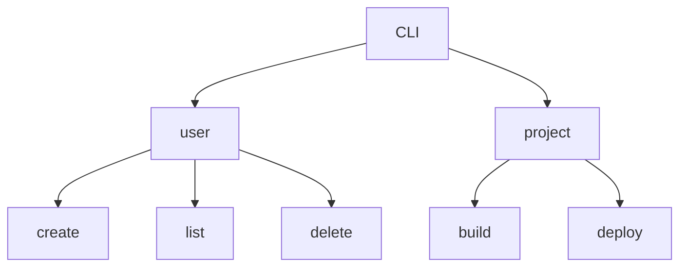

# Lệnh nhiều từ, tiền tố và cấu trúc lệnh con

Khi CLI có nhiều chức năng, việc đặt mọi command thành một danh sách tên rời rạc khiến người dùng khó tìm và khó nhớ cú pháp. Spring Shell cho phép tổ chức tên lệnh thành nhiều từ, dùng tiền tố chung cho một nhóm thao tác và gom các command liên quan trong phần trợ giúp. Ví dụ, thay vì tạo những tên khó liên hệ như `create-user`, `delete-user` và `list-users`, ứng dụng có thể cung cấp một họ lệnh nhất quán: `user create`, `user delete` và `user list`.

Trong module `SPRING_SHELL`, cấu trúc command ảnh hưởng trực tiếp đến khả năng khám phá lệnh, xử lý đối số, validation, trợ giúp và tự hoàn thành. Một cây lệnh rõ ràng cũng giúp script và pipeline gọi CLI ổn định khi ứng dụng phát triển thêm chức năng.

## 1. Các khái niệm cần phân biệt

Một command có thể được mô tả bằng đường dẫn gồm một hoặc nhiều thành phần. Ví dụ `user create` có hai thành phần: `user` là tiền tố, `create` là thao tác. Từ góc nhìn người dùng, các thành phần này tạo thành một cấu trúc phân cấp.

| Khái niệm | Ý nghĩa | Ví dụ |
| --- | --- | --- |
| Lệnh nhiều từ (multi-word command) | Tên command chứa từ hai thành phần trở lên | `user create` |
| Tiền tố (prefix) | Thành phần chung đứng trước nhiều command để tạo ngữ cảnh | `user` trong `user create` và `user list` |
| Lệnh con (subcommand) | Command nằm dưới một tiền tố hoặc command path chung | `create`, `list`, `delete` dưới `user` |
| Nhóm trợ giúp (command group) | Nhãn gom command liên quan trong kết quả `help` | `User Management` |
| Bí danh (alias) | Tên thay thế để gọi cùng một command | `users` gọi command `user list` nếu được khai báo |

Tiền tố và nhóm trợ giúp có mục đích khác nhau. Tiền tố là một phần của cú pháp người dùng phải nhập; nhóm trợ giúp chỉ ảnh hưởng cách command được trình bày trong `help`. Đặt hai command vào cùng nhóm `User Management` không tự tạo ra tiền tố `user`.

Ví dụ về cây lệnh:



Người dùng có thể đọc cấu trúc này như các thao tác trên từng loại tài nguyên:

```text
user create --username linh
user list --active true
user delete --id 42

project build --name storefront
project deploy --environment staging
```

## 2. Chọn cách tổ chức tên command

Không phải CLI nào cũng cần cây lệnh sâu. Hãy chọn cấu trúc theo số lượng thao tác, mối quan hệ nghiệp vụ và cách người dùng tìm command.

### Tên command phẳng

Với ứng dụng nhỏ, tên command đơn có thể đủ rõ:

```text
version
health
config-show
```

Cách này dễ khai báo và dễ gọi. Khi số command tăng, các tên phẳng có thể trở nên dài và không nhất quán vì mỗi nhóm tự chọn một quy ước.

### Tên command nhiều từ

Khi nhiều thao tác cùng tác động lên một loại tài nguyên, dùng danh từ làm tiền tố và động từ làm thao tác:

```text
user create
user list
user disable
user delete
```

Người dùng chỉ cần nhớ từ `user` để tìm các thao tác liên quan. Các từ tiếp theo mô tả hành động cụ thể.

### Cây lệnh nhiều cấp

Một command path có thể chứa nhiều thành phần khi nghiệp vụ thật sự có nhiều cấp:

```text
project environment create
project environment list
project environment delete
```

Chỉ nên thêm cấp khi nó làm rõ mối quan hệ giữa các thao tác. Cây quá sâu khiến người dùng phải nhớ nhiều từ trước khi đến phần option; trong nhiều trường hợp, hai cấp là đủ.

### Dùng alias cho thao tác thường gặp

Alias giúp rút ngắn một command dài hoặc duy trì cú pháp quen thuộc:

```text
user list
users
```

Hai cách gọi có thể cùng thực hiện một thao tác nếu `users` được đăng ký làm alias. Alias phải dễ nhớ và không trùng với command khác. Tránh tạo quá nhiều alias vì chúng làm tăng số cú pháp cần tài liệu hóa và kiểm thử.

## 3. Khai báo lệnh nhiều từ trong Spring Shell 3.x

Trong mô hình annotation mới của Spring Shell 3.x, `@Command` có thể đặt trên lớp và phương thức. Thuộc tính `command` xác định tên command; khi được khai báo ở cấp lớp, giá trị đó trở thành tiền tố cho các command ở cấp phương thức.

```java
import org.springframework.shell.command.annotation.Command;
import org.springframework.shell.command.annotation.Option;
import org.springframework.stereotype.Component;

@Component
@Command(command = "user", group = "User Management")
public class UserCommands {

    @Command(command = "create", description = "Tạo người dùng mới.")
    public String create(
            @Option(longNames = "username") String username) {
        return "Đã tạo người dùng " + username;
    }

    @Command(command = "list", description = "Liệt kê người dùng.")
    public String list() {
        return "Danh sách người dùng";
    }

    @Command(command = "delete", description = "Xóa người dùng theo mã.")
    public String delete(@Option(longNames = "id") long id) {
        return "Đã yêu cầu xóa người dùng " + id;
    }
}
```

Tiền tố ở cấp lớp kết hợp với tên ở cấp phương thức. Người dùng gọi `user create`, `user list` và `user delete`. Group `User Management` gom chúng trong phần trợ giúp. Nếu một phương thức cần xuất hiện trong nhóm khác, có thể khai báo `group` ở cấp phương thức để ghi đè group được kế thừa.

Nếu không muốn dùng tiền tố ở cấp lớp, có thể khai báo toàn bộ đường dẫn trên từng phương thức:

```java
@Command(command = "user create", description = "Tạo người dùng mới.")
public String create() {
    return "Đã tạo người dùng";
}

@Command(command = "user list", description = "Liệt kê người dùng.")
public String list() {
    return "Danh sách người dùng";
}
```

Cách khai báo tường minh này hữu ích khi một lớp chứa command thuộc nhiều nhánh khác nhau hoặc khi muốn tránh phụ thuộc vào tiền tố cấp lớp.

Trong API legacy của Spring Shell 3.x, có thể đăng ký tên nhiều từ bằng `@ShellMethod(key = "user create")`. `@ShellCommandGroup` hoặc thuộc tính `group` của `@ShellMethod` chỉ định nhóm hiển thị trong trợ giúp. Đây là mô hình cũ; không dùng lẫn `@ShellMethod` và `@Command` trong cùng một ví dụ nếu không có chủ đích duy trì hai API riêng.

## 4. Khai báo tiền tố và nhóm trong Spring Shell 4.x

Spring Shell 4.x thay đổi cách tổ chức annotation. `@Command` chỉ đặt trên phương thức và dùng thuộc tính `name`. Từ Spring Shell 4.0.2, `@CommandGroup` cung cấp tiền tố chung và tên nhóm cho các command trong một lớp.

```java
import org.springframework.shell.core.command.annotation.Command;
import org.springframework.shell.core.command.annotation.CommandGroup;
import org.springframework.shell.core.command.annotation.Option;

@CommandGroup(
    prefix = "user",
    name = "User Management",
    description = "Các thao tác quản lý người dùng"
)
public class UserCommands {

    @Command(name = "create", description = "Tạo người dùng mới.")
    public String create(
            @Option(longName = "username", required = true) String username) {
        return "Đã tạo người dùng " + username;
    }

    @Command(name = "list", description = "Liệt kê người dùng.")
    public String list() {
        return "Danh sách người dùng";
    }

    @Command(name = "delete", description = "Xóa người dùng theo mã.")
    public String delete(@Option(longName = "id", required = true) long id) {
        return "Đã yêu cầu xóa người dùng " + id;
    }
}
```

Các phương thức được gọi bằng `user create`, `user list` và `user delete`. `@CommandGroup` đồng thời cung cấp tên nhóm `User Management` cho trợ giúp. Annotation này là Spring component stereotype, vì vậy lớp được đăng ký như một bean khi nằm trong phạm vi component scan.

Nếu dự án dùng Spring Shell 4.0.0 hoặc 4.0.1, `@CommandGroup` chưa có. Hãy khai báo đầy đủ đường dẫn trong từng method, ví dụ `@Command(name = {"user", "create"})`, hoặc nâng lên phiên bản từ 4.0.2 có hỗ trợ `@CommandGroup`.

Đối với Spring Shell 3.x, không sao chép cú pháp `name` và `@CommandGroup` của 4.x vào mã 3.x: API mới của 3.x dùng `command` và có thể đặt `@Command` trên lớp. Ngược lại, khi đã chuyển sang 4.x, không giữ `@Command(command = ...)` ở cấp lớp.

## 5. Nhóm trợ giúp không phải là tiền tố

Một nhóm trợ giúp có thể chứa những command không cùng tiền tố, và một tiền tố có thể được dùng cho các command thuộc cùng một nhóm. Hai cơ chế này giải quyết hai nhu cầu khác nhau:

```java
@Command(name = "user list", group = "Administration")
public String listUsers() {
    return "Danh sách người dùng";
}

@Command(name = "project list", group = "Administration")
public String listProjects() {
    return "Danh sách dự án";
}

@Command(name = "system status", group = "Diagnostics")
public String status() {
    return "Hệ thống đang hoạt động";
}
```

Trong ví dụ này, `Administration` gom hai command ở hai tiền tố khác nhau; `Diagnostics` chứa command `system status`. Khi người dùng gõ command, họ vẫn phải nhập đường dẫn như `user list` hoặc `system status`. Tên group không tham gia phân giải command.

Trong Spring Shell 3.x, `group` có thể đặt trên `@Command` cấp lớp hoặc phương thức; group ở phương thức có độ ưu tiên cao hơn. Trong Spring Shell 4.x, group có thể đặt trực tiếp trên `@Command` hoặc thông qua `@CommandGroup` cho cả lớp. Hãy chọn một quy tắc phân nhóm thống nhất để `help` không trở thành danh sách khó hiểu.

## 6. Cách Spring Shell phân giải đường dẫn command

Spring Shell nhận diện tên command và các thành phần con trước khi liên kết option và argument. Có thể hình dung cú pháp tổng quát như sau:

```text
CommandName [SubCommandName ...] [Option | Argument ...]
```

Ví dụ:

```text
user create --username=linh --role editor
```

được chia thành các thành phần:

| Thành phần | Giá trị | Vai trò |
| --- | --- | --- |
| Command path | `user create` | Xác định command cần gọi |
| Long option | `--username=linh` | Truyền tên đăng nhập |
| Long option | `--role editor` | Truyền vai trò |

Parser của Spring Shell hỗ trợ option dạng `--key=value` hoặc `--key value`, và dạng ngắn `-k=value` hoặc `-k value`. Option và argument có thể xuất hiện theo thứ tự được parser hỗ trợ. Khi có subcommand, nên ưu tiên option có tên thay vì nhiều argument vị trí để tránh nhầm phần đường dẫn với dữ liệu.

Giá trị có khoảng trắng cần được đặt trong dấu nháy:

```text
user create --display-name "Nguyen Van Linh"
```

Dấu nháy giúp parser coi cả cụm là một giá trị. Nếu command được gọi từ script, cần kiểm tra thêm quy tắc quoting của shell hệ điều hành vì dấu nháy có thể được xử lý trước khi chuỗi đến Spring Shell.

## 7. Thiết kế nhánh lệnh để tránh xung đột

Một cây lệnh tốt có đường dẫn duy nhất, tên dễ đoán và không tạo ra các trường hợp khó phân giải. Hãy áp dụng các nguyên tắc sau:

- Dùng danh từ làm tiền tố và động từ làm thao tác: `user create`, `user disable`, `user list`.
- Giữ số cấp vừa đủ. Chỉ thêm `project environment` nếu môi trường thực sự là một khái niệm con có nhiều thao tác riêng.
- Không đăng ký hai command có cùng đường dẫn; alias cũng phải duy nhất trong phạm vi command registry.
- Tránh để một token vừa có thể là command con vừa có thể là argument đầu tiên.
- Ưu tiên option có tên khi command có nhiều tham số hoặc có subcommand.
- Đặt các command cần chia sẻ trạng thái hoặc collaborator vào cùng lớp khi điều đó làm thiết kế đơn giản hơn; tách lớp khi nhóm chức năng có trách nhiệm khác nhau.

### Lưu ý về command cha và command con sâu hơn

Tài liệu kỹ thuật của Spring Shell 3.4 ghi rõ một giới hạn trong mô hình đăng ký: không hỗ trợ đồng thời đăng ký một command làm parent tường minh và một command con sâu hơn dưới chính parent đó. Ví dụ, không thể đăng ký cả `project environment` như một command thực thi và `project environment create` như một command con theo cách này.

Nếu cần cả hai thao tác, hãy thiết kế lại đường dẫn để tránh xung đột, chẳng hạn:

```text
project environment-show
project environment create
project environment list
```

Hoặc dùng một command gốc có tên riêng và các command con dưới một nhánh khác. Với phiên bản khác 3.4, hãy xác nhận giới hạn tương ứng trong tài liệu/API của đúng phiên bản trước khi dựa vào cấu trúc đó.

## 8. Tổ chức lớp command theo miền nghiệp vụ

Đặt mọi command trong một lớp lớn khiến class khó đọc và làm các dependency không liên quan bị gom chung. Ngược lại, tạo một lớp cho từng command nhỏ cũng có thể khiến cấu hình và component scan rời rạc.

Một cách cân bằng là tổ chức lớp theo miền nghiệp vụ:

```text
commands/
  UserCommands.java
  ProjectCommands.java
  EnvironmentCommands.java
  SystemCommands.java
```

Mỗi lớp chứa các thao tác cùng tài nguyên và dùng chung những collaborator cần thiết. Ví dụ `UserCommands` có thể phụ thuộc vào `UserService`; `ProjectCommands` phụ thuộc `ProjectService`. Logic nghiệp vụ vẫn nằm trong service để có thể được gọi từ web API, batch job hoặc test mà không cần đi qua shell.

Không nên lưu trạng thái nghiệp vụ quan trọng trong field mutable của command class chỉ vì các phương thức cùng lớp có thể truy cập field đó. Command bean thường được quản lý trong application context; nếu cần trạng thái phiên làm việc, hãy dùng một component chuyên trách với vòng đời và quy tắc đồng bộ rõ ràng.

## 9. Kiểm tra cây lệnh và trợ giúp

Sau khi khai báo command, hãy xác nhận cả cách gọi lẫn cách hiển thị. Một command có thể chạy đúng nhưng được nhóm sai trong `help`; ngược lại, command xuất hiện trong trợ giúp nhưng đường dẫn gọi không như mong đợi do prefix bị ghép sai.

Checklist kiểm tra:

1. Gọi từng command bằng đường dẫn đầy đủ, gồm cả tiền tố và các thành phần con.
2. Kiểm tra alias nếu có; xác nhận alias gọi đúng một command và không đè tên command khác.
3. Chạy `help` để kiểm tra group, mô tả và cú pháp hiển thị.
4. Thử command không có option, thiếu option bắt buộc và truyền option sai kiểu.
5. Thử giá trị có dấu cách và gọi cùng command từ script.
6. Thử command con không tồn tại và đường dẫn bị thiếu thành phần để xác nhận thông báo lỗi dễ hiểu.
7. Kiểm tra tự hoàn thành nếu ứng dụng bật completion cho command và option.

| Hiện tượng | Nguyên nhân có thể có | Cách xử lý |
| --- | --- | --- |
| `user create` không được nhận diện | Prefix hoặc tên command con không khớp với cấu hình | Kiểm tra `command` trong 3.x hoặc `name`/`prefix` trong 4.x |
| Command xuất hiện sai nhóm trong `help` | Group cấp phương thức ghi đè group cấp lớp hoặc group chưa được đặt | Kiểm tra thứ tự ưu tiên metadata theo phiên bản |
| Nhập `user` nhưng shell báo không tìm thấy command | Chỉ có command con `user create`, chưa có command `user` độc lập | Gọi command con hoặc đăng ký command gốc nếu cần thao tác riêng |
| Alias gọi nhầm command | Alias trùng hoặc quá giống tên khác | Chọn alias duy nhất, mô tả và kiểm thử |
| Đường dẫn nhiều cấp bị nhập nhằng | Một command cha và command con dùng chung phần đường dẫn trong mô hình không hỗ trợ | Thiết kế lại tên command và kiểm tra giới hạn của phiên bản |

## 10. Checklist thiết kế cấu trúc command

- Tên command thể hiện rõ tài nguyên và hành động.
- Tiền tố dùng nhất quán giữa các thao tác cùng miền nghiệp vụ.
- Group trợ giúp được dùng để tổ chức hiển thị, không nhầm với cú pháp gọi lệnh.
- Số cấp lệnh vừa đủ; đường dẫn không trùng và alias không nhập nhằng.
- Option có tên được ưu tiên khi command có nhiều tham số hoặc subcommand.
- Cấu trúc annotation khớp phiên bản Spring Shell đang dùng.
- Trợ giúp, completion, script và tài liệu hướng dẫn phản ánh cùng một command path.
- Cây lệnh đã được kiểm tra với trường hợp hợp lệ và các đường dẫn sai.

## Tài liệu tham khảo

- [Spring Shell 3.4 — Command Annotation API](https://docs.spring.io/spring-shell/reference/3.4/api/java/org/springframework/shell/command/annotation/Command.html)
- [Spring Shell 3.4 — Command Registration](https://docs.spring.io/spring-shell/reference/3.4/appendices/techintro/registration.html)
- [Spring Shell 3.4 — Organizing Commands](https://docs.spring.io/spring-shell/reference/3.4/commands/organize.html)
- [Spring Shell 4.x — Organizing Commands](https://docs.spring.io/spring-shell/reference/commands/organize.html)
- [Spring Shell 4.x — Command Syntax](https://docs.spring.io/spring-shell/reference/commands/syntax.html)
