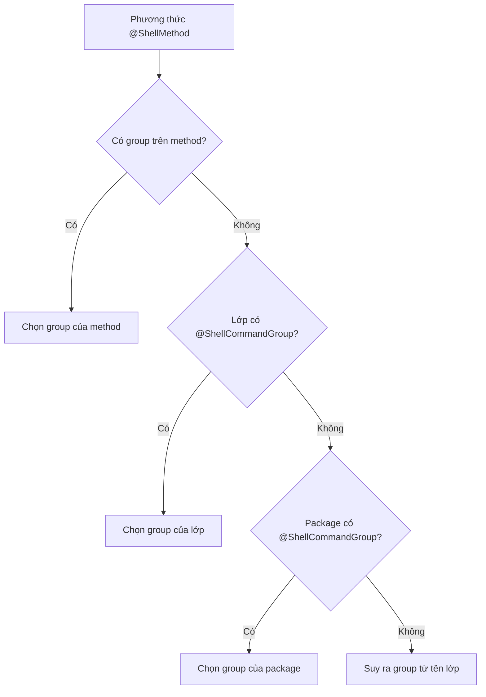

# Nhóm theo lớp hoặc package trong mô hình 3.x

Khi ứng dụng Spring Shell có nhiều command, danh sách `help` có thể trở nên dài và khó tìm. Legacy annotation model của Spring Shell 3.x cho phép gom các command liên quan thành nhóm hiển thị. Ta có thể đặt nhóm mặc định theo lớp Java, khai báo tường minh trên một lớp hoặc áp dụng chung cho cả package bằng `@ShellCommandGroup`.

Điểm cần nhớ là nhóm chỉ tổ chức cách hiển thị command trong trợ giúp và những nơi framework sử dụng metadata nhóm. Nó không tạo tiền tố cho tên command, không thay đổi cách parser đọc lệnh và không tạo ra command con. Ví dụ trong bài dùng Spring Shell 3.1.3, với các annotation legacy trong package `org.springframework.shell.standard`.

## 1. Vì sao cần nhóm command?

Một CLI nhỏ có thể chỉ có vài command như `help`, `version` và `user show`. Khi ứng dụng phát triển, số lượng command có thể tăng lên:

- `product show`, `product search`, `product create`;
- `stock show`, `stock adjust`, `stock import`;
- `report daily`, `report export`;
- `user show`, `user lock`, `user unlock`.

Nếu tất cả command được trình bày thành một danh sách dài, người dùng phải đọc nhiều mục để tìm đúng chức năng. Nhóm giúp gom các lệnh theo lĩnh vực hoặc mục đích, chẳng hạn **Quản lý sản phẩm**, **Quản lý kho**, **Báo cáo** và **Quản trị người dùng**.

Trong Spring Shell legacy annotation model, mỗi phương thức `@ShellMethod` có thể nhận tên nhóm riêng. Ngoài ra, `@ShellCommandGroup` có thể đặt ở cấp lớp hoặc package để cung cấp giá trị mặc định cho nhiều command.

## 2. Điều kiện để command được phát hiện

Trước khi tổ chức nhóm, cần bảo đảm command đã được đăng ký. Với legacy annotation model, Spring Shell chuyển các phương thức thành command khi:

1. Lớp chứa command được đánh dấu `@ShellComponent`.
2. Phương thức cần gọi được đánh dấu `@ShellMethod`.
3. Lớp là Spring bean và nằm trong phạm vi component scan hoặc được đăng ký bằng cấu hình Spring phù hợp.

`@ShellComponent` là stereotype annotation có meta-annotation `@Component`. Nó vừa đánh dấu bean, vừa giúp Spring Shell giới hạn những bean được xem xét để tìm command. `@ShellCommandGroup` chỉ khai báo nhóm; đặt annotation nhóm trên package hoặc lớp không thay thế `@ShellComponent` và `@ShellMethod`.

```java
package com.example.inventory.shell;

import org.springframework.shell.standard.ShellComponent;
import org.springframework.shell.standard.ShellMethod;

@ShellComponent
public class ProductCommands {

    @ShellMethod(value = "Tra cứu thông tin sản phẩm.", key = "product show")
    public String show() {
        return "Thông tin sản phẩm";
    }
}
```

Trong ví dụ này, `product show` là command được đăng ký. Nhóm hiển thị sẽ được xác định theo quy tắc mặc định hoặc theo cấu hình nhóm ở cấp phương thức, lớp hay package.

## 3. Nhóm mặc định theo tên lớp

Nếu không khai báo nhóm ở bất kỳ cấp nào, Spring Shell suy ra nhóm từ tên lớp chứa phương thức command. Tên camelCase được tách thành các từ để tạo nhãn dễ đọc.

| Tên lớp | Nhóm mặc định |
|---|---|
| `UserCommands` | `User Commands` |
| `InventoryCommands` | `Inventory Commands` |
| `URLRelatedCommands` | `URL Related Commands` |
| `ReportExportCommands` | `Report Export Commands` |

Ví dụ:

```java
@ShellComponent
public class UserCommands {

    @ShellMethod(value = "Xem thông tin người dùng.", key = "user show")
    public String show() {
        return "Thông tin người dùng";
    }

    @ShellMethod(value = "Khóa tài khoản người dùng.", key = "user lock")
    public String lock() {
        return "Đã khóa tài khoản";
    }
}
```

Cả `user show` và `user lock` được xếp vào nhóm suy ra từ `UserCommands`. Đây là lựa chọn thuận tiện khi các command trong cùng lớp phục vụ một lĩnh vực và cần dùng chung service hoặc trạng thái.

Nếu tên lớp hiện tại không tạo ra nhãn nhóm phù hợp, có thể đổi tên lớp theo quy ước dễ hiểu hoặc khai báo nhóm tường minh bằng `@ShellCommandGroup`.

## 4. Đặt nhóm mặc định trên lớp bằng @ShellCommandGroup

`@ShellCommandGroup` có thể đặt trực tiếp trên lớp chứa command. Giá trị của annotation trở thành nhóm mặc định cho tất cả phương thức `@ShellMethod` trong lớp đó, trừ phương thức có `group` riêng.

```java
package com.example.inventory.shell;

import org.springframework.shell.standard.ShellCommandGroup;
import org.springframework.shell.standard.ShellComponent;
import org.springframework.shell.standard.ShellMethod;

@ShellComponent
@ShellCommandGroup("Quản lý kho")
public class InventoryCommands {

    @ShellMethod(value = "Tra cứu tồn kho.", key = "stock show")
    public String showStock() {
        return "Tồn kho hiện tại";
    }

    @ShellMethod(value = "Điều chỉnh số lượng tồn kho.", key = "stock adjust")
    public String adjustStock() {
        return "Đã điều chỉnh tồn kho";
    }

    @ShellMethod(value = "Nhập dữ liệu tồn kho.", key = "stock import")
    public String importStock() {
        return "Đã tiếp nhận dữ liệu nhập";
    }
}
```

Ba command được xếp vào nhóm `Quản lý kho`. Cách này hữu ích khi một lớp đại diện cho một miền nghiệp vụ rõ ràng, nhưng tên lớp kỹ thuật không phù hợp làm nhãn hiển thị hoặc tên nhóm cần thống nhất với ngôn ngữ nghiệp vụ.

### Ghi đè nhóm cho một command

Nếu một phương thức trong lớp có mục đích khác với các command còn lại, có thể dùng thuộc tính `group` của `@ShellMethod` để đặt nhóm riêng. Giá trị này có độ ưu tiên cao hơn `@ShellCommandGroup` trên lớp.

```java
@ShellComponent
@ShellCommandGroup("Quản lý kho")
public class InventoryCommands {

    @ShellMethod(value = "Tra cứu tồn kho.", key = "stock show")
    public String showStock() {
        return "Tồn kho hiện tại";
    }

    @ShellMethod(
        value = "Tạo báo cáo tồn kho.",
        key = "stock report",
        group = "Báo cáo"
    )
    public String reportStock() {
        return "Báo cáo tồn kho";
    }
}
```

`stock show` vẫn thuộc nhóm `Quản lý kho`, còn `stock report` được đưa vào nhóm `Báo cáo`. Không cần tách lớp chỉ để thay đổi nhãn nhóm của một command.

## 5. Đặt nhóm mặc định trên package bằng package-info.java

Khi nhiều lớp command trong cùng package thuộc một lĩnh vực, có thể khai báo `@ShellCommandGroup` ở cấp package. Java lưu annotation package trong file `package-info.java`. Mọi command trong package đó nhận nhóm mặc định từ annotation này, trừ khi nhóm bị ghi đè ở cấp lớp hoặc phương thức.

Ví dụ cấu trúc mã nguồn:

```text
src/main/java/
└── com/example/inventory/shell/
    ├── package-info.java
    ├── ProductCommands.java
    ├── StockCommands.java
    └── WarehouseCommands.java
```

Nội dung `package-info.java`:

```java
@org.springframework.shell.standard.ShellCommandGroup("Quản lý kho")
package com.example.inventory.shell;
```

Không cần tạo lớp Java thông thường trong file này. Annotation package phải đặt trước khai báo `package`; dùng tên đầy đủ của annotation giúp file không cần câu lệnh `import`.

Lớp `ProductCommands.java`:

```java
package com.example.inventory.shell;

import org.springframework.shell.standard.ShellComponent;
import org.springframework.shell.standard.ShellMethod;

@ShellComponent
public class ProductCommands {

    @ShellMethod(value = "Tra cứu sản phẩm.", key = "product show")
    public String show() {
        return "Thông tin sản phẩm";
    }
}
```

Lớp `StockCommands.java`:

```java
package com.example.inventory.shell;

import org.springframework.shell.standard.ShellComponent;
import org.springframework.shell.standard.ShellMethod;

@ShellComponent
public class StockCommands {

    @ShellMethod(value = "Tra cứu tồn kho.", key = "stock show")
    public String show() {
        return "Thông tin tồn kho";
    }
}
```

Vì hai lớp cùng thuộc package `com.example.inventory.shell`, hai command được xếp vào nhóm `Quản lý kho`. Package-level grouping hữu ích khi package đã được tổ chức theo một miền chức năng và các lớp trong đó cần dùng chung một nhãn nhóm.

### Ghi đè nhóm package ở cấp lớp hoặc phương thức

Có thể có một lớp nằm trong package `com.example.inventory.shell` nhưng chứa command cần nhóm riêng. Đặt `@ShellCommandGroup` trên lớp sẽ ghi đè nhóm package cho các command trong lớp đó. Nếu chỉ một command khác nhóm, đặt `group` trên `@ShellMethod`.

```java
package com.example.inventory.shell;

import org.springframework.shell.standard.ShellCommandGroup;
import org.springframework.shell.standard.ShellComponent;
import org.springframework.shell.standard.ShellMethod;

@ShellComponent
@ShellCommandGroup("Báo cáo kho")
public class InventoryReportCommands {

    @ShellMethod(value = "Tạo báo cáo tổng hợp.", key = "stock report summary")
    public String summary() {
        return "Báo cáo tổng hợp";
    }

    @ShellMethod(
        value = "Xuất báo cáo kiểm kê.",
        key = "stock report export",
        group = "Xuất dữ liệu"
    )
    public String export() {
        return "Đã xuất báo cáo";
    }
}
```

Trong trường hợp này, `stock report summary` thuộc nhóm `Báo cáo kho`, còn `stock report export` thuộc nhóm `Xuất dữ liệu`. Nhóm package `Quản lý kho` không còn áp dụng cho hai command của lớp này vì class-level group đã ghi đè nó.

## 6. Thứ tự ưu tiên khi xác định nhóm

Spring Shell 3.1.3 xác định nhóm theo thứ tự ưu tiên sau:

| Ưu tiên | Nơi khai báo | Phạm vi áp dụng |
|---|---|---|
| Cao nhất | `group` trong `@ShellMethod` | Chỉ phương thức command đó |
| 2 | `@ShellCommandGroup` trên lớp | Các command trong lớp, trừ phương thức có `group` riêng |
| 3 | `@ShellCommandGroup` trên package | Các command trong package, trừ lớp hoặc phương thức có nhóm riêng |
| Mặc định | Tên lớp chứa command | Dùng khi không có nhóm tường minh phù hợp |

Có thể hình dung cách chọn nhóm như sau:



Điểm cần chú ý: khai báo nhóm ở cấp thấp hơn chỉ ghi đè phạm vi của nó. Một phương thức ghi đè không làm thay đổi nhóm của các phương thức khác trong lớp; một lớp ghi đè không ảnh hưởng đến các lớp còn lại trong package.

## 7. Chọn nhóm theo lớp hay package?

Hai cách đều hợp lệ, nhưng phù hợp với cấu trúc mã nguồn khác nhau.

| Tiêu chí | Nhóm theo lớp | Nhóm theo package |
|---|---|---|
| Phạm vi | Một lớp command | Nhiều lớp trong cùng package |
| Khi nên dùng | Một lớp đại diện cho một nhóm nghiệp vụ cụ thể | Một package chứa nhiều lớp command của cùng một miền |
| Ưu điểm | Rõ ràng, gần nơi khai báo command; dễ chia nhóm theo class | Giảm lặp annotation khi nhiều lớp cùng nhóm |
| Rủi ro | Có thể lặp cùng một nhãn ở nhiều lớp | Package có thể trở nên quá rộng và gom cả command không liên quan |
| Ví dụ | `InventoryCommands` → `Quản lý kho` | `com.example.inventory.shell` → `Quản lý kho` |

Hãy ưu tiên nhóm theo lớp khi một package chứa nhiều loại command khác nhau. Dùng nhóm package khi package được đặt theo một miền nghiệp vụ nhất quán, chẳng hạn `user.shell`, `inventory.shell` hoặc `report.shell`.

Không nên tạo một package chung như `commands` rồi gắn tất cả command của ứng dụng vào một nhóm duy nhất nếu chúng phục vụ nhiều lĩnh vực. Trong trường hợp đó, hãy chia package theo feature hoặc dùng class-level group để giữ trợ giúp dễ tìm.

## 8. Nhóm hiển thị không phải tiền tố hay cấu trúc command

Tên nhóm và tên command là hai metadata độc lập.

- `group = "Quản lý kho"` quyết định command xuất hiện dưới nhóm nào trong trợ giúp.
- `key = "stock show"` quyết định chuỗi người dùng nhập để gọi command.
- Package Java và tên lớp quyết định nơi mã nguồn được tổ chức và cách Spring phát hiện bean.

Ví dụ, command sau vẫn được gọi bằng `stock show` dù được xếp vào nhóm `Vận hành`:

```java
@ShellMethod(
    value = "Tra cứu tồn kho.",
    key = "stock show",
    group = "Vận hành"
)
public String showStock() {
    return "Tồn kho hiện tại";
}
```

Nhóm không tự tạo command `stock`, không làm cho `show` trở thành subcommand và không thay đổi alias. Nếu cần cấu trúc lệnh nhiều từ, hãy thiết kế `key` của command riêng. Nếu cần gom mục trong trợ giúp, hãy dùng group.

## 9. Kiểm tra nhóm trong shell

Sau khi khởi động ứng dụng, chạy `help` để xem danh sách command theo nhóm. Kiểm tra một số trường hợp:

```text
shell:>help
shell:>help stock show
shell:>help stock report summary
```

Với ví dụ package-level grouping, kết quả `help` dự kiến có các nhóm hiển thị như:

```text
AVAILABLE COMMANDS

Quản lý kho
  product show: Tra cứu sản phẩm.
  stock show: Tra cứu tồn kho.

Báo cáo kho
  stock report summary: Tạo báo cáo tổng hợp.

Xuất dữ liệu
  stock report export: Xuất báo cáo kiểm kê.
```

Đây là ví dụ minh họa cách nhóm được trình bày; định dạng khoảng trắng và thứ tự cụ thể có thể phụ thuộc phiên bản và cấu hình trợ giúp. Việc thay đổi nhóm không làm thay đổi chuỗi lệnh người dùng cần nhập.

Nên kiểm tra cả command thuộc nhóm mặc định, command nhận nhóm từ lớp, command nhận nhóm từ package và command ghi đè nhóm bằng `@ShellMethod(group = ...)`.

## 10. Lỗi thường gặp khi nhóm command

| Triệu chứng | Nguyên nhân có thể | Cách kiểm tra |
|---|---|---|
| Command không xuất hiện trong `help` | Lớp chưa là Spring bean, thiếu `@ShellComponent`, thiếu `@ShellMethod` hoặc package nằm ngoài component scan | Kiểm tra bean discovery và annotation command |
| Package-level group không có tác dụng | `package-info.java` nằm sai thư mục hoặc khai báo sai tên package | Đối chiếu đường dẫn với package của các lớp command và kiểm tra annotation package |
| Một command không ở nhóm mong muốn | `group` trên `@ShellMethod` hoặc `@ShellCommandGroup` trên lớp có độ ưu tiên cao hơn package | Kiểm tra lần lượt method, class, package |
| Nhóm mặc định có tên khó hiểu | Tên lớp kỹ thuật không phù hợp làm nhãn trợ giúp | Đặt `@ShellCommandGroup` tường minh hoặc đổi tên lớp |
| Người dùng tưởng group là prefix | Nhầm metadata trợ giúp với tên command | Kiểm tra `key` trong `@ShellMethod`; group không thay đổi cú pháp gọi |
| Hai lớp cùng package bị gom vào nhóm quá rộng | Package-level annotation áp dụng cho tất cả command trong package | Chuyển nhóm xuống cấp lớp hoặc chia package theo feature |

Khi dùng package annotation, cần chắc chắn file `package-info.java` được đặt trong đúng thư mục source và package declaration khớp với các lớp command. Ví dụ `com.example.inventory.shell` tương ứng với `src/main/java/com/example/inventory/shell/package-info.java` trong cấu trúc Maven/Gradle thông thường.

## 11. Ranh giới phiên bản: legacy 3.x và Spring Shell 4.x

`@ShellCommandGroup`, `@ShellComponent` và `@ShellMethod` thuộc legacy annotation model của Spring Shell 3.x. Tài liệu 3.1.3 mô tả rõ cách nhóm theo lớp và package bằng `@ShellCommandGroup`.

Khi nâng lên Spring Shell 4.x, legacy annotations như `@ShellComponent`, `@ShellMethod`, `@ShellOption` và các annotation liên quan đã bị loại bỏ. Mô hình mới sử dụng `@Command`, `@Option`, `@Argument` và `@CommandGroup` trong module `spring-shell-core`. `@CommandGroup` là annotation mới với cách khai báo nhóm/prefix khác; không thể chỉ đổi import `@ShellCommandGroup` thành `@CommandGroup` rồi giữ nguyên mã 3.x.

Nếu đang duy trì ứng dụng 3.x, dùng đúng API legacy theo phiên bản đang chạy. Nếu chuẩn bị nâng lên 4.x, hãy thiết kế lại metadata command theo tài liệu migration và API 4.x.

## 12. Quy trình tổ chức command theo nhóm

1. Liệt kê các command theo lĩnh vực nghiệp vụ, ví dụ sản phẩm, kho, báo cáo và người dùng.
2. Chọn lớp chứa các command có chung service, trạng thái hoặc trách nhiệm.
3. Nếu các lớp trong cùng package cùng thuộc một miền, khai báo `@ShellCommandGroup` trong `package-info.java`.
4. Nếu một lớp có nhãn nhóm riêng, đặt `@ShellCommandGroup` trên lớp.
5. Nếu chỉ một command khác nhóm, đặt `group` trong `@ShellMethod`.
6. Chạy `help` để xác nhận các nhóm và command được hiển thị đúng.
7. Kiểm tra lại tên `key` để bảo đảm cách gọi command vẫn rõ ràng và nhất quán.

## 13. Tổng kết

Trong Spring Shell 3.x legacy annotation model, command được gom nhóm theo bốn mức: tên lớp mặc định, package, lớp và phương thức. `@ShellCommandGroup` có thể đặt ở cấp package qua `package-info.java` hoặc cấp lớp; thuộc tính `group` trong `@ShellMethod` có độ ưu tiên cao nhất.

Hãy nhóm theo package khi nhiều lớp command cùng thuộc một miền chức năng, nhóm theo lớp khi một lớp có trách nhiệm riêng, và chỉ ghi đè ở cấp phương thức khi thật sự cần. Luôn nhớ rằng group phục vụ trợ giúp và khả năng khám phá; `key` mới là tên lệnh mà người dùng nhập.

## Tài liệu tham khảo

- [Spring Shell 3.1.3 Reference Documentation](https://docs.spring.io/spring-shell/docs/3.1.3/docs/index.html) — mục 4.1.3 Legacy Annotation và 4.2 Organizing Commands.
- [ShellCommandGroup API 3.1.x](https://docs.spring.io/spring-shell/docs/3.1.x/api/org/springframework/shell/standard/ShellCommandGroup.html) — phạm vi PACKAGE/TYPE và ý nghĩa của annotation nhóm.
- [ShellComponent API 3.1.x](https://docs.spring.io/spring-shell/docs/3.1.x/api/org/springframework/shell/standard/ShellComponent.html) — vai trò phát hiện lớp chứa shell method.
- [ShellMethod API 3.1.x](https://docs.spring.io/spring-shell/docs/3.1.x/api/org/springframework/shell/standard/ShellMethod.html) — metadata command và thuộc tính `group`.
- [Spring Shell 4.x Migration Guide](https://github.com/spring-projects/spring-shell/wiki/v4-migration-guide) — việc loại bỏ legacy annotations và chuyển sang mô hình `@CommandGroup`.
