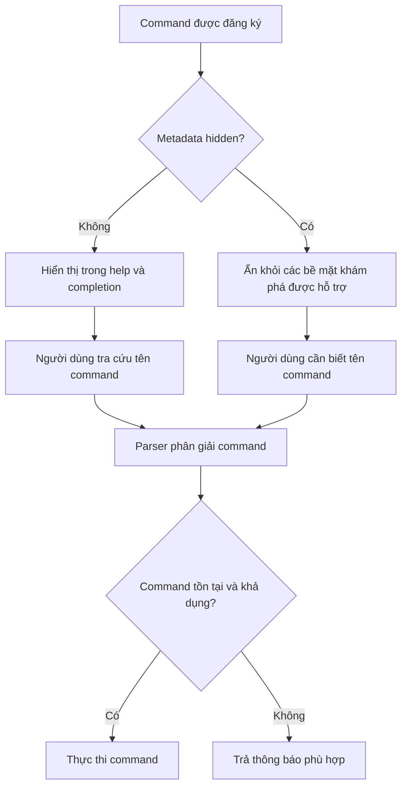

# Ẩn lệnh khỏi trợ giúp theo khả năng của phiên bản

Một ứng dụng Spring Shell có thể chứa các command dành cho bảo trì, chẩn đoán, hỗ trợ vận hành hoặc thử nghiệm nội bộ. Những lệnh này vẫn cần được đăng ký để người có trách nhiệm sử dụng, nhưng không nhất thiết phải xuất hiện trong danh sách `help` hoặc gợi ý hoàn thành dành cho người dùng thông thường. Spring Shell có metadata `hidden` để biểu thị command như vậy; cách khai báo phụ thuộc phiên bản và mô hình đăng ký.

Điểm quan trọng là **ẩn command chỉ hạn chế khả năng khám phá**. Người biết chính xác tên lệnh và các đối số vẫn có thể gọi command. Vì vậy, `hidden` không thay thế kiểm tra quyền truy cập trong ứng dụng.

## Hidden command ảnh hưởng đến những gì?

Trong tài liệu Spring Shell 3.2.x–3.4.x, một command được đánh dấu hidden bị loại khỏi các bề mặt khám phá sau:

- Danh sách command của `help`.
- Trang trợ giúp chi tiết khi người dùng yêu cầu `help <command>`; shell phản hồi như command không tồn tại.
- Gợi ý hoàn thành command trong phiên tương tác.
- Bash completion.

Command vẫn tồn tại trong cấu trúc đăng ký và vẫn có thể thực thi nếu người dùng biết tên cùng các tùy chọn cần thiết. Do đó, ẩn command không đồng nghĩa với xóa command khỏi ứng dụng, làm command unavailable hoặc chặn lời gọi.



Sơ đồ cho thấy metadata hidden không xóa command khỏi registry và không tự ngăn parser phân giải tên. Khi kiểm thử, cần kiểm tra riêng việc ẩn khỏi help/completion và khả năng thực thi bằng tên đầy đủ.

## Chọn cách khai báo theo phiên bản

Khả năng ẩn bằng annotation đã thay đổi giữa các bản Spring Shell. Không nên suy ra rằng một thuộc tính có trong Javadoc của một bản mới cũng được hỗ trợ trong mọi bản cũ.

| Phiên bản được tài liệu xác nhận | Mô hình programmatic | Mô hình annotation |
|---|---|---|
| Spring Shell 3.0.x–3.3.x, gồm tài liệu 3.2.8 và 3.3.4 | `CommandRegistration.Builder.hidden()` hoặc `hidden(true)` | Tài liệu ghi rõ hidden command chưa được hỗ trợ bằng annotation-based configuration |
| Spring Shell 3.4.1 | `CommandRegistration.Builder.hidden()` hoặc `hidden(true)` | Tài liệu 3.4.1 vẫn ghi chưa hỗ trợ bằng annotation |
| Spring Shell 3.4.3 | `CommandRegistration.Builder.hidden()` hoặc `hidden(true)` | Đã hỗ trợ; dùng `hidden = true` trong `@Command` để ẩn khỏi help listing |
| Spring Shell 4.0.x | `Command.Builder.hidden(true)` hoặc constructor `AbstractCommand` có tham số `hidden` | `@Command(hidden = true)` có trong API; annotation 4.0.3 nhắm đến method (`@Target(METHOD)`) |

Các mốc 3.4.1 và 3.4.3 cho thấy phải kiểm tra cả phiên bản vá. Nếu dự án đang dùng 3.4.x, hãy mở tài liệu đúng bản đang khai báo trong dependency management. Với Spring Shell 2.1.x, không dùng ví dụ hidden của 3.x/4.x nếu chưa xác minh API của bản 2.1.x cụ thể; tài liệu 2.1.1 không trình bày tính năng hidden command theo mô hình ở các bản sau.

## Spring Shell 3.0.x–3.4.1: dùng CommandRegistration.Builder

Ở các bản 3.0.x, 3.1.x, 3.2.x, 3.3.x và 3.4.1, tài liệu hidden command hướng dẫn dùng mô hình programmatic. Gọi `hidden()` hoặc `hidden(true)` trên `CommandRegistration.Builder` để đánh dấu registration.

Ví dụ đăng ký command chẩn đoán bằng bean:

```java
import org.springframework.context.annotation.Bean;
import org.springframework.context.annotation.Configuration;
import org.springframework.shell.command.CommandRegistration;

@Configuration
class InternalCommandConfiguration {

    @Bean
    CommandRegistration diagnosticsCommand() {
        return CommandRegistration.builder()
                .command("diagnostics")
                .description("Hiển thị thông tin chẩn đoán")
                .hidden()
                .withTarget()
                    .function(context -> "Thông tin chẩn đoán nội bộ")
                    .and()
                .build();
    }
}
```

`CommandRegistration` mô tả command, metadata và target thực thi. Khi bean được Spring Shell phát hiện và đăng ký vào `CommandCatalog`, thuộc tính hidden được giữ trong registration. Có thể dùng `.hidden(true)` để thể hiện rõ giá trị boolean hoặc `.hidden(false)` khi muốn hiển thị command.

Ví dụ đặt trạng thái bằng điều kiện cấu hình:

```java
boolean hideDiagnostics = true;

CommandRegistration registration = CommandRegistration.builder()
        .command("diagnostics")
        .description("Hiển thị thông tin chẩn đoán")
        .hidden(hideDiagnostics)
        .withTarget()
            .function(context -> "Thông tin chẩn đoán nội bộ")
            .and()
        .build();
```

Điều kiện này chỉ minh họa cách truyền giá trị vào builder. Trong ứng dụng thật, có thể lấy giá trị từ cấu hình Spring, profile hoặc feature flag. Hãy xác định rõ ai được phép bật tính năng và tránh để một cấu hình công khai vô tình phơi bày command nội bộ.

### Vì sao không dùng @Command(hidden = true) ở các bản này?

Tài liệu Spring Shell 3.2.8, 3.3.4 và 3.4.1 ghi rõ hidden command chưa được hỗ trợ với annotation-based configuration. Một số API annotation của các bản sau có thêm thuộc tính `hidden`, nhưng điều đó không làm cho ví dụ mới tương thích ngược với các bản cũ.

Nếu dự án đang ở một trong các bản này, hãy chuyển riêng command cần ẩn sang đăng ký programmatic bằng `CommandRegistration`. Không thêm một thuộc tính annotation rồi kỳ vọng nó được xử lý khi phiên bản đang chạy chưa hỗ trợ.

## Spring Shell 3.4.3: hidden bằng annotation

Từ tài liệu Spring Shell 3.4.3, hidden command đã được hỗ trợ trong annotation-based configuration. Có thể đặt `hidden = true` trực tiếp trên method `@Command`:

```java
import org.springframework.shell.command.annotation.Command;
import org.springframework.stereotype.Component;

@Component
class DiagnosticsCommands {

    @Command(
            command = "diagnostics",
            description = "Hiển thị thông tin chẩn đoán",
            hidden = true
    )
    public String diagnostics() {
        return "Thông tin chẩn đoán nội bộ";
    }
}
```

Trong Spring Shell 3.4.3, `hidden = true` được tài liệu mô tả là ẩn command khỏi danh sách trợ giúp. Hãy chạy thử `help` và kiểm tra completion trong phiên bản thực tế nếu yêu cầu sản phẩm cần ẩn ở tất cả bề mặt khám phá. Cách kiểm tra này đặc biệt hữu ích khi nâng từ 3.4.1, nơi tài liệu còn ghi annotation-based hidden chưa được hỗ trợ.

## Spring Shell 4.0.x: annotation và programmatic API

Spring Shell 4.0.x có thuộc tính `hidden` trên annotation `org.springframework.shell.core.command.annotation.Command`. Có thể dùng annotation trên method command:

```java
import org.springframework.shell.core.command.annotation.Command;
import org.springframework.stereotype.Component;

@Component
class DiagnosticsCommands {

    @Command(
            name = "diagnostics",
            description = "Hiển thị thông tin chẩn đoán",
            hidden = true
    )
    public String diagnostics() {
        return "Thông tin chẩn đoán nội bộ";
    }
}
```

Trong API 4.0.3, `@Command` được khai báo với `@Target(METHOD)`. Vì vậy, hãy đặt `hidden = true` trên method command; không chuyển nguyên ví dụ class-level của annotation model 3.4.x sang 4.0.x.

Nếu đăng ký command bằng code, `Command.Builder` có phương thức `hidden(boolean)`:

```java
import org.springframework.context.annotation.Bean;
import org.springframework.context.annotation.Configuration;
import org.springframework.shell.core.command.Command;

@Configuration
class InternalCommandConfiguration {

    @Bean
    Command diagnosticsCommand() {
        return Command.builder()
                .name("diagnostics")
                .description("Hiển thị thông tin chẩn đoán")
                .hidden(true)
                .execute(context -> {
                    context.outputWriter()
                            .println("Thông tin chẩn đoán nội bộ");
                });
    }
}
```

`Command.Builder.execute(Consumer<CommandContext>)` tạo một command thực thi phần thân lambda. `hidden(true)` lưu metadata ẩn trên command. API 4.x cũng có `AbstractCommand` với constructor nhận tham số `hidden`, nếu ứng dụng cần một lớp command chuyên biệt thay vì builder.

`Command.isHidden()` cho phép đọc trạng thái hidden từ command. Trong mô hình 4.x, command vẫn được quản lý bởi `CommandRegistry`; hidden là metadata của command chứ không phải thao tác xóa command khỏi registry.

## Ẩn, unavailable và unregister là ba việc khác nhau

Ba cơ chế này phục vụ những mục đích khác nhau:

| Cơ chế | Ý nghĩa | Có thể gọi bằng tên đã biết? |
|---|---|---|
| Hidden | Giảm khả năng khám phá trong help/completion theo hỗ trợ của phiên bản | Có; hidden command vẫn có thể thực thi |
| Availability | Command đã đăng ký nhưng chưa được phép chạy trong trạng thái hiện tại | Không thể thực thi khi availability không đạt; shell có thể giải thích lý do |
| Unregister | Gỡ command khỏi catalog/registry | Không thể phân giải command cho đến khi đăng ký lại |

Ví dụ: `diagnostics` có thể luôn tồn tại nhưng bị ẩn với người dùng thông thường; `download` có thể hiện trong help nhưng chỉ chạy sau khi kết nối; một command theo feature flag có thể được đăng ký khi bật tính năng và gỡ đăng ký khi tắt. Chọn đúng cơ chế giúp phản hồi của shell khớp với trạng thái thực tế.

## Hidden command không phải cơ chế bảo mật

Không dùng hidden để bảo vệ thao tác nhạy cảm như xóa dữ liệu, xuất thông tin cá nhân, thay đổi quyền hoặc chạy lệnh quản trị. Người dùng có thể biết tên command qua tài liệu cũ, lịch sử terminal, log, mã nguồn hoặc được người khác cung cấp. Tài liệu Spring Shell cũng nói rõ hidden command có thể được gọi nếu biết tên và các tùy chọn.

Nếu command cần giới hạn người dùng, hãy kiểm tra quyền tại lớp bảo mật hoặc service trước khi thực hiện nghiệp vụ. Ví dụ, command quản trị có thể kiểm tra principal/role hoặc quyền của tài khoản hiện tại; việc kiểm tra này phải chạy cả khi command được gọi trực tiếp bằng tên đầy đủ.

Nếu command không nên tồn tại trong một cấu hình triển khai, hãy cân nhắc không tạo bean hoặc không đăng ký command ở cấu hình đó. Nếu command cần biến mất trong lúc ứng dụng đang chạy, dùng thao tác unregister theo API registry/catalog của phiên bản. Hidden chỉ nên dùng khi mục tiêu là giữ command có sẵn nhưng không quảng bá trong trải nghiệm khám phá.

## Kiểm thử command đã ẩn

Không dừng ở việc kiểm tra annotation hoặc builder đã nhận `hidden = true`. Hãy kiểm thử hành vi người dùng nhìn thấy:

1. Chạy `help` và xác nhận command ẩn không xuất hiện trong danh sách.
2. Chạy `help diagnostics` và xác nhận kết quả theo hành vi hidden của phiên bản.
3. Nhấn Tab ở đầu dòng hoặc sau tiền tố liên quan và xác nhận command ẩn không được gợi ý nếu phiên bản hỗ trợ ẩn khỏi completion.
4. Nếu ứng dụng cung cấp Bash completion, tạo lại script completion và xác nhận command ẩn không xuất hiện.
5. Gõ chính xác `diagnostics` để xác nhận command vẫn thực thi khi thiết kế yêu cầu giữ khả năng gọi trực tiếp.
6. Kiểm tra command có alias; xác nhận alias cũng không bị lộ trong danh sách/gợi ý khi hidden được áp dụng.
7. Kiểm tra quyền truy cập độc lập với hidden bằng một tài khoản không đủ quyền.
8. Chạy lại các kiểm tra sau khi nâng phiên bản Spring Shell, nhất là khi chuyển qua mốc 3.4.3 hoặc 4.0.x.

Với Spring Shell 3.4.3, tài liệu annotation hidden nêu rõ việc ẩn khỏi help listing; cần kiểm tra thêm completion theo bản vá đang chạy nếu đây là tiêu chí nghiệm thu. Với programmatic hidden ở tài liệu 3.2.x–3.4.x, tài liệu mô tả đầy đủ help listing, detailed help, interactive completion và Bash completion.

## Lỗi thường gặp

| Biểu hiện | Nguyên nhân có thể | Cách xử lý |
|---|---|---|
| `hidden` không có tác dụng với `@Command` | Phiên bản 3.x đang dùng chưa hỗ trợ annotation-based hidden | Dùng `CommandRegistration.Builder.hidden()` hoặc nâng lên bản có hỗ trợ |
| Không biên dịch được `.hidden()` | Đang dùng nhầm API hoặc version | Kiểm tra package và Javadoc đúng phiên bản; 4.x dùng `Command.Builder.hidden(boolean)` |
| Command không xuất hiện trong help và cũng không thể gọi | Command chưa được đăng ký, bị unregister hoặc không khả dụng | Kiểm tra registry/catalog và availability riêng biệt |
| Command bị lộ qua alias | Kiểm tra alias chưa được ẩn/đăng ký theo cùng metadata hoặc completion cache cũ | Kiểm tra alias trong registry và tạo lại Bash completion |
| Nghĩ rằng hidden ngăn người dùng chạy lệnh | Nhầm khả năng khám phá với phân quyền | Bổ sung kiểm tra quyền trong service hoặc security layer |
| Nâng từ 3.4.1 lên 3.4.3 nhưng help thay đổi | Phiên bản mới đã hỗ trợ hidden qua annotation | Kiểm tra lại output help và completion sau nâng cấp |

## Quy trình chọn cách ẩn command

Khi bắt đầu triển khai, hãy làm theo trình tự sau:

1. Xác định phiên bản Spring Shell thực tế từ dependency hoặc BOM.
2. Xác định command đang dùng annotation model hay programmatic model.
3. Mở tài liệu hidden command và Javadoc đúng phiên bản.
4. Nếu là 3.0.x–3.4.1, dùng `CommandRegistration.Builder.hidden()` cho command cần ẩn.
5. Nếu là 3.4.3, có thể dùng `@Command(hidden = true)` theo tài liệu annotation-based hidden.
6. Nếu là 4.0.x, dùng `@Command(hidden = true)` trên method hoặc `Command.Builder.hidden(true)` trong programmatic model.
7. Kiểm thử help, detailed help, completion và lời gọi trực tiếp; bổ sung authorization nếu command có tác động nhạy cảm.

## Tài liệu tham khảo theo phiên bản

- [Spring Shell 3.2.8 — Hidden Command](https://docs.spring.io/spring-shell/reference/3.2/commands/hidden.html): hidden qua `CommandRegistration.Builder`; annotation-based configuration chưa được hỗ trợ.
- [Spring Shell 3.3.4 — Hidden Command](https://docs.spring.io/spring-shell/reference/3.3/commands/hidden.html): hành vi ẩn khỏi help, detailed help, interactive completion và Bash completion.
- [Spring Shell 3.4.1 — Hidden Command](https://docs.spring.io/spring-shell/reference/3.4/commands/hidden.html): mốc tài liệu còn ghi annotation-based configuration chưa được hỗ trợ.
- [Spring Shell 3.4.3 — Hidden Command](https://docs.spring.io/spring-shell/reference/3.4/commands/hidden.html): annotation-based hidden được hỗ trợ bằng `@Command(hidden = true)`.
- [Spring Shell 3.4.2-SNAPSHOT API — Command annotation](https://docs.spring.io/spring-shell/reference/3.4/api/java/org/springframework/shell/command/annotation/Command.html): Javadoc mô tả thuộc tính hidden ở phạm vi TYPE/METHOD và cách kế thừa xuống method mapping; kiểm tra lại với bản phát hành ổn định cụ thể trước khi dựa vào hành vi này.
- [Spring Shell 2.1.1 Reference Documentation](https://docs.spring.io/spring-shell/docs/2.1.1/site/reference/htmlsingle/): tài liệu dòng 2.1.x để đối chiếu API legacy; không áp dụng ví dụ hidden của các bản mới nếu API chưa xác nhận.
- [Spring Shell 4.0.3 API — Command annotation](https://docs.spring.io/spring-shell/reference/api/org/springframework/shell/core/command/annotation/Command.html): thuộc tính `hidden` và phạm vi METHOD trong API 4.0.x.
- [Spring Shell 4.0.3 API — AbstractCommand](https://docs.spring.io/spring-shell/reference/api/org/springframework/shell/core/command/AbstractCommand.html): constructor nhận cờ hidden và phương thức `isHidden()`.
- [Spring Shell 4.0.4 API — Command.Builder](https://docs.spring.io/spring-shell/reference/api/org/springframework/shell/core/command/Command.Builder.html): phương thức `hidden(boolean)` cho đăng ký programmatic.
- [Spring Shell 4.0.3 API — Command](https://docs.spring.io/spring-shell/reference/api/org/springframework/shell/core/command/Command.html): phương thức `isHidden()`.
