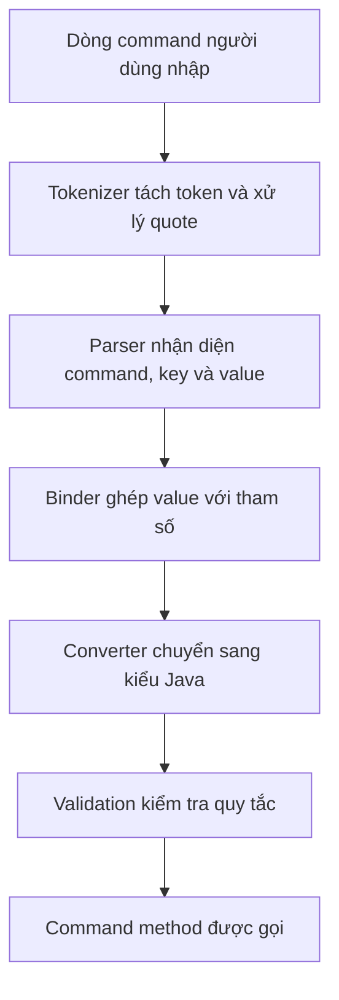

# Các dạng `--key=value` và `--key value` theo parser đang dùng

Khi gọi một command Spring Shell, option có tên thường được viết theo dạng `--key=value` hoặc `--key value`. Hai cách viết này có thể truyền cùng một giá trị, nhưng chúng tạo ra chuỗi token khác nhau và phụ thuộc vào quy tắc phân tích của parser đang nhận dòng lệnh.

Để chọn cú pháp chính xác, cần hiểu parser tách tên option và giá trị như thế nào, cách dấu nháy bảo vệ khoảng trắng, trường hợp giá trị bắt đầu bằng dấu gạch ngang và cách framework chuyển token thành tham số Java. Đừng xem hai cách viết là luôn thay thế được cho nhau trong mọi CLI hoặc mọi phiên bản.

## Mục tiêu học tập

Sau bài học, bạn có thể:

- Phân biệt cấu trúc token của `--key=value` và `--key value`.
- Chọn cách viết phù hợp với kiểu option và parser của ứng dụng.
- Truyền giá trị có khoảng trắng, dấu `=`, dấu gạch ngang hoặc giá trị rỗng một cách rõ ràng.
- Phân biệt option bị bỏ qua, option thiếu giá trị và option có giá trị rỗng.
- Nhận biết lỗi cú pháp, lỗi chuyển đổi kiểu và lỗi validation.
- Kiểm thử cú pháp với parser thực tế của phiên bản Spring Shell đang dùng.

## 1. Option có tên gồm key và value

Một command có thể nhận dữ liệu qua argument vị trí và option có tên. Argument vị trí được xác định dựa trên vị trí xuất hiện; option có tên được nhận diện bằng key, thường có tiền tố `--`.

Ví dụ command xuất báo cáo:

```text
report export --format csv --output report.csv
```

Trong ví dụ, `report export` là tên command, `--format` và `--output` là các key, còn `csv` và `report.csv` là value tương ứng.

Một số parser cũng chấp nhận dạng gắn value ngay sau key:

```text
report export --format=csv --output=report.csv
```

Ở dạng này, dấu `=` phân cách key và value trong cùng một token. Dạng tách bằng khoảng trắng đặt key và value ở hai token liền nhau. Cả hai đều nhằm truyền giá trị cho option đã khai báo, nhưng cách parser nhận diện chúng phải được xác nhận trong phiên bản và cấu hình cụ thể.

## 2. Dạng `--key=value`

Với cú pháp gắn liền, tên option và giá trị nằm trong cùng một phần tử văn bản:

```text
--format=csv
--limit=100
--output=build/reports/monthly.csv
```

Ở mức khái niệm, parser nhận token `--format=csv`, nhận diện key `format` và lấy `csv` làm value. Cách viết này giúp ranh giới giữa key và value hiện rõ, đặc biệt khi value có thể bị nhầm là một option khác.

Ví dụ đầy đủ:

```text
report export --format=csv --limit=100 --output=build/reports/monthly.csv
```

Các ưu điểm thường gặp:

- Mỗi option và value được gắn trong cùng một token.
- Dễ đọc khi có nhiều option liên tiếp.
- Ít mơ hồ hơn khi value bắt đầu bằng `-`.
- Thuận tiện khi tạo command line từ cấu hình hoặc template, nếu parser hỗ trợ dạng này.

Điểm cần lưu ý là dấu `=` đầu tiên sau key thường là dấu phân cách; những dấu `=` tiếp theo có thể thuộc value. Ví dụ URL có query string:

```text
--url=https://example.test/search?q=spring&sort=name
```

Parser cần tách ở dấu phân cách giữa key và value, giữ phần còn lại của URL làm giá trị. Hãy kiểm tra parser thực tế nếu ứng dụng nhận chuỗi có nhiều dấu `=`.

## 3. Dạng `--key value`

Với cú pháp tách rời, key và value là hai token liền nhau:

```text
--format csv
--limit 100
--output build/reports/monthly.csv
```

Parser nhận `--format`, sau đó lấy token kế tiếp `csv` làm value nếu option đó được khai báo là option cần một giá trị.

Ví dụ đầy đủ:

```text
report export --format csv --limit 100 --output build/reports/monthly.csv
```

Ưu điểm thường gặp:

- Cách viết dễ đọc với người đã quen CLI trên hệ điều hành.
- Key và value tách biệt rõ về mặt hình thức.
- Dễ kết hợp với một số công cụ sinh command line vốn tạo từng argument riêng.

Rủi ro chính là parser phải xác định token tiếp theo thuộc value hay là option mới. Với option cần value, nếu người dùng quên value và viết tiếp một key khác, parser có thể báo thiếu giá trị hoặc diễn giải sai tùy quy tắc.

Ví dụ dễ gây nhầm:

```text
report export --format --output report.csv
```

Nếu `--format` cần một giá trị, token `--output` không phải một value định dạng hợp lệ. Parser có thể báo `--format` thiếu value, hoặc báo lỗi chuyển đổi tùy cách triển khai. Không nên dựa vào hành vi suy đoán; hãy viết đủ value hoặc dùng dạng `--format=csv`.

## 4. So sánh hai dạng cú pháp

| Tiêu chí | `--key=value` | `--key value` |
|---|---|---|
| Cấu trúc token | Key và value gắn trong một token | Key và value là hai token |
| Ranh giới | Dấu `=` | Khoảng trắng/token kế tiếp |
| Value bắt đầu bằng `-` | Ít mơ hồ hơn | Có thể bị nhận diện nhầm là option mới |
| Value có khoảng trắng | Cần quy tắc quote phù hợp | Cần quote value thành một token |
| Thiếu value | Thường nhận ra key có dấu `=` nhưng phần value rỗng | Parser phải quyết định token tiếp theo có phải value không |
| Tính tương thích | Phụ thuộc parser có hỗ trợ dạng gắn không | Phụ thuộc parser có hỗ trợ dạng tách không |

Nếu parser của ứng dụng hỗ trợ cả hai dạng cho một option đơn trị, chúng thường có ý nghĩa tương đương:

```text
customer find --status=active
customer find --status active
```

Trong cả hai trường hợp, mục tiêu là truyền `active` cho option `status`. Tuy nhiên, hãy kiểm tra parser và metadata command thay vì giả định mọi option hoặc mọi kiểu dữ liệu đều xử lý giống nhau.

## 5. Dấu nháy và value có khoảng trắng

Khoảng trắng thường đánh dấu ranh giới giữa các token. Nếu value chứa khoảng trắng, cần đặt nó trong dấu nháy theo quy tắc tokenizer của môi trường.

Hai cách viết thường gặp:

```text
report export --file-name="monthly sales report.csv"
report export --file-name "monthly sales report.csv"
```

Trong cả hai ví dụ, mục tiêu là truyền một value duy nhất:

```text
monthly sales report.csv
```

Nếu bỏ dấu nháy:

```text
report export --file-name monthly sales report.csv
```

parser có thể chỉ lấy `monthly` làm value và coi `sales`, `report.csv` là token dư hoặc argument khác. Kết quả phụ thuộc grammar của command.

### 5.1. Dấu nháy đơn và dấu nháy kép

Một số tokenizer hỗ trợ cả dấu nháy đơn và kép:

```text
--message="hello from Spring Shell"
--message='hello from Spring Shell'
```

Nhưng cách xử lý escape, dấu nháy lồng nhau và ký tự đặc biệt có thể khác nhau. Hãy dùng quy tắc được parser hiện tại hỗ trợ và kiểm thử các chuỗi có dấu nháy bên trong.

### 5.2. Dấu nháy được xử lý ở lớp nào?

Khi nhập command tại prompt Spring Shell, dòng văn bản đi qua bộ đọc dòng và tokenizer/parser của ứng dụng. Khi chạy ứng dụng từ PowerShell hoặc Bash, shell hệ điều hành lại có quy tắc quote riêng cho câu lệnh khởi chạy và đối số truyền cho tiến trình Java.

Hai lớp này có thể cùng xuất hiện trong một quy trình nhưng không phải một parser. Ví dụ, dấu nháy dùng để bao đường dẫn JAR trong lệnh PowerShell chỉ phục vụ PowerShell; dấu nháy quanh value trong một dòng nhập tại prompt Spring Shell được xử lý bởi parser của ứng dụng.

## 6. Value bắt đầu bằng dấu gạch ngang

Một value có thể bắt đầu bằng dấu `-`, ví dụ tên nhánh Git, chuỗi âm hoặc một mẫu tìm kiếm:

```text
--pattern -draft
--offset -10
--name --legacy
```

Với cú pháp tách rời, parser có thể nhầm token bắt đầu bằng `-` là option tiếp theo. Nếu parser hỗ trợ dạng gắn, có thể viết rõ ràng:

```text
--pattern=-draft
--offset=-10
--name=--legacy
```

Đây là một lý do thực tế để ưu tiên `--key=value` khi value có tiền tố giống option. Nếu parser không hỗ trợ dạng gắn, hãy xem tài liệu cú pháp của parser để biết cách escape hoặc truyền token đặc biệt.

Không nên tự thêm dấu nháy với kỳ vọng chúng luôn giải quyết được vấn đề. Một số tokenizer bỏ dấu nháy trước khi parser xử lý option; khi đó token vẫn có thể bắt đầu bằng `-`. Cần kiểm tra kết quả token hóa thực tế.

## 7. Value chứa dấu `=` hoặc ký tự đặc biệt

Value có thể chứa dấu `=` mà không phải dấu phân cách option:

```text
--expression=a=b=c
--url=https://example.test/path?mode=fast&sort=name
```

Với dạng `--key=value`, parser phù hợp thường tách tại dấu `=` phân cách đầu tiên và giữ phần còn lại cho value. Nếu parser hoặc lớp tiền xử lý xử lý khác, cần kiểm tra bằng test với giá trị mẫu.

Các ký tự như `&`, `;`, `$`, `*`, `|` còn có ý nghĩa đặc biệt trong một số shell hệ điều hành. Khi gõ tại prompt Spring Shell, ý nghĩa của chúng do tokenizer/parser của ứng dụng quyết định. Khi truyền cả dòng qua một shell bên ngoài hoặc file script của hệ điều hành, shell bên ngoài có thể diễn giải chúng trước. Vì vậy, phải quote hoặc escape theo đúng lớp đang nhận dòng lệnh.

Ví dụ URL trong Bash được quote để shell bên ngoài không diễn giải `&` thành toán tử chạy nền:

```bash
java -jar support-cli.jar "report fetch --url=https://example.test/path?mode=fast&sort=name"
```

Đây chỉ là ví dụ minh họa việc quote đối số ở Bash. Cách ứng dụng nhận một command line hoàn chỉnh qua tham số khởi chạy phải được thiết kế riêng; không nên mặc định mọi ứng dụng Spring Shell đều hỗ trợ cách gọi một lần này.

## 8. Option boolean và option dạng cờ

Option boolean cần được phân biệt với option nhận chuỗi hoặc số. Một command có thể định nghĩa option dạng cờ, trong đó sự hiện diện của key biểu thị `true`:

```text
report export --verbose
```

Một parser hoặc metadata command khác có thể cho phép truyền giá trị tường minh:

```text
report export --verbose=true
report export --verbose false
```

Không phải mọi cách khai báo boolean đều hỗ trợ cả ba dạng. Nếu `--verbose` được định nghĩa là flag không nhận value, token `false` ở dạng tách rời có thể bị coi là argument dư. Nếu option được định nghĩa là boolean có value, parser có thể yêu cầu giá trị hoặc áp dụng default khi key vắng mặt.

Khi thiết kế CLI, cần quy định rõ:

- Key vắng mặt có nghĩa `false`, `true` hay dùng default khác?
- Có chấp nhận `--verbose=true` không?
- Có chấp nhận `--verbose false` không?
- Có dạng phủ định như `--no-verbose` không?

Không nên tự suy ra quy tắc `--no-key` hoặc giá trị mặc định chỉ từ tên option. Hãy kiểm tra metadata command và test parser với từng dạng được tài liệu hóa.

## 9. Phân biệt option vắng mặt, thiếu value và value rỗng

Ba trường hợp này có ý nghĩa khác nhau:

| Cách nhập | Ý nghĩa dự kiến |
|---|---|
| Không có `--label` | Option không được truyền; framework có thể dùng default hoặc báo thiếu option bắt buộc |
| `--label` | Key xuất hiện nhưng không có token value; hợp lệ hay không phụ thuộc loại option |
| `--label=` | Key có dấu phân cách nhưng value rỗng; parser có thể nhận chuỗi rỗng hoặc từ chối |
| `--label ""` | Token value là chuỗi rỗng nếu tokenizer giữ được giá trị quote rỗng |
| `--label value` | Key có value `value` |

Không nên coi `--label` và `--label=` là tương đương. Một option cờ có thể hợp lệ khi chỉ có key, trong khi option chuỗi bắt buộc có value. Một chuỗi rỗng có thể được chấp nhận ở bước parse nhưng bị validation từ chối sau đó.

Nếu nghiệp vụ phân biệt “không cung cấp” với “cố ý để trống”, hãy giữ sự khác biệt đó trong kiểu dữ liệu hoặc logic binding. Đừng tự thay chuỗi rỗng thành `null` nếu hợp đồng command không quy định như vậy.

## 10. Thứ tự option và option lặp

Một số parser cho phép option xuất hiện trước hoặc sau argument vị trí:

```text
customer find --status active 42
customer find 42 --status active
```

Khả năng này phụ thuộc parser và grammar command. Nếu parser dừng phân tích option sau một argument vị trí, hai dòng trên có thể không tương đương. Hãy theo cú pháp được công bố cho ứng dụng và giữ cách gọi nhất quán trong script.

Option lặp cũng phụ thuộc kiểu tham số:

```text
report export --column name --column email
report export --column=name --column=email
```

Nếu option được khai báo nhận một giá trị đơn, lặp key có thể gây lỗi hoặc áp dụng quy tắc ưu tiên. Nếu tham số là danh sách, parser có thể thu thập nhiều giá trị theo cách được hỗ trợ. Không mặc định option lặp sẽ tự động tạo `List`; hãy kiểm tra kiểu tham số, conversion và parser.

## 11. Parser, binding, conversion và validation là các bước khác nhau

Khi một option không hoạt động như mong đợi, cần xác định lỗi nằm ở bước nào.



Ví dụ:

```text
customer find --id=abc
```

Nếu `id` được khai báo là số nguyên, parser có thể nhận diện key `id` và value `abc` thành công, nhưng converter không chuyển được chuỗi `abc` sang kiểu số. Đây là lỗi conversion, không nhất thiết là lỗi cú pháp `--key=value`.

Trong ví dụ:

```text
customer find --id
```

Nếu `id` cần value, lỗi có thể xuất hiện ngay ở bước parser hoặc binding vì thiếu value.

Và với:

```text
customer find --id=-1
```

Parser có thể đọc thành công số `-1`, nhưng validation nghiệp vụ có thể từ chối vì ID phải lớn hơn `0`. Đó là lỗi validation.

Phân loại đúng giúp sửa đúng nơi: cú pháp ở cách nhập, conversion ở kiểu dữ liệu, validation ở quy tắc nghiệp vụ.

## 12. Chọn cú pháp nào trong dự án?

Nếu parser hỗ trợ cả hai dạng, hãy chọn một quy ước nhất quán cho tài liệu, ví dụ và script. Có thể dùng dạng tách rời cho các giá trị đơn giản và dạng gắn khi value có thể bắt đầu bằng dấu gạch ngang hoặc khi cần ranh giới token rõ ràng.

Một quy ước thực tế:

| Tình huống | Cách viết nên cân nhắc |
|---|---|
| Value đơn giản, không có khoảng trắng | `--format csv` hoặc `--format=csv` theo style của dự án |
| Value bắt đầu bằng `-` | `--pattern=-draft` nếu parser hỗ trợ |
| Value có khoảng trắng | Quote thành một token, kiểm tra quy tắc tokenizer |
| Value có nhiều dấu `=` | Dùng dạng gắn và xác nhận parser tách đúng dấu đầu tiên |
| Boolean flag | Dùng đúng dạng được khai báo trong command metadata |
| Option bắt buộc nhưng không có value | Bổ sung value; không dựa vào cách parser đoán |
| Option list hoặc lặp | Kiểm tra quy tắc lặp và kiểu tham số |

Đối với tài liệu người dùng, luôn hiển thị cú pháp chính thức mà ứng dụng hỗ trợ. Nếu cả hai dạng được hỗ trợ, có thể nêu dạng tương đương và chỉ rõ các trường hợp đặc biệt.

## 13. Kiểm thử parser đang dùng

Vì cú pháp phụ thuộc parser và phiên bản, kiểm thử trên runtime thực tế là cách xác nhận đáng tin cậy. Tạo một command kiểm thử có option chuỗi, số và boolean; sau đó gửi từng biến thể và kiểm tra giá trị nhận được.

| Test input | Điều cần xác nhận |
|---|---|
| `--name=Lan` | Key và value được tách đúng |
| `--name Lan` | Dạng tách rời được hỗ trợ nếu tài liệu cho phép |
| `--name="Lan Nguyen"` | Quote bảo vệ khoảng trắng trong dạng gắn |
| `--name "Lan Nguyen"` | Quote bảo vệ khoảng trắng trong dạng tách |
| `--pattern=-draft` | Value bắt đầu bằng dấu gạch ngang được giữ nguyên |
| `--url=https://host/path?a=b` | Value giữ các dấu `=` bên trong |
| `--limit=abc` | Lỗi conversion được báo rõ |
| `--limit` | Thiếu value được phát hiện |
| `--label=` | Quy tắc value rỗng được xác định |
| `--verbose` và `--verbose=false` | Quy tắc boolean được xác nhận |

Trong unit test, có thể kiểm tra trực tiếp command method và converter. Để xác minh cú pháp dòng lệnh, cần kiểm thử qua parser hoặc command execution layer của Spring Shell thay vì chỉ gọi phương thức Java. Nên có cả test chấp nhận và test từ chối để tránh vô tình thay đổi grammar khi nâng cấp dependency.

Khi nâng cấp Spring Shell, chạy lại bộ test cú pháp. Một thay đổi parser hoặc tokenizer có thể ảnh hưởng đến quote, option lặp, giá trị bắt đầu bằng dấu gạch ngang hoặc cách xử lý token rỗng dù command method không thay đổi.

## 14. Các lỗi thường gặp

### Dùng `--key value` nhưng parser coi value là argument khác

Kiểm tra option có thực sự nhận value không, token kế tiếp có được quote đúng không và parser hiện tại có hỗ trợ dạng tách rời không.

### Dùng `--key=value` nhưng value bị rỗng

Kiểm tra chuỗi sau dấu `=` và quy tắc xử lý empty value. Nếu value có khoảng trắng hoặc ký tự đặc biệt, kiểm tra quote và escaping.

### Value bắt đầu bằng dấu `-` bị coi là option mới

Thử dạng gắn `--key=-value` nếu parser hỗ trợ. Nếu không, dùng cách escape hoặc cú pháp đặc biệt được parser tài liệu hóa.

### Value có khoảng trắng bị tách thành nhiều phần

Bao value trong dấu nháy theo tokenizer. Xác minh dấu nháy được xử lý ở prompt Spring Shell hay bởi shell hệ điều hành bên ngoài.

### `--key=` và `--key` cho kết quả khác nhau

Đây có thể là khác biệt đúng theo grammar: một dạng có value rỗng, dạng kia không có value. Kiểm tra kiểu option, default, required flag và validation.

### Chuỗi hợp lệ nhưng command vẫn báo lỗi

Parser có thể đã tách key/value đúng nhưng conversion hoặc validation thất bại. Đọc thông báo lỗi và kiểm tra kiểu Java cùng ràng buộc nghiệp vụ.

## 15. Checklist trước khi công bố cú pháp command

- [ ] Đã xác định parser và phiên bản Spring Shell thực tế.
- [ ] Đã xác nhận parser hỗ trợ `--key=value`, `--key value` hay cả hai.
- [ ] Đã kiểm thử option đơn trị và option lặp.
- [ ] Đã xác định cách quote value có khoảng trắng.
- [ ] Đã kiểm tra value bắt đầu bằng dấu `-` và chứa dấu `=`.
- [ ] Đã phân biệt option vắng mặt, thiếu value và value rỗng.
- [ ] Đã ghi rõ quy tắc cho boolean flag.
- [ ] Đã phân biệt lỗi parser, conversion và validation.
- [ ] Ví dụ trong help và tài liệu khớp với cú pháp runtime.
- [ ] Đã chạy lại test cú pháp sau khi nâng cấp parser hoặc dependency.

## 16. Tự kiểm tra

**Câu 1.** Khác biệt cơ bản giữa `--format=csv` và `--format csv` là gì?

**Gợi ý trả lời:** Dạng đầu gắn key và value trong cùng token qua dấu `=`; dạng sau đặt key và value ở hai token liền nhau. Hai dạng chỉ tương đương nếu parser hỗ trợ và option có cùng cách binding.

**Câu 2.** Vì sao `--pattern=-draft` có thể rõ ràng hơn `--pattern -draft`?

**Gợi ý trả lời:** Token value `-draft` có thể bị parser xem là một option mới ở dạng tách rời. Dạng gắn làm rõ `-draft` là value của `pattern`, nếu parser hỗ trợ cú pháp đó.

**Câu 3.** Làm thế nào truyền value có khoảng trắng?

**Gợi ý trả lời:** Bao value trong dấu nháy theo quy tắc tokenizer, ví dụ `--name "Lan Nguyen"` hoặc `--name="Lan Nguyen"`, rồi xác minh parser giữ toàn bộ chuỗi thành một value.

**Câu 4.** `--label=` có giống với việc bỏ hẳn `--label` không?

**Gợi ý trả lời:** Không nhất thiết. Một dạng truyền value rỗng; dạng còn lại không truyền option. Default, required option và validation có thể xử lý chúng khác nhau.

**Câu 5.** Nếu `--id=abc` được parser chấp nhận nhưng command báo không chuyển được sang số, lỗi thuộc bước nào?

**Gợi ý trả lời:** Parser đã nhận key và value; lỗi nằm ở conversion sang kiểu Java được khai báo cho tham số.

## Kết luận

`--key=value` gắn key và value trong cùng token, còn `--key value` đặt chúng thành hai token liền nhau. Hai dạng có thể truyền cùng dữ liệu nếu parser đang dùng hỗ trợ cả hai và option được khai báo phù hợp. Sự khác biệt trở nên quan trọng với value có khoảng trắng, bắt đầu bằng dấu gạch ngang, chứa dấu `=` hoặc bị bỏ trống.

Hãy xác định rõ tokenizer và parser của phiên bản Spring Shell đang chạy, phân biệt cú pháp với binding, conversion và validation, rồi kiểm thử các trường hợp biên. Tài liệu command nên phản ánh đúng grammar thực tế để người dùng có thể nhập lệnh ổn định trong cả phiên tương tác lẫn quy trình tự động hóa.
