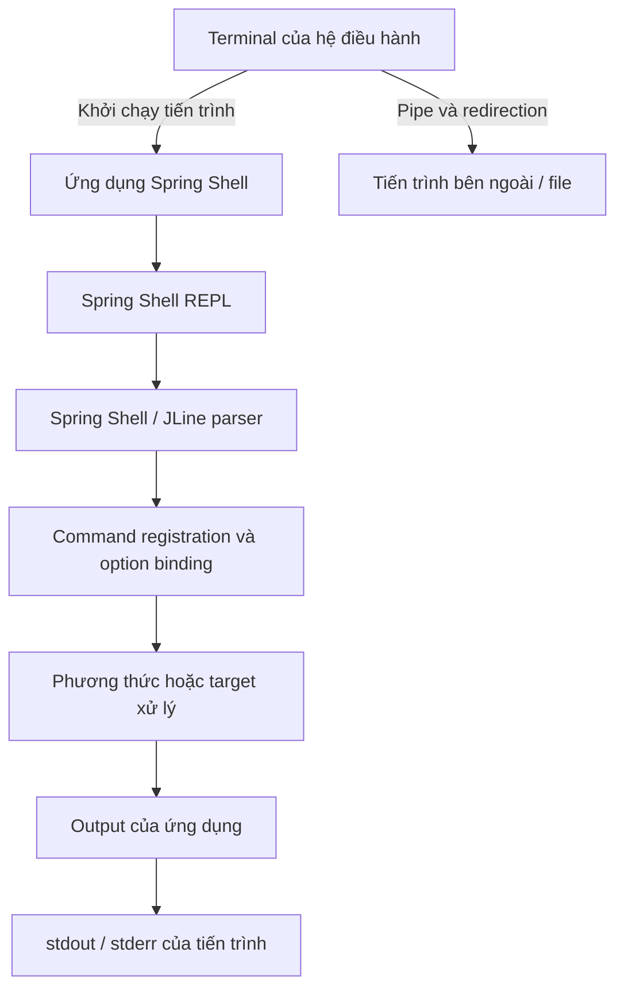

# Phân biệt toán tử pipe, chuyển hướng của hệ điều hành với cú pháp Spring Shell

Khi làm việc với ứng dụng dòng lệnh, ta thường gặp các ký hiệu `|`, `>`, `>>`, `2>` hoặc `<`. Đây là những toán tử quen thuộc của shell hệ điều hành như Bash, Zsh, PowerShell hoặc Command Prompt. Chúng cho phép nối đầu ra giữa các tiến trình, ghi dữ liệu vào file hoặc đọc dữ liệu từ file.

Spring Shell cũng nhận một dòng văn bản, phân tích command, option và argument rồi gọi phương thức xử lý. Tuy nhiên, trong Spring Shell 3.1.x, dòng lệnh bên trong REPL được xử lý bởi parser của Spring Shell/JLine. Tài liệu Spring Shell 3.1.3 mô tả việc phân tích command, dấu nháy, escape và command `script`; tài liệu không định nghĩa `|`, `>` hay `2>` là toán tử pipeline/chuyển hướng tích hợp trong REPL. Vì vậy, cần xác định dòng lệnh đang được nhập vào shell nào trước khi dùng các ký hiệu này.

## 1. Hai lớp xử lý dòng lệnh

Một ứng dụng Spring Shell có thể được chạy từ terminal của hệ điều hành hoặc chạy ở chế độ tương tác. Hai cách chạy có luồng xử lý khác nhau.



**Shell hệ điều hành** là chương trình mà người dùng mở trước khi chạy ứng dụng. Nó chịu trách nhiệm đọc toàn bộ câu lệnh, xử lý toán tử, biến môi trường, wildcard, khởi chạy tiến trình và kết nối luồng vào/ra.

**Spring Shell REPL** là vòng lặp tương tác bên trong tiến trình Java. Khi ứng dụng đã khởi động và hiển thị prompt như `shell:>`, dòng tiếp theo được gửi vào parser của Spring Shell. Parser tách từ, xử lý dấu nháy/escape và phân giải command theo registry.

Ví dụ, khi nhập `java -jar inventory-shell.jar` trong Bash hoặc PowerShell, shell hệ điều hành khởi chạy tiến trình Java. Sau khi ứng dụng hiển thị `shell:>`, người dùng đang tương tác với Spring Shell. Cùng một ký hiệu có thể có ý nghĩa khác nhau tùy dòng lệnh đang được xử lý ở lớp nào.

## 2. Pipe `|` của shell hệ điều hành

Pipe nối đầu ra chuẩn (stdout) của tiến trình bên trái với đầu vào chuẩn (stdin) của tiến trình bên phải. Shell hệ điều hành tạo kết nối này khi khởi chạy các tiến trình.

Ví dụ trên Bash hoặc Zsh:

```bash
java -jar inventory-shell.jar stock show --sku SKU-123 | grep SKU-123
```

Trong ví dụ này:

1. Bash khởi chạy ứng dụng Spring Shell ở chế độ non-interactive với command `stock show`.
2. Kết quả stdout của tiến trình Java được chuyển sang stdin của `grep`.
3. `grep` lọc và chỉ in những dòng có `SKU-123`.

Ví dụ tương đương trong PowerShell:

```powershell
java -jar .\inventory-shell.jar stock show --sku SKU-123 | Select-String 'SKU-123'
```

PowerShell cũng dùng `|`, nhưng pipeline của PowerShell được thiết kế theo luồng object; với đầu ra của chương trình native, PowerShell thường chuyển các dòng văn bản thành giá trị chuỗi để chuyển tiếp. Vì vậy, chi tiết pipeline có thể khác Bash dù ký hiệu giống nhau.

### Pipe bên trong Spring Shell REPL

Khi đã ở prompt Spring Shell, dòng sau không tự động tạo pipeline giữa hai command:

```text
shell:>stock show --sku SKU-123 | grep SKU-123
```

Trong Spring Shell 3.1.x, `|` không được tài liệu mô tả như toán tử pipe của REPL. Dòng nhập được xử lý như đầu vào command của Spring Shell; ký hiệu `|` có thể trở thành một phần token/argument hoặc khiến command báo lỗi do có đầu vào dư. Nó không yêu cầu shell hệ điều hành khởi chạy `grep`.

Nếu cần pipeline, hãy chạy command Spring Shell ở chế độ non-interactive từ terminal hệ điều hành như ví dụ ở trên. Nếu cần truyền ký tự pipe như dữ liệu cho command, hãy đặt giá trị trong dấu nháy phù hợp với parser đang xử lý dòng lệnh.

```text
shell:>stock search --filter "status=ACTIVE | region=HN"
```

Trong ví dụ này, `|` là một phần của giá trị `--filter`, không phải toán tử nối hai tiến trình.

## 3. Chuyển hướng output bằng `>` và `>>`

Trong shell hệ điều hành, `>` chuyển stdout vào file. Nếu file đã tồn tại, nội dung cũ thường bị ghi đè. `>>` nối stdout vào cuối file.

Ví dụ Bash:

```bash
java -jar inventory-shell.jar stock show --sku SKU-123 > stock.txt
java -jar inventory-shell.jar stock show --sku SKU-456 >> stock.txt
```

Ví dụ PowerShell:

```powershell
java -jar .\inventory-shell.jar stock show --sku SKU-123 > .\stock.txt
java -jar .\inventory-shell.jar stock show --sku SKU-456 >> .\stock.txt
```

Ở cả hai trường hợp, `>` và `>>` được shell hệ điều hành xử lý trước khi tiến trình Java chạy. Ứng dụng chỉ ghi output vào stdout như bình thường; shell bên ngoài quyết định ghi luồng đó vào file.

### Chuyển hướng bên trong REPL

Khi nhập dòng sau tại prompt Spring Shell:

```text
shell:>stock show --sku SKU-123 > stock.txt
```

Spring Shell 3.1.x không tự hiểu `>` là yêu cầu ghi output vào `stock.txt`. Ký hiệu có thể bị parser coi là token/argument thuộc dòng command, dẫn đến lỗi hoặc được truyền như dữ liệu tùy chữ ký command. Muốn command tự ghi file, hãy thiết kế option tường minh, ví dụ `--output`, rồi dùng Java I/O trong phần xử lý.

```text
shell:>stock report --format csv --output "C:/reports/stock.csv"
```

Trong thiết kế này, `--output` là option do ứng dụng định nghĩa. Command chịu trách nhiệm kiểm tra đường dẫn, quyền ghi và xử lý lỗi file. Dùng dấu `/` trong đường dẫn Windows là cách thuận tiện để tránh nhầm lẫn với ký tự escape của một số parser.

## 4. Chuyển hướng lỗi bằng `2>` và gộp luồng bằng `2>&1`

Tiến trình thông thường có ba luồng chuẩn:

| Luồng | File descriptor | Mục đích |
|---|---:|---|
| stdin | `0` | Dữ liệu đầu vào của tiến trình |
| stdout | `1` | Kết quả bình thường |
| stderr | `2` | Thông báo lỗi và chẩn đoán |

Trong Bash, `2>` chuyển stderr vào file:

```bash
java -jar inventory-shell.jar stock import --file stock.csv 2> import-errors.log
```

Có thể gộp stderr vào stdout rồi chuyển cả hai luồng qua pipe:

```bash
java -jar inventory-shell.jar stock import --file stock.csv 2>&1 | tee import-output.log
```

Trong PowerShell, có thể chuyển riêng lỗi native process bằng `2>` và gộp bằng `2>&1`:

```powershell
java -jar .\inventory-shell.jar stock import --file .\stock.csv 2> .\import-errors.log
java -jar .\inventory-shell.jar stock import --file .\stock.csv 2>&1 | Tee-Object .\import-output.log
```

Các toán tử chuyển hướng này chỉ có tác dụng ở shell hệ điều hành. Khi nhập `2>` vào Spring Shell REPL, Spring Shell không tự chuyển stderr của command sang file.

## 5. Đọc dữ liệu từ file bằng `<`

Trong Bash, `<` chuyển nội dung file vào stdin của tiến trình:

```bash
java -jar inventory-shell.jar stock import < stock.csv
```

Ví dụ này chỉ hữu ích nếu command hoặc ứng dụng được thiết kế để đọc dữ liệu từ stdin. Nếu command yêu cầu option `--file`, hãy truyền đường dẫn theo hợp đồng của command:

```bash
java -jar inventory-shell.jar stock import --file stock.csv
```

PowerShell không dùng `<` làm toán tử chuyển hướng stdin theo cùng cách Bash. Cần dùng cách nhập dữ liệu phù hợp với PowerShell và chương trình native, hoặc truyền đường dẫn qua option. Nếu Spring Shell cần đọc file, cách rõ ràng nhất thường là định nghĩa option `--file` và để command đọc bằng Java I/O.

## 6. Dấu nháy và escape: mỗi lớp có quy tắc riêng

Khi gọi ứng dụng từ terminal hệ điều hành, dấu nháy trước hết được xử lý bởi shell bên ngoài. Nếu ứng dụng tiếp tục phân tích một dòng lệnh trong REPL, parser Spring Shell/JLine lại có quy tắc riêng.

Spring Shell 3.1.3 sử dụng `ExtendedDefaultParser` của package `org.springframework.shell.jline`. Parser này triển khai giao diện `org.jline.reader.Parser`; tài liệu API cho biết dấu phân cách mặc định là khoảng trắng, đồng thời parser có cơ chế nhận diện quote và escape. Dấu nháy giúp gom phần văn bản có khoảng trắng thành một token.

Ví dụ trong Spring Shell REPL:

```text
shell:>report create --title "Báo cáo tồn kho tháng 11"
shell:>report search --expression "status=ACTIVE | region=HN"
shell:>user note --text 'Người dùng nói "đã nhận hàng"'
```

Trong ví dụ thứ hai, pipe nằm trong giá trị của option. Trong ví dụ thứ ba, dấu nháy đơn bao ngoài giúp giữ dấu nháy kép bên trong chuỗi.

Khi chạy từ Bash, có thể dùng dấu nháy đơn để giữ nguyên một biểu thức chứa pipe:

```bash
java -jar inventory-shell.jar report search --expression 'status=ACTIVE | region=HN'
```

Trong PowerShell, dấu nháy đơn cũng phù hợp để truyền chuỗi literal:

```powershell
java -jar .\inventory-shell.jar report search --expression 'status=ACTIVE | region=HN'
```

Nếu cần truyền một chuỗi có dấu nháy cùng loại với dấu nháy bao ngoài, hãy dùng quy tắc escape của lớp đang xử lý chuỗi. Không nên giả định cú pháp escape của Bash, PowerShell và JLine hoàn toàn giống nhau.

## 7. Command script của Spring Shell và shell script của hệ điều hành

Spring Shell 3.1.3 có command tích hợp `script` để đọc file cục bộ và thực thi từng command theo thứ tự. Nội dung file được xử lý như khi nhập trong REPL: dòng bắt đầu bằng `//` là comment, dòng kết thúc bằng dấu `\` tiếp tục sang dòng kế tiếp.

Ví dụ nội dung file `inventory-setup.shell`:

```text
// Kiểm tra phiên bản ứng dụng
version

// Kiểm tra trạng thái kho
stock show --sku SKU-123

// Tạo báo cáo
stock report --format csv
```

Trong Spring Shell, chạy `help script` để xem chính xác cách truyền đường dẫn file của phiên bản đang dùng, sau đó chạy command `script` theo phần trợ giúp đó.

File trên là danh sách command Spring Shell. Nó không phải Bash script hoặc PowerShell script. Các toán tử hệ điều hành như `|`, `>`, `&&`, biến môi trường và wildcard không tự động có cùng ý nghĩa trong file này. Nếu cần điều phối tiến trình, pipeline và chuyển hướng, hãy viết shell script của hệ điều hành rồi gọi ứng dụng Spring Shell ở chế độ non-interactive.

Ví dụ Bash script `run-stock-report.sh`:

```bash
#!/usr/bin/env bash
set -euo pipefail

java -jar inventory-shell.jar stock report --format csv > stock-report.csv
grep -i "SKU-123" stock-report.csv > selected-stock.txt
```

Ví dụ PowerShell script `run-stock-report.ps1`:

```powershell
$ErrorActionPreference = 'Stop'

java -jar .\inventory-shell.jar stock report --format csv > .\stock-report.csv
Get-Content .\stock-report.csv | Select-String 'SKU-123' | Set-Content .\selected-stock.txt
```

Các script này được Bash hoặc PowerShell diễn giải. Spring Shell chỉ nhận command và option được truyền cho tiến trình Java.

## 8. Chọn đúng cách xuất file hoặc truyền dữ liệu

Có ba cách phổ biến, mỗi cách phù hợp với một nơi chịu trách nhiệm khác nhau:

| Cách làm | Ai xử lý? | Khi nên dùng |
|---|---|---|
| `command ... > file.txt` | Shell hệ điều hành | Muốn lưu toàn bộ stdout của một lần chạy non-interactive |
| `command ... 2> errors.log` | Shell hệ điều hành | Muốn tách thông báo lỗi của tiến trình khỏi kết quả bình thường |
| `command --output file.csv` | Command Spring Shell và Java I/O | Muốn ứng dụng tự định dạng, kiểm tra và ghi file theo nghiệp vụ |
| `script` tích hợp của Spring Shell | Spring Shell | Muốn phát lại tuần tự các command trong REPL |
| `.sh` hoặc `.ps1` | Shell hệ điều hành | Muốn kết hợp nhiều tiến trình, pipe, điều kiện, biến và chuyển hướng |

Ví dụ, nếu command xuất báo cáo cần bảo đảm định dạng CSV, kiểm tra quyền ghi và ghi metadata vào file, option `--output` là giao diện rõ ràng hơn. Nếu chỉ cần lưu phần output mà command đã in ra, chuyển hướng stdout ở shell hệ điều hành là đủ.

## 9. Giữ stdout sạch khi dùng pipeline

Khi output của command được đưa vào `grep`, `jq`, `Select-String` hoặc một tiến trình khác, mọi dòng ghi ra stdout có thể trở thành đầu vào của tiến trình kế tiếp. Nếu log khởi động Spring Boot, banner, thông báo debug hoặc nội dung chẩn đoán trộn vào dữ liệu, pipeline có thể cho kết quả sai.

Spring Shell 3.1.3 lưu ý log console mặc định có thể gây nhiễu output command. Có thể cấu hình log ra file:

```yaml
logging:
  file:
    name: inventory-shell.log
```

Hoặc tắt pattern log console nếu ứng dụng cần stdout dành riêng cho dữ liệu command:

```yaml
logging:
  pattern:
    console:
```

Hãy chọn cách phù hợp với môi trường triển khai và bảo đảm lỗi vẫn được ghi nhận ở nơi có thể kiểm tra. Với command dùng trong pipeline, nên trả về định dạng ổn định như CSV hoặc JSON và tránh in thêm lời chào, tiến độ hay thông báo không thuộc dữ liệu.

## 10. Những lỗi thường gặp

| Triệu chứng | Nguyên nhân có thể | Cách xử lý |
|---|---|---|
| `grep` hoặc `Select-String` không chạy khi nhập sau `shell:>` | Đang ở Spring Shell REPL, không phải shell hệ điều hành | Chạy command non-interactive từ terminal bên ngoài |
| `stock.txt` không được tạo khi gõ `> stock.txt` trong REPL | Spring Shell 3.1.x không dùng `>` làm toán tử chuyển hướng tích hợp | Dùng `>` ở terminal hệ điều hành hoặc option `--output` do command hỗ trợ |
| Command báo thừa argument sau ký hiệu `|` | Parser Spring Shell nhận dòng đó như đầu vào command | Bỏ toán tử khỏi REPL hoặc đặt pipe vào trong chuỗi được quote nếu đó là dữ liệu |
| Giá trị option bị tách thành nhiều phần | Chuỗi chứa khoảng trắng chưa được quote | Dùng dấu nháy phù hợp với shell/parser đang xử lý |
| Pipeline nhận cả log và dữ liệu | Log console trộn với stdout của command | Ghi log ra file hoặc cấu hình log console phù hợp |
| Script dừng ở dòng có `>` hoặc `|` | Đang dùng file command Spring Shell như shell script của hệ điều hành | Dùng built-in `script` cho command Spring Shell; dùng `.sh`/`.ps1` cho pipeline và redirection |
| Đường dẫn Windows bị mất dấu `\` | Ký tự escape bị parser xử lý | Thử dấu `/` trong đường dẫn hoặc escape theo parser thực tế |

## 11. Quy trình xác định lỗi theo từng lớp

Khi một lệnh có pipe hoặc redirection không hoạt động, hãy kiểm tra lần lượt:

1. **Xác định prompt hiện tại.** Nếu thấy `PS>` hoặc dấu nhắc Bash, bạn đang ở shell hệ điều hành. Nếu thấy `shell:>`, bạn đang ở Spring Shell REPL.
2. **Xác định tiến trình nào nhận dòng lệnh.** Lệnh được gõ trước khi ứng dụng Java khởi động do shell hệ điều hành phân tích; dòng gõ sau prompt Spring Shell do parser của ứng dụng xử lý.
3. **Kiểm tra command có chạy non-interactive không.** Ví dụ `java -jar inventory-shell.jar stock show --sku SKU-123` gọi một command rồi kết thúc tiến trình theo chế độ chạy.
4. **Kiểm tra quote và escape.** Nếu giá trị chứa khoảng trắng, pipe hoặc dấu nháy, xem shell ngoài và parser bên trong xử lý chuỗi ở giai đoạn nào.
5. **Kiểm tra stdout/stderr.** Chạy thử command không có pipe, chuyển hướng riêng từng luồng và kiểm tra nội dung file.
6. **Kiểm tra script đúng loại.** File command của Spring Shell chỉ chứa command Spring Shell; file `.sh` hoặc `.ps1` mới dùng cú pháp của hệ điều hành tương ứng.

## 12. Bài tập thực hành

Giả sử ứng dụng có command `stock report --format csv` xuất danh sách tồn kho.

1. Chạy command từ Bash và chuyển stdout vào `stock.csv` bằng `>`.
2. Dùng `grep` lọc các dòng chứa `SKU-123` và ghi kết quả vào `selected-stock.csv`.
3. Chạy command import từ PowerShell và chuyển stderr vào `import-errors.log` bằng `2>`.
4. Mở Spring Shell REPL và thử `stock report --format csv > stock.csv`. Quan sát kết quả, sau đó giải thích vì sao ký hiệu `>` không có hành vi chuyển hướng như ở terminal hệ điều hành.
5. Viết một file command Spring Shell gồm `version`, `stock show` và `stock report`, sau đó chạy bằng built-in `script` theo trợ giúp của phiên bản đang dùng.
6. Viết một shell script Bash hoặc PowerShell để gọi command non-interactive, lưu output và lọc kết quả bằng pipe.

## 13. Tổng kết

`|`, `>`, `>>`, `2>` và `<` là toán tử của shell hệ điều hành. Chúng kết nối tiến trình và luồng dữ liệu khi shell bên ngoài khởi chạy ứng dụng. Spring Shell 3.1.x có REPL riêng, parser riêng và command `script` để phát lại command; không nên mặc định rằng toán tử pipeline/chuyển hướng của Bash hoặc PowerShell cũng hoạt động trong prompt `shell:>`.

Hãy dùng pipe và redirection khi chạy command Spring Shell ở chế độ non-interactive từ terminal hệ điều hành. Dùng dấu nháy khi cần giữ một giá trị chứa khoảng trắng hoặc ký tự đặc biệt. Nếu muốn command tự ghi file, thiết kế option như `--output` và xử lý bằng Java I/O. Nếu cần tự động hóa nhiều command trong REPL, dùng `script` của Spring Shell; nếu cần pipeline, điều kiện và chuyển hướng giữa tiến trình, dùng Bash hoặc PowerShell script.

## Tài liệu tham khảo

- [Spring Shell 3.1.3 Reference Documentation](https://docs.spring.io/spring-shell/docs/3.1.3/docs/index.html) — mục 1, 2.1, 4.8.5 Script, 4.9 Writing, chương 5 Options, 10 Execution và Appendix A.2 Command Parser.
- [ExtendedDefaultParser API 3.1.x](https://docs.spring.io/spring-shell/docs/3.1.x/api/org/springframework/shell/jline/ExtendedDefaultParser.html) — parser của Spring Shell dựa trên JLine, xử lý delimiter, quote và escape.
- [JLine 3 API Overview](https://jline.org/versions/3.x/docs/api/overview/) — vai trò của `LineReader`, `Parser` và `ParsedLine`.
- [Bash Reference Manual: Pipelines](https://www.gnu.org/software/bash/manual/html_node/Pipelines.html) — cách shell Bash nối stdout và stdin giữa các command.
- [Bash Reference Manual: Redirections](https://www.gnu.org/software/bash/manual/html_node/Redirections.html) — chuyển hướng stdin, stdout và stderr.
- [Microsoft PowerShell: about_Redirection](https://learn.microsoft.com/powershell/module/microsoft.powershell.core/about/about_redirection) — toán tử chuyển hướng và các luồng trong PowerShell.
- [Microsoft PowerShell: about_Pipelines](https://learn.microsoft.com/powershell/module/microsoft.powershell.core/about/about_pipelines) — cách pipeline của PowerShell truyền dữ liệu giữa command.
