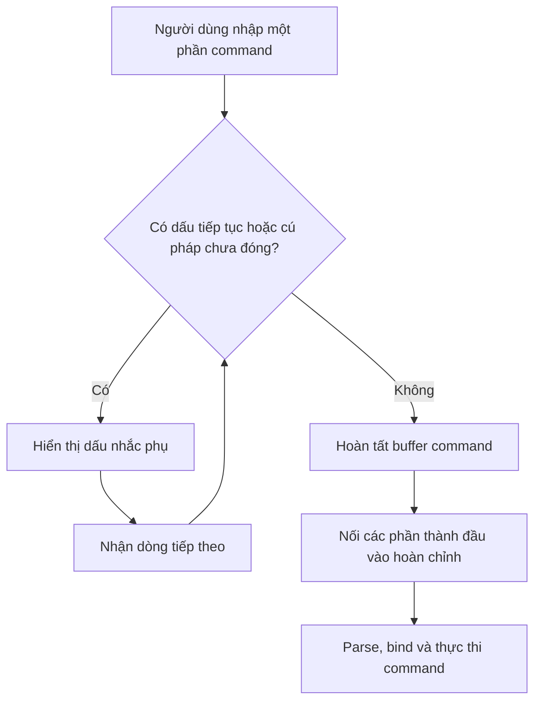

# Đầu vào nhiều dòng và điều kiện tiếp tục dòng khi terminal hỗ trợ

Một command Spring Shell có thể dài vì chứa nhiều option, đường dẫn hoặc chuỗi mô tả. Khi nhập trong terminal tương tác, người dùng có thể chia command thành nhiều dòng để dễ đọc. Spring Shell kết hợp JLine và parser để nhận biết khi nào dòng hiện tại chưa hoàn chỉnh, hiển thị dấu nhắc phụ và chờ phần tiếp theo trước khi thực thi command.

Có hai cách tiếp tục dòng thường gặp: đặt dấu gạch chéo ngược (`\`) ở cuối dòng hoặc nhấn Enter khi một cặp dấu nháy vẫn chưa được đóng. Khi command hoàn chỉnh được gửi tới parser, các dòng được nối với nhau như một dòng lệnh; dấu xuống dòng được thay bằng khoảng trắng. Vì vậy, đây là cách chia nhỏ cú pháp command, không phải cách gửi một chuỗi văn bản nhiều dòng nguyên vẹn vào tham số.

Spring Shell hỗ trợ khai báo command, xử lý đối số, validation, trợ giúp và tự hoàn thành; đồng thời có thể chạy ở chế độ tương tác hoặc đọc command từ script. Bài này giải thích cách nhập nhiều dòng, điều kiện để terminal hiển thị dấu nhắc tiếp tục, cách dùng continuation trong script và cách xử lý khi môi trường không hỗ trợ phiên tương tác.

Sau bài này, bạn có thể:

- Chia một command dài thành nhiều dòng bằng dấu `\` ở cuối dòng.
- Tiếp tục nhập khi đang ở bên trong chuỗi được đặt trong dấu nháy.
- Phân biệt nối dòng command với việc truyền dữ liệu văn bản có newline.
- Nhận biết điều kiện cần có của JLine và interactive runner.
- Viết command script có continuation và xử lý các lỗi thường gặp.

## 1. Hai khái niệm cần phân biệt

Trong một command, có hai loại xuống dòng rất khác nhau:

- **Nối dòng cú pháp:** chia một command dài thành nhiều dòng để dễ nhập. Spring Shell ghép các phần lại trước khi thực thi.
- **Dữ liệu có newline:** một tham số thực sự cần chứa ký tự xuống dòng, ví dụ nội dung email hoặc văn bản nhiều đoạn. Continuation của command không bảo toàn newline như dữ liệu.

Ví dụ, command sau được viết trên ba dòng:

```text
shell:>customer create --name "Nguyễn An" \
> --email an@example.com \
> --status ACTIVE
```

Về mặt cú pháp, shell xử lý tương đương một dòng:

```text
customer create --name "Nguyễn An" --email an@example.com --status ACTIVE
```

Các dòng được nối bằng khoảng trắng. Parser sau đó mới tách tên command, option và giá trị để ánh xạ vào tham số Java.



## 2. Cách thứ nhất: đặt `\` ở cuối dòng

Khi command quá dài, đặt dấu gạch chéo ngược ở cuối dòng rồi nhấn Enter. Spring Shell tiếp tục nhận phần còn lại thay vì thực thi ngay.

```text
shell:>report export --from 2026-01-01 --to 2026-12-31 \
> --format csv \
> --output "reports/annual report.csv"
Đã xuất báo cáo.
```

Trong ví dụ:

1. Dòng đầu kết thúc bằng `\`, báo hiệu command còn tiếp tục.
2. Dấu nhắc phụ `>` cho biết shell đang chờ phần tiếp theo.
3. Dòng thứ hai cũng kết thúc bằng `\`, vì vậy shell tiếp tục chờ.
4. Dòng cuối không có dấu tiếp tục, nên toàn bộ command được gửi để xử lý.

Khi nhập tại dấu nhắc phụ, chỉ cung cấp phần còn thiếu của command. Không lặp lại tên command ở mỗi dòng trừ khi đó thực sự là một argument hoặc giá trị cần truyền.

### Ví dụ với command có nhiều option

```java
import org.springframework.shell.standard.ShellComponent;
import org.springframework.shell.standard.ShellMethod;
import org.springframework.shell.standard.ShellOption;

@ShellComponent
public class ReportCommands {

    @ShellMethod(key = "report export", value = "Xuất báo cáo theo khoảng ngày.")
    public String export(
            @ShellOption("--from") String from,
            @ShellOption("--to") String to,
            @ShellOption("--format") String format,
            @ShellOption("--output") String output) {
        return "Đã nhận yêu cầu xuất " + format + " từ " + from
                + " đến " + to + " tại " + output;
    }
}
```

Command trên có thể được gọi bằng một dòng hoặc nhiều dòng:

```text
report export --from 2026-01-01 --to 2026-12-31 --format csv --output report.csv
```

```text
report export --from 2026-01-01 \
> --to 2026-12-31 \
> --format csv \
> --output report.csv
```

Hai cách nhập truyền cùng một tập giá trị cho phương thức `export()`.

### Quy tắc đặt dấu tiếp tục

- Đặt `\` ở cuối dòng cần nối; nên để nó là ký tự cuối cùng, không thêm khoảng trắng hoặc nội dung sau nó.
- Chỉ dòng cần tiếp tục mới có dấu `\`; dòng cuối bỏ dấu này để kết thúc command.
- Dùng dấu nhắc phụ để nhận biết shell vẫn đang chờ đầu vào.
- Nếu lỡ nhấn Enter mà không có dấu tiếp tục và cú pháp đã hoàn chỉnh, command có thể được thực thi ngay. Khi đó hãy chờ kết quả rồi nhập command mới.
- Tránh đặt dấu `\` ở cuối một dòng chỉ vì giá trị đường dẫn có dấu gạch chéo ngược; parser có thể hiểu đó là dấu tiếp tục.

## 3. Cách thứ hai: tiếp tục khi dấu nháy chưa đóng

Spring Shell cũng có thể tiếp tục đọc khi người dùng nhấn Enter bên trong một chuỗi đang được mở bằng dấu nháy đơn hoặc nháy kép. JLine nhận biết rằng chuỗi chưa hoàn chỉnh và hiển thị dấu nhắc phụ phù hợp.

Ví dụ với dấu nháy kép:

```text
shell:>customer note --id 42 --text "Khách hàng đề nghị
dquote> gọi lại vào sáng mai"
Đã lưu ghi chú.
```

Ví dụ với dấu nháy đơn:

```text
shell:>message send --text 'Vui lòng chuẩn bị
squote> hồ sơ trước cuộc họp ngày mai'
Đã gửi thông điệp.
```

`dquote>` và `squote>` là ví dụ về dấu nhắc phụ khi đang ở trong chuỗi có dấu nháy tương ứng. Nội dung cần tiếp tục cho tới khi dấu nháy được đóng. Khi command được gửi đi, line break được xử lý như khoảng trắng, vì vậy giá trị nhận được tương đương:

```text
Khách hàng đề nghị gọi lại vào sáng mai
```

### Dùng dấu nháy để bảo vệ khoảng trắng

Dấu nháy còn có nhiệm vụ giữ các từ có khoảng trắng thành một giá trị duy nhất. Ví dụ:

```text
customer create --name "Nguyễn An"
```

Nếu tên có khoảng trắng mà không đặt trong dấu nháy, parser có thể tách thành nhiều token. Có thể dùng dấu nháy đơn hoặc kép; nếu cần đưa chính loại dấu nháy đang bao quanh chuỗi vào nội dung, hãy escape theo quy tắc parser của phiên bản đang dùng.

## 4. Dấu nhắc phụ cho biết shell đang chờ gì

Trong phiên tương tác, dấu nhắc phụ giúp người dùng biết vì sao Enter chưa thực thi command:

| Dấu nhắc minh họa | Nguyên nhân | Cách tiếp tục |
|---|---|---|
| `>` | Dòng trước kết thúc bằng dấu `\` | Nhập phần tiếp theo; dòng cuối bỏ dấu `\`. |
| `dquote>` | Đang ở trong chuỗi mở bằng `"` | Tiếp tục nội dung và đóng dấu `"`. |
| `squote>` | Đang ở trong chuỗi mở bằng `'` | Tiếp tục nội dung và đóng dấu `'`. |

Tên và cách trình bày dấu nhắc phụ phụ thuộc JLine, parser và cấu hình shell. Điều quan trọng là buffer chưa hoàn chỉnh nên shell chưa chuyển nó thành một lần gọi command.

Nếu nhập nhầm và muốn hủy phần đang gõ, dùng thao tác ngắt hoặc xóa dòng mà terminal/JLine hỗ trợ, thường là `Ctrl+C` để hủy đầu vào hiện tại. Phím này có thể có hành vi khác khi một command đang chạy; hãy thử trong môi trường phát triển để biết cách terminal của bạn xử lý.

## 5. Điều kiện để nhập nhiều dòng trong terminal tương tác

Continuation tương tác phụ thuộc vào đường đọc đầu vào, không chỉ phụ thuộc nội dung command. Các điều kiện thường cần có:

1. **Ứng dụng chạy interactive runner.** Spring Shell phải vào vòng lặp tương tác thay vì chỉ nhận command từ tham số khởi chạy rồi kết thúc.
2. **Đầu vào được đọc qua JLine.** Interactive runner dùng JLine để đọc và chỉnh sửa dòng, nhận biết cú pháp chưa hoàn chỉnh và hiển thị secondary prompt.
3. **Terminal hỗ trợ phiên nhập tương tác.** Terminal emulator hoặc console cần chuyển được phím Enter, dữ liệu bàn phím và đầu ra của dấu nhắc. Nếu stdin bị redirect từ pipe hoặc không có TTY, hành vi tương tác có thể không tồn tại.
4. **Parser giữ trạng thái cú pháp chưa hoàn chỉnh.** Parser phải nhận ra dấu escape cuối dòng hoặc dấu nháy chưa đóng. Nếu ứng dụng thay parser mặc định, cần kiểm tra lại hai tình huống này.

### Cấu hình interactive runner ở Spring Shell 3.3.x

Từ Spring Shell 3.3.x, chỉ `NonInteractiveShellRunner` được bật mặc định. Nếu ứng dụng cần dấu nhắc tương tác, hãy bật interactive runner trong cấu hình:

```yaml
spring:
  shell:
    interactive:
      enabled: true
```

Nếu đồng thời dùng script runner, cấu hình script riêng:

```yaml
spring:
  shell:
    interactive:
      enabled: true
    script:
      enabled: true
```

Các phiên bản trước 3.3.x có mặc định runner khác. Khi nâng cấp, hãy kiểm tra lại thuộc tính `spring.shell.interactive.enabled` và `spring.shell.script.enabled` thay vì suy ra hành vi từ phiên bản Spring Boot.

### Chạy trong container, IDE hoặc môi trường tự động

Một ứng dụng có thể hoạt động bình thường trên terminal máy phát triển nhưng không có continuation khi chạy trong CI, container hoặc console của IDE. Nguyên nhân thường là môi trường không cấp terminal tương tác hoặc ứng dụng đang chọn non-interactive runner.

- Khi chạy container, cần cấp TTY và stdin tương tác nếu muốn dùng JLine như một terminal thật.
- Khi chạy CI hoặc pipe đầu vào, ưu tiên truyền command hoàn chỉnh trên một dòng hoặc dùng script file.
- Khi chạy từ IDE, kiểm tra console có hỗ trợ nhập tương tác và cập nhật dấu nhắc phụ không.
- Nếu ứng dụng khởi chạy với một command-line argument để chạy trực tiếp, hãy phân biệt chế độ non-interactive với phiên REPL tương tác.

## 6. Nối dòng trong file script

Spring Shell có thể đọc nhiều command từ file thông qua built-in `script` command hoặc `ScriptShellRunner`. Trong file script, một dòng kết thúc bằng `\` sẽ được nối với dòng tiếp theo trước khi command được thực thi.

Ví dụ nội dung `reports.shell`:

```text
// Xuất báo cáo năm
report export --from 2026-01-01 \
  --to 2026-12-31 \
  --format csv \
  --output reports/annual.csv

report list --limit 10
```

Các dòng kết thúc bằng `\` thuộc cùng một command. Dòng `report list` bắt đầu command tiếp theo. Trong script, việc nối dòng được xử lý bởi input provider đọc file; không cần người dùng nhập dấu nhắc phụ.

Spring Shell 3.3.x mô tả built-in `script` command đọc file và phát lại từng command; các dòng kết thúc bằng `\` kích hoạt continuation. Nếu dùng `ScriptShellRunner` để khởi chạy script qua runner, bật `spring.shell.script.enabled` theo cấu hình phiên bản. Built-in `script` command và `ScriptShellRunner` là hai cách chạy script khác nhau; kiểm tra `help script` và cấu hình runner để xác định cách ứng dụng đang dùng.

### Script khác với lệnh nhiều dòng của hệ điều hành

Phân biệt ba nơi có thể nhận dấu `\`:

| Nơi nhập | Ai xử lý continuation? | Ghi chú |
|---|---|---|
| Bên trong dấu nhắc Spring Shell | JLine và parser của Spring Shell | Dùng `\` ở cuối dòng hoặc để chuỗi chưa đóng. |
| Bên trong file script do Spring Shell đọc | Input provider/script runner của Spring Shell | Dòng kết thúc bằng `\` được nối với dòng kế tiếp. |
| Terminal hệ điều hành trước khi Spring Shell khởi động | Bash, PowerShell hoặc shell hệ điều hành khác | Cú pháp phụ thuộc shell chủ, ví dụ PowerShell dùng backtick cho continuation. |

Nếu bạn đang gõ `java -jar app.jar ...` ở dấu nhắc PowerShell, ký tự nối dòng do PowerShell xử lý trước khi Java nhận tham số. Khi ứng dụng đã hiển thị dấu nhắc `shell:>`, quy tắc nhập command thuộc Spring Shell. Không dùng lẫn cú pháp của hai lớp shell.

## 7. Nối dòng không giữ newline trong giá trị

Continuation phục vụ việc chia command dài thành các dòng dễ đọc. Nó không phải cơ chế nhập nội dung nhiều đoạn với newline nguyên gốc.

Ví dụ:

```text
shell:>message send --text "Dòng thứ nhất
dquote> Dòng thứ hai"
```

Giá trị nhận được tương đương:

```text
Dòng thứ nhất Dòng thứ hai
```

Nếu nghiệp vụ cần giữ xuống dòng, hãy chọn một cách truyền dữ liệu khác:

- Nhận đường dẫn file qua option như `--file`, sau đó command đọc nguyên nội dung file.
- Dùng một command tương tác riêng để đọc nhiều dòng cho đến khi gặp dấu kết thúc do ứng dụng định nghĩa.
- Dùng định dạng mã hóa rõ ràng cho newline, chẳng hạn chuỗi có `\n`, rồi giải mã trong command nếu hợp đồng đầu vào cho phép.
- Dùng file script hoặc file dữ liệu thay vì cố đưa toàn bộ văn bản nhiều đoạn vào một command line.

Ví dụ thiết kế command đọc nội dung từ file:

```java
import java.io.IOException;
import java.nio.charset.StandardCharsets;
import java.nio.file.Files;
import java.nio.file.Path;

import org.springframework.shell.standard.ShellComponent;
import org.springframework.shell.standard.ShellMethod;
import org.springframework.shell.standard.ShellOption;

@ShellComponent
public class MessageCommands {

    @ShellMethod(key = "message import", value = "Đọc nội dung thông điệp từ file.")
    public String importMessage(@ShellOption("--file") String filePath) throws IOException {
        String content = Files.readString(Path.of(filePath), StandardCharsets.UTF_8);
        return "Đã đọc " + content.length() + " ký tự.";
    }
}
```

Với cách này, nội dung file giữ nguyên các ký tự newline. Cần kiểm tra quyền truy cập file và xử lý lỗi I/O theo yêu cầu của ứng dụng.

## 8. Parser và khả năng tùy biến

Spring Shell 3.x cung cấp `ExtendedDefaultParser` trong package `org.springframework.shell.jline`. Parser này tích hợp với JLine và có các phương thức cấu hình:

- `setQuoteChars(...)` và `getQuoteChars()` để làm việc với ký tự quote.
- `setEscapeChars(...)` và `getEscapeChars()` để cấu hình ký tự escape.
- `setEofOnEscapedNewLine(...)` để điều chỉnh việc parser xem newline được escape là EOF.
- `setEofOnUnclosedQuote(...)` để điều chỉnh việc parser xem quote chưa đóng là EOF.

Các setter này là API mức parser. Nếu ứng dụng thay parser hoặc thay cách dựng `LineReader`, cần xác minh cả luồng đọc dòng lẫn cách parser báo rằng đầu vào còn chưa hoàn chỉnh. Chỉ đổi parser mà không kiểm tra secondary prompt có thể khiến người dùng không biết phải nhập tiếp hoặc khiến command được gửi quá sớm.

Không nên thay parser chỉ để làm command dài dễ đọc. Dấu `\` ở cuối dòng và continuation trong quote đã đáp ứng phần lớn nhu cầu. Chỉ tùy biến khi cú pháp sản phẩm cần một quy tắc khác và có integration test bao phủ cả terminal tương tác lẫn script.

## 9. Lỗi thường gặp và cách xử lý

| Hiện tượng | Nguyên nhân có thể | Cách xử lý |
|---|---|---|
| Enter thực thi command ngay | Dòng không có `\` cuối dòng và quote đã đóng | Thêm dấu continuation hoặc chia command thành một dòng hoàn chỉnh. |
| Dấu nhắc phụ không xuất hiện | Không chạy interactive runner, stdin không phải TTY hoặc parser tùy chỉnh kết thúc dòng ngay | Bật interactive runner, cấp terminal tương tác và kiểm tra parser. |
| `\` không nối dòng | Có ký tự hoặc khoảng trắng sau dấu `\`, hoặc parser đã bị thay đổi | Đặt `\` ở cuối dòng và thử với parser mặc định. |
| Shell cứ chờ dù đã nhập đủ | Một dấu nháy chưa đóng hoặc escape cuối dòng vẫn còn | Đóng dấu nháy, xóa escape thừa hoặc hủy buffer hiện tại. |
| Nội dung tham số mất xuống dòng | Continuation thay line break bằng khoảng trắng | Đọc nội dung từ file hoặc dùng giao thức nhập nhiều dòng riêng. |
| Script dừng giữa command | Dòng nối thiếu `\` hoặc dòng kết thúc không như mong đợi | Kiểm tra nội dung file và bảo đảm mỗi dòng cần nối có dấu `\` ở cuối. |
| Hoạt động khác nhau giữa máy cá nhân và CI | Một môi trường có TTY còn môi trường kia dùng pipe/non-interactive runner | Dùng script hoặc đầu vào một dòng trong CI; kiểm thử riêng chế độ tương tác. |
| Đường dẫn Windows làm shell chờ tiếp | Dấu `\` cuối đường dẫn bị hiểu là dấu continuation | Đặt đường dẫn trong dấu nháy và bảo đảm ký tự cuối của dòng là dấu nháy đóng. |

## 10. Checklist trước khi phát hành CLI

- Command dài có thể nhập bằng một dòng và bằng continuation.
- Dấu `\` được đặt ở cuối dòng cần nối.
- Chuỗi có khoảng trắng được quote và quote chưa đóng dẫn tới dấu nhắc phụ khi chạy tương tác.
- Ứng dụng bật interactive runner khi cần dùng terminal tương tác.
- Ứng dụng có phương án chạy không cần TTY, thường là command một dòng hoặc script.
- Script được kiểm tra với các dòng continuation và command kế tiếp.
- Dữ liệu cần giữ newline được truyền qua file hoặc cơ chế nhập riêng.
- Parser tùy chỉnh, nếu có, được kiểm tra với escape newline và quote chưa đóng.
- Cú pháp của Spring Shell không bị nhầm với cú pháp continuation của Bash, PowerShell hoặc shell hệ điều hành khác.

## 11. Bài tập thực hành

Tạo command `deployment create` nhận `--name`, `--environment`, `--version` và `--description`.

1. Gọi command trên một dòng.
2. Chia command thành ba dòng bằng dấu `\`.
3. Chia command bằng cách mở dấu nháy kép cho `--description`, xuống dòng rồi đóng dấu nháy ở dòng tiếp theo.
4. Quan sát dấu nhắc phụ và giải thích vì sao command chưa được thực thi ở các dòng trung gian.
5. Lưu command vào file script, dùng `\` để nối dòng rồi chạy script.
6. Thử chạy ứng dụng trong môi trường không có TTY và giải thích vì sao không có dấu nhắc phụ.
7. Nếu mô tả cần giữ newline thật, chuyển nội dung mô tả sang file và thay option thành `--description-file`.

Khi hoàn thành, hãy so sánh đầu vào sau khi nối dòng với nội dung file nhiều dòng để xác định trường hợp nào giữ được ký tự newline.

## Tài liệu tham khảo

- [Spring Shell 3.0 – Interacting with the Shell](https://docs.spring.io/spring-shell/docs/3.0.0-M1/site/reference/htmlsingle/): continuation bằng dấu `\`, continuation khi quote chưa đóng và hành vi JLine trong phiên tương tác.
- [Spring Shell 3.3.4 – Script](https://docs.spring.io/spring-shell/reference/3.3/commands/builtin/script.html): dòng trong file script kết thúc bằng `\` sẽ được nối với dòng kế tiếp.
- [Spring Shell 3.3.4 – Execution](https://docs.spring.io/spring-shell/reference/3.3/execution.html): interactive, non-interactive và script runner; cấu hình bật runner.
- [Spring Shell 3.3.0 – ExtendedDefaultParser API](https://docs.spring.io/spring-shell/docs/3.3.0/api/org/springframework/shell/jline/ExtendedDefaultParser.html): cấu hình quote, escape và cách parser xử lý newline.
- [JLine – Line Reader](https://jline.org/versions/3.x/docs/line-reader/): cơ chế đọc dòng, chỉnh sửa và nhập nhiều dòng của JLine.
