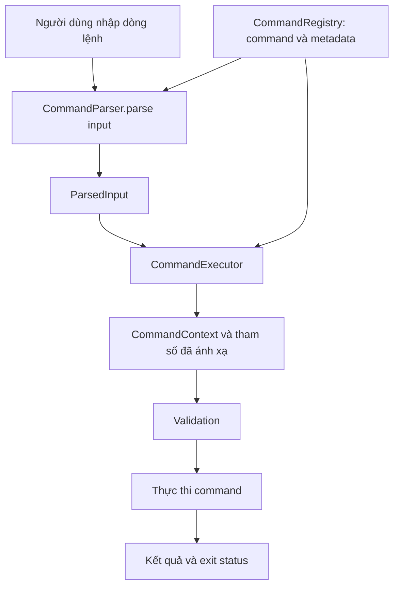

# CommandParser và điểm tùy biến quy tắc phân tích trong 4.x

Khi người dùng nhập một dòng lệnh, Spring Shell cần xác định tên command, subcommand, option và đối số trước khi gọi phần xử lý. Trong Spring Shell 4.x, `CommandParser` là API chịu trách nhiệm phân tích chuỗi input thô thành một cấu trúc `ParsedInput`. Nếu cú pháp mặc định không phù hợp với ứng dụng, có thể thay thế parser bằng một implementation riêng được đăng ký trong Spring application context.

Bài học thuộc chương **Cú pháp dòng lệnh** của Spring Shell. Nội dung giải thích vai trò của `CommandParser`, quy tắc mặc định, cấu trúc kết quả phân tích và cách tùy biến parser bằng cách bọc `DefaultCommandParser` hoặc tự xây dựng `ParsedInput`.

Sau bài học, bạn có thể:

- Mô tả vị trí của bước parsing trong luồng thực thi command.
- Đọc cú pháp option, argument, quoting và escaping mặc định của Spring Shell 4.x.
- Giải thích vai trò của `CommandParser`, `DefaultCommandParser` và `ParsedInput`.
- Đăng ký parser tùy chỉnh dưới dạng Spring bean.
- Mở rộng cú pháp bằng cách chuẩn hóa input rồi ủy quyền phần còn lại cho parser mặc định.
- Nhận biết khi nào cần tự tạo `ParsedInput` và cách kiểm thử parser.

## Parsing nằm ở đâu trong luồng thực thi?

Parser nằm giữa bước đăng ký command và bước thực thi. Command registry chứa các định nghĩa command, gồm tên, alias, option và argument. Parser sử dụng input thô cùng các định nghĩa đó để tạo ra kết quả phân tích. Sau đó, command executor dựa trên kết quả này để tìm command phù hợp và gọi phần xử lý.



Ví dụ người dùng nhập:

```text
report export --format=csv monthly.csv
```

Parser cần xác định:

- Command chính: `report`.
- Subcommand: `export`.
- Option `format` có giá trị `csv`.
- Đối số vị trí thứ nhất có giá trị `monthly.csv`.

Parser xử lý cú pháp và cấu trúc của input. Việc gọi nghiệp vụ thuộc execution target. Các ràng buộc dữ liệu như độ dài mật khẩu hoặc giới hạn số lượng được kiểm tra ở bước validation của tham số command.

## Quy tắc mặc định của Spring Shell 4.x

`DefaultCommandParser` là implementation mặc định của `CommandParser`. Nó hỗ trợ command có nhiều cấp, option dạng ngắn hoặc dài và positional argument.

### Cú pháp command, option và argument

Mô hình cú pháp tổng quát:

```text
CommandSyntax ::= CommandName [SubCommandName]* [Option | Argument]*
CommandName ::= String
SubCommandName ::= String
Option ::= ShortOption | LongOption
ShortOption ::= '-' Char ['=' | ' ']? String
LongOption ::= '--' String ['=' | ' ']? String
Argument ::= String
```

Các cách truyền option sau đều hợp lệ:

```text
report export --format=csv
report export --format csv
report export -f=csv
report export -f csv
```

Option và argument có thể xuất hiện ở các vị trí khác nhau trong phần input còn lại:

```text
report export --format=csv monthly.csv --compress true
report export monthly.csv --compress=true --format csv
```

Các argument được đánh chỉ số từ `0` theo thứ tự xuất hiện trong nhóm argument. Option là dữ liệu có tên; argument là dữ liệu theo vị trí. Với command có subcommand hoặc nhiều tham số, option có tên thường giúp câu lệnh rõ nghĩa hơn.

Một số quy tắc cần nhớ:

- Option luôn được kỳ vọng có giá trị, kể cả option kiểu boolean. Ví dụ `--compress true` hoặc `--compress=false`.
- Không hỗ trợ gộp nhiều short option thành một chuỗi như `-abc`.
- Tên option dài bắt đầu bằng `--`; short option dùng một ký tự sau `-`.
- Argument là token không được nhận diện như option và được đánh chỉ số theo thứ tự xuất hiện.

### Quoting và escaping

Input được tách thành từ theo khoảng trắng. Nếu giá trị chứa dấu cách, đặt toàn bộ giá trị trong dấu nháy đơn hoặc nháy kép:

```text
message send --text="Hello Spring Shell"
message send --text='Hello Spring Shell'
file inspect "monthly report.csv"
```

Hai loại dấu nháy cho phép chứa loại dấu nháy còn lại trong giá trị:

```text
message send --text="I'm ready"
message send --text='He said "Hello"'
```

Nếu cần đưa chính loại dấu nháy đang bao quanh vào giá trị, dùng backslash để escape:

```text
message send --text="He said \"Hello\""
message send --text='I\'m ready'
```

Spring Shell chỉ loại bỏ dấu nháy khi toàn bộ giá trị được bao bởi cặp dấu nháy đó. Dấu nháy xuất hiện ở giữa một token vẫn được giữ nguyên. Escape sequence cũng chỉ được giải quyết bên trong giá trị có dấu nháy. Nếu dấu nháy mở mà không có dấu đóng tương ứng, parser từ chối input và báo lỗi.

## CommandParser và ParsedInput

Trong Spring Shell 4.x, `CommandParser` nằm trong package:

```java
org.springframework.shell.core.command.CommandParser
```

Interface này có một phương thức chính:

```java
ParsedInput parse(String input);
```

Phương thức nhận dòng input thô và trả về `ParsedInput`. Kết quả này là record gồm bốn thành phần:

| Thành phần | Kiểu | Ý nghĩa |
| --- | --- | --- |
| `commandName` | `String` | Tên command chính được nhận diện. |
| `subCommands` | `List<String>` | Các cấp subcommand theo thứ tự. |
| `options` | `List<CommandOption>` | Các option được nhận diện và giá trị tương ứng. |
| `arguments` | `List<CommandArgument>` | Các argument cùng chỉ số và giá trị. |

`CommandOption` lưu metadata và giá trị runtime như short name, long name, mô tả, tính bắt buộc, giá trị mặc định, giá trị người dùng truyền và kiểu dữ liệu. `CommandArgument` lưu index và value của argument.

Ví dụ tạo một kết quả phân tích bằng builder:

```java
import org.springframework.shell.core.command.CommandArgument;
import org.springframework.shell.core.command.CommandOption;
import org.springframework.shell.core.command.ParsedInput;

ParsedInput parsed = ParsedInput.builder()
    .commandName("report")
    .addSubCommand("export")
    .addOption(CommandOption.with()
        .longName("format")
        .value("csv")
        .type(String.class)
        .build())
    .addArgument(CommandArgument.with()
        .index(0)
        .value("monthly.csv")
        .type(String.class)
        .build())
    .build();
```

Đoạn code minh họa cấu trúc kết quả mà parser cần trả về. Khi tự xây parser, phải bảo đảm tên command, subcommand, option và argument phù hợp với các định nghĩa đã đăng ký trong `CommandRegistry`.

## DefaultCommandParser

`DefaultCommandParser` là implementation có sẵn của `CommandParser`. Constructor nhận `CommandRegistry`:

```java
CommandParser parser = new DefaultCommandParser(commandRegistry);
ParsedInput parsed = parser.parse("report export --format=csv monthly.csv");
```

Parser mặc định sử dụng registry để hiểu metadata của command và các option đã đăng ký. Nó cũng xử lý việc tách token, dấu nháy và escape theo cú pháp của Spring Shell.

Trong hầu hết ứng dụng, parser mặc định đáp ứng đủ nhu cầu. Chỉ nên thay đổi khi ứng dụng thực sự cần một cú pháp riêng, ví dụ muốn hỗ trợ dấu `:` làm dấu phân cách option hoặc cần một quy ước input tương thích với công cụ nội bộ.

## Tùy biến bằng cách bọc DefaultCommandParser

Một cách mở rộng an toàn là chuẩn hóa phần cú pháp riêng rồi giao input đã chuẩn hóa cho `DefaultCommandParser`. Cách này giữ lại các quy tắc mặc định về subcommand, option, argument, dấu nháy và escaping.

Ví dụ, ứng dụng muốn chấp nhận cú pháp:

```text
deploy --region:ap-southeast-1
deploy --message:"Deploy to staging"
```

Trong đó, dấu `:` sau tên option dài có ý nghĩa tương đương dấu `=`. Ta có thể chuẩn hóa dấu phân cách trước khi gọi parser mặc định:

```java
import java.util.regex.Pattern;

import org.springframework.shell.core.command.CommandParser;
import org.springframework.shell.core.command.CommandRegistry;
import org.springframework.shell.core.command.DefaultCommandParser;
import org.springframework.shell.core.command.ParsedInput;
import org.springframework.stereotype.Component;

@Component
class ColonOptionCommandParser implements CommandParser {

    private static final Pattern LONG_OPTION_COLON = Pattern.compile(
        "(?<!\\S)(--[A-Za-z][A-Za-z0-9-]*):(?=\\S)");

    private final CommandParser delegate;

    ColonOptionCommandParser(CommandRegistry commandRegistry) {
        this.delegate = new DefaultCommandParser(commandRegistry);
    }

    @Override
    public ParsedInput parse(String input) {
        String normalized = LONG_OPTION_COLON
            .matcher(input)
            .replaceAll("$1=");
        return delegate.parse(normalized);
    }
}
```

Pattern chỉ nhận diện dấu `:` ngay sau một tên long option ở đầu token và khi có giá trị theo sau. Nó không thay dấu `:` nằm bên trong giá trị. Sau khi chuẩn hóa, parser mặc định tiếp tục xử lý phần còn lại.

Với implementation này, các lệnh sau được chuẩn hóa như sau:

| Input người dùng | Input chuyển cho parser mặc định |
| --- | --- |
| `deploy --region:prod` | `deploy --region=prod` |
| `deploy --message:"Hello world"` | `deploy --message="Hello world"` |
| `deploy --path:reports:daily.csv` | `deploy --path=reports:daily.csv` |

Ví dụ này cố ý chỉ hỗ trợ long option và không cho phép khoảng trắng giữa dấu `:` với giá trị. Nếu cần một ngữ pháp rộng hơn, hãy định nghĩa rõ tokenization và quy tắc escape thay vì mở rộng biểu thức chính quy một cách tùy tiện.

### Đăng ký parser tùy chỉnh

Spring Shell sử dụng `CommandParser` được cung cấp dưới dạng bean trong application context. Trong ứng dụng Spring Boot, auto-configuration có bean parser mặc định được khai báo với `@ConditionalOnMissingBean`. Khi có bean `CommandParser` của ứng dụng, cấu hình mặc định sẽ nhường chỗ cho implementation tùy chỉnh.

Có thể khai báo parser bằng `@Component` như ví dụ trên hoặc bằng `@Bean` trong lớp cấu hình:

```java
import org.springframework.context.annotation.Bean;
import org.springframework.context.annotation.Configuration;
import org.springframework.shell.core.command.CommandParser;
import org.springframework.shell.core.command.CommandRegistry;
import org.springframework.shell.core.command.DefaultCommandParser;

@Configuration
class ShellParserConfiguration {

    @Bean
    CommandParser commandParser(CommandRegistry commandRegistry) {
        DefaultCommandParser delegate =
            new DefaultCommandParser(commandRegistry);

        return input -> delegate.parse(
            input.replaceAll("(?<!\\S)(--[A-Za-z][A-Za-z0-9-]*):(?=\\S)", "$1="));
    }
}
```

Chỉ chọn một cách đăng ký cho parser tùy chỉnh. Không đăng ký đồng thời nhiều bean cùng kiểu `CommandParser`, vì runner cần một parser xác định để phân tích input.

Trong ứng dụng Spring Framework thuần, hãy bảo đảm cấu hình tạo `CommandRegistry`, parser và `ShellRunner` cùng thuộc application context. Tài liệu Spring Shell hướng dẫn đăng ký parser tùy chỉnh thành bean; nếu ứng dụng tự cấu hình runner, cần truyền parser đó vào runner được tạo.

### Phân biệt API parser giữa Spring Shell 3.x và 4.x

`CommandParser` trong bài này là API của Spring Shell 4.x, thuộc package `org.springframework.shell.core.command` và trả về `ParsedInput`. Ở Spring Shell 3.x, cũng có interface tên `CommandParser` trong package `org.springframework.shell.command`, nhưng API đó phục vụ `CommandRegistration` và mô hình parser AST của dòng 3.x. Hai interface cùng tên nhưng khác package, kiểu dữ liệu và mô hình command; cần dùng đúng API theo phiên bản dependency của dự án.

## Tự triển khai CommandParser hoàn toàn

Nếu ngữ pháp khác biệt lớn, có thể triển khai trực tiếp `CommandParser` mà không dùng `DefaultCommandParser`. Implementation phải tự chịu trách nhiệm:

1. Tách input thành token mà không làm mất nội dung của giá trị có dấu nháy.
2. Nhận diện command chính và các cấp subcommand.
3. Nhận diện option dài, option ngắn và giá trị tương ứng.
4. Xác định argument theo thứ tự và gán index bắt đầu từ `0`.
5. Đối chiếu tên option với metadata command trong registry.
6. Trả về `ParsedInput` có đủ các thành phần cần thiết.
7. Phát hiện input không hợp lệ, chẳng hạn option thiếu giá trị hoặc dấu nháy không cân bằng.

Một parser tự viết có thể tạo kết quả bằng `ParsedInput.builder()`, `CommandOption.with()` và `CommandArgument.with()`. Ví dụ ở phần trước minh họa cách tạo từng thành phần. Khi parser tự tạo `CommandOption`, cần giữ đúng `longName`, `shortName`, `type`, `required`, `defaultValue` và `value` theo định nghĩa command; nếu thiếu hoặc sai metadata, bước binding và thực thi phía sau có thể không hoạt động đúng.

Không nên đưa logic nghiệp vụ vào parser. Parser không nên truy vấn cơ sở dữ liệu, kiểm tra quyền người dùng hoặc thực hiện thao tác triển khai. Các công việc đó thuộc command handler hoặc service. Parser chỉ quyết định chuỗi input có nghĩa gì theo ngữ pháp CLI.

## Parsing, chuyển đổi kiểu và validation là các bước khác nhau

Ba bước này có liên quan nhưng đảm nhiệm các trách nhiệm riêng:

| Bước | Câu hỏi cần trả lời | Ví dụ |
| --- | --- | --- |
| Parsing | Token nào là command, option hay argument? | `--limit=20` là option `limit` với giá trị `20`. |
| Binding và chuyển đổi | Giá trị đã phân tích được đưa vào tham số Java nào và có kiểu gì? | Chuỗi `20` được chuyển thành `Integer`. |
| Validation | Giá trị có thỏa điều kiện của tham số không? | `@Min(1)` từ chối giá trị `0`. |

Spring Shell tích hợp Bean Validation để kiểm tra constraint trên tham số command trước khi method được thực thi. Vì vậy, không nên viết parser để kiểm tra các điều kiện như độ dài mật khẩu hoặc giới hạn số trang. Nếu parser cố gắng thực hiện những việc này, nó sẽ bị gắn chặt với từng command và khó tái sử dụng.

## Kiểm thử parser tùy chỉnh

Parser là thành phần xử lý cú pháp, vì vậy nên kiểm thử trực tiếp với các chuỗi input đại diện. Với parser bọc `DefaultCommandParser`, cần kiểm tra cả cú pháp mở rộng và những cú pháp mặc định vẫn phải hoạt động:

| Nhóm kiểm thử | Input ví dụ | Kết quả mong đợi |
| --- | --- | --- |
| Dấu `:` tùy chỉnh | `deploy --region:prod` | Option `region` có giá trị `prod`. |
| Giá trị có khoảng trắng | `deploy --message:"Hello world"` | Giá trị được giữ thành một token `Hello world`. |
| Dấu `:` trong value | `deploy --path:reports:daily.csv` | Giá trị là `reports:daily.csv`. |
| Cú pháp mặc định | `deploy --region=prod` | Vẫn phân tích được như trước. |
| Option tách giá trị | `deploy --region prod` | Vẫn phân tích được như trước. |
| Short option | `deploy -r prod` | Vẫn nhận diện short option nếu command khai báo nó. |
| Argument vị trí | `report export monthly.csv` | Argument có index `0`. |
| Dấu nháy không cân bằng | `deploy --message="hello` | Parser từ chối input với lỗi cú pháp. |
| Option không tồn tại | `deploy --unknown=value` | Không được âm thầm chuyển thành argument; phải xử lý theo định nghĩa command và thông báo lỗi. |

Ngoài unit test cho parser, cần kiểm thử tích hợp bằng `ShellTestClient` hoặc runner thực tế để xác nhận parser được Spring inject đúng và command nhận đúng giá trị. Nên chạy kiểm thử với cả input tương tác lẫn input không tương tác hoặc script nếu ứng dụng hỗ trợ các chế độ đó.

## Lỗi thường gặp khi tùy biến parser

| Hiện tượng | Nguyên nhân | Cách xử lý |
| --- | --- | --- |
| Parser tùy chỉnh không được sử dụng | Bean parser không có trong context hoặc có nhiều bean cùng kiểu. | Kiểm tra cấu hình bean và bảo đảm chỉ có một parser được runner sử dụng. |
| Command không được tìm thấy | Parser trả về sai `commandName` hoặc `subCommands`. | Đối chiếu cấu trúc input với tên command đã đăng ký. |
| Option không đến được handler | Parser tạo option sai tên, short name hoặc giá trị. | Đối chiếu `CommandOption` với metadata command trong registry. |
| Giá trị có dấu cách bị tách | Parser tự viết không giữ nhóm token có dấu nháy. | Giữ nguyên quoting/escaping hoặc ủy quyền phần tokenize cho `DefaultCommandParser`. |
| Dấu nháy không đóng làm ứng dụng chạy sai | Parser không phát hiện input chưa hoàn chỉnh. | Báo lỗi cú pháp rõ ràng và không trả kết quả phân tích giả định. |
| Boolean option không hoạt động | Parser giả định boolean là flag không cần giá trị, trái với cú pháp mặc định. | Tuân thủ quy tắc giá trị boolean của ứng dụng hoặc định nghĩa rõ cú pháp riêng và kiểm thử. |
| Cú pháp mới làm hỏng script cũ | Parser thay thế toàn bộ ngữ pháp mặc định. | Bọc parser mặc định khi chỉ cần mở rộng nhỏ; kiểm thử hồi quy script. |
| Validation nghiệp vụ xuất hiện trong parser | Trộn parsing với xử lý nghiệp vụ. | Chuyển constraint sang Bean Validation hoặc service của command. |

## Khi nào nên tùy biến?

Hãy dùng `DefaultCommandParser` nếu cú pháp mặc định đáp ứng yêu cầu. Chỉ nên triển khai parser riêng khi có một lý do cụ thể như:

- Cần tương thích với cú pháp CLI đã tồn tại trong tổ chức.
- Muốn hỗ trợ một dấu phân cách option riêng cho công cụ nội bộ.
- Cần quy tắc tokenization đặc biệt mà parser mặc định không hỗ trợ.
- Muốn tích hợp một DSL nhỏ hoặc cú pháp miền nghiệp vụ vào dòng lệnh.

Nếu chỉ cần đổi tên command, thêm alias, thêm option hoặc argument, hãy khai báo ở metadata command. Không cần thay parser cho những nhu cầu đã được mô hình command hỗ trợ.

## Ghi nhớ

Trong Spring Shell 4.x, `CommandParser` là điểm mở rộng chính thức cho cú pháp dòng lệnh. `DefaultCommandParser` đã xử lý command nhiều cấp, option dài/ngắn, argument, thứ tự token, quoting và escaping. Khi chỉ cần thay đổi nhỏ, hãy chuẩn hóa phần input riêng rồi ủy quyền cho parser mặc định. Khi tự viết hoàn toàn, phải trả về `ParsedInput` nhất quán với metadata trong `CommandRegistry` và giữ parsing tách biệt với binding, validation cùng nghiệp vụ.

## Tài liệu tham khảo

- [Spring Shell 4.0.3 — Command Syntax](https://docs.spring.io/spring-shell/reference/commands/syntax.html): cú pháp mặc định, quoting, escaping và tùy biến `CommandParser`.
- [Spring Shell 4.x API — CommandParser](https://docs.spring.io/spring-shell/reference/api/org/springframework/shell/core/command/CommandParser.html): interface và phương thức `parse(String)`.
- [Spring Shell 4.x API — DefaultCommandParser](https://docs.spring.io/spring-shell/reference/api/org/springframework/shell/core/command/DefaultCommandParser.html): parser mặc định và constructor nhận `CommandRegistry`.
- [Spring Shell 4.x API — ParsedInput](https://docs.spring.io/spring-shell/reference/api/org/springframework/shell/core/command/ParsedInput.html): cấu trúc kết quả phân tích.
- [Spring Shell 4.x API — CommandOption](https://docs.spring.io/spring-shell/reference/api/org/springframework/shell/core/command/CommandOption.html): metadata và giá trị runtime của option.
- [Spring Shell 4.x API — ShellRunnerAutoConfiguration](https://docs.spring.io/spring-shell/reference/api/org/springframework/shell/core/autoconfigure/ShellRunnerAutoConfiguration.html): bean parser mặc định được tạo khi chưa có `CommandParser` khác.
- [Spring Shell 4.0.3 — Option Validation](https://docs.spring.io/spring-shell/reference/commands/validation.html): validation tham số trước khi command thực thi.
