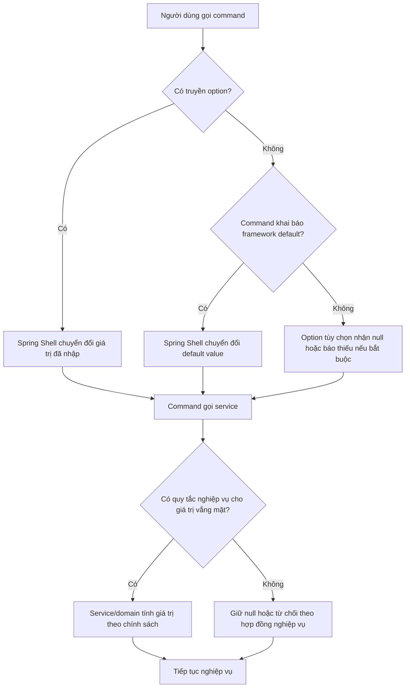

# Phân biệt mặc định của framework với mặc định nghiệp vụ

Khi người dùng bỏ qua một tùy chọn, ứng dụng có thể vẫn cần một giá trị để tiếp tục. Ví dụ, `report list` có thể hiển thị tối đa 20 dòng theo mặc định; khi tạo hóa đơn, ngày đến hạn có thể được tính theo điều khoản thanh toán của khách hàng. Hai trường hợp đều tạo ra một giá trị khi đầu vào không được cung cấp, nhưng chúng thuộc hai tầng khác nhau.

Spring Shell hỗ trợ khai báo giá trị mặc định cho option ngay tại tầng command. Framework điền giá trị đó khi người dùng bỏ qua option, chuyển đổi giá trị sang kiểu Java và truyền vào phương thức xử lý. Đây là **mặc định của framework**. **Mặc định nghiệp vụ** là quy tắc của ứng dụng hoặc miền nghiệp vụ để quyết định giá trị có ý nghĩa khi không có lựa chọn cụ thể, có thể phụ thuộc khách hàng, chính sách, thời điểm hoặc trạng thái dữ liệu.

Spring Shell cung cấp nhiều cách khai báo option: annotation legacy `@ShellOption`, annotation mới `@Option` và đăng ký programmatic qua `CommandRegistration`. Cả ba mô hình đều có cách biểu diễn default value, nhưng cú pháp và cách khai báo option có khác nhau. Bài này giúp chọn đúng tầng để đặt mặc định và tránh để cấu hình CLI vô tình quyết định quy tắc nghiệp vụ.

Sau bài này, bạn có thể:

- Phân biệt giá trị mặc định được Spring Shell điền với giá trị mặc định do service hoặc domain quyết định.
- Khai báo default value bằng `@ShellOption`, `@Option` và `CommandRegistration`.
- Phân biệt option bắt buộc, option tùy chọn không có default và option có default.
- Hiểu ý nghĩa của `ShellOption.NONE` và `ShellOption.NULL` trong API legacy.
- Đặt mặc định nghiệp vụ ở đúng tầng để các kênh gọi khác CLI cũng tuân theo cùng quy tắc.
- Kiểm thử cả giá trị mặc định lẫn đầu vào do người dùng cung cấp.

## 1. Hai loại mặc định giải quyết hai vấn đề khác nhau

Giả sử ứng dụng có command `report list`. Khi người dùng không truyền `--limit`, giao diện CLI có thể tự chọn 20 dòng để kết quả không quá dài. Con số 20 là lựa chọn tiện dụng cho cách trình bày kết quả trong CLI.

Ngược lại, khi tạo hóa đơn cho khách hàng, ngày đến hạn có thể phụ thuộc vào điều khoản thanh toán đã thỏa thuận. Khách hàng A được thanh toán trong 15 ngày, khách hàng B trong 30 ngày. Nếu người dùng không truyền `--due-date`, ứng dụng cần áp dụng điều khoản của chính khách hàng đó. Đây là quy tắc nghiệp vụ.

| Tiêu chí | Mặc định của framework | Mặc định nghiệp vụ |
|---|---|---|
| Tầng chịu trách nhiệm | Spring Shell và khai báo command | Service, domain hoặc chính sách ứng dụng |
| Mục đích | Giúp cú pháp CLI thuận tiện và xác định giá trị đầu vào khi option bị bỏ qua | Bảo đảm nghiệp vụ có giá trị hợp lệ theo quy tắc miền |
| Ví dụ | `--limit` mặc định `20`, `--format` mặc định `table` | Ngày đến hạn theo điều khoản khách hàng, trạng thái hóa đơn ban đầu là `DRAFT` |
| Phạm vi áp dụng | Khi gọi command qua Spring Shell | Mọi kênh gọi cùng nghiệp vụ: CLI, REST, batch, message consumer |
| Có thể phụ thuộc dữ liệu nghiệp vụ? | Thông thường không; giá trị được khai báo tĩnh trong metadata command | Có; có thể dựa vào khách hàng, hợp đồng, chính sách và thời điểm |

Quy tắc dễ nhớ: mặc định của framework giúp người dùng gọi lệnh dễ hơn; mặc định nghiệp vụ giúp ứng dụng ra quyết định đúng ngay cả khi không có giao diện dòng lệnh.

## 2. Mặc định của framework trong Spring Shell

Spring Shell cho phép khai báo `defaultValue` cho option. Khi người dùng không cung cấp option, framework dùng giá trị mặc định đã khai báo để tạo tham số cho command target.

Ví dụ:

```java
import org.springframework.shell.standard.ShellComponent;
import org.springframework.shell.standard.ShellMethod;
import org.springframework.shell.standard.ShellOption;

@ShellComponent
public class ReportCommands {

    @ShellMethod(key = "report list", value = "Liệt kê báo cáo.")
    public String list(
            @ShellOption(value = {"-l", "--limit"},
                    defaultValue = "20",
                    help = "Số dòng tối đa cần hiển thị.") int limit) {
        return "Hiển thị tối đa " + limit + " báo cáo.";
    }
}
```

Hai cách gọi sau tạo cùng giá trị `limit`:

```text
report list
report list --limit 5
```

Trong lần gọi đầu, Spring Shell điền `20`. Trong lần gọi thứ hai, giá trị người dùng nhập `5` được ưu tiên. Phương thức `list()` nhận giá trị đã được phân giải; nó không cần tự kiểm tra xem option có được nhập hay không để áp dụng default value.

### Default value là chuỗi trước khi chuyển đổi kiểu

Trong API legacy, `@ShellOption.defaultValue` được mô tả là giá trị dạng văn bản trước khi chuyển đổi. Vì vậy, giá trị mặc định cần hợp lệ với kiểu tham số:

```java
@ShellMethod(key = "report recent", value = "Liệt kê báo cáo gần đây.")
public String recent(
        @ShellOption(value = "--days", defaultValue = "7") int days) {
    return "Tìm báo cáo trong " + days + " ngày gần đây.";
}
```

Giá trị chuỗi `"7"` được chuyển thành `int`. Với kiểu enum, ngày tháng hoặc kiểu miền riêng, giá trị mặc định cũng cần có định dạng mà `ConversionService` hoặc converter tương ứng hiểu được. Nếu mặc định không thể chuyển đổi hoặc vi phạm validation, command có thể không chạy thành công dù người dùng không truyền option đó.

### Cùng một ý nghĩa trong ba mô hình đăng ký

Spring Shell 3.x có thể khai báo default value theo ba cách:

**Legacy annotation – `@ShellOption`:**

```java
@ShellMethod(key = "report list", value = "Liệt kê báo cáo.")
public String list(
        @ShellOption(value = "--limit", defaultValue = "20") int limit) {
    return "Giới hạn: " + limit;
}
```

**Annotation mới – `@Option`:**

```java
import org.springframework.shell.command.annotation.Command;
import org.springframework.shell.command.annotation.Option;

@Command
public class ReportCommands {

    @Command(command = "report list", description = "Liệt kê báo cáo.")
    public String list(
            @Option(longNames = "limit", defaultValue = "20") Integer limit) {
        return "Giới hạn: " + limit;
    }
}
```

**Programmatic registration – `CommandRegistration`:**

```java
import org.springframework.shell.command.CommandRegistration;

CommandRegistration reportListCommand() {
    return CommandRegistration.builder()
            .command("report list")
            .withOption()
                .longNames("limit")
                .type(Integer.class)
                .defaultValue("20")
                .and()
            .withTarget()
                .function(context -> {
                    Integer limit = context.getOptionValue("limit");
                    return "Giới hạn: " + limit;
                })
                .and()
            .build();
}
```

Ba ví dụ đều đặt default value ở metadata của option. Chọn cú pháp tương ứng với mô hình đăng ký mà dự án đang dùng; không cần trộn các mô hình chỉ để khai báo cùng một giá trị.

## 3. Bắt buộc, tùy chọn và có default là ba trạng thái cần phân biệt

Một option có thể bắt buộc hoặc không bắt buộc. Một option tùy chọn có thể trả về `null`, hoặc framework có thể cung cấp một default value. Không nên coi “không bắt buộc” và “có giá trị mặc định” là cùng một khái niệm.

| Trạng thái | Khi người dùng bỏ qua option | Ý nghĩa |
|---|---|---|
| Bắt buộc | Framework báo thiếu option; target không được gọi | Người dùng phải cung cấp giá trị. |
| Tùy chọn, không có default | Giá trị vắng mặt được biểu diễn bằng `null` hoặc trạng thái không có giá trị tùy target | Ứng dụng quyết định cách xử lý khi thiếu. |
| Có default value | Framework cung cấp giá trị đã khai báo | Target nhận giá trị mặc định thay cho đầu vào bị bỏ qua. |

### API legacy: `ShellOption.NONE` và `ShellOption.NULL`

Trong `@ShellOption`, mặc định của thuộc tính `defaultValue` là `ShellOption.NONE`. Giá trị này biểu thị không có default, nên tham số là bắt buộc. Dùng `ShellOption.NULL` để biểu thị option không bắt buộc và giá trị nhận được khi bỏ qua là `null`:

```java
@ShellMethod(key = "customer search", value = "Tìm khách hàng theo từ khóa.")
public String search(
        @ShellOption(value = "--keyword",
                defaultValue = ShellOption.NULL) String keyword) {
    if (keyword == null || keyword.isBlank()) {
        return "Chưa cung cấp từ khóa.";
    }
    return "Tìm khách hàng theo: " + keyword;
}
```

Người dùng có thể chạy `customer search` mà không truyền `--keyword`. Phương thức nhận `null` và quyết định phản hồi. Nếu khai báo `defaultValue = "all"`, Spring Shell sẽ truyền chuỗi `all` khi option bị bỏ qua; lúc đó phương thức không còn nhận biết sự vắng mặt chỉ từ giá trị `keyword`.

### Annotation mới và programmatic registration

Với mô hình annotation mới, dùng `@Option(required = false)` cho option tùy chọn không có default và `@Option(required = true)` cho option bắt buộc. Với programmatic registration, dùng `.required(false)` hoặc `.required()` tương ứng:

```java
import org.springframework.shell.command.annotation.Command;
import org.springframework.shell.command.annotation.Option;

@Command
public class CustomerCommands {

    @Command(command = "customer search")
    public String search(@Option(longNames = "keyword", required = false)
                         String keyword) {
        return keyword == null ? "Chưa cung cấp từ khóa." : "Từ khóa: " + keyword;
    }
}
```

```java
import org.springframework.context.annotation.Bean;
import org.springframework.context.annotation.Configuration;
import org.springframework.shell.command.CommandRegistration;

@Configuration
public class CustomerProgrammaticCommands {

    @Bean
    CommandRegistration customerSearchCommand() {
        return CommandRegistration.builder()
                .command("customer search")
                .withOption()
                    .longNames("keyword")
                    .type(String.class)
                    .required(false)
                    .and()
                .withTarget()
                    .function(context -> {
                        String keyword = context.getOptionValue("keyword");
                        return keyword == null ? "Chưa cung cấp từ khóa." : keyword;
                    })
                    .and()
                .build();
    }
}
```

Khi cần một giá trị mặc định, khai báo `defaultValue` thay vì để target tự suy ra từ một giá trị giả. Khi cần phân biệt rõ “người dùng không truyền” với “người dùng truyền một giá trị”, giữ option ở trạng thái tùy chọn và xử lý `null` ở tầng phù hợp.

## 4. Mặc định boolean và cờ bật/tắt

Boolean thường được dùng làm cờ. Với `boolean` nguyên thủy, option dạng cờ có arity mặc định bằng 0: khi không truyền, giá trị thường là `false`; khi truyền cờ, giá trị thành `true`. Nếu cần nhận cả giá trị `false` tường minh, đặt arity bằng 1:

```java
@ShellMethod(key = "report export", value = "Xuất báo cáo.")
public String export(
        @ShellOption(value = "--dry-run", arity = 1, defaultValue = "true") boolean dryRun) {
    return dryRun ? "Chỉ mô phỏng, không ghi dữ liệu." : "Thực hiện xuất báo cáo.";
}
```

Với default `true`, người dùng không truyền `--dry-run` vẫn nhận `true`. Ví dụ đặt `arity = 1` để option nhận giá trị tường minh; khi cần thực thi thật, người dùng gọi `report export --dry-run false`. Nếu không cấu hình arity, option boolean thường hoạt động như cờ không nhận token giá trị. Vì vậy, đối với cờ hành động, hãy cân nhắc kỹ default để tránh một lệnh trông như đã chạy nhưng thực tế chỉ mô phỏng hoặc ngược lại.

Kiểu `boolean` và `Boolean` có thể có hành vi khác nhau khi option vắng mặt, đặc biệt giữa các target/resolver. Trong mô hình programmatic, tài liệu kiểu dữ liệu của Spring Shell minh họa `Boolean` không có giá trị mặc định có thể nhận `null`, còn `boolean` nguyên thủy nhận `false`. Nếu cần trạng thái ba giá trị “không chỉ định / bật / tắt”, hãy dùng kiểu tham chiếu `Boolean` hoặc một kiểu biểu diễn tường minh và kiểm thử trên đúng API của dự án.

## 5. Mặc định nghiệp vụ thuộc về service hoặc domain

Giả sử command `invoice create` cho phép người dùng nhập ngày đến hạn. Nếu họ không nhập, ngày đến hạn được xác định theo điều khoản thanh toán của khách hàng. Điều khoản này là quy tắc nghiệp vụ, có thể khác giữa từng khách hàng và thay đổi theo hợp đồng.

Trong command, khai báo option tùy chọn không có default:

```java
import java.time.LocalDate;

@ShellComponent
public class InvoiceCommands {

    private final InvoiceService invoiceService;

    public InvoiceCommands(InvoiceService invoiceService) {
        this.invoiceService = invoiceService;
    }

    @ShellMethod(key = "invoice create", value = "Tạo hóa đơn cho khách hàng.")
    public String create(
            @ShellOption("--customer-id") long customerId,
            @ShellOption(value = "--due-date",
                    defaultValue = ShellOption.NULL) LocalDate requestedDueDate) {
        Invoice invoice = invoiceService.create(customerId, requestedDueDate);
        return "Đã tạo hóa đơn #" + invoice.id()
                + ", hạn thanh toán " + invoice.dueDate();
    }
}
```

Service quyết định giá trị thực tế:

```java
import java.time.LocalDate;

public class InvoiceService {

    private final CustomerRepository customerRepository;
    private final InvoiceRepository invoiceRepository;

    public InvoiceService(CustomerRepository customerRepository,
                          InvoiceRepository invoiceRepository) {
        this.customerRepository = customerRepository;
        this.invoiceRepository = invoiceRepository;
    }

    public Invoice create(long customerId, LocalDate requestedDueDate) {
        Customer customer = customerRepository.findById(customerId)
                .orElseThrow(() -> new IllegalArgumentException("Không tìm thấy khách hàng."));

        LocalDate effectiveDueDate = requestedDueDate != null
                ? requestedDueDate
                : customer.paymentTerms().calculateDueDate(LocalDate.now());

        return invoiceRepository.save(new Invoice(customerId, effectiveDueDate));
    }
}
```

Ở đây, Spring Shell chỉ chuyển `--due-date` thành `LocalDate` hoặc truyền `null`. `InvoiceService` mới là nơi quyết định ngày đến hạn khi thiếu đầu vào, dựa vào điều khoản thanh toán của khách hàng. Nếu hóa đơn được tạo từ REST API hoặc batch job, các kênh đó cũng gọi cùng service và nhận cùng quy tắc.

Không nên khai báo `defaultValue = "2026-12-31"` ở command cho trường hợp này. Giá trị đó cố định, không biết khách hàng nào đang được lập hóa đơn và có thể sai ngay ngày hôm sau. Nếu quy tắc cần cấu hình theo tổ chức, service có thể nhận một chính sách từ Spring configuration; vẫn cần đặt quyết định ở tầng ứng dụng/nghiệp vụ thay vì nhân bản giá trị trong từng command.

## 6. Ba tầng mặc định trong một ứng dụng

Trong hệ thống lớn, ngoài mặc định framework và mặc định nghiệp vụ còn có mặc định cấu hình ứng dụng:

| Tầng | Ví dụ | Nơi đặt |
|---|---|---|
| CLI/framework | `--limit` mặc định `20` để giới hạn output | `@ShellOption`, `@Option` hoặc `CommandRegistration.defaultValue()` |
| Cấu hình ứng dụng | Kích thước trang mặc định cho API hoặc giới hạn tải dữ liệu của hệ thống | `application.yml`, `@ConfigurationProperties` hoặc cấu hình theo môi trường |
| Nghiệp vụ/domain | Hạn thanh toán dựa trên điều khoản khách hàng; trạng thái ban đầu `DRAFT` | Service, domain policy hoặc domain object |

Một giá trị có thể được cấu hình từ file môi trường nhưng vẫn mang ý nghĩa nghiệp vụ. Ví dụ, `invoice.default-payment-days` có thể được đọc vào một policy bean và policy đó được service sử dụng. File cấu hình chỉ cung cấp tham số; quy tắc áp dụng tham số cho từng hóa đơn vẫn thuộc tầng nghiệp vụ.

### Luồng quyết định khi option bị bỏ qua



Nếu framework đã điền default, service chỉ nhận giá trị đó và thường không biết người dùng đã nhập hay framework tự điền. Nếu service cần tự quyết định theo dữ liệu miền, đừng đặt một framework default cho cùng tham số.

## 7. Chọn đúng tầng để đặt default

Hãy tự hỏi các câu sau trước khi khai báo một giá trị mặc định:

1. Giá trị này chỉ làm cho cú pháp CLI thuận tiện hơn? Nếu có, đặt `defaultValue` trong khai báo option.
2. Giá trị này có phải áp dụng cho mọi kênh gọi cùng use case? Nếu có, đặt trong service/domain hoặc policy dùng chung.
3. Giá trị này thay đổi theo môi trường triển khai? Nếu có, đưa vào cấu hình ứng dụng rồi inject vào service hoặc policy.
4. Ứng dụng có cần biết người dùng đã bỏ qua option không? Nếu có, đừng để framework điền default; dùng option tùy chọn và giữ thông tin vắng mặt.
5. Giá trị mặc định có thể vi phạm validation hoặc quy tắc miền? Nếu có, xác thực cả default và đầu vào do người dùng truyền.

### Khi nào có thể dùng framework default cho giá trị có vẻ nghiệp vụ?

Nếu command là kênh duy nhất của chức năng và default value không thay đổi theo dữ liệu hoặc chính sách, có thể khai báo trực tiếp trong Spring Shell để người dùng thấy ngay trong trợ giúp. Ví dụ `--format table` cho một CLI chỉ xuất bảng là lựa chọn hợp lý.

Tuy nhiên, nếu cùng use case được gọi từ nhiều nơi hoặc giá trị cần thống nhất với quy tắc miền, hãy chuyển default về service. Không nên để REST API, CLI và batch job mỗi nơi có một default khác nhau.

## 8. Validation đối với giá trị mặc định

Default value vẫn là đầu vào của command. Nó cần chuyển đổi được sang kiểu Java và phải thỏa mãn validation giống như giá trị người dùng nhập.

Ví dụ `limit` có default `20` nhưng chỉ chấp nhận từ 1 đến 100:

```java
@ShellMethod(key = "report list", value = "Liệt kê báo cáo.")
public String list(
        @ShellOption(value = "--limit", defaultValue = "20") int limit) {
    if (limit < 1 || limit > 100) {
        throw new IllegalArgumentException("limit phải nằm trong khoảng 1 đến 100.");
    }
    return "Hiển thị tối đa " + limit + " báo cáo.";
}
```

Trong ví dụ, default `20` hợp lệ. Nếu sau này đổi thành `200`, command sẽ thất bại theo validation dù người dùng chỉ gõ `report list`. Vì vậy, khi sửa default, hãy kiểm tra lại constraint và test cho cả trường hợp bỏ option.

Với validation annotation, Spring Shell 3.x có thể tích hợp Bean Validation cho tham số command. Hãy kiểm tra dependency và cấu hình validation của ứng dụng, đồng thời đặt các invariant nghiệp vụ quan trọng trong service/domain để không phụ thuộc việc command có chạy validation hay không.

## 9. Kiểm thử mặc định

Một bộ test nên kiểm tra cả giá trị do framework điền và quyết định của nghiệp vụ.

| Trường hợp | Đầu vào | Kết quả cần xác nhận |
|---|---|---|
| Framework default | Không truyền `--limit` | Phương thức command nhận `20`. |
| Người dùng ghi đè | `--limit 5` | Phương thức nhận `5`. |
| Đầu vào không hợp lệ | `--limit 0` | Validation từ chối giá trị. |
| Default sai kiểu | Default khai báo `"abc"` cho `int` | Chuyển đổi không thành công; command không thực hiện nghiệp vụ. |
| Option tùy chọn không default | Bỏ `--due-date` | Command nhận `null`, service tự tính ngày đến hạn. |
| Option nghiệp vụ có giá trị rõ ràng | Truyền `--due-date 2026-12-31` | Service giữ ngày người dùng yêu cầu nếu quy tắc nghiệp vụ cho phép. |
| Gọi service từ kênh khác | REST/batch không truyền ngày | Service áp dụng cùng chính sách ngày đến hạn. |

Unit test service cần xác nhận chính sách nghiệp vụ độc lập với Spring Shell. Integration test shell cần xác nhận `defaultValue`, chuyển đổi và cách giá trị được truyền vào target. Hai loại test này bổ sung cho nhau.

## 10. Lỗi thường gặp

| Hiện tượng | Nguyên nhân có thể | Cách xử lý |
|---|---|---|
| Bỏ option nhưng framework báo thiếu | Option đang bắt buộc, chưa có default | Khai báo default hoặc đánh dấu tùy chọn nếu nghiệp vụ cho phép thiếu. |
| Phương thức nhận `null` ngoài dự kiến | Option tùy chọn không có default | Kiểm tra `ShellOption.NULL`, `@Option(required = false)` hoặc `.required(false)` và xử lý giá trị vắng mặt. |
| Service không tự áp dụng quy tắc mặc định | Framework đã điền default ở tầng command | Bỏ framework default và để service nhận `null` hoặc biểu diễn rõ trạng thái không chỉ định. |
| CLI và REST có hành vi khác nhau | Default nghiệp vụ bị đặt riêng trong command | Chuyển quy tắc về service/domain dùng chung. |
| Default không chuyển đổi được | Chuỗi default không phù hợp kiểu tham số hoặc thiếu converter | Sửa định dạng hoặc đăng ký converter đúng kiểu. |
| Default vượt constraint | Giá trị mặc định không thỏa validation | Điều chỉnh default và thêm test cho lần gọi không truyền option. |
| Boolean có kết quả bất ngờ | Nhầm `boolean`, `Boolean`, arity và default value | Kiểm tra kiểu target, cú pháp cờ và hành vi của API cụ thể. |
| Giá trị mặc định bị thay đổi theo môi trường | Hard-code chính sách cần cấu hình | Đưa tham số vào application configuration và inject vào policy/service. |

## 11. Checklist thiết kế default

- Xác định giá trị là mặc định cú pháp CLI, mặc định cấu hình ứng dụng hay mặc định nghiệp vụ.
- Chỉ đặt `defaultValue` trong Spring Shell khi giá trị phù hợp với hợp đồng của command.
- Dùng option bắt buộc khi người dùng phải chủ động quyết định.
- Dùng option tùy chọn không default khi service cần biết đầu vào bị bỏ qua.
- Với legacy annotation, hiểu rõ `ShellOption.NONE` và `ShellOption.NULL`.
- Kiểm tra default có chuyển đổi được sang kiểu Java và thỏa validation.
- Đặt quy tắc phụ thuộc khách hàng, hợp đồng hoặc trạng thái trong service/domain.
- Không sao chép cùng một mặc định nghiệp vụ vào nhiều command hoặc nhiều kênh API.
- Viết test cho cả giá trị mặc định, giá trị ghi đè và trường hợp thiếu đầu vào.
- Kiểm tra phần trợ giúp để người dùng hiểu option nào có default và default là gì.

## 12. Bài tập thực hành

Xây dựng command `invoice list` và `invoice create` với yêu cầu:

1. `invoice list` có option `--limit` mặc định `20` và `--format` mặc định `table`. Đây là mặc định phục vụ giao diện CLI.
2. `invoice create` nhận `--customer-id` bắt buộc và `--due-date` tùy chọn, không có framework default.
3. Khi `--due-date` bị bỏ qua, `InvoiceService` tính ngày đến hạn từ điều khoản thanh toán của khách hàng.
4. Khi người dùng truyền `--due-date`, service kiểm tra ngày đó theo quy tắc nghiệp vụ trước khi lưu.
5. Gọi cùng service từ một test không dùng Spring Shell và xác nhận default ngày đến hạn vẫn được áp dụng.
6. Thử một default `--limit` không hợp lệ rồi quan sát validation từ chối ngay cả khi người dùng không truyền option.
7. Kiểm tra trợ giúp để phân biệt option có default với option bắt buộc hoặc tùy chọn không default.

Khi hoàn thành, hãy giải thích vì sao `--limit` có thể đặt default ở framework, trong khi ngày đến hạn cần được quyết định ở tầng nghiệp vụ.

## Tài liệu tham khảo

- [Spring Shell 3.3 – Default Value](https://docs.spring.io/spring-shell/reference/3.3/options/default.html): khai báo default value bằng programmatic, annotation và legacy annotation.
- [Spring Shell 3.3 – Optional Value](https://docs.spring.io/spring-shell/reference/3.3/options/optional.html): phân biệt option bắt buộc và tùy chọn trong ba mô hình đăng ký.
- [Spring Shell 3.3 – Types](https://docs.spring.io/spring-shell/reference/3.3/options/types.html): chuyển đổi kiểu và hành vi của boolean, Boolean.
- [Spring Shell ShellOption API](https://docs.spring.io/spring-shell/docs/3.3.0/api/org/springframework/shell/standard/ShellOption.html): ý nghĩa của `defaultValue`, `NONE` và `NULL`.
- [Spring Shell CommandRegistration.OptionSpec API](https://docs.spring.io/spring-shell/docs/3.3.0/api/org/springframework/shell/command/CommandRegistration.OptionSpec.html): cấu hình `defaultValue`, `required` và kiểu option trong programmatic registration.
