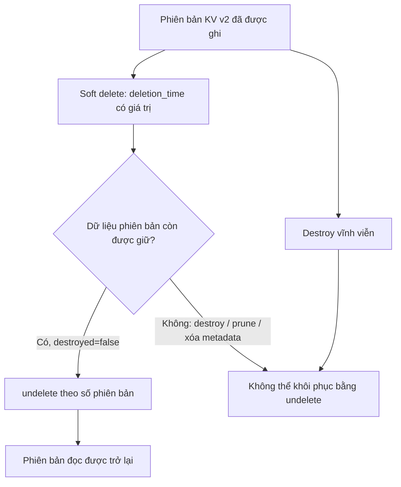

# Khôi phục phiên bản đã đánh dấu xóa bằng `undelete` trong Vault KV v2

## 1. Mục tiêu bài học

Trong **Spring Vault**, ứng dụng Java thường truy cập HashiCorp Vault qua `VaultTemplate` để quản lý cấu hình nhạy cảm và các bí mật theo chính sách phân quyền. Với secret engine **Key/Value phiên bản 2 (KV v2)**, mỗi lần ghi tạo một phiên bản dữ liệu. Khi một phiên bản bị **soft delete** (đánh dấu xóa), dữ liệu của phiên bản đó có thể được khôi phục bằng thao tác **`undelete`**, miễn là phiên bản chưa bị hủy vĩnh viễn hoặc loại bỏ khỏi lịch sử lưu trữ.

Sau bài này, bạn có thể:

- Phân biệt `delete`, `undelete`, `destroy` và xóa metadata trong vòng đời secret KV v2.
- Xác định đúng **mount**, **đường dẫn key** và **số phiên bản** cần khôi phục.
- Khôi phục phiên bản bằng Vault CLI, HTTP API và `VaultTemplate` trong ứng dụng Java.
- Cấp quyền ACL tối thiểu, xác minh kết quả và xử lý lỗi khi tích hợp với workload.
- Thiết kế kiểm thử tích hợp để tránh khôi phục nhầm hoặc tưởng rằng dữ liệu đã bị hủy vẫn có thể lấy lại.

## 2. `undelete` thực sự làm gì?

Giả sử KV v2 được mount tại `kv-demo/`, có key `apps/demo` và các phiên bản sau:

| Phiên bản | Giá trị minh họa | Trạng thái | Có đọc trực tiếp được không? |
|---|---|---|---|
| 1 | `feature=on` | Đang tồn tại | Có, nếu có quyền đọc |
| 2 | `feature=off` | Đã soft delete | Không, trước khi khôi phục |
| 3 | `feature=on` | Đang tồn tại | Có, nếu có quyền đọc |

Lệnh `undelete` cho phiên bản **2** gỡ trạng thái đánh dấu xóa của chính phiên bản đó. Dữ liệu cũ lại có thể được đọc theo `version=2`. Thao tác này **không tạo phiên bản 4**, **không đổi giá trị của phiên bản 3** và **không chuyển phiên bản 2 thành phiên bản mới nhất**.

Trong metadata của key, KV v2 theo dõi các thông tin như `current_version` và trạng thái từng phiên bản. Hai thuộc tính đặc biệt hữu ích khi chẩn đoán là:

- `deletion_time`: thời điểm phiên bản bị đánh dấu xóa; ở trạng thái chưa xóa thường là chuỗi rỗng.
- `destroyed`: cho biết nội dung của phiên bản đã bị hủy vĩnh viễn hay chưa.

| Thao tác | Tác động | Có thể dùng `undelete` để đảo ngược? |
|---|---|---|
| `delete` trên phiên bản | Đánh dấu xóa phiên bản, giữ dữ liệu trong KV v2 | **Có**, nếu dữ liệu còn được giữ |
| Tự động soft delete theo `delete_version_after` | Đánh dấu xóa khi hết thời hạn được cấu hình | **Có**, khi phiên bản vẫn còn được lưu |
| `undelete` | Gỡ dấu xóa ở phiên bản còn tồn tại | Không áp dụng; đây là thao tác khôi phục |
| `destroy` | Hủy vĩnh viễn dữ liệu của phiên bản được chỉ định | **Không** |
| Xóa toàn bộ metadata/key hoặc loại phiên bản cũ theo `max_versions` | Loại bỏ lịch sử hoặc dữ liệu phiên bản | **Không** đối với phiên bản không còn dữ liệu |

> **Giới hạn quan trọng:** `undelete` chỉ phục hồi phiên bản đã **soft delete** và **chưa bị destroy**. Nếu metadata còn ghi số phiên bản nhưng `destroyed=true`, không có lệnh `undelete` nào khôi phục được payload đã bị hủy.



## 3. Chuẩn bị và xác định phiên bản cần khôi phục

Các ví dụ dưới đây dùng **môi trường Vault thử nghiệm riêng**, mount KV v2 tên `kv-demo`, key `apps/demo`, và dữ liệu giả `feature=on/off`. Lệnh bật engine chỉ chạy **một lần khi mount `kv-demo/` chưa tồn tại**; không dùng nó để ghi đè mount thật đang vận hành.

```bash
# Ví dụ chuẩn bị trên môi trường thử nghiệm có quyền quản trị mount.
vault secrets enable -path=kv-demo -version=2 kv

# Mỗi lần put tạo một phiên bản mới.
vault kv put -mount=kv-demo apps/demo feature=on
vault kv put -mount=kv-demo apps/demo feature=off

# Xem thông tin phiên bản trước khi thao tác.
vault kv metadata get -mount=kv-demo apps/demo

# Chỉ đánh dấu xóa phiên bản 2.
vault kv delete -mount=kv-demo -versions=2 apps/demo

# Kiểm tra trạng thái và thử đọc rõ phiên bản 2.
vault kv metadata get -mount=kv-demo apps/demo
vault kv get -mount=kv-demo -version=2 apps/demo
```

Sau `delete`, lệnh đọc phiên bản 2 không trả về secret như trước; metadata cho biết phiên bản 2 đã bị đánh dấu xóa và chưa bị hủy. Đây là thời điểm có thể phục hồi.

Khi phân tích một sự cố thực tế, cần xác minh ba thông tin độc lập: **mount KV v2**, **đường dẫn key bên trong mount**, và **số version**. Không nhầm `apps/demo` với đường dẫn API chứa thêm `data/`, `metadata/` hay `undelete/`.

## 4. Khôi phục bằng Vault CLI

```bash
# Khôi phục đúng phiên bản đã soft delete.
vault kv undelete -mount=kv-demo -versions=2 apps/demo

# Xem trạng thái sau khi khôi phục.
vault kv metadata get -mount=kv-demo apps/demo

# Đọc lại chính phiên bản được phục hồi.
vault kv get -mount=kv-demo -version=2 apps/demo
```

Kết quả cần kiểm chứng là phiên bản 2 lại chứa `feature=off`, metadata không còn đánh dấu xóa cho phiên bản này và `destroyed` vẫn là `false`. Nếu key còn phiên bản mới hơn, việc khôi phục phiên bản 2 **không làm thay đổi phiên bản mới nhất**; ứng dụng đọc không truyền `version` có thể tiếp tục nhận dữ liệu của phiên bản mới nhất.

Có thể khôi phục nhiều phiên bản đã soft delete trong cùng một lệnh, nhưng chỉ thực hiện sau khi kiểm tra từng phiên bản:

```bash
vault kv undelete -mount=kv-demo -versions=1,2 apps/demo
```

Nếu không có quyền xem metadata, người dùng thực hiện khôi phục phải nhận số phiên bản đã được xác minh từ quy trình vận hành có thẩm quyền; không đoán version dựa vào thời điểm sự cố.

## 5. Gọi trực tiếp HTTP API của KV v2

Endpoint dành cho `undelete` có mẫu:

```http
POST /v1/<mount>/undelete/<path>
X-Vault-Token: <VAULT_TOKEN>
Content-Type: application/json

{"versions": [2]}
```

Với mount và key trong ví dụ, request tương ứng là:

```bash
curl --request POST \
  --header "X-Vault-Token: $VAULT_TOKEN" \
  --header "Content-Type: application/json" \
  --data '{"versions":[2]}' \
  "$VAULT_ADDR/v1/kv-demo/undelete/apps/demo"
```

Sử dụng biến môi trường `VAULT_ADDR` và `VAULT_TOKEN` đã được cấp trong môi trường thử nghiệm. Không ghi token hoặc nội dung bí mật thật vào tài liệu, source code, URL, nhật ký hay lịch sử lệnh được chia sẻ. Trong môi trường production, kết nối Vault phải dùng TLS được xác minh.

Một số điểm dễ nhầm:

- URL dùng **`undelete/`**, không dùng `data/` (đường dẫn đọc/ghi payload) hay `metadata/` (đường dẫn metadata).
- Body chứa mảng **số phiên bản nguyên dương**, không chứa payload của secret.
- Request được Vault xử lý bằng quyền **`update`** trên đường dẫn `kv-demo/undelete/apps/demo`.
- Phản hồi thành công thường không có payload secret; cần đọc metadata và đúng version để xác minh.

## 6. Tích hợp `undelete` với Spring Vault và `VaultTemplate`

Ứng dụng Java dùng Spring Vault có thể gọi endpoint KV v2 trực tiếp qua `VaultTemplate.write(...)`. Ví dụ dưới đây cố định mount/key cho một chức năng khôi phục có kiểm soát; giả định `VaultTemplate` đã được cấu hình với Vault endpoint, TLS và phương thức xác thực phù hợp với workload (chẳng hạn Kubernetes Auth hoặc AppRole).

```java
import java.util.List;
import java.util.Map;

import org.springframework.stereotype.Service;
import org.springframework.vault.core.VaultTemplate;

@Service
public class KvVersionRecoveryService {

    private static final String UNDELETE_PATH =
            "kv-demo/undelete/apps/demo";

    private final VaultTemplate vaultTemplate;

    public KvVersionRecoveryService(VaultTemplate vaultTemplate) {
        this.vaultTemplate = vaultTemplate;
    }

    public void restoreVersion(int version) {
        if (version <= 0) {
            throw new IllegalArgumentException(
                    "KV v2 version must be a positive integer");
        }

        // VaultTemplate.write dùng HTTP POST cho endpoint này.
        vaultTemplate.write(
                UNDELETE_PATH,
                Map.of("versions", List.of(version))
        );
    }
}
```

Ví dụ gọi từ quy trình vận hành đã kiểm tra quyền và yêu cầu khôi phục:

```java
recoveryService.restoreVersion(2);
```

`VaultTemplate` xử lý việc gửi HTTP request và xác thực thông qua cấu hình Spring Vault hiện có. Phần Java chỉ truyền số version và path API, không cần đọc secret rồi ghi lại. Đối với quyền đọc KV v2 thông thường, Spring Vault còn cung cấp API mức cao `vaultTemplate.opsForVersionedKeyValue("kv-demo")`; phần thao tác `undelete` ở đây dùng đường dẫn HTTP rõ ràng để dễ đối chiếu với Vault API.

Để xác minh metadata sau thao tác, workload **có quyền đọc metadata** có thể gọi:

```java
import org.springframework.vault.support.VaultResponse;

VaultResponse response = vaultTemplate.read(
        "kv-demo/metadata/apps/demo"
);
// Kiểm tra response.getData(): versions["2"].deletion_time và destroyed.
// Không log toàn bộ response hoặc nội dung secret.
```

Trong hệ thống thực tế, hãy kiểm tra null/cấu trúc phản hồi trước khi truy cập các trường lồng nhau. Nếu cần xác minh giá trị bằng chương trình, dùng API đọc KV v2 có chỉ định version và so sánh **những thuộc tính kiểm thử không nhạy cảm**; không ghi payload bí mật vào log. Một ứng dụng chỉ cần quyền `update` để phục hồi có thể giao việc xác minh dữ liệu cho quy trình giám sát riêng có quyền `read`.

### 6.1. Vì sao không dùng `put` để khôi phục?

`put` ghi lại giá trị và tạo **một version mới**. Trong khi đó, `undelete` làm version cũ đọc được trở lại và **giữ nguyên số version**. Nếu mục tiêu vận hành là đưa **nội dung cũ thành bản mới nhất** cho các client luôn đọc `latest`, thì đó là một tác vụ khác: phải có phê duyệt và tạo version mới bằng thao tác ghi, cân nhắc kiểm soát đồng thời bằng CAS. Không xem hai thao tác là tương đương.

### 6.2. Ranh giới xác thực và token

Token hợp lệ phải mang policy cho đường dẫn `undelete`; token hết hạn, bị thu hồi hoặc thiếu policy sẽ khiến yêu cầu thất bại. Cơ chế xác thực workload (Kubernetes/AppRole), thời hạn token và khả năng gia hạn do cấu hình Vault/Spring Vault quản lý. **Khôi phục một KV version không gia hạn token, không phục hồi lease và không cấp lại quyền truy cập**.

## 7. Chính sách ACL tối thiểu

Ví dụ policy HCL dành riêng cho thao tác khôi phục key `apps/demo`:

```hcl
# Cần để POST /v1/kv-demo/undelete/apps/demo.
path "kv-demo/undelete/apps/demo" {
  capabilities = ["update"]
}

# Chỉ cấp thêm nếu vai trò này cần xác minh metadata.
path "kv-demo/metadata/apps/demo" {
  capabilities = ["read"]
}

# Chỉ cấp thêm nếu vai trò này cần xác minh dữ liệu theo version.
path "kv-demo/data/apps/demo" {
  capabilities = ["read"]
}
```

Đường dẫn ACL của KV v2 là **đường dẫn API nội bộ**; cấp quyền trên `kv-demo/apps/demo` sẽ không tự động thay thế cho quyền trên `kv-demo/undelete/apps/demo`. Không cần cấp `destroy`, `delete` hay quyền quản trị mount cho chức năng chỉ khôi phục. Trong production, nên giới hạn role được phép thao tác, ghi nhận yêu cầu khôi phục và tuân thủ quy trình kiểm soát thay đổi.

## 8. Các tình huống lỗi và cách chẩn đoán

| Hiện tượng | Nguyên nhân cần kiểm tra | Cách xử lý |
|---|---|---|
| Vault trả `403 Permission denied` | Token không hợp lệ hoặc policy không cho `update` tại endpoint `undelete` | Kiểm tra phương thức xác thực, token/role và path ACL cụ thể; không cấp quyền wildcard tùy tiện |
| `404` hoặc endpoint không tồn tại | Sai mount, sai key, mount không phải KV v2 hoặc phiên bản không tồn tại | Xác minh mount và đường dẫn thực tế; đối chiếu metadata khi có quyền |
| Request bị từ chối vì dữ liệu/version không hợp lệ | Version không phải số nguyên dương, body sai cấu trúc hoặc trạng thái phiên bản không cho phục hồi | Kiểm tra `versions`, metadata và thông báo lỗi Vault; không lặp request mù |
| Version có `destroyed=true` | Dữ liệu phiên bản đã bị destroy | Không thể `undelete`; cần quy trình khôi phục từ bản sao lưu phù hợp, nếu tổ chức có |
| Version đã bị loại vì `max_versions` hoặc metadata bị xóa | Dữ liệu không còn được lưu trong KV engine | Không thể phục hồi qua `undelete`; xác minh bản sao lưu và chính sách giữ phiên bản |
| `undelete` thành công nhưng ứng dụng vẫn thấy giá trị mới hơn | Ứng dụng đang đọc `latest`, trong khi version cũ được phục hồi không đổi `current_version` | Đọc với `version` được chỉ định; nếu cần đổi nội dung `latest`, lập một thao tác ghi mới có kiểm soát |
| `undelete` thành công nhưng request đọc vẫn thất bại | Thiếu quyền `read` trên `data/` hoặc yêu cầu đang dùng sai version/path | Kiểm tra policy và đường dẫn đọc; phân biệt lỗi khôi phục với lỗi xác minh |
| Lỗi kết nối, TLS, timeout | Vault không sẵn sàng, cấu hình endpoint/chứng chỉ sai hoặc hạ tầng mạng gặp sự cố | Kiểm tra kết nối, độ tin cậy chứng chỉ và health; retry có giới hạn sau khi xác định tình trạng |

Không kết luận chỉ dựa trên một mã HTTP: cùng một mã có thể xuất hiện ở nhiều tình huống. Kết hợp thông báo Vault, trạng thái metadata, đường dẫn request và audit log để xác định nguyên nhân. Với workload Java, theo dõi số request thành công/thất bại, latency, 403/404/5xx và trace ID; tránh đưa token hoặc secret vào metrics, exceptions được log hay thông báo lỗi cho người dùng.

## 9. Kiểm thử tích hợp trên Vault cô lập

Kiểm thử cần chạy trên mount thử nghiệm (ví dụ `kv-demo`) và dữ liệu giả. Một kịch bản kiểm chứng đầy đủ:

1. Tạo key `apps/demo` với version 1 là `feature=on` và version 2 là `feature=off`.
2. Soft delete **chính version 2**, rồi xác minh đọc version 2 thất bại và metadata cho thấy `destroyed=false`.
3. Gọi `KvVersionRecoveryService.restoreVersion(2)` với workload được cấp `update` đúng đường dẫn.
4. Đọc lại **version 2** và xác nhận `feature=off`; kiểm tra `deletion_time` đã được gỡ và số `current_version` không bị tăng do `undelete`.
5. Dùng một token chỉ có `read` nhưng không có `update` để gọi `undelete` và xác nhận Vault từ chối với 403.
6. Trong một **key thử nghiệm khác**, tạo, soft delete rồi **destroy** một version; xác nhận `undelete` không khôi phục được payload đã destroy. Tuyệt đối không kiểm thử `destroy` trên key đang được sử dụng.

Nên chạy các tình huống này bằng Vault Dev/Testcontainers hoặc một Vault thử nghiệm được cấu hình riêng, gán mỗi lần chạy một key duy nhất để tránh phụ thuộc trạng thái từ các test khác. Khi kiểm thử API Spring Vault, phân biệt rõ lỗi quyền, lỗi mạng và lỗi trạng thái phiên bản để hệ thống không che khuất lỗi gốc bằng một thông báo `not found` chung.

## 10. Ghi nhớ khi vận hành

- **`undelete` khôi phục khả năng đọc của một version KV v2 đã soft delete**, không tạo version mới và không biến version cũ thành `latest`.
- **`destroy` là ranh giới không thể đảo ngược bằng `undelete`**; tương tự, phiên bản bị loại khỏi lịch sử không còn dữ liệu để khôi phục.
- Dùng đúng ba yếu tố **mount / key / version** và đúng endpoint `/<mount>/undelete/<key>`.
- `VaultTemplate.write(path, Map.of("versions", ...))` có thể thực hiện thao tác này; authentication và ACL phải được cấu hình trước.
- Xác minh metadata và đọc chính version được khôi phục bằng quyền tối thiểu; bảo vệ token, secret, audit log và theo dõi lỗi phù hợp với môi trường vận hành.

**Câu hỏi tự kiểm tra:** Key có version 1, 2, 3; version 2 bị soft delete, version 3 vẫn là latest. Sau khi `undelete` version 2, client đọc không chỉ định version sẽ nhận version nào? **Đáp án:** version 3; `undelete` không thay đổi `current_version`.
