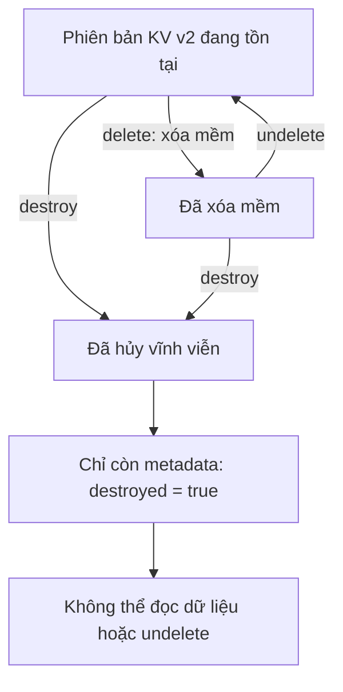

# Hủy dữ liệu phiên bản bằng `destroy` trong KV v2

## 1. Mục tiêu bài học

HashiCorp Vault KV (Key/Value) phiên bản 2 lưu nhiều phiên bản của cùng một secret. Điều này cho phép ứng dụng Java đọc phiên bản cụ thể, khôi phục phiên bản đã xóa mềm và kiểm soát lịch sử thay đổi. Tuy nhiên, khi một phiên bản chứa thông tin bí mật bị lộ, hết thời hạn lưu trữ hoặc không được phép tiếp tục tồn tại, việc **ẩn phiên bản khỏi kết quả đọc** có thể chưa đủ: dữ liệu gốc vẫn còn trong Vault.

Trong **Spring Vault**, `VaultTemplate` cung cấp giao diện `VaultVersionedKeyValueOperations` để gọi thao tác **`destroy`**, hủy vĩnh viễn dữ liệu của những phiên bản KV v2 được chỉ định. Bài học tập trung vào cách xác định chính xác phiên bản cần hủy, thao tác qua Vault CLI/HTTP API/Java, thiết lập quyền tối thiểu, quan sát kết quả và kiểm thử hành vi sau hủy.

Sau bài học, bạn có thể:

- Phân biệt `delete`, `undelete`, `destroy` và `metadata delete` trong KV v2.
- Hủy đúng một hoặc nhiều phiên bản mà không làm mất những phiên bản còn lại.
- Dùng `VaultTemplate.opsForVersionedKeyValue(...)` và `Versioned.Version.from(...)` để thực hiện từ Java.
- Cấp quyền `update` trên đường dẫn `<mount>/destroy/<path>` và kiểm tra metadata `destroyed`.
- Thiết kế thao tác vận hành có xác nhận, nhật ký kiểm toán và phương án ứng phó lỗi phù hợp.

> **Cảnh báo:** `destroy` là thao tác không thể đảo ngược bằng `undelete`. Mọi lệnh thực hành bên dưới dùng **giá trị giả và mount thử nghiệm**; không chạy trên secret sản xuất nếu chưa xác minh chính xác path, phiên bản và thẩm quyền.

## 2. `destroy` thực sự làm gì?

Giả sử mount KV v2 tên `kv-demo` chứa secret tại `demo/payments` với ba phiên bản:

| Phiên bản | Dữ liệu minh họa | Trạng thái trước thao tác |
| --- | --- | --- |
| `v1` | `api_key=DEMO-OLD-1` | Đang tồn tại |
| `v2` | `api_key=DEMO-OLD-2` | Đang tồn tại |
| `v3` | `api_key=DEMO-NEW-3` | Đang tồn tại |

Khi gọi `destroy` đối với phiên bản 2:

1. Vault loại bỏ dữ liệu bí mật đã lưu cho **v2**.
2. Metadata phiên bản vẫn được giữ để thể hiện `destroyed: true`.
3. `v1` và `v3` không bị hủy chỉ vì cùng thuộc một secret path.
4. Đọc lại nội dung `v2` không thành công; gọi `undelete` cũng **không thể** khôi phục nội dung đó.
5. Số phiên bản không được đánh lại; `destroy` không biến `v3` thành `v2` và không đặt lại bộ đếm phiên bản.

### So sánh các thao tác vòng đời

| Thao tác | Endpoint KV v2 | Tác động | Có khôi phục bằng `undelete`? |
| --- | --- | --- | --- |
| Xóa mềm phiên bản chỉ định | `POST /<mount>/delete/<path>` | Đánh dấu phiên bản đã xóa, giữ dữ liệu gốc | Có, khi dữ liệu chưa bị hủy |
| Hủy vĩnh viễn phiên bản | `PUT /<mount>/destroy/<path>` | Loại bỏ dữ liệu các phiên bản đã chọn, giữ metadata đánh dấu `destroyed` | **Không** |
| Khôi phục bản xóa mềm | `POST /<mount>/undelete/<path>` | Bỏ trạng thái xóa mềm của các phiên bản đủ điều kiện | Không áp dụng cho phiên bản đã `destroy` |
| Xóa toàn bộ secret và metadata | `DELETE /<mount>/metadata/<path>` | Xóa mọi phiên bản và metadata của cả key | **Không** |

Lưu ý: lệnh `vault kv delete` thông thường xóa mềm **phiên bản mới nhất**; `vault kv delete -versions=...` xóa mềm các phiên bản được chọn. Trong khi đó, `vault kv destroy` yêu cầu chọn phiên bản cụ thể.

`destroy` không đồng nghĩa với thu hồi Vault token, thu hồi dynamic secret lease, xoay vòng khóa Transit hoặc xóa bản sao từng được ghi ra log, backup hay hệ thống bên ngoài. Nếu bí mật bị lộ, phải kết hợp **rotation/revocation** tại hệ thống sử dụng secret với chính sách lưu trữ và hủy phiên bản thích hợp.

### Sơ đồ trạng thái của một phiên bản



Một chi tiết dễ nhầm: nếu **phiên bản mới nhất** bị `destroy`, lệnh đọc mặc định phiên bản mới nhất không tự động chuyển về phiên bản cũ hơn. Ứng dụng cần xử lý trường hợp secret hiện tại không đọc được và cập nhật/ghi phiên bản mới theo quy trình đã duyệt.

## 3. Chuẩn bị môi trường thực hành

Yêu cầu có một Vault instance thử nghiệm, CLI `vault` đã kết nối tới Vault, và một token có quyền cấu hình mount/thực hành. Để giảm nguy cơ thao tác nhầm dữ liệu thật, tạo mount KV v2 riêng:

```bash
# Chỉ dùng trên Vault lab/dev; cần quyền quản trị mount.
vault secrets enable -path=kv-demo -version=2 kv

# Tạo 3 phiên bản với giá trị minh họa.
vault kv put -mount=kv-demo demo/payments api_key=DEMO-OLD-1
vault kv put -mount=kv-demo demo/payments api_key=DEMO-OLD-2
vault kv put -mount=kv-demo demo/payments api_key=DEMO-NEW-3

# Đọc metadata để kiểm tra số phiên bản đang có.
vault kv metadata get -mount=kv-demo demo/payments

# Đọc riêng phiên bản 2 trước khi hủy (chỉ với dữ liệu thử nghiệm).
vault kv get -mount=kv-demo -version=2 demo/payments
```

Khi mount đã tồn tại, không chạy lại lệnh `secrets enable`; thay vào đó kiểm tra mount nào thực sự đang dùng `version=2`. Việc tạo ba phiên bản cần thực hiện tuần tự tại path mới, chưa từng có dữ liệu, để các số `1, 2, 3` đúng với ví dụ.

Hai phần của đường dẫn phải được phân biệt:

- **Mount:** `kv-demo` — tên KV secrets engine.
- **Secret path:** `demo/payments` — key bên trong mount.

Với KV v2, API thực tế thêm đoạn `data/`, `delete/`, `destroy/` hoặc `metadata/` tùy thao tác. Trong `VaultVersionedKeyValueOperations`, bạn truyền **secret path tương đối** (`demo/payments`); Spring Vault tự xây endpoint đúng, không cần viết thêm `destroy/` hay `data/`.

## 4. Thao tác hủy bằng Vault CLI

Hủy riêng phiên bản 2:

```bash
vault kv destroy -mount=kv-demo -versions=2 demo/payments
```

Hủy nhiều phiên bản trong **một lần gọi**:

```bash
# Chỉ là ví dụ cú pháp, không chạy nếu còn cần v1/v3.
vault kv destroy -mount=kv-demo -versions=1,3 demo/payments
```

Flag `-versions` chứa danh sách số phiên bản, phân tách bằng dấu phẩy. Trước khi hủy, đối chiếu danh sách phiên bản thực tế với yêu cầu vận hành; không suy số phiên bản từ thời điểm cập nhật hoặc từ nhãn triển khai.

### Đọc lại kết quả

```bash
# Kiểm tra metadata còn ghi nhận version 2 nhưng destroyed = true.
vault kv metadata get -mount=kv-demo demo/payments

# Dự kiến không đọc lại được dữ liệu v2 sau khi destroy.
vault kv get -mount=kv-demo -version=2 demo/payments

# Phiên bản v3 vẫn đọc được nếu chưa bị xóa/hủy.
vault kv get -mount=kv-demo -version=3 demo/payments
```

Lệnh đọc v2 thường trả lỗi không có secret data/không tìm thấy dữ liệu; đây là kết quả dự kiến, còn trạng thái đáng tin cậy để xác nhận hủy là metadata của phiên bản hiển thị `destroyed: true`. Không lấy riêng thông báo CLI “Success!” làm bằng chứng rằng mọi yêu cầu nghiệp vụ và an toàn đã hoàn tất.

## 5. Tương đương bằng HTTP API

Với KV v2, endpoint hủy phiên bản là:

```http
PUT /v1/kv-demo/destroy/demo/payments
X-Vault-Token: <token>
Content-Type: application/json

{
  "versions": [2]
}
```

Trong môi trường shell, có thể gửi:

```bash
curl --request PUT \
  --header "X-Vault-Token: $VAULT_TOKEN" \
  --header "Content-Type: application/json" \
  --data '{"versions":[2]}' \
  "$VAULT_ADDR/v1/kv-demo/destroy/demo/payments"
```

API yêu cầu mảng `versions` gồm các số nguyên phiên bản. Nó **không** nhận tên field secret (`api_key`) và không nhận dữ liệu secret trong payload. Tài liệu HashiCorp có ví dụ thao tác cập nhật qua `POST`; tham chiếu HTTP API của KV v2 mô tả `PUT` cho endpoint `destroy`. Ví dụ ở đây sử dụng `PUT` theo đặc tả API chính thức. API thành công không trả về nội dung bí mật; cần xem metadata để xác nhận trạng thái từng phiên bản.

Một đường dẫn tương tự nhưng khác mục đích là `/v1/kv-demo/data/demo/payments`: đây là endpoint đọc/ghi data và không thực hiện `destroy`. Lỗi chọn sai path có thể gây thao tác khác mong muốn hoặc nhận thông báo không đủ quyền.

## 6. Hủy phiên bản từ ứng dụng Java với Spring Vault

Spring Vault cung cấp API cấp cao để tránh phải tự ghép đường dẫn HTTP và JSON payload. Giả sử ứng dụng đã cấu hình bean `VaultTemplate` và xác thực vào Vault qua cơ chế phù hợp với workload (ví dụ Kubernetes hoặc AppRole):

```java
import java.util.List;

import org.springframework.stereotype.Service;
import org.springframework.vault.core.VaultTemplate;
import org.springframework.vault.core.VaultVersionedKeyValueOperations;
import org.springframework.vault.support.Versioned;

@Service
public class KvVersionDestroyService {

    private final VaultVersionedKeyValueOperations kv;

    public KvVersionDestroyService(VaultTemplate vaultTemplate) {
        // "kv-demo" là tên mount KV v2, không phải "kv-demo/data".
        this.kv = vaultTemplate.opsForVersionedKeyValue("kv-demo");
    }

    public void destroyVersions(String secretPath, List<Integer> versionNumbers) {
        if (secretPath == null || secretPath.isBlank()) {
            throw new IllegalArgumentException("Secret path must not be blank");
        }
        if (versionNumbers == null || versionNumbers.isEmpty()
                || versionNumbers.stream().anyMatch(v -> v == null || v <= 0)) {
            throw new IllegalArgumentException("Specify positive version numbers");
        }

        Versioned.Version[] versions = versionNumbers.stream()
                .distinct()
                .map(Versioned.Version::from)
                .toArray(Versioned.Version[]::new);

        // Thao tác phá hủy dữ liệu; chỉ gọi sau bước kiểm tra/phê duyệt.
        kv.destroy(secretPath, versions);
    }
}
```

Cách sử dụng cho dữ liệu thử nghiệm:

```java
destroyService.destroyVersions("demo/payments", List.of(2));
// Đối chiếu metadata trên Vault để xác nhận v2 đã destroyed.
```

Đối với môi trường production, `secretPath` và danh sách phiên bản phải đến từ một tác vụ quản trị đã được kiểm tra và xác nhận, không truyền trực tiếp từ request của người dùng vào phương thức `destroy`. Validate số phiên bản dương chỉ giúp tránh đầu vào sai; nó **không** thay thế xác minh đúng mount, đường dẫn, quyền và mục đích hủy.

### Vì sao dùng `VaultVersionedKeyValueOperations`?

- `vaultTemplate.opsForVersionedKeyValue("kv-demo")` chọn API KV v2 chuyên biệt.
- `Versioned.Version.from(2)` tạo giá trị phiên bản rõ ràng, giảm nhầm lẫn với phiên bản “latest” hoặc placeholder phiên bản 0.
- `kv.destroy(path, versions...)` hủy chính xác các phiên bản được truyền; với cùng interface, `kv.delete(path, versions...)` chỉ xóa mềm và `kv.undelete(path, versions...)` khôi phục bản đã xóa mềm.
- `VaultTemplate` sử dụng cơ chế xác thực/session của ứng dụng; không cần tự nhúng Vault token vào mã nguồn.

Các phiên bản Spring Vault khác nhau có thể có cách cấu hình bean hoặc dependency khác nhau, nhưng API `VaultVersionedKeyValueOperations.destroy(String, Versioned.Version...)` là điểm tích hợp chính. Nếu chỉ có nhu cầu đọc/ghi secret đơn giản, `VaultKeyValueOperations` vẫn hữu ích; để xử lý vòng đời phiên bản, sử dụng interface có chữ `Versioned`.

## 7. Phân quyền theo nguyên tắc tối thiểu

Endpoint `destroy` rất nhạy cảm: cấp quyền này cho ứng dụng bình thường đồng nghĩa ứng dụng có khả năng làm biến mất vĩnh viễn dữ liệu phiên bản. Vault ACL cho phép tách quyền hủy khỏi quyền đọc/ghi.

Policy minh họa cho **một path thử nghiệm**:

```hcl
# Chỉ cho phép hủy phiên bản tại đúng key này.
path "kv-demo/destroy/demo/payments" {
  capabilities = ["update"]
}

# Cho phép xem metadata để kiểm tra trạng thái trước/sau.
path "kv-demo/metadata/demo/payments" {
  capabilities = ["read"]
}
```

Quyền `update` trên `kv-demo/destroy/demo/payments` phục vụ thao tác destroy; quyền đọc metadata là một khả năng **riêng biệt** để kiểm chứng. Nếu tác vụ cũng cần đọc dữ liệu, phải cấp `read` trên `kv-demo/data/demo/payments` một cách có chủ đích. Nếu cần `undelete`, phải cấp `update` tại `kv-demo/undelete/demo/payments`; quyền hủy không tự động bao hàm quyền khôi phục.

Không cấp `update` trên `kv-demo/destroy/*` cho mọi workload nếu chỉ một nhóm vận hành cần hủy dữ liệu. Phân tách danh tính thường dùng:

| Workload | Quyền phù hợp | Quyền nên hạn chế |
| --- | --- | --- |
| Ứng dụng chạy nghiệp vụ | Đọc secret tại `data/` theo path được giao | `destroy/`, xóa metadata |
| Quy trình xoay vòng secret | Ghi phiên bản mới tại `data/`, quyền metadata khi thực sự cần | `destroy/` nếu không thuộc quy trình xử lý tồn dư |
| Job quản trị vòng đời | `update` trên `destroy/` cho tập path được duyệt; `read` metadata phục vụ xác nhận | Wildcard trên mọi mount và quyền quản trị không liên quan |

Trong Kubernetes/AppRole, policy gắn với Vault identity/workload. Nên sử dụng danh tính riêng cho job hủy dữ liệu, token có thời hạn phù hợp và được phát hành qua cơ chế xác thực workload; không chia sẻ token quản trị cho toàn bộ ứng dụng. Vault audit device cần được cấu hình để truy vết ai đã hủy đường dẫn nào, lúc nào, dựa trên quyền nào.

## 8. Quy trình vận hành an toàn

Tình huống: API key từng lưu ở v2 đã bị lộ. Hệ thống đã thay sang key mới ở v3; tổ chức cần ngăn việc lấy lại bản cũ.

1. **Xác định phạm vi:** kiểm tra KV mount đúng phiên bản 2, secret path, số phiên bản bị ảnh hưởng và những hệ thống từng tiêu thụ secret. Nếu key bị lộ, ưu tiên thu hồi/rotate key tại nhà cung cấp dịch vụ; `destroy` đơn thuần không vô hiệu hóa giá trị key đã bị sao chép.
2. **Kiểm tra metadata:** sử dụng `vault kv metadata get` để đối chiếu `current_version`, thông tin các phiên bản và trạng thái `deletion_time`/`destroyed`. Chỉ đọc nội dung secret khi thực sự cần và khi có quyền.
3. **Kiểm tra lệ thuộc:** bảo đảm workload không còn cố đọc v2 (ví dụ client cố định `?version=2`), đã chuyển sang v3 hoặc secret thay thế.
4. **Phê duyệt thao tác hủy:** lưu yêu cầu gồm mount, path, danh sách version, lý do, người yêu cầu/người phê duyệt và mã change/ticket. Với nhiệm vụ tự động, áp dụng allowlist và chính sách xét duyệt tương đương.
5. **Gọi `destroy` một lần với đúng versions:** qua CLI, Vault API hoặc `VaultVersionedKeyValueOperations`.
6. **Xác minh độc lập:** metadata của từng version mục tiêu báo `destroyed: true`; các phiên bản không nằm trong danh sách vẫn giữ trạng thái dự kiến; ứng dụng đọc được secret hiện hành.
7. **Ghi nhật ký vận hành:** ghi metadata về quyết định, phiên bản, kết quả xác minh và audit request; **không** ghi token hoặc secret value vào log.

Không triển khai endpoint công khai kiểu `DELETE /secrets/{path}?versions=...` gọi thẳng `destroy` chỉ dựa vào input của client. Nếu có yêu cầu quản trị qua API, phải thêm xác thực/ủy quyền chặt, giới hạn path, xác minh trạng thái, luồng phê duyệt và audit.

### Khi bí mật bị lộ

`destroy` xóa bản lưu trong Vault KV v2, nhưng không thể bảo đảm xóa các bản dữ liệu đã bị sao chép trước đó (cache của ứng dụng, log, hệ thống downstream hoặc snapshot lưu trữ). Quy trình ứng phó sự cố cần thu hồi credential ở hệ thống đích, phát hành credential mới, cập nhật workload và đánh giá bản sao liên quan. Không nên diễn giải `destroyed: true` thành bảo đảm “không còn bản sao nào ở mọi nơi”.

## 9. Xử lý lỗi và quan sát

| Hiện tượng | Nguyên nhân thường gặp | Cách kiểm tra/xử lý |
| --- | --- | --- |
| HTTP `403 permission denied` | Token thiếu `update` trên `<mount>/destroy/<path>` hoặc policy path không khớp | Xác minh mount/path và ACL của identity thực thi; không tự mở rộng quyền wildcard |
| HTTP `404` hoặc path không tìm thấy | Chọn sai mount, secret path, KV v1 hoặc secret/version không tồn tại theo API đang gọi | Kiểm tra mount KV v2, metadata và endpoint thực tế; phân biệt `data/` với `destroy/` |
| HTTP `400`/payload không hợp lệ | Mảng phiên bản rỗng, giá trị không hợp lệ hoặc JSON sai dạng | Gửi `{"versions":[2]}`, dùng số phiên bản dương đã xác minh |
| Gọi `destroy` xong nhưng vẫn thấy version trong metadata | Metadata về lịch sử được giữ lại | Kiểm tra `destroyed: true`, không kỳ vọng metadata biến mất |
| Đọc `v2` thất bại sau khi destroy | Dữ liệu v2 đã bị loại bỏ | Đây là kết quả dự kiến; kiểm tra thêm rằng v3 vẫn đọc được |
| `undelete` không khôi phục được | Phiên bản đã bị hủy vĩnh viễn | Không retry `undelete` để “khôi phục” dữ liệu đã destroy; sử dụng quy trình tái tạo secret nếu có |
| Ứng dụng mất secret sau khi destroy bản mới nhất | Client đọc latest, phiên bản latest không còn dữ liệu | Ghi phiên bản hợp lệ mới theo quy trình và kiểm tra client; không giả định tự fallback sang bản cũ |

Trong Java, xem lỗi Vault như lỗi thao tác từ xa cần được ghi nhận với ngữ cảnh không nhạy cảm (mount, path đã kiểm soát, versions, mã HTTP/loại lỗi, correlation ID). Chỉ phát tín hiệu “đã hủy” sau khi lệnh thành công **và** xác nhận metadata mong đợi. Nếu kết nối gián đoạn sau khi gửi request, trạng thái có thể không rõ: **đọc metadata trước khi quyết định gửi lại** thay vì tự động retry vô điều kiện một lệnh phá hủy.

Các tín hiệu giám sát phù hợp là số yêu cầu destroy theo workload, tần suất lỗi quyền, lỗi kết nối, các version đã yêu cầu hủy nhưng chưa xác minh, và audit events của Vault. Giới hạn nội dung audit/log để không phát tán token hoặc secret.

## 10. Kịch bản kiểm thử tích hợp

Dùng Vault thử nghiệm độc lập (ví dụ container Vault dành riêng cho test), gắn `kv-demo` dưới dạng KV v2 và chạy các kiểm thử theo path riêng cho từng case để tránh nhiễu dữ liệu.

| Kiểm thử | Thiết lập | Hành động | Kỳ vọng |
| --- | --- | --- | --- |
| Hủy đúng một phiên bản | Viết liên tiếp v1, v2, v3 | `destroy(path, Version.from(2))` | v2 báo `destroyed=true`; v1 và v3 vẫn đọc được |
| Hủy nhiều phiên bản | Có v1, v2, v3 | Hủy v1, v2 trong một call | Cả v1/v2 destroyed; v3 còn nguyên |
| Hủy sau xóa mềm | Tạo v1 rồi xóa mềm v1 | Hủy v1 và gọi `undelete` | Không khôi phục được nội dung v1 |
| Quyền thiếu | Token chỉ có `read` tại `data/` | Gọi `destroy` | Vault từ chối thao tác; metadata/data không đổi |
| Input sai | Không có số phiên bản hoặc có số ≤ 0 | Gọi service Java | Bị từ chối trước khi gửi request tới Vault |
| Hủy bản mới nhất | Có v1, v2, v3; hủy v3 | Đọc `get(path)` phiên bản mặc định | Không tự trả nội dung v2; ứng dụng xử lý secret hiện tại không khả dụng |
| Không hủy cả path | Có nhiều version, chỉ chọn v2 | Destroy v2 | Metadata path và các version khác còn tồn tại |

Khi thực thi test, cần bảo đảm token dùng để quan sát metadata có quyền đọc metadata; token riêng của ứng dụng thông thường có thể không có quyền này. Phân biệt lỗi ACL với kết quả phiên bản đã bị hủy: một HTTP 403 không chứng minh dữ liệu đã được destroy.

### Bài tập tự thực hành

1. Tạo mới secret `demo/orders` gồm ba phiên bản có giá trị giả.
2. Xóa mềm v1, xác nhận có thể `undelete`, sau đó xóa mềm lại.
3. Dùng Spring Vault hủy v1 và v2; đọc metadata để xác nhận `destroyed=true` ở cả hai.
4. Kiểm tra phiên bản v3 vẫn được ứng dụng đọc bình thường.
5. Gán policy chỉ đọc dữ liệu cho một token khác và xác nhận token đó **không** thể hủy phiên bản.
6. Giải thích vì sao không thể dùng `undelete` sau bước 3 và vì sao `metadata delete` có phạm vi tác động lớn hơn `destroy`.

## 11. Những điểm cần nhớ

- `destroy` chỉ có trong **KV v2** và hủy dữ liệu **của các phiên bản được chọn**, không mặc nhiên xóa cả secret path.
- `delete` là xóa mềm, `undelete` có thể phục hồi xóa mềm; `destroy` loại bỏ dữ liệu vĩnh viễn, giữ metadata `destroyed=true`.
- Với Java, API chính là `VaultTemplate.opsForVersionedKeyValue(mount).destroy(path, Versioned.Version...)`.
- Quyền Vault ACL cần là `update` tại `<mount>/destroy/<path>`; quyền `read` data không đủ.
- Trước và sau khi hủy phải đối chiếu phiên bản; dữ liệu secret đã bị lộ vẫn cần thu hồi/rotate ngoài Vault nếu có hệ thống sử dụng.
- Vòng đời Vault token/lease không bị thay thế bởi `destroy` của KV v2; các loại secret khác (Transit, PKI, dynamic credentials) có cơ chế quản trị riêng.

## Tài liệu tham khảo

- [HashiCorp Vault — KV v2: Permanently delete data](https://developer.hashicorp.com/vault/docs/secrets/kv/kv-v2/cookbook/destroy-data)
- [HashiCorp Vault — KV v2 HTTP API](https://developer.hashicorp.com/vault/api-docs/secret/kv/kv-v2)
- [HashiCorp Vault CLI — `vault kv destroy`](https://developer.hashicorp.com/vault/docs/commands/kv/destroy)
- [Spring Vault — `VaultVersionedKeyValueOperations` API](https://docs.spring.io/spring-vault/docs/current/api/org/springframework/vault/core/VaultVersionedKeyValueOperations.html)
- [Spring Vault — `Versioned.Version` API](https://docs.spring.io/spring-vault/docs/current/api/org/springframework/vault/support/Versioned.Version.html)
