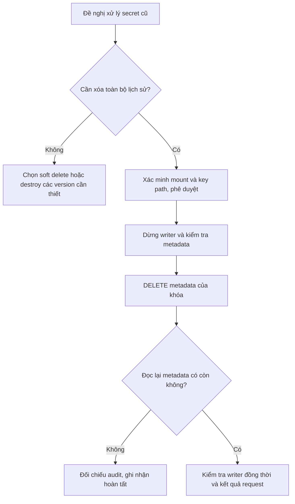

# Xóa metadata và toàn bộ lịch sử của một khóa trong KV v2

## 1. Mục tiêu và tình huống sử dụng

HashiCorp Vault KV v2 lưu một **khóa logic (secret path)** cùng nhiều phiên bản dữ liệu và metadata của khóa đó. Khi một ứng dụng Java dùng Spring Vault thay đổi mật khẩu, ghi phiên bản mới không tự làm mất các phiên bản cũ. Tương tự, thao tác `delete` thông thường của KV v2 chủ yếu đánh dấu phiên bản đã bị xóa, nên vẫn có thể phục hồi trong những trường hợp được phép.

Đôi khi cần **chấm dứt hoàn toàn vòng đời của một khóa**, chẳng hạn một môi trường thử nghiệm đã bị hủy, thông tin xác thực cũ không còn được phép lưu hoặc một secret path đã được thay thế. Thao tác dành cho yêu cầu này là **xóa metadata và tất cả các phiên bản của một khóa** (*delete metadata and all versions*).

Sau bài học, bạn có thể:

- Phân biệt xóa mềm, hủy một số phiên bản và xóa toàn bộ lịch sử KV v2.
- Gọi đúng endpoint `DELETE /v1/<mount>/metadata/<path>` bằng Vault CLI, HTTP API và `VaultTemplate` của Spring Vault.
- Cấp quyền ACL tối thiểu, xác minh trạng thái sau xóa, xử lý lỗi và tránh thao tác nhầm trong hệ thống đang hoạt động.
- Viết kiểm thử tích hợp cho hành vi xóa không thể hoàn tác bằng cơ chế `undelete`.

> **Cảnh báo:** Đây là thao tác phá hủy dữ liệu của **một khóa cùng mọi phiên bản**. Không có lệnh `vault kv undelete` hay rollback nào lấy lại được các phiên bản đã bị xóa bằng endpoint này. Chỉ thực hiện với đường dẫn đã xác minh và theo quy trình phê duyệt của hệ thống.

## 2. Phân biệt khóa, phiên bản, metadata và mount

Giả sử secrets engine **KV v2** được mount tại `kv-demo/`, còn đường dẫn khóa trong engine là `apps/payments/api-key`:

| Thành phần | Ví dụ | Ý nghĩa |
|---|---|---|
| Mount | `kv-demo` | Vị trí gắn KV v2 trong Vault; không phải phần của tên khóa tương đối. |
| Key path | `apps/payments/api-key` | Một khóa logic có thể mang nhiều phiên bản. |
| Đường dẫn dữ liệu | `kv-demo/data/apps/payments/api-key` | Endpoint đọc/ghi dữ liệu KV v2. |
| Đường dẫn metadata | `kv-demo/metadata/apps/payments/api-key` | Endpoint quản lý metadata và toàn bộ lịch sử phiên bản. |

Thông tin metadata của khóa có thể chứa `current_version`, `oldest_version`, thông tin thời điểm tạo/cập nhật, các mục `versions` và thiết lập như `max_versions`, `cas_required`, `delete_version_after`, `custom_metadata`. Giá trị secret nằm trong dữ liệu từng phiên bản, không đồng nghĩa với trường `custom_metadata`.

Một khóa có thể lần lượt có phiên bản `1`, `2`, `3`, kể cả khi một vài phiên bản đã bị xóa mềm hoặc hủy dữ liệu. **Xóa metadata của khóa** sẽ xóa cả bản ghi mô tả khóa và toàn bộ dữ liệu phiên bản tương ứng. Phạm vi là **đúng key path được chỉ định**, không phải tất cả khóa trong mount hay tất cả khóa dưới một prefix.

### Những thao tác dễ nhầm lẫn

| Nhu cầu | CLI | HTTP API KV v2 | Có thể giữ lịch sử? |
|---|---|---|---|
| Xóa mềm phiên bản mới nhất | `vault kv delete -mount=kv-demo apps/payments/api-key` | `DELETE /v1/kv-demo/data/apps/payments/api-key` | Có. Phiên bản được đánh dấu đã xóa và có thể `undelete` nếu chưa bị hủy. |
| Xóa mềm các phiên bản chỉ định | `vault kv delete -mount=kv-demo -versions=1,2 apps/payments/api-key` | `POST /v1/kv-demo/delete/apps/payments/api-key` | Có. Vẫn còn metadata phiên bản. |
| Hủy vĩnh viễn dữ liệu của vài phiên bản | `vault kv destroy -mount=kv-demo -versions=1,2 apps/payments/api-key` | `PUT /v1/kv-demo/destroy/apps/payments/api-key` | Có. Metadata của khóa và dấu vết phiên bản bị hủy vẫn được giữ. |
| **Xóa metadata và tất cả phiên bản** | **`vault kv metadata delete -mount=kv-demo apps/payments/api-key`** | **`DELETE /v1/kv-demo/metadata/apps/payments/api-key`** | **Không. Cả khóa và lịch sử phiên bản bị xóa.** |

Không dùng `VaultVersionedKeyValueOperations.delete(path, versions...)` hoặc `destroy(path, versions...)` thay cho yêu cầu cuối cùng: hai API đó chỉ tác động lên những phiên bản được chỉ định. Nếu chỉ muốn chỉnh `custom_metadata`, `max_versions` hoặc `cas_required`, hãy cập nhật metadata bằng API tương ứng thay vì xóa toàn bộ khóa.

## 3. API chuẩn: DELETE metadata và toàn bộ phiên bản

Vault KV v2 định nghĩa endpoint:

```http
DELETE /v1/{secret-mount-path}/metadata/{path}
X-Vault-Token: <token-co-quyen-delete>
```

Với ví dụ của bài học, request là:

```http
DELETE /v1/kv-demo/metadata/apps/payments/api-key
```

- `secret-mount-path` là mount KV v2 (`kv-demo`), có thể khác với mount mặc định `secret`.
- `path` là key path tương đối (`apps/payments/api-key`); không tự thêm `data/` hoặc `metadata/` vào tên khóa.
- Request xóa **không cần JSON body** và không có danh sách version: Vault xóa tất cả phiên bản thuộc khóa.
- Token phải có capability **`delete`** trên **đường dẫn `metadata/...`**. Quyền `delete` trên `data/...` không tự cấp quyền xóa metadata.

Ví dụ gọi trực tiếp bằng HTTP trong môi trường thử nghiệm đã xác thực:

```bash
curl --request DELETE \
  --header "X-Vault-Token: ${VAULT_TOKEN}" \
  "${VAULT_ADDR}/v1/kv-demo/metadata/apps/payments/api-key"
```

Khi thành công, API thường trả `204 No Content`, không có đối tượng JSON mô tả các phiên bản đã xóa. Không diễn giải một response trống là lỗi. Trong ứng dụng thực tế, ưu tiên cơ chế xác thực workload và client của Spring Vault thay cho truyền token cố định vào source code, tham số dòng lệnh hoặc log.

## 4. Thực hành bằng Vault CLI trong môi trường cô lập

Các bước sau **chỉ chạy trên Vault development/test**, với các giá trị giả. Nếu mount `kv-demo/` đã tồn tại, xác minh nó thực sự là KV v2 và bỏ qua bước tạo mount. Đừng dùng `vault secrets enable` trên hệ thống production chỉ để chạy ví dụ.

```bash
# Bước này chỉ dành cho Vault dev/test chưa có mount kv-demo/.
vault secrets enable -path=kv-demo -version=2 kv

# Tạo hai phiên bản cho cùng một key path; không sử dụng secret thật.
vault kv put -mount=kv-demo apps/payments/api-key value=demo-v1
vault kv put -mount=kv-demo apps/payments/api-key value=demo-v2

# Quan sát metadata và lịch sử phiên bản trước khi xóa.
vault kv metadata get -mount=kv-demo apps/payments/api-key

# Xóa vĩnh viễn metadata và mọi phiên bản của đúng khóa đó.
vault kv metadata delete -mount=kv-demo apps/payments/api-key

# Xác minh: sau khi xóa, các lệnh đọc khóa phải không còn tìm thấy nó.
vault kv metadata get -mount=kv-demo apps/payments/api-key
vault kv get -mount=kv-demo apps/payments/api-key
```

Trước khi xóa, `metadata get` hiển thị `current_version` và các mục version. Sau khi xóa, cả lệnh `metadata get` lẫn lệnh `get` dữ liệu đều không thể đọc khóa cũ và thông thường báo không tìm thấy. **Thất bại có chủ đích của hai lệnh xác minh không có nghĩa bước xóa thất bại.** Nếu xóa thành công, chạy `vault kv undelete` sau đó cũng không thể phục hồi lịch sử vừa bị loại bỏ.

CLI trả về thông báo thành công theo mẫu `Success! Data deleted (if it existed) ...`. Do phần *if it existed*, riêng thông báo này không chứng minh khóa đã tồn tại ngay trước lúc xóa. Muốn ghi nhận việc hủy một khóa cụ thể, cần có bằng chứng metadata trước thao tác và kết quả kiểm tra sau thao tác.

## 5. Dùng Spring Vault và VaultTemplate

Spring Vault cung cấp `VaultVersionedKeyValueOperations` cho KV v2. Phương thức `opsForKeyValueMetadata()` trả về `VaultKeyValueMetadataOperations`, trong đó **`delete(String path)`** thực hiện thao tác xóa metadata và toàn bộ dữ liệu phiên bản. Đây là API đúng cho tình huống của bài học.

Ví dụ service Spring dành cho **một khóa đã được phê duyệt xóa**:

```java
import org.springframework.stereotype.Service;
import org.springframework.vault.core.VaultKeyValueMetadataOperations;
import org.springframework.vault.core.VaultTemplate;

@Service
public class RetiredSecretCleanupService {

    private static final String MOUNT = "kv-demo";
    private static final String KEY = "apps/payments/api-key";

    private final VaultKeyValueMetadataOperations metadata;

    public RetiredSecretCleanupService(VaultTemplate vaultTemplate) {
        this.metadata = vaultTemplate
                .opsForVersionedKeyValue(MOUNT)
                .opsForKeyValueMetadata();
    }

    public void permanentlyDeleteApprovedKey() {
        // Kiểm tra khóa tồn tại trước khi thực hiện thao tác phá hủy.
        if (metadata.get(KEY) == null) {
            throw new IllegalStateException("Key metadata was not found");
        }

        // DELETE /v1/kv-demo/metadata/apps/payments/api-key
        metadata.delete(KEY);

        // Đọc lại để xác nhận không còn metadata tại cùng key path.
        if (metadata.get(KEY) != null) {
            throw new IllegalStateException("Key metadata still exists after deletion");
        }
    }
}
```

Điểm cần nhớ:

1. `opsForVersionedKeyValue(MOUNT)` nhận **tên mount**, không nhận `kv-demo/data` hoặc key path.
2. `metadata.delete(KEY)` nhận **key path tương đối**, không nhận URL `/v1/.../metadata/...`.
3. `metadata.get(KEY)` trả về `null` khi không tìm thấy metadata theo hợp đồng API Spring Vault; lỗi xác thực, ACL hoặc kết nối phải được xử lý như lỗi thực, không đồng nhất với `null`.
4. Đoạn code giả định service chạy trong quy trình có phê duyệt, và các tiến trình ghi đã dừng. Không expose phương thức phá hủy này thành một endpoint nhận key path tùy ý từ request bên ngoài.

Trong thực tế, application có thể dùng Vault authentication theo workload (ví dụ Kubernetes authentication hoặc AppRole) và cơ chế quản lý session/token của Spring Vault. Tài khoản ứng dụng thông thường chỉ cần `read` trên `data/` nên **không nên** nhận thêm quyền hủy metadata. Nên dùng một workload/role riêng có quyền xóa trên danh sách key path được xét duyệt và chỉ kích hoạt trong đợt cleanup.

### Về kiểm tra trước khi xóa và tính đồng thời

Luồng `get → delete → get` ở ví dụ giúp kiểm tra dữ liệu và xác minh hậu điều kiện, **không tạo thành giao dịch nguyên tử** với Vault. Nếu một writer tiếp tục ghi cùng key path trong lúc cleanup, nó có thể tái tạo metadata sau thao tác xóa, khiến phép xác minh cuối thấy khóa tồn tại trở lại. Cần tạm dừng writer hoặc chặn quyền `create`/`update` trên `data/` trong khoảng thời gian xử lý; khi đã ngừng ghi, mới đọc metadata, xóa và xác minh.

## 6. Chính sách ACL theo nguyên tắc ít quyền nhất

Giả sử workload dọn dẹp chỉ được xóa đúng khóa `apps/payments/api-key` tại mount `kv-demo/`:

```hcl
path "kv-demo/metadata/apps/payments/api-key" {
  capabilities = ["read", "delete"]
}
```

`read` dùng cho preflight/readback metadata; `delete` cho HTTP DELETE. Nếu workload chỉ xóa mà không đọc, chính sách có thể chỉ cấp `delete`, nhưng phải dùng một danh tính khác có quyền `read` để xác minh. Đường dẫn ACL ở đây là **đường dẫn API sau `/v1/`**, không có prefix `/v1/` trong policy.

**Không mở rộng thành** `path "kv-demo/metadata/*" { capabilities = ["delete"] }` chỉ để xử lý một khóa. Wildcard sẽ mở khả năng xóa toàn bộ lịch sử của nhiều khóa khác trong mount. Đồng thời, quyền `delete` trên `kv-demo/data/apps/payments/api-key` không đủ cho thao tác `metadata delete`, vì đó là endpoint khác.

Đối với các môi trường có namespace, mount hoặc policy được quản lý riêng, cần xác minh cả namespace đang sử dụng. Mục tiêu là đúng bộ **Vault instance/namespace + mount + relative key path**, tránh xóa nhầm khóa trùng tên trong môi trường khác.

## 7. Quy trình vận hành an toàn

Một quy trình xóa metadata đáng tin cậy có thể triển khai như sau:

1. **Xác định đích:** ghi nhận Vault environment, namespace nếu có, mount KV v2, key path và lý do xóa. Kiểm tra `vault secrets list -detailed` hoặc cấu hình mount để xác nhận KV **version 2**.
2. **Đánh giá ảnh hưởng:** xác định service, job và pipeline còn đọc hoặc ghi khóa; chuyển chúng sang secret mới và ngừng hoạt động ghi vào đường dẫn cũ.
3. **Xem trạng thái trước khi xóa:** dùng `vault kv metadata get -mount=<mount> <key>` dưới identity có `read` để lấy `current_version`, thời điểm cập nhật và số phiên bản. Không cần đọc/in giá trị bí mật chỉ để kiểm tra sự tồn tại.
4. **Đảm bảo chính sách lưu giữ:** xác nhận yêu cầu phê duyệt/retention, snapshot hoặc bản sao lưu theo chính sách. Xóa trong Vault không tự xóa bản sao bên ngoài, cache ứng dụng hay snapshot đã tồn tại.
5. **Thực hiện một thao tác delete:** gọi CLI, HTTP hoặc `VaultKeyValueMetadataOperations.delete(...)` bằng workload có đúng quyền `delete` trên metadata path.
6. **Xác minh hậu điều kiện:** `metadata get` không còn thấy khóa; `kv get` không đọc được dữ liệu cũ; kiểm tra log/audit (theo chính sách truy cập) để đối chiếu thời điểm, actor, mount và key path.
7. **Giám sát sau xóa:** bảo đảm không có writer tạo lại khóa ngoài ý muốn; cập nhật inventory/CMDB nếu có và loại bỏ các tham chiếu đến key path đã bị ngừng sử dụng.

Luồng quyết định đơn giản:



## 8. Lỗi thường gặp và cách xử lý

| Hiện tượng | Nguyên nhân có thể | Hướng xử lý |
|---|---|---|
| `403 permission denied` khi xóa | Workload không có `delete` trên `.../metadata/<key>`; token hết hạn hoặc sai namespace. | Kiểm tra policy gắn với token/role thực tế, Vault namespace và khả năng gia hạn/đăng nhập lại theo workload. Không tự nâng quyền ứng dụng đọc secret. |
| Lệnh đọc trả `404` hoặc không tìm thấy | Khóa đã bị xóa, chưa từng tồn tại, hoặc nhập sai mount/key path. | So khớp metadata trước xóa, mount và path; xem audit khi cần. Không mặc định 404 là bằng chứng một lần xóa thành công. |
| `400` / route không hỗ trợ | Gọi KV v1 hoặc nhầm `data/` với `metadata/`; HTTP method/path sai. | Kiểm tra secrets engine là KV v2 và dùng `DELETE /<mount>/metadata/<path>`. |
| Timeout, mất kết nối hoặc lỗi `5xx` | Chưa rõ Vault đã xử lý DELETE hay chưa. | Dùng identity có quyền `read` để kiểm tra trạng thái hiện tại và audit; cân nhắc retry sau khi biết hậu điều kiện, tránh tự động lặp thao tác phá hủy vô điều kiện. |
| Xóa thành công nhưng khóa lại xuất hiện | Writer khác tiếp tục ghi vào cùng path, tạo một vòng đời mới. | Dừng writer, kiểm tra principal có quyền `create`/`update`, phối hợp thời điểm cleanup. |
| Ứng dụng vẫn đọc được giá trị cũ | Cấu hình/caching của ứng dụng, secret được nạp vào bộ nhớ hoặc có nguồn dữ liệu khác. | Kiểm tra cache, biến môi trường, instance chưa restart và các bản sao khác; endpoint Vault không thu hồi những giá trị đã được ứng dụng giữ sẵn. |

Khi xử lý lỗi trong Java, không bắt toàn bộ `VaultException` rồi coi là "đã xóa". Phân biệt **khóa không còn tồn tại** với **thiếu quyền xác minh** và **kết nối bị lỗi**. Với HTTP request có kết quả không chắc chắn, việc đọc lại trạng thái dưới quyền thích hợp có giá trị hơn việc ghi log một thông báo thành công giả.

## 9. Kiểm thử tích hợp Spring Vault

Kiểm thử này cần một Vault **KV v2 cô lập** ở mount `kv-demo` và token/role dành cho test có quyền tạo, đọc, cập nhật dữ liệu và đọc/xóa metadata của đường dẫn `tests/`. Mỗi lần chạy dùng một key path riêng để không đụng dữ liệu khác.

```java
import static org.junit.jupiter.api.Assertions.assertNotNull;
import static org.junit.jupiter.api.Assertions.assertNull;

import java.util.Map;
import java.util.UUID;

import org.junit.jupiter.api.Test;
import org.springframework.beans.factory.annotation.Autowired;
import org.springframework.boot.test.context.SpringBootTest;
import org.springframework.vault.core.VaultTemplate;

@SpringBootTest
class Kv2MetadataDeletionIntegrationTest {

    @Autowired
    VaultTemplate vaultTemplate;

    @Test
    void metadataDeleteRemovesTheWholeKeyHistory() {
        var kv = vaultTemplate.opsForVersionedKeyValue("kv-demo");
        var metadata = kv.opsForKeyValueMetadata();
        String key = "tests/purge-" + UUID.randomUUID();

        kv.put(key, Map.of("demo", "version-1"));
        kv.put(key, Map.of("demo", "version-2"));

        assertNotNull(metadata.get(key));
        assertNotNull(kv.get(key));

        metadata.delete(key);

        assertNull(metadata.get(key));
        assertNull(kv.get(key));
    }
}
```

Đây là kiểm thử tích hợp thực sự vì phải làm việc với một Vault server; mock `VaultKeyValueMetadataOperations` chỉ chứng minh service có gọi `delete`, không chứng minh Vault xóa toàn bộ lịch sử. Có thể chạy trên Vault dev mode hoặc Testcontainers với fixture KV v2 đã chuẩn bị. Đối với bài test kiểm tra quyền, dùng một role chỉ có `read` trên `data/` và xác nhận nó **không được** gọi `metadata.delete`, sau đó dùng role cleanup riêng để kiểm tra đường dẫn được cho phép.

### Tiêu chí nghiệm thu

- Trước thao tác, metadata ghi nhận ít nhất hai phiên bản cho key path của test.
- Sau thao tác, metadata và dữ liệu của key path đều không thể đọc; các version cũ không thể `undelete`.
- Một key path **khác** trong cùng mount vẫn tồn tại và đọc được, xác nhận việc xóa chỉ tác động đúng khóa.
- Workload không có `delete` trên metadata path bị từ chối, còn workload cleanup được cấp đúng scope thì thực hiện thành công.
- Nếu writer tạo lại cùng key path, hệ thống phát hiện đó là dữ liệu mới và không coi lịch sử cũ đã được phục hồi.

## 10. Ghi nhớ khi áp dụng vào hệ thống Java

**API cần dùng:** `vaultTemplate.opsForVersionedKeyValue(mount).opsForKeyValueMetadata().delete(keyPath)`. Đây là thao tác xóa metadata **và tất cả phiên bản** của một khóa KV v2; không truyền version ID, không dùng endpoint `data/`.

Chỉ chạy sau khi xác minh scope và ngừng writer, bằng một identity cleanup có capability `delete` chính xác trên `metadata/<key>`. Đọc lại metadata để kiểm tra hậu điều kiện; giữ bằng chứng vận hành cần thiết nhưng không ghi giá trị secret hoặc token ra log. Việc xóa trong Vault không tự xử lý những dữ liệu đã được sao chép sang snapshot, cache hay hệ thống bên ngoài.

## Tài liệu tham khảo

- HashiCorp Vault API — [KV v2: Delete metadata and all versions](https://developer.hashicorp.com/vault/api-docs/secret/kv/kv-v2#delete-metadata-and-all-versions).
- HashiCorp Vault CLI — [`vault kv metadata delete`](https://developer.hashicorp.com/vault/docs/commands/kv/metadata#kv-metadata-delete).
- HashiCorp Vault — [So sánh đường dẫn API KV v1 và KV v2](https://developer.hashicorp.com/vault/docs/secrets/kv).
- Spring Vault API — [`VaultKeyValueMetadataOperations`](https://docs.spring.io/spring-vault/docs/current/api/org/springframework/vault/core/VaultKeyValueMetadataOperations.html).
- Spring Vault API — [`VaultVersionedKeyValueOperations`](https://docs.spring.io/spring-vault/docs/current/api/org/springframework/vault/core/VaultVersionedKeyValueOperations.html).
