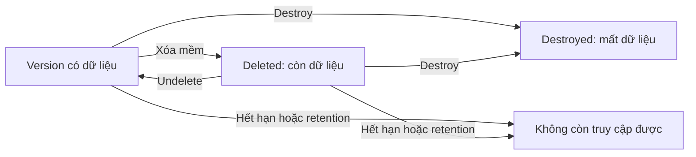

# Phân biệt dữ liệu bị xóa, bị hủy và khóa chưa tồn tại trong KV v2

## 1. Vì sao ứng dụng Java cần phân biệt các trạng thái này?

Khi một ứng dụng Java dùng **Spring Vault** để đọc secret từ **HashiCorp Vault KV phiên bản 2 (KV v2)**, kết quả không có dữ liệu có thể xuất phát từ nhiều nguyên nhân khác nhau:

- **Soft delete (xóa mềm):** một phiên bản secret bị đánh dấu không còn đọc được, nhưng dữ liệu vẫn được giữ và có thể khôi phục bằng `undelete`.
- **Destroy (hủy vĩnh viễn):** dữ liệu của một phiên bản đã bị loại bỏ; không thể `undelete` phiên bản ấy.
- **Chưa có khóa/đường dẫn secret:** secret path hoặc phiên bản được yêu cầu chưa tồn tại, hoặc metadata đã bị xóa hoàn toàn.
- **Không đủ quyền hoặc lỗi vận hành:** request bị từ chối, mất kết nối, timeout, sai mount, sai namespace… Đây là lỗi riêng, không nên tự động xếp vào nhóm “không tồn tại”.

Đối với KV v2, “khóa” trong bài này là **đường dẫn secret** (ví dụ `apps/payment/config` dưới mount `secret`), không phải một field bên trong JSON của secret. Một path chứa nhiều **version**; mỗi version có trạng thái riêng. Cần phân biệt cả trường hợp *path có thật nhưng version được hỏi không còn đọc được*.

**Mục tiêu học tập:** đọc được metadata KV v2; nhận biết deleted, destroyed và missing; chọn thao tác phục hồi hợp lệ; triển khai kiểm tra bằng `VaultTemplate` / `VaultVersionedKeyValueOperations`; xử lý lỗi và quyền truy cập đúng cách.

## 2. Mô hình dữ liệu: path, version và metadata

Giả sử mount KV v2 có tên `secret` và đường dẫn logic của ứng dụng là `apps/payment/config`.

| Thành phần | Đường dẫn KV v2 | Ý nghĩa |
| --- | --- | --- |
| Đọc nội dung | `GET /v1/secret/data/apps/payment/config` | Đọc version hiện hành; thêm `?version=2` để đọc version cụ thể. |
| Đọc metadata | `GET /v1/secret/metadata/apps/payment/config` | Đọc `current_version` và bản ghi của từng version. |
| Xóa mềm bản mới nhất | `DELETE /v1/secret/data/apps/payment/config` | Đánh dấu version mới nhất là deleted. |
| Xóa mềm các bản chỉ định | `POST /v1/secret/delete/apps/payment/config` | Truyền JSON `{"versions":[2]}`. |
| Khôi phục bản đã xóa mềm | `POST /v1/secret/undelete/apps/payment/config` | Truyền `{"versions":[2]}`. |
| Hủy vĩnh viễn version | `PUT /v1/secret/destroy/apps/payment/config` | Truyền `{"versions":[2]}`; dữ liệu version 2 không còn khôi phục được. |
| Xóa toàn bộ path và lịch sử | `DELETE /v1/secret/metadata/apps/payment/config` | Xóa metadata cùng **mọi version** của path. |

KV v2 thêm phân đoạn `data/` hoặc `metadata/` khi gọi **HTTP API**. Với API cấp cao của Spring Vault, ta truyền mount `secret` và path logic `apps/payment/config`; thư viện sẽ xây dựng đường dẫn phù hợp. Tránh truyền `secret/data/apps/payment/config` cho `opsForVersionedKeyValue("secret").get(...)`.

Một phản hồi metadata rút gọn có thể có dạng:

```json
{
  "data": {
    "current_version": 3,
    "oldest_version": 0,
    "versions": {
      "1": {
        "created_time": "2026-11-01T10:00:00Z",
        "deletion_time": "",
        "destroyed": false
      },
      "2": {
        "created_time": "2026-11-02T10:00:00Z",
        "deletion_time": "",
        "destroyed": true
      },
      "3": {
        "created_time": "2026-11-03T10:00:00Z",
        "deletion_time": "2026-11-04T10:00:00Z",
        "destroyed": false
      }
    }
  }
}
```

Ở thời điểm sau ngày 04/11/2026, ví dụ này cho thấy version 1 còn đọc được, version 2 đã bị hủy và version 3 đã bị xóa mềm. `current_version: 3` chỉ biểu thị số version mới nhất từng được ghi, **không đảm bảo version 3 còn đọc được**. Đọc không chỉ định version có thể thất bại dù version 1 vẫn tồn tại.

## 3. Bảng phân biệt trạng thái

| Tình huống | Dữ liệu version | Metadata version | Có thể khôi phục version cũ? | Hướng xử lý |
| --- | --- | --- | --- | --- |
| **Đang hoạt động** | Đọc được bằng `GET data` | `destroyed=false`, `deletion_time=""` | Không cần | Dùng dữ liệu bình thường. |
| **Deleted / soft delete** | Không đọc được khi thời điểm xóa đã có hiệu lực | `destroyed=false`, `deletion_time` là thời điểm xóa | **Có**, nếu còn dữ liệu | `undelete` đúng số version. |
| **Destroyed** | Dữ liệu đã bị loại bỏ vĩnh viễn | Thường còn bản ghi với `destroyed=true` | **Không** | Tạo version mới từ nguồn quản lý secret được phép; không thử `undelete`. |
| **Path chưa có metadata** | Không tìm thấy dữ liệu | `GET metadata` trả `404` | Không thể khôi phục bằng KV v2 | Kiểm tra đúng mount/path, nguồn cấp phát secret và lịch sử audit. |
| **Path có metadata, version không có trong danh sách** | Không đọc được version đó | Có metadata cấp path, nhưng thiếu version yêu cầu | Không đủ căn cứ để phục hồi | Có thể chưa ghi version này hoặc version cũ đã bị cắt theo retention; cần thêm bằng chứng. |
| **Metadata còn nhưng chưa ghi dữ liệu** | Chưa có version dữ liệu | Có thể `current_version=0`, `versions` rỗng | Không có version để phục hồi | Tạo version đầu tiên theo quy trình cấp phát secret. |

Hai điểm cần nhớ:

1. `GET data` trả `404` **không phân biệt được** một cách chắc chắn deleted, destroyed, path không tồn tại và version không tồn tại. Hãy đọc metadata với quyền phù hợp.
2. Nếu `DELETE /metadata/...` đã được thực hiện, metadata cũ biến mất. Chỉ từ trạng thái hiện tại, bạn **không thể chứng minh** path đó “chưa từng tồn tại” thay vì “đã bị xóa cả metadata”. Cần audit log hoặc hệ thống quản lý cấp phát để xác định lịch sử.

### Lưu ý về `deletion_time`

Thông thường, `deletion_time=""` nghĩa là chưa đánh dấu xóa; giá trị thời gian đã qua và `destroyed=false` phù hợp với xóa mềm. Tuy nhiên KV v2 còn hỗ trợ cấu hình `delete_version_after`, nên `deletion_time` có thể là **thời điểm xóa được lên lịch trong tương lai**. Khi phân loại, so sánh timestamp với thời gian hiện tại (UTC) và xác nhận bằng khả năng đọc; đừng kết luận mọi `deletion_time` khác rỗng đều đã bị xóa ngay lập tức. Ưu tiên kiểm tra `destroyed=true` trước vì đó là trạng thái không thể phục hồi.

### Minh họa vòng đời một version



Sơ đồ mô tả một version; việc **ghi secret mới** tạo version kế tiếp, không đảo ngược trạng thái của version đã bị destroy. Trạng thái metadata của version đã được giữ lại có thể khác với trạng thái version bị dọn khỏi lịch sử do chính sách lưu giữ.

## 4. Quy trình chẩn đoán khi đọc secret thất bại

Giả sử Java cần version `N`, hoặc version mới nhất nếu không chỉ định `N`.

1. **Kiểm tra kết quả đọc và mã lỗi.** Nếu `403`: kiểm tra policy, token, namespace và mount. Nếu timeout / `5xx`: xử lý như sự cố hệ thống. Chỉ tiếp tục phân loại trạng thái dữ liệu khi có quyền đọc metadata.
2. **Đọc `GET /secret/metadata/<path>`.** Nếu metadata cũng `404`, kết luận “không thấy metadata hiện tại” chứ chưa kết luận “chưa từng tồn tại”. Nếu `403`, trạng thái là **không thể xác minh**.
3. **Chọn version cần xét.** Với yêu cầu đọc mặc định, dùng `current_version` từ metadata; với yêu cầu đọc lịch sử, dùng chính số version do caller chỉ định. Không tự chọn version cũ hơn khi version mới nhất đã bị xóa.
4. **Tìm bản ghi trong `versions`.** Không tìm thấy: version đó có thể chưa từng được ghi hoặc đã bị retention loại bỏ; không đánh đồng với destroyed còn metadata.
5. **Kiểm tra các field theo thứ tự:** `destroyed=true` → `DESTROYED`; `deletion_time` đã có hiệu lực → `SOFT_DELETED`; `deletion_time` ở tương lai → `SCHEDULED_FOR_DELETION`; nếu không có dấu hiệu trên → `AVAILABLE` theo metadata.
6. **Đối chiếu khi cần sử dụng secret.** Ngay cả sau kiểm tra metadata, version có thể thay đổi bởi request khác; phải đọc lại secret và xử lý kết quả thực tế. Metadata là công cụ chẩn đoán, không bảo đảm giao dịch nguyên tử với lệnh đọc.

Ví dụ rất dễ mắc lỗi: hệ thống có version 1 còn dùng được, version 2 bị destroy, version 3 bị soft delete. Lệnh đọc **mới nhất** không tự động quay về version 1. Muốn sử dụng version 1, ứng dụng phải có chủ đích yêu cầu `?version=1` và quyền đọc phù hợp; về lâu dài nên phục hồi hoặc phát hành secret mới theo quy trình vận hành.

## 5. Kiểm tra nhanh bằng Vault CLI và HTTP API

Các lệnh sau dùng path thử nghiệm `apps/demo-kv2` trên mount KV v2 `secret`. Chỉ thực hiện trong môi trường thử nghiệm; giá trị `hello` không phải secret thật.

```bash
# Tạo version 1 và version 2.
vault kv put -mount=secret apps/demo-kv2 message=v1
vault kv put -mount=secret apps/demo-kv2 message=v2

# Quan sát metadata và version hiện hành.
vault kv metadata get -mount=secret apps/demo-kv2
vault kv get -mount=secret apps/demo-kv2

# Xóa mềm riêng version 2: bản mới nhất sẽ không đọc được.
vault kv delete -mount=secret -versions=2 apps/demo-kv2
vault kv metadata get -mount=secret apps/demo-kv2
vault kv get -mount=secret -version=1 apps/demo-kv2

# Khôi phục version 2: lại đọc được.
vault kv undelete -mount=secret -versions=2 apps/demo-kv2
vault kv get -mount=secret -version=2 apps/demo-kv2

# Hủy version 1: bản này không thể undelete.
vault kv destroy -mount=secret -versions=1 apps/demo-kv2
vault kv metadata get -mount=secret apps/demo-kv2
```

Quan sát trực tiếp metadata qua HTTP (giả sử `VAULT_ADDR` và `VAULT_TOKEN` đã được cấu hình an toàn):

```bash
curl --silent --show-error --include \
  --header "X-Vault-Token: $VAULT_TOKEN" \
  "$VAULT_ADDR/v1/secret/metadata/apps/demo-kv2"

curl --silent --show-error --include \
  --header "X-Vault-Token: $VAULT_TOKEN" \
  "$VAULT_ADDR/v1/secret/data/apps/demo-kv2?version=1"
```

`--include` giúp nhìn mã HTTP khi request không thành công. Đừng ghi token, nội dung secret hay toàn bộ response chứa secret vào log; hạn chế dùng `-v`/trace trong môi trường thật.

**Cảnh báo về thao tác phá hủy:** `vault kv destroy` và `vault kv metadata delete` là thao tác không thể khôi phục dữ liệu bằng `undelete`. Giới hạn các quyền này cho quy trình quản trị được phê duyệt.

## 6. Triển khai phân loại bằng Spring Vault

Thư viện Spring Vault hỗ trợ `VaultOperations.opsForVersionedKeyValue(mount)` và `VaultVersionedKeyValueOperations.opsForKeyValueMetadata()`. Hai API này đọc đúng KV v2 và cho phép kiểm tra cấu trúc metadata bằng đối tượng Java.

Ví dụ dùng Java 17+ và nhận vào một `VaultOperations` đã được cấu hình xác thực workload (ví dụ AppRole hoặc Kubernetes auth tùy môi trường), thêm `Clock` để dễ kiểm thử logic thời gian. Đây là **phân loại tại thời điểm đọc metadata**, không thay thế xử lý kết quả đọc dữ liệu thực tế.

```java
import java.time.Clock;
import java.time.Instant;
import java.util.List;

import org.springframework.vault.core.VaultOperations;
import org.springframework.vault.core.VaultVersionedKeyValueOperations;
import org.springframework.vault.support.VaultMetadataResponse;
import org.springframework.vault.support.Versioned;

public final class Kv2VersionInspector {

    public enum State {
        AVAILABLE,
        SCHEDULED_FOR_DELETION,
        SOFT_DELETED,
        DESTROYED,
        METADATA_ABSENT,
        VERSION_ABSENT
    }

    public record Result(State state, int version) {}

    private final VaultVersionedKeyValueOperations kv;
    private final Clock clock;

    public Kv2VersionInspector(VaultOperations vault, String mount, Clock clock) {
        this.kv = vault.opsForVersionedKeyValue(mount);
        this.clock = clock;
    }

    public Result inspect(String path, Integer requestedVersion) {
        if (requestedVersion != null && requestedVersion <= 0) {
            throw new IllegalArgumentException("Version must be positive");
        }

        VaultMetadataResponse metadata =
                kv.opsForKeyValueMetadata().get(path);

        if (metadata == null) {
            return new Result(State.METADATA_ABSENT, 0);
        }

        int version = requestedVersion == null
                ? metadata.getCurrentVersion()
                : requestedVersion;

        // Metadata có thể được tạo trước khi ghi version đầu tiên.
        if (version <= 0) {
            return new Result(State.VERSION_ABSENT, version);
        }

        List<Versioned.Metadata> versions = metadata.getVersions();
        if (versions == null) {
            return new Result(State.VERSION_ABSENT, version);
        }

        Versioned.Metadata entry = versions.stream()
                .filter(v -> v.getVersion().getVersion() == version)
                .findFirst()
                .orElse(null);

        if (entry == null) {
            return new Result(State.VERSION_ABSENT, version);
        }
        if (entry.isDestroyed()) {
            return new Result(State.DESTROYED, version);
        }

        Instant deletionTime = entry.getDeletedAt();
        if (deletionTime != null) {
            if (deletionTime.isAfter(clock.instant())) {
                return new Result(State.SCHEDULED_FOR_DELETION, version);
            }
            return new Result(State.SOFT_DELETED, version);
        }

        return new Result(State.AVAILABLE, version);
    }
}
```

Sử dụng trong service:

```java
import java.time.Clock;
import java.util.Map;

import org.springframework.vault.core.VaultOperations;
import org.springframework.vault.support.Versioned;

// vaultOperations do cấu hình Spring quản lý; không tự hard-code token.
Kv2VersionInspector inspector =
        new Kv2VersionInspector(vaultOperations, "secret", Clock.systemUTC());

Kv2VersionInspector.Result state =
        inspector.inspect("apps/payment/config", null); // version mới nhất

if (state.state() == Kv2VersionInspector.State.AVAILABLE) {
    Versioned<Map<String, Object>> item = vaultOperations
            .opsForVersionedKeyValue("secret")
            .get("apps/payment/config");

    // Giữa inspect và get, secret có thể bị sửa hoặc xóa.
    if (item == null || !item.hasData()) {
        throw new IllegalStateException("Secret changed during read");
    }
    Map<String, Object> secretValues = item.getData();
    // Sử dụng secretValues theo phạm vi nghiệp vụ, không log nội dung.
}
```

**Các điểm kỹ thuật cần để ý:**

- `VaultKeyValueOperations.get(path)` cũng là lựa chọn tốt khi chỉ cần dữ liệu của phiên bản mới nhất: tạo bằng `vaultOperations.opsForKeyValue("secret", KeyValueBackend.KV_2)`. Với kiểu này, response `VaultResponse.getData()` là map secret đã được thư viện giải bọc. Trong khi đó `vaultOperations.read("secret/data/...")` là HTTP-path thô, dữ liệu nằm trong `data.data` của phản hồi KV v2.
- `VaultVersionedKeyValueOperations.get(path, Versioned.Version.from(n))` đọc đúng version `n`; `get(path)` đọc mới nhất. Phản hồi có thể là `null` hoặc không có data khi secret không đọc được; cần kiểm tra thay vì dereference trực tiếp.
- `VaultMetadataResponse.getVersions()` trả danh sách `Versioned.Metadata`; `getVersion().getVersion()` là số version, `isDestroyed()` báo version bị hủy, `getDeletedAt()` cung cấp thời điểm xóa/đến hạn.
- `get(path)` từ metadata có thể trả `null` khi metadata không có; lỗi `403` hoặc kết nối thường phát sinh exception. **Không** `catch (Exception)` rồi trả về `METADATA_ABSENT`.
- Khi sử dụng API raw, cần giữ đúng dạng phản hồi KV v2: đọc version hoạt động có dạng `{"data":{"data":{...},"metadata":{...}}}` ở lớp JSON HTTP. Đừng nhầm dữ liệu chưa có với response chứa map rỗng hay field Java `null`.

## 7. Hành động đúng cho từng kết quả

### 7.1. Deleted: cân nhắc khôi phục phiên bản gốc

Nếu metadata xác nhận `destroyed=false` và version đã soft delete, người vận hành có quyền phù hợp có thể thực hiện:

```bash
vault kv undelete -mount=secret -versions=2 apps/demo-kv2
```

Trong Spring Vault cũng có `vaultOperations.opsForVersionedKeyValue("secret").undelete("apps/demo-kv2", Versioned.Version.from(2))`. Sau đó **đọc lại** để xác nhận bản đã phục hồi và kiểm tra ứng dụng đang dùng đúng version mong muốn. Khôi phục version 2 không đồng nghĩa version hiện hành thay đổi sang 2 nếu path đã phát hành version mới hơn.

### 7.2. Destroyed: cấp lại giá trị, không thử undelete

Version `destroyed=true` không còn payload để phục hồi. Nếu yêu cầu khôi phục năng lực ứng dụng, hãy lấy thông tin từ **nguồn hợp lệ** (hệ thống quản lý cấu hình, bản sao đã được quản trị phê duyệt hoặc quy trình cấp lại credential), ghi một **version mới**, đồng bộ ứng dụng và kiểm tra khả năng sử dụng. Không giả định số version cũ được tái sử dụng; cũng không chuyển sang bản cũ hơn một cách tự động vì có thể chứa credential đã bị thu hồi.

### 7.3. Metadata không có: xác thực định danh và nguồn cấp phát

Kiểm tra mount có chạy **KV v2** hay không, path logic có đúng không, namespace (nếu sử dụng Vault Enterprise), token có quyền `read` trên `metadata/` hay không và quy trình bootstrap secret có hoàn thành không. `404` metadata cho biết **không thấy bản ghi hiện tại**; không đủ để phân biệt chưa tạo với từng tồn tại rồi bị xóa toàn bộ metadata.

### 7.4. Version absent: kiểm tra giới hạn lưu giữ

`max_versions` có thể khiến những version cũ bị loại bỏ vĩnh viễn khi vượt giới hạn. Ngoài ra một version không có trong metadata cũng có thể do chưa từng được ghi. Đừng suy ra chắc chắn `destroyed=true` khi không tìm thấy mục version; hãy kiểm tra `current_version`, `oldest_version`, lịch sử thay đổi và audit. Nếu cần khôi phục dữ liệu, chuyển sang nguồn backup/nguồn cấp phát theo chính sách doanh nghiệp.

## 8. Phân quyền, bảo mật và xử lý lỗi

Trong Vault policy, đọc giá trị và đọc metadata là **hai đường dẫn khác nhau**. Chính sách đọc tối thiểu phục vụ chẩn đoán một secret cụ thể có thể là:

```hcl
path "secret/data/apps/payment/config" {
  capabilities = ["read"]
}

path "secret/metadata/apps/payment/config" {
  capabilities = ["read"]
}
```

Không tự cấp quyền ghi/xóa như `delete`, `update` trên `secret/metadata/`, hoặc quyền hủy trên `secret/destroy/`, cho workload chỉ có nhiệm vụ đọc. Nếu ứng dụng không được phép đọc metadata, nó có thể báo “không xác định được trạng thái” và để hệ thống vận hành chẩn đoán bằng danh tính có quyền. Không mở rộng quyền chỉ để che một lỗi 404.

| Tín hiệu từ ứng dụng | Cách hiểu | Xử lý gợi ý |
| --- | --- | --- |
| Đọc secret `404`, metadata cho thấy đã xóa mềm | Phiên bản yêu cầu không sẵn có nhưng có thể khôi phục | Báo trạng thái `SOFT_DELETED`, thực hiện quy trình undelete nếu được duyệt. |
| Đọc secret `404`, metadata `destroyed=true` | Payload version mất vĩnh viễn | Báo `DESTROYED`, yêu cầu cấp mới. |
| Đọc secret `404`, metadata cũng `404` | Không có metadata tại thời điểm kiểm tra | Báo `METADATA_ABSENT`, kiểm tra bootstrap, path, lịch sử. |
| `403 Forbidden` | Thiếu quyền / sai danh tính / sai namespace | Báo lỗi quyền; không đổi thành “không có khóa”. |
| `429`, timeout, `5xx` | Hạn mức, sự cố Vault hoặc mạng | Retry có giới hạn và backoff, theo chính sách ứng dụng. |
| Có secret nhưng thiếu field `apiKey` | Field bên trong map không có | Kiểm tra `containsKey("apiKey")` và schema; không kết luận cả path absent. |

Trong quan sát vận hành, ghi **tên secret path đã được cho phép ghi log, trạng thái, version, mã HTTP, request ID**; tránh ghi token, payload bí mật hoặc exception chứa đường dẫn nhạy cảm. Với secret bắt buộc để startup, lỗi thiếu secret cần làm rõ ràng ở health check / readiness theo yêu cầu hệ thống. Việc tự động lấy version cũ sau một lần đọc mới nhất thất bại có thể đưa ứng dụng về một credential đã bị thu hồi.

## 9. Bài thực hành và tiêu chí kiểm chứng

Thực hiện trong mount hoặc namespace thử nghiệm có quyền phù hợp. Chuẩn bị một path chưa từng ghi dữ liệu, một path có hai version, và một danh tính chỉ có quyền đọc secret nhưng không có quyền đọc metadata.

| Ca thử | Hành động | Kết quả cần quan sát |
| --- | --- | --- |
| A — Chưa tồn tại | Đọc metadata path mới | `404`; inspector trả `METADATA_ABSENT` khi có quyền chẩn đoán. |
| B — Đang hoạt động | Ghi version 1, đọc metadata và nội dung | `destroyed=false`, `deletion_time=""`, dữ liệu đọc được. |
| C — Xóa mềm | Soft delete version 1 rồi đọc lại | Đọc dữ liệu không thành công; metadata còn và ghi thời gian xóa; inspector trả `SOFT_DELETED` sau khi thời điểm xóa có hiệu lực. |
| D — Khôi phục | Undelete version 1 | Đọc version 1 trở lại thành công. |
| E — Hủy | Destroy version 1 | Metadata `destroyed=true` nếu bản ghi còn được giữ; không thể undelete. |
| F — Bản mới nhất mất, bản cũ còn | Ghi 2 version, soft delete version 2 | Đọc mặc định không khả dụng, `get(..., Version.from(1))` vẫn có thể đọc version 1. |
| G — Không đủ quyền | Dùng token không có quyền metadata | Lỗi phân quyền `403`/exception; **không** trả `METADATA_ABSENT`. |
| H — Retention | Giới hạn số version và ghi nhiều lần | Version cũ biến mất khỏi lịch sử; phân biệt `VERSION_ABSENT` với bản còn metadata `DESTROYED`. |

Để kiểm thử code `Kv2VersionInspector` một cách ổn định, cố định `Clock` tại thời điểm xác định và dựng metadata với version còn hiệu lực, version đã xóa, version chờ đến hạn và version bị hủy. Khi kiểm thử tích hợp với Vault thật/Testcontainers, xác minh thêm quyền policy và kết quả HTTP; không dùng secret sản xuất trong fixture.

## 10. Câu hỏi tự kiểm tra

1. Vì sao `GET secret/data/path` trả `404` không đủ để kết luận path chưa tồn tại?
2. Phân biệt `delete` và `destroy` khi cần khôi phục một version đã bị xóa.
3. Nếu `current_version=5` đã soft delete nhưng version 4 vẫn hoạt động, lệnh đọc không có tham số version sẽ xử lý thế nào?
4. `GET /metadata/path` trả `404` có chứng minh path chưa từng được tạo không? Vì sao?
5. Vì sao phải phân biệt HTTP `403` với `404`, và khi nào ứng dụng cần coi kết quả là “không xác định”?

**Ghi nhớ:** Cần đọc metadata theo **từng version** để phân biệt các trạng thái. Deleted thường còn khả năng `undelete`; destroyed mất payload; metadata/path vắng mặt không chứng minh được lịch sử; quyền truy cập và lỗi mạng phải được xử lý riêng.

## Tài liệu tham khảo

- HashiCorp Vault, [KV v2 HTTP API](https://developer.hashicorp.com/vault/api-docs/secret/kv/kv-v2): các đường dẫn `data`, `metadata`, `delete`, `undelete`, `destroy`.
- HashiCorp Vault, [KV v2 overview](https://developer.hashicorp.com/vault/docs/secrets/kv/kv-v2): cơ chế version, xóa mềm và hủy vĩnh viễn.
- Spring Vault, [Vault Secrets Engines — Key-Value Version 2](https://docs.spring.io/spring-vault/reference/vault/vault-secret-engines.html): sử dụng `VaultKeyValueOperations` và `VaultVersionedKeyValueOperations`.
- Spring Vault Javadoc, [VaultVersionedKeyValueOperations](https://docs.spring.io/spring-vault/docs/current/api/org/springframework/vault/core/VaultVersionedKeyValueOperations.html) và [VaultKeyValueMetadataOperations](https://docs.spring.io/spring-vault/reference/api/java/org/springframework/vault/core/VaultKeyValueMetadataOperations.html).
