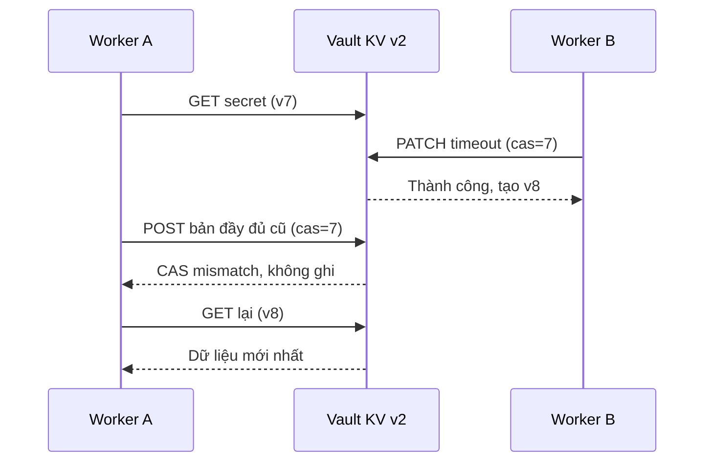

# Đối chiếu `put` thay thế dữ liệu với cập nhật một phần khi API hỗ trợ

Trong HashiCorp Vault, **KV secrets engine phiên bản 2 (KV v2)** lưu các secret tĩnh theo từng `path` và theo dõi **phiên bản** mỗi lần ghi. Khi ứng dụng Java dùng Spring Vault để thay đổi một vài thuộc tính, lựa chọn giữa **ghi toàn bộ (`put`)** và **cập nhật một phần (`patch`)** quyết định liệu các thuộc tính không được gửi trong yêu cầu có còn tồn tại hay không.

Ví dụ: secret `secret/apps/payment` đang có `username`, `password` và `timeout`. Nếu chỉ gửi `{"timeout":"30s"}` bằng `put`, dữ liệu của phiên bản mới chỉ còn `timeout`. Nếu áp dụng `patch`, `username` và `password` vẫn được giữ lại. Cả hai thao tác đều có thể tạo phiên bản KV v2 mới; phiên bản cũ không tự động mất ngay, nhưng việc khôi phục còn phụ thuộc chính sách lưu phiên bản.

## 1. Mục tiêu và phạm vi

Sau bài này, bạn có thể:

- Giải thích chính xác ý nghĩa **thay thế toàn bộ** của `put` so với **hợp nhất một phần** của `patch` trong KV v2.
- Đọc kết quả sau khi ghi và hiểu `version`, `CAS` (Check-And-Set), rủi ro cập nhật đồng thời.
- Chọn API `VaultTemplate`/Spring Vault phù hợp, biết trường hợp cần gọi HTTP `PATCH` trực tiếp.
- Cấu hình quyền Vault ACL, kiểm tra lỗi và viết kiểm thử để tránh vô tình xóa secret.

Phạm vi ở đây là **giá trị secret** tại KV v2 `data/`. Không nhầm với `PATCH /metadata/`, thao tác sửa metadata của key và **không tạo phiên bản dữ liệu**.

## 2. Hiểu đúng cấu trúc dữ liệu và đường dẫn

Giả sử KV v2 được mount tại `secret`, còn đường dẫn logic là `apps/payment`:

| Khái niệm | Giá trị trong ví dụ | Ý nghĩa |
| --- | --- | --- |
| Mount | `secret` | Secrets engine KV v2 |
| Đường dẫn logic | `apps/payment` | Tên key mà ứng dụng làm việc |
| Đường dẫn HTTP | `/v1/secret/data/apps/payment` | Endpoint đọc/ghi giá trị |
| Đường dẫn metadata | `/v1/secret/metadata/apps/payment` | Thông tin phiên bản/chính sách cho key |
| Phiên bản | `1`, `2`, `3`... | Mỗi lần ghi dữ liệu thành công tạo một phiên bản mới |

Với `VaultTemplate.opsForKeyValue("secret", KV_2)` hoặc `opsForVersionedKeyValue("secret")`, tham số `path` chỉ là `apps/payment`. **Không chèn thủ công `data/`** vào path của API mức cao vì Spring Vault tự xây dựng endpoint tương ứng.

Trong KV v2, bản ghi đọc bằng HTTP có lớp bọc `data.data` (giá trị secret) và `data.metadata` (thông tin phiên bản):

```json
{
  "data": {
    "data": {
      "username": "svc-payment",
      "password": "<gia-tri-minh-hoa>",
      "timeout": "10s"
    },
    "metadata": {
      "version": 3,
      "destroyed": false,
      "deletion_time": ""
    }
  }
}
```

Đây là bản minh họa đã rút gọn. Không lưu thông tin đăng nhập thật trong tài liệu, source code, shell history hoặc log.

## 3. `put`: tạo phiên bản mới từ **toàn bộ** dữ liệu được gửi

Giả sử trạng thái ở phiên bản `3` là:

```json
{
  "username": "svc-payment",
  "password": "<gia-tri-minh-hoa>",
  "timeout": "10s",
  "features": {
    "audit": true,
    "region": "ap-southeast-1"
  }
}
```

Ứng dụng chỉ muốn đổi `timeout` nhưng lại thực hiện `put` với payload:

```json
{
  "timeout": "30s"
}
```

**Kết quả ở phiên bản `4`:**

```json
{
  "timeout": "30s"
}
```

Các key `username`, `password`, `features` **không còn trong phiên bản mới**. `put` không hiểu «thuộc tính không gửi đi nghĩa là giữ nguyên». Nó xem map được gửi là **trạng thái đầy đủ cần lưu**.

Điều này đúng cả khi code chỉ muốn sửa một field và ngay cả khi KV v2 vẫn lưu các phiên bản cũ để có thể tra cứu hoặc khôi phục.

### Tương ứng HTTP của `put`

Tên phương thức Java/CLI là `put`, nhưng **API ghi giá trị KV v2 qua HTTP dùng `POST`**, không phải HTTP `PUT`:

```http
POST /v1/secret/data/apps/payment
Content-Type: application/json
X-Vault-Token: <token>

{
  "options": {"cas": 3},
  "data": {"timeout": "30s"}
}
```

`options.cas` ở đây yêu cầu phiên bản hiện tại phải là `3`; nó **chặn ghi đè khi có phiên bản mới hơn**, nhưng không thay đổi ngữ nghĩa thay thế toàn bộ của `data`. Nếu cần giữ các trường cũ, phải gửi chúng trong cùng payload.

`put` phù hợp khi ứng dụng quản lý **trọn vẹn một secret** (ví dụ nạp lại toàn bộ cấu hình từ nguồn đã xác thực), hoặc khi muốn loại bỏ chủ động những key không còn dùng.

## 4. `patch`: hợp nhất thay đổi lên secret hiện hữu

KV v2 hỗ trợ HTTP `PATCH` theo **JSON Merge Patch**. Với cùng phiên bản `3` ở trên, gửi:

```http
PATCH /v1/secret/data/apps/payment
Content-Type: application/merge-patch+json
X-Vault-Token: <token>

{
  "options": {"cas": 3},
  "data": {"timeout": "30s"}
}
```

**Kết quả ở phiên bản `4`:**

```json
{
  "username": "svc-payment",
  "password": "<gia-tri-minh-hoa>",
  "timeout": "30s",
  "features": {
    "audit": true,
    "region": "ap-southeast-1"
  }
}
```

Vault áp dụng thay đổi lên trạng thái hiện hành, ghi kết quả thành **một phiên bản mới**. Đây là cập nhật một phần tại phía server, nên ứng dụng không phải tự đọc toàn bộ secret rồi gửi lại các trường cũ chỉ để sửa `timeout`.

### Quy tắc JSON Merge Patch dễ bỏ sót

Với dữ liệu:

```json
{
  "features": {"audit": true, "region": "ap-southeast-1"},
  "targets": ["primary", "backup"],
  "comment": "legacy"
}
```

Áp dụng `PATCH` có `data`:

```json
{
  "features": {"audit": false},
  "targets": ["primary"],
  "comment": null
}
```

Sẽ cho kết quả:

```json
{
  "features": {"audit": false, "region": "ap-southeast-1"},
  "targets": ["primary"]
}
```

Quy tắc cần nhớ:

1. **Key bị bỏ qua** trong patch: giữ nguyên giá trị hiện có.
2. **Key có giá trị mới**: cập nhật giá trị đó.
3. **Đối tượng lồng nhau (JSON object)**: hợp nhất đệ quy; ví dụ `features.audit` thay đổi nhưng `features.region` được giữ.
4. **Mảng và giá trị vô hướng**: thay thế cả giá trị; không có thao tác nối thêm một phần tử mảng.
5. **Key có giá trị `null`**: theo JSON Merge Patch là yêu cầu **xóa key**. Không sử dụng `null` để biểu diễn một field muốn lưu với giá trị JSON null.

`patch` chỉ dùng cho **secret đang tồn tại và phiên bản hiện hành chưa bị soft-delete/destroy**. Nó không thay thế cho thao tác tạo secret lần đầu.

## 5. Bảng so sánh nhanh

| Tiêu chí | `put` / `POST data/` | `patch` / `PATCH data/` |
| --- | --- | --- |
| Ý nghĩa | Ghi trạng thái đầy đủ | Ghi riêng các thay đổi |
| Key không được gửi | Bị loại khỏi phiên bản mới | Được giữ nguyên |
| Object lồng nhau | Thay bằng object gửi lên | Merge đệ quy theo JSON Merge Patch |
| Mảng | Thay cả mảng | Thay cả mảng nếu key có trong patch |
| `null` | Có thể là giá trị trong payload đầy đủ | Xóa key tương ứng |
| Secret chưa tồn tại | Có thể tạo mới, nếu có quyền `create` | Không tạo mới |
| Phiên bản dữ liệu | Thành công thì tạo version mới | Thành công thì tạo version mới |
| ACL trên `data/` | `create` khi tạo, `update` khi sửa | `patch` |
| CAS | Có `options.cas`; `0` dùng cho chỉ tạo mới | Có `options.cas`; nếu cung cấp phải khớp version hiện tại và lớn hơn `0` |
| Trường hợp thường dùng | Đồng bộ toàn bộ giá trị, thay cấu hình hoàn chỉnh | Xoay một tham số, bổ sung hoặc xóa một vài key |

**Điểm quan trọng:** tên `put` trên Spring Vault **không đồng nghĩa** với `HTTP PUT`, còn `patch` trên KV v2 chỉ được dùng khi backend, client HTTP và ACL cho phép. Không áp dụng máy móc cách này cho KV v1.

## 6. Thực hành bằng Vault CLI

Ví dụ dưới đây giả định Vault đã được khởi động, KV v2 đã mount ở `secret/` và phiên đăng nhập CLI có quyền phù hợp. Các giá trị chỉ dùng để minh họa.

Khởi tạo một secret:

```bash
vault kv put -mount=secret apps/payment \
  username=svc-payment \
  password=demo-only \
  timeout=10s

vault kv get -mount=secret apps/payment
```

Nếu chạy:

```bash
vault kv put -mount=secret apps/payment timeout=30s
vault kv get -mount=secret apps/payment
```

thì chỉ còn key `timeout`. Để thử `patch` từ trạng thái có đủ key, khởi tạo lại dữ liệu mẫu rồi cập nhật:

```bash
vault kv put -mount=secret apps/payment \
  username=svc-payment \
  password=demo-only \
  timeout=10s

vault kv patch -mount=secret apps/payment timeout=30s
vault kv get -mount=secret apps/payment
```

Lúc này cả ba key vẫn xuất hiện. Mỗi thao tác ghi thành công tạo version mới; số version thực tế phụ thuộc trạng thái key trước khi chạy.

Để cập nhật có kiểm tra version, trước tiên đọc metadata của phiên bản mới nhất rồi truyền đúng số đó:

```bash
vault kv get -mount=secret apps/payment
vault kv patch -mount=secret -cas=<current-version> apps/payment timeout=45s
```

Thay `<current-version>` bằng số nguyên vừa đọc. Khi có tiến trình khác ghi trước, Vault từ chối CAS cũ và **không áp dụng patch**.

CLI còn có `vault kv patch -method=rw`: CLI tự **đọc → sửa trong bộ nhớ → ghi lại**; cách này cần các quyền đọc/ghi tương ứng và có đặc điểm khác direct HTTP `PATCH`. Mặc định `vault kv patch` dùng phương thức `patch` qua HTTP.

## 7. Dùng Spring Vault và `VaultTemplate`

Spring Vault cung cấp hai kiểu operations đáng phân biệt:

- `VaultKeyValueOperations`: có `put(path, body)` và `patch(path, Map)`. Cần xác định mount là KV v2 khi dùng `patch`.
- `VaultVersionedKeyValueOperations`: có `get` / `put` kèm `Versioned` và hỗ trợ **CAS cho ghi toàn bộ**. API này **không có `patch` riêng**; đừng gọi một method không tồn tại.

### 7.1. Thay thế toàn bộ và cập nhật một phần

Ví dụ trong một service Spring đã được inject `VaultTemplate` (hoặc dùng `VaultOperations`):

```java
import java.util.Map;
import org.springframework.vault.core.VaultKeyValueOperations;
import org.springframework.vault.core.VaultKeyValueOperationsSupport;
import org.springframework.vault.core.VaultOperations;
import org.springframework.vault.support.VaultResponse;

public final class PaymentSecretStore {
    private static final String PATH = "apps/payment";
    private final VaultKeyValueOperations kv;

    public PaymentSecretStore(VaultOperations vault) {
        this.kv = vault.opsForKeyValue(
                "secret",
                VaultKeyValueOperationsSupport.KeyValueBackend.KV_2);
    }

    // Ghi đầy đủ: các key không có trong map sẽ không còn ở version mới.
    public void replaceAll(String username, String password, String timeout) {
        kv.put(PATH, Map.of(
                "username", username,
                "password", password,
                "timeout", timeout));
    }

    // Sửa riêng timeout, giữ lại username/password.
    public void updateTimeout(String timeout) {
        boolean successful = kv.patch(PATH, Map.of("timeout", timeout));
        if (!successful) {
            throw new IllegalStateException("Vault KV v2 patch không thành công");
        }
    }

    public Map<String, Object> readCurrent() {
        VaultResponse response = kv.get(PATH);
        if (response == null || response.getData() == null) {
            throw new IllegalStateException("Secret không tồn tại/không đọc được");
        }
        return response.getData();
    }
}
```

`VaultKeyValueOperations.patch` trả về `boolean` theo contract API; trong thực tế yêu cầu không thành công cũng có thể gây exception của Spring Vault/HTTP (ví dụ thiếu quyền, CAS bắt buộc, endpoint không hỗ trợ). Không xem `false` là cách xử lý duy nhất.

**Giới hạn quan trọng:** chữ ký `patch(String, Map)` ở API mức cao **không có tham số CAS**. Nếu KV mount đặt `cas_required=true`, chỉ gửi `Map` thay đổi qua phương thức này không giải quyết được yêu cầu CAS. Khi cần HTTP PATCH kèm `options.cas`, dùng HTTP client được cấu hình cùng phiên Vault, hoặc lựa chọn quy trình cập nhật đầy đủ với CAS dưới đây. Trước khi dùng phương án HTTP thấp hơn, kiểm tra version Spring Vault, khả năng hỗ trợ PATCH của HTTP request factory và cách truyền token an toàn.

### 7.2. Khi muốn cập nhật **toàn bộ** nhưng chống ghi đè đồng thời bằng CAS

`VaultVersionedKeyValueOperations` cho phép đọc version hiện tại rồi ghi **toàn bộ** map đã sửa với version kỳ vọng:

```java
import java.util.HashMap;
import java.util.Map;
import org.springframework.vault.core.VaultOperations;
import org.springframework.vault.core.VaultVersionedKeyValueOperations;
import org.springframework.vault.support.Versioned;

public final class CasPaymentSecretStore {
    private final VaultVersionedKeyValueOperations kv;

    public CasPaymentSecretStore(VaultOperations vault) {
        this.kv = vault.opsForVersionedKeyValue("secret");
    }

    public Versioned.Metadata updateTimeout(String timeout) {
        Versioned<Map<String, Object>> current = kv.get("apps/payment");
        if (current == null) {
            throw new IllegalStateException("Secret chưa tồn tại");
        }

        Map<String, Object> completeData = new HashMap<>(current.getData());
        completeData.put("timeout", timeout);

        // Nếu version thay đổi sau lệnh get, Vault từ chối ghi.
        Versioned<Map<String, Object>> compareAndSet =
                Versioned.create(completeData, current.getVersion());
        return kv.put("apps/payment", compareAndSet);
    }
}
```

Code này **không thực hiện JSON Merge Patch**; nó tạo map đầy đủ từ bản đã đọc, rồi gửi `put` có CAS. Khi gặp xung đột, ứng dụng phải **đọc lại bản mới nhất, tính lại thay đổi dựa trên bản đó** và chỉ retry có giới hạn. Không retry mù một bản snapshot cũ.

### 7.3. HTTP `PATCH` với CAS khi cần quyền và ngữ nghĩa chính xác

Khi cần cập nhật một phần theo một version cụ thể, gửi đúng request KV v2:

```bash
curl --request PATCH \
  --header "X-Vault-Token: $VAULT_TOKEN" \
  --header "Content-Type: application/merge-patch+json" \
  --data '{"options":{"cas":3},"data":{"timeout":"30s"}}' \
  "$VAULT_ADDR/v1/secret/data/apps/payment"
```

Giả sử version hiện tại là `3`, request thành công tạo version `4` và giữ nguyên các key khác. Nếu đã có version `4` từ một writer khác thì `cas=3` bị từ chối. Số `3` chỉ là ví dụ; ứng dụng thực tế phải lấy số version hiện tại từ bản đọc hoặc metadata, không hardcode.

Với Java, có thể dùng client HTTP thích hợp để gửi chính xác `PATCH` và header `application/merge-patch+json`. Khi tích hợp qua `VaultTemplate`, cần giữ nguyên cơ chế session/token của Spring Vault; tránh tự chèn token cố định vào mã nguồn. Luôn kiểm tra response, exception và version trả về trước khi báo thao tác thành công.

## 8. CAS, atomicity và ghi đồng thời

Hai tác vụ `put` và `patch` đều có thể tham gia vào một hệ thống nhiều instance; nguy cơ khác nhau:



- **`put` không CAS:** rất dễ ghi đè thay đổi từ tiến trình khác, nhất là khi payload được tính từ snapshot cũ.
- **`put` có CAS:** đảm bảo chỉ ghi nếu phiên bản chưa đổi; phải gửi toàn bộ dữ liệu cần giữ.
- **`patch` không CAS:** cập nhật một phần được Vault xử lý như một thao tác tại server, tránh mất các key *không có trong patch*, nhưng hai writer sửa **cùng key** vẫn có thể xảy ra «last writer wins».
- **`patch` có CAS:** vừa hợp nhất thay đổi vừa từ chối phiên bản không còn hiện hành; cần khi phải bảo vệ quan hệ giữa nhiều field hoặc tránh ghi đè cập nhật cùng key.

**Quy tắc CAS:** với `POST`, `cas=0` có nghĩa «chỉ tạo nếu key chưa tồn tại»; với `PATCH`, target phải tồn tại và giá trị CAS hợp lệ nếu được cung cấp phải **lớn hơn 0**, khớp version hiện tại. Khi `cas_required=true` ở mount hoặc key, phải cung cấp CAS cho thao tác ghi.

Đọc trước rồi `put` mà **không CAS** không an toàn bằng một HTTP `PATCH` atomic. Quy trình read–modify–write **có CAS** có thể an toàn trước race, nhưng vẫn phải xử lý conflict và retry có giới hạn.

## 9. Phân quyền Vault ACL

Với mount `secret`, policy cần áp dụng lên **đường dẫn HTTP `data/`**, không phải đường dẫn logic trần.

Ví dụ tài khoản chuyên khởi tạo/thay thế toàn bộ secret:

```hcl
path "secret/data/apps/payment" {
  capabilities = ["create", "update", "read"]
}
```

Ví dụ workload chỉ được đọc và cập nhật một phần secret đã có:

```hcl
path "secret/data/apps/payment" {
  capabilities = ["read", "patch"]
}
```

`patch` là capability riêng. Nếu token chỉ có `update` mà thiếu `patch`, HTTP PATCH có thể bị từ chối. Quyền `read` không bắt buộc cho bản thân thao tác PATCH, nhưng cần nếu workload phải xem trạng thái và version để CAS hoặc kiểm chứng. Trường hợp có yêu cầu CAS nhưng workload không được đọc, cần một thiết kế cung cấp version kỳ vọng bằng nguồn tin cậy.

Nên cấp quyền theo đường dẫn ứng dụng cần dùng, xác thực workload qua cơ chế phù hợp (AppRole/Kubernetes/JWT...) và dùng token có TTL, chính sách tối thiểu. Không tạo policy `secret/data/*` chỉ vì muốn sửa một key của một ứng dụng.

## 10. Các lỗi thường gặp và cách xử lý

| Hiện tượng | Nguyên nhân có thể | Cách kiểm tra/xử lý |
| --- | --- | --- |
| Mất `username`/`password` sau đổi `timeout` | Dùng `put` với map thiếu key | Đọc version mới; chọn `patch` hoặc `put` đầy đủ; phục hồi từ version cũ khi phù hợp |
| `PATCH` bị từ chối quyền | Token thiếu capability `patch` ở `secret/data/...` | Kiểm tra ACL trên endpoint chính xác; cấp tối thiểu quyền cần thiết |
| `PATCH` thất bại vì path không tồn tại/đã xóa | Không thể patch secret chưa có hoặc version hiện hành bị delete/destroy | Khởi tạo bằng `put`; xác định trạng thái version, cân nhắc undelete theo quy trình riêng |
| Lỗi `check-and-set parameter did not match` | Writer khác tạo version mới, CAS cũ | Đọc lại version và dữ liệu; tính lại thay đổi rồi retry có giới hạn |
| Bị yêu cầu CAS khi gọi `kv.patch` | `cas_required` bật, nhưng API mức cao không truyền CAS | Dùng HTTP `PATCH` với `options.cas`, hoặc read–modify–write bằng `Versioned` có CAS |
| HTTP `PATCH` báo không hỗ trợ hoặc sai media type | KV v1, client/proxy không hỗ trợ PATCH, thiếu `Content-Type` | Kiểm tra mount là KV v2, phiên bản Vault và HTTP client; gửi `application/merge-patch+json` |
| Mất trường bên trong object hoặc danh sách | Hiểu nhầm ngữ nghĩa JSON Merge Patch | Kiểm tra cấu trúc object/mảng; test trường hợp `null`, nested object và mảng |

Với lỗi HTTP, mã trạng thái cụ thể có thể thay đổi theo loại lỗi, cấu hình Vault hoặc proxy. Nên đọc **nội dung lỗi Vault** và context đã được loại bỏ thông tin nhạy cảm, thay vì suy luận chỉ từ mã 400/403/404/405/415.

**Quan sát vận hành:** theo dõi số lần ghi thành công/thất bại, lỗi CAS, lỗi quyền, độ trễ và phiên bản mới; không log payload secret, token hoặc response chứa `data.data`. KV v2 chứa secret tĩnh; việc tăng version do `put`/`patch` không đồng nghĩa phát sinh dynamic-secret lease. Vòng đời token xác thực là vấn đề tách biệt.

## 11. Kiểm thử tích hợp nên có

Trong môi trường Vault thử nghiệm tách biệt production, chạy các kịch bản sau:

| Ca kiểm thử | Thao tác | Kỳ vọng |
| --- | --- | --- |
| 1. Thay thế toàn bộ | Seed `a=1,b=2`; `put` chỉ `a=3` | Version mới chỉ chứa `a=3` |
| 2. Cập nhật một phần | Seed `a=1,b=2`; `patch` `a=3` | Version mới có `a=3,b=2` |
| 3. Nested object | Seed `settings={x:1,y:2}`; patch `settings={x:9}` | `y=2` được giữ |
| 4. Mảng | Seed `roles=["read","write"]`; patch `roles=["read"]` | Mảng chỉ còn `["read"]` |
| 5. Xóa key bằng null | Seed `a=1,b=2`; patch `b=null` | `b` bị xóa |
| 6. Secret chưa tồn tại | Thực hiện direct `PATCH` | Bị từ chối, không tự tạo secret |
| 7. CAS stale | Đọc vN; writer khác ghi vN+1; gửi CAS=N | Bị từ chối, vN+1 không bị ghi đè |
| 8. ACL tối thiểu | Token chỉ có `patch` | PATCH hợp lệ; `put` không được cấp quyền tương ứng |
| 9. CAS bắt buộc | Bật `cas_required` rồi PATCH không CAS | Bị từ chối; PATCH có CAS đúng được chấp nhận |

Nên kiểm tra cả **nội dung cuối** lẫn **version tăng đúng một lần** cho mỗi lần ghi thành công. Nếu dùng Spring Vault `patch(path, Map)` trong dự án, kiểm tra thực tế bằng bản Spring Vault/Vault đang triển khai, vì hỗ trợ HTTP PATCH còn phụ thuộc client và cấu hình mạng.

## 12. Chọn chiến lược nào trong ứng dụng Java?

| Nhu cầu | Lựa chọn đề xuất | Lưu ý |
| --- | --- | --- |
| Seed secret lần đầu | `put` với map đầy đủ, `cas=0` nếu yêu cầu chỉ tạo mới | Cần `create` |
| Đồng bộ trọn secret từ hệ thống cấu hình | `put` đầy đủ, ưu tiên CAS | Key không có trong map sẽ bị loại |
| Đổi một tham số của secret đang tồn tại | `patch` | Cần KV v2 và quyền `patch` |
| Sửa nested object nhưng giữ các key còn lại | `patch` theo JSON Merge Patch | Mảng vẫn bị thay toàn bộ |
| Cập nhật một phần với version kỳ vọng | HTTP `PATCH` + `options.cas` | API mức cao `patch(String, Map)` không nhận CAS |
| Không thể dùng direct PATCH nhưng có quyền đọc/ghi | `get` → sửa map đầy đủ → `put` với `Versioned` CAS | Xử lý conflict/retry; tránh ghi đè dữ liệu |
| Muốn xóa rõ ràng một key | `patch` với giá trị `null` | Không nhầm với lưu JSON null |

**Nguyên tắc thực hành:** chỉ dùng `put` khi đã có **toàn bộ trạng thái mong muốn**; dùng `patch` khi thay đổi **một phần trạng thái của secret hiện hữu** và endpoint hỗ trợ. Với nhiều writer, dùng CAS để bảo đảm tính nhất quán, dù chọn thao tác nào.

## Tài liệu tham khảo

- [HashiCorp Vault — KV v2 HTTP API: Create/Update và Patch secret](https://developer.hashicorp.com/vault/api-docs/secret/kv/kv-v2)
- [HashiCorp Vault — Hướng dẫn Patch KV v2](https://developer.hashicorp.com/vault/docs/secrets/kv/kv-v2/cookbook/patch-data)
- [HashiCorp Vault CLI — kv patch và phương thức rw](https://developer.hashicorp.com/vault/docs/commands/kv/patch)
- [Spring Vault — VaultKeyValueOperations, put và patch](https://docs.spring.io/spring-vault/reference/api/java/org/springframework/vault/core/VaultKeyValueOperations.html)
- [Spring Vault — VaultVersionedKeyValueOperations và CAS](https://docs.spring.io/spring-vault/reference/api/java/org/springframework/vault/core/VaultVersionedKeyValueOperations.html)
