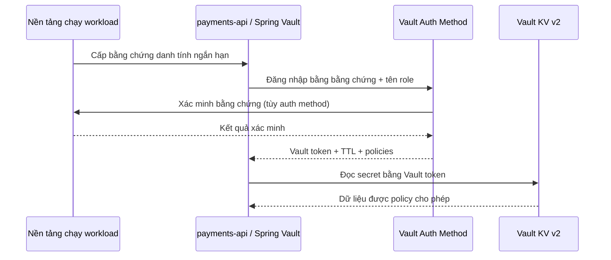
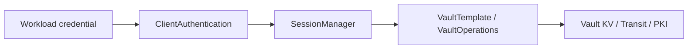
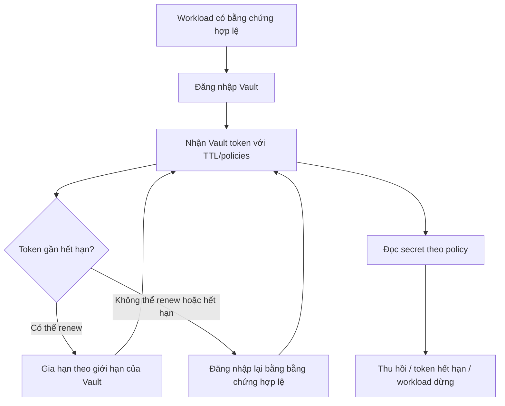

# Bài toán cấp danh tính ban đầu cho ứng dụng

Khi một ứng dụng Java sử dụng **Spring Vault** để lấy bí mật từ HashiCorp Vault, câu hỏi đầu tiên không phải là “đọc key nào?” mà là **“Vault dựa vào đâu để tin rằng tiến trình đang gọi thực sự là ứng dụng được phép truy cập?”**. Nếu ứng dụng chưa có thông tin nào để chứng minh mình là ai, nó không thể tự xin một Vault token có quyền đọc secret. Đây là **bài toán cấp danh tính ban đầu** (*identity bootstrap*, thường liên quan đến *secret zero problem*).

Trong một hệ thống dùng `VaultTemplate`, quá trình xác thực thường diễn ra trước thao tác đọc KV, gọi Transit hoặc yêu cầu chứng chỉ PKI. Spring Vault có thể gửi yêu cầu đăng nhập và quản lý phiên; nhưng **Spring Vault không tự tạo ra bằng chứng danh tính đáng tin cậy cho workload**. Bằng chứng ban đầu phải đến từ một nguồn tin cậy khác: Kubernetes, nền tảng cloud, hệ thống cấp chứng chỉ, hệ thống CI/CD hoặc một quy trình phân phối credential đã được kiểm soát.

## 1. Tình huống mở đầu: ứng dụng cần bí mật để khởi động

Giả sử dịch vụ `payments-api` chạy trên Kubernetes và cần đọc khóa kết nối đối tác từ KV v2 tại `kv/payments-api/partner`. Nhóm vận hành muốn bỏ khóa đối tác khỏi Git, Docker image và biến môi trường cấu hình tĩnh bằng cách đặt khóa trong Vault.

Một cách triển khai chưa giải quyết được gốc vấn đề là đặt **Vault token dài hạn** vào biến môi trường `VAULT_TOKEN`, rồi để ứng dụng dùng token này lấy khóa đối tác. Khóa đối tác đã chuyển sang Vault, nhưng giờ phải bảo vệ và phân phối chính `VAULT_TOKEN`: ai cấp nó, đưa vào Pod bằng cách nào, xoay vòng khi nào và thu hồi ra sao? Nếu token có phạm vi rộng, sự cố còn nghiêm trọng hơn việc lộ một khóa ứng dụng.

Mục tiêu đúng là thiết lập một chuỗi tin cậy:



Với Kubernetes auth, bằng chứng là service account token của Pod; Vault kiểm tra token thông qua cơ chế tích hợp Kubernetes đã cấu hình. Với JWT/OIDC hoặc cloud auth, bước xác minh dùng cơ chế tương ứng; không phải phương thức nào cũng gửi yêu cầu ngược về nền tảng ở mỗi lần đăng nhập. Sơ đồ thể hiện **quan hệ tin cậy**, không áp đặt cùng một giao thức cho mọi auth method.

## 2. Phân biệt những thứ thường bị gọi chung là “danh tính”

| Thành phần | Vai trò trong hệ thống | Ví dụ của `payments-api` |
|---|---|---|
| **Workload identity** | Định danh mà nền tảng chạy ứng dụng có thể xác nhận | Kubernetes ServiceAccount `payments-api` trong namespace `production` |
| **Bằng chứng ban đầu** (*bootstrap credential*) | Dữ liệu/chứng minh được đưa tới Vault để xác thực workload | Projected service account JWT với audience phù hợp |
| **Auth method** | Cơ chế Vault dùng để kiểm chứng bằng chứng | Mount `auth/kubernetes` |
| **Auth role / ràng buộc tin cậy** | Quy tắc cho biết danh tính nào được phép đăng nhập và nhận quyền gì | Role Vault chỉ chấp nhận đúng ServiceAccount và namespace |
| **Vault token** | Credential được Vault phát hành **sau** khi đăng nhập thành công | Token ngắn hạn dùng với `VaultTemplate` |
| **Vault policy** | Giới hạn thao tác mà token được làm | Chỉ `read` tại `kv/data/payments-api/partner` |
| **Secret/lease của ứng dụng** | Tài nguyên nhận được sau khi đã được Vault cấp quyền | Khóa đối tác từ KV hoặc credential động có lease riêng |

Đừng nhầm **xác thực** (*authentication*) với **phân quyền** (*authorization*). Đăng nhập thành công trả lời câu hỏi “đây là workload nào theo quy tắc đã cấu hình?”; policy mới trả lời “workload đó được làm gì?”. Một token hợp lệ vẫn có thể bị từ chối đọc KV nếu policy không cho phép đường dẫn tương ứng.

Tương tự, **Vault token TTL** và **secret lease TTL** là hai vòng đời khác nhau. Token hết hạn có thể khiến các lệnh Vault tiếp theo thất bại ngay cả khi credential đã đọc vẫn còn giá trị. Ngược lại, một dynamic database credential có thể hết lease dù Vault token vẫn dùng được.

## 3. Vì sao bài toán “secret zero” khó?

Để lấy secret an toàn từ Vault, ứng dụng phải xác thực. Nhưng nếu lại đặt credential xác thực Vault trong chính Vault, ứng dụng cần một credential khác để lấy nó: hình thành **phụ thuộc vòng tròn**.

```text
Ứng dụng cần secret S
  -> Vault yêu cầu xác thực
    -> Ứng dụng cần credential C
      -> Nếu C cũng chỉ nằm trong Vault: không có điểm bắt đầu
```

Không tồn tại cơ chế phần mềm thuần túy có thể chứng minh danh tính đáng tin cậy chỉ từ việc ứng dụng tự khai báo `applicationName=payments-api`. Luôn cần một **gốc tin cậy** bên ngoài luồng xin secret, chẳng hạn:

- Kubernetes cấp JWT cho ServiceAccount của Pod theo chính sách triển khai và kiểm soát nền tảng.
- Cloud IAM cung cấp danh tính của instance, container task hoặc workload dựa trên cơ chế ký và xác minh của nhà cung cấp.
- Hệ thống PKI cấp chứng chỉ và khóa riêng qua một quy trình quản lý riêng.
- Hệ thống CI/CD hoặc hệ thống provisioning phân phối AppRole SecretID qua kênh an toàn.

Workload identity giúp **tránh tự lưu một Vault token dài hạn** trong ứng dụng. Tuy nhiên, nó không có nghĩa “không tồn tại credential nhạy cảm”: service account JWT, private key, bằng chứng cloud hoặc SecretID đều cần bảo vệ theo đặc tính của từng loại. Bài toán thực tế là **giảm số lượng bí mật tĩnh, giới hạn phạm vi và thời gian lộ lọt, xác thực được nguồn gốc**.

### Các câu hỏi phải trả lời trước khi viết code

1. **Ai khẳng định danh tính?** Kubernetes API, IAM, CA hay hệ thống cấp SecretID?
2. **Bằng chứng đến ứng dụng bằng cách nào?** Token được mount vào container, lấy từ metadata endpoint hay nhận từ kênh provisioning?
3. **Vault xác minh điều gì?** Chữ ký, issuer, audience, ServiceAccount/namespace, danh tính cloud, certificate chain, thời hạn hoặc số lần sử dụng?
4. **Danh tính ánh xạ sang quyền nào?** Role và policy có giới hạn theo ứng dụng, namespace, môi trường, tenant không?
5. **Sau khi đăng nhập, ai quản lý vòng đời token?** Spring Vault session manager, Vault Agent hay một cơ chế đã thống nhất?
6. **Khi mất bằng chứng hoặc Vault không sẵn sàng, ứng dụng xử lý ra sao?** Từ chối khởi động, retry có giới hạn hay vận hành tạm bằng credential còn hợp lệ?

## 4. Các lựa chọn cấp danh tính ban đầu

Không có một auth method phù hợp cho mọi môi trường. Lựa chọn tốt thường là phương thức tận dụng **danh tính workload sẵn có ở nơi ứng dụng thực sự chạy**.

| Môi trường | Cách bootstrap thường dùng | Điểm mạnh | Rủi ro/cần kiểm soát |
|---|---|---|---|
| Kubernetes | `kubernetes` auth với projected ServiceAccount JWT | Gắn với namespace, ServiceAccount, audience; không cần lưu Vault token cố định | Pod bị chiếm quyền có thể dùng token; role binding, thời hạn và bảo mật mount rất quan trọng |
| Cloud workload | AWS/GCP/Azure auth hoặc JWT dựa trên danh tính cloud | Tận dụng IAM/managed identity của nền tảng | Phải khóa chặt role, tài khoản/định danh và quyền metadata; cấu hình liên cloud dễ sai |
| Nền tảng phát JWT/OIDC | `jwt` auth với issuer, JWKS, audience, bound claims | Có thể triển khai đa môi trường | Phải kiểm tra signature, issuer, audience, thời hạn, claims ràng buộc |
| Máy chủ/CI/CD có kênh cấp credential riêng | `approle` auth với RoleID + SecretID | Hữu ích khi không có workload identity tự nhiên | Phải phân phối SecretID, giới hạn TTL/uses, chống ghi log hoặc lưu vào image |
| Máy chủ có PKI thiết bị/workload | `cert` auth qua mTLS client certificate | Dựa trên danh tính chứng chỉ | Private key phải được bảo vệ, cấp phát/thu hồi và xoay vòng chứng chỉ |
| Môi trường dev hoặc kiểm thử có kiểm soát | Token có sẵn (`TokenAuthentication`) | Dễ dựng ví dụ ngắn | Token tĩnh không giải quyết bootstrap production; tuyệt đối tránh root token trong ứng dụng |

AppRole không “kém an toàn mặc định”, nhưng cần giải được **bài toán vận chuyển SecretID**. RoleID chủ yếu xác định role; **SecretID mới là thành phần phải giữ bí mật**. Có thể giảm rủi ro bằng SecretID TTL ngắn, giới hạn số lần dùng, CIDR constraints (nếu phù hợp), response wrapping và kênh phân phối chỉ tới đúng workload. Response wrapping bảo vệ đường giao SecretID tốt hơn, nhưng vẫn cần người nhận xác thực đúng Vault và unwrap an toàn.

## 5. Dòng xác thực mẫu với Kubernetes và Spring Vault

Giả sử namespace `production` có Pod chạy dưới ServiceAccount `payments-api`. Phần Vault đã được người vận hành tích hợp với Kubernetes và bật auth mount `kubernetes`.

### Bước 1: Nền tảng cấp bằng chứng

Pod nhận service account JWT được mount qua projected volume. Trong triển khai chú trọng bảo mật, token có **audience hướng tới Vault**, thời hạn ngắn và được Kubernetes luân chuyển. Không đặt JWT vào Docker image, source code, artifact CI hoặc file cấu hình có thể commit.

### Bước 2: Vault role ràng buộc danh tính được phép

Ví dụ cấu hình role minh họa (giả định auth method đã bật và cấu hình kiểm chứng Kubernetes):

```bash
vault write auth/kubernetes/role/payments-api \
  bound_service_account_names=payments-api \
  bound_service_account_namespaces=production \
  audience=vault \
  policies=payments-api
```

Giá trị `audience=vault` chỉ đúng khi JWT do Pod nhận được cũng có audience tương ứng. Tùy cách triển khai Kubernetes auth, người vận hành cần cấu hình Kubernetes API, TLS CA, reviewer token/TokenReview và các ràng buộc phù hợp. Không thể chỉ tạo Vault role là Pod đăng nhập được ngay.

Policy tối thiểu có thể là:

```hcl
# Mount KV v2 là "kv", key logic là "payments-api/partner".
path "kv/data/payments-api/partner" {
  capabilities = ["read"]
}
```

KV v2 sử dụng đường dẫn API có đoạn `/data/` để đọc phiên bản của secret; đường dẫn người dùng thấy trong lệnh `vault kv get kv/payments-api/partner` có thể không có đoạn này. Policy phải viết theo **đường dẫn API thực tế**. Không cấp `list`, `sudo`, `update` hoặc quyền `kv/data/*` nếu ứng dụng chỉ đọc một secret.

### Bước 3: Ứng dụng đăng nhập tại auth endpoint

Về mặt giao thức, request đăng nhập tương ứng có dạng:

```http
POST /v1/auth/kubernetes/login
Content-Type: application/json

{
  "role": "payments-api",
  "jwt": "<JWT được mount cho Pod, không ghi ra log>"
}
```

Response thành công chứa đối tượng `auth` với token được cấp, danh sách policy, thời gian sống và cờ có thể gia hạn. Ví dụ **rút gọn và đã che token**:

```json
{
  "auth": {
    "client_token": "REDACTED",
    "policies": ["default", "payments-api"],
    "lease_duration": 900,
    "renewable": true
  }
}
```

Các giá trị trên chỉ minh họa; thời gian sống, policy thực tế và khả năng gia hạn phụ thuộc cấu hình Vault. Nếu Vault role không khớp ServiceAccount, namespace hoặc audience, yêu cầu đăng nhập bị từ chối **trước cả khi** ứng dụng gọi KV.

### Bước 4: Spring Vault dùng token trong phiên

Ở tầng Java, hai hợp đồng quan trọng của Spring Vault là `ClientAuthentication` (cách thực hiện đăng nhập) và `SessionManager` (cung cấp token cho các request tiếp theo). `VaultTemplate`/`VaultOperations` làm việc với Vault qua các API và không cần mỗi lớp nghiệp vụ tự truyền token.



Một cách cấu hình tích hợp **Spring Cloud Vault** (thư viện tích hợp ở tầng Spring Boot, sử dụng Spring Vault bên dưới) là:

```yaml
spring:
  cloud:
    vault:
      uri: https://vault.internal.example:8200
      authentication: KUBERNETES
      kubernetes:
        role: payments-api
        kubernetes-path: kubernetes
        service-account-token-file: /var/run/secrets/kubernetes.io/serviceaccount/token
```

Đây là **ví dụ cho ứng dụng có dependency Spring Cloud Vault**; chỉ thêm YAML vào một ứng dụng chỉ có `spring-vault-core` thì chưa tự sinh cấu hình xác thực. Nếu dùng Spring Vault thuần, cần cấu hình `ClientAuthentication` tương ứng và nối nó với `SessionManager`/`VaultTemplate` theo phiên bản thư viện đang dùng. Endpoint phải dùng TLS với CA và hostname được xác minh; không tắt kiểm tra TLS để “sửa nhanh” lỗi đăng nhập.

Khi `VaultOperations` đã được cấu hình và quản lý phiên, lớp nghiệp vụ chỉ cần thao tác trên đường dẫn được policy cho phép:

```java
import java.util.Map;
import java.util.Optional;

import org.springframework.vault.core.VaultOperations;
import org.springframework.vault.support.VaultResponse;

public final class PartnerCredentialReader {
    private final VaultOperations vault;

    public PartnerCredentialReader(VaultOperations vault) {
        this.vault = vault;
    }

    public Optional<String> readPartnerApiKey() {
        // Đường dẫn API KV v2, không phải đường dẫn mount logic.
        VaultResponse response = vault.read("kv/data/payments-api/partner");
        if (response == null || response.getData() == null) {
            return Optional.empty();
        }

        Object payload = response.getData().get("data");
        if (!(payload instanceof Map<?, ?> values)) {
            return Optional.empty();
        }

        Object key = values.get("apiKey");
        return key instanceof String value ? Optional.of(value) : Optional.empty();
    }
}
```

Ví dụ trên minh họa cấu trúc dữ liệu KV v2: JSON trả về có lớp `data`, bên trong là secret payload. `VaultOperations` cần được khởi tạo bằng cơ chế xác thực đã chọn; đoạn code **không** tự làm bootstrap. Trong thực tế, nên gom logic ánh xạ và kiểm tra dữ liệu vào một lớp riêng, xử lý thiếu khóa theo yêu cầu nghiệp vụ và tránh ghi giá trị secret vào log/exception.

## 6. Ai chịu trách nhiệm làm mới token?

Cấp danh tính ban đầu chỉ là chặng đầu của một vòng đời:



Trong Spring Vault, một session manager có hỗ trợ lifecycle có thể xử lý gia hạn/đăng nhập lại theo khả năng của auth method và cấu hình. Một lựa chọn triển khai khác là **Vault Agent** đảm nhiệm xác thực và quản lý token thay cho ứng dụng. Cần định rõ **một chủ thể quản lý token** trên đường đi thực tế, tránh hai tiến trình cùng giả định mình sở hữu vòng đời hoặc làm rò token qua tệp/biến môi trường chia sẻ không được bảo vệ.

Phân biệt các sự kiện sau:

- **Renew**: kéo dài thời gian dùng token khi Vault cho phép, không đồng nghĩa phát một danh tính mới.
- **Re-authenticate**: gửi lại bằng chứng ban đầu, để Vault phát token mới theo role/policy tại thời điểm đăng nhập.
- **Rotate bootstrap credential**: nền tảng thay JWT, SecretID hoặc certificate; ứng dụng phải đọc được bản mới nếu cơ chế cho phép.
- **Revoke**: quản trị viên hoặc hệ thống hủy token/credential; các yêu cầu phụ thuộc credential đó có thể thất bại ngay.

Không dựa vào một token đã hết hạn để “tự chữa” nếu bằng chứng ban đầu cũng đã mất. Thiết kế cần giữ đường lấy credential mới độc lập với secret chỉ có trong Vault.

## 7. Thiết kế ranh giới tin cậy và nguyên tắc tối thiểu quyền

Đăng nhập được từ Pod không có nghĩa Pod đó phải có quyền đọc mọi secret của namespace. Một thiết kế tốt thể hiện rõ các ranh giới:

| Ranh giới | Câu hỏi kiểm soát | Ví dụ quyết định |
|---|---|---|
| Nền tảng → workload | Ai được chạy dưới danh tính ứng dụng? | Hạn chế quyền tạo Pod/chọn ServiceAccount; tách `payments-api` khỏi workload khác |
| Workload → auth method | Bằng chứng nào được chấp nhận? | Ràng buộc JWT audience, namespace, ServiceAccount, thời hạn |
| Auth role → Vault token | Token có quyền gì, sống bao lâu? | Policy riêng `payments-api`, TTL ngắn và có giới hạn |
| Vault token → secrets engine | API path và hành động nào được phép? | Chỉ `read` một đường dẫn KV v2 cụ thể |
| Secret → ứng dụng | Secret xuất hiện ở những nơi nào? | Không log, không đưa vào URL, traces, lỗi HTTP hay crash report |

Nếu nhiều workload chia sẻ cùng một ServiceAccount và Vault role, Vault có thể **không phân biệt được chúng** theo mức độ mong muốn. Tách danh tính theo ứng dụng và môi trường (`staging`/`production`) giúp giảm phạm vi ảnh hưởng khi một Pod bị xâm nhập.

Đường truyền tới Vault phải được kiểm chứng TLS, DNS và trust store phải đúng. TLS giúp ứng dụng biết nó đang nói với Vault dự kiến và giảm nguy cơ lộ token khi truyền. Việc chỉ bảo vệ Vault token nhưng cho phép kết nối TLS không kiểm chứng sẽ phá vỡ chuỗi tin cậy ngay từ điểm đầu.

## 8. Khi nào một cách bootstrap là chưa đạt?

Xét ba thiết kế cho cùng dịch vụ:

**Thiết kế A — Vault root token trong image:** pipeline ghi root token vào Docker image, ứng dụng đọc token lúc khởi động. Bất kỳ ai đọc được image hoặc log có thể có quyền rất lớn. Không có ràng buộc theo workload, môi trường hay mục đích. Đây không phải phương án phù hợp cho production.

**Thiết kế B — AppRole với SecretID không giới hạn:** image chỉ chứa RoleID nhưng biến môi trường có SecretID lâu dài, không giới hạn số lần sử dụng; nhiều máy chia sẻ cùng SecretID. Thiết kế đã giảm quyền nếu policy tốt, song kẻ lấy được SecretID có thể đăng nhập lại liên tục. Cần cải thiện phân phối, TTL, số lần dùng, phạm vi mạng và thu hồi.

**Thiết kế C — Kubernetes projected JWT:** Pod dùng ServiceAccount riêng, JWT audience phù hợp, Vault role giới hạn namespace/ServiceAccount, token Vault có policy hẹp và vòng đời ngắn. Workload không giữ Vault token cố định trong cấu hình. Đây là hướng hợp lý cho dịch vụ chạy trên Kubernetes, với điều kiện cluster RBAC, admission policy và bảo vệ Pod được cấu hình nghiêm túc.

Kết luận của so sánh không phải Kubernetes luôn an toàn hơn mọi môi trường khác; tiêu chí là **nguồn xác minh danh tính có thật, điều kiện ràng buộc chặt và credential có thể hết hạn/thu hồi**.

## 9. Sự cố thường gặp khi khởi tạo danh tính

| Triệu chứng | Khả năng cần kiểm tra | Cách xử lý đúng hướng |
|---|---|---|
| Login tới `auth/kubernetes/login` bị từ chối | Sai role, auth mount, ServiceAccount, namespace, audience, token hết hạn hoặc Vault-Kubernetes integration sai | Kiểm tra metadata workload và cấu hình role; chỉ ghi kết quả kiểm tra, không in JWT ra log |
| Đăng nhập thành công nhưng đọc KV bị `403` | Policy token thiếu `read` hoặc sai đường dẫn `kv/data/...` của KV v2 | Kiểm tra policy và path cụ thể; không mở wildcard toàn bộ mount để “thử” |
| TLS handshake/xác minh hostname thất bại | CA trust store, chứng chỉ, tên host hoặc proxy sai | Sửa trust chain và cấu hình endpoint; không tắt TLS verification |
| Chạy được lúc khởi động nhưng lỗi sau một khoảng thời gian | Vault token hết hạn, không renew/re-login; JWT/SecretID đầu vào không còn hợp lệ | Xem TTL, renewable, cơ chế quản lý phiên và luân chuyển credential |
| Đăng nhập thất bại sau rollout/đổi namespace | Workload identity thực tế không khớp role | Đồng bộ manifest với ràng buộc Vault; tránh nới role chấp nhận mọi namespace |
| Nhiều instance đồng loạt mất quyền khi Vault tạm gián đoạn | Auth/login bị phụ thuộc khả dụng Vault, retry dồn dập | Retry có backoff và jitter, giới hạn số lần, theo dõi sức khỏe; không fallback về secret hardcoded |

Mã HTTP phụ thuộc auth method và kiểu lỗi; không suy ra tuyệt đối nguyên nhân chỉ từ `400`, `403` hoặc `503`. Cần kết hợp client error, trạng thái Vault, audit log và cấu hình liên quan. Không đính kèm `client_token`, JWT, SecretID hay giá trị KV trong log hoặc hệ thống giám sát.

### Những chỉ số nên quan sát

- Số lần login thành công/thất bại theo **auth mount và role** (không gắn token làm nhãn metric).
- Thời gian đăng nhập và gọi Vault, mã lỗi được phân loại, lượng retry.
- Số lần renew thành công/thất bại, thời gian sống token còn lại nếu thư viện cung cấp an toàn.
- Sự cố TLS, Vault unavailable và sự kiện revoke/role thay đổi liên quan.

Audit log Vault hỗ trợ điều tra ai đã gọi đường dẫn nào; quyền truy cập audit log cần được kiểm soát. Không dùng việc bật log request body chứa credential như một cách debug nhanh.

## 10. Bài thực hành thiết kế: không cần secret tĩnh để xin secret

**Đề bài.** Dịch vụ `payments-api` chạy trong namespace `production`, cần đọc key `kv/payments-api/partner` từ Vault KV v2. Bạn có quyền tạo Kubernetes ServiceAccount, cấu hình Vault role và policy. Hãy thiết kế bootstrap danh tính, rồi kiểm tra thiết kế bằng các tình huống dưới đây.

**Phương án tham chiếu:**

1. Tạo ServiceAccount chỉ dành cho workload `payments-api`; Pod chạy đúng service account đó. Cho phép projected token với audience mà Vault role yêu cầu, thời gian sống được giới hạn và cơ chế refresh của nền tảng.
2. Cấu hình Vault Kubernetes auth để xác minh JWT với cluster đúng. Tạo Vault role chỉ cho `payments-api` thuộc namespace `production` và audience đã chọn.
3. Tạo policy `payments-api` chỉ có `read` trên `kv/data/payments-api/partner`; gắn policy này vào role, dùng token TTL hợp lý và các giới hạn của hệ thống.
4. Cấu hình client Spring Vault (trực tiếp hoặc qua Spring Cloud Vault) đăng nhập bằng JWT được mount; dùng `VaultOperations` để đọc secret và cơ chế quản lý phiên token.
5. Dùng workload **khác** ServiceAccount hoặc namespace thử login: kết quả mong đợi là bị từ chối. Dùng token hợp lệ thử đọc đường dẫn KV khác: kết quả mong đợi là bị policy từ chối.
6. Luân chuyển projected token và chạy dịch vụ đủ lâu để quan sát việc renew/re-login; mô phỏng Vault tạm không sẵn sàng và xác nhận ứng dụng không chuyển sang token hardcoded.

**Tiêu chí đạt:** hệ thống phân biệt được hai thất bại độc lập: *(a)* chưa chứng minh đúng danh tính khi gọi auth method; *(b)* đã đăng nhập đúng nhưng không có quyền trên một API path. Không cần đặt Vault root token, JWT, SecretID hoặc partner API key vào Git, Docker image, test report hay log.

## 11. Câu hỏi tự kiểm tra

1. Nếu một ứng dụng cần Vault token để đọc SecretID từ Vault, chỗ nào tạo ra vòng phụ thuộc? Bạn sẽ thay nguồn bootstrap bằng gì?
2. Tại sao biết tên ServiceAccount là `payments-api` chưa đủ để Vault tin một request đến từ Pod đó?
3. Vai trò của `ClientAuthentication`, `SessionManager` và `VaultTemplate` khác nhau như thế nào?
4. Đăng nhập thành công nhưng `vault.read("kv/data/payments-api/partner")` bị từ chối: nên kiểm tra role binding hay policy trước, vì sao?
5. Nếu một Pod bị chiếm quyền và kẻ tấn công lấy được projected JWT, TTL ngắn, audience binding và policy hẹp hạn chế được những gì? Chúng **không** bảo vệ được điều gì trong thời gian token vẫn hợp lệ?

**Gợi ý:** Truy theo chuỗi `nguồn danh tính → bằng chứng → xác minh của Vault → token → policy → đường dẫn secret`. Mỗi mũi tên là một giả định tin cậy cần nêu rõ, kiểm thử và vận hành.
