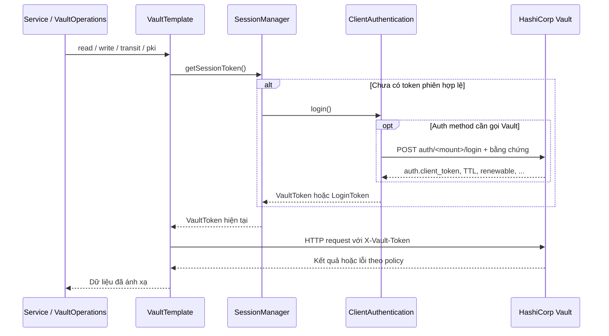

# `ClientAuthentication` và hợp đồng trả về `VaultToken`

Trong Spring Vault, một ứng dụng Java cần có **Vault token hợp lệ** trước khi đọc KV secrets bằng `VaultTemplate`, gọi Transit encryption hoặc yêu cầu chứng chỉ từ PKI. Ứng dụng có thể nhận token bằng Kubernetes, AppRole, JWT, cơ chế cloud, chứng chỉ hoặc một token được cấp từ trước. Các phương thức này khác nhau về cách chứng minh danh tính, nhưng ở tầng client chúng cần cung cấp cùng một kết quả: **token để thực hiện yêu cầu đã xác thực tới Vault**.

`ClientAuthentication` là điểm mở rộng chuẩn hóa bước đó. Bài học này giải thích chính xác hợp đồng `login()`, sự khác nhau giữa `VaultToken` và `LoginToken`, cách `SessionManager` sử dụng chúng, cũng như những lỗi thường gặp khi tự triển khai xác thực. Đây là phần kiến thức nền để cấu hình `VaultTemplate`, phân quyền theo policy và quản lý vòng đời token/lease trong Spring Vault.

## 1. `ClientAuthentication` giải quyết vấn đề gì?

Xét dịch vụ `orders-api` cần gọi một secret engine trong HashiCorp Vault. Để có token, dịch vụ có thể:

- Gửi JWT do Kubernetes cấp đến `auth/kubernetes/login`.
- Gửi `role_id` và `secret_id` đến `auth/approle/login`.
- Chứng minh danh tính bằng cloud IAM, JWT/OIDC hoặc chứng chỉ client.
- Dùng token có sẵn do một cơ chế khác cung cấp.

Nếu `VaultTemplate` phải hiểu từng luồng đăng nhập, code thao tác secret sẽ phụ thuộc trực tiếp vào môi trường chạy. Spring Vault tách trách nhiệm qua các lớp:

| Thành phần | Trách nhiệm | Điều không thuộc trách nhiệm chính |
|---|---|---|
| `ClientAuthentication` | Có được `VaultToken` theo một phương thức xác thực | Không quyết định ứng dụng được đọc secret nào |
| `VaultToken` | Bao gói giá trị token để gọi Vault | Không tự biểu diễn toàn bộ Vault policy hoặc tự gia hạn |
| `LoginToken` | Biến thể của `VaultToken` có metadata liên quan vòng đời phiên | Không phải trình quản lý lịch gia hạn |
| `SessionManager` | Cung cấp token phiên cho các lần gọi Vault | Không tự tạo ra workload identity ban đầu |
| `VaultTemplate` / `VaultOperations` | Gọi API Vault như KV, Transit, PKI, system API | Không phải nơi nhúng logic login của từng auth method |
| Vault policy và auth role | Gán, kiểm tra quyền truy cập và giới hạn tài nguyên | Không do kiểu dữ liệu Java `VaultToken` quyết định |

Vì vậy, **xác thực thành công không có nghĩa được phép thực hiện mọi yêu cầu**. Vault vẫn kiểm tra policy trên token đối với từng đường dẫn và hành động.

## 2. Hợp đồng Java của `ClientAuthentication`

Trong Spring Vault, interface này nằm tại `org.springframework.vault.authentication.ClientAuthentication`. Hợp đồng cốt lõi có thể viết lại theo đúng chữ ký API như sau:

```java
@FunctionalInterface
public interface ClientAuthentication {

    VaultToken login() throws VaultException;
}
```

Đoạn trên chỉ trích **hợp đồng** để giải thích; khi viết ứng dụng hãy import interface từ Spring Vault, không khai báo lại. `VaultToken` thuộc package `org.springframework.vault.support`; `VaultException` thuộc `org.springframework.vault`.

Từ chữ ký `VaultToken login()` có bốn điểm quan trọng:

1. **Input không nằm trong tham số của `login()`.** Role, token file, JWT supplier, certificate, Vault client hoặc thông tin môi trường được cung cấp lúc cấu hình implementation.
2. **Kết quả là `VaultToken`, không phải HTTP response.** Implementation chịu trách nhiệm gửi yêu cầu đăng nhập nếu cần, đọc phản hồi và lấy credential sử dụng cho các API tiếp theo.
3. **Một lần gọi không nhất thiết tạo token mới.** `TokenAuthentication` có thể trả token được cấp sẵn mà không gọi endpoint đăng nhập; các auth method như Kubernetes hoặc AppRole thường thực sự đăng nhập Vault.
4. **Thất bại phải thể hiện bằng exception.** Lỗi xác thực, kết nối, TLS hoặc phản hồi không hợp lệ không được biến thành token giả hay kết quả thành công rỗng. API có thể ném `VaultException` và những biến thể cụ thể hơn tùy tình huống.

`ClientAuthentication` là interface đồng bộ (*imperative/synchronous*). Với luồng reactive, Spring Vault sử dụng các abstraction như `VaultTokenSupplier`, `ReactiveSessionManager` và `AuthenticationSteps`/executor tương ứng. Không nên giả định `login()` tự động là một API không chặn luồng.

### Luồng gọi thực tế



Đây là luồng *khái niệm*. Session manager có thể dùng token đã lưu, renew, lookup hoặc đăng nhập lại tùy implementation và cấu hình; không phải lần gọi `VaultTemplate` nào cũng dẫn đến `login()`.

## 3. `VaultToken`: giá trị token tối thiểu

Lớp `org.springframework.vault.support.VaultToken` là value object biểu diễn token để gửi tới Vault. Các API tiêu biểu:

```java
import org.springframework.vault.support.VaultToken;

VaultToken token = VaultToken.of("s.example-only-not-a-real-token");

// Giá trị dùng cho header xác thực, không bao giờ in ra log:
String sensitiveValue = token.getToken();
```

Ví dụ chỉ minh họa cách tạo đối tượng; chuỗi trên không phải token hoạt động. `VaultToken` còn có factory nhận `char[]` và phương thức lấy dạng mảng ký tự. Nhưng dùng `char[]` không đảm bảo bí mật không xuất hiện trong heap, crash dump hoặc lớp transport; vẫn cần bảo vệ luồng cấp phát, truyền và lưu trữ.

`VaultToken` **không chứa sẵn** các thuộc tính như `getLeaseDuration()`, `isRenewable()` hay danh sách policy. Đó là lý do cần phân biệt với `LoginToken`.

## 4. `LoginToken`: token kèm thông tin vòng đời

`org.springframework.vault.authentication.LoginToken` **kế thừa** `VaultToken` và bổ sung thông tin thường nhận được khi Vault phát token sau đăng nhập. Vì là quan hệ kế thừa, một đối tượng `LoginToken` hoàn toàn hợp lệ với kiểu trả về `VaultToken` của `login()`.

| API / thuộc tính | `VaultToken` | `LoginToken` | Ý nghĩa |
|---|---|---|---|
| `getToken()` | Có | Có, kế thừa | Giá trị token nhạy cảm dùng cho API Vault |
| `getLeaseDuration()` | Không | Có (`Duration`) | Thời lượng TTL của token theo metadata tại thời điểm nhận/tra cứu |
| `isRenewable()` | Không | Có | Vault có báo token đủ điều kiện gia hạn hay không |
| `getAccessor()` | Không | Có, có thể `null` | Token accessor dùng cho một số thao tác quản trị/tra cứu |
| `getType()` | Không | Có, có thể `null` | Loại token, chẳng hạn service hoặc batch khi Vault cung cấp metadata |
| `isServiceToken()` / `isBatchToken()` | Không | Có | Phân loại hành vi token theo loại |
| Policy chi tiết | Không | Không | Policy thuộc về cấu hình/quyết định của Vault, không phải trường mặc định của hai class |

Ví dụ phản hồi đăng nhập rút gọn từ Vault (đã che toàn bộ credential):

```json
{
  "auth": {
    "client_token": "REDACTED",
    "accessor": "REDACTED",
    "policies": ["orders-read"],
    "lease_duration": 900,
    "renewable": true,
    "token_type": "service"
  }
}
```

Implementation xác thực có thể chuyển `client_token` thành token value và đưa metadata TTL/renewability vào một `LoginToken`. **Không** nên suy luận rằng tất cả trường trong JSON sẽ xuất hiện dưới dạng getter của `LoginToken`: ví dụ danh sách `policies` không phải thuộc tính của lớp này. Tương tự, `lease_duration: 900` là thời lượng tính bằng giây theo phản hồi; nó không đồng nghĩa token còn chính xác 900 giây tại mọi thời điểm về sau.

### Đọc metadata mà không làm lộ token

```java
import java.time.Duration;

import org.springframework.vault.authentication.LoginToken;
import org.springframework.vault.support.VaultToken;

public final class TokenMetadata {

    public record Summary(boolean hasTtl, Duration ttl, boolean renewable) {}

    public static Summary summarize(VaultToken token) {
        if (token instanceof LoginToken loginToken) {
            return new Summary(
                    true,
                    loginToken.getLeaseDuration(),
                    loginToken.isRenewable());
        }

        // VaultToken thuần không mang TTL/renewability.
        return new Summary(false, Duration.ZERO, false);
    }
}
```

Ở đây `hasTtl=false` có nghĩa **không có metadata TTL trong đối tượng Java**, không có nghĩa token sống vô hạn hoặc chắc chắn không gia hạn được. Kiểu `record` và cú pháp `instanceof` của ví dụ dùng Java 17 trở lên. Không đưa `token.getToken()`, `token.toString()` hoặc JSON phản hồi đăng nhập vào log và tracing.

### Trường hợp trả về từng loại token

| Implementation hoặc nguồn token | Kết quả điển hình | Hệ quả khi quản lý phiên |
|---|---|---|
| `TokenAuthentication` với token được cấu hình sẵn | `VaultToken` | Không đủ metadata để tự xác định TTL; manager có thể cần `lookup-self` nếu được bật và được phép |
| `KubernetesAuthentication`, `AppRoleAuthentication`, `JwtAuthentication` và auth method có login response | Thường là `LoginToken` | Có thể sử dụng TTL/renewability từ login để lên lịch vòng đời |
| Auth adapter tự triển khai lấy token từ nguồn ngoài | `VaultToken` hoặc `LoginToken` tùy thông tin xác minh được | Phải bảo đảm metadata đúng với token thực tế, không tự chế TTL |

Không nên tạo `LoginToken` với `renewable=true` chỉ vì muốn Spring Vault gia hạn: quyền gia hạn thực tế do Vault quyết định, tùy auth role, TTL, max TTL, loại token và policy. Một token có cờ `renewable=true` vẫn có thể không gia hạn được khi chạm trần thời gian sống hoặc đã bị thu hồi.

## 5. `SessionManager` là cầu nối tới `VaultTemplate`

`ClientAuthentication` cung cấp token khi được gọi; `SessionManager` quyết định khi nào cần gọi, dùng lại token nào và có quản lý vòng đời token hay không. Hợp đồng tối thiểu của `org.springframework.vault.authentication.SessionManager` là:

```java
public interface SessionManager {
    VaultToken getSessionToken();
}
```

Đây cũng là đoạn lược thuật interface để giảng giải. Trong ứng dụng thực, `VaultTemplate` làm việc với `SessionManager`; code nghiệp vụ sử dụng `VaultOperations` thay vì gọi trực tiếp `login()` ở từng service.

Hai implementation thường gặp:

| `SessionManager` | Cách hoạt động | Phù hợp |
|---|---|---|
| `SimpleSessionManager` | Đồng bộ lần login đầu và dùng lại token của phiên; không lập lịch renew/re-login theo TTL | Ví dụ kiểm thử, môi trường có token được quản lý bên ngoài, trường hợp chủ động kiểm soát vòng đời |
| `LifecycleAwareSessionManager` | Quản lý token theo TTL, làm mới khi thích hợp, xử lý login lại và lifecycle shutdown theo loại token/cấu hình | Dịch vụ chạy lâu cần quản lý token tự động |

`LifecycleAwareSessionManager` có thể gọi Vault `auth/token/lookup-self` để lấy thêm metadata nếu `ClientAuthentication` chỉ cung cấp `VaultToken` thuần. Điều này cần kết nối Vault và quyền phù hợp; lỗi lookup không có nghĩa `login()` chắc chắn thất bại. Theo semantics của Spring Vault, manager này có thể thu hồi `LoginToken` kiểu **service token** khi shutdown, trong khi `VaultToken` thuần không được tự động thu hồi theo cùng cách. Hành vi cụ thể cần kiểm tra theo phiên bản và cấu hình đang sử dụng.

### Ví dụ Java: `TokenAuthentication` và `SimpleSessionManager`

```java
import org.springframework.vault.authentication.ClientAuthentication;
import org.springframework.vault.authentication.SessionManager;
import org.springframework.vault.authentication.SimpleSessionManager;
import org.springframework.vault.authentication.TokenAuthentication;
import org.springframework.vault.support.VaultToken;

public final class TokenSessionExample {

    public static SessionManager createSessionForDemo() {
        String value = System.getenv("VAULT_TOKEN");
        if (value == null || value.isBlank()) {
            throw new IllegalStateException("VAULT_TOKEN is required");
        }

        ClientAuthentication authentication = new TokenAuthentication(value);
        return new SimpleSessionManager(authentication);
    }

    public static void useSession() {
        SessionManager session = createSessionForDemo();
        VaultToken current = session.getSessionToken();

        // Có được token cho VaultTemplate; không in current.getToken().
        if (current == null) {
            throw new IllegalStateException("Missing Vault session token");
        }
    }
}
```

Ví dụ này dùng token có sẵn để tập trung vào **hợp đồng Java**, không giải quyết bootstrap danh tính cho production. Biến môi trường có thể bị quan sát bởi tiến trình có quyền hệ điều hành tương ứng; với workload thật hãy ưu tiên cách xác thực gắn với nền tảng, ví dụ Kubernetes, cloud IAM hoặc AppRole có kênh phân phối SecretID an toàn. `SimpleSessionManager` không phù hợp nếu ứng dụng kỳ vọng thư viện tự renew một token có TTL ngắn.

### Ví dụ khi tích hợp vào Spring Vault thuần

`AbstractVaultConfiguration` của Spring Vault cung cấp điểm cấu hình `clientAuthentication()`. Ví dụ **chỉ trích phương thức cần ghi đè** trong lớp cấu hình đã có cấu hình endpoint, TLS và HTTP client phù hợp:

```java
@Override
public ClientAuthentication clientAuthentication() {
    // Chỉ dùng cho demo khi một hệ thống khác đã cấp và quản lý token.
    String value = environment.getRequiredProperty("vault.token");
    return new TokenAuthentication(value);
}
```

Đoạn này là một phương thức đặt trong lớp cấu hình có trường `environment` được khởi tạo đúng cách, không phải một class tự chạy độc lập. Nếu ứng dụng dùng Spring Cloud Vault, autoconfiguration có thể chọn auth method và session manager theo các thuộc tính `spring.cloud.vault.*`; không cần tự viết `ClientAuthentication` cho mọi dịch vụ. Tránh đăng ký đồng thời nhiều cấu hình phiên làm mỗi luồng dùng một token khác nhau mà không chủ đích.

## 6. Tại sao không nên gọi `login()` mỗi khi đọc secret?

Giả sử mỗi request HTTP tới `orders-api` lại gọi `clientAuthentication.login()` rồi mới dùng `VaultTemplate`. Thiết kế này có thể:

1. Tạo nhiều Vault token thừa và tăng tải auth endpoint.
2. Làm cạn quota hoặc rate limit; với AppRole còn có thể dùng hết lượt sử dụng của SecretID.
3. Khó biết token nào cần revoke, token nào đã hết hạn.
4. Bỏ qua cơ chế đồng bộ và quản lý phiên sẵn có trong Spring Vault.
5. Gây lỗi dây chuyền nếu Vault tạm gián đoạn dù một token phiên hiện tại vẫn hợp lệ.

Code nghiệp vụ nên phụ thuộc `VaultOperations` hoặc `VaultTemplate`, để `SessionManager` cung cấp token theo chính sách lifecycle. Nếu cần gọi `login()` thủ công để kiểm thử, chỉ làm ở một ranh giới kỹ thuật rõ ràng và không xem việc gọi trực tiếp là thay thế cho quản lý phiên.

## 7. Các hợp đồng cần tôn trọng khi tự triển khai `ClientAuthentication`

Spring Vault đã có nhiều implementation cho auth method phổ biến. Chỉ viết custom implementation khi thật sự có phương thức cấp token riêng hoặc tầng tích hợp chưa được hỗ trợ. Một implementation đúng cần đáp ứng:

| Nhóm yêu cầu | Hành vi nên có |
|---|---|
| **Đầu vào** | Lấy bằng chứng từ nguồn được tin cậy, có thể refresh khi platform xoay vòng credential |
| **Đăng nhập** | Gọi đúng auth mount/role, dùng endpoint TLS xác thực danh tính server |
| **Hợp đồng trả về** | Trả `VaultToken` hợp lệ; dùng `LoginToken` nếu thật sự có metadata TTL/renewability được Vault xác nhận |
| **Lỗi** | Ném exception rõ ngữ cảnh khi bị từ chối hoặc không thể gọi Vault; không fallback sang root token |
| **Concurrency** | Tránh mutable state không đồng bộ; `ClientAuthentication` thường được chia sẻ qua nhiều thread |
| **Bảo mật** | Không lưu log credential đầu vào, `client_token`, SecretID, JWT; không đưa secret vào message exception |
| **Vòng đời** | Để session manager chịu trách nhiệm cache/renew/re-login; nếu tự quản lý thì có hợp đồng ownership rõ ràng |
| **Phân quyền** | Không tự đặt policy trong Java và giả định được cấp; policy cuối cùng do Vault xác thực và áp dụng |

Khi token được cấp từ **nguồn ngoài**, có thể biểu diễn `ClientAuthentication` bằng một adapter. Ví dụ minh họa hợp đồng nhưng **không tự quản lý việc làm mới token**:

```java
import java.util.function.Supplier;

import org.springframework.vault.authentication.ClientAuthentication;
import org.springframework.vault.support.VaultToken;

public final class ExternalTokenAuthentication implements ClientAuthentication {
    private final Supplier<String> tokenSupplier;

    public ExternalTokenAuthentication(Supplier<String> tokenSupplier) {
        this.tokenSupplier = java.util.Objects.requireNonNull(tokenSupplier);
    }

    @Override
    public VaultToken login() {
        String value = tokenSupplier.get();
        if (value == null || value.isBlank()) {
            throw new IllegalStateException("External token is unavailable");
        }

        return VaultToken.of(value);
    }
}
```

Adapter này chỉ hợp lý khi `Supplier` được cấp từ một nguồn đáng tin cậy; lỗi kết nối hoặc hạn chế quyền của nguồn cần được xử lý phù hợp. Nếu nguồn phát token mới theo thời gian, `SimpleSessionManager` có thể giữ token cũ; phải chọn session manager/cơ chế thay phiên tương ứng. Không đưa chi tiết token vào exception hay metric.

## 8. Xử lý thất bại: biết lỗi nằm ở đâu

Một lời gọi `ClientAuthentication.login()` có thể thất bại ngay trong bước lấy credential, trong HTTP/TLS, trong phản hồi auth method hoặc lúc diễn giải token. Lỗi của yêu cầu **sau đăng nhập** là một ranh giới khác.

| Tình huống | Ranh giới thất bại | Cách chẩn đoán |
|---|---|---|
| Không đọc được JWT trong Pod | Credential supplier trước Vault login | Kiểm tra projected volume, đường dẫn mount, quyền đọc, vòng đời JWT |
| `auth/kubernetes/login` từ chối | Auth method / Vault role | Kiểm tra ServiceAccount, namespace, role, audience và cấu hình auth mount |
| AppRole login thất bại | Auth method / secret distribution | Kiểm tra RoleID/SecretID, TTL, số lượt dùng, ràng buộc CIDR và đúng auth mount |
| TLS handshake hoặc hostname verification thất bại | Kênh kết nối | Sửa trust store, CA, hostname/SNI và route tới Vault; không tắt xác minh TLS |
| `login()` thành công nhưng KV trả `403` | Phân quyền của Vault token ở API tiếp theo | Xem policy/capabilities và chính xác đường dẫn KV v1/v2; không quy lỗi ngay cho interface `ClientAuthentication` |
| Đọc secret thành công lúc đầu, thất bại sau TTL | Quản lý phiên/token | Xem `LoginToken` metadata, `SessionManager`, renew/re-login, Vault audit và thời gian token hết hạn |
| Lỗi `lookup-self` khi dùng lifecycle manager | Tra cứu metadata token | Kiểm tra khả dụng Vault, policy/khả năng tra cứu và cấu hình session manager |

Trong Spring Vault, `VaultLoginException`, `VaultTokenLookupException`, `VaultTokenRenewalException` là những loại lỗi cần biết khi quan sát authentication/session lifecycle; lỗi cụ thể phụ thuộc đường gọi và phiên bản thư viện. Không nên bắt `Exception` rồi trả `VaultToken.of("test-token")`, bỏ qua `403`, hoặc tự động chuyển sang token quyền cao hơn để “tạm chạy”.

Để giám sát, hãy ưu tiên metric số lần login/renew thành công hoặc thất bại, latency, auth mount, role (khi không chứa thông tin nhạy cảm) và phân loại nguyên nhân. Không dùng token raw hoặc accessor làm nhãn metric; không log HTTP body của yêu cầu login.

## 9. Kiểm thử hợp đồng mà không cần Vault thật

Để kiểm tra logic Java dùng `ClientAuthentication`, có thể thay thế interface bằng lambda vì đây là functional interface. Ví dụ JUnit 5 sau xác minh `SimpleSessionManager` chỉ lấy token một lần và tái sử dụng trong phiên:

```java
import static org.junit.jupiter.api.Assertions.assertEquals;

import java.util.concurrent.atomic.AtomicInteger;

import org.junit.jupiter.api.Test;
import org.springframework.vault.authentication.ClientAuthentication;
import org.springframework.vault.authentication.SessionManager;
import org.springframework.vault.authentication.SimpleSessionManager;
import org.springframework.vault.support.VaultToken;

class ClientAuthenticationContractTest {

    @Test
    void simpleSessionReusesInitialToken() {
        AtomicInteger loginCount = new AtomicInteger();

        ClientAuthentication fake = () -> {
            loginCount.incrementAndGet();
            return VaultToken.of("fake-token-for-unit-test");
        };

        SessionManager manager = new SimpleSessionManager(fake);
        VaultToken first = manager.getSessionToken();
        VaultToken second = manager.getSessionToken();

        assertEquals(1, loginCount.get());
        assertEquals(first, second);
    }
}
```

Test này **không chứng minh** token được Vault chấp nhận hoặc policy đã đúng, vì không gửi network request. Nó chỉ kiểm tra hợp đồng client/session manager. Với tích hợp thật, cần Vault test instance và cấu hình auth method tương ứng.

### Ma trận kiểm thử tích hợp cần có

| Ca kiểm thử | Điều mong đợi |
|---|---|
| Bằng chứng danh tính đúng và role hợp lệ | `login()` trả token; thao tác được policy cho phép thành công |
| Bằng chứng sai / expired / sai audience | `login()` thất bại, không tạo session giả |
| Login đúng nhưng policy thiếu quyền | `VaultTemplate` bị từ chối ở API đích; không tự login lại liên tục để tìm quyền cao hơn |
| Token renewable gần hết TTL | Manager làm mới theo cơ chế cấu hình, không khiến thao tác thường xuyên lỗi ngoài ý muốn |
| Token hết TTL tối đa / không renew được | Có thể đăng nhập lại nếu bootstrap credential còn hợp lệ; quan sát lỗi nếu nguồn credential hết hiệu lực |
| Vault tạm không khả dụng | Phân loại lỗi, retry có giới hạn và backoff khi phù hợp; không in credential trong log |
| Shutdown ứng dụng | Token được xử lý theo loại token và chính sách session manager; xác minh hành vi revoke thực tế |

Đừng dùng test token giả trong test integration có kết nối Vault rồi kết luận Vault bị lỗi. Test cần tách **kiểm tra hợp đồng Java**, **kiểm tra auth method thật** và **kiểm tra authorization trên secret engine**.

## 10. Bài thực hành: chọn đúng kiểu token và quản lý phiên

**Bối cảnh.** Dịch vụ `orders-api` chạy trên Kubernetes, đăng nhập Vault bằng ServiceAccount JWT và đọc `kv/data/orders-api/db`. Vault trả về token có TTL 15 phút, `renewable=true`, policy `orders-read`. Ứng dụng chạy nhiều ngày, xử lý request đồng thời.

**Yêu cầu thiết kế:**

1. Nêu implementation của `ClientAuthentication` phù hợp và credential ban đầu được lấy từ đâu.
2. Chọn lớp quản lý phiên để ứng dụng không đăng nhập lại cho từng request.
3. Cho biết runtime có thể nhận kiểu dữ liệu nào từ `login()` và cần đọc metadata TTL ở đâu.
4. Phân tích điều gì xảy ra nếu token mất khả năng renew nhưng JWT của workload vẫn còn hợp lệ.
5. Giải thích vì sao `login()` thành công không bảo đảm lệnh đọc `kv/data/other-team/secret` được phép.

**Lời giải tham khảo:**

- Cấu hình `KubernetesAuthentication` với role và nguồn ServiceAccount JWT đúng audience; Vault phải được cấu hình xác minh Kubernetes token và bound ServiceAccount/namespace tương ứng.
- Dùng `LifecycleAwareSessionManager` hoặc cơ chế lifecycle do Spring Cloud Vault quản lý, dùng lại token giữa các lời gọi `VaultTemplate`. Không gọi `login()` trong controller hoặc repository.
- Login-based auth thường trả `LoginToken` (một kiểu con của `VaultToken`) chứa `Duration` và trạng thái renewability; `policies` nằm ở Vault, không phải getter mặc định của token value object.
- Khi không thể renew, session manager có thể cần login lại bằng JWT hợp lệ. Nếu JWT hoặc cấu hình role không còn hợp lệ, login lại thất bại; ứng dụng cần phản ánh trạng thái này thay vì tự nâng quyền.
- Token chỉ được phép gọi các API Vault theo policy; `orders-read` chỉ nên có quyền trên đường dẫn thật sự phục vụ ứng dụng.

## 11. Tự kiểm tra kiến thức

1. Chữ ký `ClientAuthentication.login()` trả kiểu gì? Có nhất thiết gọi HTTP đến Vault không?
2. `VaultToken` thuộc package nào? `LoginToken` thuộc package nào và quan hệ kế thừa ra sao?
3. Vì sao không thể gọi `isRenewable()` trực tiếp trên biến kiểu `VaultToken`?
4. Điều gì có thể xảy ra nếu dùng `SimpleSessionManager` với token chỉ sống 15 phút trong một dịch vụ chạy suốt tuần?
5. Khi nào `LifecycleAwareSessionManager` cần tra cứu `auth/token/lookup-self`? Vì sao metadata từ `LoginToken` có ích?
6. Token nào có thể bị revoke khi shutdown theo hành vi lifecycle của Spring Vault, và vì sao không nên mặc định mọi token đều có cùng hành vi?
7. Làm sao chứng minh lỗi đọc secret do policy, thay vì do bước `ClientAuthentication.login()`?

**Trọng tâm cần nhớ:** `ClientAuthentication.login()` chỉ cam kết **cung cấp một `VaultToken` cho Vault access**. `LoginToken` làm giàu thông tin vòng đời; `SessionManager` sử dụng token theo chính sách phiên; `VaultTemplate` gọi API; Vault policy quyết định truy cập tài nguyên. Tách đúng bốn trách nhiệm này giúp việc đổi auth method, quay vòng token và chẩn đoán lỗi dễ kiểm soát hơn.

## Tài liệu tham khảo

- [Spring Vault — Authentication Methods](https://docs.spring.io/spring-vault/reference/vault/authentication.html): các implementation, token lifecycle và secure introduction.
- [Spring Vault API — `ClientAuthentication`](https://docs.spring.io/spring-vault/reference/api/java/org/springframework/vault/authentication/ClientAuthentication.html): chữ ký `login()`.
- [Spring Vault API — `VaultToken`](https://docs.spring.io/spring-vault/reference/api/java/org/springframework/vault/support/VaultToken.html): value object cho token.
- [Spring Vault API — `LoginToken`](https://docs.spring.io/spring-vault/reference/api/java/org/springframework/vault/authentication/LoginToken.html): TTL, renewable, accessor và token type.
- [Spring Vault API — `SessionManager`](https://docs.spring.io/spring-vault/reference/api/java/org/springframework/vault/authentication/SessionManager.html) và [`LifecycleAwareSessionManager`](https://docs.spring.io/spring-vault/reference/api/java/org/springframework/vault/authentication/LifecycleAwareSessionManager.html): quản lý phiên và token.
