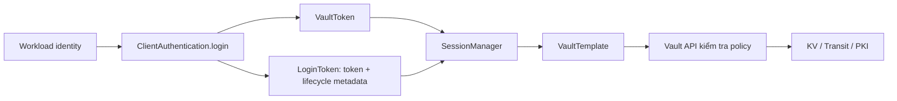
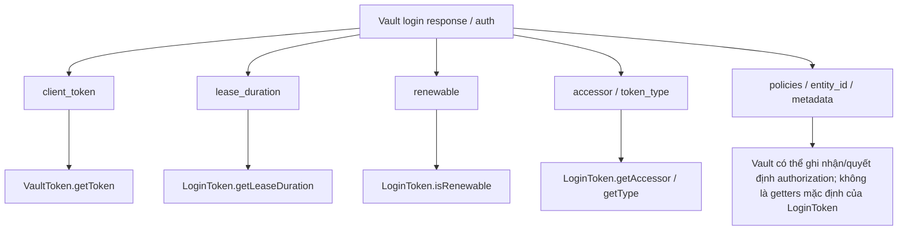
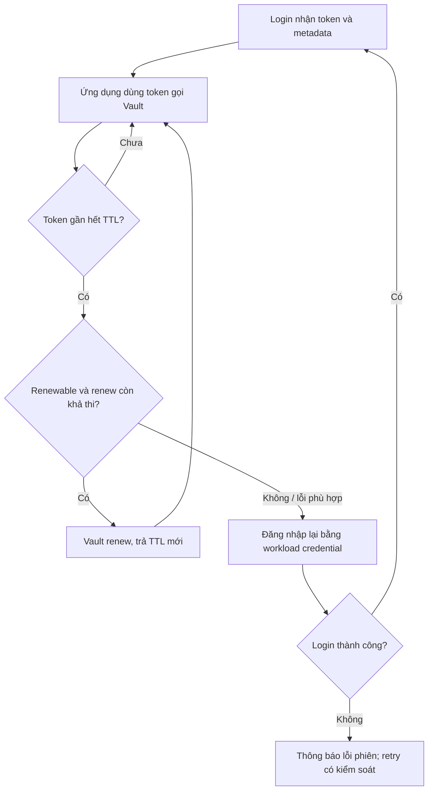
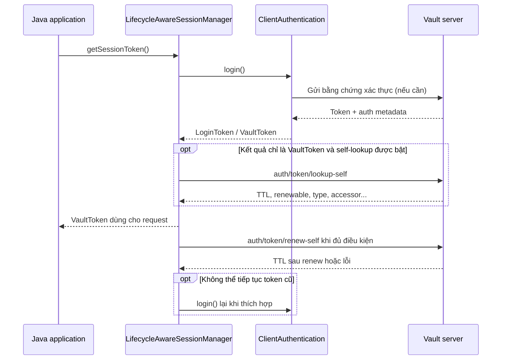
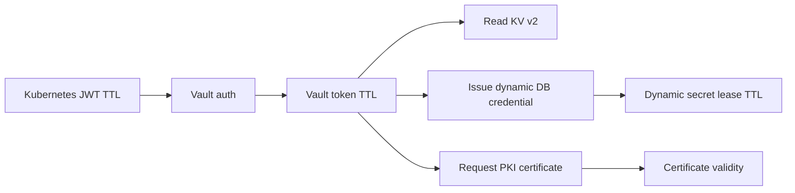

# `VaultToken`, `LoginToken` và dữ liệu vòng đời đi kèm

Trong ứng dụng Java dùng **Spring Vault** để truy cập HashiCorp Vault qua `VaultTemplate`, một giá trị token hợp lệ cho phép client gửi yêu cầu đã xác thực. Tuy nhiên, dịch vụ chạy lâu còn cần trả lời các câu hỏi khác: token còn hiệu lực bao lâu, có thể gia hạn hay không, loại token là gì, ai được thu hồi và thời điểm nào phải đăng nhập lại?

Spring Vault phân biệt **`VaultToken`** (giá trị token cơ bản) và **`LoginToken`** (token có metadata vòng đời). Hai kiểu này giúp `SessionManager` lựa chọn cách quản lý phiên khi ứng dụng đọc KV, yêu cầu Transit encryption, tạo chứng chỉ PKI hay xử lý credential động. Chúng không thay thế policy trong Vault, không biểu diễn đầy đủ mọi trường phản hồi và không quyết định thời hạn của secret đã đọc.

> **Phạm vi:** Bài thuộc chương **Nền tảng xác thực**. Trọng tâm là mô hình dữ liệu token và tác động vận hành. Cấu hình chi tiết AppRole, Kubernetes, JWT/cloud auth, lease động hoặc chính sách phân quyền sẽ sử dụng những khái niệm này ở các bài liên quan.

## 1. Ba câu hỏi khác nhau: token là gì, tồn tại bao lâu, được làm gì?

Xét dịch vụ `orders-api` được Vault phát token sau khi xác thực bằng Kubernetes ServiceAccount. Nó cần gọi `VaultTemplate` để đọc secret tại `kv/data/orders-api/database`.

1. **Token nào được gửi tới Vault?** Đây là giá trị nhạy cảm, được Spring Vault bao gói thành `VaultToken`.
2. **Token còn sống và có thể làm mới không?** Các dữ liệu như TTL và `renewable` có thể được bao gói trong `LoginToken`.
3. **Token được đọc đường dẫn nào?** Auth role và **Vault policy** quyết định, được Vault kiểm tra ở mỗi lệnh; đây không phải thuộc tính được bảo đảm bởi hai lớp Java nói trên.



`LoginToken` là **lớp con** của `VaultToken`, không phải một credential độc lập. Sơ đồ dùng hai nhánh để so sánh kiểu kết quả, không có nghĩa một lần đăng nhập luôn trả cả hai đối tượng.

## 2. API của `VaultToken`: mang giá trị token

`VaultToken` nằm trong `org.springframework.vault.support`. Đây là *value object* để chứa token dùng cho những lần gọi Vault tiếp theo. Một số phương thức cơ bản:

| API | Ý nghĩa | Lưu ý |
|---|---|---|
| `VaultToken.of(String)` | Tạo object từ chuỗi token không rỗng | Chuỗi là bí mật; tránh hardcode và commit |
| `VaultToken.of(char[])` | Tạo object từ mảng ký tự không rỗng | Giảm việc phải giữ thêm chuỗi từ phía caller, nhưng không bảo đảm xóa được mọi bản sao |
| `getToken()` | Lấy giá trị dưới dạng `String` | Chỉ cung cấp cho thành phần gửi request đáng tin cậy |
| `toCharArray()` | Lấy giá trị dưới dạng `char[]` | Có thể xóa bản sao mảng tự quản lý; dữ liệu vẫn có thể tồn tại nơi khác |
| `equals()` và `hashCode()` | So sánh theo giá trị | Không dùng token làm key trong cache/log/metric công khai |
| `toString()` | Biểu diễn đối tượng | Không dựa vào bất kỳ dạng biểu diễn nào làm bảo đảm an toàn log |

Ví dụ với token giả trong môi trường thử nghiệm:

```java
import org.springframework.vault.support.VaultToken;

public class BasicTokenDemo {
    public static void main(String[] args) {
        VaultToken token = VaultToken.of("example-token-only-for-demo");

        // Chỉ kiểm tra object đã tạo, không xuất giá trị nhạy cảm.
        System.out.println("Token wrapper created: " + (token != null));

        // Không làm trong ứng dụng thật:
        // System.out.println(token.getToken());
    }
}
```

Một `VaultToken` thuần **không có `getLeaseDuration()`, `isRenewable()`, `getAccessor()` hoặc `getType()`**. Vì vậy, việc client Java có một `VaultToken` không đủ để kết luận token không hết hạn, hết hạn sau bao lâu hay có thể gia hạn.

### Token tĩnh và token được cấp qua đăng nhập

`TokenAuthentication` nhận một token được cung cấp từ trước, chẳng hạn từ một cơ chế cung cấp token bên ngoài. Nó có thể trả về `VaultToken` mà **không gọi endpoint login** để lấy TTL. Trái lại, các phương thức đăng nhập Vault như Kubernetes, AppRole hoặc JWT thường nhận được phần `auth` trong response, có thông tin vòng đời để tạo `LoginToken`.

Chính nguồn dữ liệu này giải thích tại sao hai kiểu object tồn tại song song. `VaultToken` phù hợp khi chỉ biết **giá trị token**; `LoginToken` phù hợp khi biết thêm **dữ liệu xác thực và thời hạn**.

## 3. API của `LoginToken`: mở rộng token bằng metadata

`LoginToken` nằm trong `org.springframework.vault.authentication` và kế thừa `VaultToken`:

```java
// Mô tả quan hệ kiểu (không khai báo lại thư viện):
// package org.springframework.vault.authentication;
// public class LoginToken extends VaultToken { ... }

import java.time.Duration;
import org.springframework.vault.authentication.LoginToken;
import org.springframework.vault.support.VaultToken;

class TokenKinds {
    static VaultToken basic() {
        return VaultToken.of("example-basic-token");
    }

    static VaultToken loginWithTtl() {
        // LoginToken có thể được gán cho biến kiểu VaultToken.
        return LoginToken.renewable(
                VaultToken.of("example-login-token"),
                Duration.ofMinutes(15));
    }
}
```

Các giá trị trong đoạn code chỉ để minh họa cấu trúc Java; tự đặt `renewable=true` trong object không làm Vault cấp quyền gia hạn cho token. Thông tin đáng tin cậy phải đến từ phản hồi Vault hoặc API lookup tương ứng.

| Thành phần metadata | Phương thức trên `LoginToken` | Cách hiểu đúng |
|---|---|---|
| Giá trị token | `getToken()` kế thừa | Credential nhạy cảm gửi bằng `X-Vault-Token` |
| Thời lượng vòng đời | `getLeaseDuration(): Duration` | TTL mà Vault trả ở lần xác thực/tra cứu; có thể bằng `Duration.ZERO` khi không có giá trị cụ thể |
| Có thể gia hạn | `isRenewable(): boolean` | Trạng thái tại thời điểm lấy metadata; **không bảo đảm** mọi lần renew sau đều thành công |
| Token accessor | `getAccessor(): String` (có thể `null`) | Định danh tham chiếu dùng cho một số thao tác quản trị token, **không dùng** thay raw token để gọi API nghiệp vụ |
| Loại token | `getType(): String` (có thể `null`) | Thường là `service` hoặc `batch` nếu Vault trả thông tin này |
| Kiểm tra loại | `isServiceToken()`, `isBatchToken()` | Giúp phân biệt các khả năng vòng đời khác nhau |

`getAccessor()`, `getType()`, `isServiceToken()` và `isBatchToken()` là API xuất hiện ở các dòng Spring Vault mới hơn (có từ 3.0.2 trong Javadoc). Khi dự án khóa ở bản cũ, cần đối chiếu Javadoc đúng version trước khi dùng; mã ví dụ trong bài hướng đến các phiên bản có API này.

### Tạo `LoginToken` phục vụ kiểm thử

Spring Vault cung cấp các factory tiêu biểu:

```java
import java.time.Duration;
import org.springframework.vault.authentication.LoginToken;
import org.springframework.vault.support.VaultToken;

public class LoginTokenFactoryDemo {
    static void demonstrateFactories() {
        // Không cung cấp khả năng renew trong object:
        LoginToken nonRenewable = LoginToken.of(
                "test-only-token".toCharArray(),
                Duration.ofMinutes(10));

        // Object có renewable=true, dùng cho mô phỏng unit test:
        LoginToken renewable = LoginToken.renewable(
                VaultToken.of("test-only-renewable-token"),
                Duration.ofMinutes(15));

        System.out.println("Non-renewable: " + nonRenewable.isRenewable());
        System.out.println("Renewable: " + renewable.isRenewable());
        System.out.println("Initial duration: " + renewable.getLeaseDuration());
    }
}
```

Trong production, **không tự tạo `LoginToken` với TTL mong muốn** thay vì gọi Vault. Bản sao metadata sai có thể khiến client lên lịch làm mới trễ, tưởng nhầm token còn hạn hoặc kỳ vọng renew cho token thực tế không thể gia hạn. Factory và builder chỉ thể hiện thông tin được cung cấp cho Java object, không ghi cấu hình mới lên Vault server.

## 4. Ánh xạ phản hồi đăng nhập của Vault

Giả sử auth method hợp lệ trả JSON đã được thay token/accessor bằng giá trị giả:

```json
{
  "request_id": "example-request-id",
  "auth": {
    "client_token": "REDACTED",
    "accessor": "REDACTED",
    "policies": ["default", "orders-read"],
    "token_policies": ["default", "orders-read"],
    "lease_duration": 900,
    "renewable": true,
    "token_type": "service",
    "entity_id": "example-entity-id",
    "metadata": {
      "service": "orders-api"
    }
  }
}
```

Đây là response **minh họa**, không phải cấu trúc bảo đảm xuất hiện với mọi auth method. Đặc biệt, một số phương thức hoặc phiên bản Vault có thể bỏ qua trường hoặc trả metadata khác. Đường đi thông tin:



| Trường response | Có phải trường trên `LoginToken`? | Ý nghĩa |
|---|---|---|
| `auth.client_token` | Có: `getToken()` | Chứng thực cho những request Vault về sau |
| `auth.lease_duration` | Có: `getLeaseDuration()` | Thời lượng TTL trong phản hồi, đơn vị **giây** khi đọc JSON |
| `auth.renewable` | Có: `isRenewable()` | Trạng thái token có được phép yêu cầu renew hay không |
| `auth.accessor` | Có: `getAccessor()` | Token accessor, có ý nghĩa quản trị riêng |
| `auth.token_type` | Có: `getType()` | Loại token; không suy đoán chỉ từ prefix chuỗi token |
| `auth.policies`, `auth.token_policies` | Không | Các policy do Vault gắn; muốn biết quyền phải kiểm tra tại Vault |
| `auth.entity_id`, `auth.metadata` | Không | Dữ liệu danh tính, audit/mapping; không mặc định nằm trên `LoginToken` |
| `request_id` | Không | Mã theo dõi request tại Vault |

Đừng nhầm `lease_duration` ở **khối `auth`** với `lease_duration` trong response của **dynamic secret**. Chúng có thể cùng tên nhưng quản lý những đối tượng khác nhau: token đăng nhập và secret lease.

## 5. TTL là thời lượng tương đối, không phải thời điểm hết hạn tuyệt đối

TTL (*time-to-live*) thể hiện khoảng thời gian một token có thể tiếp tục được chấp nhận kể từ lần phát hành hoặc gia hạn được Vault xác nhận. Một `Duration` lưu trong `LoginToken` **không phải** timestamp `expiresAt` cố định và không tự động đếm ngược trong object.

Ví dụ nhận response lúc 10:00:00 với `lease_duration=900` giây (15 phút):

```text
10:00:00   Vault cấp token: TTL 900 s
10:05:00   Đã trôi qua khoảng 300 s
           Không nên coi metadata 900 s ban đầu là số giây còn lại
10:12:00   Session manager có thể quyết định renew sớm
10:12:01   Vault trả TTL mới: phải dùng giá trị response mới
10:15:00   Mốc hết hạn ban đầu không còn là mốc kết luận sau renew
```

Nếu muốn **ước lượng** thời điểm hết hạn tại client, cần gắn metadata với thời điểm thực nhận response và chừa biên cho độ trễ mạng/lệch đồng hồ. Nhưng quyền quyết định cuối cùng vẫn ở Vault: token có thể bị revoke trước hạn, bị chặn vì policy thay đổi hoặc không còn hợp lệ theo quy tắc của server.

### Ba giới hạn thời gian cần phân biệt

| Khái niệm Vault | Câu hỏi trả lời | Hệ quả |
|---|---|---|
| **TTL hiện tại** (`ttl`/`lease_duration`) | Token còn hạn trong khoảng bao lâu theo phản hồi hiện tại? | Đến hạn phải renew hoặc đăng nhập lại |
| **Max TTL** | Tổng thời gian sống tối đa của token thông thường là bao nhiêu? | Có thể renew vài lần nhưng không kéo dài vượt giới hạn áp dụng |
| **Explicit max TTL** | Có hard cap cố định bất kể một số cấu hình khác không? | Token không thể sống vượt giới hạn này, kể cả khi có khả năng renew |

**Periodic token** là trường hợp đặc biệt: nếu được cấu hình với period, mỗi lần renew thành công có thể đặt lại TTL thành period. Tuy nhiên, nếu token có thêm `explicit_max_ttl`, vẫn bị chặn tại giới hạn cứng đó. `LoginToken` **không có getter riêng cho max TTL hoặc period**; code không thể suy luận chính xác hai giá trị đó chỉ từ `getLeaseDuration()` và `isRenewable()`.

`Duration.ZERO` là trường hợp phải đọc trong ngữ cảnh thực tế. Javadoc cho biết `getLeaseDuration()` có thể trả về 0 khi không có giá trị thời lượng. Điều này **không cho phép** kết luận tùy tiện “token sống vĩnh viễn” hoặc “token hết hạn ngay”; cần xét auth method, token type và kết quả tra cứu ở Vault. Không sử dụng root token không hết hạn làm cơ chế xác thực ứng dụng.

## 6. `renewable=true` không có nghĩa được gia hạn mãi mãi

Trong quy trình vận hành, cần phân biệt ba thao tác:

| Thao tác | Ý nghĩa | Token sau thao tác |
|---|---|---|
| **Login** | Ứng dụng chứng minh danh tính với auth method | Nhận token mới do Vault phát |
| **Renew** | Xin Vault kéo dài TTL của token hiện tại | Thường giữ cùng giá trị token, TTL được cập nhật theo phản hồi |
| **Re-login / re-authentication** | Xác thực lại sau khi token hết khả năng dùng tiếp | Nhận token khác; các permission phụ thuộc policy/role tại thời điểm mới |

Ví dụ `orders-api` được cấp token service có TTL 15 phút và khả năng renew. Khi ứng dụng hoạt động, session manager có thể renew trước hạn. Nhưng nếu token đã chạm max TTL, bị thu hồi hoặc không còn quyền thao tác renew, một lần renew có thể thất bại dù `isRenewable()` **trước đó** là `true`.



Sơ đồ biểu diễn chiến lược khái niệm; cách client phân loại lỗi và thời điểm re-login phụ thuộc implementation `SessionManager`. Ví dụ, khi Vault không sẵn sàng tạm thời, ứng dụng cần phân biệt lỗi kết nối với credential đã bị thu hồi để lựa chọn retry, hạn chế tải dồn hoặc báo degraded status. Không nên tạo token mới vô hạn theo từng HTTP request.

## 7. `service` và `batch` token có khả năng vòng đời khác nhau

Vault phân biệt hai loại token thường gặp. Kiểu Java `LoginToken` có `getType()` và các phương thức kiểm tra loại, nhưng **kiểu token là quyết định của Vault**, không phải do tên biến Java.

| Khả năng | Service token | Batch token |
|---|---|---|
| Lưu thông tin token vào backend tracking của Vault | Có | Không theo cơ chế tracking như service token |
| Renew token | Có thể, theo policy/TTL | Không |
| Revoke riêng token bằng API quản trị | Có thể, khi có quyền | Không hỗ trợ cùng cơ chế revoke riêng như service token |
| Token accessor | Có | Không |
| Tạo child token | Có thể, khi được cấp quyền | Không |
| Periodic token | Có thể | Không |
| Giá thành vận hành | Tốn quản lý trạng thái hơn | Nhẹ hơn khi cần số lượng lớn |

Batch token vẫn có thời hạn hữu hạn và phạm vi quyền; không được hiểu là “token để bỏ qua kiểm soát”. Batch token có thể mất hiệu lực khi điều kiện parent/TTL không còn thỏa mãn. Với ứng dụng cần session renew lâu dài, service token thường thuận tiện hơn; với workload rất ngắn, batch có thể phù hợp nếu hạn chế của nó đáp ứng yêu cầu.

Không dựa vào chuỗi bắt đầu bằng `hvs.` hay `hvb.` như bằng chứng duy nhất để kết luận token type. Prefix có thể thay đổi theo phiên bản Vault; nguồn đáng tin cậy hơn là metadata Vault cung cấp.

### Code chỉ đọc đặc tính, không in credential

```java
import java.time.Duration;
import java.util.Optional;
import org.springframework.vault.authentication.LoginToken;
import org.springframework.vault.support.VaultToken;

public final class TokenLifecycleView {

    public record Status(boolean metadataPresent,
                         Optional<Duration> ttl,
                         boolean renewable,
                         Optional<String> tokenType) {}

    public static Status inspect(VaultToken token) {
        if (token instanceof LoginToken login) {
            return new Status(
                    true,
                    Optional.of(login.getLeaseDuration()),
                    login.isRenewable(),
                    Optional.ofNullable(login.getType()));
        }

        // Không biết metadata khác với biết TTL bằng 0 hoặc renewable=false.
        return new Status(false, Optional.empty(), false, Optional.empty());
    }
}
```

`metadataPresent=false` diễn đạt “object chỉ là `VaultToken`”, còn `renewable=false` trong nhánh này **không được diễn giải thành thuộc tính thật của token trên server**. Khi cần đưa ra quyết định renew, hãy dùng session manager có thể tra cứu trạng thái Vault. Ví dụ sử dụng Java 17 trở lên (record, pattern matching `instanceof`).

## 8. Accessor là tham chiếu quản trị, không phải token đăng nhập

Một **token accessor** cho phép các thao tác quản trị nhất định, như tra cứu, renew hoặc revoke token thông qua API thích hợp và **token thực hiện lời gọi phải có quyền**. Nó không thể được gửi thay `client_token` trong header `X-Vault-Token` để đọc KV.

```text
client_token (bí mật): dùng làm credential của các request Vault
accessor (tham chiếu): dùng trong API quản trị token có kiểm soát quyền
```

Vì accessor có thể trở thành mục tiêu của thao tác quản trị gây gián đoạn dịch vụ, cần hạn chế việc ghi log, thu thập vào metric label, xuất qua endpoint debug hoặc công bố công khai. Accessor không phải mật khẩu giống `client_token`, nhưng **không nên xem là dữ liệu vô hại**.

Với batch token, thông thường không có accessor theo mô hình Vault. Vì vậy, `LoginToken.getAccessor()` có thể trả `null`; code phải xử lý được tình huống này. Mỗi hệ thống phải xác định ai sở hữu quyền revoke token, trong điều kiện nào và audit việc sử dụng các API quản trị.

## 9. Khi dùng `SessionManager`, metadata ảnh hưởng điều gì?

`ClientAuthentication.login()` có kiểu trả về `VaultToken`. Một implementation có thể trả trực tiếp `LoginToken`, vẫn đáp ứng kiểu trả về của interface. `SessionManager` sử dụng token cho các lần gọi tiếp theo của `VaultTemplate`; với manager nhận biết vòng đời, metadata là đầu vào lên lịch renew/re-login.



### Trường hợp `TokenAuthentication`

Một cấu hình cung cấp token cố định có thể tạo ra `VaultToken` không chứa TTL. `LifecycleAwareSessionManager` mặc định có thể thực hiện `auth/token/lookup-self` để lấy TTL, renewable, accessor và token type cho việc quản lý. Cần quyền và khả năng gọi Vault phù hợp, đồng thời xử lý lỗi nếu token không thể tra cứu. Nếu **tắt self-lookup**, manager không thể suy ra TTL chỉ từ chuỗi token.

### Trường hợp đăng nhập như Kubernetes hoặc AppRole

Các auth method thực hiện login thường trả `LoginToken` mang metadata từ response. Manager có dữ liệu để lập lịch renew. Khi token tới giới hạn vòng đời, manager có thể xin token mới bằng cách gọi lại `ClientAuthentication.login()`, nhưng điều này chỉ thành công nếu **bootstrap credential** (JWT, SecretID, chứng chỉ hoặc bằng chứng cloud) còn hợp lệ.

### Điều cần lưu ý khi shutdown

`LifecycleAwareSessionManager` hỗ trợ thu hồi token thuộc phiên mà manager quản lý khi đóng ứng dụng, song quy tắc khác nhau theo loại token và nguồn cấp. Theo tài liệu Spring Vault, **token do login cấp và thuộc loại service token** có thể bị revoke khi manager shutdown. `VaultToken` được cung cấp sẵn (ví dụ từ `TokenAuthentication`) không mặc nhiên bị manager revoke chỉ vì ứng dụng ngừng chạy. Cơ chế này tránh việc vô tình hủy token có thể còn được nguồn ngoài quản lý hoặc chia sẻ.

Không tự suy đoán rằng mọi token đều được revoke thành công khi ứng dụng nhận tín hiệu dừng: process có thể bị kill đột ngột hoặc Vault có thể tạm unavailable. TTL ngắn, policy tối thiểu và quy trình thu hồi chủ động khi sự cố vẫn quan trọng.

## 10. Vòng đời Vault token khác vòng đời secret lease

Trong mô hình Vault, cần phân biệt ít nhất ba nhóm thời hạn:

1. **Bootstrap credential** của workload (ví dụ ServiceAccount JWT): thời hạn do nền tảng cấp danh tính quản lý.
2. **Vault token**: được cấp sau auth, có TTL/renewability riêng, dùng để gọi API Vault.
3. **Secret lease**: ví dụ database credentials động hoặc chứng chỉ có thời hạn; do secrets engine và Vault lease manager quản lý theo policy/engine configuration.



Ví dụ `orders-api` lấy database credentials động với TTL 1 giờ bằng Vault token TTL 15 phút. Kết quả là **hai đồng hồ khác nhau**: Vault token cần renew hoặc re-login để gọi API tiếp theo; DB credentials có vòng đời riêng, có thể bị Vault revoke hoặc hết hạn theo lease. Nếu Vault token bị thu hồi, tùy quan hệ token/lease, các lease liên quan cũng có thể bị thu hồi; không nên giả định một credential động vẫn sống đủ 1 giờ bất kể token cha bị revoke.

Với KV v2, secret thường là dữ liệu tĩnh/phiên bản hóa và không mang một dynamic lease TTL như credential cơ sở dữ liệu. Transit encryption có yêu cầu token hợp lệ để gọi API, nhưng việc mã hóa ra ciphertext không tạo ra một *token lease* cho ciphertext. Chứng chỉ PKI có thời gian `notBefore`/`notAfter` riêng; thời hạn chứng chỉ không tự thay đổi khi Vault token được renew.

| Câu hỏi | Nên kiểm tra ở đâu? |
|---|---|
| Token được làm mới được không? | `LoginToken` metadata + Vault token lookup/renew response |
| Token có quyền đọc một KV path không? | Vault policies và capabilities của đường dẫn API |
| Credential DB động hết hạn lúc nào? | Lease metadata và secret engine quản lý lease |
| Chứng chỉ PKI còn hợp lệ không? | Certificate validity và trạng thái thu hồi theo PKI |
| JWT của Pod đã hết hạn chưa? | Nguồn cấp workload identity và các claims của JWT |

## 11. Các lỗi diễn giải metadata dễ gây sự cố

| Nhận định sai | Vì sao sai | Cách xử lý |
|---|---|---|
| “Đối tượng là `VaultToken` nên token không có TTL.” | Class không mang metadata, không chứng minh token trên Vault không có TTL | Tra cứu token qua API/session manager nếu cần |
| “`getLeaseDuration()` = 900 nghĩa là lúc nào cũng còn 900 giây.” | Đây là thời lượng nhận được tại thời điểm nhất định, không phải bộ đếm tự cập nhật | Đọc thông tin sau renew/lookup, quản lý thời điểm nhận và biên an toàn |
| “`isRenewable()` true bảo đảm renew vô hạn.” | Max TTL, explicit max TTL, revoke, permission và lỗi server vẫn có thể chặn | Theo dõi renewal response, có khả năng re-login |
| “`getAccessor()` có thể đưa vào `X-Vault-Token`.” | Accessor chỉ phục vụ thao tác quản trị được phân quyền | Dùng `getToken()` qua HTTP client an toàn |
| “`LoginToken` chứa danh sách policy.” | Spring Vault class này không có getter policy mặc định | Kiểm tra chính sách được Vault gắn và quyền thực tế |
| “Batch token cũng có thể renew như service token.” | Batch token không hỗ trợ renew theo cơ chế service token | Chọn loại token phù hợp; chuẩn bị đăng nhập lại khi batch token hết hạn |
| “Token được renew thì database lease cũng tự renew.” | Token session và secret lease là hai vòng đời khác nhau | Có quản lý lease riêng khi dùng dynamic secrets |
| “Shutdown chắc chắn revoke mọi token.” | Chỉ một số token theo quy tắc ownership/type và shutdown bình thường | TTL ngắn, quản lý revoke đúng nơi, không dựa hoàn toàn vào shutdown |

### Ví dụ phân tích lỗi thực tế

**Hiện tượng:** `orders-api` chạy ổn trong 15 phút, sau đó API đọc KV lỗi `403`.

**Quy trình chẩn đoán có thứ tự:**

1. Xác định lỗi từ yêu cầu **login** hay từ API **đọc KV** sau login. Đừng đánh đồng chúng.
2. Kiểm tra loại token, TTL, renewable và thời điểm renew lần cuối qua thông tin chẩn đoán đã loại bỏ bí mật.
3. Xác nhận session manager có thực sự quản lý token hay chỉ dùng token cố định bằng `SimpleSessionManager`.
4. Nếu refresh thất bại, phân biệt Vault unavailable, token đã revoke, chạm max TTL hoặc bootstrap credential hết hạn.
5. Nếu token vẫn hợp lệ, kiểm tra policy và đường dẫn KV v2 (`kv/data/...`) để loại trừ lỗi authorization.
6. Kiểm tra lại bằng trường hợp thành công có cùng role/policy, không nới rộng policy production chỉ để “thử”.

**Quan sát nên có:** số lần login/renew thành công, lỗi auth và renew được phân loại, thời lượng request và TTL còn lại nếu được cung cấp an toàn. **Không quan sát bằng cách** in raw token, token accessor, JWT hoặc toàn bộ login response vào log, metric, trace hoặc hệ thống cảnh báo.

## 12. Ví dụ thực hành Java: đọc metadata an toàn

Mục tiêu là phân biệt **đã biết** thông tin vòng đời hay **chưa biết**, tránh biến thiếu metadata thành một kết luận giả. Ví dụ Java 17+ sau không gọi Vault, phù hợp bài thực hành unit-level:

```java
import java.time.Duration;
import java.util.Optional;

import org.springframework.vault.authentication.LoginToken;
import org.springframework.vault.support.VaultToken;

public final class SessionTokenDescription {

    public record Snapshot(
            boolean lifecycleMetadataAvailable,
            Optional<Duration> ttl,
            Optional<Boolean> renewable,
            Optional<String> tokenType) {}

    public static Snapshot from(VaultToken token) {
        if (token instanceof LoginToken login) {
            return new Snapshot(
                    true,
                    Optional.of(login.getLeaseDuration()),
                    Optional.of(login.isRenewable()),
                    Optional.ofNullable(login.getType()));
        }

        return new Snapshot(false, Optional.empty(),
                Optional.empty(), Optional.empty());
    }

    public static void main(String[] args) {
        VaultToken supplied = VaultToken.of("example-supplied-token");
        VaultToken loggedIn = LoginToken.renewable(
                VaultToken.of("example-login-token"),
                Duration.ofMinutes(15));

        Snapshot unknown = from(supplied);
        Snapshot known = from(loggedIn);

        System.out.println("Supplied has metadata: "
                + unknown.lifecycleMetadataAvailable());
        System.out.println("Login TTL: " + known.ttl().orElse(Duration.ZERO));
        System.out.println("Login renewable: " + known.renewable().orElse(false));
    }
}
```

`LoginToken.renewable(...)` trong ví dụ chỉ mô phỏng giá trị trả về cho mục đích kiểm thử. Bản thân nó không liên hệ Vault hay bảo đảm server chấp nhận renew. Ứng dụng thực nên để `ClientAuthentication` nhận response thật và `LifecycleAwareSessionManager` xử lý vòng đời.

## 13. Bài thực hành tình huống

**Bối cảnh:** `catalog-api` đăng nhập bằng Kubernetes auth. Lần đầu Vault trả `client_token`, `lease_duration=1200`, `renewable=true`, `token_type="service"` và `accessor`. Ứng dụng cần đọc KV v2, dùng Transit mã hóa dữ liệu nhạy cảm và chạy liên tục nhiều ngày. Một luồng khác lấy dynamic database credential có lease 30 phút.

**Yêu cầu:**

1. Nêu điểm khác nhau giữa việc lưu token này dưới dạng `VaultToken` và `LoginToken` trong Spring Vault.
2. Xác định dữ liệu nào có thể đọc từ `LoginToken`, dữ liệu nào chỉ Vault server hoặc API lookup mới xác nhận đầy đủ.
3. Phác thảo thứ tự xử lý khi token còn 2 phút TTL, renew thất bại vì đã chạm max TTL nhưng Kubernetes JWT vẫn hợp lệ.
4. Cho biết việc lấy dynamic credential lease 30 phút có đồng nghĩa Vault token tự được kéo dài thêm 30 phút không.
5. Đề xuất ba phép thử để chứng minh ứng dụng tôn trọng token TTL, quyền policy và lease riêng biệt.

**Lời giải gợi ý:**

- `VaultToken` chỉ giúp gửi `X-Vault-Token`. `LoginToken` kế thừa giá trị token và mang TTL/renewability/accessor/type nên hữu ích cho quản lý phiên.
- Có thể đọc TTL, renewability, accessor và type qua các getter tương ứng của `LoginToken`; còn max TTL, explicit max TTL, policy, giới hạn lượt dùng và trạng thái revoke thực tế phải xác định bằng Vault configuration/response/lookup phù hợp.
- `LifecycleAwareSessionManager` sẽ cố renew khi phù hợp, rồi có thể re-login khi token cũ không thể dùng tiếp. Vì JWT của Pod vẫn hợp lệ, auth method có khả năng phát token mới; tuy nhiên role hoặc policy đã thay đổi vẫn có thể khiến login bị từ chối.
- Dynamic secret lease là đồng hồ riêng. Gia hạn token không đồng nghĩa gia hạn lease, và ngược lại; quyền/parent token còn có thể ảnh hưởng đến revoke lease.
- Kiểm thử: (i) token login và renew/re-login với TTL ngắn, (ii) policy cho phép đúng API path nhưng từ chối path khác, (iii) dynamic lease hết hạn/revoke độc lập trong môi trường Vault test instance.

### Tiêu chí đánh giá

| Tiêu chí | Mức đạt |
|---|---|
| Phân biệt object Java và trạng thái Vault | Không suy đoán TTL/policy từ việc chỉ có `VaultToken` |
| Hiểu tính tương đối của TTL | Không dùng `Duration` cũ như một đồng hồ thời gian thực |
| Phân biệt `renew` và `re-login` | Nêu đúng nguồn credential cần có để login lại |
| Nhận diện loại token | Biết service/batch khác nhau về renew và revoke |
| Giữ an toàn credential | Không xuất token/accessor/response nhạy cảm vào log hoặc metric |
| Hiểu lease của secret | Không đồng nhất secret TTL với Vault login token TTL |

## 14. Câu hỏi tự kiểm tra

1. Vì sao `ClientAuthentication.login()` có thể khai báo trả `VaultToken` nhưng thực tế cho ra `LoginToken`?
2. `VaultToken.of(...)` có liên lạc với Vault hoặc xác thực quyền của token không?
3. `LoginToken.getLeaseDuration()` trả kiểu Java nào? Giá trị đó có tự đếm ngược theo đồng hồ không?
4. Tại sao `isRenewable()` true vẫn không bảo đảm một token có thể được gia hạn vào ngày hôm sau?
5. Token `service` và `batch` khác nhau thế nào về renew, accessor và revoke?
6. `LoginToken.getAccessor()` có thể dùng để đọc KV thay `getToken()` không? Vì sao vẫn cần bảo vệ accessor?
7. `LifecycleAwareSessionManager` làm gì khi `ClientAuthentication` chỉ trả `VaultToken` và self-lookup được bật?
8. Việc `orders-api` có `LoginToken` với TTL 15 phút có nói gì chắc chắn về credential DB động với lease 1 giờ?
9. Vì sao không thể xem `getType()==null` là bằng chứng token không thuộc loại service?

**Nguyên tắc ghi nhớ:** `VaultToken` là **giá trị để xác thực request**; `LoginToken` là **giá trị đó cộng metadata vòng đời**; `SessionManager` dùng metadata để quản lý phiên; **Vault server** mới là nguồn quyết định TTL, gia hạn, revoke và policy. Vòng đời token và vòng đời secret lease có liên hệ, nhưng không phải một.

## Tài liệu tham khảo

- [Spring Vault — Authentication Methods, Token Lifecycle](https://docs.spring.io/spring-vault/reference/vault/authentication.html): phân biệt `VaultToken`/`LoginToken`, self-lookup, renew và re-login.
- [Spring Vault API — `VaultToken`](https://docs.spring.io/spring-vault/reference/api/java/org/springframework/vault/support/VaultToken.html): factory, `getToken()`, `toCharArray()`.
- [Spring Vault API — `LoginToken`](https://docs.spring.io/spring-vault/reference/api/java/org/springframework/vault/authentication/LoginToken.html): TTL, renewable, accessor, token type và các factory.
- [Spring Vault API — `LifecycleAwareSessionManager`](https://docs.spring.io/spring-vault/reference/api/java/org/springframework/vault/authentication/LifecycleAwareSessionManager.html): làm mới, lookup và revocation lúc đóng phiên.
- [HashiCorp Vault — Tokens](https://developer.hashicorp.com/vault/docs/concepts/tokens): service/batch tokens, accessor, TTL, periodic và explicit max TTL.
- [HashiCorp Vault — Token Auth Method API](https://developer.hashicorp.com/vault/api-docs/auth/token): API lookup, renew, revoke, token role và các tham số thời hạn.
