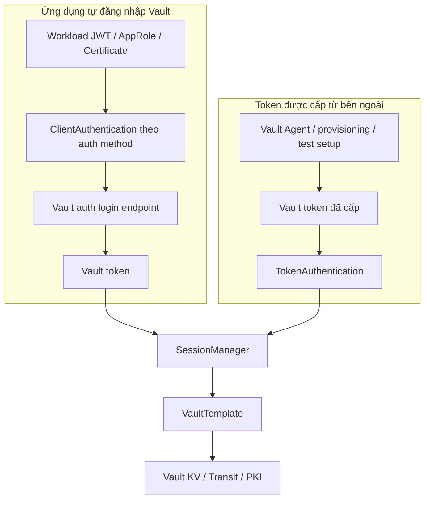
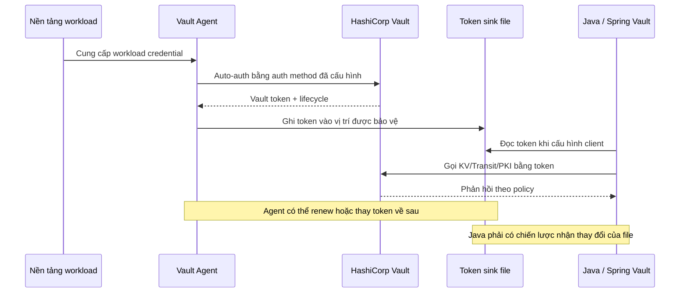

# `TokenAuthentication` với token được cấp từ bên ngoài

Trong chương **Nền tảng xác thực** của **Spring Vault**, có một trường hợp đơn giản nhưng dễ hiểu sai: **ứng dụng Java đã nhận được Vault token từ một hệ thống khác trước khi gọi Vault**. Thay vì tự đăng nhập bằng Kubernetes JWT, AppRole hoặc chứng chỉ, ứng dụng đưa token có sẵn cho `TokenAuthentication`, rồi sử dụng `VaultTemplate` để đọc KV secrets, gọi Transit encryption hoặc yêu cầu chứng chỉ PKI theo quyền mà token được cấp.

Cách này đặc biệt hữu ích khi một tiến trình hoặc dịch vụ khác đã chịu trách nhiệm xác thực với HashiCorp Vault, chẳng hạn Vault Agent, một hệ thống khởi tạo workload hoặc một môi trường kiểm thử. Tuy nhiên, **được cung cấp token** khác với **được quản lý vòng đời token**: ai phát hành, xoay vòng, thu hồi và thay thế token cần được quyết định rõ ràng.

## 1. Token “được cấp từ bên ngoài” thực sự là gì?

“Bên ngoài” ở đây nghĩa là **bên ngoài tiến trình Java**, không phải do một nhà cung cấp tùy ý tự tạo. Credential mà `TokenAuthentication` nhận phải là **Vault token do Vault phát hành hoặc chấp nhận**, có hiệu lực đối với Vault server/namespace mà ứng dụng truy cập.

Phân biệt ba loại đầu vào:

| Đầu vào | Bản chất | Cách dùng đúng trong Spring Vault |
|---|---|---|
| **Vault token** đã được cấp | Credential gọi các API Vault | Truyền cho `TokenAuthentication` |
| Kubernetes ServiceAccount JWT | Bằng chứng danh tính workload, **chưa** phải Vault token | Dùng Kubernetes auth để **đổi lấy** Vault token |
| AppRole `RoleID` + `SecretID` | Bằng chứng đăng nhập AppRole, **chưa** phải Vault token | Dùng AppRole auth để **đổi lấy** Vault token |

Đưa JWT trực tiếp vào `new TokenAuthentication(jwt)` không làm Vault tự xác thực JWT theo Kubernetes/JWT auth. `TokenAuthentication` không biết cách đổi credential đầu vào; nó coi chuỗi nhận được **đã là Vault token**.

### Hai luồng cần phân biệt



Cả hai luồng đều cần **token hợp lệ và policy phù hợp** ở thời điểm gọi API. Điểm khác biệt là `TokenAuthentication` không thực hiện bước đăng nhập với auth endpoint trong tiến trình ứng dụng.

## 2. Hợp đồng của `TokenAuthentication`

Spring Vault cung cấp class `org.springframework.vault.authentication.TokenAuthentication` triển khai interface `ClientAuthentication`. Hợp đồng của interface được rút gọn như sau:

```java
// Trích hợp đồng để minh họa, không cần tự khai báo interface.
public interface ClientAuthentication {
    VaultToken login() throws VaultException;
}
```

Khi sử dụng `TokenAuthentication`, phương thức `login()` **trả token đã được đưa vào constructor**. Nó không gửi HTTP request tới `auth/token/create`, không gọi `auth/kubernetes/login` và không chứng minh rằng token đã được Vault server xác minh.

```java
import org.springframework.vault.authentication.ClientAuthentication;
import org.springframework.vault.authentication.TokenAuthentication;
import org.springframework.vault.support.VaultToken;

public final class ExistingTokenExample {
    public static VaultToken suppliedToken() {
        // Dùng token giả để minh họa API; không hardcode token thật.
        ClientAuthentication authentication =
                new TokenAuthentication("example-token-not-valid");

        // Chỉ trả token trong bộ nhớ, chưa xác minh với Vault.
        return authentication.login();
    }
}
```

Các điểm cần nhớ:

1. **Đầu vào:** `TokenAuthentication` nhận token được chuẩn bị trước. Có thể dùng constructor nhận chuỗi hoặc `VaultToken` tùy API của phiên bản thư viện.
2. **Đầu ra:** `login()` trả `VaultToken`, chứa giá trị credential dùng cho request kế tiếp.
3. **Tính cục bộ:** bản thân `login()` không yêu cầu Vault đang kết nối được.
4. **Không có kiểm tra quyền ngầm:** token sai, hết hạn, bị revoke hoặc không đủ policy sẽ bị Vault từ chối ở lần gọi API cần xác thực.
5. **Không có làm mới nguồn đầu vào:** một instance `TokenAuthentication` giữ token đã được truyền vào; thay biến môi trường hay sửa file nguồn **không tự động đổi token trong instance hiện có**.

Do đó, tên phương thức `login()` có thể gây nhầm lẫn: với auth method có bước đăng nhập, nó thực hiện giao thức login; với `TokenAuthentication`, nó cung cấp lại token đã có.

## 3. Chọn nguồn cấp token đáng tin cậy

Việc cấp token bên ngoài phải có **chuỗi tin cậy** rõ ràng, vì ứng dụng không tự xác minh nguồn gốc bằng `TokenAuthentication`.

| Nguồn cấp | Ví dụ thực tế | Điều cần kiểm soát |
|---|---|---|
| **Vault Agent auto-auth** | Agent đăng nhập bằng Kubernetes/AppRole rồi ghi token vào sink file | Quyền đọc file, owner của token, TTL, làm mới token và thời điểm ứng dụng đọc lại |
| **Hệ thống khởi tạo workload** | Bootstrap service/provisioning cấp token phạm vi hẹp qua kênh đáng tin cậy | Ai được yêu cầu cấp token, vận chuyển an toàn, thời hạn, thu hồi |
| **CI/CD pipeline** | Job nhận token ngắn hạn để đọc secret cần thiết trong lúc build/deploy | Token thuộc riêng job, hết hạn nhanh, không đưa vào log/artifact hoặc image |
| **Nền tảng test** | Fixture hoặc Vault test instance tạo token có policy tối thiểu | Tách khỏi Vault production, cleanup/revoke, không đưa credential thật vào test |
| **Thiết lập thủ công cho local development** | Developer nhận token có quyền rất hẹp | Không dùng root token; không commit vào `application.yml`, shell history hay repo |

Không nhầm “đã có token ở biến môi trường” với “đã giải quyết bài toán cấp danh tính ban đầu”. Cần truy ngược được **ai tạo token, dựa trên danh tính nào, token có policy/TTL gì và ai chịu trách nhiệm khi nó không dùng được nữa**.

### Ví dụ: Vault Agent và ứng dụng Java



Nếu Agent renew **cùng token**, ứng dụng đang giữ chuỗi token đó có thể tiếp tục dùng khi Vault chấp nhận. Nếu Agent **re-authenticate và phát token khác**, ứng dụng vẫn giữ token cũ sẽ không tự động chuyển sang token mới. Đây là lỗi kiến trúc thường gặp khi kết hợp sink file với `TokenAuthentication`.

## 4. Dùng `TokenAuthentication` trong Spring Vault thuần

Giả sử nền tảng cung cấp file chứa Vault token tại đường dẫn `/run/secrets/vault/client-token`. File được mount vào container chỉ với quyền đọc của tài khoản chạy Java. Ví dụ tạo `VaultTemplate` từ token có sẵn:

```java
import java.io.IOException;
import java.net.URI;
import java.nio.charset.StandardCharsets;
import java.nio.file.Files;
import java.nio.file.Path;

import org.springframework.vault.authentication.ClientAuthentication;
import org.springframework.vault.authentication.TokenAuthentication;
import org.springframework.vault.client.VaultEndpoint;
import org.springframework.vault.core.VaultTemplate;

public final class ExternalTokenVaultFactory {
    private ExternalTokenVaultFactory() {}

    public static VaultTemplate create(String vaultUrl, Path tokenFile)
            throws IOException {

        URI uri = URI.create(vaultUrl);
        if (!"https".equalsIgnoreCase(uri.getScheme())) {
            throw new IllegalArgumentException("Vault endpoint must use HTTPS");
        }

        String value = Files.readString(tokenFile, StandardCharsets.UTF_8).strip();
        if (value.isBlank()) {
            throw new IllegalStateException("Vault token file is empty");
        }

        // Đã là Vault token; phương thức này không thực hiện auth login.
        ClientAuthentication authentication = new TokenAuthentication(value);
        VaultEndpoint endpoint = VaultEndpoint.from(uri);

        return new VaultTemplate(endpoint, authentication);
    }
}
```

**Giả định của ví dụ:** file đã được cung cấp từ nguồn tin cậy và cấu hình TLS của JVM đã tin cậy CA ký chứng chỉ Vault. Nếu dùng CA nội bộ, phải cấu hình truststore/HTTP client tương ứng; không tắt xác minh TLS. Mã trên thực hiện đọc **một lần** tại thời điểm khởi tạo. Nó minh họa cơ chế sử dụng token đã cấp, **không phải** giải pháp tự động làm mới file khi token bị thay.

Tạo client để đọc một secret KV v2:

```java
import java.nio.file.Path;
import org.springframework.vault.core.VaultTemplate;
import org.springframework.vault.support.VaultResponse;

public final class VerifyVaultAccess {
    public static void main(String[] args) throws Exception {
        VaultTemplate vault = ExternalTokenVaultFactory.create(
                "https://vault.example.internal:8200",
                Path.of("/run/secrets/vault/client-token"));

        // Mount KV v2 tên "kv"; API path có phần "/data/".
        VaultResponse response = vault.read("kv/data/orders-api/database");

        if (response == null || response.getData() == null) {
            throw new IllegalStateException("Expected secret is missing");
        }

        // Chỉ xác nhận có dữ liệu; không in nội dung secret.
        System.out.println("Vault KV read completed");
    }
}
```

Đường dẫn `kv/data/orders-api/database` ở đây là **đường dẫn API của KV v2**, không phải ví dụ chung cho mọi secrets engine. Với Transit và PKI, ứng dụng sử dụng API tương ứng của Spring Vault nhưng vẫn dùng chung token phiên. Token được cấp quyền đọc KV **không mặc nhiên** có quyền mã hóa hoặc phát chứng chỉ.

> Cảnh báo vận hành: nếu file được mount bởi Agent hoặc orchestrator, hãy kiểm tra quyền đọc file, đồng bộ thời điểm file sẵn sàng và chiến lược khi token bị đổi. Không dựa vào `Thread.sleep(...)` tùy ý để “chờ token” hoặc log nội dung file khi khởi động lỗi.

## 5. Cấu hình qua Spring Cloud Vault

Nếu ứng dụng Spring Boot dùng **Spring Cloud Vault** (lớp tích hợp sử dụng Spring Vault bên dưới), chế độ xác thực `TOKEN` có thể lấy token từ cấu hình:

```yaml
spring:
  cloud:
    vault:
      uri: ${VAULT_URI}
      authentication: TOKEN
      token: ${VAULT_TOKEN}
```

Ví dụ này chỉ cho thấy **các thuộc tính cấu hình**, không chứa token thật. Runtime cần cung cấp `VAULT_URI` và `VAULT_TOKEN` bằng cơ chế an toàn; giá trị `spring.cloud.vault.token` có thể được giữ trong đối tượng cấu hình của ứng dụng. Việc đưa token vào biến môi trường vẫn có nguy cơ bị lộ qua hệ thống quản trị process, dump hoặc công cụ chẩn đoán có quyền truy cập.

Các điểm cần kiểm tra:

- Có dependency Spring Cloud Vault và phiên bản tương thích với Spring Boot; **chỉ có `spring-vault-core` không tự hiểu thuộc tính `spring.cloud.vault.*`**.
- Nếu cần thay token trong thời gian chạy, cơ chế cấu hình phải hỗ trợ refresh/thay client một cách chủ động; **chỉ cập nhật biến môi trường của container không tự đổi giá trị mà Java process đã đọc**.
- Không bật endpoint actuator, debug config dump hoặc log startup làm lộ `spring.cloud.vault.token`.
- Nếu token là do workload identity tự đăng nhập, nên dùng auth method tương ứng thay vì cố biến JWT hoặc SecretID thành cấu hình `token`.

### Khi nào chọn cấu hình thuần và khi nào dùng Cloud Vault?

| Nhu cầu | Lựa chọn phù hợp |
|---|---|
Ứng dụng Java muốn gọi API Vault một cách chủ động | `VaultTemplate` với `TokenAuthentication` và cấu hình HTTP/TLS |
Ứng dụng Spring Boot cần tích hợp cấu hình theo conventions của Spring Cloud | Spring Cloud Vault với `authentication: TOKEN` |
Ứng dụng cần tự đăng nhập bằng workload JWT/Kubernetes | Auth method Kubernetes/JWT; **không** dùng `TOKEN` với JWT |
Vault Agent đã sở hữu việc làm mới và có thể cấp token mới | Thiết kế rõ đường cập nhật token hoặc dùng một mô hình Agent/proxy tích hợp thích hợp |

## 6. `VaultToken`, `LoginToken` và metadata khi dùng token có sẵn

`TokenAuthentication.login()` thường trả một `VaultToken` biểu diễn **giá trị token**. Khác với `LoginToken` nhận được từ một login response, `VaultToken` thuần không mang sẵn các getter TTL hoặc renewability.

```java
import org.springframework.vault.authentication.ClientAuthentication;
import org.springframework.vault.authentication.TokenAuthentication;
import org.springframework.vault.support.VaultToken;

public class SuppliedTokenMetadata {
    public static void main(String[] args) {
        ClientAuthentication authentication =
                new TokenAuthentication("example-token-not-valid");

        VaultToken token = authentication.login();

        // token.getToken() tồn tại nhưng là dữ liệu nhạy cảm.
        // Các lời gọi sau KHÔNG có trên kiểu VaultToken:
        // token.getLeaseDuration();
        // token.isRenewable();

        System.out.println("Token was supplied locally");
    }
}
```

**Thiếu metadata không đồng nghĩa token không hết hạn.** Token thực có thể có TTL vài phút, có thể được renew, bị revoke hoặc đã chạm max TTL. Muốn xác định trạng thái thật cần thực hiện API lookup/renew tương ứng ở Vault bằng quyền phù hợp, hoặc lấy metadata từ chủ thể đã phát token.

| Điều biết khi chỉ có `VaultToken` | Điều **chưa** biết chắc |
|---|---|
Có chuỗi token để gửi tới Vault | Token có còn hợp lệ trên server không |
Biết token nào đang được Java giữ | TTL còn lại và thời điểm hết hạn |
Có thể đưa token vào phiên Spring Vault | Token thuộc loại service/batch hay có thể renew không |
Có thể bắt đầu gọi API Vault | Token có policy/capabilities trên KV, Transit, PKI nào |

Ngay cả khi chủ thể cung cấp token kèm TTL ban đầu, không nên tự tạo `LoginToken` với giá trị suy đoán rồi coi đó là trạng thái hiện tại của Vault: một token có thể bị revoke sớm hơn TTL hoặc gia hạn theo cơ chế bên ngoài.

## 7. Ai quản lý vòng đời token?

Cần tách **người cung cấp token** và **người quản lý token**. Cả hai có thể là cùng một thành phần, nhưng phải được chỉ định rõ.

| Mô hình | Chủ thể cấp/phát token | Chủ thể quản lý TTL, renew, thay token | Trách nhiệm Java |
|---|---|---|---|
Vault Agent auto-auth và token sink | Vault sau khi Agent login | Agent theo cấu hình | Đọc token an toàn, nhận thay thế token, tránh can thiệp vào lifecycle của Agent |
Provisioning cấp token rồi bàn giao quyền quản lý | Vault/provisioning | Phải có thỏa thuận cụ thể | Có thể dùng lifecycle manager nếu được trao quyền, xử lý lookup/renew/revoke |
CI job có token ngắn hạn | Vault/cấp phát cho job | CI/orchestrator theo thời gian job | Chỉ dùng trong phạm vi job, không giữ dài hơn cần thiết |
Developer local | Vault/operator cấp token tối thiểu | Developer/quy trình dev | Không lưu vào Git; phát hiện hết hạn và xin lại |

### `SimpleSessionManager`: sử dụng một token đã được cấp

Nếu một hệ thống khác đã quản lý token và thời gian chạy ngắn hoặc có quy trình restart khi token đổi, `SimpleSessionManager` là một cách mô hình hóa phiên đơn giản:

```java
import org.springframework.vault.authentication.ClientAuthentication;
import org.springframework.vault.authentication.SessionManager;
import org.springframework.vault.authentication.SimpleSessionManager;
import org.springframework.vault.authentication.TokenAuthentication;

public class SuppliedSession {
    public static SessionManager create(String tokenFromTrustedSource) {
        ClientAuthentication authentication =
                new TokenAuthentication(tokenFromTrustedSource);

        return new SimpleSessionManager(authentication);
    }
}
```

`SimpleSessionManager` giữ token của phiên, **không tự lập lịch renew hoặc re-login theo TTL**. Vì vậy, nếu ứng dụng chạy nhiều ngày với token vài phút, việc “có `SessionManager`” chưa đủ để tránh lỗi hết hạn.

### `LifecycleAwareSessionManager`: lưu ý quyền sở hữu

`LifecycleAwareSessionManager` có cơ chế theo dõi TTL và làm mới/đăng nhập lại khi thích hợp. Với `VaultToken` không có metadata, manager có thể tra cứu `auth/token/lookup-self` để biết thông tin vòng đời, tùy phiên bản và cấu hình. Tra cứu hoặc renew yêu cầu token có quyền và server có khả năng đáp ứng.

Nhưng cần lưu ý **hai vấn đề riêng**:

1. Nếu token được cấp sẵn từ một Agent, cho cả Agent và Java cùng quyết định renew/revoke/thay token có thể gây xung đột. Hãy xác định một chủ thể sở hữu vòng đời; nếu Agent quản lý, Java thường chỉ tiêu thụ token theo hợp đồng của Agent.
2. Khi manager cần gọi lại `ClientAuthentication.login()`, **`TokenAuthentication` vẫn trả token ban đầu**. Nếu token này đã bị revoke, re-login kiểu đó **không tạo token mới**. Chỉ chuyển sang manager “nhận biết vòng đời” không tự giải quyết việc thay đổi sink file hoặc môi trường.

### Cần làm gì khi file token được cập nhật?

Giả sử lúc khởi động file chứa token **A**, còn sau 30 phút Agent ghi token **B**:

```text
t0  Java đọc file: A -> new TokenAuthentication(A)
t1  Agent renew A; Java dùng A vẫn có thể hợp lệ
t2  Agent re-authenticate, ghi B vào file
t3  Java vẫn đang giữ A, dù file đã chứa B
t4  A bị revoke/hết hạn -> Java nhận 403 từ Vault
```

Giải pháp phải là một **cơ chế thay client/session token có chủ đích**, ví dụ:

- Khởi động lại workload theo sự kiện phát token mới (nếu phù hợp yêu cầu availability).
- Dùng một tích hợp hỗ trợ đọc token động/thay phiên đồng bộ sau khi token sink cập nhật, có xử lý cạnh tranh giữa những request đang chạy.
- Đặt trách nhiệm auth/token hoàn toàn ở Vault Agent hoặc proxy theo kiến trúc được hỗ trợ, để ứng dụng không giữ token lâu dài.

Việc tự đọc file ở mọi request chưa phải một giải pháp đầy đủ: có thể đọc trúng file đang cập nhật, ảnh hưởng hiệu năng, khó kiểm soát tính nhất quán và không giải quyết đồng bộ token đã cache. Nếu cần hot reload, hãy thiết kế thao tác cập nhật **nguyên tử** và kiểm thử luồng request song song.

## 8. TTL, renew, revoke và policy khi token được cấp ngoài

Một Vault token dù ai nhận ban đầu vẫn chịu quy tắc Vault:

- **TTL hiện tại:** khoảng thời gian token còn hiệu lực theo Vault tại thời điểm quan sát. Nếu đã renew, TTL mới có thể khác TTL ban đầu.
- **Max TTL / explicit max TTL:** có thể giới hạn tổng thời gian gia hạn. `renewable=true` không bảo đảm renew mãi mãi.
- **Revoke:** token có thể bị vô hiệu hóa trước hạn; một số lease liên quan cũng có thể bị ảnh hưởng.
- **Service/batch token:** batch token không hỗ trợ renew theo cơ chế service token và có các giới hạn khác về accessor, revoke.
- **Policy:** xác định API path và capabilities; token có giá trị nhưng thiếu `read` trên KV vẫn nhận lỗi phân quyền.
- **Num uses (nếu cấu hình):** token có thể chỉ được dùng một số lần; dù chưa hết TTL, token có thể không còn dùng được sau khi đạt giới hạn.

Ví dụ policy tối thiểu để `orders-api` đọc đúng một key KV v2:

```hcl
path "kv/data/orders-api/database" {
  capabilities = ["read"]
}
```

Policy trên **không** tự cấp quyền ghi key khác, sử dụng Transit hoặc issue PKI certificate. Nếu session manager cần `lookup-self` hoặc `renew-self`, phải xác nhận token và cấu hình Vault cho phép các API này; không mở rộng toàn bộ `auth/token/*` chỉ để xử lý lỗi.

### Một bảng quyết định nhanh

| Hiện tượng | Điều nên kiểm tra trước | Điều không nên làm |
|---|---|---|
Token đọc được từ file nhưng Vault trả `403` | Token hợp lệ chưa, policy đúng path, token bị revoke/hết hạn chưa | Không tự đổi sang root token |
Chạy được 20 phút rồi `403` | TTL, max TTL, chủ thể renew, Java còn giữ token cũ không | Không đăng nhập vô hạn bằng cùng token đã revoke |
Vault trả lỗi kết nối/TLS | Endpoint, CA, truststore, mạng, availability | Không tắt xác minh TLS |
KV đọc được nhưng Transit bị từ chối | Policy cho endpoint Transit tương ứng | Không cấp `sudo` hoặc wildcard cho toàn Vault |
File chứa token B nhưng Java vẫn giữ token A | Cách instance khởi tạo/cache token và thiết kế refresh | Không giả định `TokenAuthentication` tự đọc lại file |
Token thuộc batch không renew được | Loại token, TTL và khả năng xin token mới từ bên ngoài | Không “ép” `renewable=true` trong Java object |

## 9. Bảo vệ token trong đường cấp phát và sử dụng

Token đã cấp từ bên ngoài là **credential bearer**: ai lấy được chuỗi còn hợp lệ có thể thực hiện các thao tác mà policy và ràng buộc của token cho phép. Vì vậy, bảo vệ đúng nơi cấp và nơi nhận là phần cốt lõi của thiết kế.

### Trong pipeline, container và runtime

1. **Không commit** token vào Git, YAML được quản lý phiên bản, mã Java, Dockerfile, Docker layer hoặc tài liệu runbook.
2. **Tránh tham số command line** chứa token; process list và công cụ giám sát có thể ghi lại.
3. **Ưu tiên kênh cấp an toàn:** volume/file với permission hẹp, secret injection của nền tảng, hoặc API nội bộ có xác thực; đánh giá nguy cơ khi dùng biến môi trường.
4. **Giới hạn quyền token:** role/policy hẹp, TTL hợp lý, tránh dùng token root cho dịch vụ.
5. **Xác thực Vault endpoint bằng TLS:** truststore/CA và hostname verification phải đúng; tránh gửi token đến địa chỉ không đáng tin.
6. **Không ghi token vào log/trace/metric:** bao gồm `VaultToken.getToken()`, raw HTTP header `X-Vault-Token`, dump cấu hình và lỗi chứa nguyên request.
7. **Thiết kế thu hồi:** có cách revoke token bị lộ và khởi tạo token thay thế mà không đưa hệ thống vào vòng lặp fallback nguy hiểm.
8. **Tách môi trường:** token cho dev, staging và production phải thuộc phạm vi riêng; không tái sử dụng token giữa ứng dụng khác nhau.

Một số Vault token có thể bị ràng buộc thêm bởi CIDR, số lần sử dụng hoặc loại token. Các ràng buộc này giúp giảm thiệt hại khi token bị lộ nhưng không thay thế policy tối thiểu và kênh truyền bảo mật.

## 10. Lỗi thường gặp khi tích hợp

### Lỗi 1: “Đã gọi `login()` thành công nên token chắc chắn hợp lệ”

Sai. Với `TokenAuthentication`, `login()` là thao tác cục bộ. Khởi tạo thành công chỉ cho thấy code có một token value. Muốn xác định Vault chấp nhận, phải gọi API có xác thực, ví dụ một API đọc được cấp quyền hoặc `lookup-self` khi chính sách cho phép. Lỗi trả về sau đó mới cho biết token hoặc quyền đang có vấn đề.

### Lỗi 2: “Agent đã ghi token mới nên ứng dụng tự dùng token mới”

Sai. `TokenAuthentication` khởi tạo bằng chuỗi token A vẫn giữ A khi file đã được ghi B. Cần có hợp đồng hot reload/restart/session swap, đồng thời quyết định Ai sở hữu renew và revoke.

### Lỗi 3: “Token có sẵn thì không cần cấu hình auth hoặc policy”

Ứng dụng có thể không cần thực hiện **login lại**, nhưng Vault vẫn kiểm tra token, namespace, policy và secret engine. Nếu token do Vault cấp cho role không có quyền đọc `kv/data/orders-api/database`, `VaultTemplate.read(...)` sẽ bị từ chối.

### Lỗi 4: “Giữ token ngắn hạn và dùng `SimpleSessionManager` cho dịch vụ chạy liên tục là đủ”

Sai khi thiếu cơ chế bên ngoài giữ token hiệu lực hoặc thay thế phiên. `SimpleSessionManager` không tự renew. Thay manager cũng không giúp lấy token B nếu `TokenAuthentication` luôn trả A.

### Lỗi 5: “Token trong môi trường khác có thể dùng ở mọi Vault”

Token thuộc Vault server/namespace và cấu hình xác thực cụ thể. Cùng một giá trị string ở sai cluster hoặc namespace không chứng minh có quyền truy cập. Không sao chép token production sang test chỉ để tránh cấu hình test.

## 11. Kiểm thử hợp đồng và tích hợp

### Unit test: xác nhận `login()` sử dụng token đã cấp

Ví dụ JUnit 5 sau **không cần Vault đang chạy**:

```java
import static org.junit.jupiter.api.Assertions.assertEquals;

import org.junit.jupiter.api.Test;
import org.springframework.vault.authentication.ClientAuthentication;
import org.springframework.vault.authentication.TokenAuthentication;
import org.springframework.vault.support.VaultToken;

class TokenAuthenticationTest {

    @Test
    void loginReturnsSuppliedTokenWithoutNetworkRequest() {
        String supplied = "test-only-token";
        ClientAuthentication authentication =
                new TokenAuthentication(supplied);

        VaultToken actual = authentication.login();

        assertEquals(VaultToken.of(supplied), actual);
    }
}
```

Test này **chỉ kiểm tra contract Java**, không xác nhận token được Vault cấp, còn hiệu lực hoặc có policy đúng. Không nhầm với kiểm thử tích hợp auth/authorization.

### Các ca tích hợp cần xác minh

| Ca kiểm thử | Thiết lập | Kết quả kỳ vọng |
|---|---|---|
Token hợp lệ và policy đúng | Vault test instance cấp token chỉ đọc một KV v2 path | Đọc thành công đúng path |
Token hợp lệ nhưng policy thiếu quyền | Dùng token chỉ đọc key A để đọc key B | Vault từ chối yêu cầu B |
Token giả hoặc đã revoke | Tạo client bằng token không hợp lệ | `login()` cục bộ có thể trả token, API Vault trả lỗi auth |
Token còn hạn nhưng đã hết số lần sử dụng | Cấp token có `num_uses` thấp trong môi trường test | Yêu cầu sau giới hạn bị từ chối |
Token bị thay từ A sang B | Khởi tạo client bằng A, thay nội dung file thành B | Client cũ vẫn giữ A cho đến khi có cơ chế refresh/restart |
Vault/đường mạng tạm lỗi | Ngắt kết nối trong môi trường test | Lỗi được phân loại, retry có giới hạn; không log token |
TLS trust không hợp lệ | Dùng test CA chưa được tin cậy | Handshake thất bại; hệ thống không tự hạ cấp sang HTTP |

Có thể dùng Vault chạy trong môi trường test cô lập và token cấp riêng cho từng ca. Hãy ghi nhận request path, trạng thái thao tác và loại lỗi, **không** lưu token thật hay response chứa secret vào report.

## 12. Bài thực hành: Vault Agent cấp token cho `orders-api`

**Bối cảnh.** `orders-api` là ứng dụng Spring Boot chạy trên Kubernetes. Nhóm nền tảng đã cấu hình Vault Agent auto-auth bằng ServiceAccount của Pod. Agent ghi token vào file `/run/secrets/vault/client-token`. Dịch vụ chỉ cần đọc KV v2 `kv/data/orders-api/database` và chạy liên tục nhiều ngày.

**Yêu cầu:**

1. Giải thích vì sao ứng dụng nhận file chứa **Vault token** có thể dùng `TokenAuthentication`, nhưng ứng dụng chỉ nhận ServiceAccount JWT thì không.
2. Viết cấu hình `VaultTemplate` hoặc Spring Cloud Vault sử dụng token đã cấp, đồng thời nêu cách cấu hình TLS phù hợp.
3. Nêu chính xác thành phần nào chịu trách nhiệm renew/re-authenticate, ai có quyền revoke và ai cập nhật client khi file đổi token.
4. Mô tả hậu quả khi Java giữ token A trong khi Agent đã ghi token B, rồi A hết hạn.
5. Chỉ ra policy tối thiểu để đọc đúng một đường dẫn KV v2.
6. Đề xuất test phân biệt lỗi token hết hạn với lỗi policy thiếu quyền.

**Lời giải tham khảo:**

- File token do Agent viết chứa credential đã được Vault cấp, nên Java có thể nạp vào `TokenAuthentication`. ServiceAccount JWT là bằng chứng để **đăng nhập**; phải dùng Kubernetes auth nếu Java trực tiếp xử lý.
- Có thể tạo `VaultTemplate` bằng `VaultEndpoint` HTTPS và `TokenAuthentication`, hoặc dùng Spring Cloud Vault `authentication: TOKEN` và đưa giá trị vào cấu hình từ nguồn an toàn. CA/hostname verification bắt buộc hoạt động đúng.
- Theo tình huống, Agent đang sở hữu auth/renew. Ứng dụng cần chiến lược đồng bộ khi token sink đổi: cấu hình tích hợp phù hợp hoặc restart/swap phiên có kiểm soát; không để hai cơ chế quản lý token xung đột.
- Java khởi tạo một lần bằng A sẽ tiếp tục gửi A. Khi A hết hạn/bị revoke, Vault từ chối mặc dù file đã chứa B; phải thay token trong client/session.
- Chỉ cấp `read` trên `kv/data/orders-api/database`, không mở wildcard cho cả KV mount hoặc auth/system API.
- Với token bị revoke, yêu cầu đến path **từng được phép** cũng thất bại. Với token hợp lệ nhưng thiếu policy, yêu cầu đến path không được cấp quyền thất bại, trong khi path hợp lệ vẫn thành công.

### Checklist bàn giao cho vận hành

- [ ] Định danh đúng Vault server, namespace (nếu có), auth role và môi trường.
- [ ] Ghi nhận nguồn phát token và chủ thể sở hữu vòng đời.
- [ ] Không đưa token vào image, Git, log, trace, report hoặc process arguments.
- [ ] Có chính sách permission và thời điểm sẵn sàng của token sink file.
- [ ] Có cách thay token trong Java khi credential bị đổi.
- [ ] Có giới hạn policy theo đường dẫn API thực tế và TTL phù hợp.
- [ ] Có giám sát số lần lỗi xác thực/authorization và thời gian gọi Vault, không dùng raw token làm nhãn.
- [ ] Có bài test token hết hạn, token bị thay và Vault tạm unavailable.

## 13. Câu hỏi tự kiểm tra

1. “Được cấp từ bên ngoài” trong `TokenAuthentication` nghĩa là ai đã phát token? Vì sao không thể đưa trực tiếp Kubernetes JWT vào constructor?
2. `TokenAuthentication.login()` có nhất thiết gửi request đến Vault không? Khi nào token giả mới được phát hiện?
3. Vì sao `VaultToken` trả về từ `TokenAuthentication` không tự cho biết TTL và `renewable`?
4. Nếu một Vault Agent renew cùng token, kết quả khác thế nào với trường hợp Agent re-login và thay token?
5. `SimpleSessionManager` có tự làm mới token không? `LifecycleAwareSessionManager` có tự lấy được token B từ instance `TokenAuthentication(A)` không?
6. Token có `read` trên `kv/data/orders-api/database` có đủ để gọi Transit encrypt hoặc PKI issue không?
7. Vì sao một ứng dụng không nên dùng root token để “kiểm tra nhanh” lỗi `403`?
8. Để kiểm thử đúng, bạn phân biệt kết quả `login()` cục bộ với kết quả `VaultTemplate.read()` thế nào?
9. Nếu token nằm trong `spring.cloud.vault.token`, những đường rò rỉ nào cần rà soát?
10. Ai cần chịu trách nhiệm thu hồi token sau khi workload dừng đột ngột?

**Điểm cần nhớ:** `TokenAuthentication` là **cầu nối đưa Vault token đã có vào Spring Vault**, không phải cơ chế biến JWT/SecretID thành token, cũng không tự xác minh, renew hoặc theo dõi nguồn cấp token. Để ứng dụng vận hành ổn định, cần ghép đúng **nguồn token → cơ chế thay token → quản lý phiên → policy Vault → yêu cầu `VaultTemplate`**.

## Tài liệu tham khảo

- [Spring Vault — Authentication](https://docs.spring.io/spring-vault/reference/vault/authentication.html): TokenAuthentication, cơ chế xác thực và quản lý vòng đời token.
- [Spring Vault API — `TokenAuthentication`](https://docs.spring.io/spring-vault/docs/current/api/org/springframework/vault/authentication/TokenAuthentication.html): constructor và hợp đồng `ClientAuthentication`.
- [Spring Vault API — `VaultTemplate`](https://docs.spring.io/spring-vault/docs/current/api/org/springframework/vault/core/VaultTemplate.html): các phương thức thao tác Vault và constructor.
- [HashiCorp Vault — Tokens](https://developer.hashicorp.com/vault/docs/concepts/tokens): token TTL, service/batch, revoke và token accessor.
- [HashiCorp Vault — Vault Agent Auto-Auth](https://developer.hashicorp.com/vault/docs/agent-and-proxy/autoauth): cấp credential qua Agent, token sink và vòng đời auto-auth.
- [HashiCorp Vault — KV Secrets Engine v2 API](https://developer.hashicorp.com/vault/api-docs/secret/kv/kv-v2): đường dẫn `/data/` và policy cho API KV v2.
