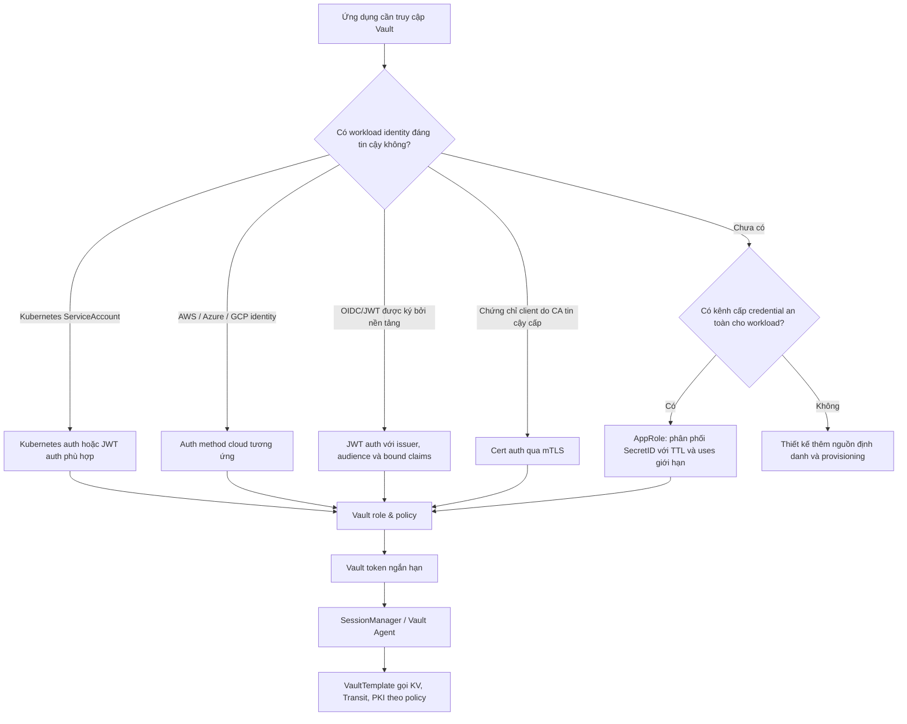
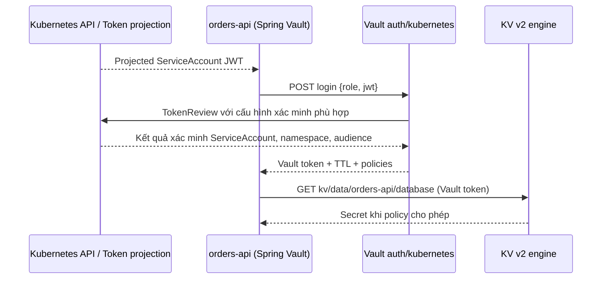
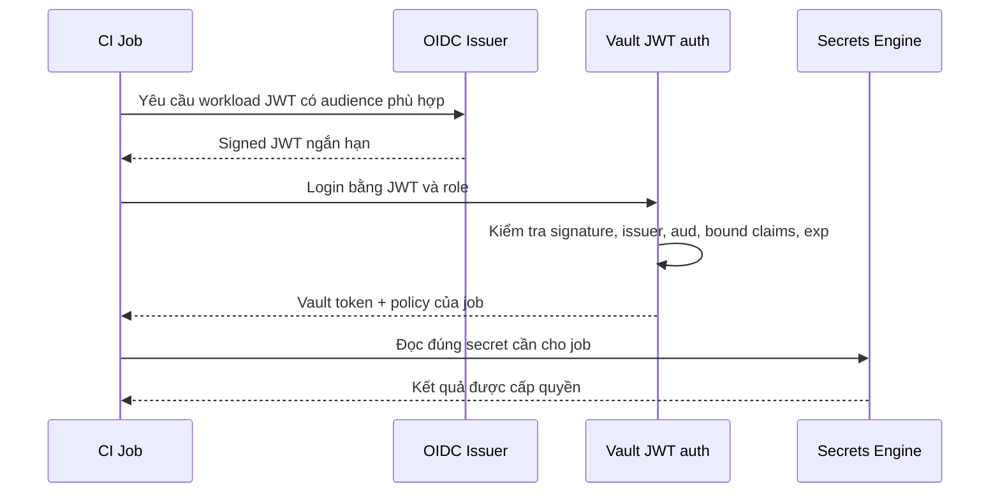
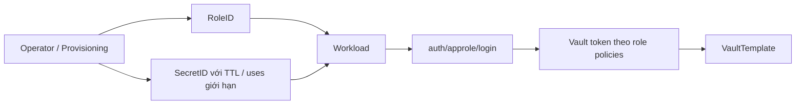

# Chọn phương thức xác thực theo môi trường chạy

Một ứng dụng Java dùng **Spring Vault** có thể đọc KV secrets qua `VaultTemplate`, yêu cầu Transit encryption hoặc chứng chỉ PKI chỉ sau khi có **Vault token hợp lệ**. Nhưng token ban đầu lấy từ đâu? Cách trả lời phụ thuộc vào **môi trường thực sự chạy workload**, nguồn định danh sẵn có, phương án bảo vệ bằng chứng đăng nhập và cách duy trì token trong suốt vòng đời ứng dụng.

Trong chương **Nền tảng xác thực**, bài này tập trung vào **quyết định chọn phương thức xác thực** cho HashiCorp Vault: Kubernetes, cloud identity, JWT/OIDC, AppRole, chứng chỉ, token được cấp ngoài và Vault Agent. Mục tiêu là có khả năng giải thích *vì sao* một lựa chọn phù hợp với hệ thống cụ thể, *ai* xác minh danh tính, *bằng chứng* được đưa đến đâu, và *điều kiện nào* khiến Vault từ chối đăng nhập. Sau khi xác thực, Vault policy vẫn quyết định quyền truy cập KV, Transit, PKI và các API khác.

## 1. Nguyên tắc lựa chọn: tận dụng danh tính workload đã được nền tảng chứng thực

Một dịch vụ `orders-api` chạy trên Kubernetes không nên phải mang theo Vault root token trong image. Tương tự, một EC2 instance có IAM identity không nhất thiết cần một AppRole SecretID lưu lâu dài nếu Vault đã được cấu hình xác minh AWS identity. Với batch job ở một máy chủ không có workload identity đáng tin cậy, AppRole có thể hợp lý **nếu** hệ thống giải quyết được cách phân phối SecretID an toàn.

Hãy bắt đầu bằng câu hỏi: **“Nền tảng nào có thể chứng minh đây là đúng workload mà không cần nhúng một bí mật dài hạn vào mã nguồn?”**



Sơ đồ là quy trình **ra quyết định**, không phải một thứ tự xếp hạng tuyệt đối. Một Kubernetes Pod chạy trên AWS có thể sử dụng cả danh tính ServiceAccount lẫn cơ chế cloud tùy thiết kế; phải đánh giá **ranh giới tin cậy và quyền** của từng lựa chọn, không chọn chỉ vì nền tảng có tên tương ứng.

## 2. Tách ba lớp: bằng chứng, đăng nhập và quyền truy cập

| Lớp | Câu hỏi | Ví dụ |
|---|---|---|
| **Danh tính và bằng chứng ban đầu** | Ai khẳng định workload này là ai? | Kubernetes cấp projected ServiceAccount JWT; cloud cấp bằng chứng IAM |
| **Vault authentication** | Vault kiểm tra bằng chứng theo quy tắc nào? | `auth/kubernetes` + role `orders-api`, hoặc `auth/jwt` + bound claims |
| **Vault authorization** | Token được làm gì sau đăng nhập? | Policy `orders-read` cho `read` tại `kv/data/orders-api/database` |

Không thể lấy một chuỗi `application.name=orders-api` do ứng dụng tự khai báo làm bằng chứng đáng tin cậy. Vault cần xác minh chữ ký, chứng chỉ, identity service hoặc credential được cấp qua kênh kiểm soát. Ngược lại, **đăng nhập thành công không cấp mặc định mọi quyền**: Vault token có thể hợp lệ nhưng vẫn bị từ chối gọi Transit hay đọc secret ngoài phạm vi policy.

Một login response điển hình có `auth.client_token`, `lease_duration`, `renewable` và policy liên quan. Trong Spring Vault, `ClientAuthentication.login()` trả `VaultToken`; nhiều auth method trả kiểu `LoginToken` kèm dữ liệu TTL/renewability. `SessionManager` sử dụng token cho những request kế tiếp, còn `VaultTemplate` làm việc với API Vault. Phương thức xác thực chọn ở đây quyết định **cách có token**, không thay thế quản lý phiên hoặc kiểm tra policy.

## 3. Ma trận lựa chọn theo môi trường chạy

| Môi trường workload | Phương thức thường phù hợp | Bằng chứng ban đầu | Điều kiện/rủi ro cần kiểm soát |
|---|---|---|---|
| **Kubernetes / OpenShift** | Kubernetes auth | Projected ServiceAccount JWT | Vault xác minh TokenReview; bind ServiceAccount, namespace, audience; bảo vệ token trong Pod |
| **Kubernetes có JWT issuer/JWKS phù hợp** | JWT auth | JWT do cluster ký | Xác minh issuer, signature, audience, claims; chú ý khác biệt với TokenReview về hiệu lực/thu hồi |
| **AWS EC2/ECS hoặc workload có AWS identity** | AWS IAM auth; EC2 auth nếu phù hợp | SigV4-signed identity request hoặc bằng chứng instance tương ứng | Ràng buộc IAM principal/account/role; bảo vệ metadata/credentials, tránh role quá rộng |
| **Azure workload có managed identity** | Azure auth | Bằng chứng identity do Azure cung cấp | Giới hạn identity/subscription/resource group/VM/VMSS theo auth role hỗ trợ |
| **GCP VM/workload có GCP identity** | GCP auth (IAM/GCE tùy trường hợp) | Bằng chứng service account hoặc instance được ký | Bound project/service account/instance; chỉ cấp quyền và API cần thiết |
| **CI/CD có OIDC workload token** | JWT auth | OIDC JWT ngắn hạn của CI platform | Ràng buộc issuer, audience, repository/project, branch/ref/environment; xử lý untrusted PR |
| **Máy chủ có managed client certificate** | Cert auth | Client certificate + private key | CA, EKU/identity mapping, quản lý khóa riêng, revoke/rotate, mTLS |
| **VM, batch scheduler, hệ thống legacy không có identity tích hợp** | AppRole | RoleID + SecretID | Cần kênh cấp SecretID, TTL, số lượt dùng, CIDR, response wrapping |
| **Vault Agent đã đăng nhập thay ứng dụng** | Token do Agent cấp cho client, hoặc kiến trúc Agent/proxy phù hợp | Vault token do Agent quản lý | Quyền file sink, cơ chế ứng dụng nhận token mới, một chủ thể sở hữu renew/revoke |
| **Developer chạy local** | Human identity qua Vault OIDC/CLI hoặc token dev phạm vi hẹp | Credential cá nhân hoặc token ngắn hạn | Tách dev/prod; không dùng root token, không commit hoặc đưa vào shell history |

Ma trận không bảo đảm tất cả phương thức đều được autoconfigure trong **mọi phiên bản** Spring Vault hoặc Spring Cloud Vault. Khi chọn, cần đối chiếu capability của phiên bản dùng trong ứng dụng; có thể dùng Spring Vault client trực tiếp hoặc Vault Agent trong trường hợp không có tích hợp cấp cao sẵn có.

### Tiêu chí đánh giá khi có nhiều lựa chọn

| Tiêu chí | Câu hỏi kiểm tra | Ưu tiên khi chọn |
|---|---|---|
| **Nguồn tin cậy** | Bằng chứng do hệ thống nào cấp và Vault xác minh ra sao? | Nguồn identity có cơ chế xác minh, không do ứng dụng tự khai |
| **Secret zero** | Có phải nhúng thêm credential tĩnh vào image/Git không? | Giảm credential tĩnh, dùng workload identity nếu khả thi |
| **Phạm vi định danh** | Role ràng buộc đến ứng dụng, namespace, account, project nào? | Mỗi workload/môi trường có identity và role riêng |
| **Giới hạn thời gian** | Credential ban đầu và Vault token sống bao lâu, ai xoay vòng? | TTL vừa đủ, refresh an toàn, revoke được |
| **Vận hành** | Vault/cơ chế identity gián đoạn thì app làm gì? | Retry/backoff và cảnh báo, không fallback sang quyền cao |
| **Audit** | Có phân biệt được workload A với workload B không? | Dấu vết theo role/identity, không cần đưa token vào log |
| **Hỗ trợ client** | Spring Vault hoặc Agent có hỗ trợ luồng này không? | Có đường tích hợp rõ và kiểm thử được |

## 4. Kubernetes: lựa chọn phổ biến cho dịch vụ Java dạng Pod

Với Pod chạy dưới Kubernetes ServiceAccount riêng, **Kubernetes auth** thường là điểm khởi đầu tự nhiên. Nền tảng cấp JWT cho Pod, Vault cấu hình kết nối đến Kubernetes API để xác minh token bằng cơ chế TokenReview. Vault role ràng buộc ServiceAccount và namespace, có thể thêm audience; Vault phát token theo policy đã cấu hình.



### 4.1. Cấp ServiceAccount token đúng audience

Ví dụ phần YAML **rút gọn** trong Pod template của Deployment (các trường khác như `containers.image`, `selector` phải được khai báo trong manifest đầy đủ):

```yaml
spec:
  serviceAccountName: orders-api
  automountServiceAccountToken: false
  volumes:
    - name: vault-workload-token
      projected:
        sources:
          - serviceAccountToken:
              path: token
              audience: vault
              expirationSeconds: 600
  containers:
    - name: orders-api
      image: registry.example.invalid/orders-api:1.0
      volumeMounts:
        - name: vault-workload-token
          mountPath: /var/run/secrets/vault-identity
          readOnly: true
```

`automountServiceAccountToken: false` ngăn việc tự động mount ServiceAccount token mặc định; phần projected volume bên trên chủ động yêu cầu một token riêng. Kubernetes quản lý việc luân chuyển projected token theo thời gian. Đây vẫn là **credential nhạy cảm** đối với bất kỳ tiến trình nào có quyền đọc file trong Pod.

Audience `vault` chỉ có ý nghĩa nếu Vault role và cấu hình xác minh chấp nhận cùng audience. Không mặc định rằng token tự mount tại `/var/run/secrets/kubernetes.io/serviceaccount/token` có audience phù hợp với mọi Vault role.

### 4.2. Ràng buộc Vault role và policy

Ví dụ CLI **giả định admin đã bật auth method và cấu hình tích hợp với Kubernetes API**:

```bash
vault write auth/kubernetes/role/orders-api \
  bound_service_account_names=orders-api \
  bound_service_account_namespaces=production \
  audience=vault \
  policies=orders-read \
  ttl=15m
```

Role này giới hạn đúng ServiceAccount `orders-api` trong namespace `production`. Nếu role chấp nhận `*` cho cả tên lẫn namespace thì phạm vi bị mở rộng đáng kể; chỉ dùng wildcard khi có lý do và biện pháp ràng buộc bổ sung. Vault còn cần cấu hình Kubernetes host/CA/TokenReview reviewer phù hợp; lệnh tạo role đơn lẻ không đủ để auth hoạt động.

Ví dụ policy cho ứng dụng chỉ được đọc **một** secret KV v2:

```hcl
path "kv/data/orders-api/database" {
  capabilities = ["read"]
}
```

Đường dẫn policy của KV v2 có `/data/` cho API đọc phiên bản secret; khi dùng CLI `vault kv get kv/orders-api/database`, đường dẫn hiển thị có thể không chứa đoạn đó. Chính sách không cấp quyền `transit/encrypt/*`, `pki/issue/*` hay secret của ứng dụng khác.

### 4.3. Cấu hình Spring Cloud Vault

Ví dụ cho ứng dụng Spring Boot có dependency **Spring Cloud Vault** tương thích:

```yaml
spring:
  cloud:
    vault:
      uri: https://vault.example.internal:8200
      authentication: KUBERNETES
      kubernetes:
        role: orders-api
        kubernetes-path: kubernetes
        service-account-token-file: /var/run/secrets/vault-identity/token
```

Ứng dụng dùng Spring Vault **thuần** cần tạo và nối `ClientAuthentication` tương ứng với `SessionManager`/`VaultTemplate` bằng API của phiên bản đang dùng; việc thêm YAML `spring.cloud.vault.*` không tự có hiệu lực nếu không có Spring Cloud Vault. Endpoint phải dùng TLS, truststore phải nhận diện đúng CA và hostname của Vault.

Sau đăng nhập, code nghiệp vụ không nên biết đường login:

```java
import org.springframework.vault.core.VaultOperations;
import org.springframework.vault.support.VaultResponse;

public final class DatabaseSettingsReader {
    private final VaultOperations vault;

    public DatabaseSettingsReader(VaultOperations vault) {
        this.vault = vault;
    }

    public VaultResponse readSettings() {
        // Yêu cầu policy read trên đường dẫn API KV v2.
        return vault.read("kv/data/orders-api/database");
    }
}
```

`VaultOperations` phải được cấu hình phiên và xác thực đúng; lớp này chỉ gọi API. Kết quả có thể `null` khi không có dữ liệu; ứng dụng thực nên kiểm tra cấu trúc `data` của KV v2 và không log giá trị secret.

### Khi nào chọn JWT auth thay Kubernetes auth?

Vault **JWT auth** có thể xác minh JWT bằng khóa, JWKS hoặc cấu hình issuer phù hợp, ràng buộc `iss`, `aud` và claims. Cách này có thể hữu ích khi một nền tảng phát workload JWT tương thích nhưng không thể/không muốn tích hợp TokenReview. Với ServiceAccount token của Kubernetes, JWT auth không có cùng ngữ nghĩa xác minh sống qua TokenReview: một JWT có chữ ký hợp lệ có thể còn được chấp nhận đến khi hết hạn ngay cả khi ServiceAccount bị thay đổi hoặc xóa, tùy cấu hình. Vì vậy cần cân nhắc TTL ngắn và yêu cầu thu hồi nhanh.

**Kubernetes auth** và **JWT auth** là hai auth method khác nhau; không cấu hình cùng một path/role rồi mặc định chúng tương đương.

## 5. AWS, Azure, GCP: tận dụng managed identity của cloud

Với workload có danh tính cloud sẵn có, Vault có các auth method tích hợp. Mục tiêu là để Vault xác minh bằng chứng danh tính do cloud cung cấp, tránh phải nhúng Vault token dài hạn vào image hoặc cấu hình ứng dụng.

| Nền tảng | Hướng tiếp cận | Điều kiện phải rà soát |
|---|---|---|
| **AWS** | AWS IAM auth thường dựa trên request STS `GetCallerIdentity` được ký SigV4; một số trường hợp dùng AWS EC2 auth | Chính xác account/ARN/principal, cách lấy AWS credentials, quyền metadata/role, trust policies |
| **Azure** | Azure auth dựa trên managed identity và dữ liệu định danh được Vault xác minh | Subscription, resource group, VM/VMSS/managed identity, truy cập metadata endpoint |
| **GCP** | GCP IAM/GCE auth dựa trên identity và bằng chứng được ký tương ứng | Service account/project, phạm vi role, nguồn token và lifetime |

Trình tự khái niệm:

```text
Cloud runtime / identity provider
    -> chứng minh instance, task hoặc workload identity
    -> Spring Vault auth adapter hoặc Vault Agent
    -> Vault cloud auth mount + role binding
    -> Vault token với TTL/policies
    -> VaultTemplate gọi secret engine
```

Điểm cần kiểm soát là **role binding theo identity thực**, không chỉ theo tên instance do workload tự đặt. Trong môi trường AWS, quyền gọi metadata service hoặc lấy IAM credentials có thể trở thành đường bị lợi dụng khi ứng dụng có lỗ hổng SSRF/remote code execution; ràng buộc Vault role và hạn chế quyền của workload giúp giảm phạm vi ảnh hưởng. Trong Azure/GCP cũng cần bảo vệ endpoint/credential cấp identity tương ứng.

Nếu thư viện Spring Vault/Spring Cloud Vault phiên bản sử dụng không có adapter hoặc kiểu cấu hình phù hợp với biến thể cloud identity cần dùng, cân nhắc Vault Agent hoặc một tích hợp chính thức tương thích. **Không giả định** rằng cứ triển khai trên AWS/Azure/GCP là một tên auth method có thể tự động hoạt động mà không cấu hình trust và role tại Vault.

### Workload chạy trên Kubernetes được quản lý bởi cloud

Một Pod trên EKS, AKS hoặc GKE có thể có nhiều danh tính (Kubernetes ServiceAccount, cloud workload identity, service account IAM). Hãy chọn **danh tính thực sự được dùng để xin token và Vault được cấu hình xác minh**, rồi ràng buộc tối thiểu. Đừng trộn claims của Kubernetes token với kỳ vọng của AWS IAM/Azure/GCP auth nếu chúng không cùng giao thức.

## 6. CI/CD và nền tảng phát JWT/OIDC

Nhiều hệ thống CI/CD cấp **OIDC JWT ngắn hạn** cho một job thay vì để pipeline giữ SecretID/Vault token dài hạn. Khi Vault có thể xác minh issuer và chữ ký, **JWT auth** là một lựa chọn tốt.

Ví dụ job `deploy-production` có các claims đại diện cho repository, ref/branch, environment và audience; role Vault cần ràng buộc **đúng các claims do issuer thực sự phát**, chẳng hạn:

```text
iss:  https://issuer.ci.example.invalid
aud:  vault-prod
sub:  repo:team/orders:ref:refs/heads/main
environment: production
exp:  (thời điểm hết hạn)
```

Đây chỉ là định dạng **minh họa**, không phải claim schema của mọi nhà cung cấp CI. Cần kiểm tra JWK/issuer, audience, ký token, thời gian token, `bound_claims` hoặc `bound_subject` theo cấu hình Vault role và hợp đồng chính thức của CI platform.



**Đặc biệt với pipeline nhận đóng góp từ bên ngoài:** một job chạy cho pull request không đáng tin cậy không được mặc nhiên mang cùng bound claims và role với job deploy production. Các điều kiện `repository/project`, `ref`, `environment`, `workflow` hoặc các claim tương ứng nên được ràng buộc và quản trị theo nền tảng. Vault role nên phân tách đọc secret cho build/test với deploy production.

JWT auth dành cho workload có JWT do **issuer được Vault tin cậy** cấp; không nhận JWT tự ký bằng bí mật trong image rồi coi như đã giải được bài toán danh tính ban đầu.

## 7. AppRole: khi môi trường không có workload identity tự nhiên

**AppRole auth** phù hợp với máy chủ, batch scheduler, agent hoặc hệ thống legacy có **kênh provisioning đáng tin cậy** nhưng không có JWT/managed identity thuận tiện. Vault role được nhận diện bởi RoleID; đăng nhập cần thêm SecretID được cấp riêng và phải bảo vệ như một credential.



### Điều kiện để AppRole là lựa chọn hợp lý

- SecretID được chuyển đến **đúng workload** qua kênh an toàn, không nằm trong Git, Docker image hoặc log.
- SecretID có thời gian sống và số lần sử dụng vừa đủ, được cấp riêng theo instance/job khi khả thi.
- Quy trình thay SecretID và re-login xử lý được trường hợp đăng nhập lại sau khi hết TTL token.
- Nếu dùng **response wrapping**, bên nhận xác thực nguồn Vault, giới hạn wrapping TTL và unwrap một lần đúng cách; wrapping không giải quyết vấn đề xác minh chính workload bằng phép màu.
- Role và policy giới hạn ứng dụng, môi trường và đường dẫn API thực tế.

Ví dụ tạo một AppRole cho job xử lý theo lô (giả định Vault đã bật AppRole mount):

```bash
vault write auth/approle/role/batch-reconciler \
  token_policies=batch-reconciler-read \
  token_ttl=15m \
  secret_id_ttl=30m \
  secret_id_num_uses=5
```

Các giá trị là **minh họa chính sách**, cần điều chỉnh theo số lần job có thể đăng nhập trong thực tế. Nếu một job chạy lâu và phải re-login nhiều lần, SecretID `num_uses=1` có thể khiến lần đăng nhập sau thất bại; khi đó provisioning cần cung cấp SecretID mới hoặc điều chỉnh thiết kế. Tránh tăng vô hạn số lần dùng chỉ để che lỗi về vòng đời credential.

Request đăng nhập theo API có dạng:

```http
POST /v1/auth/approle/login
Content-Type: application/json

{
  "role_id": "<RoleID do provisioning cung cấp>",
  "secret_id": "<SecretID nhạy cảm, không ghi log>"
}
```

Không đưa SecretID thật vào ví dụ, test report hay môi trường demo dùng chung. Tên RoleID có thể được coi ít nhạy cảm hơn SecretID, nhưng vẫn nên kiểm soát việc công bố thông tin mô tả hạ tầng.

## 8. Cert auth: phù hợp khi đã có cơ chế quản lý chứng chỉ workload

Nếu máy chủ hoặc thiết bị được cấp **client certificate** từ hệ thống PKI đáng tin cậy, Vault `cert` auth có thể sử dụng bằng chứng sở hữu private key qua TLS client authentication để cấp Vault token. Đây là hướng hợp lý khi tổ chức đã có quy trình phát hành, bảo vệ và thu hồi chứng chỉ cho đúng workload.

Các điều kiện chính:

1. Vault tin cậy CA/certificate chain và cấu hình cert auth role ràng buộc danh tính cần thiết.
2. Ứng dụng hoặc Agent sử dụng **client certificate kèm private key** đúng cách; truststore server vẫn phải xác minh TLS của Vault.
3. Private key được lưu ở keystore/secret store an toàn, không commit hoặc nhúng trực tiếp trong image.
4. Có cơ chế thay chứng chỉ trước hết hạn; lập kế hoạch khi key bị lộ hoặc chứng chỉ bị revoke.
5. Kiểm tra hành vi khi chứng chỉ hết hạn và khi Vault token đã phát trước đó vẫn còn TTL: vòng đời chứng chỉ và vòng đời token **khác nhau**.

Cert auth khác với **Vault PKI secrets engine**: một cái dùng chứng chỉ **để đăng nhập Vault**, cái kia **phát hành chứng chỉ** cho ứng dụng sau khi ứng dụng có quyền. Tránh dùng hai khái niệm này như một.

## 9. Token có sẵn và Vault Agent: lựa chọn khi auth đã được ủy quyền

Nếu một thành phần đã đăng nhập Vault thay cho ứng dụng, Java có thể nhận **Vault token đã cấp** qua file sink hoặc kênh an toàn, sau đó dùng `TokenAuthentication`.

```java
import org.springframework.vault.authentication.ClientAuthentication;
import org.springframework.vault.authentication.TokenAuthentication;

public final class ExternalTokenClientAuthentication {
    public static ClientAuthentication fromIssuedToken(String issuedToken) {
        if (issuedToken == null || issuedToken.isBlank()) {
            throw new IllegalArgumentException("Issued Vault token is required");
        }
        // Đã là Vault token; không thực hiện Kubernetes/AppRole/JWT login.
        return new TokenAuthentication(issuedToken);
    }
}
```

**Không** truyền Kubernetes JWT hoặc AppRole SecretID vào `TokenAuthentication`: chúng chưa phải Vault token. Khi Vault Agent quản lý việc đăng nhập và làm mới, ứng dụng cần làm rõ **token A trong bộ nhớ** được thay bằng **token B từ sink file** như thế nào. Nếu `TokenAuthentication` khởi tạo một lần bằng A và Agent re-login để ghi B, client Java có thể tiếp tục giữ A đến khi nó hết hạn.

Các lựa chọn vận hành gồm restart theo vòng đời token, cơ chế refresh/swap session an toàn, hoặc kiến trúc Agent/proxy đã được hỗ trợ. Chỉ đổi biến môi trường của container hoặc ghi lại file không tự biến một instance `TokenAuthentication(A)` thành `TokenAuthentication(B)`.

Với **Vault Agent auto-auth**, Agent có thể sở hữu renew/re-login, còn Spring Vault chỉ sử dụng token. Cần tránh việc Agent và ứng dụng cùng tự quyết định revoke/renew gây xung đột; ghi rõ trách nhiệm của mỗi thành phần. Với workload chạy ngắn, token được cấp riêng có TTL nhỏ và được thu hồi khi kết thúc có thể đơn giản hơn việc quản lý một session lâu dài.

## 10. Local development, test và bài toán không dùng root token

Tại máy developer hoặc môi trường test, cần cách cấu hình dễ tái lập nhưng vẫn tách bạch với production:

| Hoàn cảnh | Lựa chọn đề xuất | Ràng buộc |
|---|---|---|
| Developer local cần thử đọc KV | Vault CLI/OIDC cấp token cá nhân hoặc dev token hẹp | Không dùng token production; không commit hoặc log; TTL ngắn |
| Test đơn vị cho code nghiệp vụ | Mock/stub `VaultOperations` hoặc `ClientAuthentication` | Không chứng minh auth/policy thật; chỉ kiểm tra logic Java |
| Integration test với Vault cô lập | Vault test instance cùng auth method với production khi thực tế khả thi | Tạo policy/role riêng, token/test data giả, cleanup |
| CI test pipeline cần secret từ Vault | JWT/OIDC nếu CI hỗ trợ | Ràng buộc audience/repository/ref và phạm vi secret, chặn untrusted contexts |

**Root token** có quyền rất rộng, chỉ phù hợp các tình huống quản trị/break-glass được kiểm soát. Không dùng root token trong ứng dụng hoặc integration test thông thường để “giải quyết” lỗi `403`, vì nó che giấu lỗi policy và tạo thói quen nguy hiểm khi mang sang production.

## 11. Khi đã chọn auth method: ai quản lý token và lease?

Việc chọn phương thức xác thực chỉ giải quyết chặng đầu. Một dịch vụ chạy liên tục phải còn tính đến TTL, renewability và thời hạn của **credential ban đầu**:

```text
Workload credential: JWT / cloud proof / SecretID / certificate
        |
        v
ClientAuthentication.login() -> VaultToken / LoginToken
        |
        v
SessionManager hoặc Vault Agent xử lý phiên
        |
        v
VaultTemplate -> KV, Transit, PKI, database secrets engine
        |
        +--> Secret lease hoặc certificate validity (vòng đời riêng)
```

Ví dụ token Vault TTL 15 phút, còn database credential động được cấp lease 1 giờ. Hai khoảng thời gian không đồng nhất: session cần renew/re-login để **gọi Vault**, trong khi database credential có **lease riêng** và có thể bị ảnh hưởng khi token cấp nó bị revoke. KV v2 thường không mang dynamic lease như credential database; certificate PKI có ngày hiệu lực riêng.

| Thành phần | Ai tạo/cấp? | Làm mới bằng gì? | Điều gì xảy ra khi thất bại? |
|---|---|---|---|
| Kubernetes JWT | Kubernetes | Kubelet/projected token rotation | Re-login Vault có thể thất bại khi JWT hết hạn hoặc sai audience |
| CI OIDC JWT | CI identity issuer | Cơ chế job/platform phát token mới | Job không thể login nếu không xin được JWT hợp lệ |
| AppRole SecretID | Vault/provisioning | Phát SecretID mới qua kênh an toàn | Re-login thất bại nếu SecretID quá TTL/uses |
| Vault login token | Vault auth method | Renew nếu được phép hoặc re-login | API Vault bị từ chối khi token hết hạn/revoke |
| Dynamic secret lease | Secrets engine/Vault | Renew lease theo engine/policy nếu hỗ trợ | Credential có thể hết hạn hoặc bị thu hồi |

Với Spring Vault, một `LifecycleAwareSessionManager` có thể quản lý token theo TTL; nhưng không có nghĩa nó tự tái tạo được credential từ nền tảng nếu nguồn ban đầu đã mất. Một `SimpleSessionManager` thường giữ token và không tự quản lý renew theo TTL. Nếu dùng token được Agent cấp ngoài, người triển khai phải xử lý thay token trong client theo hợp đồng của Agent.

### Quyền không đến từ loại auth method

Đối với cùng một ứng dụng `orders-api`, policy có thể gồm:

```hcl
# Đọc một key KV v2
path "kv/data/orders-api/database" {
  capabilities = ["read"]
}

# Gọi Transit encrypt của key đã được cấp quyền
path "transit/encrypt/orders-data" {
  capabilities = ["update"]
}
```

Nếu dịch vụ cần PKI issue, phải thêm **endpoint PKI chính xác và quyền tương ứng**, thường là `update` ở `pki/issue/<role>`, sau khi kiểm soát role PKI. Không cấp quyền wildcard hoặc admin chỉ vì ứng dụng đã đăng nhập thành công. Các auth role khác nhau có thể cùng map về một policy, nhưng nên giữ ranh giới workload và môi trường rõ ràng.

## 12. Kịch bản chọn sai và cách sửa

### Tình huống A: Kubernetes Pod dùng AppRole SecretID trong Docker image

**Vấn đề:** credential tĩnh có thể bị lộ qua image registry, CI artifact hoặc máy developer. Hơn nữa, SecretID dùng chung nhiều Pod làm giảm khả năng phân biệt từng workload.

**Hướng sửa:** ưu tiên ServiceAccount identity và Kubernetes auth; ràng buộc namespace, ServiceAccount, audience, TTL và policy hẹp. Nếu tổ chức vẫn cần AppRole, phải phân phối SecretID riêng qua cơ chế provisioning an toàn, không đưa vào image.

### Tình huống B: CI job dùng JWT nhưng role Vault không bind ref/environment

**Vấn đề:** token hợp lệ của job ở nhánh không tin cậy có thể được trao policy deploy production nếu chỉ ràng buộc issuer/audience quá rộng.

**Hướng sửa:** bind các claims đúng schema của issuer, tách role theo môi trường và khóa quyền phát OIDC token/deploy workflow. Kiểm thử đăng nhập từ job không được phép phải thất bại.

### Tình huống C: EC2 dùng một Vault token dài hạn chung cho mọi instance

**Vấn đề:** khó truy nguồn instance, token có phạm vi lộ lớn, không xoay vòng tốt khi máy bị thay.

**Hướng sửa:** đánh giá AWS IAM/EC2 auth với Vault role ràng buộc đúng identity; hoặc triển khai provisioning cấp credential riêng từng instance có TTL và revoke rõ ràng.

### Tình huống D: Vault Agent đổi token nhưng Java vẫn giữ token cũ

**Vấn đề:** App chạy tốt lúc khởi động rồi lỗi khi A hết hạn; file chứa B không khiến token lưu trong `TokenAuthentication(A)` tự đổi.

**Hướng sửa:** chọn cơ chế reload/swap client hoặc restart có kiểm soát; kiểm tra việc renew và re-auth của Agent. Không tạo login loop liên tục bằng token đã bị revoke.

### Tình huống E: Chọn Cert auth nhưng không ai xoay vòng private key/certificate

**Vấn đề:** app không thể login lại sau khi certificate hết hạn, trong khi Vault token cũ cũng dần hết hạn.

**Hướng sửa:** chỉ dùng Cert auth khi CA, key management và cơ chế rotate/revoke có owner thực sự, có test trước thời điểm chứng chỉ hết hạn.

## 13. Kiểm thử lựa chọn phương thức xác thực

Kiểm thử phải tách **bằng chứng được Vault chấp nhận** khỏi **policy sau đăng nhập** và **vòng đời phiên**. Tránh dùng một token quyền cao để biến mọi ca test thành thành công.

| Ca kiểm thử | Ví dụ kích hoạt | Kết quả mong đợi |
|---|---|---|
| **Positive login** | Pod `orders-api`, JWT đúng audience và namespace | Vault login thành công và nhận token đúng role |
| **Sai workload identity** | ServiceAccount khác, namespace khác, principal khác | Vault từ chối tại auth method |
| **Sai audience/issuer/claim** | JWT CI đúng chữ ký nhưng `aud` hoặc ref không khớp | JWT auth từ chối trước khi truy cập KV |
| **Credential ban đầu hết hạn** | Projected JWT cũ, AppRole SecretID quá TTL/uses, cert expired | Re-login thất bại; không fallback sang root token |
| **Login đúng, policy sai** | Token `orders-read` đọc secret `other-team` | API secret engine bị từ chối, không tự nâng quyền |
| **Token đến cuối TTL/max TTL** | Auth role cấp token ngắn hạn | Renew/re-login theo cấu hình hoặc báo lỗi chính xác |
| **Vault tạm unavailable** | Ngắt kết nối trong test cô lập | Retry có giới hạn, backoff/jitter và quan sát lỗi |
| **Rotate credential ngoài** | Agent ghi B, Java đang giữ A | Cơ chế reload/restart nhận B đúng như thiết kế |
| **TLS trust lỗi** | CA/hostname không hợp lệ | Kết nối thất bại; không tắt TLS verification |

Khi đánh giá kết quả, hãy ghi **auth mount, role, loại lỗi, thời gian login/renew, số lần retry**, không ghi raw JWT, SecretID, Vault token, client certificate private key hoặc response chứa secret. Audit log của Vault hỗ trợ điều tra quyền gọi API, nhưng quyền đọc audit log phải được quản lý chặt.

### Mẫu bảng quyết định cho một ứng dụng mới

Trước khi tạo code, nhóm triển khai nên hoàn thành tối thiểu các trường sau:

| Trường thiết kế | Ví dụ `orders-api` |
|---|---|
| Runtime | Kubernetes namespace `production` |
| Nguồn workload identity | ServiceAccount `orders-api`, projected JWT audience `vault` |
| Auth mount và role | `auth/kubernetes`, role `orders-api` |
| Ràng buộc | ServiceAccount, namespace, audience; chỉ cluster đã tin cậy |
| Token policy | `orders-read`, chỉ `read` KV v2 path yêu cầu |
| TTL và lifecycle | Token ngắn hạn; Spring Vault manager hỗ trợ renew/re-login |
| Chủ thể đổi bootstrap credential | Kubernetes/kubelet xoay projected JWT |
| Kiểm soát TLS | HTTPS Vault, CA/truststore và hostname đúng |
| Quan sát và failure mode | Login/renew failures, network errors, app readiness và retry giới hạn |

## 14. Bài thực hành: chọn phương thức cho bốn workload

Giả sử công ty sử dụng một Vault cluster (với các auth mount được quản trị phù hợp), cần cấp secret tối thiểu cho bốn loại ứng dụng:

1. `orders-api`: Spring Boot trong Kubernetes production; có ServiceAccount riêng.
2. `ledger-worker`: Java process trên AWS EC2; instance đã có IAM role riêng.
3. `deploy-job`: pipeline chạy theo sự kiện release, có OIDC JWT do nền tảng CI cấp.
4. `nightly-reconciler`: chương trình batch chạy trên VM nội bộ, không có cloud identity/Kubernetes nhưng có provisioning service phân phối SecretID an toàn.

**Nhiệm vụ:**

- Chọn auth method cho từng workload và nêu gốc tin cậy của credential ban đầu.
- Xác định ít nhất ba ràng buộc danh tính ở Vault role hoặc hệ thống phát token đối với từng lựa chọn.
- Đề xuất ai quản lý việc làm mới bằng chứng ban đầu, Vault token và secret lease nếu có.
- Nêu một ca login bị từ chối, một ca policy từ chối và một ca token hết hạn để kiểm thử từng workload.
- Giải thích vì sao không dùng chung một Vault token có quyền đọc toàn bộ KV mount cho cả bốn workload.

**Lời giải tham khảo:**

| Workload | Gợi ý auth method | Ràng buộc cần ưu tiên | Trách nhiệm vòng đời |
|---|---|---|---|
| `orders-api` | Kubernetes auth | Bound ServiceAccount, namespace, audience | Kubelet xoay JWT; Spring Vault quản lý Vault token |
| `ledger-worker` | AWS IAM auth | Bound IAM role/ARN, account và context môi trường | Cloud cung cấp identity; client/Agent quản lý Vault token |
| `deploy-job` | JWT auth | Issuer, audience, repo/ref/environment hoặc các claims thực tế | CI cấp JWT ngắn hạn, token Vault gắn vòng đời job |
| `nightly-reconciler` | AppRole auth | RoleID/SecretID, TTL/uses/CIDR nếu phù hợp | Provisioning cấp SecretID; client/Agent làm mới Vault token |

Không có lời giải duy nhất cho mọi tổ chức: nếu `nightly-reconciler` thực ra có client certificate được quản lý tốt, Cert auth cũng là lựa chọn đáng cân nhắc. Nếu `ledger-worker` không thể sử dụng AWS identity trong kiến trúc thực tế, cần thiết kế phương thức phù hợp khác và chứng minh đường cấp credential an toàn.

### Tiêu chí chấm bài thực hành

| Tiêu chí | Dấu hiệu đạt |
|---|---|
| Chọn đúng nguồn identity | Có bằng chứng đáng tin cậy từ đúng runtime |
| Auth role ràng buộc hẹp | Không chỉ dựa vào một tên application do client tự khai |
| Không để lộ secret zero | Không nhúng root/Vault token hoặc SecretID tĩnh trong image/Git |
| Policy tách biệt | Login đúng vẫn có thể bị từ chối đường dẫn không được phép |
| Vòng đời rõ ràng | Phân biệt credential ban đầu, Vault token và secret lease |
| Có kế hoạch vận hành | Xác minh TLS, rotation/re-login, retry và kiểm thử negative cases |

## 15. Câu hỏi tự kiểm tra

1. Vì sao Kubernetes ServiceAccount JWT chưa phải là Vault token? Nó phải được gửi tới auth method nào khi chọn Kubernetes auth?
2. Kubernetes auth và JWT auth có thể dùng cùng một Kubernetes-issued JWT trong điều kiện nào, và khác nhau gì về TokenReview?
3. Một Pod trên EKS nhất thiết phải dùng AWS IAM auth hay không? Lựa chọn cần dựa trên điều gì?
4. Với CI OIDC JWT, chỉ kiểm tra chữ ký và issuer đã đủ để cấp quyền deploy production chưa? Vì sao?
5. Vai trò của RoleID và SecretID trong AppRole khác nhau ra sao? Cần bảo vệ thành phần nào đặc biệt?
6. Nếu Java dùng `TokenAuthentication` với token do Agent cấp, ai làm mới token và ứng dụng nhận token thay thế bằng cách nào?
7. Cert auth dùng chứng chỉ **đăng nhập**, còn PKI secrets engine dùng chứng chỉ để làm gì?
8. Auth role và policy khác nhau như thế nào khi một token đọc KV được nhưng Transit bị `403`?
9. Vì sao `renewable=true` không đồng nghĩa token có thể được gia hạn vô thời hạn?
10. Trong bảng quyết định cho ứng dụng mới, thông tin nào giúp chứng minh secret zero đã có gốc tin cậy và vòng đời rõ ràng?

**Nguyên tắc cốt lõi:** **Chọn auth method từ nguồn định danh thực của workload**, ràng buộc role theo môi trường và đặc tính danh tính, rồi cấp Vault token có policy/TTL tối thiểu. Spring Vault cung cấp `ClientAuthentication`, `SessionManager` và `VaultTemplate` để sử dụng các khả năng đó; tính an toàn phụ thuộc vào cả chuỗi **nền tảng → bằng chứng → Vault auth role → Vault policy → token lifecycle → secrets engine**.

## Tài liệu tham khảo

- [Spring Vault — Authentication](https://docs.spring.io/spring-vault/reference/vault/authentication.html): các auth method và vòng đời token trong Spring Vault.
- [Spring Cloud Vault — Authentication](https://docs.spring.io/spring-cloud-vault/reference/authentication.html): cấu hình Spring Boot theo môi trường triển khai.
- [HashiCorp Vault — Authentication](https://developer.hashicorp.com/vault/docs/auth): khái niệm auth methods và token.
- [HashiCorp Vault — Kubernetes Auth](https://developer.hashicorp.com/vault/docs/auth/kubernetes): TokenReview, role bindings, JWT và Kubernetes integration.
- [HashiCorp Vault — JWT/OIDC Auth](https://developer.hashicorp.com/vault/docs/auth/jwt): JWT verification, issuer/audience/bound claims và OIDC workflows.
- [HashiCorp Vault — AppRole Auth](https://developer.hashicorp.com/vault/docs/auth/approle): RoleID, SecretID, response wrapping và các ràng buộc.
- [HashiCorp Vault — Cloud Auth Methods](https://developer.hashicorp.com/vault/docs/auth): AWS, Azure, GCP và cơ chế xác minh identity.
- [HashiCorp Vault — Cert Auth](https://developer.hashicorp.com/vault/docs/auth/cert): xác thực bằng client certificate.
- [HashiCorp Vault — Vault Agent Auto-Auth](https://developer.hashicorp.com/vault/docs/agent-and-proxy/autoauth): token sink và quản lý tự động.
