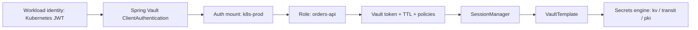

# Mount path của auth method và role được sử dụng

Trong **Spring Vault**, ứng dụng Java thường gọi `VaultTemplate` để đọc KV secrets, mã hóa bằng Transit hoặc yêu cầu chứng chỉ PKI. Trước khi gọi các API này, ứng dụng cần được HashiCorp Vault xác thực và nhận **Vault token**. Hai tham số rất dễ nhầm khi thiết lập đăng nhập là **mount path của auth method** và **role được dùng tại mount đó**.

Ví dụ, dịch vụ `orders-api` trên Kubernetes đăng nhập bằng role `orders-api` tại mount `auth/k8s-prod`. Nếu Java gửi đúng JWT nhưng lại gọi `auth/kubernetes/login`, hoặc gọi đúng mount nhưng chọn role `orders-staging`, kết quả vẫn có thể là đăng nhập thất bại. Việc đổi mount path hoàn toàn không đồng nghĩa đổi loại auth method; việc đổi role có thể thay đổi đối tượng được chấp nhận và policy nhận được.

Bài này thuộc chương **Nền tảng xác thực**. Trọng tâm là hiểu chính xác **mount path → login endpoint → auth role → Vault token/policy**, sau đó cấu hình nhất quán giữa Vault server, Spring Vault/Spring Cloud Vault và workload. Các khái niệm áp dụng cho Kubernetes, AppRole, JWT và những auth method có mô hình role tương ứng.

## 1. Phân biệt bốn khái niệm chính

| Khái niệm | Trả lời câu hỏi | Ví dụ |
|---|---|---|
| **Auth method type** | Vault dùng cơ chế nào để xác minh bằng chứng? | `kubernetes`, `approle`, `jwt`, `aws`, `cert` |
| **Auth mount path** | Instance auth method đó được gắn tại đường dẫn nào trong Vault? | `k8s-prod`, tương ứng prefix API `auth/k8s-prod` |
| **Auth role** | Bằng chứng của workload nào được chấp nhận, và token nhận policy/TTL gì? | `orders-api` giới hạn đúng ServiceAccount và namespace |
| **Vault policy** | Token đã được phát được thực hiện API nào? | Quyền `read` tại `kv/data/orders-api/database` |

Thêm hai thành phần liên quan nhưng khác vai trò:

- **Login endpoint** là URL cụ thể của auth method để ứng dụng gửi yêu cầu đăng nhập, ví dụ `POST /v1/auth/k8s-prod/login`.
- **Secrets engine mount** là nơi các API sau đăng nhập hoạt động, ví dụ `kv` (KV v2), `transit` hoặc `pki`. Mount của secrets engine **không** phải mount xác thực.

Một sơ đồ ngắn:



Một **role name** như `orders-api` không có tính toàn cục: cùng một Vault namespace có thể có role `orders-api` ở hai auth mount khác nhau. Vai trò và quyền của hai role đó vẫn độc lập.

### Cách đọc đường dẫn API

Với Kubernetes auth được gắn dưới path `k8s-prod`:

```text
/v1/auth/k8s-prod/login
│   │    │        └─ endpoint login do auth method định nghĩa
│   │    └────────── mount path của instance Kubernetes auth
│   └─────────────── prefix API của authentication backends
└─────────────────── prefix API HTTP Vault

auth/k8s-prod/role/orders-api
│    │        │    └── tên role
│    │        └─────── API quản trị role của Kubernetes auth
│    └──────────────── mount path
└───────────────────── prefix auth mount
```

Dấu `/v1` ở đầu là prefix HTTP API, **không** được đặt trong giá trị cấu hình `kubernetes-path` của Spring Cloud Vault. Tương tự, thông thường `kubernetes-path` nhận `k8s-prod`, không nhận `auth/k8s-prod/login`.

## 2. Auth method type và mount path không phải một

Vault có thể bật cùng một **loại auth method** nhiều lần với các mount path khác nhau. Mỗi lần enable tạo một mount có cấu hình và role riêng trong phạm vi namespace đó.

Ví dụ người quản trị tách môi trường thử nghiệm và production trong cùng phạm vi Vault namespace:

```bash
# Thao tác quản trị minh họa; chạy bởi người có quyền quản lý auth mount.
vault auth enable -path=k8s-dev kubernetes
vault auth enable -path=k8s-prod kubernetes

# Liệt kê mount đã bật và type thực tế.
vault auth list -detailed
```

Bảng kết quả kỳ vọng được diễn giải như sau (không phải output chính xác của một Vault server cụ thể):

| Auth mount | Type | Vai trò dự kiến |
|---|---|---|
| `auth/k8s-dev/` | `kubernetes` | Xác thực Pod thuộc dev cluster/workloads |
| `auth/k8s-prod/` | `kubernetes` | Xác thực Pod production |
| `auth/approle-jobs/` | `approle` | Xác thực batch jobs đã nhận RoleID/SecretID |

Ở ví dụ này:

- **`k8s-prod` là tên mount do quản trị viên chọn**, không phải loại auth method.
- **`kubernetes` là loại backend**, không phải đường dẫn mặc định bắt buộc. Mặc định nhiều hướng dẫn gắn loại Kubernetes tại mount `kubernetes` nhưng người triển khai có thể chọn tên khác.
- Tham số `-path=k8s-prod` trong lệnh enable chỉ định đường dẫn **tương đối bên dưới `auth/`**.
- Giá trị `k8s-prod` chỉ có ý nghĩa khi mount đó thực sự tồn tại trong Vault namespace tương ứng.

Việc enable mount **chưa hoàn tất cấu hình login**. Kubernetes auth cần thiết lập kết nối và xác minh Kubernetes API/token theo phiên bản, Vault role và các điều kiện ràng buộc. JWT auth cần issuer/keys/JWKS và role; AppRole cần cấu hình role và kênh phân phối SecretID.

### Có thể đổi mount path sau này không?

Vault có cơ chế quản trị remount/move tùy phiên bản và quyền. Tuy vậy, mount path là **hợp đồng địa chỉ** giữa server, ứng dụng, Agent, CLI và automation. Thay path yêu cầu rà soát client config, health checks, audit dashboards, tài liệu vận hành và các tích hợp phụ thuộc đường dẫn. Không tự xóa một mount cũ để “đổi tên”: thao tác đó có thể làm mất cấu hình auth, liên kết và trạng thái liên quan.

Vault cũng cung cấp **mount accessor** (hiển thị qua các API liệt kê mount): đó là định danh nội bộ của mount, được Vault Identity sử dụng trong một số ánh xạ alias. **Mount accessor không phải mount path**, cũng không phải Vault token. Đừng đưa accessor vào vị trí `kubernetes-path` hoặc `jwt-path`.

## 3. Role được lưu ở đâu và giải quyết điều gì?

Một auth role định nghĩa **điều kiện chấp nhận danh tính ban đầu** và **đặc điểm token phát hành**. Nội dung phụ thuộc auth method:

| Auth method | Cách role nhận diện workload | Địa chỉ cấu hình role thường thấy | Dữ liệu thường dùng khi login |
|---|---|---|---|
| Kubernetes | ServiceAccount, namespace, audience | `auth/<mount>/role/<name>` | `role` + `jwt` |
| JWT | Bound claims, subject, audience, issuer theo cấu hình | `auth/<mount>/role/<name>` | `role` + `jwt` |
| AppRole | RoleID và SecretID theo role | `auth/<mount>/role/<name>` | `role_id` + `secret_id` |
| AWS IAM | IAM principal/account/ARN và các bound constraints | `auth/<mount>/role/<name>` | Bằng chứng SigV4, role khi giao thức yêu cầu |
| Cert auth | Chứng chỉ/CA và các ràng buộc mapping | API cấu hình cert role/certificate của mount | TLS client certificate; hình thức gửi role tùy auth method |
| Token auth | Token đã được cấp sẵn | Không có cùng luồng role-based login như các phương thức trên | Gửi Vault token tới API cần xác thực |

Các đường dẫn `<mount>` và `<name>` là ký hiệu thay thế, không phải chuỗi gửi nguyên xi tới Vault.

**Vai trò của role không phải chỉ là tên.** Hai role cùng tên ở hai mount có thể cho phép hai workload khác nhau và nhận hai policy khác nhau. Một role được cấu hình yếu (ví dụ chấp nhận tất cả namespace) vẫn yếu dù mount có tên `k8s-prod`. Ngược lại, mount đặt tên `kubernetes` vẫn có thể an toàn khi nguồn danh tính, binding, TLS, role và policy được thiết kế đúng.

**Role và policy tách biệt:** auth role chỉ gắn policy vào token được cấp, còn policy xác định endpoint nào được phép. Role có thể cấp một policy hẹp nhưng credential ban đầu vẫn cần vượt qua xác thực; policy tốt không sửa được cấu hình login sai.

## 4. Ví dụ đầy đủ: Kubernetes auth tại mount tùy chỉnh

Giả sử dịch vụ Java `orders-api` chạy trên Kubernetes namespace `production` với ServiceAccount cùng tên. Vault dùng auth method type `kubernetes` nhưng được mount ở **`k8s-prod`**. Ứng dụng cần đọc duy nhất KV v2 key `orders-api/database` từ secrets engine `kv`.

### Bước 1: Người quản trị bật mount và cấu hình xác minh

```bash
# Ví dụ chỉ chạy một lần khi tạo mount, với quyền quản trị thích hợp.
vault auth enable -path=k8s-prod kubernetes

# Xác minh mount tồn tại; không tạo thêm mount thứ hai nếu đã có.
vault auth list
```

Tiếp theo cần cấu hình Kubernetes auth, ví dụ Kubernetes API host, CA và cách Vault thực hiện TokenReview/reviewer authentication phù hợp cluster, phiên bản và cơ chế triển khai. Những giá trị đó không thể suy từ riêng tên mount, nên bài này xem **phần xác minh Kubernetes token đã được quản trị viên hoàn tất**. Không nên sao chép một reviewer JWT dài hạn vào file Git hoặc runbook.

### Bước 2: Tạo policy cho API đích

```hcl
# KV v2 mount là "kv", logical key là "orders-api/database".
# Path dưới đây là API path thực tế mà policy kiểm tra.
path "kv/data/orders-api/database" {
  capabilities = ["read"]
}
```

Ví dụ chính sách này có thể được đặt tên `orders-prod-read` và được ghi vào Vault bởi người quản trị qua cơ chế triển khai policy của tổ chức. Policy **không** cho quyền liệt kê toàn bộ `kv/metadata/`, đọc key khác hoặc gọi Transit/PKI.

### Bước 3: Tạo auth role trong **đúng mount**

```bash
vault write auth/k8s-prod/role/orders-api \
  bound_service_account_names=orders-api \
  bound_service_account_namespaces=production \
  audience=vault \
  policies=orders-prod-read \
  ttl=15m

# Đọc lại cấu hình role phục vụ xác minh.
vault read auth/k8s-prod/role/orders-api
```

Có hai giá trị trùng tên `orders-api` nhưng không phải cùng thực thể: **ServiceAccount** do Kubernetes quản lý và **Vault role** do Vault auth method quản lý. Người triển khai có thể đặt tên khác nhau (ví dụ ServiceAccount `orders-workload`, Vault role `orders-production`) nếu cấu hình binding chính xác.

Ở đây `audience=vault` phải khớp audience của JWT được Pod sử dụng. Nếu Pod được cấp token với audience khác, role đúng tên vẫn không bảo đảm login thành công.

### Bước 4: Đưa bằng chứng danh tính tới Pod

Đoạn YAML dưới đây là **phần trích trong PodSpec/Deployment Pod template**, không phải một Deployment đầy đủ:

```yaml
spec:
  serviceAccountName: orders-api
  automountServiceAccountToken: false
  volumes:
    - name: vault-jwt
      projected:
        sources:
          - serviceAccountToken:
              path: token
              audience: vault
              expirationSeconds: 600
  containers:
    - name: orders-api
      image: registry.example.invalid/orders-api:1.0
      volumeMounts:
        - name: vault-jwt
          mountPath: /var/run/secrets/vault-identity
          readOnly: true
```

File `/var/run/secrets/vault-identity/token` chứa **Kubernetes ServiceAccount JWT**, **không** phải Vault token. Dữ liệu này là credential nhạy cảm; nền tảng cần bảo vệ quyền đọc và luân chuyển token theo thời gian. Pod phải thực sự chạy dưới ServiceAccount `orders-api` trong namespace `production`.

### Bước 5: Tạo login request đúng địa chỉ

```http
POST /v1/auth/k8s-prod/login
Content-Type: application/json

{
  "role": "orders-api",
  "jwt": "<projected ServiceAccount JWT, không ghi log>"
}
```

Vault dùng **mount path `k8s-prod` để chọn instance auth method**, và dùng trường **`role` trong body** để tìm role `orders-api` tại mount đó. Vault kiểm chứng JWT và ràng buộc role, sau đó mới phát token.

Ví dụ phản hồi rút gọn, đã ẩn credential:

```json
{
  "auth": {
    "client_token": "REDACTED",
    "policies": ["default", "orders-prod-read"],
    "lease_duration": 900,
    "renewable": true
  }
}
```

Trạng thái token, cờ renewable, TTL và danh sách policy thực tế phụ thuộc Vault configuration. Không mặc định mọi token đều nhận `default` policy hoặc được renew; JSON ở đây chỉ để minh họa.

### Bước 6: Ứng dụng dùng token để gọi secrets engine

Sau login, Spring Vault session manager cung cấp Vault token cho các request API; khi đọc KV v2, đường dẫn khác hoàn toàn so với đường login:

```text
Đăng nhập: POST /v1/auth/k8s-prod/login
Đọc secret: GET /v1/kv/data/orders-api/database
                 ^ secrets engine mount "kv", không phải auth mount

Vault kiểm tra:
  login:  role + JWT + điều kiện xác thực
  KV:     Vault token + policy read trên kv/data/orders-api/database
```

Nếu login thành công mà KV trả `403`, cần kiểm tra quyền và API path của KV, thay vì mặc định nguyên nhân là `kubernetes-path`.

## 5. Ánh xạ mount và role vào Spring Cloud Vault

Với Spring Boot có dependency **Spring Cloud Vault** tương thích, cấu hình của ví dụ Kubernetes như sau:

```yaml
spring:
  cloud:
    vault:
      uri: https://vault.internal.example:8200
      authentication: KUBERNETES
      kubernetes:
        kubernetes-path: k8s-prod
        role: orders-api
        service-account-token-file: /var/run/secrets/vault-identity/token
```

Các giá trị có quan hệ một-một với Vault/Kubernetes:

| Thuộc tính Spring Cloud Vault | Giá trị | Phía server/nền tảng phải khớp |
|---|---|---|
| `spring.cloud.vault.uri` | `https://vault.internal.example:8200` | Endpoint Vault thật và TLS certificate/truststore |
| `authentication` | `KUBERNETES` | Vault auth method **type** `kubernetes` |
| `kubernetes.kubernetes-path` | `k8s-prod` | Instance mount `auth/k8s-prod` |
| `kubernetes.role` | `orders-api` | Role `auth/k8s-prod/role/orders-api` |
| `kubernetes.service-account-token-file` | Đường dẫn JWT trong Pod | Projected token có ServiceAccount/namespace/audience phù hợp |

**Sai phổ biến:**

```yaml
# Những ví dụ KHÔNG ĐÚNG cho mount trong tình huống này:
kubernetes:
  kubernetes-path: kubernetes          # mount thực sự là k8s-prod
  role: orders-staging                 # role khác hoặc không tồn tại

# Cũng không đặt "auth/" và "/login" vào giá trị path:
# kubernetes-path: auth/k8s-prod/login
```

Spring Cloud Vault sẽ xây dựng đường gọi auth theo implementation. Giá trị `kubernetes-path` mô tả **mount**, không phải URL HTTP hoàn chỉnh. Khi Vault mount được cấu hình ở path mặc định `kubernetes`, bạn có thể dùng giá trị mặc định của property; khi dùng custom mount, phải khai báo đúng để tránh login nhầm.

Ví dụ code nghiệp vụ:

```java
import org.springframework.vault.core.VaultOperations;
import org.springframework.vault.support.VaultResponse;

public final class OrdersSecretReader {
    private final VaultOperations vault;

    public OrdersSecretReader(VaultOperations vault) {
        this.vault = vault;
    }

    public VaultResponse readDbSecret() {
        // Đây là API path của KV v2, không dùng auth mount path.
        return vault.read("kv/data/orders-api/database");
    }
}
```

Đoạn Java chỉ minh họa lời gọi `VaultOperations` sau khi authentication/session đã được cấu hình. Nó không tự tạo token, không xác minh TLS và không xử lý nội dung secret; các vấn đề đó cần được cấu hình/kiểm tra ở tầng tích hợp. Chỉ thêm các thuộc tính `spring.cloud.vault.*` vào ứng dụng sử dụng **Spring Vault thuần** mà không có Spring Cloud Vault thì không khiến chúng tự được áp dụng.

### Khi cấu hình Spring Vault thuần

Ở tầng Spring Vault, implementation `ClientAuthentication` nhận **path và role** như phần option của auth method, rồi `SessionManager` cung cấp token cho `VaultTemplate`. Giao diện lập trình và builder option phụ thuộc version; nguyên tắc ánh xạ vẫn là:

```text
auth method = Kubernetes
path        = "k8s-prod"   (mount path)
role        = "orders-api" (auth role)
jwt source  = file projected token
    ↓
ClientAuthentication.login() -> VaultToken / LoginToken
    ↓
SessionManager.getSessionToken()
    ↓
VaultTemplate / VaultOperations
```

Nếu ứng dụng tự viết adapter xác thực qua HTTP, hãy sử dụng client HTTP có TLS verification và đường gọi **`/v1/auth/k8s-prod/login`**, trả token theo hợp đồng Spring Vault. Không gắn cứng một mount path mặc định trong mã nghiệp vụ nếu môi trường thực tế có thể thay đổi.

## 6. AppRole: có tên role nhưng **không** gửi tên role khi login

AppRole cũng có mount tùy chỉnh, ví dụ `approle-jobs`:

```bash
vault auth enable -path=approle-jobs approle

vault write auth/approle-jobs/role/reconciliation \
  token_policies=job-reconcile-read \
  token_ttl=20m \
  secret_id_ttl=30m \
  secret_id_num_uses=2
```

Ba địa chỉ cần hiểu rõ:

| Đường dẫn | Vai trò |
|---|---|
| `auth/approle-jobs/role/reconciliation` | Cấu hình role AppRole có tên `reconciliation` |
| `auth/approle-jobs/role/reconciliation/role-id` | Endpoint để lấy RoleID theo quyền |
| `auth/approle-jobs/role/reconciliation/secret-id` | Endpoint tạo SecretID theo quyền, đầu ra nhạy cảm |
| `auth/approle-jobs/login` | Endpoint ứng dụng gửi **RoleID + SecretID** |

Request minh họa:

```http
POST /v1/auth/approle-jobs/login
Content-Type: application/json

{
  "role_id": "REDACTED_ROLE_ID",
  "secret_id": "REDACTED_SECRET_ID"
}
```

**Không có trường `role: "reconciliation"` trong request AppRole login thông thường**. Vault tìm role từ **RoleID** và kiểm tra SecretID. Tên role dùng trong thao tác quản lý/tra cứu và giúp operator hiểu mục đích, nhưng **RoleID không phải luôn bằng tên role**.

Trái lại, với Kubernetes/JWT auth, request login thường có trường **`role` bằng tên role**. Nếu một ứng dụng chuyển từ Kubernetes sang AppRole, không thể chỉ thay `authentication: APPROle` và giữ nguyên cấu trúc payload; credential, mount, role binding và lifecycle đều phải phù hợp giao thức AppRole.

Đừng ghi SecretID thật vào lệnh shell có thể lưu history, log, URL hoặc báo cáo kiểm thử. Response wrapping, giới hạn TTL/uses và phân phối SecretID đến đúng workload giúp giảm rủi ro; role/policy vẫn phải có quyền tối thiểu.

## 7. JWT auth: một mount có thể có nhiều role theo loại workload

Ví dụ tổ chức bật JWT auth dùng OIDC JWT do CI phát tại mount `ci-jwt`:

```bash
vault auth enable -path=ci-jwt jwt
```

Phần cấu hình **issuer, JWKS/public keys** và các điều kiện xác minh JWT phải được triển khai trước khi đăng nhập. Ở cùng mount, operator có thể tạo các role khác nhau cho pipeline build/test và deploy production:

```text
auth/ci-jwt/role/build-readonly
auth/ci-jwt/role/deploy-production

POST /v1/auth/ci-jwt/login
  role = "build-readonly"    -> JWT phải khớp claims của build
  role = "deploy-production" -> JWT phải khớp claims của deploy
```

Request minh họa:

```http
POST /v1/auth/ci-jwt/login
Content-Type: application/json

{
  "role": "deploy-production",
  "jwt": "<CI OIDC JWT với issuer/audience/claims phù hợp>"
}
```

Vault role cho deploy production phải bind chặt `aud`, repository/project, workflow/ref, environment hoặc những claims thực tế được nền tảng CI phát. Tên role `deploy-production` **không tự chứng minh** người gửi có quyền deploy; Vault chỉ phát token nếu toàn bộ điều kiện được xác minh thành công.

Với JWT auth, cấu hình `default_role` (nếu có) có thể ảnh hưởng khi client không gửi `role`. Với ứng dụng yêu cầu truy xuất được role đã chọn, nên cấu hình **role tường minh**, để audit và chẩn đoán tránh nhập nhằng. Không đưa token được ký cho audience khác vào một role rộng chỉ vì chữ ký hợp lệ.

## 8. Không phải auth method nào cũng dùng tham số role giống nhau

Một hiểu lầm dễ gặp là “mọi auth mount đều gọi `/login` với một trường `role`”. Điều này không đúng.

| Auth method | Địa chỉ auth thường gặp | Phân biệt quan trọng |
|---|---|---|
| **Kubernetes** | `POST auth/<mount>/login` | Body có `role` (tên) và `jwt` |
| **JWT** | `POST auth/<mount>/login` | Body thường có `role` và `jwt`, tùy cấu hình default role |
| **AppRole** | `POST auth/<mount>/login` | Body có `role_id` và `secret_id`; tên role không phải field login |
| **AWS** | `POST auth/<mount>/login` | Payload chứng minh AWS IAM/EC2 tùy auth type, có thể gắn role theo giao thức |
| **Userpass** | `POST auth/<mount>/login/<username>` | Username nằm trong URL; không theo mẫu role của Kubernetes |
| **Cert** | Thường xác thực qua mTLS tại endpoint login của mount | Bằng chứng là client certificate/private key; quy tắc vai trò riêng |
| **Token** | Không cần đổi credential qua login endpoint khác | Vault token đã được cấp, dùng khi gọi API khác |

Phải chọn **auth type**, đọc hợp đồng API login của đúng type, xác định **mount path thực tế**, rồi mới ghép endpoint. Không xây một helper chung luôn gọi `auth/{mount}/login` và luôn gửi `role`; helper đó dễ chạy sai với Userpass, AppRole hoặc các cơ chế có định dạng bằng chứng khác.

## 9. Đừng nhầm auth role với secrets engine role

Vault có nhiều khái niệm “role” nhưng thuộc **những backend khác nhau**:

| Vai trò | Ví dụ endpoint quản lý/sử dụng | Mục đích |
|---|---|---|
| Kubernetes **auth role** | `auth/k8s-prod/role/orders-api` | Cho phép Pod nào được login và nhận policy gì |
| AppRole **auth role** | `auth/approle-jobs/role/reconciliation` | Điều kiện RoleID/SecretID và thông số token |
| PKI **issuance role** | `pki/roles/web-server` và `pki/issue/web-server` | Xác định quy tắc cấp chứng chỉ và API issue |
| Database secrets engine **role** | `database/roles/orders-readonly` và `database/creds/orders-readonly` | Tạo database credentials theo cấu hình engine |
| Vault **policy** | Ví dụ `orders-prod-read` | Định nghĩa capabilities trên endpoint API |

Có thể vô tình dùng cùng một tên `web-server` cho auth role và PKI role, nhưng chúng **không tham chiếu lẫn nhau theo tên**. Muốn yêu cầu chứng chỉ ở `pki/issue/web-server`, ứng dụng phải đăng nhập trước bằng **bất kỳ auth method hợp lệ** và nhận token có policy cho endpoint PKI tương ứng.

Ví dụ hai path hoàn toàn khác:

```hcl
# Token của workload được phép đọc secret KV v2:
path "kv/data/orders-api/database" {
  capabilities = ["read"]
}

# Nếu ứng dụng còn có nhu cầu cấp PKI certificate theo role riêng:
path "pki/issue/orders-client" {
  capabilities = ["update"]
}
```

Policy trên không tự tạo auth mount hoặc auth role. Mọi secrets engine path đều cần đối chiếu **mount thực tế** và version API (như KV v1 so với KV v2); không phải mọi secrets engine có cấu trúc `/data/`.

## 10. Tách môi trường và Vault Enterprise namespace

Có hai cách bố trí thường thấy:

### Cùng namespace, nhiều auth mount

```text
Vault namespace hiện tại
├── auth/k8s-dev/role/orders-api
├── auth/k8s-prod/role/orders-api
├── kv-dev/data/orders-api/database
└── kv-prod/data/orders-api/database
```

Tên role có thể trùng nhau nhưng thuộc hai mount riêng biệt. Quyền trên `kv-dev` và `kv-prod` vẫn do policy của token quyết định. **Không** hiểu rằng login vào mount `k8s-prod` tự động chỉ đọc được secrets engine `kv-prod`; phải ràng buộc bằng role policies.

### Các Vault namespace riêng

Với Vault Enterprise hoặc môi trường có hỗ trợ namespaces:

```text
Namespace: team-a/dev
  auth/kubernetes/role/orders-api
  kv/data/orders-api/database

Namespace: team-a/prod
  auth/kubernetes/role/orders-api
  kv/data/orders-api/database
```

Hai đường dẫn trông giống hệt nhau nhưng được giải nghĩa **trong hai Vault namespaces khác nhau**. Khi cấu hình client, cần xác định Vault namespace (chẳng hạn thông qua header `X-Vault-Namespace` hoặc cấu hình hỗ trợ namespace của thư viện), endpoint và auth mount đúng. Một `role` được tạo ở namespace `team-a/dev` không tự xuất hiện trong `team-a/prod`.

Cần ghi đầy đủ bộ định danh trong tài liệu triển khai:

```text
Vault address        = https://vault.internal.example:8200
Vault namespace      = team-a/prod  (nếu sử dụng)
Auth method type     = kubernetes
Auth mount path      = k8s-prod
Auth role            = orders-api
Workload credential  = projected Kubernetes JWT
Secrets mount        = kv
Allowed API path     = kv/data/orders-api/database
```

Đừng dựa vào chuỗi `orders-api` hoặc `production` độc lập để suy ra server, namespace hay role binding.

## 11. Sai mount, sai role và sai policy: ba tình huống khác nhau

Một token chỉ được cấp khi **đến đúng auth mount**, gửi **đúng bằng chứng** và đáp ứng **đúng role**. Sau đó mới xét **policy của token** tại API đích.

| Hiện tượng | Khả năng | Điều nên kiểm tra |
|---|---|---|
| Route login không tồn tại, ví dụ “no handler for route” | Sai mount path hoặc auth method chưa enable | `vault auth list -detailed` và path client |
| Login đến được backend nhưng role không tồn tại | Sai role name trong đúng mount; role chỉ có ở mount khác | `vault read auth/<mount>/role/<role>` với quyền phù hợp |
| Role tồn tại, login vẫn bị từ chối | JWT sai ServiceAccount/namespace/audience; AppRole SecretID sai/expired; JWT claims sai | Ràng buộc trên role, nguồn credential, issuer/TokenReview theo method |
| Login thành công nhưng đọc `kv/data/...` bị `403` | Token không có capability hoặc path sai | Token policies và đường dẫn API của secrets engine |
| Dịch vụ chạy lúc đầu rồi lỗi sau vài phút | Vault token hết TTL; renew/re-login thất bại; bootstrap credential xoay vòng sai | SessionManager, TTL, renewable, cách tải token mới |
| Cùng cấu hình hoạt động ở dev nhưng lỗi prod | Khác namespace, auth mount, role, identity issuer, Vault server hoặc policy | So sánh các trường cấu hình theo môi trường, không sao chép token |
| TLS handshake thất bại | Sai CA/truststore/hostname/route | Sửa TLS; không tắt certificate verification |

Mã lỗi HTTP không đủ để kết luận nguyên nhân tuyệt đối. Tùy backend và trường hợp, Vault có thể trả `400`, `403`, `404` hoặc lỗi khác. Hãy đối chiếu **endpoint đã gọi**, **giai đoạn lỗi**, error message đã lược bỏ credential, cấu hình mount/role và audit log được phân quyền.

### Trình tự chẩn đoán thực tế

1. **Xác minh địa chỉ Vault và namespace.** Một ứng dụng trỏ sai namespace có thể thấy “không có role” dù operator vừa tạo role ở namespace khác.
2. **Liệt kê auth mount bằng quyền quản trị phù hợp.** Dùng `vault auth list -detailed` để biết path/type. Không tự enable thêm mount trùng tên chỉ vì client login lỗi.
3. **Đọc đúng role tại mount đó.** Với Kubernetes, so tên ServiceAccount, namespace, audience và TTL. Với JWT, xem issuer/bound claims. Với AppRole, kiểm tra role và quá trình cấp SecretID mà không để lộ SecretID.
4. **Quan sát request login.** Xác nhận client đang gọi `/v1/auth/<mount>/login` phù hợp type và payload có tên trường đúng. Chỉ ghi lại path, role không nhạy cảm và mã lỗi; không in token/JWT.
5. **Phân tách login với API đích.** Nếu login đã thành công, kiểm tra policy/capabilities trên API path của KV/Transit/PKI thay vì liên tục đổi mount/role.
6. **Kiểm tra vòng đời.** Nếu lỗi chỉ xuất hiện sau một thời gian, xem renew/re-login, token TTL, token type và credential ban đầu có còn hợp lệ không.

Trình tự này giúp tìm đúng ranh giới sai mà không “mở hết quyền” để khắc phục tạm thời.

## 12. Bảo mật khi thiết kế auth mount và role

Auth mount path là **địa chỉ định tuyến**, không phải cơ chế bảo vệ bí mật theo kiểu “không ai biết đường dẫn”. Attacker có thể biết `auth/k8s-prod/login` mà vẫn không được Vault phát token nếu không có bằng chứng và role binding hợp lệ.

Thiết kế an toàn cần bảo đảm:

- **Tách role theo workload và môi trường.** Một ServiceAccount được nhiều Pod không tin cậy cùng dùng có thể làm Vault khó phân biệt từng workload.
- **Bound identity cụ thể.** Với Kubernetes bind đúng ServiceAccount/namespace/audience; với JWT kiểm tra issuer, audience, claims; với AWS/cloud bind đúng cloud principal; với AppRole bảo vệ SecretID.
- **Policy tối thiểu.** Role chỉ gắn policies cần thiết, tránh wildcard secrets mount và quyền quản trị Vault.
- **TTL phù hợp.** Token có TTL ngắn và kế hoạch renew/re-login; Vault token TTL, workload JWT TTL và secret lease TTL là các vòng đời khác nhau.
- **Chủ thể quản lý phiên rõ ràng.** Spring Vault `SessionManager` hoặc Vault Agent quản lý token theo kiến trúc đã chọn; không để hai cơ chế vô tình revoke hoặc thay token trái nhau.
- **TLS được xác minh.** Không để token và JWT đi qua kết nối không xác minh hostname/CA.
- **Không ghi credential.** Tránh raw Vault token, JWT, SecretID, private key, login response trong logs, tracing, crash report và metric labels.
- **Quản trị thay đổi mount.** Thay path hoặc role là thay hợp đồng client; cập nhật config, rollout và kiểm thử negative cases theo thứ tự an toàn.

Nếu auth method ở `k8s-prod` trả token có policy `orders-prod-read`, chính policy đó kiểm soát truy cập `kv`, Transit và PKI. Việc đặt tên mount `k8s-prod` **không tự giới hạn** tài nguyên trong prod; cần policy và namespace/tenant boundary rõ ràng.

## 13. Kiểm thử tích hợp mount path và role

Kiểm thử đơn vị có thể kiểm tra rằng ứng dụng xây dựng đúng tên mount và role trong cấu hình, nhưng **không đủ** để chứng minh Vault chấp nhận credential. Với môi trường test cô lập, nên có ma trận tích hợp gồm cả trường hợp thành công và bị từ chối:

| Ca | Thiết lập | Kết quả kỳ vọng |
|---|---|---|
| **Positive** | JWT Pod đúng, mount `k8s-prod`, role `orders-api` | Login được token; đọc KV path đúng policy thành công |
| **Sai mount path** | Gọi `auth/kubernetes/login` khi chỉ enable `k8s-prod` | Login thất bại; không sinh token |
| **Sai role** | Mount đúng nhưng dùng role không tồn tại | Login bị từ chối |
| **Sai namespace/ServiceAccount** | JWT thuộc workload khác dù role đúng tên | Kubernetes auth bị từ chối |
| **Sai audience** | JWT có audience khác `vault` | Auth role từ chối khi kiểm tra audience |
| **Sai JWT claims của CI** | Chọn role deploy nhưng JWT từ job build không đủ ràng buộc | JWT auth từ chối |
| **AppRole thiếu SecretID** | Chỉ gửi RoleID hoặc SecretID đã hết hạn | AppRole auth từ chối |
| **Login đúng, policy sai** | Token từ role đúng nhưng gọi `kv/data/other-team/...` | Secrets engine trả lỗi phân quyền |
| **Token TTL hết hạn** | Chạy quá TTL không có renew/re-login thành công | API Vault không dùng được token cũ |
| **Đổi mount/role có chủ đích** | Thay server path trong môi trường test và cập nhật client | Chỉ cấu hình mới hoạt động như mong đợi |

Khi test, dùng identity/token riêng cho môi trường test. Đừng chạy thử bằng Vault root token để vượt qua lỗi `403`, vì như vậy các trường hợp policy sai dễ bị che khuất.

### Những gì nên giám sát

Quan sát tỷ lệ login thành công/thất bại theo **auth mount/role** (chỉ dùng các nhãn không nhạy cảm), HTTP status, thời gian login, số lần renew/re-login, số lần `403` ở secrets engine và sự cố TLS. Audit log của Vault giúp biết request bị từ chối ở mount/endpoint nào, song phải quản lý quyền xem audit log. Không đưa JWT, Vault token hoặc SecretID vào telemetry.

## 14. Bài thực hành thiết kế: tìm cấu hình không khớp

**Bối cảnh.** Một nhóm triển khai `invoices-api` trên Kubernetes namespace `finance-prod`. Tại Vault, người quản trị bật auth type Kubernetes ở mount `auth/k8s-finance`, tạo role `invoices-prod` ràng buộc ServiceAccount `invoices-api`, namespace `finance-prod` và audience `vault`. Role cấp policy `invoices-read` chỉ đọc `kv/data/finance/invoices-db`.

Ứng dụng Spring Cloud Vault đang được cấu hình:

```yaml
spring:
  cloud:
    vault:
      uri: https://vault.internal.example:8200
      authentication: KUBERNETES
      kubernetes:
        kubernetes-path: kubernetes
        role: invoices-api
        service-account-token-file: /var/run/secrets/vault-identity/token
```

Pod có projected JWT cho audience `vault`. Java code gọi:

```java
vaultOperations.read("kv/data/finance/invoices-db");
```

**Yêu cầu:**

1. Chỉ ra **hai** cấu hình auth không khớp giữa Java và Vault.
2. Viết lại phần YAML cấu hình đúng, không sửa danh tính Kubernetes và không mở rộng role binding.
3. Nêu URL HTTP login mà Spring Vault cần gửi yêu cầu đến.
4. Giải thích nếu đổi role thành đúng nhưng giữ sai mount path thì kết quả có thể ra sao.
5. Phân biệt lỗi login do sai mount/role với lỗi policy khi đã có token.
6. Đề xuất ba phép thử âm tính để chắc chắn không cấp quyền cho workload khác.

### Lời giải tham khảo

**Hai lỗi:** `kubernetes-path: kubernetes` khác mount thực `k8s-finance`; `role: invoices-api` khác Vault role thực `invoices-prod`. ServiceAccount có tên `invoices-api` không buộc Vault role cũng phải mang tên đó.

Cấu hình sửa:

```yaml
spring:
  cloud:
    vault:
      uri: https://vault.internal.example:8200
      authentication: KUBERNETES
      kubernetes:
        kubernetes-path: k8s-finance
        role: invoices-prod
        service-account-token-file: /var/run/secrets/vault-identity/token
```

**Endpoint:** `POST /v1/auth/k8s-finance/login` với body `role: "invoices-prod"` và JWT được mount. Vault dùng role để kiểm tra ServiceAccount `invoices-api`, namespace `finance-prod` và audience `vault`.

**Phân tách lỗi:** nếu gọi mount `kubernetes` chưa tồn tại, Vault có thể trả lỗi route không tồn tại; nếu mount khác tồn tại nhưng thiếu role `invoices-prod` hoặc có ràng buộc khác, login vẫn có thể bị từ chối. Sau khi login thành công, policy `invoices-read` mới quyết định có đọc được `kv/data/finance/invoices-db` hay không.

**Kiểm thử âm tính:** dùng JWT từ ServiceAccount khác; dùng JWT ở namespace khác; dùng JWT không có audience `vault`. Với token hợp lệ, thử đọc `kv/data/finance/other-db` và xác nhận bị từ chối theo policy.

### Checklist trước khi đưa ứng dụng vào môi trường thật

- [ ] Vault address và Vault namespace được xác định rõ.
- [ ] Auth method type đúng, mount path tồn tại ở namespace thực tế.
- [ ] Role tồn tại **trong đúng mount** và ràng buộc đúng danh tính workload.
- [ ] Nguồn JWT/SecretID/cloud proof phù hợp auth method và còn hiệu lực.
- [ ] Spring Vault/Spring Cloud Vault nhận mount path không kèm prefix/suffix HTTP.
- [ ] Secrets engine mount và API path được phân biệt với auth mount.
- [ ] Token policy được giới hạn theo tài nguyên cần dùng.
- [ ] Token TTL, re-login/renew và chủ thể quản lý phiên đã rõ.
- [ ] TLS và secret handling được kiểm thử.
- [ ] Có kiểm thử positive, sai mount, sai role, sai identity và sai policy.

## 15. Câu hỏi tự kiểm tra

1. Sự khác nhau giữa auth method **type** `kubernetes` và mount path `k8s-prod` là gì?
2. Vì sao có thể có hai role cùng tên `orders-api` ở hai auth mounts khác nhau?
3. Spring Cloud Vault cần dùng giá trị `kubernetes-path` nào nếu endpoint login là `/v1/auth/k8s-prod/login`?
4. Một Kubernetes ServiceAccount tên `orders-api` có bắt buộc Vault role cũng tên `orders-api` không?
5. Vì sao AppRole login gửi `role_id`/`secret_id` thay vì gửi tên role?
6. Auth role `pki-client` và PKI secrets engine role `pki/roles/pki-client` có phải một đối tượng không?
7. Nếu login thành công nhưng `VaultTemplate.read("kv/data/orders-api/database")` trả `403`, cần kiểm tra bước nào trước?
8. Điều gì xảy ra nếu Vault Enterprise namespace mà client dùng không chứa mount/role mong đợi?
9. Auth mount path có phải một “bí mật” đủ để bảo vệ endpoint login không?
10. Khi đội vận hành chuyển mount từ `kubernetes` sang `k8s-prod`, những nơi nào phải được kiểm tra trước rollout?

**Điểm cần nhớ:** **Mount path quyết định ứng dụng đang nói chuyện với instance auth method nào; role quyết định danh tính nào được đăng nhập và nhận đặc tính token gì; policy quyết định token được làm gì tiếp theo.** Với Spring Vault, hãy kiểm tra đồng thời `Vault address/namespace → auth method type → mount path → role + bằng chứng → Vault token → policy → secrets engine path`. Chỉ cần một thành phần không khớp, luồng truy cập có thể thất bại.

## Tài liệu tham khảo

- [Spring Vault — Authentication](https://docs.spring.io/spring-vault/reference/vault/authentication.html): các phương thức xác thực, mount path và vòng đời token.
- [Spring Cloud Vault — Authentication](https://docs.spring.io/spring-cloud-vault/reference/authentication.html): cấu hình Kubernetes/JWT/AppRole và đường dẫn auth backend.
- [HashiCorp Vault — Auth Methods](https://developer.hashicorp.com/vault/docs/auth): cách bật và quản lý auth mounts.
- [HashiCorp Vault — Kubernetes Auth](https://developer.hashicorp.com/vault/docs/auth/kubernetes): cấu hình role, JWT/TokenReview, audience.
- [HashiCorp Vault — JWT/OIDC Auth](https://developer.hashicorp.com/vault/docs/auth/jwt): login role, issuer, bound claims và audience.
- [HashiCorp Vault — AppRole Auth](https://developer.hashicorp.com/vault/docs/auth/approle): role, RoleID, SecretID và login request.
- [HashiCorp Vault — Policy Concepts](https://developer.hashicorp.com/vault/docs/concepts/policies): policy paths, capabilities và giới hạn quyền.
- [HashiCorp Vault — Namespaces](https://developer.hashicorp.com/vault/docs/enterprise/namespaces): phạm vi mount và tài nguyên theo namespace.
