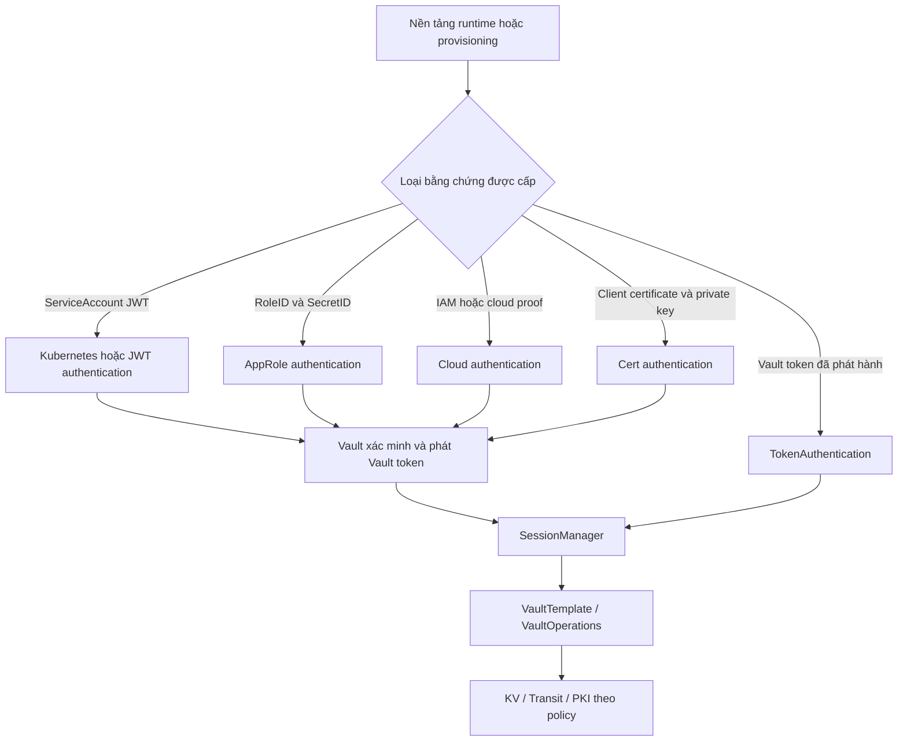
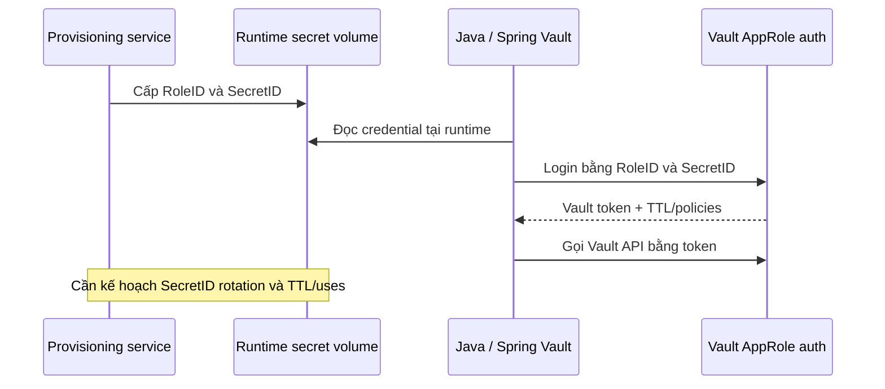
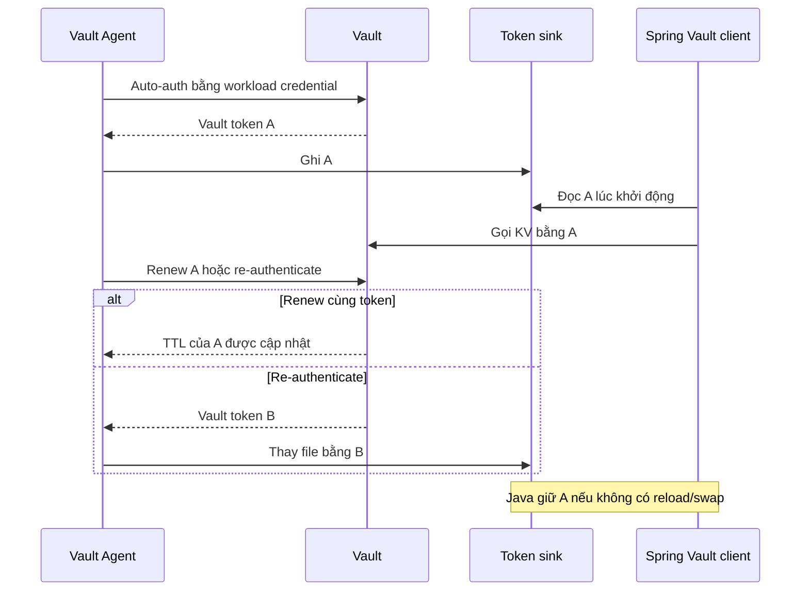
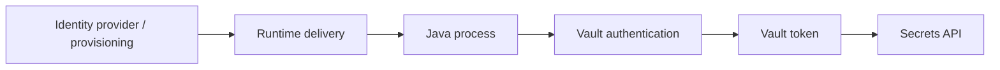

# Cung cấp thông tin xác thực từ cấu hình ngoài mã nguồn

Trong một ứng dụng Java sử dụng **Spring Vault** để truy cập HashiCorp Vault, lập trình viên thường muốn đưa thông tin đăng nhập vào `application.yml`, mã Java hoặc Docker image để chạy thử nhanh. Nếu các giá trị đó là **Vault token**, **AppRole SecretID**, **Kubernetes/JWT token** hoặc khóa riêng của chứng chỉ, cách làm này dễ khiến thông tin nhạy cảm xuất hiện trong Git, artifact CI/CD, bản sao image, log hoặc file cấu hình được chia sẻ.

**Cung cấp thông tin xác thực từ cấu hình ngoài mã nguồn** (*externalized authentication configuration*) là phương án để **nền tảng chạy ứng dụng** cung cấp credential vào thời điểm triển khai hoặc chạy. Spring Vault nhận credential từ một nguồn đã được kiểm soát, thực hiện xác thực nếu cần, nhận Vault token và dùng `SessionManager`/`VaultTemplate` để truy cập KV secrets, Transit encryption, PKI hoặc các API khác theo policy của token.

Bài thuộc chương **Nền tảng xác thực** và giải quyết ba câu hỏi:

1. Những **loại thông tin nào** nên nằm trong cấu hình ứng dụng thông thường, loại nào phải được cung cấp qua kênh bảo vệ credential?
2. Có những **kênh cấp credential** nào cho Java/Spring Boot, và cách chúng liên quan đến `ClientAuthentication`?
3. Khi credential được đổi hoặc hết hạn, làm sao bảo đảm ứng dụng **thực sự nhận giá trị mới** mà không tạo vòng phụ thuộc vào chính Vault?

> **Phạm vi:** Bài tập trung vào điểm nhận credential đầu tiên và cấu hình runtime của Spring Vault/Spring Cloud Vault. Nơi lưu KV data hay luồng gia hạn dynamic secret lease là công đoạn sau xác thực. Đưa một bí mật vào Vault chưa giải quyết được cách ứng dụng **đăng nhập Vault lần đầu**.

## 1. Bản chất của cấu hình ngoài mã nguồn

**Externalized configuration** nghĩa là ứng dụng lấy giá trị cấu hình từ nguồn được cung cấp **khi chạy hoặc khi triển khai**, thay vì hardcode trong class Java. Các nguồn có thể là:

- Biến môi trường hoặc system property của JVM do runtime cấp;
- File cấu hình được mount vào container/VM bằng quyền truy cập hạn chế;
- Kubernetes Secret volume, projected ServiceAccount token;
- Credential được Vault Agent viết vào file sink hoặc cung cấp theo một hợp đồng tích hợp khác;
- Cơ chế workload identity của cloud như managed identity, IAM metadata hoặc OIDC JWT;
- Hệ thống provisioning/CI cấp SecretID, certificate hoặc token qua kênh an toàn.

**Chuyển một credential từ mã Java sang biến môi trường không tự làm nó an toàn.** Độ bảo vệ phụ thuộc vào cách nguồn đó được tạo, quyền đọc của tiến trình/hệ thống quản trị, khả năng xuất log, lịch sử thay đổi và cơ chế thu hồi.

### Phân loại cấu hình ngay từ đầu

| Giá trị | Có nhạy cảm không? | Nguồn gợi ý | Ví dụ |
|---|---|---|---|
| Địa chỉ Vault | Thường là cấu hình, vẫn có thể tiết lộ topology | File cấu hình không chứa credential hoặc config platform | `https://vault.internal.example:8200` |
| Auth method | Không phải credential | `application.yml` hoặc biến môi trường | `KUBERNETES`, `APPROLE` |
| Auth mount path | Thường là metadata vận hành | Config ngoài hoặc file cấu hình được quản lý | `k8s-prod`, `approle-jobs` |
| Auth role name | Thường là metadata vận hành | Config ngoài hoặc file cấu hình được quản lý | `orders-api` |
| AppRole RoleID | Định danh role; cần kiểm soát công bố | Provisioning/config được kiểm soát | RoleID cho job |
| AppRole SecretID | **Có** | Secret volume/provisioning/response wrapping | Không viết giá trị thật trong source |
| Vault token | **Có** | Vault Agent sink, nguồn cấp token có TTL ngắn | Được dùng làm bearer token |
| Kubernetes ServiceAccount JWT | **Có** | Projected token volume từ Kubernetes | `/var/run/secrets/vault-identity/token` |
| CI OIDC JWT / cloud identity proof | **Có** | Identity provider của workload | JWT chỉ có hiệu lực theo issuer/audience |
| Private key cho cert auth | **Có, mức bảo vệ cao** | Keystore, key manager hoặc volume bảo vệ | Không nhúng vào image |
| CA trust certificate | Thường là thông tin công khai, cần bảo đảm tính toàn vẹn | Truststore/volume quản lý | Xác minh TLS của Vault |

Một tên role không cần được coi như mật khẩu, nhưng cũng không nên phát tán sơ đồ môi trường một cách không kiểm soát. Ngược lại, **token và SecretID không được coi là cấu hình bình thường chỉ vì chúng xuất hiện dưới dạng chuỗi**.

## 2. Đặt điểm nhận credential đúng trong chuỗi xác thực

Mỗi auth method đòi hỏi một bằng chứng khác nhau. **Spring Vault không tự phát minh ra danh tính workload**: credential phải có nguồn gốc từ Kubernetes, cloud IAM, hệ thống CI/OIDC, Vault/provisioning hoặc hạ tầng cấp chứng chỉ.



**Quy tắc quan trọng:** chỉ đưa **Vault token đã được phát hành** vào `TokenAuthentication`. Một Kubernetes JWT hoặc AppRole SecretID là **bằng chứng để đăng nhập** tại auth method tương ứng, chưa phải Vault token. Nếu đặt JWT vào `TokenAuthentication`, ứng dụng có thể khởi tạo object thành công nhưng Vault sẽ từ chối khi dùng chuỗi đó như bearer token.

### Chuỗi trách nhiệm tối thiểu

| Thành phần | Trách nhiệm |
|---|---|
| Kubernetes, cloud platform, CI, provisioning hoặc Agent | Cấp/đưa credential đầu tiên tới đúng workload |
| `ClientAuthentication` | Sử dụng bằng chứng để đăng nhập, hoặc trả Vault token đã được cấp |
| `VaultToken` / `LoginToken` | Biểu diễn token và có thể có metadata TTL/renewability |
| `SessionManager` | Cung cấp token cho các request; một số implementation quản lý renew/re-login |
| `VaultTemplate` / `VaultOperations` | Gọi API Vault bằng token nhận từ phiên |
| Vault auth role / policy | Kiểm tra danh tính tại login và giới hạn quyền token trên API |

Role, policy và Vault endpoint thường được quản lý riêng với chính credential. Thay token có thể không cần thay role; thay policy trên Vault cũng không có nghĩa Java được tự động cấp quyền rộng hơn trong mọi ngữ cảnh.

## 3. Đánh giá kênh cung cấp credential

Không có một kênh tối ưu cho mọi môi trường. Nên lựa chọn dựa trên **ai có quyền đọc**, **credential có cần xoay vòng** và **runtime có hỗ trợ danh tính sẵn có hay không**.

| Kênh | Lợi thế | Hạn chế / rủi ro | Tình huống phù hợp |
|---|---|---|---|
| **Biến môi trường** | Dễ inject trong container, CI và JVM | Có thể lộ qua công cụ quản trị process, dump/debug hoặc thông tin triển khai; thay giá trị không cập nhật tiến trình đang chạy | Job ngắn hạn, dev/test có kiểm soát |
| **System property** `-D...` | Dễ cấu hình Java | Command line/process list và log launch có thể hiển thị giá trị | Cấu hình không nhạy cảm; hạn chế cho credential |
| **File mount chỉ đọc** | Có thể giới hạn owner/permission, không cần đưa secret vào image | Cần quản lý file tồn tại lúc startup, atomic replacement và việc Java nạp lại | Secret volume, token sink, certificate |
| **Kubernetes Secret** | Tích hợp với Pod, hỗ trợ secretKeyRef hoặc volume | Giá trị trong `data` được base64 encode, **không mặc nhiên mã hóa an toàn**; RBAC, etcd và node access cần bảo vệ | AppRole SecretID hoặc credential buộc phải được provision vào cluster |
| **Projected ServiceAccount token** | Kubernetes phát JWT theo workload/audience/TTL và luân chuyển | Token vẫn có thể bị lấy nếu Pod bị chiếm quyền; Vault role phải ràng buộc đúng | Kubernetes auth hoặc JWT auth |
| **Cloud managed identity** | Dựa vào gốc tin cậy cloud, không cần mang token Vault tĩnh | Phụ thuộc API/metadata credentials, IAM bindings và cấu hình Vault | AWS/Azure/GCP workloads |
| **Vault Agent auto-auth** | Agent có thể xử lý login, renew và token sink | Ứng dụng phải có cách nhận token mới nếu Agent re-login; quyền sink và ownership phải rõ | Workload có Agent phù hợp |
| **Hệ thống CI/OIDC** | JWT ngắn hạn và claims theo job/repository | Phải bind issuer/audience/ref/environment; tránh chia quyền cho untrusted jobs | Build/deploy jobs |

### Vì sao tránh biến môi trường cho credential dài hạn?

Biến môi trường thường được xem như một cách “giấu secret” vì không nằm trong mã nguồn. Nhưng trong thực tế, những nơi sau có thể quan sát hoặc ghi lại giá trị:

- Hệ thống quản lý container/orchestration và các tài khoản có quyền xem Pod spec hoặc deployment;
- Công cụ chẩn đoán process, crash dump, Java diagnostics hoặc script vận hành;
- Pipeline CI/CD vô tình bật chế độ in toàn bộ environment;
- Log cấu hình ở startup, endpoint actuator hoặc thư viện debug chưa cấu hình loại bỏ bí mật.

Vì vậy, **cấu hình từ môi trường khác với cơ chế lưu secret an toàn**. Với credential nhạy cảm, đánh giá quyền và vòng đời ở toàn bộ pipeline trước khi chọn môi trường hay file.

## 4. Spring Boot và Spring Cloud Vault: tách cấu hình công khai khỏi credential

Ví dụ `orders-api` chạy ở Kubernetes production. Vault đã enable Kubernetes auth tại mount `k8s-prod`, có role `orders-api` ràng buộc đúng ServiceAccount và namespace. Ứng dụng dùng **Spring Cloud Vault** để cấu hình `ClientAuthentication` bên dưới.

Các thuộc tính **không chứa credential thô** có thể ở `application.yml`:

```yaml
spring:
  cloud:
    vault:
      uri: https://vault.internal.example:8200
      authentication: KUBERNETES
      kubernetes:
        kubernetes-path: k8s-prod
        role: orders-api
        service-account-token-file: /var/run/secrets/vault-identity/token
```

Trong ví dụ này:

1. `uri` là endpoint Vault; CA/truststore và hostname verification phải được cấu hình đúng.
2. `authentication: KUBERNETES` chọn auth method **type**.
3. `kubernetes-path: k8s-prod` là **mount path tương đối dưới `auth/`**, không phải URL `/v1/auth/k8s-prod/login`.
4. `role: orders-api` là tên role tồn tại ở đúng mount trên Vault.
5. `service-account-token-file` trỏ tới **JWT do Kubernetes cấp lúc chạy**, không phải Vault token và không nằm trong repository.

`application.yml` ở đây chỉ chứa địa chỉ và chỉ dẫn lấy bằng chứng. JWT thật được cấp riêng ở runtime. Dù vậy, nếu policy bảo mật của tổ chức xem endpoint và role name là thông tin nội bộ, có thể tiếp tục đưa chúng ra cấu hình triển khai.

**Điều kiện:** Ví dụ chỉ có hiệu lực nếu ứng dụng sử dụng dependency Spring Cloud Vault tương thích với Spring Boot. Dự án chỉ dùng `spring-vault-core` sẽ không tự động đọc các thuộc tính `spring.cloud.vault.*`. Ngoài ra, nếu muốn Spring Cloud Vault đọc secret như **Config Data / PropertySource** của Spring Boot, cần cấu hình cơ chế import/bootstrap tương ứng với phiên bản Spring Cloud Vault; cấu hình auth không có nghĩa mọi secret KV tự động xuất hiện trong `Environment`.

### Khi cấu hình được cấp qua environment

Spring Boot có cơ chế property binding từ biến môi trường. Chẳng hạn, ở bước triển khai có thể đặt:

```text
SPRING_CLOUD_VAULT_URI=https://vault.internal.example:8200
SPRING_CLOUD_VAULT_AUTHENTICATION=KUBERNETES
SPRING_CLOUD_VAULT_KUBERNETES_KUBERNETES_PATH=k8s-prod
SPRING_CLOUD_VAULT_KUBERNETES_ROLE=orders-api
SPRING_CLOUD_VAULT_KUBERNETES_SERVICE_ACCOUNT_TOKEN_FILE=/var/run/secrets/vault-identity/token
```

Đây là **tên property được ánh xạ** trong ví dụ, không phải credential thực. Để tránh khác biệt về canonical property names và thứ tự ưu tiên giữa phiên bản, hãy kiểm chứng mapping trong phiên bản Spring Boot/Spring Cloud Vault mà ứng dụng đang dùng.

Spring Boot có nhiều nguồn thuộc tính với độ ưu tiên khác nhau. Khi cùng một key xuất hiện trong file, profile, biến môi trường và command line, nguồn có độ ưu tiên cao hơn có thể ghi đè cấu hình dự kiến. Với dữ liệu đăng nhập, điều đó có thể gây lỗi vì workload **đến nhầm Vault server, auth mount hoặc role**.

Không giải quyết lỗi override bằng cách in toàn bộ Spring `Environment` hoặc actuator `/env` ra log. Hãy chỉ kiểm tra **các trường không nhạy cảm** sau khi đã bỏ qua token, SecretID, JWT và private key.

## 5. Dùng projected ServiceAccount JWT thay cho secret tĩnh trên Kubernetes

Với `orders-api`, nguồn bên ngoài an toàn hơn việc nhúng JWT vào image là **projected ServiceAccount token** do Kubernetes cấp theo workload.

Đoạn YAML sau là phần trích của **Pod spec** (ví dụ `spec.template.spec` trong Deployment), không phải manifest Deployment độc lập:

```yaml
spec:
  serviceAccountName: orders-api
  automountServiceAccountToken: false
  volumes:
    - name: vault-identity
      projected:
        sources:
          - serviceAccountToken:
              path: token
              audience: vault
              expirationSeconds: 600
  containers:
    - name: orders-api
      image: registry.example.invalid/orders-api:1.0
      volumeMounts:
        - name: vault-identity
          mountPath: /var/run/secrets/vault-identity
          readOnly: true
```

Kubernetes cấp JWT tại `/var/run/secrets/vault-identity/token` và thực hiện luân chuyển theo cơ chế projected volume. Pod phải chạy đúng ServiceAccount trong đúng namespace mà Vault role chấp nhận. Role cũng phải chấp nhận `audience=vault` (hoặc audience thực tế do hai bên thỏa thuận).

Vault role minh họa, giả định auth mount và Kubernetes TokenReview integration đã được cấu hình:

```bash
vault write auth/k8s-prod/role/orders-api \
  bound_service_account_names=orders-api \
  bound_service_account_namespaces=production \
  audience=vault \
  policies=orders-read \
  ttl=15m
```

Policy đọc một secret KV v2:

```hcl
path "kv/data/orders-api/database" {
  capabilities = ["read"]
}
```

Dù app lấy được JWT, Vault chỉ phát token nếu **TokenReview/kiểm chứng JWT và role binding** thành công. Một Vault token hợp lệ vẫn bị từ chối khi gọi đường dẫn KV khác không được policy cho phép.

### Kiểm soát việc thay JWT

Projected token có thể được Kubernetes xoay vòng và ghi lại vào volume. Điều quan trọng là **implementation xác thực phải lấy được JWT còn hiệu lực khi cần đăng nhập lại**, không tiếp tục dùng một bản sao JWT đã hết hạn được cache tại startup. Kiểm chứng hành vi này với phiên bản Spring Vault và hình thức cung cấp token đang dùng.

TTL của **Kubernetes JWT** và TTL của **Vault token** là hai thời hạn khác nhau. Ví dụ JWT được cấp với lifetime 600 giây, Vault token TTL 900 giây; sau khi Vault token chạm giới hạn renew và phải re-login, nguồn JWT phải được đọc lại ở trạng thái mới còn hợp lệ.

## 6. AppRole SecretID được provision bằng file ngoài source

Không phải mọi workload đều có Kubernetes hoặc managed identity. Với VM và job legacy, **AppRole** có thể phù hợp khi đã có hệ thống cấp phát credential an toàn.

Trong AppRole:

- `RoleID` xác định role, có thể được quản lý như cấu hình hạn chế công bố;
- `SecretID` là credential nhạy cảm; cần kênh provision riêng, TTL, giới hạn lượt sử dụng và khả năng thu hồi;
- Vault auth method nhận `role_id` và `secret_id` tại `auth/<approle-mount>/login`, sau đó phát **Vault token**;
- SecretID **không** được đặt vào `TokenAuthentication` như thể nó là Vault token.

Ví dụ bố trí file trong container:

```text
/run/vault-bootstrap/
├── role-id       # định danh AppRole
└── secret-id     # credential nhạy cảm, file permission hẹp
```

Không cần viết hai giá trị vào `application.yml` hoặc Dockerfile. Hệ thống provisioning/Secret volume cung cấp chúng ở runtime. Để tích hợp bằng Spring Vault thuần, tầng cấu hình Java **đọc hai file an toàn**, tạo implementation AppRole của `ClientAuthentication` theo API phiên bản đang dùng và chuyển cho `SessionManager`.

Sơ đồ:



**Điểm vận hành quan trọng:** nếu SecretID bị giới hạn số lần dùng, một ứng dụng chạy lâu có thể login lần đầu thành công nhưng không login lại được sau khi Vault token đến cuối vòng đời. Provisioning phải có cách cung cấp SecretID mới, hoặc thiết kế auth method khác phù hợp hơn.

### Khi dùng Spring Cloud Vault AppRole

Các property dùng để cấu hình AppRole trong Spring Cloud Vault thường gồm auth method `APPROLE`, mount path, `role-id` và `secret-id`, ví dụ:

```yaml
spring:
  cloud:
    vault:
      uri: https://vault.internal.example:8200
      authentication: APPROLE
      app-role:
        app-role-path: approle-jobs
        role-id: EXTERNAL_ROLE_ID_PLACEHOLDER
        secret-id: EXTERNAL_SECRET_ID_PLACEHOLDER
```

**Đây là ví dụ cấu trúc, không phải tệp cấu hình nên commit nguyên trạng với SecretID thật.** Trong ứng dụng thực, đặt các trường credential qua nguồn property an toàn đã cấu hình và kiểm tra lại chính xác tên property/chiến lược AppRole trong phiên bản Spring Cloud Vault. Không mặc định rằng file SecretID được mount sẽ tự được Spring Cloud Vault nạp nếu không cấu hình một lớp đọc file/property source tương ứng.

Phương án dùng Spring Boot `configtree:` có thể ánh xạ file trong thư mục thành property khi ứng dụng được cấu hình import đúng. Tuy nhiên, việc load Config Data và bootstrap của Spring Cloud Vault có thứ tự khởi tạo cần kiểm thử theo phiên bản; **không** nên dựa vào suy đoán rằng mọi file mount sẽ tự động trở thành `spring.cloud.vault.app-role.secret-id`.

## 7. Đọc một Vault token đã cấp từ file trong Spring Vault thuần

Nếu **Vault Agent** hoặc provisioning đã cấp sẵn **Vault token** vào file, Spring Vault có thể dùng `TokenAuthentication`. Đây là trường hợp ứng dụng **không tự gửi Kubernetes/AppRole login**.

Ví dụ tạo `VaultTemplate` bằng token đã đọc từ file:

```java
import java.io.IOException;
import java.net.URI;
import java.nio.charset.StandardCharsets;
import java.nio.file.Files;
import java.nio.file.Path;

import org.springframework.vault.authentication.ClientAuthentication;
import org.springframework.vault.authentication.TokenAuthentication;
import org.springframework.vault.client.VaultEndpoint;
import org.springframework.vault.core.VaultTemplate;

public final class ExternalVaultTokenConfiguration {
    private ExternalVaultTokenConfiguration() {}

    public static VaultTemplate create(String vaultUri, Path tokenFile)
            throws IOException {

        URI uri = URI.create(vaultUri);
        if (!"https".equalsIgnoreCase(uri.getScheme())) {
            throw new IllegalArgumentException("Vault URI must use HTTPS");
        }

        String token = Files.readString(tokenFile, StandardCharsets.UTF_8).strip();
        if (token.isBlank()) {
            throw new IllegalStateException("Vault token source is empty");
        }

        // tokenFile chứa Vault token đã phát hành, không phải Kubernetes JWT.
        ClientAuthentication authentication = new TokenAuthentication(token);
        VaultEndpoint endpoint = VaultEndpoint.from(uri);
        return new VaultTemplate(endpoint, authentication);
    }
}
```

**Giả định kỹ thuật:** URI có hostname đúng, TLS truststore đã cấu hình CA đáng tin cậy và file có quyền đọc phù hợp. `Files.readString()` tạo một `String` nhạy cảm trong JVM; Java không bảo đảm xóa giá trị đó khỏi toàn bộ memory dump. Không ghi biến `token` vào log, exception, trace hoặc debug.

Đoạn code **chỉ đọc file một lần khi tạo client**. Nó không tự theo dõi file khi Agent ghi token mới; muốn dùng token B thay token A phải có cơ chế cập nhật client/session, restart có kiểm soát hoặc một integration hỗ trợ đọc token động phù hợp.

### So sánh file chứa JWT và file chứa Vault token

| File do nền tảng cấp | Dùng với | Điều không nên làm |
|---|---|---|
| `/var/run/secrets/vault-identity/token` chứa ServiceAccount JWT | `KubernetesAuthentication`/JWT auth | Đưa JWT thẳng vào `TokenAuthentication` |
| `/run/secrets/vault/client-token` chứa Vault token do Agent cấp | `TokenAuthentication` | Giả định `login()` sẽ đổi được token mới từ server |
| `/run/vault-bootstrap/secret-id` chứa AppRole SecretID | AppRole auth cùng RoleID | Đặt SecretID vào header `X-Vault-Token` |
| `/run/vault-bootstrap/client.key` chứa private key | Cert authentication qua TLS | Gửi private key trong JSON login body hoặc in ra log |

Một file có tên `token` không nói lên **loại credential** bên trong. Phải ghi rõ hợp đồng cấp phát: JWT, Vault token hay một token của identity provider khác.

## 8. Tích hợp Kubernetes Secret: sử dụng đúng mức bảo vệ

Với tình huống buộc phải phân phối **SecretID** (hoặc token đã được cấp), Kubernetes Secret có thể cung cấp dữ liệu qua **file mount**:

```yaml
# Phần trích PodSpec, giả định Secret "orders-approle" đã được provision.
spec:
  volumes:
    - name: app-role-bootstrap
      secret:
        secretName: orders-approle
        items:
          - key: role-id
            path: role-id
          - key: secret-id
            path: secret-id
  containers:
    - name: orders-api
      image: registry.example.invalid/orders-api:1.0
      volumeMounts:
        - name: app-role-bootstrap
          mountPath: /run/vault-bootstrap
          readOnly: true
```

Với mẫu này, Pod đọc các file `/run/vault-bootstrap/role-id` và `/run/vault-bootstrap/secret-id`. Ví dụ **không tạo một Kubernetes Secret chứa giá trị credential thật**; khâu provisioning phải có quyền và chính sách riêng.

Những điểm bảo mật cần hiểu:

- Dữ liệu base64 trong trường `data` của Kubernetes Secret chỉ là **encoding**, không phải encryption.
- Nên bật và quản lý **encryption at rest** của API server/etcd theo thiết kế hạ tầng, phân quyền RBAC cho người có thể `get/list/watch` Secret và kiểm soát các Pod có thể mount Secret.
- Dùng ServiceAccount riêng và giới hạn quyền tạo Pod/mount Secret; quyền tạo workload có khả năng dẫn đến đọc Secret mà workload được phép mount.
- File volume có quyền truy cập theo cấu hình Pod, user/group và filesystem; không giả định `readOnly: true` đồng nghĩa chỉ một process có thể đọc nội dung.
- Secret được cập nhật qua volume có cơ chế đồng bộ theo Kubernetes nhưng ứng dụng phải **đọc lại file**; ứng dụng dùng Secret qua biến môi trường thường cần restart để nhận giá trị mới.
- Nếu ứng dụng mount từng file bằng `subPath`, cập nhật Secret volume không được phản ánh theo cách mount cập nhật thông thường; cần thiết kế rollout phù hợp.

**Không nên tự động ưu tiên Kubernetes Secret chứa Vault token tĩnh** khi đã có cơ chế Kubernetes ServiceAccount JWT và Vault Kubernetes auth đáng tin cậy. Workload identity thường giúp giảm việc phải phân phối Vault token lâu dài.

## 9. Vault Agent sink: tránh hai chủ thể cùng sở hữu token

Vault Agent có thể đăng nhập Vault bằng auth method được cấu hình, sau đó ghi Vault token vào **token sink** cho ứng dụng hoặc thành phần khác sử dụng. Đây là cách cung cấp credential bên ngoài Java.



Cần xác định rõ **ownership**:

- Agent thường chịu trách nhiệm login/renew/re-authenticate theo cấu hình auto-auth.
- Ứng dụng Java chịu trách nhiệm đọc token từ sink theo hợp đồng đã chọn và **cập nhật token đang dùng** khi sink có giá trị mới.
- Nếu dùng cả lifecycle manager của Spring Vault, cần xác định vai trò renew/revoke của từng bên, tránh Agent và Java cùng thay token mà không phối hợp.

**Tình huống hay gây lỗi:** lúc 09:00 Java đọc token A; lúc 09:30 Agent re-authenticate và ghi token B; lúc 09:35 A hết hạn. Java vẫn gửi A vì `TokenAuthentication(A)` và session hiện tại không tự đọc lại file, nên Vault từ chối request.

Các giải pháp phụ thuộc yêu cầu availability: restart workload theo thay token, dùng cơ chế reload client/session an toàn, hoặc kiến trúc Agent/proxy mà ứng dụng không phải giữ một token lâu dài. Phải kiểm thử **thời điểm file đang đổi** và các request song song. Việc dùng `Thread.sleep()` hoặc đọc file tùy tiện ở mỗi request không thay thế thiết kế đồng bộ.

## 10. Thời điểm nạp cấu hình và thứ tự ưu tiên

Đưa credential ra ngoài source chỉ hữu ích nếu ứng dụng lấy đúng giá trị **trước khi thực hiện Vault login**.

### Ba thời điểm cần phân biệt

```text
1. Trước khi Java process khởi động
   Runtime/CI/Agent tạo credential hoặc đường dẫn cần thiết

2. Khởi tạo Spring ApplicationContext
   Spring Boot Environment / ClientAuthentication đọc cấu hình

3. Chạy ứng dụng
   SessionManager dùng token, renew/re-login khi cần
   Nguồn credential có thể được xoay vòng độc lập
```

Một số tình huống:

- **File chưa xuất hiện ở bước 2:** Spring Vault không lấy được JWT/SecretID/token và khởi tạo có thể thất bại. Cần xác định readiness/startup dependency hoặc cơ chế retry có giới hạn.
- **Dùng giá trị env tại bước 2:** việc orchestrator thay Secret của Pod không tự cập nhật biến môi trường đã được process nhận.
- **File đã đổi ở bước 3:** nạp lại file chỉ có tác dụng nếu implementation xác thực/session thực sự hỗ trợ nhận giá trị mới.
- **Spring Config Data được tải sau khi auth cần credential:** không thể dùng secret lấy *từ chính Vault* làm phương tiện duy nhất để login Vault lần đầu nếu chưa có credential khác. Đây là dạng **bootstrap/secret-zero circular dependency**.
- **Một property được khai báo ở nhiều nguồn:** profile, env hoặc command line có thể ghi đè mount/role/URI mà người vận hành kỳ vọng.

### Ví dụ vòng phụ thuộc cần tránh

```text
Ứng dụng muốn lấy Vault token từ KV:
  -> Đọc KV cần có Vault token
  -> Để có Vault token, phải đọc KV
  -> Không có nguồn bootstrap độc lập: vòng lặp không có điểm bắt đầu
```

Giải pháp cần một **gốc tin cậy ở ngoài Vault login** như Kubernetes JWT, cloud identity, CI JWT, chứng chỉ hoặc SecretID được cấp qua provisioning. Một token do Vault Agent cấp cũng cần Agent đã giải quyết bước đầu đó.

## 11. Xử lý xoay vòng và lỗi khi nguồn credential thay đổi

**Mỗi loại credential có vòng đời riêng**. Ví dụ Kubernetes JWT có thời hạn theo TokenRequest/volume projection; Vault token nhận sau login có TTL/renewability; database credential động có secret lease; chứng chỉ PKI có ngày hết hạn. Không được gộp các đồng hồ này thành một biến `TOKEN_TTL`.

| Sự kiện | Nguồn thay đổi | Phản ứng cần có ở ứng dụng |
|---|---|---|
| Projected JWT xoay vòng | Kubernetes | Lần re-login sau phải đọc JWT còn hiệu lực |
| AppRole SecretID hết uses hoặc TTL | Provisioning/Vault | Nhận SecretID mới trước khi cần re-login |
| Vault Agent renew cùng token | Agent/Vault | Token A có thể tiếp tục dùng nếu Vault chấp nhận |
| Agent phát token B thay A | Agent token sink | Java phải nhận B bằng reload/swap/restart đã thiết kế |
| Vault token đạt max TTL | Vault | Re-login bằng credential ban đầu còn hợp lệ |
| Vault token bị revoke | Vault/operator | Request dùng token cũ thất bại; không fallback root token |
| KV secret được cập nhật | Vault KV | Làm mới dữ liệu nghiệp vụ theo chính sách cache, độc lập với login |
| Dynamic secret lease hết hạn | Secrets engine | Gia hạn/thu hồi/đọc credential động mới theo lifecycle của engine |

### Khi cần retry

Retry chỉ phù hợp với lỗi **tạm thời** như network/Vault unavailable, với backoff, jitter và giới hạn số lần. Nếu file không tồn tại vì cấu hình sai, audience không khớp, role không tồn tại hoặc SecretID đã hết uses, retry vô hạn có thể chỉ tăng tải và che nguyên nhân.

Không ghi nguyên HTTP login body vào log để debug. Đặc biệt tránh trường `jwt`, `secret_id`, header `X-Vault-Token` và chuỗi private key.

## 12. Bảo vệ đường cấp phát từ lúc tạo đến lúc thu hồi

Một thiết kế externalized credential tốt cần bảo vệ **toàn bộ chuỗi**:



| Ranh giới | Biện pháp cụ thể |
|---|---|
| Cấp credential | Identity phải ràng buộc đúng workload, role và môi trường; SecretID giới hạn TTL/uses |
| Phân phối | HTTPS/mTLS hoặc volume bảo vệ; không đi qua Git, artifact, Docker layer hay log |
| Lưu trữ runtime | Quyền file/Pod/VM hẹp; tránh lộ biến môi trường, dump và command line |
| Truyền tới Vault | TLS xác minh CA và hostname; không hạ cấp sang HTTP khi handshake lỗi |
| Xác thực | Mount/role/issuer/audience/claims đúng; Vault chỉ phát token theo policy hẹp |
| Sử dụng | `VaultTemplate` gọi đúng API; policy cho KV/Transit/PKI tối thiểu |
| Gia hạn/đổi token | Có chủ thể sở hữu renew/re-login, cơ chế nhận credential mới |
| Thu hồi | Quy trình revoke khi lộ credential, khi workload không còn quyền hoặc kết thúc job |
| Quan sát | Metric login/renew success/failure, latency và HTTP status; không gắn token/SecretID làm label |

### Nguy cơ theo phương thức cung cấp

**Biến môi trường:** bảo vệ trong hệ thống orchestration và quy trình debug; không in `env` nguyên vẹn. **Secret volume:** bảo vệ RBAC, host filesystem và quyền của process trong Pod. **OIDC/JWT:** audience, issuer, expiration và claims phải phù hợp; không lưu vào artifact job. **Private key:** nên có cơ chế key management và rotation; cần phân biệt TLS client certificate cho auth với truststore kiểm tra Vault server. **Vault Agent:** bảo vệ token sink, kiểm thử token replacement và rõ ràng trách nhiệm renew.

## 13. Chẩn đoán: lỗi nằm ở cấu hình, nguồn credential hay Vault?

| Triệu chứng | Nguồn khả nghi | Cách kiểm tra có kiểm soát |
|---|---|---|
| Startup báo thiếu property | Cấu hình không được inject hoặc property name sai | Kiểm tra tên key và nguồn property, chỉ hiện key name |
| File token/JWT không tồn tại | Volume mount sai, Agent chưa ghi, đường dẫn không khớp | Kiểm tra mount path, owner, permission và readiness |
| `TokenAuthentication.login()` trả object nhưng request Vault bị từ chối | Token đưa vào không phải Vault token, đã hết hạn hoặc bị revoke | Xác định nguồn/token type, kiểm tra API có quyền trong test; không in token |
| Kubernetes login trả lỗi | JWT expired/sai audience, ServiceAccount/namespace hoặc mount/role không khớp | Kiểm tra metadata workload và Vault role, TokenReview integration |
| AppRole lần đầu được, re-login thất bại | SecretID đã hết TTL/uses hoặc provisioning không rotate | Kiểm tra vòng đời SecretID và quy trình cấp mới |
| Java tiếp tục lỗi dù Agent đã ghi token mới | Client giữ token cũ từ startup | Kiểm tra tính năng reload/swap session, rollout |
| Login thành công nhưng `VaultTemplate.read()` trả `403` | Policy/capabilities hoặc API path sai | Kiểm tra policy theo path KV v2 `kv/data/...`, không cấp wildcard |
| TLS handshake thất bại | Vault URI, CA hoặc hostname không đúng | Sửa truststore và endpoint; không tắt TLS verification |
| Dev chạy được nhưng production lỗi | Property override, namespace/role/mount/identity khác | Đối chiếu danh sách config không nhạy cảm từng môi trường |
| Sau khi đổi Secret, Pod không nhận bản mới | Dùng env hoặc mount qua `subPath` | Rollout/restart hoặc thiết kế volume/reload phù hợp |

### Cách quan sát an toàn khi triển khai

- Ghi lại **Vault URI đã được kiểm duyệt nếu cần**, auth method và mount path (không chứa credential), role không nhạy cảm.
- Ghi số lần login/renew, latency, loại exception và HTTP status.
- Kiểm tra luồng gọi `login` thành công riêng với quyền gọi `KV/Transit/PKI`; hai lỗi có nguyên nhân khác nhau.
- Không đưa `client_token`, JWT, SecretID, private key hoặc full login response vào log, APM, trace, test output.

## 14. Kiểm thử tích hợp từ nguồn credential đến Vault

Unit test có thể xác minh Java chọn đúng file/property và tạo đúng `ClientAuthentication`. Nhưng điều đó **không chứng minh Vault tin danh tính và policy đúng**. Cần integration test trong Vault test instance và môi trường identity tương ứng, dùng credential giả và quyền tối thiểu.

| Ca kiểm thử | Cách thiết lập | Kết quả mong đợi |
|---|---|---|
| Cấu hình đúng và credential hợp lệ | Cấp projected JWT/SecretID/token hợp lệ vào runtime | Login thành công; đọc đúng key KV được phép |
| Thiếu credential | Không mount file hoặc không inject property bắt buộc | Startup/login thất bại rõ nguyên nhân, không in secret |
| Sai định dạng credential | Đưa JWT vào đường dành cho Vault token | `TokenAuthentication` không đổi JWT thành Vault token; API bị từ chối |
| JWT khác audience | Projected JWT cho audience khác role | Kubernetes/JWT auth bị từ chối |
| AppRole SecretID hết uses | Dùng đủ số lần rồi re-login | Re-login thất bại; hệ thống không tự đổi sang root token |
| Credential bị đổi trong file | Agent hoặc provisioning ghi token B thay A | Java nhận B chỉ khi có cơ chế reload/restart đã thiết kế |
| Policy không cho phép | Token hợp lệ chỉ đọc key A, thử đọc key B | API Vault từ chối B |
| Vault tạm unavailable | Chặn mạng tới test Vault | Retry giới hạn, lỗi được phân loại, không log credential |
| CA hoặc hostname sai | Dùng endpoint test với certificate không tin cậy | TLS verification thất bại |
| Override cấu hình | Dùng profile/env khai báo mount path khác | Phát hiện sai nguồn property hoặc login fail có thể chẩn đoán |

### Ví dụ unit test không cần Vault thật

Một kiểm thử nhẹ xác minh có thể tạo `TokenAuthentication` từ nguồn cấp giả và không yêu cầu network để lấy `VaultToken`:

```java
import static org.junit.jupiter.api.Assertions.assertEquals;

import org.junit.jupiter.api.Test;
import org.springframework.vault.authentication.ClientAuthentication;
import org.springframework.vault.authentication.TokenAuthentication;
import org.springframework.vault.support.VaultToken;

class ExternalCredentialWiringTest {

    @Test
    void tokenAuthenticationUsesAlreadyIssuedToken() {
        String fromTrustedTestFixture = "fake-token-for-unit-test";

        ClientAuthentication auth =
                new TokenAuthentication(fromTrustedTestFixture);

        VaultToken result = auth.login();
        assertEquals(VaultToken.of(fromTrustedTestFixture), result);
    }
}
```

Bài test không xác minh token trên Vault và không phải test security của Kubernetes/JWT/AppRole. Trong integration test phải gọi Vault thật tại môi trường cô lập với token do test Vault cấp, sau đó kiểm tra cả **positive** và **negative authorization**.

## 15. Bài thực hành: chuyển `orders-api` từ credential hardcode sang runtime identity

**Bối cảnh.** Một ứng dụng Spring Boot đang chứa đoạn cấu hình nguy hiểm:

```yaml
spring:
  cloud:
    vault:
      uri: https://vault.internal.example:8200
      authentication: TOKEN
      token: PASTE_REAL_TOKEN_HERE
```

Tổ chức chuyển `orders-api` sang Kubernetes. Vault đã bật `auth/k8s-prod` và có role `orders-api` cho ServiceAccount `orders-api` trong namespace `production`. Ứng dụng chỉ được đọc `kv/data/orders-api/database`.

### Yêu cầu

1. Chỉ ra vì sao cấu hình cũ dễ lộ bí mật dù repository là private.
2. Viết lại `application.yml` theo hướng **Kubernetes auth**, không có JWT hoặc Vault token trong file.
3. Thiết kế phần projected ServiceAccount token trong PodSpec, audience `vault`, lifetime 600 giây, đường dẫn khớp cấu hình Java.
4. Viết policy tối thiểu cho đường dẫn KV v2.
5. Giải thích thành phần nào làm mới Kubernetes JWT và thành phần nào quản lý Vault token sau login.
6. Nêu cách chẩn đoán khi Pod chạy được 15 phút rồi liên tục lỗi login/đọc KV.
7. Thêm phương án thay thế nếu workload phải chạy trên VM không có Kubernetes nhưng có provisioning cấp AppRole SecretID.

### Hướng giải tham khảo

**Cấu hình Spring Cloud Vault:**

```yaml
spring:
  cloud:
    vault:
      uri: https://vault.internal.example:8200
      authentication: KUBERNETES
      kubernetes:
        kubernetes-path: k8s-prod
        role: orders-api
        service-account-token-file: /var/run/secrets/vault-identity/token
```

**Runtime:** Pod sử dụng ServiceAccount `orders-api`, projected JWT audience `vault` tại `/var/run/secrets/vault-identity/token`. Kubernetes lo phát và luân chuyển JWT; Spring Vault/SessionManager dùng JWT còn hợp lệ để login/re-login và quản lý Vault token theo cấu hình. Không đưa JWT vào image, Kubernetes Secret không cần thiết cho trường hợp này.

**Policy:**

```hcl
path "kv/data/orders-api/database" {
  capabilities = ["read"]
}
```

**Lỗi sau 15 phút:** phân biệt Vault token hết TTL/renew thất bại, JWT nguồn đã cũ, Vault auth role sai audience, hoặc request KV thiếu policy. Kiểm tra login và KV như hai giai đoạn riêng, không cấp root token để “xác minh nhanh”.

**VM với AppRole:** provisioning cấp RoleID và SecretID riêng qua kênh bảo vệ; SecretID có TTL/uses và cơ chế cấp mới. Java/Spring Cloud Vault cấu hình AppRole auth đúng mount, đọc credential ngoài source và có kế hoạch re-login khi SecretID cần đổi. Không dùng một SecretID dài hạn chung cho tất cả VM.

### Tiêu chí hoàn thành

- [ ] Source code và image không chứa token, JWT, SecretID hoặc private key.
- [ ] Workload có một nguồn credential được nền tảng cấp và xác minh được.
- [ ] Spring Cloud Vault / Spring Vault chọn đúng auth type, mount path và role.
- [ ] Runtime bảo vệ file hoặc environment nhận credential.
- [ ] TLS của Vault được xác minh; policy chỉ cho đúng API path.
- [ ] Có chiến lược rotation/re-login nhận credential mới.
- [ ] Có test login đúng/sai, policy đúng/sai và token hết hạn.
- [ ] Các log, metric và test report không làm lộ credential.

## 16. Câu hỏi tự kiểm tra

1. Vì sao đặt Vault token trong biến môi trường chưa chắc an toàn hơn đặt trong file? Những nguồn nào có thể làm lộ giá trị?
2. Sự khác nhau giữa **Vault token**, **Kubernetes ServiceAccount JWT** và **AppRole SecretID** khi cấu hình `ClientAuthentication` là gì?
3. Trong Spring Cloud Vault, `kubernetes.service-account-token-file` trỏ đến loại credential nào?
4. Khi Vault Agent thay token A bằng B, vì sao một `TokenAuthentication(A)` đã tạo từ trước có thể tiếp tục thất bại?
5. Vì sao thay Kubernetes Secret dùng làm env var thường cần restart process, còn Secret volume có thể được cập nhật trên filesystem?
6. `readOnly: true` trong `volumeMounts` có bảo đảm không một tiến trình nào khác đọc được file không?
7. Vì sao không nên lấy credential dùng để login Vault từ chính KV của Vault nếu chưa có bất kỳ gốc tin cậy nào?
8. Khi AppRole SecretID có `secret_id_num_uses`, cần nghĩ gì về lần re-login sau khi Vault token hết TTL?
9. Spring Boot `Environment` và `Config Data` có thể làm gì với cấu hình ứng dụng, và điều gì chúng **không tự giải quyết** về vòng đời credential?
10. Làm sao chứng minh lỗi bắt nguồn từ mount/role/bằng chứng đăng nhập thay vì từ policy của KV?
11. Để dùng `VaultTemplate` gọi Transit hoặc PKI, ngoài credential ban đầu còn cần điều kiện gì?
12. Bạn sẽ kiểm thử việc ứng dụng nhận file token mới an toàn như thế nào nếu nhiều request Vault đang chạy song song?

**Điểm cần nhớ:** **Nguồn cấu hình ngoài mã nguồn là một mắt xích trong chuỗi tin cậy, không tự phải là nơi giữ bí mật an toàn.** Với Spring Vault, hãy thiết kế rõ **nguồn identity/provisioning → phương tiện cấp credential → `ClientAuthentication` → `SessionManager` → `VaultTemplate` → policy/secret engine**; đồng thời kiểm soát quyền đọc, TLS, TTL, vòng đời cập nhật và xử lý thất bại.

## Tài liệu tham khảo

- [Spring Boot — Externalized Configuration](https://docs.spring.io/spring-boot/reference/features/external-config.html): nguồn property, thứ tự ưu tiên, environment và Config Data.
- [Spring Vault — Authentication](https://docs.spring.io/spring-vault/reference/vault/authentication.html): `ClientAuthentication`, token lifecycle và các auth method.
- [Spring Cloud Vault — Authentication](https://docs.spring.io/spring-cloud-vault/reference/authentication.html): cấu hình Kubernetes, AppRole, token và auth mount.
- [HashiCorp Vault — Authentication](https://developer.hashicorp.com/vault/docs/auth): workload identity, auth methods và token.
- [HashiCorp Vault — AppRole](https://developer.hashicorp.com/vault/docs/auth/approle): RoleID/SecretID, TTL, uses và response wrapping.
- [HashiCorp Vault — Vault Agent Auto-Auth](https://developer.hashicorp.com/vault/docs/agent-and-proxy/autoauth): auto-auth, token sink và vòng đời token.
- [Kubernetes — Service Accounts](https://kubernetes.io/docs/concepts/security/service-accounts/): projected JWT, audience và ServiceAccount.
- [Kubernetes — Secrets](https://kubernetes.io/docs/concepts/configuration/secret/): secret volume, environment, cập nhật và các giới hạn bảo mật.
