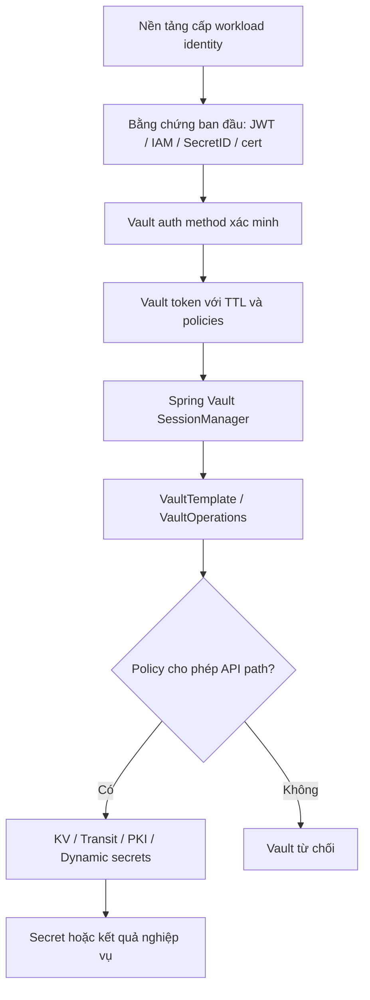
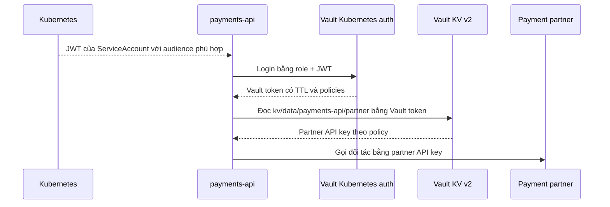
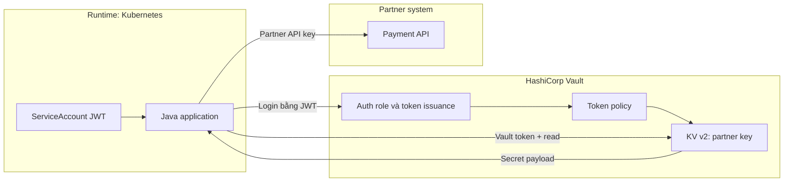
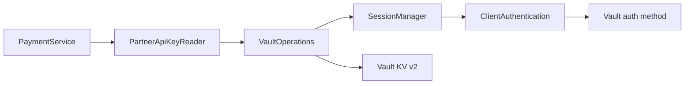

# Tách thông tin đăng nhập Vault khỏi secret cần lấy

Trong ứng dụng Java dùng **Spring Vault**, hai việc thường bị trộn lẫn là **chứng minh ứng dụng được phép vào Vault** và **lấy secret mà ứng dụng cần để thực hiện nghiệp vụ**. Ví dụ, `payments-api` cần API key đối tác từ KV v2 tại `kv/payments-api/partner`. Nếu chuyển API key đó vào Vault nhưng lại hardcode **Vault token dài hạn** trong Java hoặc Docker image, nhóm chỉ thay một secret tĩnh bằng một secret tĩnh khác, thậm chí có thể có quyền rộng hơn.

Thiết kế đúng cần tách ba lớp: **bằng chứng danh tính ban đầu** (bootstrap credential), **Vault token được phát hành sau xác thực**, và **secret nghiệp vụ** được lấy từ secrets engine. Từng lớp có nguồn phát hành, mục đích, quyền hạn và vòng đời khác nhau. Spring Vault giúp ứng dụng quản lý phần đăng nhập và gọi API qua `ClientAuthentication`, `SessionManager` và `VaultTemplate`, nhưng ranh giới tin cậy phải được thiết kế từ phía workload, Vault auth role và policy.

Bài này thuộc chương **Nền tảng xác thực**, tập trung vào cách phân tách ba lớp trong thiết kế, code, cấu hình, phân quyền, vận hành và kiểm thử; đồng thời liên hệ với KV secrets, Transit encryption, PKI và dynamic lease.

## 1. Ba lớp bí mật có vai trò khác nhau

Giả sử `payments-api` chạy trong Kubernetes namespace `production` và phải lấy API key để gọi đối tác thanh toán.

| Lớp | Câu hỏi nó giải quyết | Ví dụ | Bên chịu trách nhiệm chính |
|---|---|---|---|
| **Bằng chứng ban đầu** (*bootstrap credential*) | Vault dựa vào đâu để biết ứng dụng là đúng workload? | Projected Kubernetes ServiceAccount JWT | Kubernetes cấp; Vault Kubernetes auth xác minh |
| **Vault token** (*session credential*) | Những request kế tiếp tới Vault được xác thực bằng gì? | Token do `auth/kubernetes/login` phát hành | Vault cấp; Spring Vault session manager/Agent quản lý theo thiết kế |
| **Secret nghiệp vụ** (*target secret*) | Ứng dụng cần dữ liệu nào để thực hiện nghiệp vụ? | `apiKey` tại KV v2 `kv/payments-api/partner` | KV secrets engine lưu; ứng dụng được policy cho phép đọc |

Khi đăng nhập AppRole, credential ban đầu đổi thành **RoleID + SecretID**; nếu dùng cloud IAM, credential là bằng chứng nhận diện cloud; nếu dùng Vault Agent auto-auth, Agent có thể đảm nhiệm hai chặng đầu và đưa token cho ứng dụng. **Vai trò ba lớp không đổi**.



**Thông tin đăng nhập Vault không phải secret nghiệp vụ.** Chúng có thể đều là dữ liệu nhạy cảm dạng chuỗi, nhưng không thể dùng thay nhau. JWT của Kubernetes không phải Vault token; Vault token không phải API key đối tác; API key đối tác không có quyền đăng nhập Vault.

### So sánh ranh giới

| Thuộc tính | Bootstrap credential | Vault token | Secret đích |
|---|---|---|---|
| Nguồn cấp | Kubernetes/IAM/CI/provisioning/CA | Vault auth method hoặc token provisioning | KV, database, PKI hoặc engine khác |
| Mục đích | Xin Vault token | Xác thực các request tới Vault | Gọi đối tác, kết nối DB, vận hành nghiệp vụ |
| Nơi gửi | Auth login endpoint/chứng minh danh tính | Header `X-Vault-Token` của Vault API | Hệ thống đích hoặc sử dụng nội bộ, không gửi vào auth endpoint |
| Quyền chi phối | Auth role, claims, audience, TTL, identity binding | Vault policies, token TTL, revoke | Quy tắc tiêu thụ secret, engine lease/certificate validity |
| Có thể đổi khi nào? | Do workload identity/provisioning | Renew, re-login hoặc cấp mới | Secret rotation hoặc engine cấp động |
| Nếu bị lộ | Có thể xin Vault token trong thời gian còn hợp lệ | Có thể gọi các Vault API theo policy | Có thể sử dụng credential tại hệ thống đích theo quyền của nó |

Một trong ba lớp hết hạn **không có nghĩa** hai lớp còn lại cùng hết hạn ngay. Tuy nhiên, chúng có thể **phụ thuộc nhau**: ví dụ Vault token bị thu hồi có thể kéo theo việc revoke một số lease động được cấp dưới token đó.

## 2. Bài toán secret zero: tránh phụ thuộc vòng

Nếu ứng dụng cần credential để đọc Vault, credential đầu tiên phải có **nguồn gốc tin cậy ngoài luồng đọc secret đó**.

**Thiết kế bị vòng phụ thuộc:**

```text
payments-api cần lấy API key từ KV
  -> Muốn đọc KV phải có Vault token
    -> Muốn có Vault token phải đọc token từ chính KV
      -> Quay lại bước "muốn đọc KV phải có Vault token"
```

Một biến thể khác cũng không giải quyết bài toán: ứng dụng hardcode root token, sau đó dùng root token để đọc một Vault token khác từ KV. Đó chỉ là chuyển nơi lưu secret và làm tăng quyền của credential ban đầu.

**Thiết kế có điểm bắt đầu rõ ràng:**



Chuỗi trên cho thấy rõ:

1. **Kubernetes** chứng nhận workload; ứng dụng không tự tuyên bố mình là `payments-api` rồi được tin.
2. **Vault** kiểm tra danh tính, ràng buộc role và phát Vault token có quyền hạn cụ thể.
3. **Vault KV** chỉ trả secret nếu token có `read` trên đúng API path.
4. **Đối tác thanh toán** nhận credential nghiệp vụ; không có lý do nhận JWT của Pod hoặc Vault token.

Dấu hiệu của một thiết kế tốt là có thể giải thích **ai cấp, ai giữ, ai xác minh, ai đổi và ai thu hồi** ở từng bước mà không cần dùng lại secret của bước sau để bắt đầu bước trước.

## 3. Tách đường xác thực khỏi đường đọc secret

HashiCorp Vault có nhiều mount, trong đó **auth method mount** và **secrets engine mount** là hai loại khác nhau.

Ví dụ:

```text
POST /v1/auth/k8s-prod/login
     \__________________/
       Auth mount: "k8s-prod" (type: kubernetes)
       Request: role + Kubernetes JWT
       Response: Vault token

GET  /v1/kv/data/payments-api/partner
     \______________________________/
       Secrets mount: "kv" (type: KV v2)
       Request: Vault token trong X-Vault-Token
       Response: secret được policy cho phép
```

Không lấy `kv/data/...` làm auth mount path; cũng không dùng `auth/k8s-prod/role/payments-api` làm đường dẫn đọc API key. Hai loại mount có thể đổi tên tùy quản trị viên nhưng giữ trách nhiệm riêng.

| Thành phần | Ví dụ | Tại sao khác nhau? |
|---|---|---|
| Auth method type | `kubernetes` | Cơ chế Vault xác minh JWT |
| Auth mount path | `k8s-prod` | Instance auth method ở `auth/k8s-prod` |
| Auth role | `payments-api` | Chấp nhận ServiceAccount/namespace/audience nào |
| Token policy | `payments-partner-read` | Cho phép API path nào |
| Secrets engine mount | `kv` | Engine lưu và trả secret |
| Target secret path | `payments-api/partner` | Logical key nằm trong KV |
| KV v2 API path | `kv/data/payments-api/partner` | Đường đi thực tế cần cấp `read` trong policy |

**Role không phải policy.** Role có thể gắn policy cho token, nhưng policy mới quyết định token được đọc, ghi, liệt kê hoặc gọi endpoint nào. Một token login thành công vẫn có thể nhận `403` ở đường dẫn KV bị cấm.

## 4. Ranh giới tin cậy khi ứng dụng sử dụng secret đích

Tách ba lớp còn giúp xây dựng ranh giới truy cập giữa các hệ thống.



Đọc secret qua Vault **không biến secret đó thành dữ liệu không cần bảo vệ nữa**. Sau khi trả về Java process, API key vẫn hiện diện trong bộ nhớ của ứng dụng. Nó có thể rò qua log, trace, serialized exception, HTTP response, debug endpoint hoặc heap dump.

Ngược lại, việc API key đối tác bị lộ **không nên tự động cho phép kẻ tấn công đọc các secret khác trong Vault**, vì API key không phải Vault token. Đây là lợi ích thiết kế của **phân quyền và phạm vi tác động (blast radius)**. Nhưng nếu kẻ tấn công chiếm toàn quyền process/Pod có cả JWT và Vault token, họ có thể sử dụng những credential còn hợp lệ; tách lớp giảm phạm vi quyền chứ không biến một process bị chiếm quyền thành an toàn tuyệt đối.

### Không trộn đầu vào của hệ thống

- Vault token chỉ được dùng để xác thực với **Vault API**, không đưa vào request của payment partner.
- Partner API key chỉ được dùng theo hợp đồng **partner API**, không dùng làm bằng chứng login Vault.
- Kubernetes ServiceAccount JWT chỉ được dùng với auth method/đối tượng chấp nhận audience tương ứng, không đưa vào header `X-Vault-Token`.
- SecretID dùng để **đăng nhập AppRole**, không phải giá trị dành cho `VaultTemplate.read()`.
- Private key của client certificate phục vụ chứng minh sở hữu trong mTLS, không nên gửi nguyên văn đến một endpoint nghiệp vụ.

## 5. Thiết kế mẫu: Kubernetes workload lấy API key từ KV v2

Giả định:

- Ứng dụng `payments-api` chạy ở namespace `production` dưới ServiceAccount `payments-api`.
- Vault auth method type `kubernetes` được mount tại `auth/k8s-prod` và **đã cấu hình TokenReview/kết nối Kubernetes**.
- KV v2 được mount ở `kv`; secret logic là `payments-api/partner`.
- Ứng dụng chỉ cần đọc secret; không có quyền ghi, liệt kê toàn KV hay cấp Vault token cho người khác.

### 5.1. Cấp một workload identity thay vì một Vault token cứng

Đoạn YAML sau là phần trích `spec.template.spec` của một Deployment, không phải manifest Deployment độc lập:

```yaml
serviceAccountName: payments-api
automountServiceAccountToken: false
volumes:
  - name: vault-jwt
    projected:
      sources:
        - serviceAccountToken:
            path: token
            audience: vault
            expirationSeconds: 600
containers:
  - name: payments-api
    image: registry.example.invalid/payments-api:1.0
    volumeMounts:
      - name: vault-jwt
        mountPath: /var/run/secrets/vault-identity
        readOnly: true
```

Kubernetes phát và luân chuyển JWT trong volume. Giá trị `audience=vault` cần khớp ràng buộc Vault role. JWT trong file này là **bootstrap credential**, không phải partner API key và cũng không phải Vault token sau login.

### 5.2. Vault auth role gắn danh tính với policy hẹp

Người quản trị Vault tạo policy dành cho ứng dụng:

```hcl
# Mount KV v2: "kv"; key logic: "payments-api/partner".
path "kv/data/payments-api/partner" {
  capabilities = ["read"]
}
```

Sau khi tạo policy `payments-partner-read`, người quản trị tạo role ở **đúng auth mount**:

```bash
vault write auth/k8s-prod/role/payments-api \
  bound_service_account_names=payments-api \
  bound_service_account_namespaces=production \
  audience=vault \
  policies=payments-partner-read \
  ttl=15m
```

Ví dụ giả định Vault Kubernetes auth đã được bật và cấu hình xác minh token. Đặt tên role `payments-api` giống ServiceAccount giúp dễ đọc nhưng không bắt buộc; Vault tin **ràng buộc đã xác minh**, không phải sự trùng tên tình cờ.

Không cho policy:

```hcl
# Ví dụ quá rộng, KHÔNG dùng cho ứng dụng chỉ đọc một key.
path "kv/data/*" {
  capabilities = ["create", "read", "update", "delete", "list"]
}
```

Một token dùng để lấy partner API key không cần quyền quản trị mount, tạo token khác hay đọc secret của các nhóm khác. Quyền `list` của KV v2 có đường dẫn API metadata riêng; đừng thêm `list` chỉ vì đang đọc key.

### 5.3. Cấu hình Spring Cloud Vault không chứa secret đích

Với ứng dụng Spring Boot sử dụng dependency **Spring Cloud Vault** tương thích:

```yaml
spring:
  cloud:
    vault:
      uri: https://vault.internal.example:8200
      authentication: KUBERNETES
      kubernetes:
        kubernetes-path: k8s-prod
        role: payments-api
        service-account-token-file: /var/run/secrets/vault-identity/token
```

Các thuộc tính này hướng dẫn client **đăng nhập**: endpoint, auth method, mount path, role và file JWT. Chúng không chứa partner API key hoặc Vault token.

**Lưu ý:** Những property `spring.cloud.vault.*` chỉ có tác dụng khi tích hợp Spring Cloud Vault đã được cấu hình đúng. Ứng dụng chỉ thêm dependency `spring-vault-core` sẽ phải tự cung cấp `ClientAuthentication`, `SessionManager` và `VaultTemplate` hoặc các bean/configuration tương ứng. Nếu ứng dụng cần import secrets thành cấu hình Spring Boot lúc khởi động, cần thiết lập cơ chế Config Data/bootstrap của Spring Cloud Vault đúng phiên bản; khai báo auth không tự động biến mọi key KV thành property.

Kết nối Vault cần **TLS xác minh CA và hostname**. Không tắt kiểm tra TLS để xử lý lỗi login. Chỉ cho workload đúng quyền đọc token volume, và không đưa JWT/token/secret vào log cấu hình.

### 5.4. Lấy target secret bằng `VaultOperations`

Khi `VaultOperations` đã có session hợp lệ, lớp nghiệp vụ chỉ đọc API path thuộc policy:

```java
import java.util.Map;
import java.util.Optional;

import org.springframework.vault.core.VaultOperations;
import org.springframework.vault.support.VaultResponse;

public final class PartnerApiKeyReader {
    private final VaultOperations vault;

    public PartnerApiKeyReader(VaultOperations vault) {
        this.vault = vault;
    }

    public Optional<String> readApiKey() {
        // Đường dẫn API KV v2, khác auth login path.
        VaultResponse response = vault.read("kv/data/payments-api/partner");
        if (response == null || response.getData() == null) {
            return Optional.empty();
        }

        // KV v2 bọc dữ liệu của secret bên trong trường "data".
        Object payload = response.getData().get("data");
        if (!(payload instanceof Map<?, ?> values)) {
            throw new IllegalStateException("Unexpected Vault KV v2 payload");
        }

        Object key = values.get("apiKey");
        return key instanceof String value
                ? Optional.of(value)
                : Optional.empty();
    }
}
```

Ví dụ dùng cú pháp Java 17+ và minh họa response JSON của KV v2; trong dự án thực có thể dùng API `VaultKeyValueOperations`/`opsForKeyValue` của Spring Vault để tránh xử lý wrapper bằng tay. Giá trị `apiKey` giả định đã nằm trong KV, không được hardcode trong mã.

Lớp trên không biết Kubernetes JWT, mount auth hay SecretID. Nó chỉ phụ thuộc một `VaultOperations` đã cấu hình. **Đây là sự phân tách ở mức code**: thay phương thức đăng nhập từ Kubernetes sang AppRole hoặc Agent không buộc viết lại logic trích xuất partner API key.

#### Điểm cần cân nhắc khi đọc secret

- Quyết định rõ: key không tồn tại thì ứng dụng khởi động thất bại, báo degraded hay thực hiện cơ chế nghiệp vụ được phê duyệt; không âm thầm thay bằng giá trị hardcode.
- Không log `response.getData()`, API key hoặc thông tin credential trong exception.
- Nếu dữ liệu được cache để giảm gọi Vault, cần chính sách refresh/rotation rõ ràng. Cache không được kéo dài vô thời hạn chỉ vì Vault tạm không khả dụng.
- Có thể đặt bộ kiểm tra cấu trúc dữ liệu/validation và xử lý secret bị rotate trước khi sử dụng trong client gọi đối tác.

## 6. Không để lớp nghiệp vụ tự đăng nhập Vault

Một antipattern là controller hoặc service mỗi khi gọi partner API lại tự lấy JWT, gửi login request, trích Vault token rồi đọc KV. Thiết kế này gắn logic nghiệp vụ với auth method, dễ tạo quá nhiều token và làm tăng tải Vault.



Ranh giới đề xuất:

| Lớp ứng dụng | Có thể biết gì? | Không cần biết gì? |
|---|---|---|
| `PaymentService` | Khách hàng, giao dịch, interface gọi đối tác | JWT, Vault token, auth mount, SecretID |
| `PartnerApiKeyReader` | Logical secret/API path và cách map dữ liệu | Cách đăng nhập Vault, quyền cấp token |
| `VaultOperations`/`VaultTemplate` | API Vault, request/response | Ý nghĩa nghiệp vụ của API key |
| `SessionManager` | Token phiên, renew/re-login theo cấu hình | Dữ liệu giao dịch hoặc partner API |
| `ClientAuthentication` | Workload credential và login protocol | Giá trị partner API key |

Nếu code phải dùng trực tiếp `ClientAuthentication.login()` trước **mọi** thao tác đọc KV, cần xem lại thiết kế phiên. `SimpleSessionManager` có thể giữ token nhưng không tự lập lịch renew. `LifecycleAwareSessionManager` có thể theo dõi TTL/renew/re-login theo auth method và cấu hình. Cả hai không thay Vault policy.

## 7. Khi nào dùng AppRole hoặc Vault Agent?

Không phải môi trường nào cũng có Kubernetes workload identity. Việc tách bí mật vẫn áp dụng khi cơ chế đăng nhập khác.

### AppRole: tách SecretID khỏi secret nghiệp vụ

Với VM legacy có provisioning service, có thể cấp `RoleID` và **`SecretID`** qua kênh an toàn để Java đăng nhập `auth/approle-jobs/login`.

```text
Provisioning service
    └─ RoleID + SecretID được cấp cho đúng VM/job
       └─ AppRole login -> Vault token
          └─ Vault KV v2 -> partner API key
```

- `RoleID` và `SecretID` là **credential của phương thức xác thực**, không phải API key đối tác.
- `SecretID` cần TTL, giới hạn lượt sử dụng khi phù hợp, bảo vệ file/runtime và kênh cấp phát đáng tin cậy.
- Nếu `SecretID` bị hết lượt dùng hoặc hết TTL, đăng nhập lại sau này có thể thất bại dù `apiKey` trong KV chưa thay đổi.
- Đừng lưu `SecretID` **chỉ** ở KV mà ứng dụng cần chính `SecretID` đó để đăng nhập.
- Nếu dùng response wrapping để phân phối SecretID, phải kiểm soát đường giao, wrapping TTL và unwrap an toàn; response wrapping không tự chứng minh người nhận là workload đúng.

### Vault Agent: tách token sink và secret template

Vault Agent có thể thực hiện **auto-auth** bằng JWT/AppRole/cloud identity, quản lý token rồi ghi ra **token sink**. Ngoài ra, Agent có thể **render secret nghiệp vụ** từ Vault vào file thông qua template khi được cấu hình.

Hai file có ý nghĩa khác nhau:

```text
/run/vault/
  agent-token            # Vault token (để ứng dụng dùng Vault API nếu cần)
  partner-credentials    # API key/secret đã render, để ứng dụng dùng nghiệp vụ
```

Nếu ứng dụng chỉ cần file `partner-credentials` do Agent render và không gọi Vault API trực tiếp, nó có thể **không cần giữ Vault token**. Nếu ứng dụng còn dùng `VaultTemplate` để gọi Transit/PKI/KV, cần thiết kế đường nhận token riêng; chỉ vì một template đã render secret không có nghĩa `VaultTemplate` tự xác thực được.

Cần phân biệt:

1. **Credential để Agent đăng nhập**: ServiceAccount JWT, AppRole SecretID hoặc nguồn identity khác.
2. **Vault token được Agent phát vào sink**: credential gọi Vault API.
3. **Secret do Agent render từ KV**: dữ liệu ứng dụng sử dụng, ví dụ API key đối tác.

Agent có thể renew token **cùng giá trị** hoặc re-authenticate và ghi token **mới** vào sink. Một instance `TokenAuthentication` đã khởi tạo với token A trong bộ nhớ **không tự đổi thành token B** chỉ vì file sink thay đổi. Phải có cơ chế reload/swap session hoặc restart có kiểm soát, và chỉ định rõ **một chủ thể sở hữu vòng đời token** để tránh Agent và Java xung đột.

## 8. Vòng đời riêng của login credential, token và secret nghiệp vụ

Phân tách không chỉ là cất ba giá trị ở ba nơi. Cần quản lý ba (thậm chí bốn) vòng đời.

| Vòng đời | Ai quản lý? | Sự kiện thường gặp | Tác động đến hệ thống |
|---|---|---|---|
| **Workload JWT/SecretID/cert** | Kubernetes, IAM, CI, provisioning, PKI | Rotate, expired, revoked, audience thay đổi | Vault re-login có thể thất bại |
| **Vault token** | Vault + `SessionManager` hoặc Agent | Renew, max TTL, revoked, re-login | Các request Vault tiếp theo có thể bị từ chối |
| **Partner API key trong KV** | Nhóm sở hữu secret/đối tác | Rotate key, revoke tại partner | Lời gọi tới partner thất bại nếu ứng dụng dùng key cũ |
| **Dynamic secret lease** nếu có | Vault secrets engine, cơ chế lease lifecycle | Renew/revoke/expire | Credential động (ví dụ DB) có thể hết hiệu lực |
| **PKI certificate validity** nếu có | PKI/CA và ứng dụng | NotAfter, revoke, renew/re-issue | Chứng chỉ có thể không dùng được dù token Vault còn hạn |

Ví dụ:

```text
09:00 Kubernetes cấp JWT audience=vault, hạn 10 phút
09:00 Vault phát service token TTL 15 phút
09:01 payments-api đọc partner API key từ KV
09:08 Kubernetes xoay JWT (còn Vault token vẫn có thể hợp lệ)
09:12 Spring Vault renew token, nếu Vault cho phép
09:30 Đối tác thu hồi API key cũ và cấp key mới vào KV
       -> Ứng dụng phải làm mới secret đích; renew Vault token không đổi API key
```

Đây chỉ là timeline minh họa. TTL thực tế, hành vi renew và thời điểm rotation tùy môi trường. Điểm chính: **renew Vault token không tự refresh API key được cache**, và **thay API key trong KV không tự làm hết hạn Vault token**.

Đối với dynamic database credentials, token đã nhận và lease của secret cần quản lý riêng. Thu hồi Vault token có thể khiến lease liên quan bị thu hồi theo quan hệ phụ thuộc, nên không được giả định dynamic secret chắc chắn còn sống tới đúng TTL ban đầu nếu token cấp nó bị revoke.

### Hai vòng cache không được gộp

- **Token cache** nằm trong phiên của Spring Vault/Agent, nhằm tránh login lại cho từng request.
- **Business secret cache** lưu API key/DB credential/chứng chỉ để sử dụng; có chiến lược làm mới riêng theo rotation hoặc lease.

Một ứng dụng có token cache hoạt động tốt vẫn có thể dùng **partner API key đã bị thu hồi** nếu business secret cache không được refresh. Ngược lại, ứng dụng có partner API key còn sử dụng được vẫn có thể không gọi Vault được nếu Vault token hết hạn.

## 9. Phân quyền sao cho lộ một secret không mở cửa mọi secret

Nếu cấp cho `payments-api` token có quyền `read` trên toàn bộ `kv/data/*`, kẻ lấy được Vault token có thể đọc secret của các ứng dụng khác. Nếu token chỉ có quyền trên đúng `kv/data/payments-api/partner`, phạm vi tác động hẹp hơn.

So sánh:

| Thiết kế | Khi lộ Vault token | Khi lộ partner API key |
|---|---|---|
| Token root / policy quá rộng | Có thể đọc hoặc thao tác nhiều tài nguyên Vault | Vẫn sử dụng được key tại đối tác |
| Token chỉ đọc `kv/data/payments-api/partner` | Có thể đọc lại key đó trong thời gian token còn hợp lệ | Chỉ tác động phạm vi mà partner cấp cho key |
| Workload identity + token TTL ngắn + policy hẹp + rotation key | Giới hạn theo TTL và policy; có thể revoke/rotate | Có thể revoke/rotate key riêng theo hệ thống đối tác |

**Không đánh đồng bảo vệ policy với bảo vệ secret sau khi lấy ra:** nếu ứng dụng đã đọc và giữ key trong memory, thu hồi Vault token có thể ngăn đọc lại KV nhưng không tự vô hiệu hóa **key tại phía đối tác**. Để chặn tiếp tục sử dụng key bị lộ, cần revoke/rotate **key nghiệp vụ** ở hệ thống sở hữu nó.

Các nguyên tắc phân quyền:

1. Mỗi ứng dụng/môi trường dùng identity và auth role riêng khi khả thi.
2. Role gắn token policy tối thiểu, giới hạn **đúng API path** của secrets engine.
3. App chỉ đọc KV không cần quyền tạo token, quản trị policy, quản trị auth mounts hoặc cấp certificate tùy ý.
4. Nếu cần Transit, chỉ cấp `update` cho endpoint `transit/encrypt/<key>`/`transit/decrypt/<key>` tương ứng với nghiệp vụ; việc có Vault token hợp lệ không tự cấp quyền Transit.
5. Nếu cần PKI, giới hạn endpoint `pki/issue/<role>` và role PKI được cấp quyền; auth role và PKI issuance role là hai đối tượng khác nhau.

## 10. Tách cấu hình kỹ thuật khỏi dữ liệu bí mật trong Spring Boot

Một cấu hình ứng dụng có thể chứa:

```yaml
# application.yml: chỉ chứa cách kết nối và xác thực.
spring:
  cloud:
    vault:
      uri: https://vault.internal.example:8200
      authentication: KUBERNETES
      kubernetes:
        kubernetes-path: k8s-prod
        role: payments-api
        service-account-token-file: /var/run/secrets/vault-identity/token

partner:
  # Đây là tên key logic, KHÔNG phải giá trị API key.
  secret-path: payments-api/partner
```

**Không** đặt chung các giá trị sau trong source/`application.yml`:

```yaml
# Mẫu phản ví dụ: KHÔNG đưa giá trị thật của những trường sau vào Git.
spring:
  cloud:
    vault:
      authentication: TOKEN
      token: DO_NOT_COMMIT_REAL_VAULT_TOKEN

partner:
  api-key: DO_NOT_COMMIT_REAL_PARTNER_KEY
```

Một điều cần tránh nữa là sử dụng **Config Data/PropertySource lấy từ Vault** làm nguồn *duy nhất* cho credential cần **đăng nhập chính Vault**. Nếu token/SecretID chỉ có thể lấy sau khi đã truy cập Vault, sẽ hình thành vòng phụ thuộc secret zero. Cần dùng identity/provisioning bên ngoài để khởi đầu, rồi mới lấy cấu hình nghiệp vụ từ Vault.

Với Spring Cloud Vault, việc đưa một secret KV thành `Environment` property là cơ chế tích hợp cấu hình ở thời điểm bootstrap. Nó vẫn cần auth độc lập trước khi đọc KV, và cũng không tự giải quyết việc luân chuyển giá trị đã được ứng dụng đọc/cache về sau. Hãy kiểm tra hành vi reload/config refresh theo phiên bản và cách cấu hình cụ thể.

## 11. Một số phản ví dụ thường gặp và cách sửa

| Phản ví dụ | Vì sao rủi ro | Thiết kế nên dùng |
|---|---|---|
| Lưu Vault root token trong Docker image để đọc partner key | Root token có quyền quá rộng; khó rotate và dễ rò qua image | Workload identity/role riêng, policy `read` đúng path |
| Lưu SecretID AppRole trong chính KV mà cần SecretID mới đọc được | Vòng phụ thuộc không có credential đầu tiên | Provision SecretID qua kênh ngoài Vault login hoặc đổi auth method |
| Đưa Kubernetes JWT vào `TokenAuthentication` | JWT chưa phải Vault token | `KubernetesAuthentication` hoặc JWT auth phù hợp |
| Dùng chung Vault token cho nhiều dịch vụ | Khó truy vết, phạm vi lộ lớn, vòng đời chồng chéo | Token riêng theo workload, auth role và policy hẹp |
| Trả raw `VaultResponse` ra HTTP response của ứng dụng | Có thể xuất cả secret payload ra client | Chỉ map trường nghiệp vụ cần dùng; giữ secret nội bộ |
| In `VaultToken.getToken()` hoặc `response.getData()` vào log | Token và secret nghiệp vụ cùng bị lộ | Log mã lỗi, path đã kiểm duyệt và sự kiện lifecycle, không log payload |
| Renew token rồi mặc định partner key đã được cập nhật | Token lifecycle khác secret rotation | Refresh key riêng, có cơ chế chuyển đổi và thu hồi key cũ |
| Cấp `kv/data/*` vì đọc một key bị `403` | Che lỗi path/policy, mở quá rộng quyền | Kiểm tra mount KV v2 và `read` trên API path đúng |
| Dùng token Vault để gọi partner API | Lộ credential nội bộ cho hệ thống khác | Chỉ đưa partner API key tới partner |
| Khi Vault unavailable, fallback sang key hardcode trong code | Tạo đường bí mật tồn tại vô thời hạn ngoài quản lý | Có chính sách availability/cache được duyệt hoặc từ chối thao tác an toàn |

### Cần xem lại khi dùng shared cache

Nếu nhiều ứng dụng hoặc nhiều tenant chia sẻ một cache chứa API key, quyền kiểm soát cache có thể phá vỡ ranh giới đã thiết kế trong Vault. Policy Vault chỉ áp dụng **trước khi secret được trả về**; một nơi lưu bản sao secret ở ngoài Vault cần kiểm soát truy cập riêng.

Cũng nên phân biệt *secret path* mà server cấu hình cố định với *secret path* do người dùng API truyền vào. Không cho client bên ngoài tự chọn một đường dẫn Vault tùy ý rồi để backend lấy bằng token có quyền rộng. Nếu cho phép nhiều tenant, cần ánh xạ và kiểm soát tenant/path rõ ràng, không chỉ nối chuỗi từ request.

## 12. Phát hiện lỗi ở đúng ranh giới

Một lỗi `403` của Vault không thể được phân tích đầy đủ nếu không biết **lỗi xảy ra khi login hay khi đọc secret**.

| Triệu chứng | Ranh giới lỗi | Kiểm tra gì trước? |
|---|---|---|
| Không đọc được JWT/SecretID từ volume | Bootstrap credential delivery | Mount, path, quyền file, readiness và cơ chế rotation |
| `auth/k8s-prod/login` bị từ chối | Workload identity → Vault auth | Audience, ServiceAccount, namespace, role, TokenReview và auth mount |
| Login thành công, KV đọc bị `403` | Vault token → policy/secret path | Token policies, `kv/data/...`, namespace và capabilities |
| KV đọc trả kết quả nhưng thiếu `apiKey` | Secret payload → mapping Java | Đường dẫn, cấu trúc KV v2, phiên bản key và schema |
| Partner API trả `401`/`403` | Secret nghiệp vụ → hệ thống đối tác | API key đã rotate/revoke, scope, endpoint partner; không tự kết luận Vault login lỗi |
| Chạy được 15 phút rồi Vault API thất bại | Vault token lifecycle | TTL, renew/re-login, token type, bootstrap credential còn hạn |
| Vault API thành công nhưng partner vẫn từ chối | Business secret lifecycle | Secret cache, key bị đổi hoặc thu hồi phía đối tác |
| TLS handshake lỗi | Kênh client → Vault | CA, truststore, hostname và endpoint, không tắt TLS verification |

**Ba trường hợp dễ phân biệt khi debug:**

- **Chưa xác thực:** Vault từ chối login do danh tính/credential không hợp lệ.
- **Đã xác thực nhưng thiếu quyền:** login có token, nhưng policy không cho đọc đúng API path.
- **Có quyền đọc nhưng secret nghiệp vụ sai/hết hạn:** Vault có thể trả key thành công, còn partner từ chối key. Cần xử lý ở nguồn secret đích.

Không đưa JWT, Vault token, SecretID, API key, private key hoặc nguyên HTTP login body vào log/traces/test report. Có thể ghi metric login/renew thành công/thất bại, latency, auth mount/role (khi không nhạy cảm), status và số lần lỗi API đích đã được phân loại.

## 13. Vận hành khi Vault hoặc nguồn identity gặp sự cố

Để hệ thống chịu lỗi tốt mà vẫn giữ nguyên ranh giới bí mật:

1. **Chọn hành vi khởi động khi thiếu target secret.** Nếu API key là bắt buộc để hệ thống hoạt động an toàn, có thể fail startup/readiness. Nếu chỉ một chức năng phụ thuộc key, có thể đánh dấu chức năng đó unavailable theo thiết kế.
2. **Phân loại lỗi trước khi retry.** Network timeout/Vault unavailable có thể retry có backoff và giới hạn; sai role, JWT audience hoặc policy thì retry vô hạn không khắc phục được.
3. **Không fallback sang Vault root token hoặc API key hardcode.** Cách đó vô hiệu hóa mô hình least privilege và vòng đời rotation.
4. **Nếu cần cache key để chịu gián đoạn Vault**, định nghĩa tuổi cache tối đa, cơ chế nhận sự kiện rotation/revocation, phạm vi truy cập và cách xử lý khi không xác minh được tính còn hiệu lực. Không bảo đảm một key đã bị revoke vẫn dùng được chỉ vì cache.
5. **Quản lý shutdown/revocation theo owner.** Token của phiên được Spring Vault quản lý khác token do Agent/provisioning cấp sẵn. Không giả định shutdown luôn revoke được mọi token.
6. **Kiểm thử token A → B và secret X → Y tách biệt.** Thay Vault token không nhất thiết thay API key, và thay API key không thay Vault token.

Nếu ứng dụng đồng thời dùng dynamic DB credential, nên kiểm soát lease lifecycle riêng. Nếu dùng Transit, sự thành công của `transit/encrypt` không biểu thị key nghiệp vụ trong KV được refresh. Nếu dùng PKI, chứng chỉ có ngày hiệu lực và quy trình revoke/issue riêng.

## 14. Kiểm thử phân tách trong Spring Vault

Một bài kiểm thử có ý nghĩa cần xác minh **độc lập** từng ranh giới, thay vì chỉ kiểm tra “ứng dụng đọc được một key khi dùng root token”.

### Ma trận kiểm thử tích hợp

| Trường hợp | Thiết lập | Kết quả mong đợi |
|---|---|---|
| Danh tính đúng + policy đúng | JWT hợp lệ, role riêng, policy chỉ `read` một key | Login thành công; đọc đúng key thành công |
| Danh tính sai | JWT từ ServiceAccount khác hoặc sai audience | Login thất bại trước khi đọc KV |
| Danh tính đúng + policy thiếu quyền | Login thành công rồi gọi key của team khác | Vault từ chối ở API đích |
| Vault token hết hạn | Giảm TTL trên Vault test instance, tắt/giới hạn renew có kiểm soát | Phiên renew/re-login hoặc báo lỗi phù hợp |
| Secret bị rotate nhưng token giữ nguyên | Ghi bản mới của `apiKey` ở KV test | Lớp đọc/refresh nhận bản mới theo hợp đồng |
| Token được thay nhưng secret giữ nguyên | Agent/provisioning đổi token A sang B | Ứng dụng nhận token B theo cơ chế reload, vẫn đọc cùng key |
| Vault tạm unavailable | Ngắt mạng tới Vault test instance | Không tự chuyển sang secret hardcode; retry có giới hạn |
| Partner từ chối key đã thu hồi | Mock partner trả `401` cho key cũ | Hệ thống phân biệt lỗi target credential với lỗi Vault auth |
| Dữ liệu KV sai schema | Payload không có `data.apiKey` | Xử lý thiếu key rõ ràng, không log toàn bộ payload |
| Truyền nhầm credential | Dùng Kubernetes JWT làm Vault token | Vault API từ chối, không nhận nhầm JWT là credential đã login |

### Unit test cho mapping, không cần Vault thật

Có thể tách phần ánh xạ secret khỏi `VaultOperations` để kiểm tra dễ hơn. Ví dụ Java 17/JUnit 5:

```java
import static org.junit.jupiter.api.Assertions.assertEquals;
import static org.junit.jupiter.api.Assertions.assertThrows;

import java.util.Map;

import org.junit.jupiter.api.Test;

class PartnerSecretMappingTest {

    static String requireApiKey(Map<String, ?> payload) {
        Object key = payload.get("apiKey");
        if (!(key instanceof String value) || value.isBlank()) {
            throw new IllegalArgumentException("Missing partner API key");
        }
        return value;
    }

    @Test
    void mapsOnlyTheTargetField() {
        Map<String, Object> kvData = Map.of(
                "apiKey", "fake-test-key",
                "unrelatedSecret", "do-not-expose");
        assertEquals("fake-test-key", requireApiKey(kvData));
    }

    @Test
    void reportsMissingKeyWithoutLoggingPayload() {
        assertThrows(IllegalArgumentException.class,
                () -> requireApiKey(Map.of("other", "value")));
    }
}
```

Test này chỉ chứng minh logic Java đọc đúng trường; nó **không kiểm tra Vault auth hoặc Vault policy**. Integration test cần Vault instance cô lập với auth method, role và policy tối thiểu. Không đặt credential thật vào fixture.

## 15. Bài thực hành: thiết kế luồng cho `billing-api`

**Tình huống:** `billing-api` chạy trong Kubernetes namespace `billing-prod`. Nó cần:

- API key đối tác tại KV v2 `kv/billing-api/processor`;
- Mã hóa dữ liệu nhạy cảm bằng Transit key `billing-data`;
- Thỉnh thoảng yêu cầu client certificate từ PKI role `billing-client`.

Nhóm vận hành muốn bỏ tất cả token và partner API key khỏi Git/Image. Vault được tích hợp Kubernetes auth tại mount `auth/k8s-billing`. App chạy liên tục và phải chịu được việc JWT và secret đối tác thay đổi.

### Nhiệm vụ

1. Phân loại **bootstrap credential, Vault token, partner API key, kết quả Transit và PKI certificate** theo đúng ranh giới.
2. Chọn nguồn bootstrap identity và thiết kế role chỉ chấp nhận đúng ServiceAccount, namespace, audience.
3. Viết policy tối thiểu cho ba API path: đọc KV v2, Transit encrypt và PKI issue. Giải thích vì sao các quyền khác không cần thiết.
4. Nêu hai vòng làm mới khác nhau: Vault token và partner API key.
5. Mô tả điều gì xảy ra nếu Vault token bị revoke nhưng ứng dụng vẫn giữ partner API key trong memory.
6. Đề xuất một ca login bị từ chối, một ca policy bị từ chối và một ca partner key bị thu hồi để kiểm thử.

### Đáp án tham khảo

**Phân lớp:**

```text
Kubernetes ServiceAccount JWT
    -> Vault Kubernetes auth (role billing-api)
        -> Vault token (policies của billing-api)
            -> KV v2: partner API key
            -> Transit encrypt: ciphertext
            -> PKI issue: client certificate và private key theo phản hồi
```

Một certificate/key do PKI cấp cũng là **đầu ra nhạy cảm cần bảo vệ**; nó không được đem dùng làm “credential đăng nhập Vault” trừ khi hệ thống thiết kế cert auth riêng với chứng chỉ đó. Transit ciphertext là kết quả của API mã hóa; vòng đời khóa Transit và quyền decrypt/encrypt được Vault quản lý riêng với vòng đời login.

**Ví dụ policy** (giả định tên secrets mounts chính xác là `kv`, `transit`, `pki`):

```hcl
path "kv/data/billing-api/processor" {
  capabilities = ["read"]
}

path "transit/encrypt/billing-data" {
  capabilities = ["update"]
}

path "pki/issue/billing-client" {
  capabilities = ["update"]
}
```

Đây là policy **chỉ phục vụ những thao tác được đề bài cho phép**. Nếu ứng dụng cần decrypt, đọc metadata hoặc renew lease riêng, phải phân tích yêu cầu và thêm quyền đúng API path, tránh `transit/*`, `pki/*` hay `kv/data/*`.

**Vòng đời:** Kubernetes xoay JWT; Spring Vault/Agent quản lý token; API key đối tác được rotate theo hệ thống đối tác và KV. Nếu token Vault bị revoke, ứng dụng mất khả năng gọi Vault tiếp cho đến khi có token hợp lệ mới. **API key đã đọc có thể vẫn còn dùng được** tại đối tác cho tới khi hệ thống đối tác thu hồi nó; muốn vô hiệu hóa key bị lộ phải revoke tại đối tác, không chỉ revoke Vault token.

**Kiểm thử:** JWT của ServiceAccount khác bị auth role từ chối; token hợp lệ nhưng đọc `kv/data/other-team/key` bị policy từ chối; mock partner từ chối key cũ dù Vault login và đọc KV thành công.

### Checklist đánh giá thiết kế

- [ ] Có gốc workload identity đáng tin cậy và kênh cấp credential ban đầu.
- [ ] Vault token không được hardcode trong source, image, artifact hoặc response HTTP.
- [ ] Target secret không được đưa vào logic login hoặc file cấu hình nguồn.
- [ ] Auth mount/role và secrets engine mount/path được phân biệt.
- [ ] Token policies giới hạn đúng KV, Transit, PKI operations cần dùng.
- [ ] Java tách logic `ClientAuthentication`/`SessionManager` khỏi reader/service nghiệp vụ.
- [ ] TTL/renew/re-login và rotation target secret có owner rõ ràng.
- [ ] Có negative tests cho auth, authorization, schema và credential tại hệ thống đích.
- [ ] Log/metrics không chứa JWT, token, partner API key hoặc private key.

## 16. Câu hỏi tự kiểm tra

1. Vì sao API key đối tác không nên đồng thời đóng vai trò credential đăng nhập Vault?
2. Kubernetes JWT, Vault token và secret KV v2 khác nhau thế nào về nguồn cấp, endpoint sử dụng và TTL?
3. Nếu một ứng dụng lưu Vault token vào chính KV mà nó cần token mới đọc được, vòng phụ thuộc xuất hiện ở đâu?
4. Role `payments-api` và policy `payments-partner-read` thực hiện hai nhiệm vụ khác nhau thế nào?
5. Vì sao login thành công không bảo đảm đọc được `kv/data/other-team/key`?
6. Nếu `VaultTemplate` đọc được API key nhưng partner trả `401`, bước nào cần kiểm tra trước?
7. Vì sao `LifecycleAwareSessionManager` renew Vault token không tự đổi giá trị `apiKey` trong business cache?
8. Khi Vault token bị revoke, API key mà ứng dụng đã đọc trước đó có mặc định bị revoke tại partner không?
9. Khi dùng Vault Agent, token sink khác secret template file về nội dung và mục đích thế nào?
10. Vì sao token cho `billing-api` không nên có toàn quyền đọc KV, decrypt mọi Transit key và issue mọi PKI role?
11. Điều gì khác nhau giữa unit test map payload KV và integration test xác thực/ủy quyền với Vault thật?
12. Nếu server chạy trong Kubernetes và có ServiceAccount riêng, vì sao không nhất thiết cần một Vault token tĩnh trong Kubernetes Secret?

**Điểm cần nhớ:** Tách **credential để xin quyền truy cập Vault**, **Vault token để gọi API** và **secret ứng dụng thật sự cần** thành ba trách nhiệm riêng. Một hệ thống an toàn không chỉ đặt secret vào Vault mà còn phải bảo đảm **đường lấy được secret có gốc tin cậy, token có quyền tối thiểu, vòng đời từng credential được quản lý độc lập và lỗi được phân loại đúng ranh giới**.

## Tài liệu tham khảo

- [Spring Vault — Authentication](https://docs.spring.io/spring-vault/reference/vault/authentication.html): `ClientAuthentication`, token/session lifecycle và các auth method.
- [Spring Vault — VaultTemplate](https://docs.spring.io/spring-vault/reference/vault/vault-template.html): client thao tác Vault và các API Spring Vault.
- [Spring Cloud Vault — Authentication](https://docs.spring.io/spring-cloud-vault/reference/authentication.html): cấu hình Kubernetes/AppRole/Token/JWT.
- [HashiCorp Vault — Auth Methods](https://developer.hashicorp.com/vault/docs/auth): phương thức đăng nhập và phát token.
- [HashiCorp Vault — Policies](https://developer.hashicorp.com/vault/docs/concepts/policies): capabilities và API paths.
- [HashiCorp Vault — KV v2 API](https://developer.hashicorp.com/vault/api-docs/secret/kv/kv-v2): đường dẫn `/data/` và cấu trúc response.
- [HashiCorp Vault — Token Concepts](https://developer.hashicorp.com/vault/docs/concepts/tokens): TTL, renew, token types và revoke.
- [HashiCorp Vault — Vault Agent Auto-Auth](https://developer.hashicorp.com/vault/docs/agent-and-proxy/autoauth): token sink và auto-auth.
- [Kubernetes — Service Accounts](https://kubernetes.io/docs/concepts/security/service-accounts/): projected JWT và workload identity.
