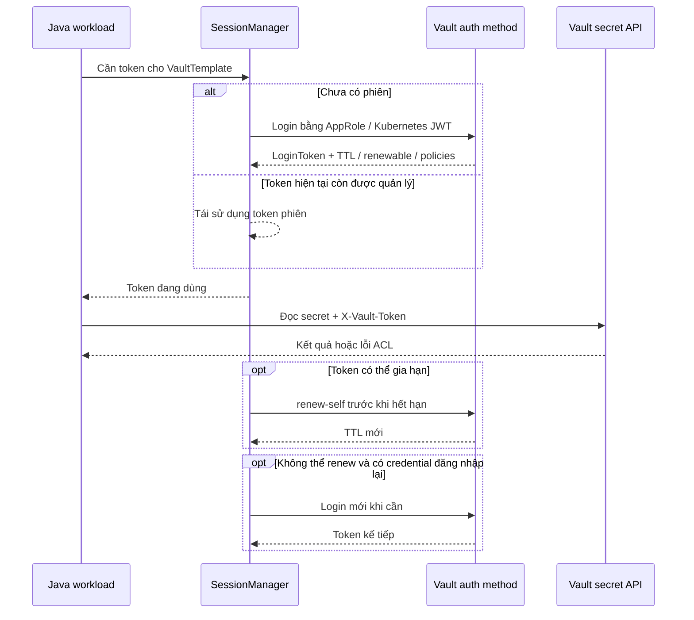

# Thời điểm đăng nhập và việc tái sử dụng token trong Spring Vault

## 1. Vì sao cần phân biệt thời điểm đăng nhập với mỗi lần truy cập Vault?

Trong ứng dụng Java sử dụng **Spring Vault**, `VaultTemplate` là điểm vào chính để đọc KV secrets, gọi Transit encryption, yêu cầu chứng chỉ qua PKI hoặc thực hiện các thao tác Vault khác. Những lời gọi này cần một danh tính được Vault chấp nhận, thường biểu diễn bằng **Vault token**. Tuy nhiên, **mỗi yêu cầu đọc secret không tương đương với một lần đăng nhập mới**.

Một workload như `order-service` có thể đăng nhập bằng Kubernetes ServiceAccount JWT hoặc AppRole, nhận token được gắn policy rồi sử dụng token đó qua hàng trăm yêu cầu đến Vault. Việc giữ và sử dụng lại token là trách nhiệm của lớp quản lý phiên trong Spring Vault. Nếu ứng dụng đăng nhập lại cho từng thao tác, số yêu cầu đến auth backend tăng, độ trễ cao hơn, nhiều token mới được phát hành và vòng đời token khó kiểm soát.

Bài học này tập trung vào bốn câu hỏi:

1. **Khi nào** Spring Vault thực sự lấy token hoặc gửi yêu cầu đăng nhập?
2. **Bộ phận nào** tái sử dụng token cho các lần gọi `VaultTemplate`?
3. **Điều gì xảy ra** khi token gần hết hạn, bị thu hồi hoặc workload khởi động lại?
4. **Lựa chọn và kiểm chứng** cơ chế quản lý token thế nào để vừa ổn định vừa tuân thủ policy?

Trong chương **Nền tảng xác thực**, nội dung này là cầu nối giữa cơ chế chứng thực workload và các chủ đề tiếp theo về vòng đời token, lease, phân quyền, lỗi và giám sát.

## 2. Ba thành phần phải hiểu rõ

| Thành phần | Vai trò | Ví dụ |
| --- | --- | --- |
| `ClientAuthentication` | Cung cấp phương thức lấy token từ thông tin định danh của workload; có thể thực hiện một yêu cầu login thực sự hoặc trả về token đã có | `TokenAuthentication`, `AppRoleAuthentication`, `KubernetesAuthentication` |
| `SessionManager` | Quyết định thời điểm lấy token, tái sử dụng token và tùy triển khai mà gia hạn/thu hồi token | `SimpleSessionManager`, `LifecycleAwareSessionManager` |
| `VaultTemplate` / `VaultOperations` | Dùng phiên xác thực để gửi các lời gọi API đến KV, Transit, PKI và những endpoint được policy cho phép | `read(...)`, `opsForKeyValue(...)`, `opsForTransit()` |

Hãy tách hai hành động sau:

- **Đăng nhập**: dùng thông tin định danh ban đầu gửi đến auth method, ví dụ `POST /v1/auth/approle/login` hoặc `POST /v1/auth/kubernetes/login`, và nhận một Vault token.
- **Sử dụng token**: gửi yêu cầu nghiệp vụ kèm token hiện hành, thường qua header `X-Vault-Token`, ví dụ `GET /v1/secret/data/orders`. Vault kiểm tra token và ACL policy cho **từng yêu cầu**; Vault không phải tạo token mới cho mỗi lần đọc.

Có một ngoại lệ quan trọng: `TokenAuthentication` nhận **token đã được cấp từ bên ngoài**. Nó trả về token đó cho `SessionManager`, do đó bản thân hành động gọi `ClientAuthentication.login()` không tạo thêm token qua một auth login endpoint. `ClientAuthentication.login()` là tên phương thức trong Java, không phải bằng chứng luôn có HTTP login.

## 3. Dòng thời gian: login xảy ra lúc nào?

Việc tạo `VaultTemplate`, khởi tạo Spring bean, truy cập secret lần đầu và gia hạn token là các thời điểm khác nhau. Không nên suy luận thời điểm login chỉ từ việc service vừa khởi động.

| Sự kiện | Tác động đến xác thực |
| --- | --- |
| Ứng dụng tạo bean cấu hình Spring Vault | Client và session manager được thiết lập. Tùy cấu hình và hook khởi tạo, phiên có thể được lấy ngay trong giai đoạn này. |
| Ứng dụng nạp cấu hình/secret từ Vault lúc khởi động | Một truy cập thực tế có thể khiến token được lấy rất sớm, ngay trước khi ứng dụng sẵn sàng nhận HTTP traffic. |
| Lần đầu cần `SessionManager.getSessionToken()` khi chưa có token | Session manager gọi `ClientAuthentication`; auth kiểu AppRole/Kubernetes có thể phát sinh HTTP login. |
| Những lời gọi `VaultTemplate` tiếp theo cùng phiên | Thường sử dụng lại token đang được quản lý; không tạo một phiên đăng nhập riêng cho mỗi request. |
| Token tiến gần thời điểm hết hạn | Session manager có quản lý vòng đời có thể chủ động renew; khi không thể tiếp tục renew, cần lấy token mới bằng cơ chế authentication thích hợp. |
| Token bị revoke hoặc ứng dụng khởi động lại | Token cũ có thể không dùng được; cache trong bộ nhớ của process bị mất khi restart và phiên phải được thiết lập lại. |

**Cách xác định chính xác trên môi trường của bạn:** xem Vault audit log để phân biệt request `auth/<method>/login`, `auth/token/lookup-self`, `auth/token/renew-self` với các request đọc secret; đồng thời quan sát thời điểm bean khởi tạo, readiness check và lần gọi `VaultTemplate`. Tránh log giá trị token thật.

### Luồng điển hình khi dùng workload authentication



Sơ đồ diễn tả **luồng logic**, không phải cam kết mọi implementation đều gửi chính xác cùng số request. Ví dụ, `TokenAuthentication` không gửi bước login; nếu bật tra cứu token tĩnh thì có thêm request `lookup-self`. Một số lỗi mạng có thể khiến lần login/renew thất bại dù cấu hình đúng.

### Startup chủ động hay đăng nhập khi cần?

- **Chủ động kiểm tra ở startup**: gọi một thao tác Vault được phép trong bước khởi tạo/readiness. Ưu điểm: phát hiện sớm sai credentials, thiếu policy hoặc Vault không truy cập được; đổi lại tăng phụ thuộc vào Vault trong quá trình khởi động.
- **Đăng nhập ở lần truy cập thực tế**: có thể giảm công việc khởi tạo, nhưng lỗi auth và độ trễ login xuất hiện ở request đầu tiên. Hành vi thật phụ thuộc vào cấu hình và lifecycle của bean.
- **Nạp secrets vào cấu hình ứng dụng** bằng Spring Cloud Vault: hệ thống có thể truy cập Vault trong giai đoạn tải ConfigData, sớm hơn những lệnh gọi `VaultTemplate` do business code thực hiện. Phân biệt thời điểm của Spring Cloud Vault và thời điểm của Spring Vault core.

Nếu readiness dựa vào Vault, nên dùng một phép thử có chủ đích, giới hạn thời gian và có quyền tối thiểu; không vô tình biến mỗi lần health probe thành một login mới.

## 4. So sánh hai cách quản lý phiên token

| Tiêu chí | `SimpleSessionManager` | `LifecycleAwareSessionManager` |
| --- | --- | --- |
| Lấy token lần đầu | Gọi `ClientAuthentication` và giữ token | Gọi `ClientAuthentication` khi cần phiên, đồng bộ giữa các thread cạnh tranh |
| Tái sử dụng | Có, dùng cùng token trong đời sống session manager | Có, dùng token được quản lý trong session |
| Gia hạn theo TTL | **Không tự refresh** | Có thể lên lịch renew khi token có thông tin lease/TTL và Vault cho phép |
| Token hết hạn | Không tự sửa trạng thái phiên bằng refresh; ứng dụng có thể tiếp tục dùng token cũ và gặp lỗi | Có thể bỏ trạng thái token không còn hợp lệ, làm mới hoặc re-login theo cơ chế xác thực |
| Thu hồi khi shutdown | Không quản lý revoke | Có thể revoke **`LoginToken` phù hợp**, tùy loại token do auth cấp |
| Khi nào dùng | Demo ngắn, token cố định được quản lý/rotate bởi hệ thống ngoài có kiểm soát | Workload chạy dài hạn cần quản lý vòng đời session |

`SimpleSessionManager` đồng bộ việc lấy token lần đầu và giữ lại kết quả; **không nên kỳ vọng** nó sẽ tự nhìn thấy một token mới được ghi vào secret volume hay biến môi trường sau khi khởi tạo.

`LifecycleAwareSessionManager` nhận biết thời hạn và gia hạn token theo khả năng thực tế của Vault. Với token đến từ phương thức login như AppRole/Kubernetes, Spring Vault nhận `LoginToken` có thông tin TTL và `renewable`. Khi đóng session manager, token thuộc loại login phù hợp có thể được revoke. Với `TokenAuthentication`, client trả về `VaultToken` thuần: session manager có thể thực hiện **self-lookup** để biết TTL rồi renew token nếu được phép; nhưng nó **không tự revoke** token tĩnh đó khi shutdown và không tự thay giá trị token ngoài process đã bị xoay vòng.

Khi sử dụng `AbstractVaultConfiguration`, Spring Vault cấu hình `LifecycleAwareSessionManager` theo mặc định. Vì vậy, đừng gán mặc định `SimpleSessionManager` cho mọi ứng dụng chỉ dựa trên việc thấy có `TokenAuthentication`.

## 5. Ví dụ Java: token cố định và sử dụng lại `VaultTemplate`

Ví dụ dưới đây dùng token đã được cấp từ trước để **minh họa việc tái sử dụng token**, không có HTTP login theo AppRole/Kubernetes. Cấu hình mẫu dựa trên Spring Vault core:

```java
import java.net.URI;

import org.springframework.context.annotation.Configuration;
import org.springframework.vault.authentication.ClientAuthentication;
import org.springframework.vault.authentication.TokenAuthentication;
import org.springframework.vault.config.AbstractVaultConfiguration;
import org.springframework.vault.client.VaultEndpoint;

@Configuration
public class VaultConfiguration extends AbstractVaultConfiguration {

    @Override
    public VaultEndpoint vaultEndpoint() {
        return VaultEndpoint.from(
                URI.create("https://vault.example.internal:8200"));
    }

    @Override
    public ClientAuthentication clientAuthentication() {
        String token = System.getenv("VAULT_TOKEN");
        if (token == null || token.isBlank()) {
            throw new IllegalStateException("Missing VAULT_TOKEN");
        }
        return new TokenAuthentication(token);
    }
}
```

```java
import org.springframework.stereotype.Service;
import org.springframework.vault.core.VaultOperations;
import org.springframework.vault.support.VaultResponse;

@Service
public class OrderSecretReader {

    private final VaultOperations vault;

    public OrderSecretReader(VaultOperations vault) {
        this.vault = vault;
    }

    public void checkSecretAccess() {
        // Đường dẫn API của KV v2 khi mount là "secret".
        VaultResponse first = vault.read("secret/data/orders");
        VaultResponse second = vault.read("secret/data/orders");

        if (first == null || second == null) {
            throw new IllegalStateException("Secret not found");
        }
        // Không in nội dung secret hoặc Vault token ra log.
    }
}
```

Điểm cần quan sát:

1. Spring quản lý một đối tượng `VaultOperations`/`VaultTemplate` dùng chung; hai lời gọi `read` là **hai request KV**, không mặc nhiên là hai lần login.
2. `TokenAuthentication` đã có token đầu vào; không có request `auth/approle/login` hay `auth/kubernetes/login` chỉ vì hai lần đọc này.
3. `AbstractVaultConfiguration` dùng cơ chế quản lý phiên có khả năng renew; nếu cấu hình lookup và Vault policy cho phép, bạn có thể thấy request `auth/token/lookup-self` hoặc `renew-self`.
4. Đường dẫn `secret/data/orders` là API path của **KV version 2**, với mount `secret`. Nếu chỉ muốn thao tác KV, có thể dùng `opsForKeyValue("secret", KV_2)`; cách chọn client API không làm thay đổi nguyên tắc phiên token.
5. Ví dụ dùng biến môi trường để ngắn gọn; production nên chọn cơ chế **workload identity** (Kubernetes, AppRole có vòng đời secret-id phù hợp, hoặc cơ chế tin cậy của hạ tầng), cấp policy tối thiểu và bảo vệ thông tin định danh đầu vào.

Khi thay `clientAuthentication()` bằng implementation AppRole/Kubernetes, phiên đầu tiên có thể yêu cầu Vault phát hành token mới. Nên giữ lại một `SessionManager` dùng chung, để các thao tác KV, Transit và PKI trong **cùng phạm vi danh tính** có thể tái sử dụng phiên đó.

## 6. TTL, renew, re-login và revoke là bốn chuyện khác nhau

Giả sử một workload đăng nhập lúc 09:00 và nhận token có TTL 30 phút (giá trị minh họa). Tới 09:15, mọi request vẫn dùng token hiện tại. Khi đến gần 09:30, cơ chế quản lý phiên có thể gọi Vault để renew. **Renew giữ token hiện tại và kéo dài hiệu lực theo TTL Vault thực trả về**; ngược lại, **re-login dùng lại danh tính gốc để xin một token khác**. Nếu token bị revoke, chỉ có credential hợp lệ và auth method phù hợp mới cho phép xác thực lại.

| Khái niệm | Ý nghĩa | Hệ quả với ứng dụng |
| --- | --- | --- |
| `TTL` | Thời gian hiệu lực còn lại của token | Hết hạn thì token không còn được Vault chấp nhận |
| `renewable` | Token cho phép yêu cầu gia hạn hay không | Cờ này **không bảo đảm** renew luôn thành công hoặc vô hạn |
| `max_ttl` / `explicit_max_ttl` | Giới hạn tuổi thọ hiệu lực do Vault áp đặt | Token có thể đến ngưỡng buộc phải đăng nhập lại |
| Periodic token | Token cấp theo `period`, có thể duy trì nhờ renew đúng hạn | Vẫn bị giới hạn nếu có `explicit_max_ttl`, hoặc bị revoke |
| Revoke | Chủ động vô hiệu hóa token/lease | Không thể khôi phục token bị revoke bằng retry request KV |
| `LoginToken` và `VaultToken` | Loại object Spring Vault dùng để mang token và metadata vòng đời | Ảnh hưởng khả năng lên lịch renew và hành vi revoke khi đóng phiên |

Đừng đồng nhất **token TTL** với **lease của secret động**:

- Token dùng để xác thực thao tác Vault. Nếu token hết hiệu lực, những request Vault tiếp theo sẽ thất bại.
- Secret động như credentials database/PKI có **lease riêng** (nếu engine có cấp lease), cần gia hạn/đổi riêng theo hợp đồng của engine và ứng dụng sử dụng secret.
- KV secrets thông thường **không phát hành lease động** như database credentials; đọc KV nhiều lần không đồng nghĩa renew một lease secret.
- Với service token, việc hết hạn hoặc revoke token có thể khiến các lease do token sở hữu bị revoke theo quan hệ parent/lease của Vault. Không giả định gia hạn token sẽ tự động gia hạn mọi secret lease.
- Batch token có những giới hạn riêng: **không renewable**, không hỗ trợ đầy đủ các thao tác revoke/lease của service token.

Một `renew` bị Vault từ chối vì vượt max TTL không tự chứng minh hệ thống sai cấu hình. Hướng xử lý thường là đăng nhập mới bằng credential vẫn hợp lệ, theo lifecycle của authentication và workload.

## 7. Phạm vi nào nên chia sẻ token?

Một `VaultTemplate` được cấu hình đúng là thread-safe và có thể tái sử dụng cho nhiều thao tác trong một ứng dụng. Các thread cùng sử dụng một `SessionManager` của workload sẽ chia sẻ token phiên, giúp tránh các cuộc login đồng thời không cần thiết.

**Ranh giới tái sử dụng phải là danh tính và quyền truy cập của workload**, không phải sự tiện lợi khi lập trình:

- Các instance của cùng service trên các pod/container thường nên tự đăng nhập bằng danh tính workload của **chính instance đó**. Không phân phát một token chung bằng file, log, cache phân tán hoặc biến môi trường chia sẻ không kiểm soát.
- Không cho nhiều tenant hoặc nhiều end-user khác policy dùng chung session manager của một token quyền rộng. Nếu mỗi người dùng có policy riêng, cần thiết kế luồng ủy quyền và phiên riêng phù hợp.
- Token phải được Vault đánh giá policy cho **mỗi API path**. Việc token đọc được `secret/data/orders` không chứng tỏ nó được phép gọi `transit/encrypt/orders` hoặc `pki/issue/orders`.
- Nếu có Vault namespace hoặc identity scope riêng, phải cấu hình đúng ngữ cảnh namespace và mount path trước khi quyết định chia sẻ client/session.

Ví dụ policy tối thiểu cho workload cần đọc KV và mã hóa Transit:

```hcl
path "secret/data/orders" {
  capabilities = ["read"]
}

path "transit/encrypt/orders" {
  capabilities = ["update"]
}
```

Policy chỉ cho phép hai thao tác cụ thể. Đường dẫn này giả định KV v2 mount `secret` và Transit mount `transit`; không dùng root token để thử cho tiện.

## 8. Chẩn đoán lỗi: đừng retry login mù quáng

Giả sử `VaultTemplate.read(...)` báo HTTP 403. Có ít nhất hai khả năng quan trọng:

- **Token sai, hết hạn hoặc đã bị revoke**: Vault có thể trả thông báo `invalid token` kèm `permission denied`; cần kiểm tra khả năng renew/re-login và nguồn credential.
- **Token còn hiệu lực nhưng ACL không cho phép path**: Vault thường trả `permission denied`; đăng nhập lại cùng role/policy sẽ **không** tự tạo thêm quyền.

Các trạng thái khác cần phân biệt:

| Biểu hiện | Hướng xác minh |
| --- | --- |
| Request đầu tiên chậm, sau đó nhanh | Kiểm tra cold login, self-lookup, thiết lập kết nối và việc gọi Vault từ giai đoạn startup |
| Sau thời gian chạy dài mới bắt đầu 403 | Kiểm tra TTL, khả năng renew, token type, max TTL, revoke và việc đổi workload credential |
| Đồng thời nhiều request gây nhiều login | Kiểm tra có vô tình tạo `VaultTemplate`/`SessionManager` mỗi request hoặc tạo nhiều session manager độc lập không |
| Renew thất bại, request KV vẫn có lúc thành công | Quan sát trạng thái token thực tế và số lần retry; renewal lỗi không đồng nghĩa mọi request lập tức thất bại |
| Sau khi rotate token ngoài process vẫn dùng token cũ | Xem cách `TokenAuthentication` được khởi tạo và khi nào session/client được tái thiết lập |
| Lỗi TLS, DNS hoặc timeout | Giải quyết kết nối trước; không quy mọi lỗi mạng thành sai thông tin đăng nhập |

Với `LifecycleAwareSessionManager`, một số lỗi phía client khi renew có thể khiến session manager bỏ token hiện tại và thử lấy token mới ở lần cần tiếp theo. Cơ chế này không thay thế việc xác định rõ nguyên nhân 403, vì 403 do policy không phải vấn đề cần renew token.

### Tín hiệu vận hành nên theo dõi

- Số lần login theo auth method và workload; tỷ lệ login thành công/thất bại.
- Số lần renew, lỗi renew, thời gian hiệu lực còn lại nếu có thể lấy an toàn và số lần phải re-login.
- Tỷ lệ HTTP 403, 5xx và timeout khi gọi Vault, phân biệt endpoint auth/token với KV/Transit/PKI.
- Thời gian startup/readiness và độ trễ request đầu tiên sau khi workload khởi động.
- Cảnh báo khi renew liên tục thất bại, sắp hết TTL mà không thể re-login, hoặc nguồn JWT/SecretId của workload đã không còn hợp lệ.

Dùng authentication events/listeners của Spring Vault hoặc metrics ở tầng HTTP/Vault audit log để đo lường; **không** ghi token, JWT, SecretId, dữ liệu KV hay header `X-Vault-Token` vào log, trace hoặc metric label.

## 9. Thực hành có kiểm chứng trên môi trường thử nghiệm

Chuẩn bị Vault dev hoặc một Vault test cô lập, một policy chỉ đọc `secret/data/orders` và một ứng dụng Spring Vault đơn giản. Không dùng root token trong ví dụ triển khai thực tế.

### Bài A — Phân biệt login và truy cập KV

1. Cấu hình `TokenAuthentication` bằng một token thử nghiệm còn hiệu lực, khởi tạo `VaultTemplate` một lần.
2. Đọc `secret/data/orders` hai lần liên tiếp.
3. Quan sát audit log: có **hai lần gọi KV**; không có yêu cầu login AppRole/Kubernetes do đoạn mã này tạo ra. Có thể xuất hiện self-lookup tùy session manager.
4. Lặp lại với AppRole/Kubernetes và xác nhận lần lấy token đầu tiên có request auth login. Kiểm tra các request KV sau dùng token phiên, không login lại cho từng lần đọc.

**Kết quả mong đợi:** phân biệt được request auth phát hành token, request quản lý token và request KV; kiểm chứng được việc tái sử dụng token bằng hành vi quan sát được thay vì số lượng method Java đã gọi.

### Bài B — Token hết hạn và giới hạn renew

1. Tạo một token thử nghiệm với TTL ngắn, chính sách phù hợp; kiểm tra thời hạn và `renewable` bằng `vault token lookup`.
2. Cho ứng dụng thực hiện nhiều request trong thời gian token còn hiệu lực; xác định session manager đang dùng.
3. Quan sát renew (nếu token hỗ trợ và manager được cấu hình đúng), sau đó thử trường hợp revoke token trong môi trường test.
4. So sánh hành vi của `SimpleSessionManager` và `LifecycleAwareSessionManager`, ghi nhận thời điểm lỗi, renew hoặc re-login nếu auth method có thể đăng nhập lại.
5. Đảm bảo cleanup token test và kết thúc workload; không vô hiệu hóa token thật của dịch vụ đang chạy.

**Kết quả mong đợi:** mô tả được vì sao token cố định đi cùng `SimpleSessionManager` dễ bị stale, vì sao gia hạn có giới hạn và vì sao token bị revoke không thể cứu bằng cách gọi KV lặp lại.

### Bài C — Khởi động và đồng thời

1. Đặt phép đọc Vault vào readiness check có giới hạn thời gian hoặc vào một tác vụ khởi tạo test.
2. Chạy hai trường hợp: Vault sẵn sàng và Vault tạm thời không truy cập được; ghi nhận ứng dụng báo sẵn sàng ở thời điểm nào.
3. Tạo nhiều request đồng thời cùng dùng một session manager, quan sát số lần login; so sánh với trường hợp cố tình tạo session manager mới cho mỗi request trong môi trường test.
4. Bảo đảm khi đóng ứng dụng, vòng đời session manager được quản lý bởi Spring container để việc cleanup diễn ra theo cấu hình.

**Kết quả mong đợi:** thiết kế được chính sách fail-fast hoặc lazy phù hợp yêu cầu sẵn sàng của ứng dụng và tránh login storm do tái tạo client sai phạm vi.

## 10. Các câu hỏi tự kiểm tra

1. Vì sao `VaultTemplate.read(...)` gọi 100 lần không có nghĩa Vault phải phát hành 100 token?
2. Sự khác biệt giữa `TokenAuthentication` và `AppRoleAuthentication` ở lần lấy token đầu tiên là gì?
3. `SimpleSessionManager` tái sử dụng token ra sao và còn thiếu khả năng nào khi token hết TTL?
4. Vì sao token tĩnh dùng với `LifecycleAwareSessionManager` vẫn **có thể** được renew nhưng không bị tự động revoke khi session manager kết thúc?
5. Nếu một token đọc được KV nhưng không gọi được Transit, nên kiểm tra policy path hay đăng nhập lại trước?
6. Khi nào bạn chọn kiểm tra Vault ở startup và khi nào bạn chấp nhận xử lý lần truy cập đầu tiên?
7. Renew token khác renew một dynamic secret lease ở điểm nào?
8. Vì sao nhiều pod của cùng workload nên quản lý danh tính/token độc lập, ngay cả khi chúng cùng policy?

## 11. Ghi nhớ khi áp dụng

- `ClientAuthentication` mô tả **cách lấy token**; `SessionManager` mô tả **khi nào lấy, dùng lại và quản lý vòng đời**; `VaultTemplate` thực hiện **yêu cầu nghiệp vụ** dưới phiên đó.
- Không giả định mọi lệnh gọi `login()` đều có HTTP login: `TokenAuthentication` chỉ đưa vào token đã có.
- Không coi token tái sử dụng là token có thể tồn tại vô hạn. Cần tính đến TTL, renewability, max TTL, revoke và khả năng tái xác thực của workload.
- Giữ `VaultTemplate`/`SessionManager` theo phạm vi bean và danh tính hợp lý; chỉ cấp policy cho những KV, Transit và PKI endpoint dịch vụ thực sự cần.
- Đo thời điểm login và lỗi bằng audit/metrics, không dựa vào suy đoán từ constructor và không để lộ giá trị token.

### Tài liệu tham khảo

- [Spring Vault — Introduction to VaultTemplate và Session Management](https://docs.spring.io/spring-vault/reference/vault/imperative-template.html)
- [Spring Vault — Authentication Methods và Token Lifecycle](https://docs.spring.io/spring-vault/reference/vault/authentication.html)
- [Spring Vault API — LifecycleAwareSessionManager](https://docs.spring.io/spring-vault/reference/api/java/org/springframework/vault/authentication/LifecycleAwareSessionManager.html)
- [HashiCorp Vault — Tokens](https://developer.hashicorp.com/vault/docs/concepts/tokens)
- [HashiCorp Vault — Lease, Renew and Revoke](https://developer.hashicorp.com/vault/docs/concepts/lease)
