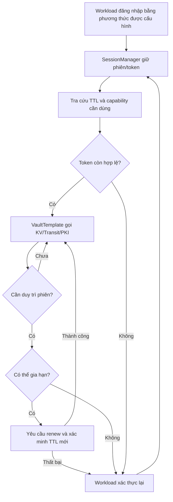

# Kiểm tra quyền và khả năng gia hạn của token được cấp trong Spring Vault

Ứng dụng Java kết nối HashiCorp Vault qua Spring Vault cần một **token hợp lệ** để đọc KV secret, gọi Transit encryption, xin chứng chỉ PKI hoặc nhận thông tin đăng nhập động. Tuy nhiên, đăng nhập thành công chỉ cho biết Vault đã cấp token; ứng dụng còn phải biết token **được phép làm gì** và **có thể tiếp tục sử dụng trong bao lâu**.

Bài học thuộc chương **Nền tảng xác thực** của module **SPRING_VAULT**. Ta sẽ dùng các API của Vault và `VaultTemplate` để kiểm tra quyền hiệu lực (*effective capabilities*) của token, đọc TTL, xác định điều kiện gia hạn và chọn cách xử lý khi token gần hết hạn. Ví dụ giả định ứng dụng xác thực theo workload bằng AppRole hoặc Kubernetes; chuỗi token và dữ liệu nhạy cảm đều được che.

## 1. Ba câu hỏi phải trả lời sau khi Vault cấp token

Khi một workload đăng nhập, Vault có thể trả về:

```json
{
  "auth": {
    "client_token": "<REDACTED>",
    "accessor": "<REDACTED>",
    "policies": ["default", "payments-reader"],
    "metadata": {"role": "payments-api"},
    "lease_duration": 1800,
    "renewable": true,
    "token_type": "service"
  },
  "data": null,
  "lease_id": "",
  "lease_duration": 0
}
```

Hãy phân biệt rõ:

1. **Token đang có quyền gì?** `auth.policies` cho thấy các policy được gắn, nhưng tên policy không phải danh sách quyền cuối cùng. Cần kiểm tra capability trên **đường dẫn API thực**.
2. **Token còn hiệu lực bao lâu?** `auth.lease_duration = 1800` nghĩa là TTL token được cấp lúc đăng nhập là khoảng 30 phút. Đây không phải TTL của secret động; `lease_duration` ở cấp gốc có ý nghĩa khác.
3. **Token gia hạn được hay không?** `auth.renewable = true` nói token thuộc loại có thể **yêu cầu** gia hạn. Gia hạn thành công còn phụ thuộc policy, loại token, giới hạn TTL, trạng thái token và cấu hình phương thức xác thực.

Không nên đưa `client_token` vào log, URL, mã nguồn hoặc thông báo lỗi. Spring Vault có `SessionManager` để cung cấp token cho các yêu cầu sau đăng nhập; ứng dụng thường không cần giữ token dưới dạng chuỗi ở mã nghiệp vụ.

## 2. Hiểu chính sách phân quyền của Vault

Vault áp dụng ACL policy theo **đường dẫn API** và **capability**. Một số capability quan trọng:

| Capability | Ý nghĩa thường gặp | Ví dụ |
| --- | --- | --- |
| `read` | Đọc dữ liệu hoặc thông tin từ endpoint. | `GET secret/data/payments/config` của KV v2. |
| `list` | Liệt kê tên khóa/đường dẫn tại endpoint hỗ trợ list. | `LIST secret/metadata/payments` của KV v2. |
| `create` | Tạo tài nguyên mới trên endpoint thích hợp. | Tạo dữ liệu tại một API path có hỗ trợ thao tác tạo. |
| `update` | Thực hiện thao tác cập nhật hoặc `POST` ở nhiều endpoint dạng action. | `POST transit/encrypt/orders`, `POST auth/token/renew-self`. |
| `delete` | Xóa dữ liệu/tài nguyên theo semantics của endpoint. | Xóa phiên bản KV v2 qua API được cấp quyền. |
| `patch` | Cập nhật một phần trên endpoint hỗ trợ patch. | API patch của KV v2 khi cấu hình phù hợp. |
| `sudo` | Quyền bổ sung cho một số endpoint được Vault bảo vệ đặc biệt. | Các API quản trị có yêu cầu `sudo`. |
| `deny` | Từ chối quyền. | Policy chứa `deny` có thể phủ quyết quyền cho đường dẫn liên quan. |

Quyền thực tế hình thành từ tập policy gắn với token, policy danh tính (identity policies), quy tắc ưu tiên path và các ràng buộc bổ sung. **Không thể suy quyền chỉ bằng tên `payments-reader` hoặc bằng một mảng `policies` xuất hiện trong phản hồi đăng nhập.**

### 2.1. Đường dẫn KV v2 khác đường dẫn logic của Spring Vault

Với mount `secret/` sử dụng KV v2:

| Nhu cầu | Đường dẫn người lập trình hay dùng | Đường dẫn ACL/API cần kiểm tra |
| --- | --- | --- |
| Đọc cấu hình payments | `vaultTemplate.opsForKeyValue("secret", KV_2).get("payments/config")` | `secret/data/payments/config` |
| Liệt kê tên secret dưới payments | `payments` trong API KV chuyên dụng | `secret/metadata/payments` |
| Ghi secret KV v2 | `payments/config` | `secret/data/payments/config` |
| Mã hóa qua Transit | Gọi key `orders` | `transit/encrypt/orders` |
| Xin chứng chỉ PKI | Gọi role `backend` | `pki/issue/backend` |

Một policy chỉ cấp `read` cho `secret/data/payments/config` không tự động cấp `list` tại `secret/metadata/payments`. Quyền liệt kê và quyền đọc giá trị là hai capability độc lập. Đối với API dạng hành động như Transit encrypt hoặc PKI issue, việc sử dụng HTTP `POST` thường cần capability `update`; không suy nó từ động từ tiếng Anh "read" hay "issue".

Ví dụ policy HCL dành cho một workload đọc cấu hình và kiểm tra vòng đời token:

```hcl
path "secret/data/payments/config" {
  capabilities = ["read"]
}

path "auth/token/lookup-self" {
  capabilities = ["read"]
}

path "auth/token/renew-self" {
  capabilities = ["update"]
}

path "sys/capabilities-self" {
  capabilities = ["update"]
}
```

Đây là policy minh họa; môi trường thật có thể đã cấp một phần quyền tự kiểm tra thông qua policy `default`, hoặc có policy giới hạn mạnh hơn. Chỉ nên cấp các path và capability workload thực sự sử dụng. Cấp quyền gọi `renew-self` **không** làm token trở thành renewable nếu loại token và chính sách cấp phát không cho phép.

## 3. Dùng `auth/token/lookup-self` để biết trạng thái token

API tự tra cứu token hiện tại:

```http
GET /v1/auth/token/lookup-self
X-Vault-Token: <TOKEN_HIEN_TAI>
```

Phản hồi ví dụ (đã lược bỏ trường nhạy cảm và trường không cần thiết):

```json
{
  "data": {
    "policies": ["default", "payments-reader"],
    "token_policies": ["default", "payments-reader"],
    "identity_policies": [],
    "ttl": 1270,
    "renewable": true,
    "creation_ttl": 1800,
    "explicit_max_ttl": 0,
    "expire_time": "2026-11-25T14:25:00Z",
    "type": "service",
    "path": "auth/kubernetes/login",
    "num_uses": 0
  }
}
```

| Thuộc tính trong `data` | Cách diễn giải |
| --- | --- |
| `ttl` | Số giây còn lại **ở thời điểm tra cứu**; giá trị này giảm theo thời gian. |
| `renewable` | Khả năng yêu cầu gia hạn ở thời điểm tra cứu; vẫn cần xác minh điều kiện thực tế. |
| `expire_time` | Thời điểm hết hạn được Vault báo; có thể thay đổi khi token được gia hạn. |
| `creation_ttl` | TTL khi token được tạo/cấp; không phải chắc chắn là giới hạn gia hạn tối đa. |
| `explicit_max_ttl` | Giới hạn TTL tối đa khai báo trực tiếp nếu có. Giá trị `0` không có nghĩa là token được gia hạn vô hạn. |
| `type` | `service` hoặc `batch`; batch token không hỗ trợ gia hạn theo cách service token. |
| `policies`, `token_policies`, `identity_policies` | Các policy liên quan đến token; không thay thế được phép kiểm tra capability theo path. |
| `num_uses` | Giới hạn số lần sử dụng khi được cấu hình; `0` thường thể hiện không giới hạn theo bộ đếm này. |
| `path` | Đường dẫn tạo token, giúp nhận diện phương thức xác thực. |

Lệnh CLI để kiểm tra token hiện tại:

```bash
# VAULT_ADDR và VAULT_TOKEN đã được cấu hình trong môi trường an toàn.
vault token lookup
```

**Lưu ý quan trọng:** truy vấn `lookup-self` có thể không thực hiện được nếu ACL chặn. Kết quả 403 là thất bại khi gọi endpoint tự tra cứu, không nhất thiết chứng minh mọi quyền khác của token đều bị từ chối. Ngoài ra, một token hết hạn hoặc bị thu hồi thường không thể tiếp tục tra cứu chính nó.

### 3.1. TTL còn lại khác TTL ban đầu

Nếu khi login `auth.lease_duration = 1800`, sau đó 10 phút `lookup-self` có thể trả `data.ttl` khoảng 1200 giây. Đừng kết luận ứng dụng có thêm 30 phút chỉ vì đang lưu phản hồi login trước đó. Cũng không nên dựa vào đồng hồ máy khách như nguồn duy nhất: dùng TTL mà Vault vừa trả, cân nhắc độ trễ và kiểm tra lại sau gia hạn.

## 4. Dùng `sys/capabilities-self` để kiểm tra quyền hiệu lực

API `sys/capabilities-self` cho phép hỏi Vault: **token đang dùng có những capability nào trên các path này?** Ví dụ:

```http
POST /v1/sys/capabilities-self
X-Vault-Token: <TOKEN_HIEN_TAI>
Content-Type: application/json

{
  "paths": [
    "secret/data/payments/config",
    "secret/metadata/payments",
    "auth/token/renew-self",
    "transit/encrypt/orders"
  ]
}
```

Giả sử Vault xác định quyền hiệu lực như sau (minh họa phần dữ liệu):

```json
{
  "secret/data/payments/config": ["read"],
  "secret/metadata/payments": ["deny"],
  "auth/token/renew-self": ["update"],
  "transit/encrypt/orders": ["deny"]
}
```

Từ kết quả này có thể kết luận: token được đọc cấu hình payments, không được liệt kê secret dưới payments và không được gọi Transit encrypt. Token có capability `update` trên `auth/token/renew-self`, **nhưng vẫn phải kiểm tra `renewable` và giới hạn TTL** trước khi chờ gia hạn.

Vault có thể biểu diễn dữ liệu kết quả hơi khác giữa truy vấn một path và nhiều path; khi tích hợp cần đối chiếu cấu trúc thực tế của endpoint/phiên bản Vault đang dùng. Mấu chốt là kiểm tra **path được yêu cầu** và danh sách capability tương ứng.

CLI tương đương để xem quyền trên một API path:

```bash
vault token capabilities secret/data/payments/config
vault token capabilities auth/token/renew-self
```

Hãy phân biệt:

- **`lookup-self`** trả thông tin vòng đời, loại token và danh sách policy.
- **`capabilities-self`** trả quyền áp dụng trên đường dẫn API cụ thể.
- **Gọi API thực tế** vẫn có thể thất bại do token hết hạn giữa hai lần gọi, sai namespace/mount, ràng buộc môi trường, giới hạn sử dụng hoặc điều kiện phía secret engine. Capabilities là phép kiểm tra hỗ trợ chẩn đoán, không phải giấy bảo đảm thao tác sau đó luôn thành công.

Không nên tự gửi toàn bộ hệ thống path vào log chỉ để khảo sát chính sách; chỉ kiểm tra các endpoint workload thực sự cần.

## 5. Điều kiện gia hạn token: nhiều hơn một cờ `renewable`

Token `renewable: true` nghĩa là có thể **thử gia hạn**; để thao tác thành công cần xét các điều kiện:

1. **Token vẫn hợp lệ:** chưa hết TTL, chưa bị thu hồi và chưa bị vô hiệu hóa bởi các giới hạn sử dụng hoặc ràng buộc liên quan.
2. **Loại token hỗ trợ:** service token có thể được cấu hình gia hạn; batch token không gia hạn như service token.
3. **Chính sách cho phép thao tác renew:** với chính token hiện tại, endpoint `auth/token/renew-self` thường cần capability `update`.
4. **TTL còn trong giới hạn:** `max_ttl`, `explicit_max_ttl`, cấu hình auth mount, token role, vòng đời token cha và quy định của Vault có thể giới hạn thời gian được cộng thêm.
5. **Cơ chế cấp token phù hợp:** periodic token có thể được gia hạn theo kỳ khi thỏa điều kiện; token thông thường có thể chạm giới hạn tối đa và phải đăng nhập lại.

Ví dụ request gia hạn chính token đang dùng:

```http
POST /v1/auth/token/renew-self
X-Vault-Token: <TOKEN_HIEN_TAI>
Content-Type: application/json

{
  "increment": "30m"
}
```

`increment` là thời lượng **yêu cầu**, không phải thời lượng Vault bắt buộc chấp thuận. Sau một lần renew thành công, đọc TTL mới từ phản hồi gia hạn (thường ở `auth.lease_duration` với API token renewal) hoặc gọi lại `auth/token/lookup-self` để xác minh. Không lấy yêu cầu `"30m"` làm TTL thực tế.

### 5.1. Phân biệt các giới hạn TTL

| Khái niệm | Ý nghĩa | Điểm cần nhớ |
| --- | --- | --- |
| `auth.lease_duration` khi login | TTL token khi mới được cấp. | Không tự động kéo dài chỉ nhờ giữ phản hồi login. |
| `data.ttl` từ `lookup-self` | Thời gian token còn sống. | Có thể giảm từng giây và thay đổi sau renew. |
| `data.creation_ttl` | TTL lúc tạo token. | Không nhất thiết là trần tối đa. |
| `data.explicit_max_ttl` | Trần TTL khai báo trực tiếp nếu khác 0. | Giá trị 0 không xóa các trần TTL khác. |
| `increment` khi renew | Thời gian mong muốn nhận thêm. | Vault có thể cấp ít hơn hoặc từ chối. |
| `lease_duration` ở gốc phản hồi dynamic secret | TTL của secret động. | Đây là **lease khác** với TTL của token. |

Ví dụ: token có thể được cấp TTL 30 phút và `renewable: true`, nhưng nếu token đã chạm giới hạn TTL tối đa cho phép thì renew có thể thất bại hoặc không kéo dài như mong đợi. Khi đó workload cần xác thực lại bằng phương thức hợp lệ của nó.

### 5.2. Token renewal và secret lease renewal là hai thao tác khác nhau

| Đối tượng | Endpoint/cơ chế điển hình | Khi nào dùng |
| --- | --- | --- |
| Token hiện tại | `auth/token/renew-self` | Kéo dài phiên xác thực khi token còn cho phép. |
| Token khác | `auth/token/renew` với quyền phù hợp | Quy trình quản trị/token lifecycle được ủy quyền. |
| Secret động có `lease_id` | `sys/leases/renew` hoặc lease lifecycle của Spring Vault | Gia hạn credential động khi engine hỗ trợ. |
| Secret KV tĩnh | Không có dynamic lease để renew theo `lease_id` | Quản lý cập nhật/xoay vòng secret theo nghiệp vụ. |

Gia hạn token không kéo dài vô hạn credential database đã cấp; ngược lại, còn lease của credential không bảo đảm token để đọc Vault tiếp tục hợp lệ. Chương trình cần theo dõi hai vòng đời tách biệt.

## 6. Kiểm tra trạng thái và capability bằng `VaultTemplate`

Spring Vault cung cấp `VaultOperations` / `VaultTemplate` để gọi API Vault. Ví dụ sau kiểm tra **token thực sự mà `VaultTemplate` đang dùng**, không truyền token ra ngoài:

```java
import java.util.Collection;
import java.util.List;
import java.util.Map;
import java.util.Set;
import java.util.stream.Collectors;

import org.springframework.vault.core.VaultOperations;
import org.springframework.vault.support.VaultResponse;

public final class VaultTokenInspector {
    private final VaultOperations vault;

    public VaultTokenInspector(VaultOperations vault) {
        this.vault = vault;
    }

    public TokenSnapshot lookupCurrentToken() {
        VaultResponse response = vault.read("auth/token/lookup-self");
        Map<String, Object> info = requireData(response);

        Object ttlValue = info.get("ttl");
        Object renewableValue = info.get("renewable");
        Object typeValue = info.get("type");

        if (!(ttlValue instanceof Number)
                || !(renewableValue instanceof Boolean)
                || !(typeValue instanceof String)) {
            throw new IllegalStateException("Phản hồi token lookup thiếu trường cần thiết");
        }

        return new TokenSnapshot(
                ((Number) ttlValue).longValue(),
                (Boolean) renewableValue,
                (String) typeValue);
    }

    public Set<String> capabilitiesFor(String apiPath) {
        // Chỉ sử dụng apiPath đã được ứng dụng chọn từ danh sách path tin cậy.
        VaultResponse response = vault.write(
                "sys/capabilities-self",
                Map.of("paths", List.of(apiPath)));
        Map<String, Object> data = requireData(response);

        // Phản hồi một path có thể cung cấp "capabilities" hoặc key là path.
        Object value = data.get(apiPath);
        if (value == null) {
            value = data.get("capabilities");
        }
        if (!(value instanceof Collection<?>)) {
            throw new IllegalStateException("Phản hồi capabilities không hợp lệ");
        }

        return ((Collection<?>) value).stream()
                .map(String::valueOf)
                .collect(Collectors.toUnmodifiableSet());
    }

    private static Map<String, Object> requireData(VaultResponse response) {
        if (response == null || response.getData() == null) {
            throw new IllegalStateException("Vault không trả dữ liệu yêu cầu");
        }
        return response.getData();
    }

    public record TokenSnapshot(long ttlSeconds, boolean renewable, String type) {
        public boolean canAttemptRenewal() {
            return ttlSeconds > 0 && renewable && "service".equals(type);
        }
    }
}
```

Ví dụ sử dụng với một `VaultTemplate` đã cấu hình xác thực và TLS:

```java
VaultTokenInspector inspector = new VaultTokenInspector(vaultTemplate);

VaultTokenInspector.TokenSnapshot token = inspector.lookupCurrentToken();
Set<String> rights = inspector.capabilitiesFor("secret/data/payments/config");

if (!rights.contains("read")) {
    throw new IllegalStateException("Workload thiếu quyền đọc cấu hình payments");
}

// Chỉ log dữ liệu không nhạy cảm phục vụ giám sát:
System.out.printf("tokenType=%s, ttlSeconds=%d, renewable=%s%n",
        token.type(), token.ttlSeconds(), token.renewable());
```

`canAttemptRenewal()` chỉ là kiểm tra sơ bộ điều kiện **có thể thử renew**. Nó không thay thế quy trình renew hay giới hạn tối đa phía Vault. Khi `lookup-self` hoặc `capabilities-self` bị từ chối, Spring Vault có thể ném exception HTTP (ví dụ `VaultException`) thay vì trả một `VaultResponse` với dữ liệu rỗng; mã ứng dụng cần phân loại lỗi khi gọi các phương thức này.

### 6.1. Vòng đời token trong Spring Vault

Trong ứng dụng có workload authentication, nên để `SessionManager` quản lý token đang dùng. `LifecycleAwareSessionManager` hỗ trợ quản lý phiên, gồm vòng đời token và việc gia hạn khi đáp ứng điều kiện cấu hình. `ClientAuthentication` (ví dụ AppRole hoặc Kubernetes) cung cấp cách lấy token mới.

Một luồng mong đợi:



Trong code nghiệp vụ, không nên đồng thời tự gọi `auth/token/renew-self` và để session manager tự gia hạn cùng một token nếu chưa thiết kế rõ cơ chế đồng bộ. Việc tự renew bên ngoài có thể làm trạng thái TTL mà session manager đang theo dõi không khớp. Nếu ứng dụng chỉ cần secret, thường để cơ chế quản lý phiên chuẩn xử lý renew/relogin; các API tra cứu ở đây phục vụ kiểm tra quyền, quan sát hoặc chẩn đoán.

Nếu workload dùng token tĩnh được cấu hình sẵn thay vì cơ chế đăng nhập lại, cần có quy trình xoay vòng token hợp lệ khi hết hạn. Gia hạn thất bại không thể được sửa chỉ bằng cách tăng số lần retry.

## 7. Chiến lược xử lý khi token sắp hết hạn

Giả sử `lookup-self` trả TTL còn 180 giây, `renewable = true` và type là `service`. Ứng dụng nên thực hiện:

1. Kiểm tra cơ chế quản lý phiên đã được kích hoạt và workload có khả năng xác thực lại.
2. Đảm bảo quyền `update` đối với `auth/token/renew-self` nếu thực hiện renew bằng endpoint đó.
3. Yêu cầu gia hạn **trước** khi token chạm TTL bằng ngưỡng dự phòng phù hợp với độ trễ mạng và tải hệ thống.
4. Xác nhận TTL thực tế của token sau gia hạn. Nếu renew thất bại do giới hạn vòng đời, dùng phương thức xác thực workload để lấy token mới.
5. Chỉ thử lại khi lỗi có tính tạm thời, với backoff có giới hạn; không retry vô hạn trên 403 hoặc token bị thu hồi.

| Tình huống | Nhận định | Hướng xử lý |
| --- | --- | --- |
| `renewable: false` | Token không được đánh dấu cho phép renew. | Chuẩn bị xác thực lại hoặc xoay vòng token, không gọi renew lặp lại. |
| `renewable: true` nhưng capability `deny` ở `renew-self` | Quyền gọi endpoint không đủ. | Xem lại policy của workload nếu nghiệp vụ thực sự cần renew. |
| Gia hạn thành công nhưng TTL tăng ít hơn yêu cầu | Có thể bị giới hạn bởi policy/TTL. | Dùng TTL Vault trả về để quyết định lần kiểm tra tiếp. |
| `403 permission denied` khi đọc KV | Có thể thiếu ACL, sai path, namespace hoặc token không hợp lệ. | Kiểm tra path API thực và trạng thái token; tránh in token. |
| `403` khi gọi `lookup-self` | Endpoint tra cứu bị hạn chế hoặc token đã không hợp lệ. | Kiểm tra policy và cơ chế phiên; không mặc định là KV cũng bị cấm. |
| Token hết hạn/đã revoke | Các yêu cầu dùng token cũ thất bại. | Đăng nhập lại bằng workload identity hợp lệ; không cố renew token cũ. |
| `lookup-self` trả `num_uses` dương | Token có giới hạn số lần sử dụng. | Không chỉ dựa vào TTL để đánh giá khả năng tiếp tục dùng. |

### 7.1. Nguyên tắc vận hành và giám sát

Chỉ ghi log/tracing các dữ liệu an toàn như: loại phương thức xác thực, tên endpoint đã kiểm soát, mã trạng thái, thời gian xử lý, TTL (giá trị số), trạng thái renewable và kết quả gia hạn/đăng nhập lại. Có thể theo dõi số lần renew thất bại, 403 theo loại thao tác và TTL trước khi phiên được thay mới.

Không log `client_token`, `accessor`, nội dung `data` chứa secret, JWT workload, AppRole SecretID hay toàn bộ phản hồi lookup vì nó có thể bao gồm định danh nhạy cảm. Nên đặt cảnh báo khi lỗi gia hạn hoặc đăng nhập lại lặp lại, để tránh trường hợp ứng dụng mất quyền đọc secrets mà không phát hiện.

## 8. Kiểm thử quyền và gia hạn trong môi trường tích hợp

Có thể dùng Vault thử nghiệm, Testcontainers hoặc một Vault dev được cô lập để tạo hai workload role với policy khác nhau. Không dùng root token cho luồng kiểm thử quyền tối thiểu vì root có khả năng vượt qua nhiều ACL mà ứng dụng thực tế phải tuân thủ.

| Ca kiểm thử | Điều kiện đầu vào | Kỳ vọng |
| --- | --- | --- |
| Quyền đọc tối thiểu | Token có `read` trên `secret/data/payments/config`. | `capabilities-self` báo `read`; thao tác đọc secret được phép. |
| Không có quyền list | Token không có `list` trên `secret/metadata/payments`. | Hỏi capability trả `deny`/không có `list`; API liệt kê bị từ chối. |
| Không có quyền Transit | Token chỉ có KV read. | `transit/encrypt/orders` không có capability `update`; gọi encrypt bị từ chối. |
| Token renewable | Service token còn TTL và có quyền renew. | Có thể thực hiện renew khi chưa vượt giới hạn; TTL sau renew được xác minh. |
| Token không renewable | Token được cấp với `renewable = false`. | Ứng dụng chọn tái xác thực/rotation thay vì phụ thuộc renew. |
| Token hết hạn hoặc bị revoke | Token không còn hiệu lực. | Gọi API lỗi; cơ chế xác thực lại được dùng nếu khả dụng. |
| KV v2 path sai | Kiểm tra `secret/payments/config` thay vì `secret/data/payments/config`. | Phát hiện kết quả capability không phản ánh quyền đọc KV v2. |

Để kiểm thử đáng tin cậy, nên xác minh cả **trả lời capability** và **thao tác Vault thật**. Kiểm thử token TTL ngắn cần có khoảng dự phòng thời gian, tránh giả định token hết hạn chính xác theo đồng hồ máy chạy test. Sau mỗi test, thu hồi token thử nghiệm, lease và dọn secret test theo quyền thích hợp.

## 9. Bài thực hành tự kiểm tra

### Tình huống A: Token có quyền nhưng không thể gia hạn

Vault trả `lookup-self`:

```json
{
  "data": {
    "ttl": 450,
    "renewable": false,
    "type": "service",
    "policies": ["payments-reader"]
  }
}
```

Trong khi `capabilities-self` cho `auth/token/renew-self` trả `["update"]`. Có nên luôn gọi renew với increment 30 phút?

**Trả lời:** Không. Capability `update` cho phép gọi endpoint theo ACL, nhưng `renewable: false` cho biết token hiện không được phép gia hạn. Ứng dụng cần chuẩn bị xác thực lại bằng workload hoặc dùng cơ chế xoay vòng đã thiết kế.

### Tình huống B: Token renewable nhưng không đọc được KV

`lookup-self` trả `ttl = 1200`, `renewable = true`. Quyền `secret/data/payments/config` lại là `["deny"]`.

**Trả lời:** Token vẫn có thể còn sống và có khả năng gia hạn, nhưng không được đọc đường dẫn KV đó. Gia hạn token không tự cấp thêm quyền. Cần cấp policy đúng cho workload nếu việc đọc là cần thiết, hoặc sửa API path nếu đang hỏi nhầm mount/phiên bản.

### Tình huống C: Phân biệt token TTL và lease của database

Sau login, `auth.lease_duration = 3600`. Ứng dụng gọi `database/creds/reporting` và nhận `lease_duration = 900`, `lease_id = "database/creds/reporting/abc"`, `renewable = true`.

**Trả lời:** Token ban đầu sống khoảng 3.600 giây, còn credential database có lease khoảng 900 giây. Token renew dùng vòng đời xác thực; credential cần theo dõi lease riêng và cập nhật connection pool khi credential đổi. Không dùng `auth/token/renew-self` thay cho gia hạn lease database.

### Tình huống D: Gia hạn được ít hơn yêu cầu

Ứng dụng yêu cầu increment 1 giờ, Vault chấp nhận nhưng TTL mới chỉ còn 10 phút.

**Trả lời:** Increment không phải cam kết. Cần dùng TTL thật Vault trả về, kiểm tra giới hạn TTL và chuẩn bị xác thực lại trước khi token hết hạn; không giả định đã được cấp 1 giờ.

## 10. Ghi nhớ

- **Kiểm tra token:** `auth/token/lookup-self` cho biết TTL còn lại, `renewable`, loại token và thông tin policy.
- **Kiểm tra quyền:** `sys/capabilities-self` trả capability hiệu lực cho **đường dẫn API cụ thể**; với KV v2, phải nhớ `data/` và `metadata/`.
- **Kiểm tra khả năng gia hạn:** phải xét trạng thái còn hiệu lực, `renewable`, token type, capability renew và các giới hạn TTL.
- **Gia hạn đúng đối tượng:** token qua `auth/token/renew-self`; lease của secret động có lifecycle riêng.
- **Tích hợp Spring Vault:** dùng `VaultTemplate` để kiểm tra khi cần, kết hợp `ClientAuthentication` và `SessionManager` để quản lý phiên, gia hạn và xác thực lại.
- **Bảo mật và kiểm thử:** cấp quyền tối thiểu, kiểm thử bằng token thật của workload và không tiết lộ token/secret trong log.

Khi tách rõ **quyền hiệu lực** và **vòng đời token**, ứng dụng Java có thể chủ động kiểm chứng các thao tác được phép, dự đoán thời điểm cần xác thực lại và xử lý lỗi khi làm việc với Vault.
