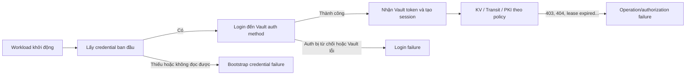
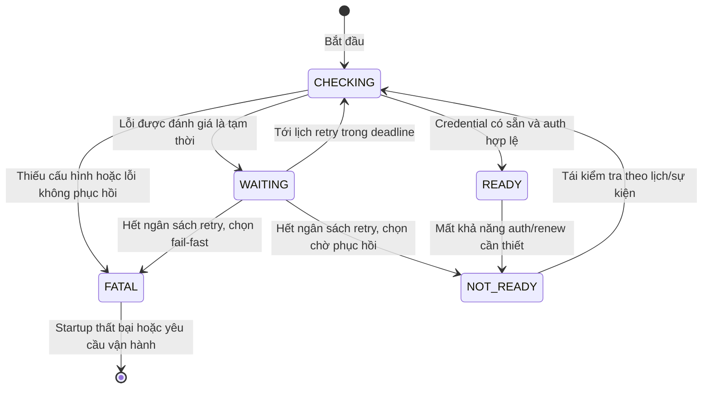

# Thiết kế hành vi khi không lấy được thông tin xác thực ban đầu

Trong **SPRING_VAULT**, ứng dụng Java thường dùng `VaultTemplate` để truy cập HashiCorp Vault, nhưng client cần có **danh tính ban đầu** trước khi Vault có thể cấp token và cho phép đọc KV secrets, gọi Transit encryption hoặc yêu cầu chứng chỉ PKI. Danh tính đó có thể là JWT của Kubernetes ServiceAccount, cặp AppRole `role_id`/`secret_id`, chứng cứ danh tính từ cloud IAM hoặc token được cấp sẵn. Một file chưa được mount, biến môi trường bị thiếu hay identity bị từ chối có thể làm hệ thống thất bại ngay ở bước đầu tiên.

Bài **Nền tảng xác thực** này tập trung vào câu hỏi vận hành: **ứng dụng phải phản ứng như thế nào khi không lấy được thông tin xác thực ban đầu?** Câu trả lời cần xét vai trò của Vault đối với tính đúng đắn của dịch vụ, phân biệt lỗi tạm thời với lỗi cấu hình, giới hạn thời gian chờ, trạng thái readiness và bảo mật thông tin xác thực. Vòng đời token/lease, Vault policy, logging và kiểm thử tích hợp đều liên quan, nhưng không thay thế quyết định về hành vi khi bootstrap authentication thất bại.

## 1. Xác định chính xác bước thất bại

Không nên gọi mọi lỗi truy cập Vault là “không lấy được credential”. Có ít nhất bốn giai đoạn:



| Giai đoạn | Ví dụ | Hành động điều tra đúng |
| --- | --- | --- |
| **Lấy credential ban đầu** | Không đọc được projected ServiceAccount JWT; chưa có AppRole `secret_id`; máy không có cloud identity | Kiểm tra nguồn cấp identity, mount, quyền file, cấu hình workload hoặc cơ chế phân phối credential |
| **Login** | Có JWT nhưng sai audience/role; Vault auth mount sai; endpoint Vault tạm không truy cập được | Kiểm tra cấu hình auth method, `role`, endpoint, TLS và khả năng Vault phản hồi |
| **Nhận/dùng Vault token** | Token bị revoke, hết TTL hoặc không thể renew/re-login | Kiểm tra `SessionManager`, TTL, loại token và khả năng lấy identity mới |
| **Thao tác theo policy** | Login thành công nhưng `403` khi đọc KV v2 hoặc gọi Transit; path `404` | Kiểm tra capabilities và API path; không gán nhầm thành thiếu initial credential |

**Credential ban đầu không đồng nghĩa Vault token.** Với Kubernetes/AppRole/IAM, client dùng credential ban đầu để login rồi Vault mới phát token theo role và policy. Nếu cấu hình token tĩnh (`TokenAuthentication`), chính token được cung cấp có thể là thông tin xác thực đầu vào; lúc đó không có bước login tương đương. `VaultTemplate` là client thao tác Vault, còn `ClientAuthentication` và `SessionManager` quyết định cách xác thực và sử dụng token. Tạo thành công bean `VaultTemplate` **không đảm bảo** đã lấy được JWT, login thành công hay được cấp quyền đọc secret.

## 2. Các nguồn thông tin xác thực ban đầu và lỗi đặc thù

| Phương thức | Thông tin cần lấy lúc bootstrap | Lỗi điển hình | Cách ứng xử |
| --- | --- | --- | --- |
| **Kubernetes auth** | ServiceAccount JWT từ file được mount/projection; role và auth mount tương ứng | File không tồn tại, rỗng, không đọc được; JWT sai audience hoặc đã hết hạn | Không ghi JWT vào log; kiểm tra cấu hình Pod/projection; thử lại có giới hạn khi mount hoặc API tạm chưa sẵn sàng |
| **AppRole** | `role_id`, `secret_id` hoặc secret ID được phân phối bằng response wrapping | Chưa được cấp, bị thu hồi, đã hết số lượt dùng hoặc wrapping token hết TTL | Dừng nếu provisioning sai; yêu cầu cấp lại qua kênh đã được phê duyệt; không hardcode `secret_id` trong mã nguồn |
| **Cloud IAM auth** | Identity/runtime credentials hoặc yêu cầu ký danh tính do cloud SDK cung cấp | Metadata/identity endpoint tạm lỗi, workload chưa gán role hoặc thiếu quyền ký | Retry lỗi hạ tầng ngắn hạn; coi role binding sai là cấu hình cần sửa |
| **Token cung cấp sẵn** | Vault token được inject an toàn qua runtime | Biến môi trường trống, file secret chưa mount, token hết hạn | Không thay bằng token dev/root; cần nguồn cấp hoặc rotation hợp lệ |
| **TLS client certificate** (nếu dùng cert auth) | Certificate, private key và trust chain | File key/cert thiếu, quyền đọc sai, cert hết hạn | Không tắt TLS verification; khắc phục provisioning và rotation |

Các phương thức có cách lấy credential và hạn sử dụng khác nhau. Với projected ServiceAccount JWT, runtime có thể thay nội dung file khi token được rotate; cách đọc/caching JWT cần phù hợp với phiên bản Spring Vault và cách cấu hình supplier. Không sao chép JWT một lần rồi mặc định dùng mãi. Với AppRole, không nên tự động tạo `secret_id` bằng đặc quyền quản trị từ chính ứng dụng đang thiếu credential; cách đó tạo vòng phụ thuộc và mở rộng quyền không cần thiết.

## 3. Định nghĩa chính sách trước khi viết retry

Quyết định quan trọng đầu tiên là: **dịch vụ có thể thực hiện tác vụ nào một cách đúng đắn và an toàn khi Vault chưa xác thực được?**

| Loại dependency | Ví dụ | Chính sách phù hợp |
| --- | --- | --- |
| **Bắt buộc để khởi chạy** | Spring Cloud Vault cần lấy cấu hình/secret trước khi tạo bean database; service không có khóa hoặc credential cần thiết | **Fail fast**: báo rõ lý do và để startup thất bại; deployment sửa cấu hình hay khởi động lại theo cơ chế có kiểm soát |
| **Bắt buộc để phục vụ request** | API chỉ hoạt động khi đọc được secret, mã hóa Transit hoặc truy cập PKI | Có thể tạo process nhưng **readiness phải là NOT_READY** cho đến khi auth và dependency cần thiết thành công; request phụ thuộc phải trả lỗi có kiểm soát |
| **Chỉ bắt buộc cho một tính năng** | Tác vụ phát hành chứng chỉ phụ, trong khi các endpoint công khai không cần Vault | Cho phép **degraded mode có giới hạn**: tắt riêng tính năng phụ thuộc Vault, thể hiện trạng thái và phục hồi khi xác thực lại được |
| **Tác vụ nền được phép trì hoãn** | Batch xử lý dữ liệu cần Transit nhưng chưa tới cửa sổ thực thi | Trì hoãn tác vụ, giữ queue/offset an toàn và retry có giới hạn; không xác nhận hoàn thành khi chưa thực hiện |

**Fail closed** là nguyên tắc bảo mật: không vì Vault unavailable mà bỏ bước kiểm tra quyền, dùng plaintext thay cho Transit, tạo khóa mã hóa tạm, đọc một bản secret không rõ nguồn gốc hoặc chuyển sang token root. Degraded mode hợp lệ khi tính năng còn hoạt động **không cần** Vault và có thiết kế độc lập được phê duyệt từ trước. Một fallback dùng cached secret chỉ được xét khi đã có chính sách rõ về nguồn gốc, mã hóa tại chỗ, giới hạn thời gian, rotation, quyền truy cập và hậu quả khi secret hết hiệu lực; cache không thể thay token bị revoke hay “gia hạn” lease bằng cách giữ giá trị cũ.

Ở nhiều ứng dụng, lỗi thiếu credential do **cấu hình cố định** (sai tên biến, sai đường dẫn, thiếu ServiceAccount, role không được gán) sẽ không tự hết khi retry. Ngược lại, một volume mount chậm, network timeout hoặc Vault tạm unavailable có thể tự phục hồi. Không có một chính sách retry duy nhất phù hợp cho mọi lỗi.

## 4. Thiết kế trạng thái: ứng dụng không được báo READY quá sớm

Đề xuất trạng thái nội bộ, có thể ánh xạ tới health/readiness:



- `CHECKING`: kiểm tra tính sẵn sàng của identity và kết quả login/operation tối thiểu cần thiết.
- `WAITING`: lỗi có thể phục hồi, retry theo ngân sách thời gian và số lần đã cấu hình; không cấp lưu lượng phụ thuộc Vault.
- `READY`: **chỉ** sau khi các điều kiện thực sự cần để phục vụ được xác nhận; có credential trên đĩa chưa đủ để chứng minh login/policy.
- `NOT_READY`: process có thể chạy để tự phục hồi, nhưng không nhận request yêu cầu Vault; vẫn có thể thực hiện chức năng độc lập nếu được thiết kế.
- `FATAL`: thiếu cấu hình, thiếu quyền cố định hoặc startup budget đã hết theo chính sách fail-fast; trả lỗi startup rõ ràng cho platform.

### Startup, readiness và liveness

Ba kiểm tra này phục vụ mục đích khác nhau:

1. **Startup gate** quyết định ứng dụng có được hoàn tất khởi tạo hay không. Trong Spring Boot có thể dùng `ApplicationRunner` để xác minh auth trước khi Boot phát tín hiệu ready; tuy nhiên nó diễn ra **sau** giai đoạn dựng context.
2. **Readiness** cho load balancer/orchestrator biết instance đã có thể phục vụ hay chưa. Một health indicator riêng cho Vault dependency có thể được đưa vào readiness group của Spring Boot Actuator; nên đọc trạng thái đã kiểm tra/cache, tránh mỗi probe lại tạo login mới.
3. **Liveness** trả lời process có còn hoạt động về mặt nội bộ không. Không gắn liveness trực tiếp vào một lần gọi Vault; Vault tạm mất kết nối có thể làm toàn bộ Pod bị restart theo vòng lặp.

Ví dụ tình huống: Pod đã chạy, JWT được mount sau vài giây. Nếu chính sách cho phép chờ, process chuyển `CHECKING → WAITING → READY` sau khi login thành công. Nếu file không bao giờ tồn tại do manifest cấu hình sai, cần phát hiện và nêu rõ nguyên nhân, không quay vòng retry vô hạn trong khi vẫn báo ready.

Trong Spring Cloud Vault dùng để nạp **property sources/config import**, thông tin xác thực có thể phải sẵn sàng **trước khi** `ApplicationContext` tạo các business bean. Khi đó lỗi bootstrap phải được xử lý ở cơ chế cấu hình của Spring Cloud Vault và deployment; một `ApplicationRunner` không thể “cứu” quá trình dựng context đã thất bại. Tùy phiên bản và cách import, hãy kiểm tra các tùy chọn như `spring.cloud.vault.fail-fast` và chính sách retry được hỗ trợ thay vì tự giả định runner chạy trước cấu hình Vault.

## 5. Phân loại lỗi trước khi quyết định retry

| Biểu hiện | Nhận định ban đầu | Chính sách gợi ý |
| --- | --- | --- |
| Biến môi trường bắt buộc rỗng hoặc file path cấu hình không có giá trị | Sai cấu hình | **Fatal**; in tên trường cấu hình thiếu, không in nội dung credential |
| Path credential đúng nhưng file chưa xuất hiện ngay khi Pod khởi chạy | Có thể là race tạm thời; cũng có thể sai manifest | Chờ ngắn có deadline; hết hạn thì NOT_READY hoặc fatal theo chính sách |
| `AccessDeniedException` khi mở file private key/JWT | Quyền file/mount sai | Thường fatal; không retry liên tục nếu chưa có tác nhân sửa quyền |
| JWT/AppRole bị Vault từ chối (`400`/`403` ở auth endpoint, tùy auth method) | Role, audience, TTL, mount hoặc binding sai | Không đổi auth method hay nâng quyền; chỉ thử lại khi có cơ chế cấp/rotate identity mới |
| DNS, connection refused, timeout, `429`, Vault `5xx` hoặc standby chuyển leader | Lỗi hệ thống tạm thời có thể phục hồi | Backoff + jitter, deadline và metrics; chỉ retry các thao tác phù hợp |
| TLS trust chain/hostname verification không hợp lệ | Sai CA, hostname hoặc cert | Fatal đến khi sửa; không vô hiệu hóa TLS verification |
| Login thành công nhưng API nghiệp vụ trả `403` | Thiếu Vault policy cho capability/path | Lỗi phân quyền; sửa policy/role, không coi là thiếu credential đầu vào |
| Token hết TTL khi ứng dụng đang chạy | Lỗi vòng đời session hoặc mất khả năng re-login | Dùng đúng `SessionManager` để re-login/renew; nếu thất bại chuyển trạng thái không sẵn sàng theo mức độ phụ thuộc |

Mã HTTP chỉ là một tín hiệu; phải xét endpoint (`auth` hay `secret engine`), phương thức xác thực và loại exception thực tế. Không nên tự động retry mọi `403`: nếu policy thiếu cố định, retry làm tăng tải và che giấu lỗi cấu hình. Ngược lại, JWT vừa được rotate hoặc quyền vừa được sửa có thể khiến lần login **mới** thành công; điều kiện cho thử lại phải dựa trên bằng chứng thay đổi identity/cấu hình.

### Ngân sách retry và thời gian chờ

Xác định cụ thể: `connectTimeout`, `readTimeout`, số lần tối đa, tổng deadline, lịch backoff và cách xử lý khi ngân sách cạn. Một chiến lược thường dùng cho lỗi tạm thời là **exponential backoff có jitter**: `delay = min(maxDelay, baseDelay × 2^attempt)` rồi thêm nhiễu ngẫu nhiên có giới hạn để tránh nhiều Pod cùng login vào Vault. Ví dụ base 250 ms, trần 5 s, tổng ngân sách startup 20 s; đây là giá trị minh họa, cần điều chỉnh theo hạ tầng và yêu cầu sản phẩm.

Không giữ request thread hoặc bean constructor chờ credential vô thời hạn. Đối với retry nền, dùng scheduler được quản lý bởi Spring và dừng nó khi context đóng. Nếu thư viện `SessionManager`/Spring Cloud Vault đã có retry hoặc token lifecycle, cần dùng **một owner** cho việc login/refresh; hai scheduler độc lập có thể gây trùng login, xung đột rotation và khó đoán trạng thái.

## 6. Một cách triển khai fail-fast bằng Spring Boot và Spring Vault

Trong trường hợp **Spring Vault core** được cấu hình cho workload login (ví dụ Kubernetes/AppRole) và startup bắt buộc có session, có thể tạo gate thử lấy token **qua `SessionManager` đang dùng chung**. Điều này buộc quá trình xác thực diễn ra trước khi ứng dụng báo ready theo luồng startup Boot thông thường. Không tạo một `ClientAuthentication` mới chỉ để login kiểm thử vì như vậy có thể phát sinh token không được session hiện tại quản lý.

```java
import org.springframework.boot.ApplicationArguments;
import org.springframework.boot.ApplicationRunner;
import org.springframework.boot.autoconfigure.condition.ConditionalOnProperty;
import org.springframework.context.annotation.Bean;
import org.springframework.context.annotation.Configuration;
import org.springframework.vault.authentication.SessionManager;

@Configuration
public class VaultBootstrapPolicyConfig {

    @Bean
    @ConditionalOnProperty(
        prefix = "app.vault",
        name = "require-login-at-startup",
        havingValue = "true"
    )
    ApplicationRunner requireVaultSession(SessionManager sessions) {
        return (ApplicationArguments args) -> {
            try {
                // Dùng đúng session manager của VaultTemplate đang được cấu hình.
                sessions.getSessionToken();
            } catch (RuntimeException exception) {
                throw new IllegalStateException(
                    "VAULT_BOOTSTRAP_AUTH_UNAVAILABLE: không lấy được phiên Vault khi khởi động",
                    exception
                );
            }
        };
    }
}
```

Ví dụ cấu hình bật gate:

```yaml
app:
  vault:
    require-login-at-startup: true
```

**Giới hạn của ví dụ:** `getSessionToken()` thực hiện hoặc kích hoạt cơ chế lấy token tùy `SessionManager` đã cấu hình; với token tĩnh, hàm có thể trả token đã cung cấp mà **chưa kiểm chứng token còn hợp lệ hoặc có policy cần thiết**. Để kiểm tra khả năng phục vụ thực sự, thêm một **operation tối thiểu, read-only được cấp quyền rõ ràng** theo nghiệp vụ (chẳng hạn đọc cấu hình bắt buộc qua KV v2). Cần phân biệt lỗi login với lỗi path/policy của operation đó; tuyệt đối không dùng thao tác cấp certificate hay ghi KV làm health check.

Code trên thể hiện **fail-fast một lần**, không triển khai retry. Nếu policy cần retry trong giới hạn, cấu hình nó ở lớp authentication/client được hỗ trợ hoặc triển khai một coordinator riêng có deadline và trạng thái, tránh `Thread.sleep` vô hạn trong `ApplicationRunner`. Nếu credential bắt buộc đã được Spring Cloud Vault sử dụng trong giai đoạn `Environment`/config import, phải xử lý fail-fast/retry tại **giai đoạn đó**; runner không thay thế cơ chế bootstrap.

### Kiểm tra nguồn credential Kubernetes trước khi login

Trong kịch bản Kubernetes auth, có thể kiểm tra riêng rằng đường dẫn JWT được mount đúng trước khi yêu cầu `SessionManager` login. Kiểm tra file chỉ giúp chẩn đoán, **không chứng minh JWT hợp lệ**:

```java
import java.io.IOException;
import java.nio.file.Files;
import java.nio.file.Path;

public final class ProjectedJwtPreflight {
    private ProjectedJwtPreflight() { }

    public static void verify(Path jwtFile) {
        try {
            if (!Files.isRegularFile(jwtFile)
                    || !Files.isReadable(jwtFile)
                    || Files.size(jwtFile) == 0) {
                throw new IllegalStateException(
                    "Kubernetes ServiceAccount token file is missing, unreadable or empty"
                );
            }
        } catch (IOException exception) {
            throw new IllegalStateException(
                "Unable to inspect Kubernetes ServiceAccount token file",
                exception
            );
        }
    }
}
```

Chỉ gọi preflight này khi **Kubernetes auth thực sự được chọn**; AppRole hoặc IAM không cần file JWT. Đường dẫn phải đến từ cấu hình workload, không mặc định mọi Pod đều mount token. Preflight không đọc hay ghi JWT vào log; bước login thực tế vẫn do Spring Vault thực hiện và xác nhận audience, role, validity. Không lưu cache kết quả “file đã tồn tại” như một bảo đảm token về sau vẫn dùng được.

## 7. Nếu chọn chờ phục hồi: readiness và fail-safe runtime

Ứng dụng có thể giữ process sống khi Vault chưa có credential, nhưng cần một trạng thái riêng và một cơ chế cập nhật. Luồng tổng quát:

```text
onStartup:
    authState = NOT_READY
    schedule attemptAuth()

attemptAuth:
    if credentialSource is obviously misconfigured:
        report CONFIGURATION_ERROR; apply fatal policy
    else:
        try sessionManager.getSessionToken()
            and optional permitted minimal read
        on success: authState = READY
        on classified transient failure:
            authState = NOT_READY
            schedule next attempt with capped backoff + jitter
        on permanent failure:
            authState = NOT_READY or FATAL according to policy

onVaultDependentOperation:
    if authState != READY: reject/defer with controlled error
    else: call Vault; reclassify unexpected auth failures

onShutdown:
    cancel scheduler, reject new work, close owned resources
```

Đây là **pseudocode điều phối**, không phải API tự động của Spring Vault. Với Spring Boot Actuator, có thể đưa custom health contributor `vaultAuth` vào readiness group, ví dụ tùy cấu hình dự án:

```yaml
management:
  endpoint:
    health:
      probes:
        enabled: true
      group:
        readiness:
          include: readinessState,vaultAuth
```

Cấu hình trên chỉ có ý nghĩa khi ứng dụng **thực sự đăng ký** health contributor `vaultAuth` trả `DOWN` lúc dependency bắt buộc chưa sẵn sàng và `UP` sau khi được xác nhận. Không bật YAML rồi cho rằng Spring tự tạo indicator hoặc tự kiểm tra Vault login. Health contributor nên đọc trạng thái đã được coordinator cập nhật; tần suất retry phải độc lập với tần suất Kubernetes probe để tránh bão đăng nhập.

Với workload chỉ cần Vault cho một số tính năng, readiness của **toàn instance** có thể vẫn `UP` nếu các endpoint được phép hoạt động độc lập. Khi đó controller/job riêng phụ thuộc Vault phải kiểm tra cờ khả dụng và trả lỗi phù hợp, ví dụ `503 Service Unavailable` cho API tạm không thể xử lý. Không biến “đang chờ auth” thành response thành công rỗng, bỏ mã hóa hoặc cung cấp dữ liệu chưa kiểm chứng.

## 8. Sự cố khi đang chạy và khi shutdown

Sau khi login lần đầu thành công, **initial credential** vẫn có thể được cần lại để Vault `SessionManager` lấy token mới khi token hiện tại hết hạn. Việc đổi JWT/secret ID ở runtime có thể làm phiên cũ hết khả năng re-login. Không gắn “đã xác thực thành công một lần” thành trạng thái READY vĩnh viễn.

- **Token TTL:** theo dõi việc gia hạn hoặc login lại theo `SessionManager`; token không được renew có thể hết hạn dù bean `VaultTemplate` còn sống.
- **Lease TTL:** credential database, PKI certificate và các leased secrets có vòng đời riêng. Có token hợp lệ không bảo đảm lease cũ còn hiệu lực; dùng cơ chế quản lý lease (`SecretLeaseContainer` khi phù hợp) và cập nhật consumer khi secret rotate.
- **KV/Transit/PKI:** quyền thực hiện operation phụ thuộc Vault policy và auth identity; không “fallback” sang static secrets hay local encryption key khi Vault unavailable nếu chưa có hợp đồng bảo mật độc lập.
- **Shutdown:** hủy các retry jobs, task chờ và HTTP resources do ứng dụng sở hữu. `@PreDestroy`/`SmartLifecycle` có thể hỗ trợ graceful shutdown nhưng không được đảm bảo khi process bị kill cưỡng bức; Vault TTL và server-side policy vẫn cần đúng.

Với Kubernetes rollout, readiness bị `DOWN` có thể ngăn Pod mới nhận lưu lượng, nhưng cần kiểm tra `startupProbe`, `readinessProbe`, `terminationGracePeriodSeconds`, thời gian retry và replica strategy để tránh một cấu hình lỗi đưa toàn bộ hệ thống vào vòng restart không cần thiết.

## 9. Logging, metrics và alert khi bootstrap thất bại

Không ghi JWT, Vault token, `secret_id`, private key, giá trị KV, toàn bộ auth response hoặc `X-Vault-Token` vào log. Cũng phải xem xét các exception chain và chế độ debug HTTP client: một số payload của authentication có thể chứa dữ liệu nhạy cảm. Thông điệp lỗi nên cho biết **loại lỗi và thành phần**, ví dụ:

```text
event=VAULT_BOOTSTRAP_AUTH_UNAVAILABLE
auth_method=kubernetes
phase=credential_source
reason=service_account_token_unreadable
retryable=false
readiness=NOT_READY
```

Những trường trên minh họa **log có cấu trúc**, không phải output mặc định của Spring Vault. Đừng log giá trị token hay nội dung file. Nên đo thời gian từ start đến auth ready, số lần login thất bại theo nhóm nguyên nhân, số lần retry, timeout, thay đổi trạng thái readiness và lỗi renew/lease. Alert nên phân biệt **misconfiguration kéo dài** với **Vault network outage**; tránh cardinality cao bằng cách không dùng JWT, Secret ID, path secret cá nhân hay message exception nguyên văn làm metric label.

Cách đưa lỗi ra ngoài cũng phải có mức độ: thông báo vận hành chỉ cần mã lỗi, pha lỗi, auth method, tên cấu hình bị thiếu (không phải giá trị); người dùng API nhận `503` và request correlation ID nếu tính năng bắt buộc đang unavailable. Không để client nhận stack trace hoặc chi tiết policy nội bộ.

## 10. Kịch bản kiểm thử bắt buộc

| Kịch bản | Cách tạo trong môi trường test cô lập | Điều phải xác nhận |
| --- | --- | --- |
| Thiếu credential | Bỏ mount JWT hoặc xóa test `secret_id` | Startup thất bại hoặc readiness `DOWN` theo chính sách; không có API Vault-dependent thành công giả |
| Credential không đọc được | Đặt quyền file không cho process test đọc | Phân loại lỗi nguồn credential; không ghi nội dung credential |
| Sai role/audience/AppRole | Dùng test identity hợp lệ về mặt định dạng nhưng không khớp auth role | Login bị từ chối, không tự nâng quyền hoặc đổi sang auth method khác |
| Vault tạm unavailable | Dùng Vault test/Testcontainers hoặc proxy test ngắt kết nối ngắn | Retry/backoff đúng ngân sách; readiness chính xác; tự hồi phục nếu policy cho phép |
| TLS sai | Gắn CA/hostname không tin cậy | Từ chối kết nối và báo lỗi rõ ràng; không tắt TLS verification |
| Vault token hết hạn hoặc revoke | Cấp token TTL ngắn và revoke bằng test fixture | Session re-login/renew theo cấu hình; request bị từ chối có kiểm soát khi không phục hồi |
| Login được nhưng thiếu policy | Chỉ cấp auth role, bỏ capability read cho KV/Transit/PKI | Nhận diện authorization failure; không nhầm với thiếu initial credential |
| Shutdown trong lúc retry | Dừng Spring context khi retry job đang chờ | Scheduler và kết nối do ứng dụng sở hữu dừng; không còn login request mới sau shutdown |
| Khôi phục nguồn identity | Mount/cấp lại credential theo cơ chế test rồi cho scheduler chạy | Từ `NOT_READY` sang `READY` sau **login thành công**, không chỉ sau khi file xuất hiện |

Unit test nên kiểm chứng bảng quyết định **loại lỗi → retry/fatal/degraded** và các chuyển trạng thái, không cần gọi Vault thật. Integration test dùng Vault cô lập với policy test tối thiểu để xác minh login và trạng thái có ảnh hưởng đến client thật. Không dùng root token hay secret production trong kiểm thử; nếu Vault dev mode cấp root token để thiết lập fixture, chỉ dùng nó trong khâu dựng môi trường test và tạo token/role giới hạn riêng cho ứng dụng đang được kiểm thử.

## 11. Ví dụ quyết định kiến trúc cho hai dịch vụ

**Ví dụ A — Payment service cần Transit để mã hóa dữ liệu bắt buộc.** Pod sử dụng Kubernetes ServiceAccount JWT để login Vault. JWT không được mount vì `serviceAccountName` cấu hình sai. Hệ thống ghi mã `VAULT_BOOTSTRAP_AUTH_UNAVAILABLE`, chọn fail-fast hoặc readiness `DOWN`, dừng xử lý thanh toán cho đến khi sửa cấu hình. Không lưu dữ liệu thẻ dạng plaintext và không phát sinh local key thay cho Transit. Khi mount JWT hợp lệ, quá trình login, kiểm tra policy Transit và readiness mới có thể thành công.

**Ví dụ B — Reporting service chỉ cần Vault cho tác vụ gửi chứng chỉ PKI định kỳ.** Chức năng báo cáo đọc dữ liệu công khai chạy độc lập với PKI; tác vụ PKI được tách khỏi đường phục vụ request. Khi AppRole `secret_id` chưa được cấp, toàn instance vẫn có thể phục vụ phần báo cáo độc lập, nhưng tác vụ chứng chỉ bị hoãn, có cảnh báo và tuyệt đối không được đánh dấu hoàn tất. Sau khi provisioning được khôi phục, cơ chế auth lấy được Vault token mới, tác vụ được thực hiện qua policy giới hạn và ghi nhận trạng thái chính xác.

## 12. Checklist thiết kế

Trước khi đưa Spring Vault vào production, nhóm triển khai phải trả lời được:

1. Workload lấy **credential đầu tiên** ở đâu, ai cấp/rotate/revoke và lúc nào credential đó có sẵn?
2. Nếu credential vắng mặt, ứng dụng cần **fail-fast**, **NOT_READY + retry** hay **degraded có giới hạn**? Quyết định dựa vào chức năng cụ thể nào?
3. Lỗi nào được retry, giới hạn thời gian/số lần là bao nhiêu, ai sở hữu retry và ai chuyển trạng thái readiness?
4. Lúc nào ứng dụng chứng minh được Vault **đã login thành công** và có policy cho thao tác bắt buộc, thay vì chỉ thấy file token tồn tại?
5. Khi token/lease hết TTL, login lại thất bại hoặc Vault tạm mất kết nối, hệ thống có chuyển trạng thái và ngừng tác vụ nhạy cảm đúng cách không?
6. Khi startup không thành công, log/metrics có đủ để sửa cấu hình **mà không làm lộ credential** không?
7. Khi dừng bình thường hoặc bị kill, cơ chế retry và resources có được xử lý theo ownership, còn tính an toàn vẫn dựa trên TTL/policy phía Vault không?

Thiết kế tốt không dựa vào giả định “Vault sẽ luôn sẵn sàng trước ứng dụng” hay “cứ retry là sẽ khỏi”. **Nguồn danh tính ban đầu, yêu cầu bảo mật của từng chức năng, giới hạn phục hồi và trạng thái readiness** phải được thể hiện thành quyết định cụ thể. Nhờ đó, ứng dụng Java dùng Spring Vault có thể thất bại rõ ràng khi cấu hình sai, tự hồi phục trước gián đoạn ngắn và vẫn giữ chính sách phân quyền khi truy cập KV, Transit hoặc PKI.
