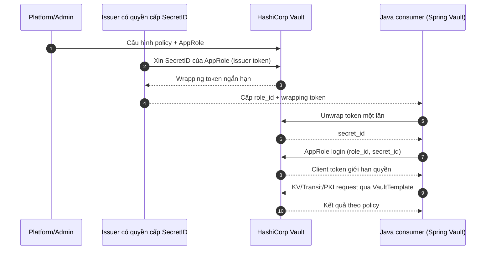
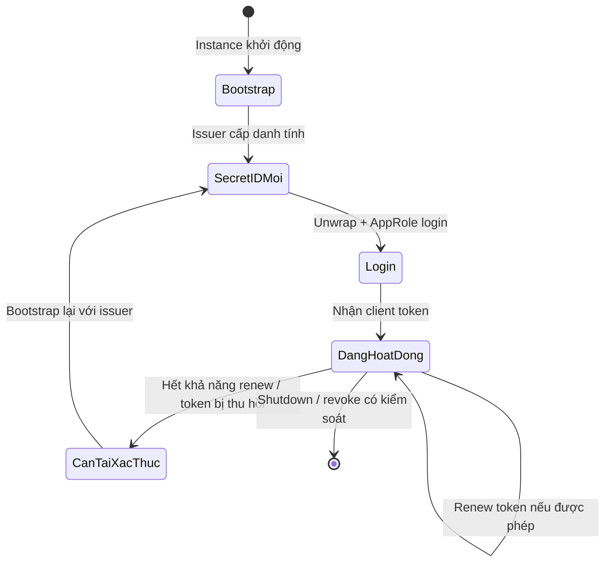

# Tách đơn vị cấp danh tính khỏi tiến trình sử dụng secret

## 1. Vấn đề: ai cấp quyền đăng nhập cho ứng dụng?

Trong Spring Vault, ứng dụng Java thường truy cập HashiCorp Vault thông qua `VaultTemplate`/`VaultOperations`. Để đọc một bí mật KV, gọi Transit encryption hoặc PKI, ứng dụng cần có **Vault token** mang policy phù hợp. Với một workload không có cơ chế danh tính nền tảng thuận tiện (chẳng hạn máy ảo chạy batch job, ứng dụng bên ngoài Kubernetes hoặc dịch vụ tự quản), **AppRole** là một cách xác thực dành cho máy.

AppRole sử dụng hai giá trị đầu vào: `role_id` xác định vai trò và `secret_id` làm yếu tố chứng thực. Ứng dụng gửi cặp này tới `auth/approle/login` để đổi lấy client token. Token mới được dùng trong các yêu cầu đọc secret.

Thiết kế dễ mắc lỗi là để **chính tiến trình sử dụng secret** giữ một Vault token đặc quyền, tự tạo AppRole, tự cấp `secret_id` và tự đọc mọi dữ liệu. Khi tiến trình bị xâm nhập, kẻ tấn công có thể vừa lấy dữ liệu vừa tạo thêm danh tính để duy trì quyền truy cập.

Giải pháp là phân định rõ:

- **Đơn vị quản trị (administrator/platform):** tạo auth mount, policy và AppRole; quyết định ứng dụng được phép truy cập những path nào.
- **Đơn vị cấp danh tính (issuer/provisioner):** được ủy quyền tạo `secret_id` cho AppRole đã tồn tại, chuyển thông tin bootstrap qua kênh bảo vệ. Issuer không cần quyền đọc secret nghiệp vụ.
- **Tiến trình tiêu thụ (consumer):** nhận `role_id` và một `secret_id` còn hiệu lực, đăng nhập lấy Vault token theo policy tối thiểu; dùng token này cho `VaultTemplate`. Consumer không được quyền quản trị AppRole hoặc phát hành thêm `secret_id`.

Tách vai trò **không nhất thiết là ba sản phẩm hoặc ba máy chủ khác nhau**; điều quan trọng là có danh tính, quyền hạn, vòng đời và kênh chuyển giao riêng. Trong thực tế, issuer có thể là một job triển khai, dịch vụ cấp danh tính hoặc thành phần bootstrap có danh tính được xác minh bằng hệ thống bên ngoài.

## 2. Cơ chế AppRole và ba loại thông tin xác thực

| Giá trị | Ai cấp / giữ? | Mức nhạy cảm và vòng đời | Dùng để làm gì? |
| --- | --- | --- | --- |
| `role_id` | Vault tạo; platform phân phối cho consumer | Là định danh, **không nên coi là mật khẩu**; vẫn nên hạn chế phát tán | Chọn AppRole khi đăng nhập |
| `secret_id` | Vault tạo theo yêu cầu từ issuer có quyền | **Là bí mật**; có TTL, số lần dùng và có thể bị hủy | Kết hợp với `role_id` để đăng nhập |
| `client_token` | Vault cấp sau khi AppRole login thành công | **Là bí mật**; mang policy, TTL và khả năng renewal riêng | Xác thực các lệnh đọc/ghi Vault tiếp theo |

Cần phân biệt thêm **response wrapping token** với ba giá trị trên. Đây là một token ngắn hạn chỉ được dùng để **mở gói một phản hồi** (ví dụ kết quả tạo `secret_id`) một lần. Issuer có thể giao wrapping token cho consumer thay vì giao trực tiếp `secret_id`.

> AppRole không tự kiểm chứng rằng tiến trình nhận `secret_id` là tiến trình hợp pháp. Việc xác minh workload, kiểm soát người nhận và bảo vệ đường chuyển giao vẫn là trách nhiệm của issuer/hạ tầng triển khai.

### Luồng đăng nhập



Các ranh giới bảo mật trong sơ đồ là:

1. **Issuer token** chỉ được dùng cho API cấp `secret_id` của một AppRole cụ thể.
2. **Wrapping token** chỉ được chuyển cho đúng consumer; hết hạn nhanh và không thể unwrap lần hai.
3. **Client token của consumer** chỉ có quyền đọc/thực thi nghiệp vụ đã khai báo, không thể tự sửa policy hay tạo `secret_id` mới.
4. Một consumer bị xâm nhập vẫn có rủi ro mất token hoặc secret đang được phép dùng. Tách issuer giới hạn mức quyền bị lộ và khả năng cấp thêm danh tính, **không loại bỏ hoàn toàn hậu quả xâm nhập**.

## 3. Thiết lập policy và AppRole theo nguyên tắc quyền tối thiểu

Ví dụ: ứng dụng `order-service` cần đọc một secret ở KV v2 mount tên `kv`, path logic `apps/order-service`. Nó không cần quyền ghi KV, tạo SecretID, quản trị token, truy cập Transit hay PKI.

### 3.1. Policy nghiệp vụ dành cho consumer

Nội dung HCL của policy `order-reader`:

```hcl
# KV v2: quyền đọc dữ liệu nằm dưới <mount>/data/<logical-path>.
path "kv/data/apps/order-service" {
  capabilities = ["read"]
}
```

Một quản trị viên có quyền cấu hình Vault lưu HCL này trong `order-reader.hcl` rồi nạp:

```bash
vault policy write order-reader order-reader.hcl
```

Nếu dùng KV v1, path và cách gọi API sẽ khác. Với KV v2, policy cần nhắm tới `kv/data/apps/order-service` dù mã Java gọi đường dẫn logic `apps/order-service`.

### 3.2. Tạo AppRole cho consumer

Người quản trị bật auth method một lần (nếu chưa bật), sau đó tạo AppRole:

```bash
vault auth enable approle

vault write auth/approle/role/order-reader \
  bind_secret_id=true \
  token_policies="order-reader" \
  token_ttl="20m" \
  token_max_ttl="1h" \
  secret_id_ttl="10m" \
  secret_id_num_uses=1

vault read -field=role_id auth/approle/role/order-reader/role-id
```

Thao tác `vault auth enable approle` sẽ lỗi nếu mount đó đã tồn tại; trong automation cần kiểm tra trạng thái trước thay vì bật lại mỗi lần.

Ý nghĩa các tham số quan trọng:

| Tham số | Tác động | Cần chú ý |
| --- | --- | --- |
| `bind_secret_id=true` | Yêu cầu SecretID cùng RoleID khi login | Tránh vô tình cho phép đăng nhập chỉ bằng RoleID |
| `token_policies="order-reader"` | Giới hạn quyền của client token mới | Không cấp policy issuer/admin cho consumer |
| `token_ttl="20m"` | TTL ban đầu được đề xuất cho token | TTL thực tế còn phụ thuộc cấu hình server, mount và policy |
| `token_max_ttl="1h"` | Giới hạn thời gian gia hạn token theo AppRole | Consumer cần cách xác thực lại khi không thể gia hạn |
| `secret_id_ttl="10m"` | SecretID hết hạn nếu chưa dùng đúng hạn | Khoảng cấp → chuyển → login phải đủ nhanh |
| `secret_id_num_uses=1` | SecretID dùng được một lần cho login | Phải cấp SecretID **mới** cho lần đăng nhập lại |

Các giá trị TTL chỉ là **ví dụ bài học**, cần thiết kế theo độ trễ deploy, thời gian sống workload và khả năng nhận lại danh tính. Có thể bổ sung `secret_id_bound_cidrs` hoặc `token_bound_cidrs` khi mạng ổn định và cấu hình NAT/proxy được hiểu rõ. Không dùng CIDR sai khiến job production bị khóa ngoài.

### 3.3. Policy riêng của issuer

Issuer cần được phép **tạo SecretID của chính role `order-reader`**. Policy minh họa:

```hcl
path "auth/approle/role/order-reader/secret-id" {
  capabilities = ["update"]
}
```

Admin cấp policy này cho danh tính xác thực của issuer (ví dụ một workload trong môi trường CI/CD được Vault tin cậy). Token issuer **không có** quyền đọc `kv/data/apps/order-service` theo policy vừa nêu, và consumer **không được** nhận token issuer.

Việc tạo/sửa AppRole, đổi `token_policies` hoặc đổi cấu hình của auth mount là quyền quản trị khác; không thêm chúng vào policy issuer. Để quản lý nhiều dịch vụ, hãy hạn chế path issuer theo từng AppRole, tránh wildcard chung cho cả `auth/approle/role/*`.

## 4. Cấp SecretID qua response wrapping

Nếu issuer trực tiếp trả `secret_id` qua log deploy, artifact CI, biến môi trường dài hạn hay chat thì các hệ thống trung gian có thể lưu lại bí mật. **Response wrapping** giúp thu hẹp phạm vi lộ secret: Vault giữ phản hồi gốc, trả về một wrapping token có TTL ngắn để consumer tự mở gói.

Trên danh tính issuer đã được cấp policy phù hợp:

```bash
# Ví dụ CLI: yêu cầu Vault wrap phản hồi tạo SecretID trong 5 phút.
vault write -wrap-ttl=5m -f auth/approle/role/order-reader/secret-id
```

Kết quả được wrap chứa thông tin như `wrapping_token` và `wrapping_accessor`. Issuer chỉ chuyển **wrapping token** cùng `role_id` cho đúng consumer qua kênh triển khai có kiểm soát. Không đưa wrapping token vào log, commit Git, tài liệu ticket hoặc message queue không được bảo vệ.

Sau khi nhận, consumer hoặc bootstrap helper thực hiện:

```bash
# Chạy trên nơi nhận, dùng token wrap nhận riêng từ issuer.
vault unwrap "$WRAPPING_TOKEN"
```

Vault trả phản hồi gốc gồm `secret_id` và thông tin liên quan. Unwrap thành công sẽ tiêu thụ wrapping token; dùng lại token này phải thất bại. Consumer phải thực hiện bước này **trước khi wrapping TTL hết hạn**, rồi hoàn tất AppRole login **trước khi SecretID TTL hết hạn**. Hai TTL có ý nghĩa khác nhau.

Tách khâu cấp và khâu dùng có thể được hiện thực theo các cách sau:

- Job triển khai được xác thực tới Vault, cấp một SecretID mới cho mỗi instance, wrap kết quả và đưa wrapping token tới nơi khởi động instance.
- Một bootstrap helper riêng nhận wrapping token, unwrap trong vùng tin cậy rồi chuyển SecretID cho tiến trình Java qua file tạm có quyền truy cập hạn chế hoặc IPC bảo vệ.
- Với workload đã có danh tính nền tảng mạnh như Kubernetes service account hoặc cloud IAM, cân nhắc dùng trực tiếp auth method của nền tảng thay cho việc duy trì kênh phân phối SecretID.

**Giới hạn:** response wrapping bảo vệ phản hồi trong quá trình chuyển giao và phát hiện được việc unwrap trước đó, nhưng không thay thế xác thực người nhận. Kẻ tấn công lấy được wrapping token còn hiệu lực có thể unwrap trước consumer hợp pháp. Issuer cần xác minh nơi cấp, còn consumer phải báo lỗi rõ khi token đã bị tiêu thụ hay hết hạn.

## 5. Consumer đăng nhập rồi mới đọc secret

### 5.1. Đổi RoleID/SecretID lấy client token

Sau bootstrap, consumer có cặp `role_id`/`secret_id`. API AppRole login không yêu cầu consumer phải mang sẵn một token issuer:

```bash
# Chỉ minh họa trên môi trường thử nghiệm riêng;
# tránh nhập bí mật trực tiếp trong shell có lưu history hoặc transcript.
vault write auth/approle/login \
  role_id="$VAULT_ROLE_ID" \
  secret_id="$VAULT_SECRET_ID"
```

Phản hồi có `auth.client_token`, TTL và danh sách policy của token. Spring Vault có thể thực hiện bước đăng nhập này thông qua AppRole authentication và dùng token khi gọi Vault API.

Không truyền `role_id`/`secret_id` trong từng request đọc secret; chúng là đầu vào **đăng nhập**, còn token phiên là đầu vào **truy cập dữ liệu**. Không chia sẻ client token của một instance cho tất cả workload khi không có lý do kiến trúc và cơ chế bảo vệ tương ứng.

### 5.2. Tích hợp Spring Cloud Vault

Khi dự án đã dùng Spring Cloud Vault tương thích với phiên bản Spring Boot hiện tại, cấu hình ví dụ:

```yaml
spring:
  cloud:
    vault:
      uri: ${VAULT_ADDR}
      authentication: APPROLE
      app-role:
        role-id: ${VAULT_ROLE_ID}
        secret-id: ${VAULT_SECRET_ID}

app:
  vault:
    kv-mount: kv
    order-secret-path: apps/order-service
```

`VAULT_ROLE_ID` và `VAULT_SECRET_ID` trong YAML là **placeholder**, không phải giá trị thực. Với production, nguồn cung cấp SecretID nên là kết quả bootstrap an toàn và chỉ tồn tại trong thời gian cần thiết; biến môi trường có thể bị lộ qua quyền truy cập tiến trình, dump và công cụ chẩn đoán. Có thể thay property source bằng cơ chế cấp secret tại runtime phù hợp kiến trúc.

Tùy phiên bản Spring Cloud Vault và cách dùng Vault như nguồn cấu hình ứng dụng, dự án còn cần cấu hình `spring.config.import`/bootstrap. Các property trên mô tả **cách chọn AppRole authentication**; tự chúng không đảm bảo mọi integration mode đều đã được bật.

Đối với ứng dụng dùng **Spring Vault thuần**, có thể khởi tạo `AppRoleAuthentication` bằng `AppRoleAuthenticationOptions` và `RestOperations` rồi cấp `ClientAuthentication` cho cấu hình Vault. Điểm cốt lõi vẫn là tách code bootstrap nhận SecretID khỏi service đọc dữ liệu; không gọi endpoint tạo SecretID từ trong service nghiệp vụ.

### 5.3. Service nghiệp vụ chỉ nhận VaultOperations

Ví dụ một service dùng lại `VaultOperations` để đọc KV v2:

```java
import org.springframework.beans.factory.annotation.Value;
import org.springframework.stereotype.Service;
import org.springframework.vault.core.VaultKeyValueOperations;
import org.springframework.vault.core.VaultKeyValueOperationsSupport;
import org.springframework.vault.core.VaultOperations;
import org.springframework.vault.support.VaultResponse;

@Service
public final class OrderSettingsRepository {

    private final VaultKeyValueOperations kv;
    private final String path;

    public OrderSettingsRepository(
            VaultOperations vault,
            @Value("${app.vault.kv-mount}") String mount,
            @Value("${app.vault.order-secret-path}") String path) {

        this.kv = vault.opsForKeyValue(
                mount,
                VaultKeyValueOperationsSupport.KeyValueBackend.KV_2);
        this.path = path;
    }

    public String getWebhookSigningKey() {
        VaultResponse response = kv.get(path);

        if (response == null || response.getData() == null) {
            throw new IllegalStateException("Required Vault configuration is missing");
        }

        Object value = response.getData().get("webhookSigningKey");
        if (!(value instanceof String) || ((String) value).isEmpty()) {
            throw new IllegalStateException("Required Vault key is invalid");
        }

        return (String) value;
    }
}
```

Service không biết issuer là ai, không đọc `secret_id` và không gọi `auth/approle/role/.../secret-id`. Nó chỉ nhìn thấy API `VaultOperations` và đường dẫn logic đã cấu hình. Nếu đổi cách cấp danh tính sang Kubernetes auth sau này, mã đọc KV có thể giữ nguyên.

Trong ứng dụng thực, tránh in `response.getData()` hoặc giá trị trả về ra log. Các giá trị như signing key cũng không nên đưa vào exception message, HTTP response hay metric label.

## 6. Vòng đời danh tính: SecretID một lần và token có TTL

Tách issuer/consumer chỉ hoàn chỉnh khi có **đường tái cấp danh tính**. Với `secret_id_num_uses=1`, SecretID sẽ bị tiêu thụ khi login đầu tiên thành công. Khi client token bị thu hồi, không thể gia hạn hoặc không thể sử dụng tiếp, consumer không được giả định rằng nó có thể login lại bằng SecretID cũ.



| Tình huống | Hành vi mong đợi |
| --- | --- |
| Token còn hiệu lực và được phép renew | Session manager thực hiện gia hạn theo cấu hình; service tiếp tục dùng Vault |
| Token hết hạn / hết max TTL | Consumer lấy SecretID mới từ issuer và login lại, hoặc khởi động lại bằng bootstrap mới |
| SecretID một lần đã dùng | Không dùng lại cùng SecretID để tái xác thực |
| Instance bị thay thế | Issuer tạo SecretID riêng cho instance mới; nếu cần thì thu hồi token/SecretID cũ |
| Nhiều instance chạy đồng thời | Không phân phát một SecretID giới hạn một lần dùng cho nhiều instance |
| Issuer không sẵn sàng | Phải có chiến lược vận hành phù hợp: token còn hạn có thể tiếp tục phục vụ, nhưng bootstrap/re-auth mới sẽ bị ảnh hưởng |

Lưu ý một trade-off quan trọng: `secret_id_num_uses=1` giảm khả năng tái sử dụng bí mật bị đánh cắp, nhưng cũng đòi hỏi **mỗi lần xác thực lại có một SecretID mới**. Một tích hợp Spring Vault chỉ nhận SecretID cố định từ biến môi trường lúc khởi động sẽ không tự tạo được SecretID khác. Muốn tự hồi phục sau khi token hết hạn, phải thiết kế lại lớp bootstrap hoặc có một cơ chế phân phối SecretID định kỳ; đừng giả định `VaultTemplate` lo toàn bộ việc này.

**Client token renewal** và **dynamic secret lease renewal** là hai vòng đời khác nhau. Nếu ứng dụng còn đọc database credentials động, transit key metadata hoặc chứng chỉ PKI, cần có cơ chế quản lý thời hạn/rotation tương ứng; việc token AppRole còn sống không bảo đảm mọi credential đã cấp còn hợp lệ.

## 7. Thu hồi quyền và phản ứng sự cố

Một quy trình an toàn cần thu hồi được quyền ở cả nơi cấp và nơi sử dụng:

- **Nghi ngờ lộ wrapping token:** nếu token chưa unwrap, cần vô hiệu hóa/chặn quy trình bootstrap và cấp một gói mới; nếu có dấu hiệu đã unwrap, coi SecretID có nguy cơ lộ và xử lý như lộ credential.
- **Nghi ngờ lộ SecretID:** hủy SecretID qua API quản trị phù hợp và cấp lại cho instance hợp lệ; nếu đã dùng để login, cũng cần xử lý client token được phát hành.
- **Nghi ngờ lộ client token:** thu hồi token hoặc token accessor bằng danh tính có quyền tương ứng, kiểm tra audit và thay instance/credential khi cần.
- **Issuer bị xâm nhập:** vô hiệu hóa danh tính issuer, chặn tạo SecretID mới, xem xét các SecretID/token đã phát hành và khôi phục kênh cấp danh tính.
- **Policy cần giảm quyền:** cập nhật policy một cách kiểm soát, kiểm tra các token đang lưu hành và thu hồi những token cần loại bỏ ngay; chỉ đổi policy cấu hình mà không xét phiên cũ có thể để lại truy cập ngoài ý muốn.

Không cấp cho consumer quyền `auth/approle/role/<role>/secret-id` hoặc quyền quản trị auth method chỉ để giúp nó “tự phục hồi”. Nếu cần tự động re-bootstrap, cấp quyền hẹp cho một **thành phần danh tính riêng**, được xác thực và giám sát.

## 8. Lỗi thường gặp và cách xác định nguyên nhân

| Triệu chứng | Nguyên nhân thường gặp | Điểm kiểm tra |
| --- | --- | --- |
| Không unwrap được response | Wrapping token hết hạn, đã unwrap hoặc bị chuyển nhầm | TTL, audit event, kênh chuyển giao và danh tính người nhận |
| AppRole login thất bại | RoleID/SecretID sai, SecretID hết hạn/đã hết lượt dùng, ràng buộc CIDR không khớp | Trạng thái AppRole, giới hạn sử dụng, IP thực tế sau proxy/NAT |
| Login thành công nhưng đọc KV lỗi `403` | Token chỉ có policy sai path, nhầm KV v1/v2 hoặc mount | `token_policies`, path `kv/data/...` và quyền đọc |
| Ứng dụng khởi chạy được nhưng lỗi sau một thời gian | Token hết hạn; không còn cách renew/re-auth; SecretID một lần bị dùng | Token TTL, max TTL, Vault session manager, cơ chế cấp SecretID mới |
| Một replica chạy, các replica khác lỗi | Một SecretID với `num_uses=1` bị dùng chung | Cấp SecretID riêng cho từng replica/đợt login |
| Issuer đọc được secret nghiệp vụ | Policy issuer bị cấp quá rộng | Xóa quyền KV/Transit/PKI khỏi danh tính issuer |
| Consumer tự tạo được SecretID | Policy consumer cấp quyền vào đường dẫn auth AppRole | Tách policy, thu hồi token vi phạm và kiểm tra audit |
| Có SecretID hoặc token trong log/CI | In phản hồi CLI, debug HTTP, artifact hoặc lưu env không kiểm soát | Redact, giới hạn quyền quan sát, thay credential đã lộ |

Khi xử lý lỗi, không tự retry vô hạn các lỗi quyền hoặc SecretID hết hạn. Chỉ retry tạm thời với backoff giới hạn, phân biệt lỗi kết nối với lỗi xác thực, và không đưa secret vào thông báo lỗi.

## 9. Quan sát, kiểm thử tích hợp và bài thực hành

Để xác minh ranh giới issuer/consumer, cần kiểm thử cả **hành vi thành công** lẫn **quyền bị từ chối**. Một kiểm thử chỉ dùng root token rồi đọc được KV sẽ không chứng minh AppRole được phân quyền đúng.

### Kịch bản thực hành trong Vault cô lập

1. Chuẩn bị một Vault thử nghiệm; bật KV v2 tại `kv/`, ghi một dữ liệu thử tại `apps/order-service` (không dùng secret thật).
2. Admin tạo `order-reader` policy chỉ đọc `kv/data/apps/order-service`, tạo AppRole `order-reader` giới hạn TTL/`num_uses`.
3. Tạo danh tính issuer với policy chỉ cho phép `update` tại `auth/approle/role/order-reader/secret-id`. Xác nhận issuer **không** đọc được `kv/data/apps/order-service`.
4. Issuer tạo SecretID với `-wrap-ttl=5m` và chuyển wrapping token cho một consumer thử nghiệm qua kênh bảo vệ. Consumer unwrap một lần rồi login thành công.
5. Xác minh client token của consumer đọc được key đã cho, nhưng **không** tạo được SecretID mới, không sửa được AppRole, không đọc được đường dẫn KV khác.
6. Thử unwrap lại token đã tiêu thụ; thử login lại bằng SecretID có `num_uses=1`; ghi nhận hành vi thất bại mong đợi.
7. Thu hồi client token hoặc để nó hết thời hạn trong một kịch bản có kiểm soát. Kiểm tra quy trình cấp SecretID mới và phục hồi ứng dụng.
8. Mở rộng sang hai instance: phát riêng hai SecretID, bảo đảm mỗi instance chỉ nhận token quyền tối thiểu của mình.

### Kiểm thử trong ứng dụng Spring

Có thể dùng Vault cô lập qua Testcontainers hoặc môi trường integration test tương đương, kết hợp fake issuer/bootstrap helper để kiểm soát vòng đời credential. Các assertion hữu ích:

- Ứng dụng chỉ cần các property AppRole và nhận `VaultOperations` đã xác thực; service nghiệp vụ không cần Vault admin token.
- Đọc KV v2 trả giá trị đúng; thử đọc path ngoài policy phải bị Vault từ chối.
- Client token hết hạn hoặc bị revoke khiến ứng dụng báo lỗi có kiểm soát; tái cấp SecretID được kiểm thử nếu thiết kế có hỗ trợ.
- Không có log chứa `role_id` kèm `secret_id`, wrapping token, client token, dữ liệu KV hay stack trace làm lộ headers.
- Hai replica không chia sẻ nhầm SecretID dùng một lần; khi scale và restart, issuer vẫn phân phối danh tính đúng instance.
- Các thao tác Transit hoặc PKI chỉ thành công nếu đã cấp policy riêng cho chúng; AppRole không mặc nhiên mở quyền các engine.

Về giám sát, nên ghi metric thời gian đăng nhập, tỷ lệ lỗi theo nhóm (unwrap, login, policy denial, Vault unavailable), số lần re-auth, thời gian còn hiệu lực của token nếu hệ thống cung cấp an toàn và trạng thái issuer. Metric/log chỉ dùng **nhãn không nhạy cảm** như tên dịch vụ, auth method và mã lỗi; tránh secret, token và đường dẫn có dữ liệu cá nhân.

## 10. Nguyên tắc thiết kế mang sang production

- Tách **quyền quản trị role**, **quyền cấp SecretID** và **quyền đọc/ghi nghiệp vụ** thành các danh tính và policy có thể audit độc lập.
- Issuer phải xác minh consumer nhận danh tính. Response wrapping giảm lộ bí mật trên đường chuyển giao nhưng không thay thế kiểm soát người nhận.
- Cấp SecretID theo instance/phiên, giới hạn TTL/số lần sử dụng và cân nhắc CIDR khi khả thi; bảo vệ cả `role_id` lẫn `secret_id` trong kênh deploy.
- Thiết kế đường **re-bootstrap** trước khi chọn `secret_id_num_uses=1`; phân biệt gia hạn token với phát hành SecretID mới.
- Giữ `VaultTemplate`/`VaultOperations` trong lớp truy cập nghiệp vụ, tách khỏi logic cấp danh tính. Không cho phép service tự quản lý AppRole bằng token đặc quyền.
- Áp dụng least privilege cho KV, Transit và PKI theo từng nhu cầu; tránh dùng root token trong workload.
- Kiểm tra cả trường hợp bị từ chối và hoạt động sau thu hồi, restart, scale; không chỉ kiểm tra login thành công.

**Ghi nhớ:** Với Spring Vault và AppRole, thiết kế an toàn là **issuer chỉ được cấp danh tính**, còn **consumer chỉ được sử dụng những secret đã được policy cho phép**. Hiệu quả bảo mật phụ thuộc vào chính sách Vault, kênh chuyển giao SecretID, TTL, khả năng tái xác thực và việc thu hồi quyền khi xảy ra sự cố.

