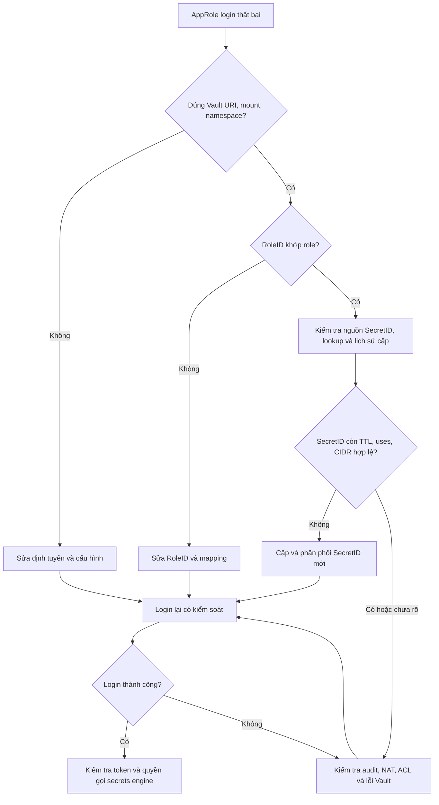

# Xử lý SecretId sai, hết hạn hoặc đã dùng hết lượt

## 1. Bối cảnh: vì sao AppRole có thể đăng nhập thất bại?

Trong **Spring Vault**, ứng dụng Java có thể dùng **AppRole authentication** để lấy Vault token trước khi gọi `VaultTemplate` đọc KV secrets, yêu cầu Transit encryption, cấp chứng chỉ PKI hoặc truy cập dynamic secrets. AppRole đặc biệt hữu ích cho workload không có phương thức xác thực gắn sẵn với nền tảng triển khai. Một AppRole sử dụng **RoleID** để nhận diện vai trò; khi AppRole yêu cầu **SecretID**, workload phải cung cấp thêm SecretID hợp lệ.

Một lỗi thường gặp là ứng dụng khởi động bình thường nhưng không lấy được Vault token, hoặc chỉ một số instance trong cùng đợt triển khai đăng nhập thành công. Nguyên nhân có thể là **SecretID sai**, **đã hết thời gian hiệu lực (TTL)**, **đã hết số lượt sử dụng** hoặc bị giới hạn bởi chính sách CIDR. Những trường hợp này đôi khi tạo phản hồi lỗi gần giống nhau, nên cần kiểm tra nguồn cấp SecretID và cấu hình Vault thay vì đoán nguyên nhân từ một dòng thông báo.

Sau bài này, bạn có thể:

- Phân biệt vòng đời **SecretID**, **Vault client token** và **secret lease**.
- Khoanh vùng sai RoleID/SecretID, TTL, số lượt sử dụng, SecretID bị thu hồi và ràng buộc IP.
- Kiểm tra AppRole bằng HTTP API/Vault CLI với quyền quản trị phù hợp và hạn chế lộ bí mật.
- Cấu hình, xử lý lỗi và lên phương án cấp lại SecretID cho Spring Vault/Spring Cloud Vault.
- Thiết kế kiểm thử tích hợp và giám sát để phát hiện lỗi AppRole trước khi ảnh hưởng ứng dụng.

> Trong bài, mount AppRole được giả định ở `auth/approle/`, tên role là `payments-service`. Đây là giá trị ví dụ; môi trường thực có thể dùng authentication mount khác hoặc Vault Enterprise namespace khác.

## 2. Hiểu đúng RoleID, SecretID và token

```mermaid
sequenceDiagram
    participant Deployment as Hệ thống cấp credential
    participant App as Workload Java
    participant Spring as Spring Vault authentication
    participant Vault as Vault auth/approle
    participant API as Vault secrets engines

    Deployment->>App: Cấp RoleID + SecretID qua kênh an toàn
    App->>Spring: Khởi tạo ClientAuthentication
    Spring->>Vault: POST /v1/auth/approle/login
    Note over Spring,Vault: {role_id, secret_id}
    Vault->>Vault: Kiểm tra role, SecretID, TTL, uses, CIDR
    alt Thông tin hợp lệ
        Vault-->>Spring: auth.client_token + thời hạn token
        Spring->>API: Gọi KV / Transit / PKI với X-Vault-Token
        API-->>App: Dữ liệu hoặc kết quả của thao tác
    else SecretID không được chấp nhận
        Vault-->>Spring: HTTP 4xx + errors
        Spring-->>App: Lỗi authentication; chưa có token mới
    end
```

| Thành phần | Ai tạo, dùng để làm gì? | Hết hạn hoặc hết lượt có ý nghĩa gì? |
| --- | --- | --- |
| **RoleID** | Định danh một AppRole; lấy từ cấu hình role hoặc API quản trị. | Không phải token để gọi secrets engine; RoleID sai sẽ không đăng nhập được với SecretID thuộc role khác. |
| **SecretID** | Credential gắn với AppRole, thường cấp theo từng workload/đợt triển khai. | Có `secret_id_ttl`, `secret_id_num_uses`, tùy chọn giới hạn CIDR; có thể hết hạn, hết lượt, bị revoke hoặc không khớp role. |
| **Vault client token** | Được trả về sau một lần AppRole login thành công. | Có TTL, khả năng renew, policy và có thể có `token_num_uses`; tuổi thọ độc lập với SecretID dùng để đăng nhập. |
| **Secret lease** | Một số secrets engine như database cấp bí mật động kèm `lease_id`/TTL. | Lease hết hạn cần gia hạn hoặc lấy secret mới; đây không phải lỗi SecretID. |

Ví dụ: một SecretID có `secret_id_num_uses = 1` chỉ cho phép **một lần đăng nhập thành công** bằng SecretID đó. Token nhận được từ lần đăng nhập ấy vẫn có thể tiếp tục hoạt động theo TTL và quyền riêng của token. Nếu ứng dụng khởi động lại hoặc cần đăng nhập lần nữa thì SecretID cũ không còn đủ điều kiện. Việc làm mới token đang hợp lệ, nếu token cho phép renew, cũng không đồng nghĩa phải dùng lại SecretID.

**Lưu ý:** `secret_id_num_uses = 0` biểu thị không giới hạn lượt sử dụng SecretID. Không suy ra SecretID không bao giờ hết hạn từ cấu hình này: TTL, CIDR và việc thu hồi vẫn có hiệu lực. Tương tự, `token_num_uses` của Vault token là bộ đếm khác.

## 3. Phân biệt các nhóm nguyên nhân

| Tình huống | Dấu hiệu hay gặp | Cách xác nhận | Hướng xử lý |
| --- | --- | --- | --- |
| SecretID sai hoặc không thuộc RoleID | Login thất bại ngay từ lần đầu; có thể gặp thông điệp `invalid secret id`. | So khớp RoleID, role name, mount và nguồn cấp credential; nếu có quyền, tra lookup SecretID/accessor. | Cấp SecretID chính xác cho role tương ứng, sửa mapping cấu hình. |
| SecretID hết TTL | Trước đó đăng nhập được; login mới thất bại sau một khoảng thời gian hoặc sau khi restart. | Đối chiếu `creation_time`, `expiration_time`, `secret_id_ttl` với thời điểm login. | Cấp SecretID mới theo chu kỳ phù hợp; rút ngắn thời gian từ cấp đến sử dụng. |
| SecretID hết số lượt | Một instance thành công, các instance khác hoặc lần restart tiếp theo thất bại. | Kiểm tra `secret_id_num_uses`, tổng số login, việc chia sẻ SecretID giữa replicas. | Cấp SecretID riêng cho từng instance hoặc chọn chính sách lượt dùng có chủ đích. |
| SecretID bị thu hồi | Credential đang hợp lệ bất ngờ không còn dùng được ở login mới. | Tra lịch sử phát hành/thu hồi, audit log và accessor nếu có quyền. | Điều tra nguyên nhân rồi cấp SecretID thay thế; không khôi phục SecretID đã revoke. |
| CIDR không khớp | Chỉ thất bại ở node, subnet hoặc môi trường sau NAT nhất định. | Kiểm tra `secret_id_bound_cidrs`, role binding và IP nguồn Vault thực sự thấy. | Điều chỉnh nguồn kết nối hoặc CIDR theo chính sách. |
| Sai auth mount / namespace | Đăng nhập thất bại ở một môi trường dù credential được cấp đúng. | So khớp `/v1/auth/<mount>/login` và namespace của role. | Sửa mount path/namespace; tránh thử credential trên sai môi trường. |
| Response wrapping hết hạn hoặc unwrap đã dùng | Không lấy được SecretID trước bước AppRole login. | Kiểm tra TTL/lượt dùng của **wrapping token**, thao tác unwrap và thời điểm phân phối. | Phát hành wrapping token mới; không nhầm wrapping token với SecretID. |

Không có một **HTTP status cố định** phân biệt đáng tin cậy ba trường hợp “sai”, “hết hạn” và “hết lượt”. AppRole login có thể trả lỗi HTTP `4xx` với thông báo tổng quát; nội dung chi tiết phụ thuộc endpoint, cấu hình và phiên bản Vault. Không đưa toàn bộ response hoặc các request có credential vào log ứng dụng chỉ để tìm nguyên nhân.

## 4. Quy trình chẩn đoán theo thứ tự

### Bước 1 — Kiểm tra đường dẫn, Vault namespace và role

AppRole login thông thường dùng:

```http
POST /v1/auth/approle/login HTTP/1.1
Host: vault.example.internal:8200
Content-Type: application/json

{"role_id":"<role-id>","secret_id":"<secret-id>"}
```

`approle` là **auth mount**, không phải role name. Nếu AppRole được mount dưới `auth/apps/`, endpoint phải là `/v1/auth/apps/login`. Với Vault Enterprise, namespace phải khớp môi trường cấp credential. Cần xác minh trước khi kiểm tra giá trị SecretID, đặc biệt khi nhiều cluster Vault dùng các role có tên tương tự.

Vai trò quản trị có thể kiểm tra RoleID theo role name (cần capability phù hợp):

```bash
vault read auth/approle/role/payments-service/role-id
```

RoleID nhận được phải khớp nguồn cấp cho ứng dụng. Một SecretID được phát hành cho role A không trở thành hợp lệ với RoleID của role B.

### Bước 2 — Kiểm tra SecretID có đúng nguồn và định dạng không

Trên workload, kiểm tra **nguồn dữ liệu**: secret store/orchestrator, cấu hình triển khai, thời điểm refresh và tên environment variable. Lỗi phổ biến là truyền **SecretID accessor** (dùng để quản trị) thay cho **SecretID thật** (dùng để login); lấy nhầm credential từ môi trường khác; hoặc copy có ký tự xuống dòng/khoảng trắng ngoài ý muốn.

Để thử riêng đường truyền và HTTP status trong **môi trường kiểm thử**, có thể gửi request mà không in token hay JSON response ra terminal:

```bash
jq -n \
  --arg role_id "$VAULT_ROLE_ID" \
  --arg secret_id "$VAULT_SECRET_ID" \
  '{role_id: $role_id, secret_id: $secret_id}' |
curl --silent --show-error \
  --output /dev/null --write-out 'AppRole login HTTP %{http_code}\n' \
  --request POST --header 'Content-Type: application/json' \
  --data-binary @- "${VAULT_ADDR}/v1/auth/approle/login"
```

Biến `VAULT_ROLE_ID`, `VAULT_SECRET_ID` cần được cấp từ môi trường kiểm thử an toàn. Chỉ kiểm tra trạng thái ở đây; **login thành công vẫn tiêu thụ một lượt SecretID**, do đó không chạy lặp lại nếu `secret_id_num_uses` có giới hạn. Không bật shell tracing (`set -x`) và không lưu payload/secret/token vào log hoặc lịch sử lệnh.

### Bước 3 — Kiểm tra TTL, số lượt và giới hạn IP

Người vận hành có quyền đọc cấu hình role có thể dùng:

```bash
vault read auth/approle/role/payments-service
```

Các trường cần tìm:

- `bind_secret_id`: nếu bật, AppRole yêu cầu SecretID khi login.
- `secret_id_ttl`: thời gian SecretID được phép dùng để đăng nhập kể từ khi phát hành, theo cấu hình hiệu lực.
- `secret_id_num_uses`: số lượt login được phép với **mỗi** SecretID (`0` nghĩa là không giới hạn lượt).
- `secret_id_bound_cidrs`: giới hạn địa chỉ nguồn được chấp nhận khi dùng SecretID.
- `token_bound_cidrs`: giới hạn IP dùng **token sau khi login**, khác với việc giới hạn SecretID tại bước đăng nhập.
- Các thiết lập TTL/policy của token: ảnh hưởng phiên đăng nhập sau khi đã được cấp token.

Nếu đang giữ **SecretID accessor** đã phát hành, có thể yêu cầu Vault tra cứu metadata mà không cần chuyển SecretID qua lệnh quản trị:

```bash
vault write -format=json \
  auth/approle/role/payments-service/secret-id-accessor/lookup \
  secret_id_accessor="$SECRET_ID_ACCESSOR"
```

Trong trường hợp được phân quyền, có thể tra cứu bằng chính SecretID qua endpoint `/v1/auth/approle/role/payments-service/secret-id/lookup`; **không nhập SecretID trực tiếp vào command line** nếu máy có lịch sử lệnh hoặc công cụ giám sát tiến trình không phù hợp. Lookup thường cho metadata như `creation_time`, `expiration_time`, `secret_id_ttl`, `secret_id_num_uses`, CIDR và accessor; nó **không phải API luôn cung cấp số lượt còn lại**. Khi SecretID đã hết hạn, hết lượt hoặc bị xóa, lookup có thể không còn tìm được bản ghi. Phối hợp nhật ký cấp phát, Vault audit log đã được bảo vệ và thông tin triển khai để kết luận.

Một trường hợp dễ bỏ sót là **nhiều replica cùng chia sẻ một SecretID giới hạn một lượt**. Replica A login được, replica B và C thất bại, dù ba máy dùng đúng RoleID và SecretID. Restart A sau đó cũng có thể thất bại khi cần login mới. Cần phân phối credential có số lượt phù hợp với mô hình mở rộng và khởi động lại.

### Bước 4 — Kiểm tra Vault audit và thời điểm lỗi

Ghi lại `request_id` (nếu có), thời điểm, auth mount, tên workload, HTTP status và danh mục lỗi. So sánh thời điểm SecretID được phát hành với thời điểm workload **thực sự login**, không chỉ thời điểm pod/container bắt đầu chạy. Kiểm tra đồng hồ node, pipeline rollout, hàng đợi phân phối và khoảng trễ trước khi khởi động.

Vault audit log có thể giúp truy vết đường dẫn và kết quả request nhưng cần quyền và cấu hình thích hợp; **không** coi audit log là nguồn được phép trích xuất SecretID dạng rõ. Nếu một biến mật khẩu/SecretID được ghi lộ ngoài ý muốn, xử lý như sự cố lộ credential: thu hồi và cấp thay thế theo quy trình an ninh.

## 5. Tạo mới và phân phối SecretID an toàn

Một người vận hành có quyền tạo SecretID cho role có thể gọi API:

```http
POST /v1/auth/approle/role/payments-service/secret-id HTTP/1.1
X-Vault-Token: <authorized-operator-token>
```

Vault trả thông tin như `secret_id`, `secret_id_accessor`, TTL và giới hạn lượt sử dụng. Đây là thao tác **cấp credential** nên response phải được chuyển trực tiếp vào kho bí mật/kênh phân phối an toàn; tuyệt đối không gửi qua ticket, commit, chat nhóm hay log CI. Trường hợp tổ chức dùng **response wrapping** (`X-Vault-Wrap-TTL`), hệ thống phân phối wrapping token ngắn hạn, workload unwrap một lần để nhận SecretID. Wrapping token cũng có TTL và lượt sử dụng riêng; unwrap thành công **không làm mới TTL** của SecretID nếu SecretID đã được phát hành trước đó.

Với ứng dụng cần tự cấp SecretID qua CI/CD hoặc controller riêng, hãy phân quyền tối thiểu cho đúng role và audit thao tác phát hành. Ứng dụng runtime chỉ cần có credential được phân phối đúng; không nên mặc định cấp cho chính workload quyền tạo và thu hồi tất cả SecretID.

Quy trình xử lý một SecretID không còn đăng nhập được:

1. Xác định nguyên nhân gần nhất: sai mapping, hết TTL, hết lượt, CIDR hoặc revoke; ghi lại bằng chứng không chứa bí mật.
2. Phát hành SecretID mới cho **đúng role và Vault namespace** theo TTL/uses/CIDR đáp ứng mô hình triển khai.
3. Phân phối credential mới qua secret store hoặc secret injection, tránh đặt trong mã nguồn, image, artifact và log.
4. Áp dụng cấu hình mới và bảo đảm các instance cần login nhận được SecretID mới **trước khi** token cũ buộc phải đăng nhập lại.
5. Kiểm tra login và gọi một endpoint secrets engine đã được policy cho phép; nếu chính sách yêu cầu, thu hồi accessor cũ và xác nhận không còn workload phụ thuộc credential ấy.

**Không dùng vòng lặp retry liên tục** cho lỗi SecretID không hợp lệ. Retry nhiều lần vừa không sửa được sai credential vừa có thể tiêu thụ hết các lượt còn lại trong trường hợp credential vẫn hợp lệ ở một số lần thử. Chỉ retry có giới hạn với lỗi mạng/Vault tạm thời, backoff rõ ràng, và sau khi có credential thay thế mới thử login lại đối với lỗi xác thực thực sự.

## 6. Tích hợp Spring Vault và hành vi khi đăng nhập lại

Nếu ứng dụng dùng **Spring Cloud Vault** để tự tạo kết nối và xác thực cho `VaultTemplate`, một cấu hình minh họa là:

```yaml
spring:
  cloud:
    vault:
      uri: ${VAULT_ADDR}
      authentication: APPROLE
      app-role:
        role-id: ${VAULT_ROLE_ID}
        secret-id: ${VAULT_SECRET_ID}
```

Cấu hình cần được đưa vào giai đoạn bootstrap phù hợp với phiên bản Spring Cloud Vault/Spring Boot đang sử dụng (ví dụ cơ chế `spring.config.import: vault://` khi áp dụng). Các biến môi trường phải đến từ hệ thống phân phối bí mật; không commit giá trị thật vào YAML. Đường dẫn auth mount cũng phải được cấu hình nếu không dùng mặc định `approle`.

Ở mức **Spring Vault core**, AppRole được biểu diễn bằng `AppRoleAuthentication` và `AppRoleAuthenticationOptions`; từ những credentials này, session manager lấy token để `VaultOperations`/`VaultTemplate` sử dụng. Ví dụ khai báo tùy chọn có thể có dạng:

```java
import org.springframework.vault.authentication.AppRoleAuthenticationOptions;
import org.springframework.vault.authentication.AppRoleAuthenticationOptions.RoleId;
import org.springframework.vault.authentication.AppRoleAuthenticationOptions.SecretId;

AppRoleAuthenticationOptions options = AppRoleAuthenticationOptions.builder()
        .roleId(RoleId.provided(roleId))
        .secretId(SecretId.provided(secretId))
        .build();
```

`roleId` và `secretId` trong ví dụ phải được lấy từ nguồn bảo mật do hệ thống triển khai quản lý. Các API và cơ chế tự động cấu hình có thể thay đổi theo phiên bản thư viện; khi dùng Spring Cloud Vault, ưu tiên dùng cấu hình chuẩn của version đang cài thay vì tạo thêm session manager riêng.

**Điểm thiết kế quan trọng:** phiên Java có thể đang giữ một token hợp lệ nên truy cập `VaultTemplate` vẫn thành công ngay sau khi SecretID bị dùng hết. Lỗi chỉ xuất hiện lúc session cần **login mới**: lần khởi động lại, mất token, token không thể renew hoặc quá trình tạo session mới. Vì thế một kiểm thử chỉ đọc KV ở instance đang chạy không chứng minh SecretID vẫn dùng lại được.

Khi AppRole login thất bại, Spring Vault có thể ném exception từ tầng xác thực/HTTP tùy version. Hãy phân loại lỗi tại ranh giới cấu hình/khởi động và giám sát, **không** bắt mọi exception của `VaultTemplate` rồi tự động ghi secret rỗng hay bỏ qua bảo mật. Một lỗi `403` khi đọc KV **sau khi login** thường là bài toán ACL policy, không phải bằng chứng SecretID sai. Cần tách hai điểm thất bại: **login lấy token** và **dùng token gọi secrets engine**.

## 7. Chiến lược cho nhiều instance và xoay vòng credential

| Thiết kế | Lợi ích | Điểm phải kiểm soát |
| --- | --- | --- |
| SecretID riêng cho từng replica/instance | Khoanh vùng rò rỉ và số lượt; có thể thu hồi riêng. | Quy trình cấp, phân phối và revoke theo vòng đời instance. |
| SecretID dùng một lượt | Giảm khả năng tái sử dụng credential đã được dùng. | Đăng nhập lại sau restart có thể thất bại; cần cấp mới cho từng session hoặc lần khởi động. |
| SecretID nhiều lượt, TTL ngắn | Chấp nhận một số restart trong một cửa sổ thời gian. | Hạn chế truy cập credential, kiểm soát thời điểm hết TTL và giới hạn số instance. |
| SecretID không giới hạn lượt | Phù hợp một số môi trường có quản lý credential lâu dài. | Rủi ro credential bị dùng lại nếu lộ; cần TTL/rotation/audit chặt chẽ. |
| Response wrapping | Hạn chế việc chuyển SecretID thô qua nhiều hệ thống. | Wrapping token chỉ unwrap một lần, có TTL riêng; mất token cần phát hành lại. |

Khi rollout nhiều pod, tránh sao chép một SecretID `num_uses=1` vào cùng một Kubernetes Secret cho cả deployment rồi kỳ vọng tất cả pod cùng login. Thay vào đó, cấp riêng SecretID hoặc chọn `num_uses` dựa trên số lần đăng nhập có thể xảy ra, tính cả restart, reschedule và recovery. Nếu nền tảng đã hỗ trợ xác thực theo danh tính workload như **Kubernetes auth**, cần đánh giá liệu AppRole và vòng đời SecretID có còn phù hợp hay không.

Sơ đồ quyết định khi phát hiện login thất bại:



## 8. Giám sát, xử lý lỗi và kiểm thử tích hợp

Trong hệ thống thực, nên có tín hiệu **login AppRole thất bại**, **số instance chưa lấy được Vault token**, **tỷ lệ lỗi khi tái xác thực**, **tuổi token**, **lỗi renew** và độ trễ đăng nhập. Theo dõi giới hạn thời gian và tỷ lệ lỗi theo workload, auth mount, môi trường nhưng không gắn SecretID, token hay password làm nhãn metric.

Phân biệt ba loại lỗi cho cơ chế phục hồi:

| Nhóm lỗi | Ví dụ | Ứng xử đề xuất |
| --- | --- | --- |
| Credential/configuration | SecretID sai, hết TTL, hết lượt, CIDR/mount sai. | Đánh dấu sự cố cấu hình/credential, yêu cầu cấp lại hoặc sửa policy; dừng retry vô hạn. |
| Token/session | Token hết hạn, không renew được, token revoked. | Thử cơ chế đăng nhập lại **khi còn SecretID hợp lệ**; nếu không, yêu cầu rotation SecretID. |
| Hạ tầng/Vault | TLS timeout, lỗi kết nối, Vault chưa sẵn sàng, `5xx`/rate limiting. | Retry có giới hạn với backoff và quan sát trạng thái hạ tầng. |

Một bộ **integration tests** hữu ích với Vault thử nghiệm riêng:

| Kịch bản | Chuẩn bị | Kết quả cần xác nhận |
| --- | --- | --- |
| SecretID hợp lệ | Cấp RoleID + SecretID có TTL/uses đủ. | Login nhận Vault token; `VaultTemplate` đọc được KV theo policy. |
| SecretID sai | Thay SecretID bằng giá trị không thuộc role. | Login bị từ chối; ứng dụng không tiếp tục bằng token rỗng. |
| Sai RoleID | Ghép SecretID của role A với RoleID role B. | Login bị từ chối; log không lộ giá trị credential. |
| SecretID hết TTL | Cấp TTL ngắn trong môi trường test, đợi hết hiệu lực rồi thử login mới. | Login mới thất bại; token đã phát hành trước đó được đánh giá riêng. |
| SecretID một lượt | Đặt `secret_id_num_uses=1`, login thành công một lần rồi login lại. | Lần login tiếp theo bằng SecretID cũ bị từ chối. |
| Hai replica dùng chung SecretID một lượt | Cho hai client đồng thời login bằng cùng credential. | Tổng số lần login thành công tối đa theo giới hạn đã cấu hình; replica còn lại xử lý lỗi đúng. |
| SecretID bị revoke | Thu hồi SecretID qua accessor khi có quyền. | SecretID không thể dùng để login mới. |
| CIDR không hợp lệ | Gọi từ IP nguồn không thuộc dải được phép. | Login bị từ chối; kiểm tra IP qua NAT/proxy thực tế. |
| Token hết hạn, SecretID vẫn dùng được | Cấp token TTL ngắn hơn SecretID. | Session có thể lấy token mới theo cấu hình. |
| Token hết hạn, SecretID đã hết lượt | Login một lần với SecretID một lượt rồi buộc cần login mới. | Ứng dụng phát hiện cần cấp lại SecretID, không lặp đăng nhập vô hạn. |

Chỉ dùng dữ liệu thử nghiệm và role/policy tối thiểu. Khi kiểm thử renew/revoke token hoặc SecretID, không thao tác trên credential của ứng dụng đang phục vụ lưu lượng thật. Test nên xác nhận **tình huống xác thực** trước rồi mới kiểm tra KV, Transit hoặc PKI, tránh hiểu nhầm lỗi policy secrets engine thành lỗi AppRole.

## 9. Bài tập tình huống

Deployment `payments-service` có ba replica, đều lấy `VAULT_ROLE_ID` và `VAULT_SECRET_ID` từ cùng một cấu hình. Role thiết lập `secret_id_num_uses=1`, SecretID có TTL 15 phút. Trong một rollout, replica đầu tiên khởi động thành công, hai replica sau báo lỗi AppRole; 20 phút sau, replica đầu tiên restart và cũng thất bại.

**Phân tích:**

1. Lần login thành công đầu tiên đã tiêu thụ lượt dùng duy nhất. Các replica sau không thể dùng lại SecretID ấy, dù còn nằm trong TTL.
2. Sau 20 phút, TTL của SecretID cũng đã qua, nhưng điều đó không có nghĩa token cấp cho replica đầu tiên ở phút đầu bị hủy ngay tại thời điểm SecretID hết hạn.
3. Việc sửa policy `secret/data/...` sẽ không giải quyết lỗi tại `/auth/approle/login`; đây là hai giai đoạn riêng.
4. Cần cấp credential mới theo từng replica/lần login hoặc thiết kế số lượt, TTL, chiến lược cấp và phân phối khớp với vòng đời rollout. Thử đăng nhập có kiểm soát và xác nhận token đủ quyền truy cập engine cần thiết.

**Câu hỏi tự kiểm tra:** Nếu Vault trả lỗi đăng nhập nhưng SecretID lookup không tìm thấy bản ghi, có thể kết luận chính xác là hết TTL không? **Không.** Kết quả đó còn có thể do SecretID sai, hết lượt, bị thu hồi hoặc tra cứu sai role/mount/namespace. Cần kết hợp dấu vết cấp phát, giới hạn lượt, thời điểm, audit và thông tin deployment.

## 10. Những nguyên tắc cần ghi nhớ

- **Xác định giai đoạn lỗi:** AppRole login (`auth/approle/login`) khác với đọc KV/Transit/PKI bằng token.
- **Kiểm tra đủ ba điều kiện SecretID:** đúng role, còn TTL, còn lượt; sau đó xét CIDR, revoke và môi trường triển khai.
- **Thiết kế theo vòng đời workload:** scale, restart và token reauthentication đều có thể phát sinh login mới.
- **Thay credential có kiểm soát:** SecretID đã hết hạn/hết lượt không được “renew” như Vault token; cấp SecretID mới qua kênh bảo mật.
- **Bảo vệ cả credential lẫn chẩn đoán:** log metadata tối thiểu, không lộ RoleID/SecretID/token và không retry đăng nhập vô hạn.

Trong hệ thống Java dùng **Spring Vault**, xử lý SecretID đúng cách giúp `VaultTemplate` duy trì truy cập an toàn vào HashiCorp Vault theo danh tính workload và ACL policy, đồng thời bảo đảm vòng đời token, secret lease, KV secrets, Transit encryption và PKI được vận hành, quan sát và kiểm thử độc lập khi cần.
