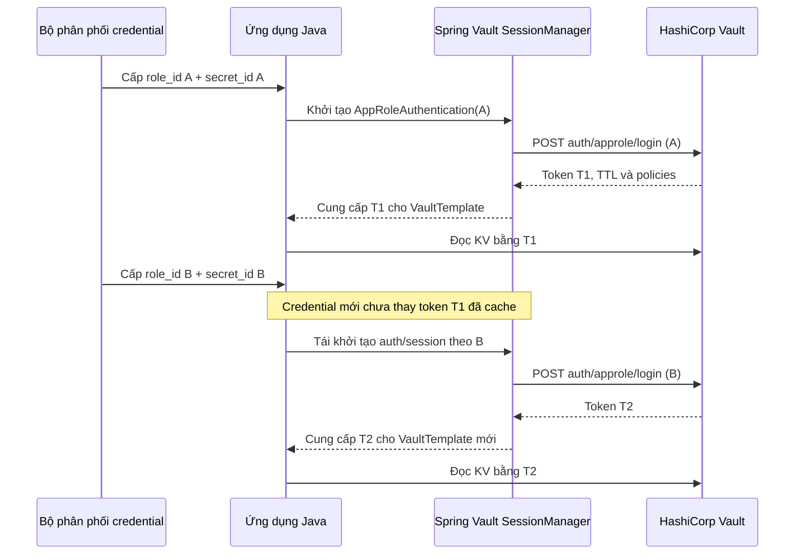

# Kiểm thử đăng nhập lại khi danh tính khởi tạo thay đổi trong Spring Vault AppRole

## 1. Bối cảnh và mục tiêu

Trong **Spring Vault**, một ứng dụng Java thường dùng `VaultTemplate` để truy cập HashiCorp Vault, đọc KV secrets hoặc gọi các engine như Transit và PKI. Trước khi thực hiện những thao tác đó, ứng dụng phải xác thực. Với **AppRole authentication**, quá trình khởi tạo danh tính của workload thường dựa vào cặp **`role_id`** và **`secret_id`**.

Bài học thuộc chương **Xác thực AppRole**, tập trung vào một tình huống vận hành quan trọng: thông tin AppRole dùng để đăng nhập ban đầu **thay đổi** khi ứng dụng đang chạy hoặc được khởi động lại. Ta cần chứng minh ứng dụng có thể đăng nhập bằng thông tin mới, sử dụng token mới để gọi Vault, đồng thời không nhầm việc đổi thông tin khởi tạo với việc gia hạn token đang được cache.

Sau bài học, bạn có thể:

- Giải thích mối quan hệ giữa `role_id`, `secret_id`, Vault token và session của Spring Vault.
- Phân biệt đổi `secret_id`, đổi `role_id`, chuyển AppRole và thu hồi token đã cấp.
- Thiết kế kịch bản kiểm thử **đăng nhập lần đầu → thay danh tính khởi tạo → đăng nhập lại → gọi KV v2**.
- Triển khai kiểm thử với `AppRoleAuthentication`, `SessionManager` và `VaultTemplate`.
- Kiểm tra tình huống sai thông tin, thông tin cũ bị thu hồi, token còn hiệu lực, hết hạn, chính sách ACL thay đổi và lỗi mạng.
- Quan sát kết quả mà không làm lộ `secret_id`, token hoặc payload secret.

## 2. Hiểu đúng “danh tính khởi tạo”

Ở đây, **danh tính khởi tạo** là tập thông tin AppRole mà workload được cấp để **thực hiện lần đăng nhập tiếp theo**. Nó có thể được phân phối qua nền tảng triển khai, secret injection hoặc quy trình cấp phát an toàn của tổ chức.

| Thành phần | Ý nghĩa | Lưu ý khi thay đổi |
|---|---|---|
| `role_id` | Định danh AppRole được chọn khi đăng nhập | Thường ổn định theo role; có thể đổi hoặc ứng dụng chuyển sang role khác |
| `secret_id` | Bằng chứng bí mật dùng cùng `role_id` khi role yêu cầu SecretID | Có TTL, giới hạn số lần dùng và khả năng thu hồi; phải bảo vệ như credential |
| Vault client token | Kết quả của một lần đăng nhập AppRole thành công | Có TTL, policy và vòng đời riêng; không tự đổi ngay khi `secret_id` thay đổi |
| `SessionManager` | Thành phần cung cấp token cho các request trong Spring Vault | Có thể tiếp tục dùng token đã cache nếu chưa được yêu cầu xác thực mới |
| Vault Identity entity/alias | Cơ chế liên kết danh tính ở phía Vault nếu được cấu hình | Không được đánh đồng với cặp `role_id`/`secret_id` |

Vault xác thực AppRole qua endpoint `POST /v1/auth/approle/login`, nhận `role_id` và `secret_id` (khi role yêu cầu), rồi trả về `auth.client_token`. Ứng dụng đưa token này vào các request tiếp theo.

**Một điểm dễ nhầm:** tạo `secret_id` mới **không mặc nhiên thu hồi** tất cả `secret_id` cũ và cũng **không thu hồi** các token được cấp trước đó. Tương tự, đổi giá trị biến môi trường trên máy chạy **không tự động cập nhật** đối tượng `AppRoleAuthentication` hoặc `SessionManager` đã khởi tạo trong bộ nhớ.

### 2.1. Những dạng thay đổi cần kiểm thử

1. **Luân chuyển SecretID trong cùng role:** `role_id` giữ nguyên, `secret_id` đổi từ A sang B. Đây là tình huống phổ biến nhất.
2. **Chuyển sang một AppRole khác:** cả `role_id` và `secret_id` đổi, thường xảy ra khi workload được cấp role mới hoặc di chuyển môi trường.
3. **Thay RoleID của role hiện có:** vai trò vận hành cấp lại RoleID theo quy trình. Hãy tạo hoặc lấy SecretID phù hợp và cập nhật cả cặp thông tin trong workload.
4. **Credential ban đầu mất hiệu lực:** SecretID hết TTL, vượt số lần dùng, bị thu hồi hoặc vi phạm CIDR; một lần đăng nhập mới với thông tin cũ có thể thất bại.
5. **Token hiện tại hết hiệu lực:** token hết TTL/bị thu hồi, buộc hệ thống cần có cơ chế nhận thông tin hiện hành trước lần xác thực tiếp theo.

## 3. Vòng đời xác thực khi credential thay đổi



Trong kịch bản này:

- **Đổi credential** là hành động ở lớp phân phối bí mật cho workload.
- **Đăng nhập lại** là một request `auth/approle/login` mới thực sự chạy bằng cặp credential hiện hành.
- **Chuyển session** là việc bảo đảm `VaultTemplate` sử dụng token nhận từ lần đăng nhập mới.
- **Thu hồi token cũ** là một bước vòng đời token riêng; cần có chính sách và thẩm quyền rõ ràng.

Nếu chỉ thay file hoặc biến môi trường trong khi ứng dụng tiếp tục dùng session cũ, một request KV thành công **chưa chứng minh** việc đăng nhập bằng danh tính mới. Vì vậy, bài kiểm thử phải kiểm tra cả **quá trình login** lẫn **lệnh gọi Vault sau login**.

## 4. Chuẩn bị môi trường kiểm thử cô lập

Các lệnh dưới đây dành cho Vault **dev/test** và một KV v2 mount thử nghiệm tên `kv-e2e/`. Chỉ thực hiện `vault auth enable approle` và `vault secrets enable` khi các mount tương ứng **chưa tồn tại**. Không đổi role, xóa SecretID hoặc thu hồi token đang phục vụ hệ thống thật.

Giả định CLI đã được cấu hình `VAULT_ADDR` và token quản trị của môi trường thử nghiệm (không ghi token thật vào mã nguồn).

### 4.1. Chuẩn bị secret và policy chỉ đọc

```bash
# Chạy một lần trên Vault dev/test chưa có những mount này.
vault auth enable approle
vault secrets enable -path=kv-e2e -version=2 kv

vault kv put -mount=kv-e2e app/config mode=testing
```

Policy `e2e-kv-read.hcl` minh họa quyền đọc **một key**:

```hcl
path "kv-e2e/data/app/config" {
  capabilities = ["read"]
}
```

```bash
vault policy write e2e-kv-read e2e-kv-read.hcl
```

Đường dẫn `data/` là thành phần của API **KV v2**; nó không xuất hiện trong lệnh `vault kv get -mount=kv-e2e app/config`. Role đăng nhập với policy này có thể đọc đúng key thử nghiệm, nhưng không cần quyền tạo mount, sửa role hay phát hành SecretID.

### 4.2. Tạo hai AppRole thử nghiệm

Hai role giúp kiểm thử rõ ràng việc chuyển **danh tính khởi tạo A → B**, tránh phụ thuộc khả năng cập nhật credential của một session cũ.

```bash
vault write auth/approle/role/e2e-app-a \
  token_policies="e2e-kv-read" \
  bind_secret_id=true \
  secret_id_num_uses=1 \
  secret_id_ttl=30m \
  token_ttl=5m

vault write auth/approle/role/e2e-app-b \
  token_policies="e2e-kv-read" \
  bind_secret_id=true \
  secret_id_num_uses=1 \
  secret_id_ttl=30m \
  token_ttl=5m
```

Có thể nhận thông tin từ CLI trong **môi trường thử nghiệm bảo mật**:

```bash
vault read -field=role_id auth/approle/role/e2e-app-a/role-id
vault write -f -field=secret_id auth/approle/role/e2e-app-a/secret-id

vault read -field=role_id auth/approle/role/e2e-app-b/role-id
vault write -f -field=secret_id auth/approle/role/e2e-app-b/secret-id
```

Kết quả thực tế là các giá trị nhạy cảm: **không đưa SecretID vào log, CI artifact, ticket hoặc lịch sử hội thoại**. Trong CI nên dùng kho credential bảo mật hoặc một fixture chỉ tồn tại trong vòng đời job; không hard-code vào test.

Vì đã cấu hình `secret_id_num_uses=1`, mỗi SecretID trong ví dụ chỉ dùng cho **một lần login thành công**. Muốn chạy thêm kịch bản phải phát hành SecretID khác. Điều này cũng là phép thử quan trọng: khởi tạo một session mới từ SecretID đã dùng hết phải thất bại dù token từ lần đăng nhập trước còn hiệu lực.

## 5. Kiểm thử đăng nhập trực tiếp qua Vault API

Dùng HTTP request để xác nhận credential mới tự nó hợp lệ **trước khi** kiểm tra hành vi của Spring Vault. Với `VAULT_ADDR` trỏ đến Vault thử nghiệm:

```http
POST /v1/auth/approle/login
Content-Type: application/json

{
  "role_id": "<ROLE_ID_B>",
  "secret_id": "<SECRET_ID_B>"
}
```

Một phản hồi thành công thường có phần `auth` chứa `client_token`, `accessor`, `policies`, `lease_duration` và thông tin role. Chỉ kiểm tra trong công cụ kiểm thử bảo mật; tránh in nguyên phản hồi chứa token vào log.

Ví dụ minh họa bằng `curl` với giá trị đã được inject an toàn:

```bash
curl --silent --show-error --fail \
  --request POST \
  --header "Content-Type: application/json" \
  --data '{"role_id":"<ROLE_ID_B>","secret_id":"<SECRET_ID_B>"}' \
  "$VAULT_ADDR/v1/auth/approle/login"
```

Ở ví dụ này, placeholder cần được hệ thống test thay bằng dữ liệu thực tại runtime; không lưu body chứa SecretID thật thành file trong repository. Khi gọi qua các công cụ shell thực tế, hạn chế truyền credential bằng đối số command-line nếu nền tảng có thể ghi lại process args.

Để chứng minh **login lại**, hãy ghi nhận *kết quả kiểm thử* mà không lưu token: login A thành công, token A dùng KV được; cung cấp credential B, thực hiện **một login mới** bằng B, token B dùng KV được. Việc so sánh token chỉ nên thực hiện trong bộ nhớ test, không in token ra log.

## 6. Đăng nhập lại qua Spring Vault: một client cho một bộ credential

Spring Vault cung cấp `AppRoleAuthentication`, `AppRoleAuthenticationOptions`, `SessionManager` và `VaultTemplate`. Mẫu dưới đây tạo một **client/session mới** từ cặp AppRole được cấp; phù hợp để kiểm thử chuyển từ credential A sang B một cách rõ ràng.

```java
import java.net.URI;

import org.springframework.http.client.ClientHttpRequestFactory;
import org.springframework.http.client.SimpleClientHttpRequestFactory;
import org.springframework.vault.authentication.AppRoleAuthentication;
import org.springframework.vault.authentication.AppRoleAuthenticationOptions;
import org.springframework.vault.authentication.AppRoleAuthenticationOptions.RoleId;
import org.springframework.vault.authentication.AppRoleAuthenticationOptions.SecretId;
import org.springframework.vault.authentication.ClientAuthentication;
import org.springframework.vault.authentication.SimpleSessionManager;
import org.springframework.vault.client.VaultClients;
import org.springframework.vault.client.VaultEndpoint;
import org.springframework.vault.core.VaultTemplate;
import org.springframework.web.client.RestOperations;

public final class AppRoleVaultClientFactory {

    private AppRoleVaultClientFactory() {
    }

    public static VaultTemplate create(
            URI vaultUri, String roleId, String secretId) {

        ClientHttpRequestFactory requestFactory =
                new SimpleClientHttpRequestFactory();

        VaultEndpoint endpoint = VaultEndpoint.from(vaultUri);
        RestOperations loginRestOperations =
                VaultClients.createRestTemplate(endpoint, requestFactory);

        AppRoleAuthenticationOptions options =
                AppRoleAuthenticationOptions.builder()
                        .roleId(RoleId.provided(roleId))
                        .secretId(SecretId.provided(secretId))
                        .build();

        ClientAuthentication authentication =
                new AppRoleAuthentication(options, loginRestOperations);

        return new VaultTemplate(
                endpoint,
                requestFactory,
                new SimpleSessionManager(authentication));
    }
}
```

Ứng dụng dùng `VaultTemplate.read("kv-e2e/data/app/config")` để đọc key KV v2 bằng token được lấy qua AppRole login. Khi đổi danh tính khởi tạo trong test, hãy tạo **đối tượng client mới** bằng credential B, thực hiện request bằng client đó và quan sát login thực sự diễn ra.

`SimpleSessionManager` trong ví dụ được dùng để làm rõ ranh giới phiên của từng bộ credential. Với ứng dụng chạy lâu, lựa chọn `SessionManager` cần phù hợp vòng đời token (gia hạn, tái xác thực, thu hồi và shutdown). Thay file cấu hình hay chỉnh một biến môi trường **không bảo đảm** `SessionManager` đang hoạt động sẽ tự đọc lại credential mới.

### 6.1. Dùng Spring trong ứng dụng vận hành

Nếu ứng dụng cấu hình AppRole qua Spring Cloud Vault hoặc cấu hình bean của chính dự án, cơ chế quản lý token và thời điểm dựng `VaultTemplate` có thể khác ví dụ trên. Do đó, cần xác định:

- Credential được đọc tại **startup** hay lấy lại từ secret provider tại mỗi lần tái xác thực?
- `SessionManager` đang giữ token nào; có cơ chế renewal và login lại không?
- Khi đổi credential, ứng dụng **restart**, dựng lại authentication/session an toàn, hay có cơ chế refresh được thiết kế riêng?
- Nếu phải chuyển sang client mới khi đang phục vụ request, quá trình thay thế có nhất quán và không làm gián đoạn request đang chạy không?

Trong quy trình kiểm thử, cách dễ chứng minh nhất là **khởi động phiên B mới** với bộ credential B rồi xác minh bằng request thực. Không giả định một bean được khởi tạo từ `secret_id` A có thể tự đăng nhập bằng B chỉ vì nguồn credential ngoài ứng dụng đã đổi.

## 7. Ví dụ kiểm thử tích hợp với JUnit 5

Ví dụ sử dụng Vault test thật đã chuẩn bị ở mục 4. Các giá trị `VAULT_E2E_ADDR`, `VAULT_E2E_ROLE_ID_A`, `VAULT_E2E_SECRET_ID_A`, `VAULT_E2E_ROLE_ID_B`, `VAULT_E2E_SECRET_ID_B` do môi trường test inject; chúng **không** xuất hiện trong mã nguồn. Cấp SecretID mới trước mỗi lượt chạy vì ví dụ đặt giới hạn một lần sử dụng.

```java
import static org.junit.jupiter.api.Assertions.assertNotNull;

import java.net.URI;

import org.junit.jupiter.api.Test;
import org.springframework.vault.core.VaultTemplate;
import org.springframework.vault.support.VaultResponse;

class AppRoleBootstrapIdentityIT {

    private static final String KEY_PATH =
            "kv-e2e/data/app/config";

    @Test
    void logsInAgainWithChangedBootstrapIdentity() {
        URI endpoint = URI.create(requiredEnv("VAULT_E2E_ADDR"));

        VaultTemplate clientA = AppRoleVaultClientFactory.create(
                endpoint,
                requiredEnv("VAULT_E2E_ROLE_ID_A"),
                requiredEnv("VAULT_E2E_SECRET_ID_A"));

        VaultResponse firstRead = clientA.read(KEY_PATH);
        assertNotNull(firstRead,
                "Role A must log in and read the test KV secret");

        // Fixture B chứa một role_id/secret_id khác A.
        // Tạo authentication/session mới để buộc login bằng B.
        VaultTemplate clientB = AppRoleVaultClientFactory.create(
                endpoint,
                requiredEnv("VAULT_E2E_ROLE_ID_B"),
                requiredEnv("VAULT_E2E_SECRET_ID_B"));

        VaultResponse secondRead = clientB.read(KEY_PATH);
        assertNotNull(secondRead,
                "Role B must log in and read with a new session");
    }

    private static String requiredEnv(String name) {
        String value = System.getenv(name);
        if (value == null || value.isBlank()) {
            throw new IllegalStateException(
                    "Missing integration-test variable: " + name);
        }
        return value;
    }
}
```

Điều kiện của phép thử này là **mỗi role phải thực sự yêu cầu SecretID**, fixture A/B độc lập và client chưa có sẵn token; `VaultTemplate.read(...)` là request khiến từng session phải đăng nhập. Vì cả hai role cùng được cấp quyền đọc key, bài test cho thấy **đường đi xác thực mới hoạt động** thay vì thất bại do ACL.

Để kiểm tra chặt hơn danh tính đã dùng, có thể bổ sung test probe gọi trực tiếp `auth/approle/login` với một **SecretID mới dành riêng cho probe**, kiểm tra `auth.metadata.role_name` hoặc đặc trưng role liên quan trong bộ nhớ, rồi hủy token phát sinh của probe. Không dùng lại SecretID giới hạn một lần dành cho bài test chính.

### 7.1. Đừng nhầm “đọc KV thành công” với “đã đăng nhập lại”

Một `VaultTemplate` cũ có thể vẫn đang dùng token A nên tiếp tục đọc thành công sau khi bộ phân phối credential đã cấp B. Để kết luận đăng nhập lại thực sự xảy ra, test cần ít nhất một trong các bằng chứng:

1. Tạo và dùng một `SessionManager` mới từ B, bảo đảm login mới được kích hoạt như ví dụ.
2. Trong hệ thống test có audit log được kiểm soát, xác nhận yêu cầu login mới tại `auth/approle/login` gắn với thời điểm chuyển đổi, không ghi payload nhạy cảm.
3. Với client tùy biến có quan sát được luồng đăng nhập, đếm số login và xác nhận nó lấy B khi xác thực mới; không tự suy từ số lần đọc KV.

Nếu mục tiêu là **tự đăng nhập lại trong một tiến trình sống lâu**, cần một bài test riêng cho đường refresh/replace session của **cấu hình thực tế**; test tạo client B mới chỉ chứng minh quá trình dựng phiên bằng B đúng.

## 8. Ma trận kiểm thử nên có

| Mã | Điều kiện ban đầu / tác động | Kết quả mong đợi |
|---|---|---|
| A1 | Role A + SecretID A còn hiệu lực; tạo session A | Login thành công; đọc KV v2 thành công |
| A2 | Cấp Role B + SecretID B mới; tạo session B | Login mới thành công; đọc KV được bằng token của B |
| A3 | Chỉ thay nguồn credential bên ngoài, tiếp tục dùng client A | Có thể vẫn dùng token A; **không kết luận đã login bằng B** |
| B1 | Giữ role_id A nhưng cấp SecretID A2 và tạo session mới | Có thể login với A2 nếu role/policy hợp lệ và SecretID chưa hết hạn |
| B2 | Dùng lại SecretID với `secret_id_num_uses=1` sau lần login thành công | Lần login tiếp theo bằng SecretID đã dùng thất bại |
| B3 | SecretID cũ bị thu hồi hoặc hết TTL | Login mới với SecretID cũ thất bại; SecretID mới hợp lệ vẫn login được |
| B4 | `role_id` và `secret_id` không thuộc cùng role hoặc sai giá trị | Vault từ chối login |
| C1 | Token A còn hạn dù đã cấp SecretID B | Token A có thể tiếp tục đọc theo policy cho đến khi hết hạn/bị thu hồi |
| C2 | Thu hồi token A trong môi trường test | Request mới dùng token A thất bại; session B hợp lệ vẫn truy cập được |
| C3 | Role B login được nhưng policy không có quyền đọc KV | Login thành công; request đọc KV bị từ chối, thường là 403 |
| C4 | Role có `secret_id_bound_cidrs` hoặc `token_bound_cidrs` không phù hợp | Login hoặc request bằng token bị từ chối theo ràng buộc tương ứng |
| D1 | Vault tạm trả 5xx, timeout hoặc TLS sai | Phân loại lỗi hạ tầng; retry có giới hạn nếu thích hợp, không log credential |

Nên kiểm thử các điều kiện trên bằng key/role/token **cô lập cho từng test**. Những thao tác tạo role, revoke token hay xóa SecretID phải giới hạn ở fixture của chính bài test.

## 9. Cách kiểm chứng rotation SecretID trong cùng role

Chuyển từ role A sang role B kiểm chứng thay đổi **cả danh tính**. Đối với **luân chuyển SecretID của cùng một role**, quy trình khác một chút:

1. Với role `e2e-app-a`, cấp `secret_id` A1; đăng nhập và xác minh token T1 đọc KV.
2. Cấp `secret_id` A2 mới; bảo đảm A2 chưa hết TTL hoặc số lần dùng.
3. Dựng authentication/session mới bằng **cùng `role_id`**, nhưng **A2**; đăng nhập và kiểm tra token T2 có quyền tương ứng.
4. Xác minh việc cấp A2 **không tự thu hồi** T1. Nếu chính sách yêu cầu, thu hồi T1 bằng cơ chế token lifecycle riêng.
5. Nếu quy trình rotation yêu cầu A1 không còn được dùng, hãy **thu hồi A1 qua SecretID hoặc accessor đúng role** trong môi trường test rồi kiểm tra một lần login mới bằng A1 bị từ chối. Không dùng lại token T1 làm bằng chứng rằng A1 còn hợp lệ.

Nếu role dùng `secret_id_num_uses=1`, A1 đã bị tiêu thụ trong lần đăng nhập đầu; để kiểm thử **chính thao tác thu hồi SecretID**, hãy tạo một fixture test riêng với số lần dùng đủ lớn, ghi giữ an toàn `secret_id_accessor`, thu hồi chính SecretID đó rồi thử login lại. Không thay đổi thuộc tính bảo mật của role production chỉ để làm test.

## 10. Token lifecycle, ACL và quyền của workload

Về quyền, có ba vai trò nghiệp vụ khác nhau:

- **Người hoặc automation quản trị fixture:** tạo policy/role, sinh và thu hồi SecretID, tạo KV test. Đây là quyền cao, chỉ cấp cho công cụ chuẩn bị môi trường.
- **Workload A/B:** có `role_id` + `secret_id` tương ứng để login AppRole; token đăng nhập nhận policy `e2e-kv-read` và chỉ đọc key đã chỉ định.
- **Bộ giám sát/kiểm thử:** chỉ thu thập kết quả login, latency, lỗi và metadata được phép; không cần log credential hoặc toàn bộ secret.

AppRole login là bước xác thực; policy của token được cấp kiểm soát các lệnh KV/Transit/PKI sau đó. **Đổi `secret_id` không đồng nghĩa đổi ACL của token đã cấp**. Nếu phải kiểm tra thay policy, hãy dùng role với policy khác và khẳng định rõ kết quả mong đợi: login có thể thành công nhưng request KV bị 403.

Token còn có TTL và có thể có giới hạn dùng; một số token có thể gia hạn tùy cấu hình. Một `LifecycleAwareSessionManager` hoặc cơ chế lifecycle tương đương hỗ trợ quản lý token trong môi trường chạy lâu, nhưng **khả năng đọc lại AppRole credential mới và tái đăng nhập bằng credential đó phụ thuộc vào cấu hình auth cụ thể**. Không mặc định rằng cơ chế tự gia hạn token cũng tự động luân chuyển `secret_id`.

**Lưu ý:** các engine Transit và PKI cũng sử dụng token/policy của workload. Phép thử đọc KV chứng minh xác thực và một quyền đọc cụ thể; nó **không tự chứng minh** workload có quyền `transit/encrypt` hoặc `pki/issue`. Nếu yêu cầu nghiệp vụ liên quan đến các engine đó, bổ sung test quyền cho đúng endpoint.

## 11. Quan sát, xử lý lỗi và tránh làm lộ bí mật

| Hiện tượng | Khả năng thường gặp | Cách điều tra |
|---|---|---|
| Login mới thất bại ngay | Sai `role_id`/`secret_id`, SecretID hết TTL/uses, đã thu hồi hoặc không phù hợp CIDR | Xác minh role, chính sách phát hành SecretID, thời hạn, dùng hết và mạng nguồn |
| Client cũ vẫn gọi KV thành công | Token cũ vẫn hợp lệ và được session cache | Đối chiếu session được dùng; đừng coi đó là login lại |
| Login B thành công, đọc KV bị 403 | Token B thiếu capability `read` trên `kv-e2e/data/app/config` | Kiểm tra policy được gán vào AppRole B và ACL path KV v2 |
| Đổi file credential nhưng không có login B | Ứng dụng giữ `ClientAuthentication`/`SessionManager` từ startup | Kiểm tra cơ chế refresh/restart và thời điểm tạo session mới |
| Một login thành công, login tiếp theo thất bại | SecretID được cấu hình `secret_id_num_uses=1` | Mỗi lần login mới cần SecretID hợp lệ mới |
| Vault không sẵn sàng hoặc chứng chỉ TLS sai | Lỗi mạng/service discovery/TLS, không phải credential | Theo dõi timeout, 5xx, endpoint, hostname và trust store |
| Đổi role nhưng kết quả không ổn định giữa các instance | Các replica đã nhận credential mới ở thời điểm khác nhau | Ghi nhận phiên bản **không nhạy cảm** của credential rollout, xác minh từng instance |

Trong logs/metrics nên ghi **số lần login, thành công/thất bại, loại lỗi, thời gian login, số lần refresh, ID của tiến trình hoặc phiên bản triển khai**. Tránh ghi token, SecretID, request body của `auth/approle/login`, giá trị KV, hoặc các header xác thực. Nếu cần liên hệ một sự kiện, dùng request/correlation ID nội bộ không chứa giá trị bí mật.

Lỗi 403 từ `auth/approle/login` khác với 403 trên `kv-e2e/data/app/config`. Một lỗi xảy ra **trong xác thực**, lỗi còn lại xảy ra **sau xác thực khi kiểm quyền dữ liệu**. Hệ thống nên phân loại và báo cáo tách biệt. Retry liên tục với credential sai thường không ích lợi; chỉ áp dụng retry giới hạn và backoff cho lỗi mạng/dịch vụ có khả năng phục hồi.

## 12. Checklist nghiệm thu và câu hỏi tự kiểm tra

Sau khi chạy kịch bản trên Vault cô lập, có thể nghiệm thu theo checklist sau:

- [ ] Role A, Role B và các SecretID test được phát hành riêng, không dùng dữ liệu production.
- [ ] Session A đăng nhập và đọc được key KV v2 theo policy.
- [ ] Credential B được cấp và dùng để tạo authentication/session **mới**.
- [ ] Có bằng chứng cho một lần `auth/approle/login` bằng B; session B đọc KV thành công.
- [ ] Test chứng minh một client cũ có thể tiếp tục dùng token cũ, nên chỉ đọc thành công không đủ xác nhận rotation.
- [ ] Có test âm tính cho SecretID sai/hết hiệu lực và role thiếu quyền đọc.
- [ ] Token cũ, SecretID cũ và dữ liệu fixture được xử lý theo vòng đời test; không để lại giá trị nhạy cảm trong log/CI artifact.
- [ ] Lỗi xác thực, lỗi ACL và lỗi kết nối được phân biệt rõ.

**Câu hỏi 1.** Workload đổi `secret_id` trong hệ thống cấp phát nhưng vẫn giữ một `VaultTemplate` đang dùng token T1. Request đọc KV thành công có chứng minh ứng dụng đã đăng nhập bằng SecretID mới không?

**Trả lời:** Không. T1 có thể vẫn hợp lệ và đang được session cache. Cần quan sát một lần login mới thực sự sử dụng SecretID mới.

**Câu hỏi 2.** SecretID A có `secret_id_num_uses=1`. Sau một login thành công, ứng dụng tạo `SessionManager` khác và thử login bằng lại A. Điều gì xảy ra?

**Trả lời:** Login mới bị từ chối vì SecretID đã dùng hết; token từ lần login trước vẫn có vòng đời riêng và không bị thu hồi chỉ vì SecretID đã dùng hết.

**Câu hỏi 3.** Workload chuyển từ role A sang role B và đăng nhập thành công, nhưng đọc `kv-e2e/data/app/config` trả 403. Kết luận là gì?

**Trả lời:** Chưa đủ cơ sở nói danh tính B sai. Login thành công cho thấy xác thực hoạt động; phải kiểm tra capability của token B đối với path KV v2 và các ràng buộc token.

**Điểm cốt lõi:** Kiểm thử **đăng nhập lại khi danh tính khởi tạo thay đổi** phải chủ động tạo ra một lần xác thực mới bằng credential hiện hành, rồi kiểm chứng hành vi của token mới trên Vault. Điều đó tách biệt với việc session cũ vẫn dùng được, SecretID cũ đã bị thu hồi hay token cũ còn hiệu lực.
