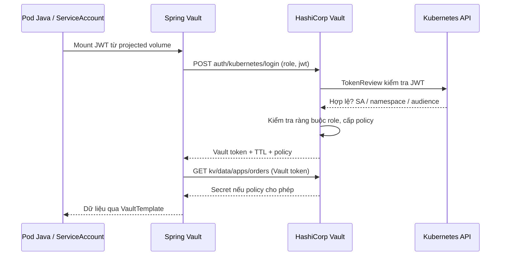

# KubernetesAuthentication và vai trò của ServiceAccount

Khi ứng dụng Java chạy trong Kubernetes, việc chép một Vault token cố định vào biến môi trường, Secret hoặc image khiến thông tin xác thực khó luân chuyển và dễ bị lộ. Spring Vault hỗ trợ **`KubernetesAuthentication`**: ứng dụng sử dụng danh tính **ServiceAccount** của Pod để đăng nhập HashiCorp Vault, nhận một **Vault token** có chính sách (policy) và thời hạn rõ ràng, rồi dùng **`VaultTemplate`** đọc secrets hoặc gọi các secrets engine khác. Đây là một cách xác thực theo *workload identity*: quyền được gắn với workload mà Kubernetes xác nhận.

Bài này thuộc chương **Kubernetes và JWT** của mô-đun **SPRING_VAULT**. Sau khi học, bạn có thể:

1. Phân biệt ServiceAccount, Kubernetes ServiceAccount JWT, Vault role, Vault policy và Vault token.
2. Giải thích luồng đăng nhập của `KubernetesAuthentication` và cơ chế `TokenReview`.
3. Cấu hình Kubernetes, Vault và Spring Vault để một Pod Java đọc đúng một secret KV v2.
4. Xử lý token xoay vòng, phiên Vault hết hạn, lỗi xác thực và kiểm thử ranh giới quyền.
5. Nhận biết khi nào nên dùng Vault **JWT auth** thay vì **Kubernetes auth**.

## 1. ServiceAccount xác thực danh tính gì?

**ServiceAccount (SA)** là danh tính dành cho tiến trình chạy trong Kubernetes; ví dụ Pod `orders-api` thuộc namespace `apps` chạy với `serviceAccountName: orders-api`. Kubernetes có thể cấp cho Pod một **JWT** đại diện cho danh tính đó. Những claim quan trọng thường gặp:

| Claim / thông tin | Vai trò |
| --- | --- |
| `sub` | Danh tính có dạng `system:serviceaccount:apps:orders-api`. |
| `iss` | Bên phát hành token (issuer) của cluster. |
| `aud` | Bên nhận dự kiến; cần khớp audience mà Vault role chấp nhận. |
| `exp`, `iat` | Thời điểm hết hạn và phát hành JWT. |
| Thông tin Kubernetes về Pod / SA | Dùng trong xác nhận danh tính và ràng buộc vòng đời token tùy loại token. |

Kubernetes RBAC quyết định SA có thể làm gì với **Kubernetes API**. **Vault policy** lại quyết định token do Vault cấp có thể làm gì với **Vault API**. Hai tập quyền này độc lập: cấp quyền đọc KV trong Vault **không** đòi hỏi SA có quyền đọc Kubernetes Secrets; một SA có `get secrets` trong Kubernetes cũng **không** tự được đọc Vault KV.

Kubernetes thường tự mount token vào `/var/run/secrets/kubernetes.io/serviceaccount/token`. Với các phiên bản Kubernetes hiện đại, token cho Pod thường là *projected, time-bound token*: kubelet chủ động làm mới, đồng thời token gắn với vòng đời Pod/ServiceAccount. Có thể chủ động khai báo `serviceAccountToken` projected volume để chọn `audience`, `expirationSeconds` và đường dẫn; ứng dụng cần đọc **giá trị mới từ file** khi đăng nhập lại. Tránh cấp quyền cho workload bằng ServiceAccount `default` của namespace chỉ vì tiện cấu hình.

## 2. Luồng từ Pod đến VaultTemplate

`KubernetesAuthentication` là một triển khai `ClientAuthentication` của Spring Vault. Nó đọc JWT từ file (hoặc từ `Supplier<String>`), gửi `role` và `jwt` đến `POST /v1/auth/kubernetes/login`, rồi nhận về Vault token nếu Vault xác minh thành công.



Có **hai loại token** trên đường đi:

- **Kubernetes SA JWT** là chứng cứ để đăng nhập; gửi trong payload `auth/kubernetes/login`, không phải token dùng để đọc KV, Transit hay PKI.
- **Vault token** là kết quả đăng nhập; Spring Vault dùng token này trong các request tiếp theo. Quyền và thời hạn của nó do Vault role, policy và cấu hình TTL quyết định.

Vault dùng Kubernetes **`TokenReview` API** để kiểm tra token đã được chấp nhận và còn hiệu lực, sau đó so khớp role với tên SA, namespace và audience. Kubernetes auth cần Vault liên lạc được với Kubernetes API, xác thực TLS được và có danh tính **reviewer** đủ quyền gọi `TokenReview`. Reviewer thường là ServiceAccount của chính Pod chạy Vault, tách biệt với ServiceAccount `orders-api` của ứng dụng.

> **Ranh giới quan trọng:** `role=orders-read` mà client gửi lên chỉ là *yêu cầu đăng nhập vào một role đã cấu hình*. Client không thể tự chọn policy bất kỳ. Vault chỉ cấp token nếu JWT đáp ứng các ràng buộc role; policy nằm phía Vault.

## 3. Thiết lập một ví dụ KV v2 có phân quyền

**Tình huống:** ứng dụng `orders-api` ở namespace `apps` cần đọc cấu hình từ `kv/apps/orders` (KV v2). Chỉ SA `apps/orders-api` mới được đăng nhập role `orders-read`, và token trả về chỉ có quyền `read` lên `kv/data/apps/orders`. Giả định Vault đã hoạt động qua HTTPS, có thể truy cập từ namespace `apps` và bạn có quyền quản trị để cấu hình auth method, secrets engine và policy. Các lệnh `vault` bên dưới chạy trong môi trường quản trị Vault đã đăng nhập hợp lệ; đường dẫn mount `kv` và `kubernetes` chỉ là ví dụ.

### 3.1. Bật auth method và chuẩn bị TokenReview

```bash
vault auth enable -path=kubernetes kubernetes
```

Nếu Vault chạy **trong Kubernetes**, một cấu hình thực tế là cho Pod Vault sử dụng token ServiceAccount cục bộ để gọi `TokenReview`. Ví dụ SA chạy Vault là `vault-auth` ở namespace `vault`:

```bash
kubectl create clusterrolebinding vault-token-review \
  --clusterrole=system:auth-delegator \
  --serviceaccount=vault:vault-auth

vault write auth/kubernetes/config \
  kubernetes_host="https://kubernetes.default.svc:443"
```

Ở cấu hình này, Vault phải thực sự chạy bằng SA `vault/vault-auth` và đọc được token cùng CA mặc định trong Pod. Khi không chỉ định `token_reviewer_jwt`, Vault chạy trong Pod có thể dùng token cục bộ và đọc lại token sau khi kubelet xoay vòng (với phiên bản Vault hỗ trợ). Nếu Vault nằm **ngoài cluster**, cần cấu hình `kubernetes_host`, `kubernetes_ca_cert` và cách cung cấp reviewer JWT phù hợp; không sao chép một JWT ngắn hạn rồi kỳ vọng nó dùng mãi. Không tự cấp `system:auth-delegator` cho mọi ServiceAccount ứng dụng. Cấu hình reviewer là việc của thành phần xác thực Vault.

Để tránh cấu hình trùng hoặc lệnh thất bại khi chạy lại, trước khi thực hành có thể xem `vault auth list`, `vault secrets list` và `kubectl get clusterrolebinding vault-token-review`. Trong môi trường có sẵn mount hoặc binding, dùng cấu hình hiện hữu sau khi kiểm tra đúng đường dẫn và quyền.

### 3.2. Tạo secret và policy chỉ đọc

```bash
vault secrets enable -path=kv kv-v2
vault kv put -mount=kv apps/orders \
  username="orders-demo" password="sample-only-change-me"
```

Lưu file `orders-read.hcl`:

```hcl
path "kv/data/apps/orders" {
  capabilities = ["read"]
}
```

Nạp policy và tạo Vault role:

```bash
vault policy write orders-read orders-read.hcl

vault write auth/kubernetes/role/orders-read \
  bound_service_account_names="orders-api" \
  bound_service_account_namespaces="apps" \
  audience="vault" \
  token_policies="orders-read" \
  token_ttl="15m" \
  token_max_ttl="1h"
```

Giải thích các tham số:

| Thành phần | Ý nghĩa |
| --- | --- |
| `bound_service_account_names` | Chỉ cho phép ServiceAccount tên `orders-api`. |
| `bound_service_account_namespaces` | Chỉ cho phép namespace `apps`; tên SA giống nhau ở namespace khác không được chấp nhận. |
| `audience=vault` | Yêu cầu JWT có audience phù hợp với role. |
| `token_policies=orders-read` | Policy gắn vào Vault token được cấp sau khi login. |
| `token_ttl`, `token_max_ttl` | TTL khởi tạo và giới hạn TTL của Vault token, còn phụ thuộc thiết lập mount/system. |

Với **KV v2**, API đọc dữ liệu có đường dẫn `kv/data/apps/orders`, khác với `kv/apps/orders` mà CLI `vault kv get` biểu diễn. Vì thế policy cần `kv/data/...`. Nếu cần liệt kê key hay thao tác metadata, phải cấp quyền riêng cho `kv/metadata/...`; ví dụ chỉ đọc này không cần. Tại môi trường thật, không ghi mật khẩu thật vào câu lệnh có thể lưu lại trong lịch sử shell; dùng quy trình nạp secret bảo mật của tổ chức.

### 3.3. Gắn ServiceAccount JWT dành cho Vault vào Pod

Đầu tiên tạo namespace `apps` nếu chưa có, rồi áp dụng manifest ví dụ:

```yaml
apiVersion: v1
kind: ServiceAccount
metadata:
  name: orders-api
  namespace: apps
---
apiVersion: apps/v1
kind: Deployment
metadata:
  name: orders-api
  namespace: apps
spec:
  replicas: 1
  selector:
    matchLabels:
      app: orders-api
  template:
    metadata:
      labels:
        app: orders-api
    spec:
      serviceAccountName: orders-api
      automountServiceAccountToken: false
      containers:
        - name: orders-api
          image: registry.example.com/orders-api:1.0.0
          env:
            - name: VAULT_URI
              value: https://vault.vault.svc:8200
            - name: VAULT_ROLE
              value: orders-read
          volumeMounts:
            - name: vault-identity
              mountPath: /var/run/secrets/vault
              readOnly: true
      volumes:
        - name: vault-identity
          projected:
            sources:
              - serviceAccountToken:
                  path: token
                  audience: vault
                  expirationSeconds: 3600
```

`registry.example.com/orders-api:1.0.0` là tên image **minh họa**, cần thay bằng image ứng dụng thật; namespace `apps` và địa chỉ HTTPS Vault cũng phải tồn tại trong cluster của bạn. `automountServiceAccountToken: false` tắt tự mount token dành cho Kubernetes API, còn volume projected được khai báo tường minh vẫn cấp JWT vào `/var/run/secrets/vault/token`. Token tại đây có `aud=vault`, khớp role đã tạo. Kubelet sẽ làm mới nội dung file; ứng dụng không nên ghi token ra log, sao chép sang file khác, hoặc đọc một lần rồi cache cố định.

Lưu ý: projected volume nên mount nguyên thư mục; mount token bằng `subPath` có thể ngăn việc nhận bản cập nhật khi kubelet xoay vòng. Ngoài ra, người chạy container phải có quyền đọc file token theo chính sách bảo mật của Pod.

## 4. Kết nối từ Java với KubernetesAuthentication

Ví dụ sau dùng **Spring Vault 4.1.x**, cho thấy mối quan hệ giữa `KubernetesAuthenticationOptions`, `KubernetesAuthentication`, `AbstractVaultConfiguration` và `VaultTemplate`. Spring Vault cung cấp sẵn `VaultTemplate` cùng `LifecycleAwareSessionManager` khi mở rộng `AbstractVaultConfiguration`.

Dependency Maven tối thiểu (phiên bản được quản lý bằng BOM/dependency management của dự án; nếu không dùng BOM thì khai báo phiên bản Spring Vault phù hợp):

```xml
<dependency>
    <groupId>org.springframework.vault</groupId>
    <artifactId>spring-vault-core</artifactId>
</dependency>
```

```java
import java.net.URI;
import org.springframework.beans.factory.annotation.Value;
import org.springframework.context.annotation.Configuration;
import org.springframework.vault.authentication.ClientAuthentication;
import org.springframework.vault.authentication.KubernetesAuthentication;
import org.springframework.vault.authentication.KubernetesAuthenticationOptions;
import org.springframework.vault.authentication.KubernetesServiceAccountTokenFile;
import org.springframework.vault.client.VaultEndpoint;
import org.springframework.vault.config.AbstractVaultConfiguration;

@Configuration
public class VaultKubernetesConfig extends AbstractVaultConfiguration {

    @Value("${VAULT_URI}")
    private URI vaultUri;

    @Value("${VAULT_ROLE:orders-read}")
    private String vaultRole;

    @Override
    public VaultEndpoint vaultEndpoint() {
        return VaultEndpoint.from(vaultUri);
    }

    @Override
    public ClientAuthentication clientAuthentication() {
        KubernetesAuthenticationOptions options =
            KubernetesAuthenticationOptions.builder()
                .role(vaultRole)
                .path("kubernetes")
                .jwtSupplier(new KubernetesServiceAccountTokenFile(
                    "/var/run/secrets/vault/token"))
                .build();

        return new KubernetesAuthentication(options, vaultClient());
    }
}
```

Ở bản **Spring Vault 3.x**, constructor phổ biến là `new KubernetesAuthentication(options, restOperations())`; từ 4.1, bản nhận `VaultClient` như ví dụ được ưu tiên và constructor `RestOperations` đã được đánh dấu deprecated. `path("kubernetes")` chỉ tên **auth mount**, không phải đường dẫn filesystem; nếu Vault mount tại `auth/k8s-prod` thì dùng `path("k8s-prod")`. Nếu dùng đường dẫn JWT mặc định của Kubernetes, có thể bỏ `jwtSupplier(...)`: builder mặc định đọc token từ `/var/run/secrets/kubernetes.io/serviceaccount/token` **mỗi lần login**. Ví dụ trên chỉ định supplier riêng vì projected volume đang nằm ở vị trí khác.

Đọc một giá trị KV v2 bằng `VaultOperations` (interface được `VaultTemplate` triển khai):

```java
import java.util.Map;
import org.springframework.stereotype.Service;
import org.springframework.vault.core.VaultOperations;
import org.springframework.vault.support.Versioned;

@Service
public class OrderCredentials {
    private final VaultOperations vault;

    public OrderCredentials(VaultOperations vault) {
        this.vault = vault;
    }

    public String username() {
        Versioned<Map<String, Object>> secret = vault
            .opsForVersionedKeyValue("kv")
            .get("apps/orders");

        if (secret == null || secret.getData() == null) {
            throw new IllegalStateException("Missing Vault secret: apps/orders");
        }

        Object value = secret.getData().get("username");
        if (!(value instanceof String)) {
            throw new IllegalStateException("Missing username in Vault secret");
        }
        return (String) value;
    }
}
```

`opsForVersionedKeyValue("kv")` hiểu định dạng của KV v2 và tự xây endpoint tương ứng; `get("apps/orders")` dùng **đường dẫn tương đối với mount**. Không gắn cứng `/v1/kv/data` vào tham số `get`. Khi gọi `username()`, Spring Vault lấy Vault token qua session manager và gửi request đã xác thực; code nghiệp vụ không cần tự thêm header `X-Vault-Token`.

Với **Spring Cloud Vault** (thư viện cấu hình bổ sung ngoài Spring Vault core), có thể chọn cấu hình khai báo thay vì tự viết `AbstractVaultConfiguration`:

```yaml
spring:
  cloud:
    vault:
      uri: https://vault.vault.svc:8200
      authentication: KUBERNETES
      kubernetes:
        role: orders-read
        kubernetes-path: kubernetes
        service-account-token-file: /var/run/secrets/vault/token
```

Hai cách trên là các lựa chọn cấu hình tùy stack dự án. Không đăng ký đồng thời nhiều bean `VaultTemplate`/`SessionManager` xung đột nếu Spring Cloud Vault đã tự cấu hình chúng. Trong triển khai thật, dùng TLS CA đáng tin cậy để xác minh chứng chỉ Vault; không vô hiệu hóa kiểm tra chứng chỉ chỉ để mẫu chạy được.

## 5. Token ngắn hạn và vòng đời phiên

Cần tách riêng ba đồng hồ thời gian:

| Đối tượng | Ai cấp / làm mới? | Điều xảy ra khi hết hạn |
| --- | --- | --- |
| **Kubernetes SA JWT** | Kubernetes TokenRequest/kubelet; kubelet làm mới file projected. | JWT cũ không còn dùng để **đăng nhập mới** khi hết hạn hoặc bị thu hồi. |
| **Vault token** | Vault cấp sau `auth/kubernetes/login`; `SessionManager` quản lý phiên. | Spring Vault có thể renew token nếu được phép hoặc đăng nhập lại bằng JWT còn hiệu lực. |
| **Secret lease** (nếu dùng dynamic secrets/PKI) | Secrets engine và bộ quản lý lease riêng. | Secret có TTL/khả năng renew/revoke riêng; không đồng nhất với TTL của Vault token. |

`LifecycleAwareSessionManager` mặc định trong `AbstractVaultConfiguration` giúp tái sử dụng token giữa các request, lên lịch renew cho token phù hợp và hỗ trợ đăng nhập lại khi cần. Vì thế không gọi trực tiếp `clientAuthentication().login()` cho **mỗi** lần đọc secret, không cache Vault token ngoài session manager và không giả định cứ xoay vòng SA JWT thì Vault token đang hoạt động lập tức bị thu hồi. Việc thu hồi JWT ảnh hưởng đến lần Kubernetes login tiếp theo; Vault token đã cấp có vòng đời riêng.

Nếu token SA mới xuất hiện trong file sau khi kubelet xoay vòng, `KubernetesServiceAccountTokenFile` có thể cung cấp nội dung mới cho lần login tiếp theo. Tránh dùng `jwtSupplier(() -> tokenDaDocLucKhoiDong)` vì supplier kiểu đó luôn trả token cũ. Nếu ứng dụng bị ngắt kết nối Vault, cơ chế retry nên có **exponential backoff và jitter**, giới hạn lần thử, tránh thác request login khi Vault hoặc Kubernetes API đang lỗi; không log JWT hay Vault token trong exception.

## 6. Phân biệt Kubernetes auth và JWT auth trong Vault

Cả hai cách đều có thể dùng Kubernetes ServiceAccount JWT, nhưng cơ chế kiểm tra khác nhau:

| Tiêu chí | Vault Kubernetes auth | Vault JWT auth |
| --- | --- | --- |
| Spring Vault client | `KubernetesAuthentication` | `JwtAuthentication` |
| Endpoint login mặc định | `auth/kubernetes/login` | `auth/jwt/login` |
| Xác minh token | Vault gọi Kubernetes `TokenReview` và kiểm tra role. | Vault xác thực chữ ký/claim JWT bằng public keys, JWKS hoặc OIDC discovery. |
| Phụ thuộc lúc login | Cần đường mạng, TLS và quyền reviewer đến Kubernetes API. | Cần cấu hình nguồn khóa tin cậy; không gọi `TokenReview` trong lúc login. |
| Thu hồi SA token trước `exp` | `TokenReview` có thể từ chối token đã bị thu hồi. | JWT từng hợp lệ có thể tiếp tục được chấp nhận đến khi hết hạn theo claim. |
| Ràng buộc danh tính | Vault role ràng buộc SA name, namespace, audience. | Vault JWT role ràng buộc issuer, audience, claims và chính sách tương ứng. |

Không nhầm `KubernetesAuthentication` (dùng JWT làm bằng chứng) với `JwtAuthentication` (dùng **JWT auth method** khác trên Vault). Nếu hạ tầng không thể để Vault truy cập Kubernetes API, JWT auth là một hướng cân nhắc; đổi lại phải cấu hình JWKS/OIDC, `bound_audiences` và claim chặt chẽ, chấp nhận giới hạn thu hồi sớm của JWT. Không chuyển auth method chỉ bằng cách đổi tên class Java mà bỏ qua cấu hình server.

## 7. Chẩn đoán lỗi theo từng mắt xích

| Triệu chứng | Nguyên nhân thường gặp | Cách xác minh / xử lý |
| --- | --- | --- |
| `IllegalArgumentException` khi tạo supplier hoặc file token không tồn tại | Sai đường dẫn, thiếu projected volume, tắt automount nhưng không mount thủ công. | Xem `volumeMounts`, `volumes`, `serviceAccountName` và kiểm tra **file tồn tại, đọc được** trong Pod; không in nội dung token. |
| Vault trả `403 permission denied` ở `auth/kubernetes/login` | Vault role sai, SA/namespace/audience không khớp; JWT hết hạn hoặc reviewer không có quyền TokenReview. | Đối chiếu `vault read auth/kubernetes/role/orders-read`; xem audit Vault đã khử dữ liệu nhạy cảm; kiểm tra reviewer RBAC và TokenReview. |
| Vault báo lỗi gọi Kubernetes API, TLS/x509 hoặc `TokenReview` | `kubernetes_host` sai, CA không đáng tin, NetworkPolicy chặn hoặc reviewer JWT hết hạn. | Kiểm tra đường mạng từ **Vault** tới Kubernetes API và cấu hình `auth/kubernetes/config`; làm mới reviewer đúng cách. |
| Login thành công nhưng đọc `kv` nhận 403 | Vault token không có capability `read` tại đúng API path. | Kiểm tra policy `kv/data/apps/orders`, quyền thực tế của token và mount KV v1/v2. |
| Có lúc login được, sau một khoảng thời gian thì thất bại | Supplier cache JWT cũ hoặc reviewer JWT tĩnh đã hết hạn. | Dùng supplier đọc file khi login, kiểm tra projected token rotation và cấu hình reviewer. |
| Login thành công nhưng secret trả `null` | Đường dẫn hoặc mount sai; secret chưa có phiên bản khả dụng. | So sánh `vault kv get -mount=kv apps/orders` và `get("apps/orders")`. |

Một trường hợp đáng chú ý: sai **audience** thường bị hiểu nhầm thành sai Vault policy. Chính sách KV chỉ được xét *sau khi đăng nhập thành công*; nếu login đã thất bại, hãy kiểm tra JWT, `role` và `TokenReview` trước.

Đối với production, nên quan sát số lần đăng nhập thành công/thất bại, tần suất làm mới phiên, độ trễ và mã lỗi Vault, khả năng gọi Kubernetes API, cùng các sự kiện `permission denied`. Ghi log tên role, mount, loại lỗi và correlation ID khi phù hợp; không ghi SA JWT, `X-Vault-Token`, giá trị secret hay các trường nhạy cảm của payload. Dùng audit devices của Vault với cơ chế bảo vệ thích hợp.

## 8. Kiểm thử tích hợp và bài thực hành

Để kiểm thử không cần hard-code một token quản trị trong test Java. Dựng môi trường Vault/Kubernetes thử nghiệm hoặc dùng cluster sandbox có quyền giới hạn; các bước xác nhận nên thực hiện theo thứ tự:

1. **Happy path:** Pod `apps/orders-api` có projected JWT `aud=vault`; ứng dụng đăng nhập `orders-read` và đọc được `username` tại `kv/apps/orders` qua `VaultTemplate`.
2. **Sai ServiceAccount:** tạo một Pod thử nghiệm mang SA khác, yêu cầu role `orders-read`; đăng nhập phải bị từ chối.
3. **Sai namespace:** SA cùng tên `orders-api` ở namespace khác không được đăng nhập role chỉ bound `apps`.
4. **Sai audience:** dùng JWT có `aud` không đúng `vault`; không cấp được token từ role `orders-read`.
5. **Ít quyền nhất:** sau khi login, thử đọc một secret khác hoặc ghi `kv/apps/orders`; phải nhận `permission denied`.
6. **Rotation và expiry:** chạy Pod qua ít nhất một lần xoay vòng JWT và để Vault token đến thời điểm cần renew/re-login; việc đọc secrets vẫn thành công khi hệ thống hoạt động bình thường.
7. **Sự cố phụ thuộc:** thử tạm chặn kết nối Vault → Kubernetes API trong sandbox; quan sát lỗi login mới, retry có giới hạn và khả năng phục hồi sau khi mở kết nối.

Đừng dùng `kubectl create token` rồi dán kết quả vào issue, công cụ phân tích log hay bài nộp. Nếu cần mô phỏng login thủ công, sử dụng JWT ngắn hạn trong môi trường sandbox, giữ kín trong phiên shell và xóa biến tạm ngay sau khi dùng. Khi assert lỗi 403, kiểm tra **đúng endpoint** thất bại để biết đó là lỗi auth hay lỗi policy.

### Câu hỏi tự kiểm tra

- Vì sao cấp Kubernetes RBAC `get secrets` cho ServiceAccount không tự cấp quyền Vault KV?
- Vì sao một JWT còn hiệu lực về `exp` vẫn có thể thất bại trong `TokenReview` sau khi Pod bị xóa?
- Vì sao policy của KV v2 viết `kv/data/apps/orders` nhưng code Java đọc `get("apps/orders")`?
- Vì sao JWT của Pod đổi sau một giờ nhưng Vault token đã cấp không nhất thiết bị thu hồi đúng lúc đó?
- Điều gì thay đổi nếu dùng `JwtAuthentication` và Vault JWT auth thay cho `KubernetesAuthentication`?

## 9. Tài liệu chính thức để đối chiếu

- [Spring Vault — Authentication Methods](https://docs.spring.io/spring-vault/reference/vault/authentication.html): mục Kubernetes và JWT authentication.
- [Spring Vault — KubernetesAuthenticationOptions](https://docs.spring.io/spring-vault/reference/api/java/org/springframework/vault/authentication/KubernetesAuthenticationOptions.html) và [KubernetesServiceAccountTokenFile](https://docs.spring.io/spring-vault/reference/api/java/org/springframework/vault/authentication/KubernetesServiceAccountTokenFile.html): builder, supplier và đường dẫn token.
- [Spring Vault — VaultTemplate và session management](https://docs.spring.io/spring-vault/reference/vault/imperative-template.html): `VaultTemplate`, `SessionManager`, token renewal.
- [HashiCorp Vault — Kubernetes auth method](https://developer.hashicorp.com/vault/docs/auth/kubernetes) và [API cấu hình role](https://developer.hashicorp.com/vault/api-docs/auth/kubernetes): `TokenReview`, reviewer JWT, audience, bound ServiceAccount.
- [HashiCorp Vault — Kubernetes OIDC/JWT auth](https://developer.hashicorp.com/vault/docs/auth/jwt/oidc-providers/kubernetes): giới hạn thu hồi token khi chỉ xác thực JWT bằng chữ ký.
- [Kubernetes — Configure Service Accounts for Pods](https://kubernetes.io/docs/tasks/configure-pod-container/configure-service-account/) và [Projected Volumes](https://kubernetes.io/docs/concepts/storage/projected-volumes/): projected token, audience, TTL, rotation và mount.
