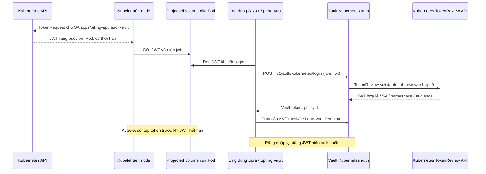

# Token được gắn vào Pod và nguồn cung cấp JWT

Trong hệ thống chạy trên Kubernetes, ứng dụng Java có thể chứng minh danh tính với HashiCorp Vault mà không phải chép một Vault token cố định vào source code, image, biến môi trường hoặc Kubernetes Secret. Cách thường dùng là cho **kubelet** gắn một **ServiceAccount JWT** ngắn hạn vào filesystem của Pod; **Spring Vault** đọc tệp đó để đăng nhập qua `KubernetesAuthentication`. Vault kiểm tra danh tính, cấp **Vault token** theo role/policy, và `VaultTemplate` dùng token vừa nhận để truy cập KV secrets, Transit, PKI hoặc các API khác đã được phân quyền.

Bài học thuộc chương **Kubernetes và JWT** của mô-đun **SPRING_VAULT**. Trọng tâm là **token được cung cấp cho Pod từ đâu, được mount ra sao, lúc nào thay đổi và Java nên đọc như thế nào**. Sau bài học, bạn có thể:

- Phân biệt ServiceAccount JWT, token reviewer của Vault, Vault client token và secret lease.
- Giải thích vì sao tệp `/var/run/secrets/kubernetes.io/serviceaccount/token` tồn tại, ai tạo và ai làm mới nó.
- Dùng projected ServiceAccount token có `audience` riêng cho Vault và kiểm soát `automountServiceAccountToken`.
- Cấu hình Spring Vault/Spring Cloud Vault lấy JWT đúng đường dẫn và tái đọc token sau khi xoay vòng.
- Chẩn đoán lỗi token thiếu, không đọc được, sai audience, hết hạn hoặc không khớp ServiceAccount.

## 1. Truy vết nguồn gốc: danh tính, JWT và phiên Vault

Ví dụ: Deployment `billing-api` có một Pod ở namespace `apps`, chạy với `serviceAccountName: billing-api`. Quy trình điển hình:



Cần phân biệt các đối tượng sau:

| Đối tượng | Nơi sinh / cấp | Dùng để làm gì? |
| --- | --- | --- |
| **ServiceAccount** | Kubernetes API, biểu diễn bằng object có tên và namespace | Danh tính workload; bản thân object không phải token. |
| **ServiceAccount JWT** | Kubernetes TokenRequest API; kubelet lấy cho Pod | Bằng chứng danh tính gửi cho Vault auth; có `iss`, `sub`, `aud`, `exp` và các claim liên quan Kubernetes. |
| **Reviewer JWT** | Kubernetes, thuộc danh tính Vault dùng để gọi `TokenReview` | Cho phép Vault xác thực JWT của ứng dụng với Kubernetes API. Có thể là token SA của Pod chạy Vault, khác token của Pod ứng dụng. |
| **Vault token** | HashiCorp Vault, sau khi xác thực thành công | Xác thực các request `VaultTemplate` tới Vault; quyền do Vault policy quyết định, TTL độc lập với JWT đầu vào. |
| **Lease của secret** | Vault secrets engine, nếu có | Quản lý TTL/renew/revoke của dynamic secret hoặc certificate; không đồng nhất với Vault token. |

> **Không đánh đồng Kubernetes Secret và ServiceAccount JWT**: với projected token hiện đại, kubelet yêu cầu token qua TokenRequest API rồi mount vào Pod, không cần tạo một Secret lưu JWT. Và **không** dùng ServiceAccount JWT làm giá trị `X-Vault-Token`; header này nhận **Vault token** đã đăng nhập thành công.

## 2. TokenRequest API và các claim trong JWT

Với cơ chế *bound ServiceAccount token*, kubelet yêu cầu Kubernetes API cấp JWT cho ServiceAccount của Pod thông qua **TokenRequest**. JWT thường gắn với một Pod cụ thể, có thời hạn sử dụng và có audience chỉ định. Khi Pod hoặc ServiceAccount bị xóa, TokenReview có thể từ chối token đó dù thời điểm `exp` chưa đến.

Một payload JWT đã **rút gọn, dùng dữ liệu giả** có hình thức sau:

```json
{
  "iss": "https://kubernetes.example.internal",
  "sub": "system:serviceaccount:apps:billing-api",
  "aud": ["vault"],
  "iat": 1764000000,
  "nbf": 1764000000,
  "exp": 1764003600,
  "kubernetes.io": {
    "namespace": "apps",
    "pod": {
      "name": "billing-api-7d6f7c9d8b-abcde",
      "uid": "pod-uid-demo"
    },
    "serviceaccount": {
      "name": "billing-api",
      "uid": "service-account-uid-demo"
    }
  }
}
```

Các timestamp là **giá trị minh họa**, không phải token có thể sử dụng. Claim thực tế thay đổi theo phiên bản Kubernetes và loại token. Cách đọc những claim quan trọng:

| Claim | Diễn giải | Vì sao liên quan tới Vault? |
| --- | --- | --- |
| `iss` (issuer) | Nguồn phát hành JWT do cluster cấu hình. | Cần khớp nguồn tin cậy khi dùng Vault JWT/OIDC auth; Kubernetes auth dựa vào `TokenReview`. |
| `sub` (subject) | Thường là `system:serviceaccount:<namespace>:<name>`. | Giúp nhận diện workload; Vault Kubernetes role còn ràng buộc trực tiếp SA/namespace. |
| `aud` (audience) | Bên nhận dự kiến, ví dụ `vault`. | JWT cấp cho Kubernetes API không mặc nhiên phù hợp với Vault role yêu cầu `audience=vault`. |
| `iat`, `nbf`, `exp` | Thời điểm phát hành, bắt đầu hiệu lực, hết hạn. | JWT không hợp lệ trước `nbf` hoặc sau `exp`; lệch đồng hồ có thể gây lỗi. |
| `kubernetes.io` | Metadata về namespace, Pod, ServiceAccount và UID tùy dạng token. | Kubernetes `TokenReview` sử dụng ngữ cảnh danh tính, ràng buộc Pod/SA khi xác thực. |

JWT có cấu trúc ba phần `header.payload.signature`, nhưng **giải mã Base64URL không đồng nghĩa với xác minh chữ ký**. Không viết code chỉ decode claim rồi tự coi JWT là tin cậy; phía Vault cần kiểm tra tính hợp lệ theo auth method đã cấu hình. Bản thân JWT là credential nhạy cảm vì ai giữ được nó có thể thử đăng nhập vào role phù hợp trong thời gian còn hiệu lực.

## 3. Tệp token mặc định được mount khi nào?

Kubernetes hiện đại thường tự động thêm một **projected volume** cho Pod có ServiceAccount và gắn vào container ở:

```text
/var/run/secrets/kubernetes.io/serviceaccount/
├── token        # JWT của ServiceAccount
├── ca.crt       # CA phục vụ tin cậy Kubernetes API
└── namespace    # Tên namespace của Pod
```

Thư mục này có thể được tạo từ nhiều nguồn trong cùng projected volume: `serviceAccountToken`, `configMap` chứa CA và `downwardAPI` cho namespace. Token mặc định thường phục vụ **Kubernetes API server**; `aud` và thời hạn thực tế phụ thuộc cấu hình cluster. Đây **không phải** chứng chỉ/mã truy cập của Vault.

Quá trình gắn token chịu ảnh hưởng của thuộc tính `automountServiceAccountToken`:

- Nếu không cấu hình, admission controller thường tự mount token cho Pod theo mặc định.
- Có thể đặt `automountServiceAccountToken: false` ở **ServiceAccount** để tắt cho các Pod sử dụng SA đó; Pod có thể ghi đè bằng thuộc tính cùng tên trong `spec` của Pod.
- Đặt `automountServiceAccountToken: false` ở **Pod** sẽ không còn token mount tự động ở đường dẫn mặc định. Vì vậy mã Spring Vault dùng đường dẫn mặc định sẽ lỗi nếu không có nguồn token khác.
- Khi chủ động khai báo **projected serviceAccountToken volume** cho Vault, vẫn có thể để `automountServiceAccountToken: false` và mount đúng một token với audience riêng. Việc tắt auto mount **không cấm** projection được chỉ định tường minh.

Ví dụ khai báo ServiceAccount không tự mount token nếu Pod không yêu cầu:

```yaml
apiVersion: v1
kind: ServiceAccount
metadata:
  name: billing-api
  namespace: apps
automountServiceAccountToken: false
```

Sau khi tạo workload, có thể xem YAML thực tế để xác định admission controller đã thêm volume nào:

```bash
kubectl -n apps get pod <pod-name> -o yaml
kubectl -n apps describe pod <pod-name>
```

Các lệnh này chỉ nên dùng để xem **metadata**; không cần in JWT để kiểm tra việc mount.

## 4. Khai báo một nguồn JWT có audience riêng cho Vault

Giả sử ứng dụng chỉ cần JWT để đăng nhập Vault Kubernetes auth ở role `billing-read`; không cần token dành cho Kubernetes API. Ta dùng một projected token với `audience: vault` và vị trí `/var/run/secrets/vault/jwt`.

Manifest hoàn chỉnh cho môi trường thử nghiệm:

```yaml
apiVersion: v1
kind: ServiceAccount
metadata:
  name: billing-api
  namespace: apps
automountServiceAccountToken: false
---
apiVersion: apps/v1
kind: Deployment
metadata:
  name: billing-api
  namespace: apps
spec:
  replicas: 1
  selector:
    matchLabels:
      app: billing-api
  template:
    metadata:
      labels:
        app: billing-api
    spec:
      serviceAccountName: billing-api
      automountServiceAccountToken: false
      containers:
        - name: billing-api
          image: registry.example.com/billing-api:1.0.0
          env:
            - name: APP_VAULT_URI
              value: "https://vault.vault.svc:8200"
            - name: APP_VAULT_ROLE
              value: "billing-read"
            - name: APP_VAULT_JWT_FILE
              value: "/var/run/secrets/vault/jwt"
          volumeMounts:
            - name: vault-identity
              mountPath: /var/run/secrets/vault
              readOnly: true
      volumes:
        - name: vault-identity
          projected:
            sources:
              - serviceAccountToken:
                  path: jwt
                  audience: vault
                  expirationSeconds: 3600
```

**Điều kiện của ví dụ:** namespace `apps` đã tồn tại; URL Vault truy cập được và chứng chỉ TLS được ứng dụng Java tin cậy; tên image là **placeholder** để thay bằng image thật. Pod sử dụng SA `apps/billing-api`. Tệp `jwt` có audience `vault`, thời hạn **yêu cầu** là 3.600 giây; API server có thể điều chỉnh thời hạn thực tế theo cấu hình cluster.

| Trường | Ý nghĩa | Lỗi hay gặp |
| --- | --- | --- |
| `serviceAccountName` | Tên SA của Pod trong chính namespace đó. | Không khai báo hoặc gõ sai, Pod dùng SA `default` hay không khởi tạo được. |
| `projected.sources.serviceAccountToken` | Yêu cầu kubelet lấy JWT từ TokenRequest API rồi đặt vào volume. | Nhầm với `secret: secretName` và dùng token tĩnh. |
| `path: jwt` | Tên file **tương đối** trong mount. | Cấu hình Java tìm `/token` trong khi volume đặt tên `/jwt`. |
| `audience: vault` | Bên nhận JWT dự kiến. | Vault role yêu cầu audience khác nên từ chối đăng nhập. |
| `expirationSeconds: 3600` | Thời hạn mong muốn, tính bằng giây. | Tưởng token sẽ cố định 1 giờ hoặc chỉ được phát hành một lần. |
| `volumeMounts.mountPath` | Đường dẫn thư mục nhìn thấy bởi container. | Chỉ khai báo `volumes` mà quên mount vào container chạy Java. |
| `readOnly: true` | Không cho ứng dụng ghi đè file được mount. | Vô tình cho ứng dụng sửa nội dung credential. |

Trong manifest, đường dẫn đầy đủ = `mountPath` + `path` = `/var/run/secrets/vault/jwt`. Nếu chuyển mountPath, **cần cập nhật cấu hình nguồn JWT của Spring Vault**; role Vault không thay đổi theo đường dẫn file.

### Không mount projected token bằng subPath

Kubelet xoay vòng projected token bằng cách cập nhật dữ liệu volume. Container truy cập **đường dẫn file trong thư mục được mount** sẽ nhìn thấy phiên bản mới khi đọc lại. Nếu dùng `subPath` để gắn riêng một file token vào container, Kubernetes không tự cập nhật nội dung projected volume đến mount qua `subPath`. Điều này có thể làm ứng dụng đăng nhập tốt lúc đầu nhưng thất bại khi JWT cũ hết hạn. Mount **cả thư mục** như manifest trên.

### Phạm vi người có thể đọc token

Projected volume nằm trong Pod và chỉ được truy cập bởi các container có mount volume đó. Dẫu vậy, mọi tiến trình có quyền filesystem tương ứng trong một container được mount đều có thể đọc credential; ứng dụng bị xâm nhập có thể làm lộ JWT. Giới hạn số container được mount, chạy workload với quyền hệ điều hành tối thiểu và thiết lập quyền file/`fsGroup` phù hợp với `securityContext` thực tế. Tránh tự đặt mode quá chặt khiến tiến trình Java không còn đọc được file sau khi chạy non-root.

## 5. Nguồn JWT khác nhau và cách lựa chọn

| Nguồn token | Cách cấp cho ứng dụng | Xoay vòng / mức độ phù hợp |
| --- | --- | --- |
| **Auto-mounted SA token** | Kubernetes gắn tại `/var/run/secrets/kubernetes.io/serviceaccount/token`. | Kubelet quản lý; thuận tiện khi audience mặc định phù hợp với Vault role. |
| **Projected token tường minh** | Khai báo `serviceAccountToken` trong Pod với `audience`, `expirationSeconds`, `path`. | Kubelet quản lý; thường phù hợp nhất khi dành audience riêng cho Vault. |
| **TokenRequest do người/vận hành gọi** | API `serviceaccounts/token`; `kubectl create token` là một client. | Token ngắn hạn; phù hợp test tạm thời/ngoài Pod, cần cơ chế phát và chuyển an toàn; không có kubelet trong ứng dụng ngoài Pod tự xoay vòng giúp. |
| **Legacy ServiceAccount token Secret** | JWT lâu dài được tạo trong Secret và mount vào Pod. | Rủi ro vì token tĩnh, không tự xoay vòng; không nên chọn cho thiết kế mới. |
| **Token do hệ thống identity khác cấp** | Workload nhận JWT từ OIDC/CI/workload platform khác. | Cần kiểm tra issuer, signature và claims; thường thuộc Vault **JWT/OIDC auth**, không mặc nhiên tương thích Vault **Kubernetes auth**. |
| **Vault Agent / injector** | Sidecar hoặc agent có thể dùng JWT của Pod để xác thực rồi cung cấp secret/token theo cơ chế riêng. | Ứng dụng có thể không tự gọi `KubernetesAuthentication`; cần hiểu ai quản lý JWT/Vault token và file nào được chia sẻ. |

Trong Kubernetes 1.24 trở đi, hệ thống không còn tự tạo Secret chứa token lâu dài cho mọi ServiceAccount như cơ chế cũ. Việc tạo Secret loại `kubernetes.io/service-account-token` thủ công vẫn có thể thực hiện, nhưng không phù hợp với mục tiêu token ngắn hạn và hạn chế lộ thông tin. Nếu cần thử TokenRequest trong một sandbox:

```bash
kubectl -n apps create token billing-api \
  --audience=vault \
  --duration=10m
```

Lệnh này **in JWT ra terminal**, nên chỉ chạy tại nơi được kiểm soát để kiểm thử, không dán kết quả vào log, issue, chat, CI output hoặc commit. Token tạo bằng lệnh này có audience, TTL yêu cầu nhưng không tự động trở thành token bound-to-Pod giống token do kubelet tạo cho Pod; muốn ràng buộc object cần chỉ định các tùy chọn TokenRequest phù hợp.

## 6. Từ file JWT đến Spring Vault

**`KubernetesAuthentication`** trong Spring Vault gửi `role` và nội dung JWT đến `auth/kubernetes/login`. Nó cần một **`Supplier<String>`** để nhận JWT. Mặc định, `KubernetesAuthenticationOptions` dùng tệp token auto-mount ở `/var/run/secrets/kubernetes.io/serviceaccount/token` và đọc khi đăng nhập. Nếu đã mount file riêng như mục 4, chỉ định supplier mới.

Ví dụ với **Spring Vault 4.1.x** và `AbstractVaultConfiguration` (sử dụng `spring-vault-core`; biến môi trường `APP_VAULT_*` được khai báo trong Deployment):

```java
import java.net.URI;
import org.springframework.beans.factory.annotation.Value;
import org.springframework.context.annotation.Configuration;
import org.springframework.vault.authentication.ClientAuthentication;
import org.springframework.vault.authentication.KubernetesAuthentication;
import org.springframework.vault.authentication.KubernetesAuthenticationOptions;
import org.springframework.vault.authentication.KubernetesServiceAccountTokenFile;
import org.springframework.vault.client.VaultEndpoint;
import org.springframework.vault.config.AbstractVaultConfiguration;

@Configuration
public class VaultIdentityConfiguration extends AbstractVaultConfiguration {

    @Value("${APP_VAULT_URI}")
    private URI vaultUri;

    @Value("${APP_VAULT_ROLE}")
    private String role;

    @Value("${APP_VAULT_JWT_FILE}")
    private String jwtFile;

    @Override
    public VaultEndpoint vaultEndpoint() {
        return VaultEndpoint.from(vaultUri);
    }

    @Override
    public ClientAuthentication clientAuthentication() {
        KubernetesAuthenticationOptions options =
            KubernetesAuthenticationOptions.builder()
                .role(role)
                .path("kubernetes")
                .jwtSupplier(new KubernetesServiceAccountTokenFile(jwtFile))
                .build();

        return new KubernetesAuthentication(options, vaultClient());
    }
}
```

`KubernetesServiceAccountTokenFile` là supplier chuyên dụng được Spring Vault cung cấp. Nó yêu cầu file tồn tại khi khởi tạo và đọc credential khi được gọi; không nên dùng `cached()` hoặc tự cache JWT một lần lúc ứng dụng start. `vaultClient()` là API được dùng cho Spring Vault 4.1.x; với Spring Vault phiên bản cũ hơn, constructor `KubernetesAuthentication` có thể nhận `RestOperations` theo tài liệu của phiên bản đó.

Spring Vault nhận **Vault token** từ lần đăng nhập và `SessionManager` quản lý việc sử dụng phiên cho `VaultTemplate`/`VaultOperations`. Khi Vault token cần renew hoặc đăng nhập lại, supplier phải cung cấp JWT hiện tại. Hai token không có chung TTL hoặc lịch xoay vòng; kubelet làm mới JWT **không tự động thu hồi Vault token đã cấp**.

### Khi sử dụng Spring Cloud Vault

Nếu dự án dùng **Spring Cloud Vault** để tự cấu hình client, có thể khai báo thay cho Java configuration ở trên:

```yaml
spring:
  cloud:
    vault:
      uri: https://vault.vault.svc:8200
      authentication: KUBERNETES
      kubernetes:
        role: billing-read
        kubernetes-path: kubernetes
        service-account-token-file: /var/run/secrets/vault/jwt
```

Spring Cloud Vault có hỗ trợ thuộc tính `service-account-token-file` chỉ nguồn JWT, `role` chọn Vault role, `kubernetes-path` chọn auth mount. Không nhầm `service-account-token-file` với đường dẫn lưu **Vault token**, và không đăng ký đồng thời bean auth/config tự viết nếu auto-configuration đã đáp ứng yêu cầu. Cần khai báo TLS trust chain của Vault trong JVM/client theo môi trường; không tắt kiểm tra chứng chỉ.

### Đọc lại file, không giữ một bản JWT cũ trong bộ nhớ

Một lỗi thường gặp:

```java
// Không nên: token được đọc đúng một lần lúc start.
String jwtAtStartup = java.nio.file.Files.readString(
    java.nio.file.Path.of("/var/run/secrets/vault/jwt"));
// jwtSupplier(() -> jwtAtStartup) khiến các lần login lại dùng JWT cũ.
```

Nếu cần tùy biến supplier, hãy thiết kế cho mỗi lần `get()` đọc lại file và xử lý lỗi I/O; thông thường dùng `KubernetesServiceAccountTokenFile` đã đủ. Tránh giữ file descriptor cũ mở liên tục nếu volume cập nhật bằng cách thay symlink/đường dẫn nội bộ. Supplier chỉ đọc file khi Vault cần login; nó **không phải** một thread liên tục đi polling JWT và không có nhiệm vụ làm mới token thay kubelet.

## 7. Ghép audience/ServiceAccount với cấu hình Vault

Khi Vault đã bật Kubernetes auth ở mount `kubernetes`, operator có thể khai báo role tương ứng với Pod đã thiết kế:

```bash
vault write auth/kubernetes/role/billing-read \
  bound_service_account_names="billing-api" \
  bound_service_account_namespaces="apps" \
  audience="vault" \
  token_policies="billing-read" \
  token_ttl="15m"
```

Lệnh giả định admin Vault đã tạo policy `billing-read` và cấu hình `auth/kubernetes/config` (Kubernetes API URL, CA và reviewer JWT phù hợp). `role` gửi từ Pod cần khớp `billing-read`; `aud=vault` từ projected JWT cần khớp audience của role; SA/namespace cũng phải khớp. Policy `billing-read` có thể chỉ cho phép đọc một đường dẫn KV v2 cụ thể, chẳng hạn:

```hcl
path "kv/data/billing/config" {
  capabilities = ["read"]
}
```

Nếu policy này được nạp vào Vault, Java có thể đọc KV v2 qua `VaultTemplate.opsForVersionedKeyValue("kv").get("billing/config")`. Những quyền như ghi KV, Transit encrypt/decrypt hay phát hành PKI certificate đòi hỏi các **Vault policy riêng** trên API path tương ứng; không do Kubernetes RBAC quyết định.

Vault xác thực JWT bằng Kubernetes `TokenReview`. Reviewer JWT có thể đến từ token của chính **Pod chạy Vault** hoặc cấu hình cung cấp credential khác. Pod `billing-api` bình thường **không cần** quyền Kubernetes RBAC `system:auth-delegator`; quyền đó dành cho danh tính reviewer gọi `TokenReview`. Nếu Vault chạy ngoài cluster, operator phải cung cấp cách truy cập Kubernetes API, TLS và token reviewer phù hợp với vòng đời ngắn hạn; nếu Vault chạy trong cluster, cách dùng token ServiceAccount cục bộ có thể hỗ trợ tự đọc lại token reviewer trên các phiên bản Vault phù hợp.

> **Audience phải được thiết kế ở hai đầu**: `audience: vault` trong Pod định danh bên nhận JWT, còn `audience="vault"` trong Vault role giới hạn token được chấp nhận. Việc JWT đọc được từ file không chứng minh rằng Vault sẽ chấp nhận nó.

## 8. Vòng đời token và hiện tượng “chạy lúc đầu, lỗi sau một giờ”

Khi `expirationSeconds: 3600` được yêu cầu, **kubelet** sẽ định kỳ yêu cầu token mới khi token cũ tiến gần thời điểm hết hạn. Theo tài liệu Kubernetes, kubelet bắt đầu tìm cách xoay vòng nếu token đã dùng trên **80% TTL** hoặc có tuổi trên **24 giờ**. Đây là hành vi chủ động, không phải cam kết token chắc chắn thay đổi chính xác tại phút thứ 48; khả năng kết nối control plane, độ dài TTL thực tế và chính sách cluster có thể ảnh hưởng.

```mermaid
flowchart LR
    A["Kubelet TokenRequest: JWT A"] --> B["Mount file /vault/jwt = A"]
    B --> C["Spring Vault login bằng JWT A"]
    C --> D["Vault token V1 dùng cho API"]
    D --> E["Kubelet cập nhật file thành JWT B"]
    E --> F["Vault token V1 cần renew hoặc login lại"]
    F --> G["Supplier đọc file hiện tại: JWT B"]
    G --> H["Vault trả token mới V2 nếu được phép"]
```



Những ý tưởng giúp tránh lỗi:

1. **Không snapshot credential vào env hay file khác:** projected token là file do kubelet quản lý; copy lúc start biến credential xoay vòng thành token cố định.
2. **Không mount qua `subPath`:** container sẽ không nhận thay đổi trong projected volume.
3. **Không ép TTL trùng nhau:** TTL của SA JWT, Vault token và secret lease là ba cấu hình và vòng đời khác biệt.
4. **Không login lại mỗi khi đọc KV:** Spring Vault có `SessionManager` giúp sử dụng Vault token giữa nhiều request; login lại khi cần phiên mới.
5. **Không coi rotation là bảo đảm thu hồi Vault token:** TokenReview có thể từ chối JWT đã bị thu hồi khi login mới; Vault token đã cấp vẫn theo TTL/revoke riêng.
6. **Không ghi credential vào log hoặc crash dump:** chỉ quan sát metadata, trạng thái kết nối, lỗi và TTL tổng hợp nếu cần.

Nếu kubelet chưa kịp làm mới hoặc Pod mất kết nối đến Kubernetes API, JWT có thể hết hạn; các lần đăng nhập Vault mới sẽ thất bại. Ứng dụng cần phản hồi rõ lỗi xác thực và có retry giới hạn, backoff cùng jitter, không tạo vòng lặp login dồn dập. Đối với dữ liệu nhạy cảm, cần quyết định rõ ứng dụng sẽ từ chối tiếp tục phục vụ hay sử dụng bản cấu hình cache đang hợp lệ theo chính sách của hệ thống.

## 9. Khắc phục lỗi theo đúng nguồn JWT

| Hiện tượng | Kiểm tra lần lượt |
| --- | --- |
| `FileNotFoundException`, `IllegalArgumentException` khi tạo supplier | Tên file, `mountPath` và `path`; Deployment có `volumeMounts` và projected volume; Pod đã chạy đúng SA chưa; có bật `automountServiceAccountToken: false` nhưng quên volume tường minh không? |
| `AccessDeniedException` hoặc file tồn tại nhưng Java không đọc được | UID/GID chạy process, mode của projected file, `fsGroup`, chính sách Pod/container và mount thực tế; tránh sửa permission tùy tiện trong container. |
| JWT đọc được nhưng `auth/kubernetes/login` trả 403 | `role` của Java, SA/namespace của Pod, `aud` của JWT, `audience` của Vault role, `exp`, trạng thái Pod và reviewer TokenReview. |
| Sau một khoảng thời gian, login bắt đầu thất bại | Ứng dụng cache JWT lúc start, volume dùng `subPath`, clock lệch, kubelet không rotate, hoặc reviewer JWT phía Vault hết hạn. |
| Vault login thất bại vì TLS/timeout đến Kubernetes API | Đường mạng **Vault → Kubernetes API**, CA và địa chỉ `kubernetes_host`; không phải chỉ đường mạng Pod Java → Vault. |
| Vault login thành công nhưng đọc `kv` bị 403 | Kiểm tra **Vault policy** trên đường dẫn API KV v2 `kv/data/...`; Kubernetes SA JWT chỉ quyết định khả năng đăng nhập, không tự cấp quyền secret. |
| Pod dùng SA `default` ngoài dự kiến | Kiểm tra `spec.serviceAccountName` của Pod đang chạy, template Deployment và namespace. |

Các thao tác chẩn đoán an toàn:

```bash
# Xem danh tính SA được gán, không đọc giá trị JWT
kubectl -n apps get pod <pod-name> \
  -o jsonpath='{.spec.serviceAccountName}'

# Xem cấu hình volume của Pod và các sự kiện
kubectl -n apps describe pod <pod-name>

# Với quyền quản trị Vault, xem role và ràng buộc audience
vault read auth/kubernetes/role/billing-read
```

Có thể kiểm tra việc **tồn tại** và **quyền truy cập** của file ở trong container mà không in nội dung của nó, ví dụ bằng `test -r /var/run/secrets/vault/jwt`. Nếu cần phân tích `iss`, `aud`, `exp` trong môi trường sandbox, chỉ giải mã cục bộ các trường tối thiểu, không đưa cả JWT lên công cụ web phân tích token và không giả định claim đã được xác thực bằng cách giải mã.

## 10. Bài thực hành kiểm chứng

Điều kiện: có Kubernetes sandbox, Vault auth method `kubernetes` đã được operator cấu hình để gọi `TokenReview`, và policy `billing-read` có sẵn. Thực hiện theo các tình huống:

1. **Đúng cấu hình:** áp dụng manifest ở mục 4, cấu hình Vault role ở mục 7; kiểm tra Pod có file token **đọc được** và Spring Vault đăng nhập thành công.
2. **Sai audience:** đổi `audience` của projected volume thành `other-service` nhưng giữ Vault role `audience=vault`; đợi Pod mới chạy và xác nhận login bị từ chối.
3. **Sai ServiceAccount:** cho Pod thử nghiệm chạy bằng SA khác; xác nhận Vault không cấp token cho role `billing-read`.
4. **Tắt nguồn token:** bỏ projected volume trong khi vẫn giữ `automountServiceAccountToken: false`; xác nhận ứng dụng phát hiện thiếu file ngay lúc cấu hình auth, thay vì tự dùng một credential khác.
5. **Xoay vòng:** để Pod chạy qua chu kỳ rotation; xác nhận file vẫn được đọc lại khi Spring Vault cần login mới, không xuất hiện lỗi do cache JWT cũ. Có thể dùng log/số liệu login đã được khử dữ liệu nhạy cảm.
6. **Phân quyền Vault:** với Vault token đã đăng nhập, thử một đường dẫn KV không được policy cho phép; phải bị từ chối dù JWT SA hợp lệ.

Khi chạy thử, ghi nhận **endpoint thất bại** để phân biệt lỗi `auth/kubernetes/login` với lỗi `kv/data/...`. Bài thực hành này xác minh cả cơ chế **cấp JWT từ Kubernetes**, **tiêu thụ JWT trong Spring Vault** và **ranh giới quyền ở Vault**, là nền tảng trước khi chuyển sang quy trình token/lease, Transit encryption, PKI và các kiểm thử tích hợp chuyên sâu khác.

## 11. Nguồn tham khảo chính thức

- [Kubernetes — Configure Service Accounts for Pods](https://kubernetes.io/docs/tasks/configure-pod-container/configure-service-account/): default mount, token projection, audience, thời hạn và kubelet rotation.
- [Kubernetes — Managing Service Accounts](https://kubernetes.io/docs/reference/access-authn-authz/service-accounts-admin/): TokenRequest, bound ServiceAccount token và cơ chế tự mount.
- [Kubernetes — Projected Volumes](https://kubernetes.io/docs/concepts/storage/projected-volumes/): `serviceAccountToken`, `path`, `expirationSeconds` và giới hạn `subPath`.
- [Kubernetes — Service Accounts](https://kubernetes.io/docs/concepts/security/service-accounts/): ServiceAccount token projection và rủi ro legacy token Secret.
- [Spring Vault — Authentication Methods](https://docs.spring.io/spring-vault/reference/vault/authentication.html), [`KubernetesAuthenticationOptions`](https://docs.spring.io/spring-vault/reference/api/java/org/springframework/vault/authentication/KubernetesAuthenticationOptions.html) và [`KubernetesServiceAccountTokenFile`](https://docs.spring.io/spring-vault/reference/api/java/org/springframework/vault/authentication/KubernetesServiceAccountTokenFile.html): cấu hình nguồn JWT trong Java.
- [Spring Cloud Vault — Authentication Methods](https://docs.spring.io/spring-cloud-vault/reference/authentication.html): thuộc tính `kubernetes.service-account-token-file`.
- [HashiCorp Vault — Kubernetes auth method](https://developer.hashicorp.com/vault/docs/auth/kubernetes) và [Kubernetes auth API](https://developer.hashicorp.com/vault/api-docs/auth/kubernetes): TokenReview, reviewer credential, role, audience và login.
