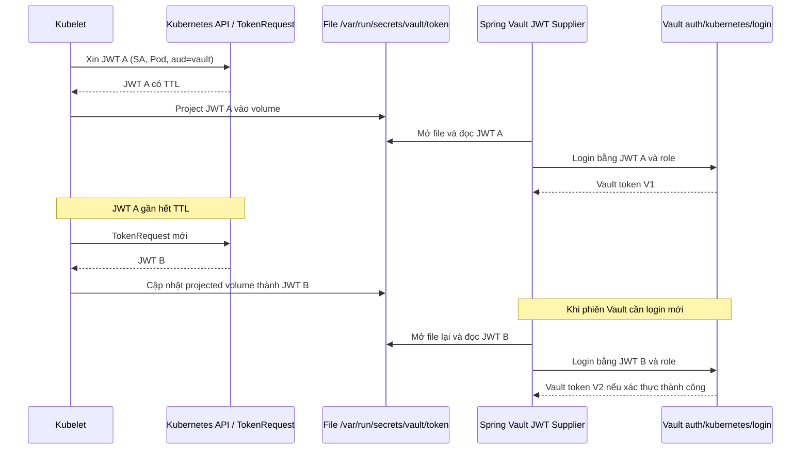
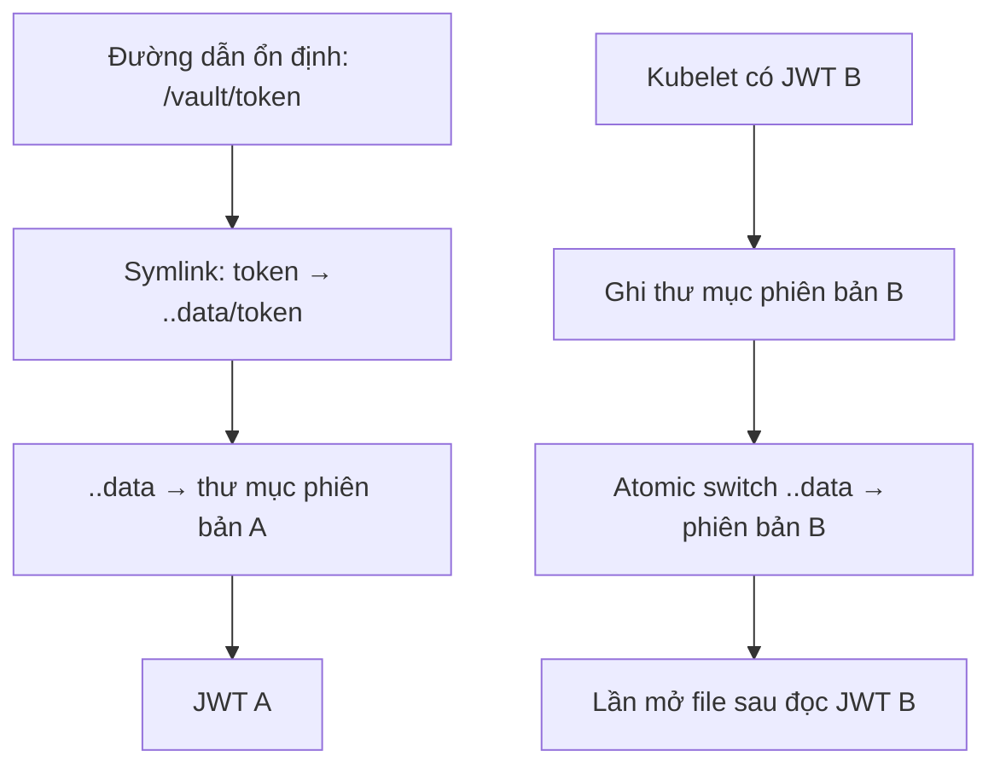
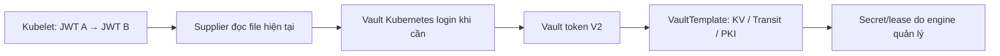

# Đọc lại token khi cơ chế projected token xoay vòng

Trong Kubernetes, JWT của ServiceAccount được gắn vào Pod bằng **projected volume** thường là một thông tin xác thực **ngắn hạn**. Kubelet có thể thay JWT trong lúc container Java vẫn chạy. Nếu ứng dụng chỉ đọc JWT một lần khi khởi động rồi giữ chuỗi đó trong bộ nhớ, lần đăng nhập Vault đầu tiên có thể thành công nhưng lần đăng nhập lại sau nhiều giờ có thể bị từ chối vì JWT đã hết hạn.

Với **SPRING_VAULT**, đây là điểm giao nhau giữa danh tính workload, vòng đời token và khả năng hoạt động liên tục của ứng dụng. Spring Vault dùng `KubernetesAuthentication` để lấy **Vault token** từ JWT của ServiceAccount; `VaultTemplate` dùng Vault token cho các thao tác được policy cho phép như đọc KV secrets, gọi Transit encryption hoặc PKI. Bài này tập trung vào **thời điểm và cách đọc lại JWT khi kubelet xoay vòng tệp projected**, đồng thời phân biệt việc đó với renew/re-login Vault token và quản lý secret lease.

Sau khi học, bạn sẽ có thể:

1. Mô tả luồng từ TokenRequest API, kubelet đến file JWT của Pod và cách file thay đổi.
2. Giải thích vì sao việc mở file **lại tại mỗi lần đăng nhập** đáng tin cậy hơn cache chuỗi hoặc giữ một file descriptor cũ.
3. Viết cấu hình `KubernetesAuthenticationOptions.jwtSupplier(...)` trỏ đến projected token và hỗ trợ JWT được xoay vòng.
4. Phân biệt **JWT của Kubernetes**, **Vault token** và **lease của secret** khi xử lý hết hạn.
5. Kiểm thử hành vi đọc lại token, quan sát rotation mà không làm lộ credential và chẩn đoán lỗi đăng nhập lại.

## 1. Bối cảnh: token được thay trong khi Pod vẫn chạy

Giả sử `orders-api` chạy với ServiceAccount `apps/orders-api`. Pod yêu cầu JWT có audience `vault`, đặt tại `/var/run/secrets/vault/token` và thời hạn yêu cầu 3.600 giây. Kubelet gửi **TokenRequest** đến Kubernetes API server, nhận JWT được cấp cho ServiceAccount và gắn vào projected volume để container đọc.



Kubernetes quy định kubelet **chủ động bắt đầu thử xoay vòng token khi token đã qua 80% TTL hoặc có tuổi trên 24 giờ**. Đây là ngưỡng bắt đầu hành động, không phải lịch chính xác đến từng giây hay bảo đảm luôn cấp được token mới: mạng, tình trạng API server, clock và chính sách cluster đều có thể ảnh hưởng. `expirationSeconds` là **TTL yêu cầu**, còn thời hạn thực tế được API server quyết định.

**Ví dụ mốc thời gian để hình dung** (giả sử TTL thực tế đúng 3.600 giây, kubelet và API server luôn sẵn sàng):

| Thời điểm tương đối | Kubernetes JWT | Spring Vault |
| --- | --- | --- |
| Phút 0 | Kubelet gắn JWT A. | Supplier đọc JWT A cho lần login đầu, Vault trả V1. |
| Khoảng phút 48 trở đi | Kubelet có thể xin JWT B và cập nhật file. | Không nhất thiết xảy ra login Vault ngay lúc file đổi. |
| Phút 50 | File có JWT B, còn JWT A cũ có thể chưa hết hạn. | Các request dùng Vault token V1 vẫn được gửi bình thường nếu V1 hợp lệ. |
| Phút 70 | JWT A đã hết hạn, file hiện tại vẫn chứa token mới hợp lệ (có thể là B hoặc token kế tiếp). | Khi cần login mới, supplier **đọc file hiện tại**; cache JWT A sẽ khiến login thất bại. |

Đây chỉ là một ví dụ có điều kiện, vì TTL của **Vault token** là độc lập. Token V1 có thể được renew mà không cần đăng nhập lại; hoặc phiên có thể phải re-login trước hoặc sau khi JWT A hết hạn.

## 2. Kubernetes cập nhật projected volume bằng cách nào?

Thay vì cho ứng dụng viết vào file token, kubelet quản lý một tập các file được chiếu (*projected*) vào volume. Triển khai volume của Kubernetes dùng cơ chế **atomic writer**: dữ liệu thật nằm trong một thư mục nội bộ có tên theo thời điểm; file mà container nhìn thấy thường là symlink qua `..data`.

Hình minh họa cấu trúc có thể quan sát bên trong container:

```text
/var/run/secrets/vault/
├── token -> ..data/token
├── ..data -> ..2026_11_25_08_00_00.000000000/
└── ..2026_11_25_08_00_00.000000000/
    └── token       # nội dung JWT A
```

Khi có JWT B, kubelet tạo một thư mục dữ liệu mới, sau đó chuyển symlink `..data` sang thư mục mới bằng thao tác thay thế atomic. File `token` vẫn có **cùng đường dẫn hiển thị**, nhưng nếu ứng dụng **mở file theo đường dẫn đó sau khi cập nhật**, nó sẽ đọc dữ liệu mới.



Từ cơ chế này suy ra bốn quy tắc quan trọng:

1. **Giữ nguyên đường dẫn logic** `/var/run/secrets/vault/token` trong cấu hình ứng dụng. Không trỏ trực tiếp đến thư mục nội bộ `..2026_...` vốn có thể bị xóa sau rotation.
2. **Đọc qua lần mở file mới** mỗi khi cần một JWT để login. Đừng giữ `InputStream` hoặc file descriptor trỏ vào inode cũ mãi mãi.
3. **Không dùng `subPath`** để mount riêng một file token. Container dùng projected volume qua `subPath` sẽ **không nhận cập nhật** của nguồn volume.
4. Khi nhiều file trong cùng projected volume có thể thay đổi, đừng giả định hai lần đọc cách nhau đều thuộc cùng một phiên bản. Với trường hợp một JWT đơn lẻ, một lần đọc đầy đủ tệp là đủ; với nhiều file đồng bộ, cần cơ chế đọc nhất quán theo thiết kế ứng dụng.

**Điểm dễ nhầm:** thay file trên filesystem **không tạo callback tự động** trong `KubernetesAuthentication`. Kubelet quản lý rotation; Spring Vault chỉ cần có một nguồn đọc JWT hiện tại vào thời điểm phát sinh lần đăng nhập Vault.

## 3. Manifest Pod tạo token có audience dành riêng cho Vault

Ví dụ sau dùng một projected volume được khai báo tường minh. Namespace `apps` phải được tạo sẵn. Registry, image và URL Vault là các giá trị minh họa, cần thay theo môi trường thật.

```yaml
apiVersion: v1
kind: ServiceAccount
metadata:
  name: orders-api
  namespace: apps
automountServiceAccountToken: false
---
apiVersion: apps/v1
kind: Deployment
metadata:
  name: orders-api
  namespace: apps
spec:
  replicas: 1
  selector:
    matchLabels:
      app: orders-api
  template:
    metadata:
      labels:
        app: orders-api
    spec:
      serviceAccountName: orders-api
      automountServiceAccountToken: false
      containers:
        - name: app
          image: registry.example.com/orders-api:1.0.0
          env:
            - name: VAULT_URI
              value: "https://vault.vault.svc:8200"
            - name: VAULT_K8S_ROLE
              value: "orders-read"
            - name: VAULT_K8S_JWT_FILE
              value: "/var/run/secrets/vault/token"
          volumeMounts:
            - name: vault-identity
              mountPath: /var/run/secrets/vault
              readOnly: true
      volumes:
        - name: vault-identity
          projected:
            sources:
              - serviceAccountToken:
                  path: token
                  audience: vault
                  expirationSeconds: 3600
```

Từ manifest:

| Trường | Tác dụng |
| --- | --- |
| `serviceAccountName: orders-api` | Pod có danh tính `system:serviceaccount:apps:orders-api`. |
| `automountServiceAccountToken: false` | Tắt volume token mặc định, giúp kiểm soát rõ token dùng cho Vault. Projected volume khai báo tường minh vẫn hoạt động. |
| `serviceAccountToken.audience: vault` | Xin JWT dành cho bên nhận tên `vault`; phải tương thích `audience` của Vault role. |
| `expirationSeconds: 3600` | TTL yêu cầu 1 giờ, không phải lệnh để Java tự refresh sau đúng 1 giờ. |
| `serviceAccountToken.path: token` | File tương đối trong volume. |
| `volumeMounts.mountPath` | File mà Java đọc là `/var/run/secrets/vault/token`. |

Nếu dùng token do admission controller mount mặc định ở `/var/run/secrets/kubernetes.io/serviceaccount/token`, có thể dùng đường dẫn mặc định của Spring Vault. Tuy nhiên, token mặc định có audience hướng về Kubernetes API và có thể **không khớp** Vault role đặt `audience=vault`. Dùng projected volume riêng thường rõ mục đích hơn.

Không nên mount JWT như một `Secret` tĩnh hoặc sao chép vào biến môi trường. Một biến môi trường đã được tạo không tự cập nhật khi kubelet thay file projected. Tránh `subPath` vì nó phá giả định token có thể xoay vòng bên dưới cùng đường dẫn.

## 4. Spring Vault phải lấy lại JWT ở thời điểm nào?

Đăng nhập Kubernetes auth vào Vault có dạng:

```http
POST /v1/auth/kubernetes/login
Content-Type: application/json

{"role":"orders-read","jwt":"<KUBERNETES_SERVICE_ACCOUNT_JWT>"}
```

Payload trên chỉ là cấu trúc minh họa; **không ghi JWT thật vào code, test snapshot hoặc log**. Vault dùng Kubernetes `TokenReview` để xác minh JWT và đối chiếu tên ServiceAccount, namespace, audience với role. Nếu thành công, Vault trả một **Vault token** để Spring Vault dùng trong các request tiếp theo.

**`KubernetesAuthenticationOptions.jwtSupplier(...)`** nhận một `Supplier<String>`. Mỗi khi `KubernetesAuthentication` cần đăng nhập, nó gọi nguồn cấp JWT để lấy credential. Cấu hình đúng là supplier **cung cấp nội dung hiện tại của file**, thay vì trả lại một chuỗi đã đọc từ lúc container khởi động.

Spring Vault cung cấp sẵn `KubernetesServiceAccountTokenFile` (là một `CredentialSupplier` chuyên dùng để đọc token của ServiceAccount). Sử dụng lớp này thuận tiện vì nó làm việc với một đường dẫn file tồn tại và được đọc khi cần credential. API còn có `cached()` để cố ý cache credential, nhưng **không dùng `cached()` cho JWT được kubelet xoay vòng**.

### Ví dụ Java dùng Spring Vault core

Khi ứng dụng quản lý bean Spring Vault trực tiếp (ví dụ với Spring Vault **4.1.x**), cấu hình:

```java
import java.net.URI;

import org.springframework.beans.factory.annotation.Value;
import org.springframework.context.annotation.Configuration;
import org.springframework.vault.authentication.ClientAuthentication;
import org.springframework.vault.authentication.KubernetesAuthentication;
import org.springframework.vault.authentication.KubernetesAuthenticationOptions;
import org.springframework.vault.authentication.KubernetesServiceAccountTokenFile;
import org.springframework.vault.client.VaultEndpoint;
import org.springframework.vault.config.AbstractVaultConfiguration;

@Configuration
public class VaultKubernetesConfiguration extends AbstractVaultConfiguration {

    @Value("${VAULT_URI}")
    private URI vaultUri;

    @Value("${VAULT_K8S_ROLE:orders-read}")
    private String vaultRole;

    @Value("${VAULT_K8S_JWT_FILE:/var/run/secrets/vault/token}")
    private String jwtPath;

    @Override
    public VaultEndpoint vaultEndpoint() {
        return VaultEndpoint.from(vaultUri);
    }

    @Override
    public ClientAuthentication clientAuthentication() {
        KubernetesAuthenticationOptions options =
            KubernetesAuthenticationOptions.builder()
                .role(vaultRole)
                .path("kubernetes")
                .jwtSupplier(new KubernetesServiceAccountTokenFile(jwtPath))
                .build();

        return new KubernetesAuthentication(options, vaultClient());
    }
}
```

`spring-vault-core` là dependency cần thiết; nếu dự án dùng Spring Boot thì đồng bộ phiên bản Spring Vault với BOM/dependency management tương thích. Constructor nhận `VaultClient` trong ví dụ thuộc Spring Vault 4.1 trở lên; các phiên bản cũ có thể dùng overload nhận `RestOperations` hoặc `RestClient`. Cần đối chiếu API theo phiên bản dự án.

**Hai thời điểm cần phân biệt:**

- **Lúc khởi tạo cấu hình:** `new KubernetesServiceAccountTokenFile(jwtPath)` cần nhìn thấy file tồn tại. Nếu volume chưa mount hoặc đường dẫn sai, constructor có thể ném `IllegalArgumentException`. Điều này giúp phát hiện cấu hình thiếu sớm.
- **Lúc phát sinh login:** Supplier lấy credential từ file. Khi kubelet đã đổi mục tiêu symlink, lần đọc sau dùng giá trị mới. Không tạo sẵn `String jwt = Files.readString(...)` làm biến singleton rồi truyền `() -> jwt`.

`KubernetesAuthentication` không nhất thiết login cho mỗi lần dùng `VaultTemplate`. `AbstractVaultConfiguration` tạo session manager cho Vault token; ứng dụng nên để session manager xử lý reuse, renew và login lại khi cần, thay vì cố chủ động đăng nhập mỗi khi đọc KV. Xác thực vào Vault chỉ cần **JWT hiện tại khi login**, không cần ứng dụng theo dõi và cập nhật một biến JWT liên tục.

### Nếu dùng Spring Cloud Vault

Với **Spring Cloud Vault**, có thể cấu hình nguồn token qua application YAML thay cho bean `AbstractVaultConfiguration` ở trên:

```yaml
spring:
  cloud:
    vault:
      uri: https://vault.vault.svc:8200
      authentication: KUBERNETES
      kubernetes:
        role: orders-read
        kubernetes-path: kubernetes
        service-account-token-file: /var/run/secrets/vault/token
```

Thuộc tính `service-account-token-file` chỉ **nơi lấy JWT** dùng cho đăng nhập Kubernetes auth; nó không chỉ đường dẫn lưu Vault token. Không đồng thời cấu hình hai hệ thống tạo bean `ClientAuthentication` / `VaultTemplate` xung đột nếu auto-configuration đã đáp ứng nhu cầu.

## 5. Mẫu đọc file đúng và sai

Đoạn code dưới đây thể hiện bản chất cách một supplier tùy biến có thể nhận dữ liệu mới. Trong trường hợp thông thường, **ưu tiên lớp có sẵn** `KubernetesServiceAccountTokenFile`.

```java
import java.io.IOException;
import java.io.UncheckedIOException;
import java.nio.charset.StandardCharsets;
import java.nio.file.Files;
import java.nio.file.Path;
import java.util.function.Supplier;

public final class ReloadingJwtSupplier implements Supplier<String> {
    private final Path path;

    public ReloadingJwtSupplier(String filePath) {
        this.path = Path.of(filePath);
    }

    @Override
    public String get() {
        try {
            // Mỗi lần get() đều mở file bằng đường dẫn logic hiện tại.
            String jwt = Files.readString(path, StandardCharsets.UTF_8).trim();
            if (jwt.isEmpty()) {
                throw new IllegalStateException("ServiceAccount JWT file is empty");
            }
            return jwt;
        } catch (IOException ex) {
            // Không đính kèm token hoặc giá trị secret vào lỗi/log.
            throw new UncheckedIOException("Cannot read projected JWT file", ex);
        }
    }
}
```

Có thể thay supplier trong builder bằng `new ReloadingJwtSupplier(jwtPath)` nếu ứng dụng thật sự cần xử lý đặc biệt. Đây là **minh họa logic đọc lại**, không phải lý do bắt buộc phải tự viết lại chức năng có sẵn của Spring Vault. Code này không tự làm mới JWT; **kubelet** chịu trách nhiệm cấp và thay token. `trim()` chỉ bỏ whitespace rìa tệp, không biến một JWT hết hạn thành JWT hợp lệ.

Phản ví dụ:

```java
// SAI: đọc lúc startup, các lần login về sau vẫn dùng JWT cũ.
String jwtAtBoot = Files.readString(Path.of(jwtPath));
KubernetesAuthenticationOptions options =
    KubernetesAuthenticationOptions.builder()
        .role("orders-read")
        .jwtSupplier(() -> jwtAtBoot)
        .build();
```

Các biến thể cũng dễ gặp lỗi:

- Đọc JWT vào một field static/final rồi trả field đó trong `Supplier.get()`.
- Gọi `CredentialSupplier.cached()` trên supplier file; API này chủ động cache credential.
- Cache giá trị đọc được bằng `@PostConstruct`, `@Bean` singleton hoặc môi trường biến `JWT_VALUE`.
- Giữ `InputStream` mở xuyên suốt vòng đời process thay vì mở file bằng đường dẫn ở lần đọc mới.
- Đổi mount sang `subPath`: dù supplier có đọc file lại, nội dung được gắn qua `subPath` vẫn có thể là phiên bản cũ.

**Đọc file đúng không có nghĩa login chắc chắn thành công:** JWT mới vẫn phải có audience, ServiceAccount, namespace phù hợp và Vault reviewer phải gọi được Kubernetes `TokenReview`.

## 6. Đồng hồ TTL: vì sao JWT thay mà VaultTemplate vẫn hoạt động?

Có ba vòng đời cần đặt cạnh nhau:

| Credential / tài nguyên | Ai xoay vòng hoặc renew? | Tác động tới request của Java |
| --- | --- | --- |
| **Kubernetes SA JWT** | Kubelet / TokenRequest API cập nhật file projected. | Cần JWT mới **khi Vault yêu cầu login**. JWT cũ đã hết `exp` hoặc bị thu hồi không đăng nhập lại được. |
| **Vault client token** | Vault cấp sau login, session manager có thể renew hoặc xin token mới tùy tính renewability và cấu hình. | `VaultTemplate` dùng Vault token cho KV, Transit, PKI; có thể tiếp tục dùng V1 dù JWT file đã chuyển sang B. |
| **Secret lease** | Vault secrets engine, có thể được quản lý bởi lease manager nếu ứng dụng dùng dynamic secrets. | Lease của database credentials/chứng chỉ PKI có TTL và khả năng revoke/renew riêng; không đồng nhất với token của Pod. |



Ví dụ, Vault token V1 có TTL 15 phút và cho phép renew trong giới hạn nhất định. Session manager có thể renew nó mà **không cần** gửi JWT mới tới `auth/kubernetes/login`. Nếu V1 không thể renew hoặc cần phiên mới, Spring Vault mới gọi cơ chế xác thực lần nữa; khi đó supplier file phải trả JWT hiện hành. Ngược lại, nếu ứng dụng cố ép login mỗi 30 giây thì tăng tải cho Vault và Kubernetes API mà không giải quyết việc kubelet cung cấp JWT.

Trong Vault Kubernetes auth, `auth/kubernetes/login` dùng `TokenReview` để xác minh JWT ServiceAccount. Vì vậy reviewer credential và kết nối **Vault → Kubernetes API** cũng ảnh hưởng khả năng login lại. Chẳng hạn, Vault chạy trong Kubernetes có thể dùng local reviewer token và đọc lại nó khi kubelet xoay vòng trên các phiên bản Vault phù hợp (Vault 1.9.3 trở lên theo tài liệu HashiCorp). Nếu admin nạp một reviewer JWT ngắn hạn cố định vào config, reviewer hết hạn có thể khiến **mọi Pod** bị lỗi login mới dù JWT của ứng dụng vẫn đang xoay vòng đúng.

Việc xoay vòng JWT của Pod **không có nghĩa** Vault token đã cấp trước đó bị thu hồi ngay lập tức. Nếu Pod bị xóa, Kubernetes có thể từ chối JWT bound-to-Pod khi xác thực mới, nhưng phải quản lý TTL/revoke của Vault token như một lớp độc lập.

## 7. Hai cách tiếp cận: đọc theo yêu cầu hay theo dõi sự kiện file

**Đọc theo yêu cầu khi login** thường phù hợp với Spring Vault:

- Không cần thread nền poll filesystem.
- Không cần biết trước chính xác thời điểm kubelet rotate.
- Mỗi lần login tự lấy credential hiện hành; Spring Vault session manager quyết định khi nào cần login.
- Giảm nguy cơ cache cũ nếu ứng dụng không dùng `cached()` hoặc singleton JWT.

Trong một số hệ thống có yêu cầu xử lý **sự kiện cập nhật file** (ví dụ ứng dụng tự quản lý xác thực ngoài Spring Vault), có thể theo dõi thay đổi của symlink `..data` trong **thư mục volume** bằng `inotify` / `fanotify`. Theo dõi inode của chính file token có thể bỏ lỡ sự kiện vì kubelet đổi đích symlink. Ngay cả khi dùng watcher, vẫn cần cơ chế đọc lại theo đường dẫn ổn định và xử lý việc bỏ lỡ event.

Đối với `KubernetesAuthentication`, **không nhất thiết phải xây watcher**, không nên tái tạo `VaultTemplate` mỗi khi JWT đổi, và không bắt buộc force-login ngay khi kubelet viết token mới. Nếu yêu cầu nghiệp vụ cần kiểm soát phiên, hãy dùng cơ chế session manager được hỗ trợ và kiểm tra tác động của việc thu hồi token trước khi thêm logic riêng.

## 8. Trạng thái lỗi và cách ứng dụng phản ứng

| Triệu chứng | Gốc lỗi có thể xảy ra | Hướng xác minh |
| --- | --- | --- |
| Startup báo không thấy token file | MountPath/path sai; volume không được khai báo; Pod chưa có SA dự kiến. | Kiểm tra `volumeMounts`, `projected.sources`, `serviceAccountName`, đường dẫn file từ bên trong container. |
| Bắt đầu chạy được, sau một thời gian Vault login trả 403 | Supplier cache JWT A; `subPath` làm token không cập nhật; JWT hiện hành hết hạn; SA/namespace/audience sai. | Đối chiếu code `jwtSupplier`, kiểu volume và role; xác minh JWT còn hiệu lực **mà không log token**. |
| Login mới fail đồng loạt trên nhiều Pod | Reviewer JWT phía Vault hết hạn, Vault mất đường đến Kubernetes API/CA, cấu hình auth mount thay đổi. | Kiểm tra audit/health tại Vault và TokenReview RBAC của reviewer. |
| JWT file đọc được nhưng role bị từ chối ngay | Projected `audience` khác Vault role `audience`, hoặc bound SA/namespace không khớp. | So `serviceAccountName` / namespace với `vault read auth/kubernetes/role/orders-read`. |
| `VaultTemplate` đọc KV nhận 403 sau khi login thành công | Vault token thiếu policy đúng đường dẫn secret (KV v2 cần `kv/data/...`). | Phân biệt endpoint `auth/kubernetes/login` và `kv/data/...` trong audit. |
| Đổi JWT trên đĩa nhưng không có login mới | Vault token đang còn hiệu lực hoặc được renew; đây có thể là hành vi bình thường. | Quan sát phiên Vault, không suy ra lỗi rotation chỉ từ việc thiếu log đăng nhập. |
| Thỉnh thoảng đọc file bị lỗi I/O | Volume/unmount/permission thay đổi, Pod đang dừng, container không có quyền đọc. | Kiểm tra quyền POSIX, UID/GID/`securityContext` và vòng đời Pod; retry có giới hạn nếu là lỗi nhất thời. |

Khi cần retry, chỉ áp dụng **backoff có giới hạn và jitter** cho lỗi có khả năng phục hồi; phân biệt 403 do sai role/audience với lỗi mạng tạm thời để tránh vòng lặp liên tục. Nếu không thể lấy credential tin cậy, không tự động fallback sang token đặc quyền hay token tĩnh lưu trong image. Tùy nhu cầu nghiệp vụ, ứng dụng có thể báo unhealthy hoặc trả lỗi dịch vụ thay vì phục vụ dữ liệu nhạy cảm khi xác thực không đảm bảo.

### Quan sát an toàn trong Pod

Các lệnh ví dụ dưới đây được dùng với namespace `apps` và Deployment `orders-api` đã chạy:

```bash
# Xem Pod đang chạy bằng ServiceAccount nào
kubectl -n apps get pod -l app=orders-api \
  -o custom-columns=NAME:.metadata.name,SA:.spec.serviceAccountName

# Xem khai báo projected volume và các sự kiện mount
kubectl -n apps describe pod <pod-name>

# Chỉ kiểm tra file có tồn tại/đọc được, KHÔNG in JWT
kubectl -n apps exec <pod-name> -c app -- \
  sh -c 'test -r /var/run/secrets/vault/token && echo token-file-readable'

# Chỉ xem symlink và tên file, KHÔNG xem nội dung
kubectl -n apps exec <pod-name> -c app -- \
  ls -l /var/run/secrets/vault/
```

Một image tối giản có thể không có `sh` hoặc `ls`; khi đó kiểm tra qua health check/metrics được thiết kế sẵn thay vì giả định công cụ debug tồn tại trong production image. Không chạy `cat`/`head`/`base64` để đẩy toàn bộ JWT vào terminal, CI log, ticket hay hệ thống quan sát.

Metrics hữu ích là số lần login thành công/thất bại, mã lỗi phân theo **login** hay **Vault API**, độ trễ đến Vault, lịch renew/re-login, số lỗi đọc file và tuổi phiên hiện hành. Không ghi nhận giá trị JWT, Vault token, dữ liệu KV hoặc secret lease payload.

## 9. Kiểm thử đúng cơ chế đọc lại token

Cần phân biệt hai nhóm kiểm thử: kiểm tra supplier có đọc lại **file mới** và kiểm thử thực tế Pod/Vault qua **rotation thật**. Kiểm thử đơn vị chỉ xác nhận phần đọc file; nó không chứng minh kubelet hoặc Vault role đã được cấu hình đúng.

### 9.1. Kiểm thử đơn vị: thay nội dung ở cùng đường dẫn

Ví dụ JUnit 5 với `@TempDir`. Thao tác tạo file khác rồi thay file cũ mô phỏng tình huống nội dung tại đường dẫn logic thay đổi; đây không phải bản sao hoàn toàn của triển khai symlink trong Kubernetes.

```java
import static org.junit.jupiter.api.Assertions.assertEquals;

import java.nio.charset.StandardCharsets;
import java.nio.file.Files;
import java.nio.file.Path;
import java.nio.file.StandardCopyOption;

import org.junit.jupiter.api.Test;
import org.junit.jupiter.api.io.TempDir;
import org.springframework.vault.authentication.KubernetesServiceAccountTokenFile;

class ReloadedJwtTest {

    @Test
    void readsNewTokenFromSamePath(@TempDir Path dir) throws Exception {
        Path tokenPath = dir.resolve("token");
        Files.writeString(tokenPath, "jwt-A", StandardCharsets.UTF_8);

        KubernetesServiceAccountTokenFile supplier =
            new KubernetesServiceAccountTokenFile(tokenPath.toString());

        assertEquals("jwt-A", supplier.get());

        Path next = dir.resolve("token-next");
        Files.writeString(next, "jwt-B", StandardCharsets.UTF_8);
        Files.move(next, tokenPath, StandardCopyOption.REPLACE_EXISTING);

        assertEquals("jwt-B", supplier.get());
    }
}
```

`jwt-A` và `jwt-B` là **chuỗi giả**, không phải JWT hợp lệ; chúng chỉ kiểm tra tệp được mở lại mỗi lần `get()`. Test có thể được mở rộng để tạo symlink tương tự `token → ..data/token` trên filesystem hỗ trợ symlink, rồi thay đích `..data` để sát cơ chế kubelet hơn. Không đưa JWT thật vào fixture hoặc assertion failure.

### 9.2. Kiểm thử tích hợp trong sandbox

Chuẩn bị Vault và cluster thử nghiệm: bật Kubernetes auth, cấu hình reviewer TokenReview hoạt động, tạo Vault role `orders-read` ràng buộc **ServiceAccount `orders-api`, namespace `apps`, audience `vault`**, và gắn policy chỉ đọc một secret KV v2 thử nghiệm. Sau đó:

1. Áp dụng Deployment ở mục 3, xác minh file `/var/run/secrets/vault/token` **đọc được** và Spring Vault login thành công.
2. Chạy Pod đủ lâu cho kubelet thử rotate. Quan sát bằng mốc file/symlink hoặc số liệu được khử nhạy cảm; không ghi giá trị JWT ra log.
3. Dùng luồng lifecycle/session phù hợp với phiên bản Spring Vault để lần login kế tiếp xảy ra **sau** rotation (trên sandbox có thể đặt TTL ngắn có kiểm soát). Xác nhận ứng dụng tiếp tục đọc KV qua Vault token mới nếu cần.
4. Chủ động thay supplier bằng một phiên bản cache `jwtAtStartup` trong **bài thử riêng**. Sau khi JWT cũ hết hạn và Vault cần login mới, xác nhận phiên bản sai thất bại để hiểu cơ chế.
5. Tạo Pod có JWT audience khác `vault`, hoặc đổi SA/namespace; xác nhận `auth/kubernetes/login` từ chối, chứng minh rotation không vượt qua ranh giới role.
6. Tạm gây gián đoạn mạng **Vault → Kubernetes API** trong sandbox rồi khôi phục; xác nhận lỗi được quan sát, retry có giới hạn và ứng dụng phục hồi khi hạ tầng hoạt động.
7. Kiểm tra một thao tác KV ngoài policy nhận 403, dù JWT mới và login thành công. Điều này chứng minh Vault policy độc lập với tính hợp lệ của JWT.

**Tiêu chí đạt:** file projected vẫn đọc được sau rotation; supplier nhận token cập nhật vào lần login mới; Vault cấp phiên theo role hợp lệ; ứng dụng không log credential; các tình huống sai audience, sai role hoặc thiếu policy bị từ chối đúng tại tầng tương ứng.

## 10. Câu hỏi tự kiểm tra và checklist triển khai

1. Vì sao một file `token` trông như vẫn có cùng tên, nhưng lần `Files.readString(path)` tiếp theo có thể trả giá trị mới?
2. Nếu ứng dụng giữ `InputStream` mở xuyên vòng đời Pod, chuyện gì xảy ra khi `..data` chuyển tới phiên bản mới?
3. Vì sao `CredentialSupplier.cached()` không phù hợp với projected JWT tự xoay vòng?
4. Kubelet rotate JWT ở phút 48 nhưng Vault không có yêu cầu login mới đến phút 90: đây có nhất thiết là lỗi không?
5. Khác nhau ở đâu giữa JWT của Pod hết hạn, Vault token hết hạn và lease của dynamic secret hết hạn?
6. Vì sao Spring Vault cần đọc JWT mới để **login Vault**, nhưng không cần lấy JWT trực tiếp để gọi `VaultTemplate.opsForVersionedKeyValue("kv")`?

Trước khi đưa workload vào production, hãy bảo đảm: projected token có `audience` phù hợp; ServiceAccount và namespace được Vault role ràng buộc; volume được mount theo **thư mục**, không qua `subPath`; JWT supplier đọc file khi cần login và không cache; Vault reviewer có khả năng TokenReview với credential còn hiệu lực; session manager, lỗi retry, health và metrics có cơ chế vận hành rõ ràng. Đảm bảo JVM tin cậy CA của Vault và không tắt xác minh TLS.

## 11. Tài liệu tham khảo

- [Kubernetes — Configure Service Accounts for Pods](https://kubernetes.io/docs/tasks/configure-pod-container/configure-service-account/): TokenRequest, projected token, ngưỡng 80% TTL và trách nhiệm ứng dụng đọc lại credential.
- [Kubernetes — Projected Volumes](https://kubernetes.io/docs/concepts/storage/projected-volumes/): trường `serviceAccountToken`, cập nhật projected volume và giới hạn mount bằng `subPath`.
- [Kubernetes — Pod API / ServiceAccountTokenProjection](https://kubernetes.io/docs/reference/kubernetes-api/core/pod-v1/): `audience`, `expirationSeconds` và `path`.
- [Kubernetes — AtomicWriter implementation](https://github.com/kubernetes/kubernetes/blob/master/pkg/volume/util/atomic_writer.go): cơ chế thư mục dữ liệu ẩn, `..data` symlink và thay thế atomic.
- [Spring Vault — Authentication Methods](https://docs.spring.io/spring-vault/reference/vault/authentication.html): Kubernetes authentication và `KubernetesAuthenticationOptions`.
- [Spring Vault — KubernetesServiceAccountTokenFile API](https://docs.spring.io/spring-vault/reference/api/java/org/springframework/vault/authentication/KubernetesServiceAccountTokenFile.html) và [CredentialSupplier API](https://docs.spring.io/spring-vault/reference/api/java/org/springframework/vault/authentication/CredentialSupplier.html): nguồn đọc credential và tác động của `cached()`.
- [Spring Cloud Vault — Authentication Methods](https://docs.spring.io/spring-cloud-vault/reference/authentication.html): cấu hình Kubernetes auth và file ServiceAccount JWT.
- [HashiCorp Vault — Kubernetes auth method](https://developer.hashicorp.com/vault/docs/auth/kubernetes): `TokenReview`, reviewer JWT, vòng đời token ngắn hạn và điều kiện dùng local reviewer.
