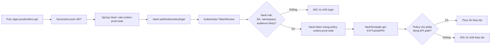

# Role, namespace Kubernetes và tên ServiceAccount được cho phép

Khi một ứng dụng Java chạy trong Kubernetes truy cập HashiCorp Vault qua **Spring Vault**, câu hỏi đầu tiên không phải là “client gửi tên role nào?”, mà là **“danh tính Kubernetes nào thực sự được Vault cho phép dùng role đó?”**. Nếu một Vault role cấp quyền đọc dữ liệu thanh toán nhưng cho phép mọi ServiceAccount thuộc mọi namespace đăng nhập, việc bảo vệ secret bằng policy ở phía Vault chưa đủ chặt: bất kỳ workload nào có JWT được chấp nhận cũng có thể xin token mang policy đó.

Bài học thuộc chương **Kubernetes và JWT** của mô-đun **SPRING_VAULT**. Trọng tâm là cấu hình **Vault Kubernetes authentication role**, giới hạn **tên ServiceAccount** và **namespace Kubernetes**, kết hợp **audience**, **Vault policy** và danh tính thực tế của Pod. Từ ranh giới này, `VaultTemplate` mới truy cập KV secrets, Transit encryption hoặc PKI theo quyền đã cấp; vòng đời Vault token và secret lease vẫn được quản lý riêng.

Sau bài học, bạn có thể:

1. Phân biệt Kubernetes ServiceAccount, namespace, JWT, Vault auth role, Vault policy và Vault token.
2. Viết role dùng `bound_service_account_names` và `bound_service_account_namespaces` theo nguyên tắc quyền tối thiểu.
3. Dự đoán chính xác Pod nào đăng nhập được role, kể cả khi trùng tên ServiceAccount nhưng khác namespace.
4. Hiểu tác động của `audience`, namespace label selector, ký tự `*` và Vault identity alias.
5. Cấu hình Pod và Spring Vault khớp với Vault role; kiểm tra lỗi 403 ở bước login và bước đọc KV.
6. Thiết kế bài kiểm thử xác nhận các trường hợp được phép/từ chối, theo dõi lỗi và thay đổi role một cách an toàn.

## 1. Ai kiểm tra điều gì?

Một hệ thống điển hình có bốn thành phần:

| Thành phần | Đại diện cho | Trách nhiệm |
| --- | --- | --- |
| **Kubernetes ServiceAccount** | Danh tính workload, ví dụ `apps-prod/orders-api`. | Kubernetes cấp JWT cho Pod chạy bằng SA đó. |
| **Kubernetes TokenReview** | API xác thực danh tính JWT. | Cho Vault biết JWT có hợp lệ, gắn với SA/namespace dự kiến và có audience phù hợp hay không. |
| **Vault Kubernetes auth role** | Quy tắc *ai được đăng nhập* một role. | Kiểm tra SA name, namespace và audience; xác định chính sách/TTL của Vault token sẽ cấp. |
| **Vault policy** | Quy tắc *token sau đăng nhập được làm gì*. | Cho phép/từ chối endpoint của Vault: đọc KV v2, Transit, PKI, v.v. |



Vai trò của từng lớp không thay thế được nhau:

- **Kubernetes RBAC** kiểm soát quyền SA khi gọi *Kubernetes API*, chẳng hạn đọc ConfigMap hoặc gọi `TokenReview`. RBAC **không** tự cấp quyền đọc secret trong Vault.
- **Vault role** ràng buộc *danh tính Kubernetes nào* được nhận một Vault token cụ thể.
- **Vault policy** kiểm soát *quyền của Vault token* sau khi xác thực; ứng dụng không được chọn policy tùy ý khi gửi `role`.
- **Kubernetes namespace** (`apps-prod`) khác với **Vault Enterprise namespace** (nếu tổ chức dùng Vault Enterprise). Trường `bound_service_account_namespaces` luôn nói về *namespace của ServiceAccount trong Kubernetes*, không phải header `X-Vault-Namespace` của Vault.

## 2. ServiceAccount có cùng tên ở hai namespace là hai danh tính khác nhau

Trong Kubernetes, ServiceAccount là tài nguyên **có namespace**. Hai object sau là hai danh tính riêng dù tên giống nhau:

```text
system:serviceaccount:apps-prod:orders-api
system:serviceaccount:apps-staging:orders-api
```

Trong JWT của Pod, claim `sub` thường có dạng trên. Thông tin namespace và SA còn xuất hiện trong metadata của token hoặc kết quả TokenReview. Vault Kubernetes auth kiểm tra danh tính thực tế do token chứng minh, **không tin** vào tên namespace mà Java gửi dưới dạng string bất kỳ.

Ví dụ về ba Pod:

| Pod | Namespace | `serviceAccountName` | Danh tính SA |
| --- | --- | --- | --- |
| `orders-prod-...` | `apps-prod` | `orders-api` | `apps-prod/orders-api` |
| `orders-staging-...` | `apps-staging` | `orders-api` | `apps-staging/orders-api` |
| `report-prod-...` | `apps-prod` | `report-api` | `apps-prod/report-api` |

Nếu role chỉ cho phép `orders-api` trong `apps-prod`, Pod đầu tiên có thể được đăng nhập (nếu các điều kiện khác hợp lệ), còn **cả hai Pod sau đều bị từ chối**. Chỉ giới hạn `bound_service_account_names=orders-api` mà mở mọi namespace sẽ làm cả staging có cơ hội nhận token của role production.

**Tên Vault role không phải danh tính Kubernetes.** Role `orders-prod-read` là tên tài nguyên trong Vault; JWT không chứa role này. Client gửi role khi login, nhưng Vault vẫn phải tự xác minh các ràng buộc bằng JWT hợp lệ.

## 3. Logic cấp quyền của Kubernetes auth role

Hai trường chính là:

- `bound_service_account_names`: danh sách **tên ServiceAccount** được phép dùng role; bắt buộc cấu hình khi tạo role.
- `bound_service_account_namespaces`: danh sách **namespace Kubernetes** được phép; có thể dùng `bound_service_account_namespace_selector` để xét namespace theo nhãn thay cho danh sách cố định.

Trường `audience` giới hạn claim `aud` của JWT. Một mô hình dễ nhớ:

```text
Login thành công khi:
  JWT hợp lệ qua TokenReview
  AND tên ServiceAccount khớp bound_service_account_names
  AND namespace khớp (danh sách cho phép OR namespace selector)
  AND audience hợp lệ với cấu hình role
  AND auth method / reviewer / TLS / network hoạt động

Sau login:
  Vault token chỉ làm được thao tác policy của nó cho phép.
```

Với role chỉ sử dụng danh sách namespace:

```hcl
# Ký pháp minh họa (không phải cú pháp file policy HCL)
serviceAccountAllowed = name in ["orders-api"]
namespaceAllowed      = namespace in ["apps-prod"]
audienceAllowed       = jwt.aud contains "vault"
allowLogin            = validJwt && serviceAccountAllowed
                      && namespaceAllowed && audienceAllowed
```

Không nhầm **AND giữa tên SA và namespace** với **OR khi kết hợp danh sách namespace và selector**. Trong các phiên bản Vault hỗ trợ `bound_service_account_namespace_selector`, việc đặt cả hai có nghĩa namespace thỏa **một trong hai** điều kiện cũng được; đây là điểm cần xem xét kỹ khi cấu hình quyền.

### Ma trận với role production

Giả sử role `orders-prod-read` có:

```yaml
bound_service_account_names:
  - orders-api
bound_service_account_namespaces:
  - apps-prod
audience: vault
token_policies:
  - orders-prod-read
```

Đây là cách biểu diễn **các giá trị logic** để đọc dễ dàng; YAML trên không phải manifest Kubernetes hoặc file cấu hình Vault nạp trực tiếp.

| Namespace | ServiceAccount | JWT audience | Login vào `orders-prod-read` |
| --- | --- | --- | --- |
| `apps-prod` | `orders-api` | `vault` | **Cho phép** nếu JWT/TokenReview hợp lệ. |
| `apps-staging` | `orders-api` | `vault` | **Từ chối**: namespace sai. |
| `apps-prod` | `report-api` | `vault` | **Từ chối**: tên ServiceAccount sai. |
| `apps-staging` | `report-api` | `vault` | **Từ chối**: cả tên và namespace sai. |
| `apps-prod` | `orders-api` | `other-service` | **Từ chối**: audience không khớp. |
| `apps-prod` | `orders-api` | `vault` nhưng JWT hết hạn/bị thu hồi | **Từ chối**: JWT không hợp lệ dù tên và namespace đúng. |

Điểm cốt lõi: **thành công khi login** chỉ cho biết Vault xác thực danh tính hợp lệ và chấp nhận các bound constraints. Một yêu cầu đọc `kv/data/...` vẫn có thể nhận `403 permission denied` nếu Vault policy không cấp quyền.

## 4. Cấu hình hoàn chỉnh một role theo nguyên tắc ít quyền nhất

**Tình huống thực hành:** ứng dụng `orders-api` chạy ở namespace `apps-prod`, cần đọc duy nhất cấu hình `kv/prod/orders/config` từ secrets engine KV v2. Vault Kubernetes auth được mount ở `auth/kubernetes`. Mọi lệnh Vault được chạy bởi operator đã đăng nhập với quyền phù hợp; ứng dụng Java không có quyền tạo role hoặc sửa policy.

### 4.1. Chuẩn bị các tài nguyên Kubernetes

Tạo namespace và ServiceAccount chuyên dụng:

```bash
kubectl create namespace apps-prod
kubectl -n apps-prod create serviceaccount orders-api
```

Các lệnh `create` dùng cho sandbox chưa có tài nguyên; trong môi trường quản trị bằng GitOps, tạo manifest và áp dụng qua pipeline được cấp quyền. Nếu namespace/SA đã tồn tại thì kiểm tra và dùng đúng đối tượng, tránh tạo trùng.

Pod `orders-api` sử dụng ServiceAccount đó và khai báo projected JWT dành riêng cho Vault:

```yaml
apiVersion: apps/v1
kind: Deployment
metadata:
  name: orders-api
  namespace: apps-prod
spec:
  replicas: 1
  selector:
    matchLabels:
      app: orders-api
  template:
    metadata:
      labels:
        app: orders-api
    spec:
      serviceAccountName: orders-api
      automountServiceAccountToken: false
      containers:
        - name: orders-api
          image: registry.example.com/orders-api:1.0.0
          env:
            - name: VAULT_URI
              value: "https://vault.vault.svc:8200"
            - name: VAULT_K8S_ROLE
              value: "orders-prod-read"
          volumeMounts:
            - name: vault-auth
              mountPath: /var/run/secrets/vault
              readOnly: true
      volumes:
        - name: vault-auth
          projected:
            sources:
              - serviceAccountToken:
                  path: jwt
                  audience: vault
                  expirationSeconds: 3600
```

Trong ví dụ, URL và image là **placeholder** của môi trường triển khai; cần thay bằng Vault endpoint có TLS hợp lệ và image thật. Kubernetes API sẽ cấp JWT cho **ServiceAccount mà Pod dùng**, không phải cho tên Vault role. File token được mount tại `/var/run/secrets/vault/jwt`; ứng dụng phải đọc file đó khi đăng nhập.

### 4.2. Cấu hình Kubernetes auth và TokenReview

Operator bật auth method nếu chưa có:

```bash
vault auth enable -path=kubernetes kubernetes
```

Vault cần thông tin Kubernetes API, CA và danh tính có quyền gọi `TokenReview`. Nếu Vault chạy **trong Kubernetes** bằng SA riêng `vault/vault-auth`, một cách là:

```bash
kubectl create clusterrolebinding vault-auth-token-review \
  --clusterrole=system:auth-delegator \
  --serviceaccount=vault:vault-auth

vault write auth/kubernetes/config \
  kubernetes_host="https://kubernetes.default.svc:443"
```

Giả định Pod Vault thực sự chạy bằng SA `vault-auth` ở namespace `vault`, có local SA token và CA được mount; Vault phiên bản hỗ trợ có thể dùng credential cục bộ và đọc lại token reviewer sau rotation. Nếu Vault **ở ngoài cluster**, operator phải cấu hình đường kết nối, xác thực CA và cách cung cấp reviewer token phù hợp. Đối với cấu hình dùng reviewer riêng, **Pod `orders-api` không cần** Kubernetes RBAC `system:auth-delegator`.

Không chạy lệnh `vault auth enable` hoặc `clusterrolebinding` lần hai nếu tài nguyên đã tồn tại; kiểm tra bằng `vault auth list` và `kubectl get clusterrolebinding` trước khi áp dụng trong môi trường chung. Quyền reviewer phục vụ **kiểm tra JWT**, không cho ứng dụng thêm quyền KV trong Vault.

### 4.3. Tạo secret và policy

Bật KV v2 nếu mount `kv` chưa tồn tại và tạo dữ liệu thử nghiệm:

```bash
vault secrets enable -path=kv kv-v2

vault kv put -mount=kv prod/orders/config \
  username="orders-demo" \
  mode="readonly"
```

Hai giá trị trên là **dữ liệu giả**. Không đưa mật khẩu thật vào command line có lịch sử shell hoặc log của CI.

Lưu `orders-prod-read.hcl` để tạo policy:

```hcl
path "kv/data/prod/orders/config" {
  capabilities = ["read"]
}
```

Nạp policy:

```bash
vault policy write orders-prod-read orders-prod-read.hcl
```

KV v2 có endpoint đọc dữ liệu `kv/data/prod/orders/config`. Đường dẫn này khác cách CLI hiển thị `kv/prod/orders/config`; quyền đọc metadata/listing nằm ở API path khác và **không tự được cấp** bởi policy chỉ đọc data này.

### 4.4. Tạo Vault Kubernetes role

```bash
vault write auth/kubernetes/role/orders-prod-read \
  bound_service_account_names="orders-api" \
  bound_service_account_namespaces="apps-prod" \
  audience="vault" \
  token_policies="orders-prod-read" \
  token_no_default_policy=true \
  token_ttl="15m" \
  token_max_ttl="1h"
```

Kiểm tra kết quả:

```bash
vault read auth/kubernetes/role/orders-prod-read
vault policy read orders-prod-read
```

| Tham số | Ý nghĩa | Lưu ý bảo mật |
| --- | --- | --- |
| `bound_service_account_names` | Chỉ SA tên `orders-api`. | Không cấp `*` nếu chỉ một workload cần sử dụng. |
| `bound_service_account_namespaces` | Chỉ namespace `apps-prod`. | Ngăn SA trùng tên trong staging nhận role production. |
| `audience` | JWT phải có audience `vault` phù hợp. | Dùng projected token tường minh để kiểm soát audience. |
| `token_policies` | Policy gắn lên Vault token sau login. | Chỉ cấp đường dẫn cần thiết; không gắn policy quản trị. |
| `token_no_default_policy` | Không tự thêm Vault `default` policy. | Đây là lựa chọn chặt chẽ của ví dụ; nếu ứng dụng cần endpoint do `default` cấp, hãy cấp có chủ đích. |
| `token_ttl`, `token_max_ttl` | TTL khởi tạo và trần renew theo role. | TTL thực tế còn chịu giới hạn mount/system; không phải TTL của SA JWT. |

Vault role thực tế là đối tượng quản trị phía server. Tham số `role=orders-prod-read` mà Spring Vault gửi khi login **không thể tự bỏ qua** ràng buộc trên.

## 5. Spring Vault sử dụng role như thế nào?

Trong `KubernetesAuthentication`, Java cần **tên role**, đường dẫn **auth mount** và JWT được đọc từ ServiceAccount token file. Ví dụ Spring Vault 4.1.x với `spring-vault-core`:

```java
import java.net.URI;

import org.springframework.beans.factory.annotation.Value;
import org.springframework.context.annotation.Configuration;
import org.springframework.vault.authentication.ClientAuthentication;
import org.springframework.vault.authentication.KubernetesAuthentication;
import org.springframework.vault.authentication.KubernetesAuthenticationOptions;
import org.springframework.vault.authentication.KubernetesServiceAccountTokenFile;
import org.springframework.vault.client.VaultEndpoint;
import org.springframework.vault.config.AbstractVaultConfiguration;

@Configuration
public class VaultKubernetesConfiguration extends AbstractVaultConfiguration {

    @Value("${VAULT_URI}")
    private URI vaultUri;

    @Value("${VAULT_K8S_ROLE:orders-prod-read}")
    private String role;

    @Override
    public VaultEndpoint vaultEndpoint() {
        return VaultEndpoint.from(vaultUri);
    }

    @Override
    public ClientAuthentication clientAuthentication() {
        KubernetesAuthenticationOptions options =
            KubernetesAuthenticationOptions.builder()
                .path("kubernetes")
                .role(role)
                .jwtSupplier(new KubernetesServiceAccountTokenFile(
                    "/var/run/secrets/vault/jwt"))
                .build();

        return new KubernetesAuthentication(options, vaultClient());
    }
}
```

`path("kubernetes")` là tên auth mount trong Vault (`auth/kubernetes`), **không** phải đường dẫn đến namespace Kubernetes. `role("orders-prod-read")` chọn role cần đăng nhập; `jwtSupplier(...)` lấy JWT thực sự của Pod. Spring Vault đọc credential mới khi phát sinh login, thích hợp với projected token được kubelet xoay vòng. Nếu dùng Spring Vault phiên bản cũ hơn, kiểm tra overload constructor phù hợp với `RestOperations`/`RestClient`.

Sau khi đăng nhập, `VaultTemplate`/`VaultOperations` gửi **Vault token** để đọc KV v2:

```java
import java.util.Map;

import org.springframework.stereotype.Service;
import org.springframework.vault.core.VaultOperations;
import org.springframework.vault.support.Versioned;

@Service
public class OrdersConfigReader {
    private final VaultOperations vault;

    public OrdersConfigReader(VaultOperations vault) {
        this.vault = vault;
    }

    public String mode() {
        Versioned<Map<String, Object>> secret =
            vault.opsForVersionedKeyValue("kv").get("prod/orders/config");
        if (secret == null || secret.getData() == null) {
            throw new IllegalStateException("Missing Vault configuration");
        }
        Object value = secret.getData().get("mode");
        if (!(value instanceof String)) {
            throw new IllegalStateException("Invalid Vault configuration");
        }
        return (String) value;
    }
}
```

Giả sử ứng dụng đã có session manager do `AbstractVaultConfiguration` cung cấp; không cần tự thêm `X-Vault-Token` vào request. Đăng nhập thành công **không đủ** để bảo đảm đọc KV thành công; việc đọc vẫn phải khớp `kv/data/prod/orders/config` trong policy.

### Biến thể Spring Cloud Vault

Nếu dự án dùng **Spring Cloud Vault** thay vì đăng ký bean `AbstractVaultConfiguration` thủ công:

```yaml
spring:
  cloud:
    vault:
      uri: https://vault.vault.svc:8200
      authentication: KUBERNETES
      kubernetes:
        role: orders-prod-read
        kubernetes-path: kubernetes
        service-account-token-file: /var/run/secrets/vault/jwt
```

Các thuộc tính này chỉ cấu hình client; nếu Vault chưa có role và policy tương ứng, thay đổi YAML ở Java **không tạo ra** chúng. Chọn một cách cấu hình ứng dụng phù hợp stack hiện có để tránh bean auth/session trùng nhau.

## 6. Khi cần nhiều namespace hoặc nhiều ServiceAccount

Vault role có thể chấp nhận **danh sách** SA và namespace. Ví dụ hai ServiceAccount `orders-api` và `orders-worker` trong hai namespace `apps-prod-a` và `apps-prod-b`:

```bash
vault write auth/kubernetes/role/orders-shared \
  bound_service_account_names="orders-api,orders-worker" \
  bound_service_account_namespaces="apps-prod-a,apps-prod-b" \
  audience="vault" \
  token_policies="orders-shared"
```

**Điểm dễ bỏ sót:** hai danh sách này được xét **độc lập**. Role phía trên cho phép tối đa **bốn cặp** kết hợp, không chỉ các cặp mà người vận hành hình dung:

| Namespace | `orders-api` | `orders-worker` |
| --- | --- | --- |
| `apps-prod-a` | Được xét cho login | Được xét cho login |
| `apps-prod-b` | Được xét cho login | Được xét cho login |

Nếu ý định chỉ cho phép **`apps-prod-a/orders-api`** và **`apps-prod-b/orders-worker`**, cần tạo **hai role riêng** với từng cặp namespace–SA hoặc thiết kế cơ chế ràng buộc khác. Một role gồm danh sách A và danh sách B không tự biểu diễn quan hệ ghép cặp 1–1.

### Wildcard `*` và rủi ro mở rộng phạm vi

`bound_service_account_names="*"` có nghĩa **mọi tên SA** trong các namespace đủ điều kiện; `bound_service_account_namespaces="*"` mở rộng sang **mọi namespace** đối với các SA name đủ điều kiện. Tránh cấu hình wildcard trong môi trường production trừ khi có lý do đặc biệt và policy đi kèm được thiết kế rất hạn chế; không nên cố mở cả hai chiều thành mọi workload. API và plugin có kiểm tra giá trị ràng buộc khi tạo role, nhưng kể cả cấu hình wildcard được chấp nhận ở một chiều thì tác động quyền vẫn phải được đánh giá.

Ví dụ:

```bash
# DỄ MỞ RỘNG QUYỀN: mọi SA tên "orders-api" ở mọi namespace
vault write auth/kubernetes/role/orders-all-namespaces \
  bound_service_account_names="orders-api" \
  bound_service_account_namespaces="*" \
  audience="vault" \
  token_policies="orders-read"
```

Nếu `apps-staging/orders-api` sở hữu JWT hợp lệ `aud=vault`, nó có thể xin token của role này. Cùng tên ServiceAccount ở hai namespace không có nghĩa hai workload được tin cậy như nhau.

## 7. Namespace label selector: linh hoạt nhưng phải hiểu phép OR

Ở các phiên bản Vault hỗ trợ (tính năng `bound_service_account_namespace_selector` được đưa vào Vault 1.16+), role có thể chọn namespace theo **nhãn của chính namespace** thay vì liệt kê tên. Ví dụ, chỉ cho phép namespace có cả hai nhãn `environment=staging` và `team=orders`:

```bash
kubectl label namespace apps-staging \
  environment=staging \
  team=orders

vault write auth/kubernetes/role/orders-staging \
  bound_service_account_names="orders-api" \
  bound_service_account_namespace_selector='{"matchLabels":{"environment":"staging","team":"orders"}}' \
  audience="vault" \
  token_policies="orders-staging-read"
```

Role trên chỉ xét các Pod có **ServiceAccount tên `orders-api`** trong namespace mang nhãn phù hợp. Đây là **namespace label selector**, không phải selector label của Pod, Deployment hoặc ServiceAccount. Trong API Kubernetes auth của Vault, dạng `matchExpressions` hiện **chưa được hỗ trợ** cho selector này; ví dụ sử dụng `matchLabels` là dạng phù hợp.

Để selector hoạt động, **Vault cần quyền đọc các namespace** từ Kubernetes API nhằm kiểm tra nhãn. Quyền này thuộc danh tính Vault dùng để tra cứu Kubernetes, không nhất thiết là SA của ứng dụng. Operator phải kiểm tra khả năng đọc namespace, cấu hình reviewer và RBAC phù hợp với phiên bản plugin/Vault đang dùng.

### Cảnh báo OR khi vừa dùng selector vừa dùng danh sách tĩnh

Nếu đặt:

```text
bound_service_account_namespaces = ["apps-prod"]
bound_service_account_namespace_selector =
  {"matchLabels":{"environment":"staging","team":"orders"}}
```

Vault chấp nhận namespace nếu:

```text
namespace == "apps-prod"
OR
namespace có đồng thời label environment=staging và team=orders
```

Do đó role sẽ có thể cho phép **cả namespace production được liệt kê lẫn các namespace staging khớp nhãn**. Không dùng hai trường này với suy nghĩ “namespace phải vừa có tên trong danh sách, vừa mang nhãn” (AND). Nếu cần quyền chặt và dễ audit, **liệt kê namespace cố định** hoặc tách role thường đơn giản hơn selector.

Tính an toàn của selector còn phụ thuộc vào **ai có quyền tạo namespace hoặc sửa nhãn namespace**. Một tài khoản có thể gắn nhãn `team=orders` lên namespace không đáng tin có thể đưa workload của namespace đó vào phạm vi role. Cần hạn chế RBAC sửa namespace label, kiểm soát admission policy và xem label như một phần của chính sách phân quyền.

## 8. Identity alias, tên SA và UID khi đối tượng bị tạo lại

Một Kubernetes ServiceAccount có cả **tên** (ví dụ `orders-api`) lẫn **UID** do Kubernetes sinh. Nếu xóa ServiceAccount rồi tạo lại cùng tên ở cùng namespace, UID mới khác UID cũ. Điều này ảnh hưởng đến Vault **identity alias**:

- Mặc định, `alias_name_source="serviceaccount_uid"`. Vault dùng UID SA làm alias, là lựa chọn được khuyến nghị vì tránh nhầm danh tính sau khi SA bị xóa và tạo lại.
- Có thể chọn `alias_name_source="serviceaccount_name"` để alias dựa vào tên và namespace (ví dụ `apps-prod/orders-api`). Cách này làm tên alias ổn định hơn nhưng có **rủi ro chiếm lại danh tính** nếu ai đó xóa/tạo lại được SA cùng tên; chỉ dùng khi tổ chức kiểm soát chặt vòng đời SA và đã chấp nhận rủi ro.

Alias là một phần của **Vault Identity**; nó không thay thế `bound_service_account_names`, `bound_service_account_namespaces` hoặc JWT TokenReview. Việc role cho phép một SA name không chứng minh UID SA giống đối tượng trong lần triển khai trước. Với hệ thống nhạy cảm, cần phân quyền Kubernetes cho các hành động tạo, sửa, xóa ServiceAccount và quản lý identity alias trong Vault.

## 9. Vòng đời token và tác động của việc sửa role

Ba lớp thời hạn cần được nhìn nhận riêng:

| Lớp | Người cấp / quản lý | Hệ quả với role/namespace |
| --- | --- | --- |
| **Kubernetes SA JWT** | API server cấp theo TokenRequest, kubelet làm mới projected token. | JWT chứng minh SA/namespace ở **thời điểm xác thực**; hết hạn hoặc bị thu hồi thì login mới không được chấp nhận. |
| **Vault token** | Vault cấp sau login, Spring Vault session manager có thể renew/re-login. | Mang policy/TTL riêng; sửa role chặt hơn ảnh hưởng login tiếp theo nhưng **không tự động thu hồi toàn bộ token đã cấp trước đó**. |
| **Secret lease** | KV/dynamic secrets/PKI/Transit tùy engine; lease manager nếu ứng dụng sử dụng. | Có vòng đời riêng; role Kubernetes auth không thay thế logic revoke/renew lease. |

Nếu vừa phát hiện role cho phép nhầm `apps-staging` vào quyền production, chỉnh `bound_service_account_namespaces` về `apps-prod` là cần thiết, nhưng **chưa đủ** để thu hồi quyền từ các Vault token đã được cấp trước khi sửa. Trong sự cố thực tế phải đánh giá token còn sống và có thể cần revoke token/lease liên quan theo quy trình vận hành Vault. Đừng xóa ngẫu nhiên toàn bộ auth mount vì thao tác đó có phạm vi ảnh hưởng lớn.

Ứng dụng Spring Vault cũng có thể giữ Vault token đang hoạt động sau khi SA JWT đổi. `KubernetesAuthentication` chỉ cung cấp JWT khi cần đăng nhập Vault; không nên ép mỗi lần gọi `VaultTemplate` đều login mới. Nếu JWT bị thu hồi, các lần login mới phải fail, trong khi Vault token cũ có thể còn hiệu lực theo chính sách riêng.

## 10. Lỗi thường gặp và cách định vị đúng lớp

| Biểu hiện | Nguyên nhân khả dĩ | Cách kiểm tra |
| --- | --- | --- |
| `auth/kubernetes/login` trả 403 với Pod staging | Role chỉ bound namespace production. | Xem `bound_service_account_namespaces` và namespace thực tế của Pod. |
| Pod production không login được dù tên SA đúng | `serviceAccountName` Pod khác dự kiến; namespace sai; JWT audience không khớp. | Xem Pod spec, Vault role và cấu hình projected token. |
| Login đồng loạt lỗi sau khi role được sửa | Thay danh sách bound names/namespaces, thay audience hoặc xóa role. | Đối chiếu thay đổi cấu hình role và audit/login errors. |
| Login đồng loạt lỗi nhưng role không thay đổi | Vault reviewer JWT hết hạn, thiếu RBAC TokenReview, lỗi TLS/network tới Kubernetes API. | Kiểm tra `auth/kubernetes/config`, danh tính reviewer và kết nối Vault → API server. |
| Login thành công nhưng đọc KV nhận 403 | Policy thiếu `read` trên `kv/data/prod/orders/config` hoặc đường dẫn sai. | Xem `vault policy read` và đường dẫn API thực; khác lỗi login. |
| Selector namespace bị lỗi hoặc không khớp | Vault không đọc được namespace, selector sai cú pháp, gắn nhãn lên Pod thay vì namespace. | Xem RBAC quyền đọc namespace, `kubectl get namespace --show-labels`, cú pháp `matchLabels`. |
| Sau khi tạo lại SA cùng tên, Identity khác trước | UID SA đổi, Vault alias mặc định dùng UID. | So SA UID và cấu hình `alias_name_source`; không tự ý gộp identity. |
| Java nhận lỗi thiếu JWT file | Pod tắt automount nhưng quên projected volume, mountPath sai. | Kiểm tra `volumeMounts` và đường dẫn file trong container mà không in nội dung JWT. |

Một vài lệnh quan sát không cần in credential:

```bash
# Danh tính SA và namespace thực tế của Pod
kubectl -n apps-prod get pod -l app=orders-api \
  -o custom-columns=NAME:.metadata.name,NAMESPACE:.metadata.namespace,SA:.spec.serviceAccountName

# Kiểm tra ServiceAccount cùng UID hiện tại
kubectl -n apps-prod get serviceaccount orders-api \
  -o custom-columns=NAME:.metadata.name,UID:.metadata.uid

# Kiểm tra các namespace và nhãn
kubectl get namespace --show-labels

# Đọc lại ràng buộc role và policy Vault (cần quyền quản trị tương ứng)
vault read auth/kubernetes/role/orders-prod-read
vault policy read orders-prod-read
```

Đừng giải mã JWT bằng website ngẫu nhiên, ghi JWT vào log hoặc dán token thật vào ticket. Có thể xem trạng thái file token **tồn tại và đọc được** bằng lệnh `test -r` trong Pod hoặc thông qua health diagnostic riêng. Khi dùng Vault audit device, cần giới hạn quyền truy cập log audit và cấu hình bảo vệ các trường nhạy cảm.

## 11. Kiểm thử phân quyền theo ma trận

Trong sandbox có Vault Kubernetes auth hoạt động, hãy tạo các workload thử nghiệm bằng **ServiceAccount và namespace tương ứng**. Mọi trường hợp đều dùng JWT còn hiệu lực do Kubernetes cấp, tránh tạo JWT giả rồi xem lỗi chữ ký là bằng chứng role ràng buộc đúng.

1. **Đúng cả SA và namespace:** `apps-prod/orders-api` với audience `vault` login `orders-prod-read` thành công, đọc được `kv/prod/orders/config`.
2. **Đúng SA, sai namespace:** `apps-staging/orders-api` cùng audience bị từ chối **ngay ở login**.
3. **Sai SA, đúng namespace:** `apps-prod/report-api` bị từ chối ở login.
4. **Đúng SA, đúng namespace, sai audience:** token `aud=other-service` bị từ chối do role yêu cầu `vault`.
5. **Tên SA giống nhưng UID khác sau khi tái tạo:** kiểm tra role vẫn bound theo tên/namespace và Vault Identity alias mặc định phản ánh UID mới; đồng thời đánh giá điều kiện cấp phép từ Kubernetes.
6. **Sai policy:** SA hợp lệ login thành công nhưng thử đọc `kv/prod/payments/config` hoặc ghi `kv/prod/orders/config` phải bị từ chối.
7. **Role danh sách nhiều namespace:** chứng minh tính **tổ hợp chéo** bằng cách login bằng từng tên SA tại từng namespace được liệt kê; nếu tổ hợp nào không mong muốn, tách role.
8. **Namespace selector:** gắn/gỡ label trên namespace sandbox, xác minh phạm vi thay đổi; nếu thêm cả danh sách tĩnh, chứng minh điều kiện **OR**.
9. **Sửa role khi có Vault token sống:** quan sát login mới bị từ chối với namespace vừa gỡ; xác minh riêng cách token Vault đã phát hành được xử lý theo quy trình revoke/TTL.

Tiêu chí đạt là: mỗi trường hợp thất bại **đúng lớp kiểm soát** (TokenReview/role hoặc policy), không có credential trong log, và workload bình thường tiếp tục hoạt động khi SA JWT/projected token xoay vòng và session manager cần đăng nhập lại.

## 12. Checklist vận hành và tài liệu tham khảo

Trước khi đưa role vào production:

- Dùng **ServiceAccount chuyên dụng cho từng workload**, đặt namespace cụ thể; tránh dùng `default` SA khi không cần.
- Mỗi role chỉ cho phép SA và namespace thực sự cần; ưu tiên các role tách biệt giữa production và staging.
- Ràng buộc `audience` rõ ràng, dùng projected JWT dành cho Vault và supplier đọc lại token khi login.
- Cấp policy ít quyền nhất, kiểm soát `token_ttl`, `token_max_ttl` và quyết định có cần Vault `default` policy hay không.
- Với namespace selector, kiểm soát quyền sửa label/namespace, cấu hình quyền đọc namespace của Vault và nhớ quy tắc **OR**.
- Giữ `alias_name_source=serviceaccount_uid` mặc định nếu không có yêu cầu và biện pháp giảm thiểu rủi ro khi dùng tên.
- Theo dõi login fail/success, TokenReview, phiên Vault và lỗi API KV; cấm log JWT, Vault token và giá trị secret.
- Khi sửa role hoặc khi SA bị xóa/tạo lại, kiểm tra cả **token Vault đã phát hành** và lease cần revoke.

**Nguồn chính thức để đối chiếu cấu hình theo phiên bản đang dùng:**

- [HashiCorp Vault — Kubernetes auth method](https://developer.hashicorp.com/vault/docs/auth/kubernetes): `TokenReview`, reviewer JWT, cấu hình role.
- [HashiCorp Vault — Kubernetes auth API](https://developer.hashicorp.com/vault/api-docs/auth/kubernetes): `bound_service_account_names`, `bound_service_account_namespaces`, namespace selector, audience, identity alias và các thuộc tính Vault token.
- [Spring Vault — Authentication Methods](https://docs.spring.io/spring-vault/reference/vault/authentication.html): `KubernetesAuthentication`, `KubernetesAuthenticationOptions` và kết nối Vault.
- [Spring Vault — KubernetesAuthenticationOptions API](https://docs.spring.io/spring-vault/reference/api/java/org/springframework/vault/authentication/KubernetesAuthenticationOptions.html): role, auth mount path, JWT supplier.
- [Spring Cloud Vault — Authentication](https://docs.spring.io/spring-cloud-vault/reference/authentication.html): cấu hình role và token file qua `spring.cloud.vault.kubernetes`.
- [Kubernetes — Service Accounts](https://kubernetes.io/docs/concepts/security/service-accounts/) và [Configure Service Accounts for Pods](https://kubernetes.io/docs/tasks/configure-pod-container/configure-service-account/): namespace, ServiceAccount, projected JWT và audience.
- [Kubernetes — RBAC Authorization](https://kubernetes.io/docs/reference/access-authn-authz/rbac/): kiểm soát quyền tạo/sửa ServiceAccount, namespace và quyền gọi Kubernetes API.
