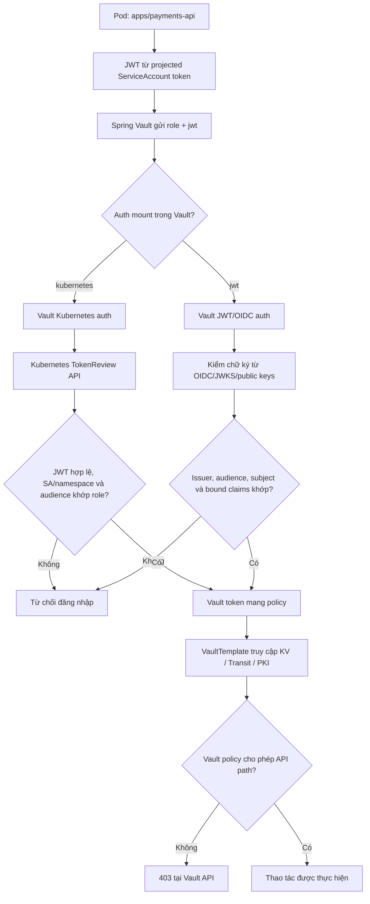

# Audience, issuer và điều kiện kiểm tra theo cấu hình Vault

Một Kubernetes ServiceAccount JWT có thể **hợp lệ về chữ ký và còn hạn**, nhưng HashiCorp Vault vẫn phải từ chối đăng nhập nếu token được phát hành cho bên nhận khác (audience không khớp), đến từ nguồn phát hành không được tin cậy (issuer không hợp lệ theo auth method đang dùng), hoặc danh tính ServiceAccount không thuộc phạm vi role cho phép. Với ứng dụng Java dùng **Spring Vault**, phân biệt đúng những điều kiện này giúp tránh hai lỗi đối lập: workload hợp lệ bị từ chối sau khi nâng cấp Kubernetes và workload không mong muốn được cấp Vault token quá rộng quyền.

Đây là bài học thuộc chương **Kubernetes và JWT** trong mô-đun **SPRING_VAULT**. Ta sẽ đi từ claim `aud` và `iss` trong JWT đến cách cấu hình **Vault Kubernetes auth** và **Vault JWT/OIDC auth**, rồi sử dụng `KubernetesAuthentication` hoặc `JwtAuthentication` để lấy Vault token cho `VaultTemplate`. Quyền đọc KV secrets, gọi Transit encryption, PKI và vòng đời token/lease nằm ở các lớp tiếp theo, nhưng phụ thuộc trước hết vào việc xác thực đúng danh tính.

**Kết quả mong đợi:** sau bài này, bạn có thể giải thích và thử nghiệm ý nghĩa của `aud`, `iss`, `sub`, `exp`; cấu hình JWT projected của Pod khớp role trong Vault; biết khi nào `disable_iss_validation=true` là lựa chọn khuyến nghị; nhận diện các khác biệt bắt buộc khi chuyển từ Kubernetes auth sang JWT auth; và chẩn đoán thất bại mà không làm lộ JWT.

## 1. Audience và issuer là hai câu hỏi khác nhau

Kubernetes phát hành JWT dành cho ServiceAccount của Pod. JWT thường có các claim sau (ví dụ giả, các timestamp không có ý nghĩa triển khai):

```json
{
  "iss": "https://kubernetes.example.internal",
  "sub": "system:serviceaccount:apps:payments-api",
  "aud": ["vault"],
  "iat": 1764000000,
  "nbf": 1764000000,
  "exp": 1764003600,
  "kubernetes.io": {
    "namespace": "apps",
    "serviceaccount": {
      "name": "payments-api",
      "uid": "demo-serviceaccount-uid"
    },
    "pod": {
      "name": "payments-api-demo",
      "uid": "demo-pod-uid"
    }
  }
}
```

| Claim | Câu hỏi mà claim trả lời | Điều cần lưu ý |
| --- | --- | --- |
| `iss` (*issuer*) | **Ai phát hành JWT?** | Với ServiceAccount token hiện đại, thường là URL do kube-apiserver cấu hình bằng `--service-account-issuer`; không lấy tên Vault role làm issuer. |
| `aud` (*audience*) | **JWT dành cho dịch vụ nhận nào?** | Là tập các chuỗi định danh bên nhận; ví dụ `["vault"]`. Bên nhận phải kiểm tra audience thuộc tập mình chấp nhận. |
| `sub` (*subject*) | **JWT đại diện cho danh tính nào?** | Thường có dạng `system:serviceaccount:<namespace>:<name>`. |
| `exp`, `nbf`, `iat` | **JWT có hiệu lực vào thời điểm nào?** | JWT hết hạn hoặc chưa đến thời điểm hiệu lực có thể bị từ chối dù audience/issuer đúng. |
| `kubernetes.io` | JWT liên quan đến Pod, namespace, ServiceAccount nào? | Metadata/UID phụ thuộc loại token và phiên bản Kubernetes; không nên giả định mọi token có cùng cấu trúc. |

**Issuer không phải audience.** Chẳng hạn, `iss=https://kubernetes.example.internal` và `aud=["vault"]` là một kết hợp bình thường: Kubernetes phát hành token, Vault là bên nhận. Hai chuỗi này không cần giống nhau. `audience: vault` trong projected volume không hề thay đổi `iss`; `iss` do control plane phát hành.

JWT chỉ là chuỗi đã ký. Giải mã `header.payload.signature` bằng Base64URL **không xác minh chữ ký hoặc tính hợp lệ**. Chỉ xem claim để đối chiếu trong môi trường kiểm soát; không gửi JWT thật đến các website giải mã token, không ghi vào log hoặc commit.

## 2. JWT đi đến Vault qua những kiểm tra nào?



Tuy cả hai phương thức đều nhận một JWT của Kubernetes, **đường kiểm tra khác nhau**:

- **Kubernetes auth (`auth/kubernetes`):** Vault gọi Kubernetes **`TokenReview`** để xác minh token, bao gồm điều kiện issuer, chữ ký, thời hạn và tính hợp lệ của danh tính theo Kubernetes, đồng thời áp các ràng buộc ServiceAccount/namespace/audience tại Vault role.
- **JWT auth (`auth/jwt`):** Vault tự xác thực chữ ký và claim bằng OIDC discovery, JWKS hoặc public keys đã cấu hình; **không gọi `TokenReview` cho lần login**. Phạm vi issuer, audience, subject và các claim tùy chọn được cấu hình cho JWT auth.

Đây là khác biệt quan trọng với trường hợp **thu hồi sớm**: JWT bound-to-Pod sau khi Pod bị xóa có thể bị Kubernetes `TokenReview` từ chối, trong khi Vault JWT auth chỉ xác minh chữ ký/claim có thể tiếp tục chấp nhận JWT đến `exp`. Do đó dùng JWT auth thường cần TTL JWT ngắn và chấp nhận đánh đổi về kiểm tra thu hồi.

## 3. Audience được cấp như thế nào trong Kubernetes?

Kubernetes có thể tự mount token vào `/var/run/secrets/kubernetes.io/serviceaccount/token`. Audience mặc định thường dành cho **Kubernetes API server**, tùy `--api-audiences` và `--service-account-issuer` của cluster. Không nên giả định audience mặc định là `vault` hoặc là một chuỗi cố định cho mọi cluster.

Để xin JWT dành riêng cho Vault, khai báo **projected ServiceAccount token** trong Pod:

```yaml
apiVersion: v1
kind: ServiceAccount
metadata:
  name: payments-api
  namespace: apps
automountServiceAccountToken: false
---
apiVersion: apps/v1
kind: Deployment
metadata:
  name: payments-api
  namespace: apps
spec:
  replicas: 1
  selector:
    matchLabels:
      app: payments-api
  template:
    metadata:
      labels:
        app: payments-api
    spec:
      serviceAccountName: payments-api
      automountServiceAccountToken: false
      containers:
        - name: payments-api
          image: registry.example.com/payments-api:1.0.0
          env:
            - name: VAULT_URI
              value: "https://vault.vault.svc:8200"
            - name: VAULT_K8S_ROLE
              value: "payments-read"
          volumeMounts:
            - name: vault-identity
              mountPath: /var/run/secrets/vault
              readOnly: true
      volumes:
        - name: vault-identity
          projected:
            sources:
              - serviceAccountToken:
                  path: jwt
                  audience: vault
                  expirationSeconds: 3600
```

**Giả định:** namespace `apps` tồn tại, image là ví dụ và Vault đã phục vụ HTTPS tin cậy tại địa chỉ đã khai báo. Kubelet yêu cầu JWT cho `apps/payments-api` và mount tại `/var/run/secrets/vault/jwt`. `automountServiceAccountToken: false` tắt token tự động dành cho API server, nhưng không ngăn volume token được khai báo tường minh.

| Trường | Tác động |
| --- | --- |
| `serviceAccountName` | Xác định **danh tính** ServiceAccount của Pod. |
| `audience: vault` | Chọn **bên nhận** của JWT, được thể hiện trong claim `aud`. |
| `expirationSeconds: 3600` | TTL **yêu cầu** (1 giờ); API server có thể điều chỉnh giá trị thực. |
| `path: jwt` | File tương đối với thư mục volume, không phải API path trong Vault. |
| `mountPath` | Thư mục mà Java đọc JWT; ở ví dụ là `/var/run/secrets/vault/jwt`. |

Kubelet sẽ cố xoay vòng projected token trước khi hết hạn; ứng dụng phải **đọc lại file khi cần JWT để đăng nhập**. Tránh cache JWT từ lúc khởi động và tránh mount file token bằng `subPath` vì cập nhật projected volume có thể không đến container qua mount đó.

### Một token có nhiều audience thì sao?

Claim `aud` là tập audience; trong một số tình huống JWT có thể chứa nhiều phần tử, chẳng hạn `["vault","other-relying-party"]`. Nếu role kiểm tra audience `vault` thì token phải có phần tử khớp với `vault`; các bên nhận còn lại không tự làm role chặt hơn. Đối với workload cần phân tách truy cập, ưu tiên **một projected token dành riêng cho Vault** thay vì token chấp nhận quá nhiều bên nhận. Chữ hoa/chữ thường, đường dẫn, dấu gạch cuối URL đều có ý nghĩa khi so khớp chuỗi; `vault` khác `Vault` hoặc `https://vault.example`.

## 4. Issuer được cấu hình ở Kubernetes

Với ServiceAccount token hiện đại, kube-apiserver ký JWT và ghi `iss` dựa trên cấu hình `--service-account-issuer`. Các cluster cũ có thể đã dùng giá trị `kubernetes/serviceaccount`; sau khi chuyển sang token projection ở Kubernetes 1.21+, issuer thường trở thành URL riêng của cluster. Điều này giải thích vì sao một Vault auth mount cấu hình từ trước đôi khi bắt đầu báo lỗi `claim "iss" is invalid` khi nâng cấp Kubernetes.

Khi có quyền đọc metadata cluster, operator có thể xem issuer từ tài liệu OIDC discovery mà **không phải in JWT**:

```bash
kubectl get --raw /.well-known/openid-configuration

# Nếu có jq: chỉ in URL issuer từ JSON discovery
kubectl get --raw /.well-known/openid-configuration | jq -r .issuer
```

Một ví dụ giản lược về metadata discovery:

```json
{
  "issuer": "https://kubernetes.example.internal",
  "jwks_uri": "https://kubernetes.example.internal/openid/v1/jwks"
}
```

Đây là **URL giả**. Việc có endpoint discovery không bảo đảm Vault ở ngoài cluster truy cập được URL hoặc chứng chỉ TLS của endpoint. Khi dùng JWT/OIDC auth, cần kiểm tra đường mạng từ Vault và các khóa xác minh qua JWKS; không sao chép issuer của một cluster sang cluster khác chỉ vì ServiceAccount có cùng tên.

## 5. Kubernetes auth: ai kiểm tra issuer và audience?

Trong **Vault Kubernetes auth**, cấu hình ở hai cấp:

| Nơi cấu hình | Các trường đáng chú ý | Ý nghĩa |
| --- | --- | --- |
| `auth/kubernetes/config` | `kubernetes_host`, `kubernetes_ca_cert`, `token_reviewer_jwt` hoặc token reviewer cục bộ | Vault có thể tin cậy TLS và gọi **Kubernetes TokenReview API**. |
| `auth/kubernetes/config` (tương thích cũ) | `disable_iss_validation`, `issuer` | Cách Vault tự kiểm tra `iss` **bổ sung** trước/ngoài TokenReview, nay đã **deprecated**. |
| `auth/kubernetes/role/<name>` | `audience` | Audience mà role yêu cầu ở JWT đăng nhập. |
| `auth/kubernetes/role/<name>` | `bound_service_account_names`, `bound_service_account_namespaces` | Danh tính Kubernetes nào được quyền dùng role. |
| `auth/kubernetes/role/<name>` | `token_policies`, `token_ttl`, `token_max_ttl` | Quyền và vòng đời **Vault token sau login**; không quyết định issuer của JWT. |

### 5.1. Vì sao tài liệu Vault khuyến nghị `disable_iss_validation=true`?

Từ **Vault 1.9.0**, Kubernetes auth mount **mới** mặc định đặt `disable_iss_validation=true` và cả `disable_iss_validation` lẫn `issuer` đã được đánh dấu **deprecated**. Đó là vì **Kubernetes TokenReview đã kiểm tra issuer** khi xác minh ServiceAccount token: Vault không cần tự kiểm tra trùng lặp bằng cấu hình issuer cố định. Tuy nhiên **auth mount được tạo từ trước Vault 1.9 có thể giữ mặc định cũ**, kể cả sau nâng cấp Vault.

Đọc cấu hình hiện có:

```bash
vault auth list
vault read auth/kubernetes/config

# Với phiên bản Vault còn hỗ trợ trường này:
vault read -field=disable_iss_validation auth/kubernetes/config
```

Nếu auth mount cũ vẫn kiểm tra issuer trong Vault và phát sinh lỗi khi JWT chuyển sang issuer mới, operator có thể **chủ động** chuyển về hành vi được HashiCorp khuyến nghị sau khi đối chiếu phiên bản và cấu hình đang dùng:

```bash
# Chạy bởi operator sau khi xác minh auth mount và ảnh hưởng của thay đổi.
vault write auth/kubernetes/config \
  kubernetes_host="https://kubernetes.default.svc:443" \
  disable_iss_validation=true
```

Lệnh trên là **ví dụ cho Vault trong Kubernetes**; các giá trị kết nối, CA, reviewer JWT/behavior của `auth/kubernetes/config` phải được giữ đúng theo hạ tầng hiện hữu. Không chạy nguyên lệnh một cách máy móc trên Vault đang vận hành: cấu hình có thể gồm thông số kết nối/reviewer khác, và tùy phiên bản API update có thể ảnh hưởng trường không nêu. Kiểm tra trạng thái trước và sau thay đổi.

**`disable_iss_validation=true` KHÔNG có nghĩa Vault bỏ qua mọi kiểm tra JWT.** Vault Kubernetes auth vẫn sử dụng `TokenReview` để xác minh chữ ký, issuer, thời hạn, tình trạng token và ServiceAccount qua Kubernetes; Vault role vẫn kiểm tra audience, tên SA và namespace. Không dùng tham số này để “sửa” một JWT có audience sai hoặc được phát hành từ cluster không được tin cậy.

Nếu tổ chức duy trì `disable_iss_validation=false` vì yêu cầu đặc biệt, phải thiết lập `issuer` tương ứng với `iss` của cluster và xử lý kế hoạch thay đổi issuer khi nâng cấp. Vì các trường này đã deprecated, ưu tiên kiểm tra tài liệu theo **phiên bản Vault cụ thể** trước khi duy trì cơ chế cũ.

### 5.2. TokenReview cũng cần một danh tính reviewer

Vault dùng Kubernetes API để gọi `TokenReview`. Nếu Vault chạy trong Kubernetes, có thể dùng token của **ServiceAccount chạy Vault** để làm reviewer; cần cấp quyền `create` trên `tokenreviews.authentication.k8s.io` (thường qua ClusterRole `system:auth-delegator`) cho danh tính reviewer.

Ví dụ, chỉ khi Pod Vault thật sự chạy bằng ServiceAccount `vault/vault-auth`:

```bash
kubectl create clusterrolebinding vault-token-reviewer \
  --clusterrole=system:auth-delegator \
  --serviceaccount=vault:vault-auth
```

Điều này **không** có nghĩa `apps/payments-api` cần quyền gọi TokenReview. Cấp `system:auth-delegator` đại trà cho Pod ứng dụng làm mở rộng quyền Kubernetes không cần thiết. Vault có thể dùng JWT client làm reviewer ở một kiểu cấu hình khác, nhưng khi đó các client cần quyền TokenReview và phải đánh giá rủi ro/chi phí vận hành.

Nếu reviewer JWT cố định đã hết hạn, login có thể hỏng dù JWT Pod có `iss` và `aud` hoàn toàn đúng. Vault chạy trong cluster từ các phiên bản hỗ trợ có thể dùng và đọc lại reviewer token cục bộ để tương thích vòng đời projected token; Vault chạy ngoài cluster phải có giải pháp reviewer credential phù hợp.

## 6. Ví dụ cấu hình Vault Kubernetes role trùng audience

Giả sử operator đã bật auth mount `kubernetes` và cấu hình TokenReview chính xác. Ứng dụng `apps/payments-api` chỉ cần đọc một bản ghi KV v2 từ `kv/apps/payments/config`.

Tạo **dữ liệu thử nghiệm** và policy ít quyền nhất:

```bash
# Chỉ dùng nếu mount kv chưa tồn tại:
vault secrets enable -path=kv kv-v2

vault kv put -mount=kv apps/payments/config \
  endpoint="https://payment-sandbox.example.internal" \
  mode="readonly"
```

Nội dung `payments-read.hcl`:

```hcl
path "kv/data/apps/payments/config" {
  capabilities = ["read"]
}
```

Nạp policy, tạo role:

```bash
vault policy write payments-read payments-read.hcl

vault write auth/kubernetes/role/payments-read \
  bound_service_account_names="payments-api" \
  bound_service_account_namespaces="apps" \
  audience="vault" \
  token_policies="payments-read" \
  token_ttl="15m" \
  token_max_ttl="1h"

vault read auth/kubernetes/role/payments-read
```

| Ràng buộc | Giá trị ví dụ | Nếu không khớp |
| --- | --- | --- |
| Tên SA trong JWT/TokenReview | `payments-api` | Từ chối login vào role. |
| Namespace Kubernetes | `apps` | Từ chối dù một namespace khác có SA trùng tên. |
| Claim `aud` | Chứa `vault` | Từ chối nếu chỉ có audience `other-service`. |
| `iss` | Issuer do Kubernetes của cluster đang được TokenReview xác thực | JWT từ issuer không được cluster chấp nhận bị từ chối; `disable_iss_validation` chỉ điều khiển kiểm tra **bổ sung** trong plugin. |
| JWT còn hạn, Pod/SA hợp lệ | Có | Token không còn hiệu lực bị từ chối khi login mới. |
| Vault policy | `payments-read` | Login có thể thành công nhưng request KV ngoài `kv/data/apps/payments/config` bị từ chối. |

Ở **KV v2**, CLI dùng `kv get -mount=kv apps/payments/config` trong khi policy trên đường dẫn API là `kv/data/apps/payments/config`. Không dùng sai `kv/apps/payments/config` làm policy data chỉ vì CLI hiển thị đường dẫn đó.

Một điểm cần nhớ: client **gửi tên role** nhưng Vault **tự quyết định có cho danh tính đó đăng nhập hay không**. Không tin vào tham số `role=payments-read` như một bằng chứng rằng ứng dụng thuộc nhóm được phép.

## 7. Spring Vault gửi JWT thế nào?

Với **Spring Vault 4.1.x**, `KubernetesAuthenticationOptions` có thể nhận role, auth path và nguồn JWT đọc từ file. Ví dụ ứng dụng dùng `spring-vault-core` và `AbstractVaultConfiguration`:

```java
import java.net.URI;

import org.springframework.beans.factory.annotation.Value;
import org.springframework.context.annotation.Configuration;
import org.springframework.vault.authentication.ClientAuthentication;
import org.springframework.vault.authentication.KubernetesAuthentication;
import org.springframework.vault.authentication.KubernetesAuthenticationOptions;
import org.springframework.vault.authentication.KubernetesServiceAccountTokenFile;
import org.springframework.vault.client.VaultEndpoint;
import org.springframework.vault.config.AbstractVaultConfiguration;

@Configuration
public class VaultKubernetesConfig extends AbstractVaultConfiguration {

    @Value("${VAULT_URI}")
    private URI uri;

    @Value("${VAULT_K8S_ROLE:payments-read}")
    private String role;

    @Override
    public VaultEndpoint vaultEndpoint() {
        return VaultEndpoint.from(uri);
    }

    @Override
    public ClientAuthentication clientAuthentication() {
        KubernetesAuthenticationOptions options =
            KubernetesAuthenticationOptions.builder()
                .path("kubernetes")
                .role(role)
                .jwtSupplier(new KubernetesServiceAccountTokenFile(
                    "/var/run/secrets/vault/jwt"))
                .build();

        return new KubernetesAuthentication(options, vaultClient());
    }
}
```

Thư viện gửi `role` và `jwt` đến `POST /v1/auth/kubernetes/login`. **Issuer và audience không phải tham số do Spring Vault gắn thêm vào request login**: chúng đã ở bên trong JWT được Kubernetes cấp và được Vault/Kubernetes xác minh. Để đổi audience, thay khai báo **projected ServiceAccount token** và **Vault role** tương ứng; đổi mỗi `role` trong Java không thay đổi `aud`.

`KubernetesServiceAccountTokenFile` lấy JWT từ file khi cần login, thích hợp với kubelet xoay vòng projected token. Tránh thay bằng supplier trả một chuỗi JWT đã đọc duy nhất lúc khởi động. `VaultEndpoint` phải dùng HTTPS đã xác minh TLS; không tắt xác minh chứng chỉ để giải quyết lỗi issuer (issuer của JWT là khái niệm khác với issuer/CA của chứng chỉ TLS).

Ứng dụng dùng `VaultOperations` / `VaultTemplate` để đọc KV v2 sau khi xác thực:

```java
import java.util.Map;

import org.springframework.stereotype.Service;
import org.springframework.vault.core.VaultOperations;
import org.springframework.vault.support.Versioned;

@Service
public class PaymentSettings {
    private final VaultOperations vault;

    public PaymentSettings(VaultOperations vault) {
        this.vault = vault;
    }

    public String mode() {
        Versioned<Map<String, Object>> version =
            vault.opsForVersionedKeyValue("kv").get("apps/payments/config");

        if (version == null || version.getData() == null) {
            throw new IllegalStateException("Missing Vault KV configuration");
        }
        Object value = version.getData().get("mode");
        if (!(value instanceof String)) {
            throw new IllegalStateException("Invalid Vault KV configuration");
        }
        return (String) value;
    }
}
```

Kết quả login là **Vault token** có policy và TTL do Vault cấp. Session manager của Spring Vault quản lý việc dùng lại hoặc renew/re-login khi cần; JWT của Kubernetes, Vault token và secret lease không tự đồng bộ TTL. Khi JWT hết hạn hoặc audience không phù hợp, lần đăng nhập **mới** thất bại; điều này không nhất thiết thu hồi tức thì Vault token đã được cấp trước đó.

Nếu dự án dùng **Spring Cloud Vault** thay vì cấu hình `AbstractVaultConfiguration`, cấu hình tương ứng là:

```yaml
spring:
  cloud:
    vault:
      uri: https://vault.vault.svc:8200
      authentication: KUBERNETES
      kubernetes:
        role: payments-read
        kubernetes-path: kubernetes
        service-account-token-file: /var/run/secrets/vault/jwt
```

Đây là cách cấu hình thay thế. Không tạo trùng các bean auth/session giữa cấu hình thủ công và Spring Cloud Vault nếu framework đã tự cung cấp.

## 8. JWT/OIDC auth: issuer và audience được xác minh trực tiếp

**JWT auth trong Vault là auth method khác** với Kubernetes auth, dù cùng sử dụng ServiceAccount JWT:

| Chủ đề | Vault Kubernetes auth | Vault JWT/OIDC auth với ServiceAccount JWT |
| --- | --- | --- |
| Auth mount mặc định | `auth/kubernetes` | `auth/jwt` |
| Java client | `KubernetesAuthentication` | `JwtAuthentication` |
| Cách xác minh | Kubernetes `TokenReview` và Vault role. | Vault kiểm tra chữ ký bằng OIDC discovery/JWKS/public keys và áp claim constraints. |
| Issuer | Khuyến nghị dựa vào TokenReview; `issuer` / `disable_iss_validation` trong plugin đã deprecated. | Kiểm tra issuer theo nguồn tin cậy và cấu hình của JWT auth (OIDC discovery hoặc `bound_issuer` khi phù hợp). |
| Audience | `audience` trong **Kubernetes role**. | `bound_audiences` trong **JWT role**. |
| Danh tính / claim | `bound_service_account_names`, `bound_service_account_namespaces`. | `bound_subject`, `bound_claims` hoặc ràng buộc claim khác tương ứng. |
| Thu hồi Pod/SA trước khi JWT hết hạn | TokenReview có thể từ chối login mới. | JWT vẫn có thể được chấp nhận tới `exp` nếu chữ ký/claims còn hợp lệ. |
| Kết nối lúc login | Vault phải gọi được Kubernetes API/TokenReview. | Vault phải có khóa tin cậy; với OIDC/JWKS cần lấy/cập nhật khóa qua endpoint cấu hình, không gọi TokenReview mỗi login. |

### 8.1. Ví dụ Vault JWT auth với OIDC discovery của Kubernetes

Giả sử issuer discovery URL thực của cluster là `https://kubernetes.example.internal`, endpoint đó được Vault truy cập qua HTTPS có chứng chỉ tin cậy và phục vụ OIDC discovery/JWKS hợp lệ. Operator bật và cấu hình **JWT auth mount riêng**:

```bash
vault auth enable -path=jwt jwt

vault write auth/jwt/config \
  oidc_discovery_url="https://kubernetes.example.internal"
```

Đây là **URL giả để diễn giải**, cần thay bằng issuer discovery URL của cluster thật; tùy môi trường có thể cần `oidc_discovery_ca_pem`. Không dùng public Internet URL tùy tiện làm issuer. JWT auth chỉ cho phép cấu hình **một** nguồn chính trong `oidc_discovery_url`, `jwks_url` hoặc `jwt_validation_pubkeys` tại một auth mount; chọn phương án phù hợp với kết nối và quản lý key của cluster.

Tạo JWT role ràng buộc **subject** của SA và audience của Pod ở mục 3:

```bash
vault write auth/jwt/role/payments-jwt-read \
  role_type="jwt" \
  user_claim="sub" \
  bound_subject="system:serviceaccount:apps:payments-api" \
  bound_audiences="vault" \
  token_policies="payments-read" \
  token_ttl="15m"
```

Từ **Vault 1.17**, nếu JWT có `aud` (trường hợp thông thường của ServiceAccount token), JWT role kiểu `jwt` **phải có** `bound_audiences` khớp **chính xác ít nhất một** audience trong claim `aud`. Thiếu `bound_audiences` hoặc điền `https://vault.example` khi JWT chỉ có `vault` có thể khiến login bị từ chối. `bound_subject` chỉ so sánh chuỗi `sub`; với role chung cho nhiều workload, cần thiết kế các bound claims khác chặt chẽ thay vì bỏ mọi ràng buộc danh tính.

Trong Spring Vault 4.1.x, ứng dụng **chuyển sang `JwtAuthentication`** nếu server đã cấu hình JWT auth:

```java
import org.springframework.vault.authentication.ClientAuthentication;
import org.springframework.vault.authentication.JwtAuthentication;
import org.springframework.vault.authentication.JwtAuthenticationOptions;
import org.springframework.vault.authentication.KubernetesServiceAccountTokenFile;

// Bên trong cấu hình AbstractVaultConfiguration của phương án JWT auth:
@Override
public ClientAuthentication clientAuthentication() {
    JwtAuthenticationOptions options = JwtAuthenticationOptions.builder()
        .path("jwt")
        .role("payments-jwt-read")
        .jwtSupplier(new KubernetesServiceAccountTokenFile(
            "/var/run/secrets/vault/jwt"))
        .build();

    return new JwtAuthentication(options, vaultClient());
}
```

Khối trên chỉ là **phương thức thay thế** trong lớp cấu hình có sẵn `AbstractVaultConfiguration`, không đặt cạnh phương thức `clientAuthentication()` của mục 7 trong cùng một lớp. `JwtAuthenticationOptions.jwtSupplier(...)` giúp đọc JWT mới khi projected token thay đổi; không dùng `jwt(String)` với JWT snapshot từ lúc khởi động nếu workload chạy lâu.

Một lựa chọn khác là xác minh bằng `jwks_url` hoặc `jwt_validation_pubkeys` nếu OIDC discovery endpoint không truy cập được; khi đó cần đảm bảo đúng issuer/bound claims và xây quy trình xoay vòng signing key. Việc chọn nguồn khóa/chữ ký phải căn cứ điều kiện cluster, không suy ra rằng bỏ TokenReview sẽ tự an toàn hơn.

### 8.2. Bẫy khi mang cấu hình giữa hai auth method

Trong Kubernetes auth:

```bash
vault write auth/kubernetes/role/payments-read \
  bound_service_account_names="payments-api" \
  bound_service_account_namespaces="apps" \
  audience="vault" \
  token_policies="payments-read"
```

Trong JWT auth, các trường **không cùng tên**:

```bash
vault write auth/jwt/role/payments-jwt-read \
  role_type="jwt" \
  bound_subject="system:serviceaccount:apps:payments-api" \
  bound_audiences="vault" \
  user_claim="sub" \
  token_policies="payments-read"
```

Không chuyển `audience=...` sang JWT auth rồi mong nó hoạt động như `bound_audiences=...`. Không chuyển `disable_iss_validation=true` từ Kubernetes auth sang JWT auth; JWT auth có cơ chế xác minh issuer riêng. Đổi auth method ở server đồng nghĩa đổi **`path` và class client** trong Spring Vault.

## 9. Ma trận được phép / từ chối

Giả sử cả hai auth mount đã được cấu hình như các ví dụ, và mọi JWT bên dưới đều là token **có chữ ký thật của cluster**, còn hạn, không bị xóa Pod/SA, trừ các hàng ghi khác. Vai trò `payments-read` chỉ cho phép `apps/payments-api` và audience `vault`; role JWT yêu cầu `sub=system:serviceaccount:apps:payments-api`, `bound_audiences=vault`.

| Trường hợp | Kubernetes auth `payments-read` | JWT auth `payments-jwt-read` | Giải thích |
| --- | --- | --- | --- |
| `iss` đúng, `aud=["vault"]`, `sub` đúng | Cho phép | Cho phép | Đủ ràng buộc của role khi các điều kiện hệ thống khác hợp lệ. |
| `iss` đúng, `aud=["other-service"]` | Từ chối | Từ chối | Audience không khớp. |
| `iss` đúng, `aud=["vault","other"]` | Có thể cho phép | Có thể cho phép | `vault` vẫn có trong tập audience. |
| SA `apps/other-api`, `aud=["vault"]` | Từ chối | Từ chối | SA name / `bound_subject` sai. |
| SA `staging/payments-api`, `aud=["vault"]` | Từ chối | Từ chối | Namespace / `bound_subject` sai. |
| JWT quá hạn | Từ chối | Từ chối | `exp` không hợp lệ. |
| JWT từ cluster khác chỉ trùng `aud`/`sub` | Từ chối nếu TokenReview cluster hiện tại không chấp nhận | Từ chối nếu issuer/khóa tin cậy không khớp | Audience không thay thế issuer và signature verification. |
| Pod bị xóa trước `exp` | TokenReview có thể từ chối | Có thể còn được chấp nhận đến `exp` | Khác biệt về thu hồi sớm. |
| Login thành công nhưng policy không có `read` trên KV | 403 tại KV | 403 tại KV | Lỗi quyền Vault, không phải JWT. |

Trong môi trường nhiều cluster, không gộp nhầm các trường hợp `sub` giống nhau: `system:serviceaccount:apps:payments-api` có thể xuất hiện ở **nhiều cluster**. Khi thiết kế JWT auth, phải ràng buộc issuer, nguồn khóa và policy đúng trust domain; không chỉ dựa vào `sub`.

## 10. Issuer rotation, nhiều cluster và các tình huống nâng cấp

Khi thay đổi Kubernetes control plane hoặc luân chuyển signing key:

1. **Kubernetes auth:** kiểm tra địa chỉ `kubernetes_host` và TLS CA có đúng cluster; reviewer có quyền `TokenReview`; mount cũ có còn kiểm tra `iss` tại Vault hay không. Với cấu hình hiện đại `disable_iss_validation=true`, Kubernetes API đóng vai trò nguồn xác minh issuer.
2. **JWT auth dùng OIDC discovery:** xác nhận `iss` trong JWT khớp discovery metadata, Vault truy cập được issuer/JWKS và tin cậy CA; theo dõi signing key rotation.
3. **JWT auth dùng public keys tĩnh:** cần cập nhật khóa tin cậy theo kế hoạch trước khi cluster ngừng ký bằng khóa cũ; không có cơ chế tự truy vấn TokenReview để bù cho khóa lỗi.
4. **Nhiều cluster cùng dùng Vault:** ưu tiên phân biệt rõ auth mount/role/trust domain, tránh một role cho phép mọi `sub` giống tên ở các cluster khác nhau; thay đổi issuer phải kèm kiểm thử mỗi nguồn.
5. **Thay audience:** cập nhật đồng bộ projection trong Pod và role Vault; rollout Pod mới để JWT được cấp với audience mới. Chỉ sửa Vault role không làm JWT đã cấp thay `aud`.
6. **Giảm quyền:** role sửa chặt hơn ảnh hưởng login mới, nhưng Vault token đã phát hành có TTL/renew/revoke riêng. Cần đánh giá token đang sống nếu đây là thay đổi khẩn cấp.

Không lấy việc JWT được giải mã ra `iss` khớp làm bằng chứng xác thực: kết luận chỉ có ý nghĩa khi chữ ký và các ràng buộc khác đã được bên tin cậy xác minh. Cũng không dùng tham số `disable_iss_validation` như cách tắt xác minh TLS hoặc bỏ kiểm tra CA; hai cơ chế này không liên quan.

## 11. Chẩn đoán lỗi theo thứ tự kiểm tra

| Dấu hiệu | Nguồn gốc khả dĩ | Xác minh không lộ secret |
| --- | --- | --- |
| `claim "iss" is invalid` ở Kubernetes auth cũ sau nâng cấp cluster | Plugin vẫn xác minh issuer cũ; `iss` của token projected đã thay. | Xem `vault read auth/kubernetes/config`, trạng thái `disable_iss_validation` và OIDC issuer cluster, đối chiếu phiên bản Vault. |
| `invalid issuer` ở JWT/OIDC auth | `oidc_discovery_url` hoặc `bound_issuer` (khi dùng) không khớp nguồn phát hành; issuer URL/CA không đúng. | Đọc discovery metadata và cấu hình `auth/jwt/config`; kiểm tra kết nối Vault → issuer. |
| Login bị từ chối dù JWT còn hạn | `aud` không khớp `audience` hoặc `bound_audiences`; sai SA/namespace/sub. | Xem projected volume, role và danh tính Pod; đối chiếu audience đã cấu hình. |
| JWT auth bắt đầu thất bại sau nâng cấp Vault 1.17 | Role kiểu `jwt` có token chứa `aud` nhưng thiếu `bound_audiences`. | Đọc `auth/jwt/role/<name>` và kiểm tra audience mong đợi. |
| Login thất bại trên mọi Pod dù issuer/audience không đổi | Reviewer JWT hết hạn, Vault mất quyền `TokenReview`, CA/API server không truy cập được. | Kiểm tra health/network từ Vault, reviewer RBAC và lỗi TokenReview. |
| Chỉ Pod mới lỗi sau rollout | `serviceAccountName` hoặc projected `audience` thay; file token path Java cũ. | Xem spec Pod đang chạy, role và tệp có tồn tại/đọc được không. |
| Lỗi `x509: certificate signed by unknown authority` khi Vault gọi Kubernetes | TLS trust CA của Kubernetes API sai. | Xem `kubernetes_ca_cert` / trust store; **không** chỉnh issuer JWT để chữa x509. |
| Login thành công, `VaultTemplate` nhận 403 đọc `kv` | Vault token thiếu policy/path hoặc policy bị đổi. | Xem policy tại `kv/data/...`, tách log endpoint login với KV. |
| Login lại lỗi sau một giờ | JWT Java cache đã hết hạn, kubelet rotation không được đọc lại, reviewer token tĩnh hết hạn. | Kiểm tra supplier, projected mount không dùng `subPath` và cấu hình reviewer. |

Một số lệnh kiểm tra an toàn:

```bash
# Xác định ServiceAccount của Pod, không in JWT
kubectl -n apps get pod -l app=payments-api \
  -o custom-columns=NAME:.metadata.name,SA:.spec.serviceAccountName

# Xem cấu hình role và auth method (yêu cầu quyền đọc Vault)
vault read auth/kubernetes/role/payments-read
vault read auth/kubernetes/config
vault read auth/jwt/role/payments-jwt-read
vault read auth/jwt/config

# Xem issuer public từ cluster, không đọc giá trị JWT
kubectl get --raw /.well-known/openid-configuration | jq -r .issuer
```

Lệnh đọc `auth/jwt/...` chỉ áp dụng nếu auth mount JWT thực sự tồn tại. Khi cần chứng minh token đã được mount, có thể kiểm tra file bằng `test -r /var/run/secrets/vault/jwt` trong Pod, không `cat` JWT ra terminal hoặc hệ thống log. Nếu giải mã claim JWT trong một sandbox, xử lý hoàn toàn cục bộ, chỉ xuất các trường cần thiết, và nhớ **giải mã không phải xác minh**.

## 12. Kiểm thử tích hợp cho audience và issuer

Để kiểm thử thực, cần Kubernetes sandbox, Vault có đường kết nối cần thiết, role/policy ví dụ và quyền hạn operator thích hợp. Không thể kiểm chứng TokenReview chỉ bằng JWT giả có payload JSON tự dựng vì chữ ký giả sẽ khiến token bị từ chối trước khi kiểm tra audience/role.

**Nhóm A — Kiểm tra Kubernetes auth (`KubernetesAuthentication`):**

1. **Đường thành công:** chạy Pod `apps/payments-api` với projected `audience=vault`; Vault role cùng tên/namespace/audience, login thành công và đọc đúng KV v2.
2. **Sai audience:** tạo Pod thử nghiệm có projected `audience=other-service` nhưng role Vault vẫn `audience=vault`; xác nhận lỗi tại `auth/kubernetes/login`.
3. **Sai ServiceAccount:** Pod `apps/report-api` có JWT `aud=vault`; xác nhận không thể xin token từ role chỉ bound `payments-api`.
4. **Sai namespace:** Pod `staging/payments-api` có audience đúng; bị từ chối do namespace.
5. **Token hết hạn/Pod bị xóa:** trong sandbox, kiểm tra đăng nhập mới bằng token không còn hợp lệ bị TokenReview từ chối; không ghi token vào test log.
6. **Auth mount cũ kiểm tra issuer:** chỉ trong môi trường cách ly, so cấu hình `disable_iss_validation=false`/`issuer` cố định với token từ cluster mới và xác minh lỗi issuer; sau đó áp dụng cấu hình phù hợp theo tài liệu Vault để login bình thường.

**Nhóm B — Kiểm tra JWT auth (`JwtAuthentication`):**

1. Xác minh `oidc_discovery_url` trỏ đúng issuer, JWKS được truy cập qua TLS; role yêu cầu `bound_subject` và `bound_audiences=vault`.
2. Đăng nhập JWT hợp lệ thành công; sau đó đổi `bound_audiences` sang chuỗi không có trong claim `aud` và xác nhận thất bại.
3. Thử token cùng audience nhưng subject/namespace khác, xác nhận `bound_subject` chặn.
4. Thử token của trust domain/cluster khác không nằm trong issuer/khóa đã cấu hình, xác nhận chữ ký hoặc issuer bị từ chối.
5. Đánh giá trường hợp JWT của một Pod đã bị xóa nhưng còn `exp` khi dùng JWT auth; không dựa vào JWT auth để bảo đảm thu hồi sớm.

**Tiêu chí đạt:** phân loại được lỗi issuer, audience, danh tính và policy; không có secret/JWT/Vault token trong log; token projected được đọc lại sau rotation; việc đổi cấu hình role không tự giả định đã thu hồi mọi Vault token cũ.

## 13. Các câu hỏi tự kiểm tra

1. Nếu `iss=https://cluster.example` và `aud=["vault"]` thì có gì sai khi chúng là hai chuỗi khác nhau không?
2. Vì sao một JWT được Kubernetes cấp với audience mặc định của API server có thể bị role Vault `audience=vault` từ chối?
3. Vì sao HashiCorp khuyến nghị `disable_iss_validation=true` cho Kubernetes auth từ Vault 1.9, nhưng điều đó không làm Vault bỏ qua TokenReview?
4. Vì sao cùng một JWT có thể có trạng thái khác nhau ở Kubernetes auth và JWT auth sau khi Pod bị xóa?
5. Với JWT auth trên Vault 1.17+, JWT có `aud=["vault"]` nhưng role thiếu `bound_audiences` sẽ ra sao?
6. Tại sao chỉ ràng buộc `bound_subject=system:serviceaccount:apps:payments-api` là chưa đủ nếu Vault JWT auth tin cậy nhiều Kubernetes cluster có ServiceAccount trùng tên?
7. Khi `VaultTemplate` đọc KV nhận 403 sau login thành công, có nên sửa `issuer`/`audience` không? Tầng nào cần kiểm tra trước?

## 14. Tài liệu chính thức

- [Kubernetes — Configure Service Accounts for Pods](https://kubernetes.io/docs/tasks/configure-pod-container/configure-service-account/): projected ServiceAccount token, `audience`, `--service-account-issuer`, thời hạn/rotation và issuer discovery.
- [Kubernetes — ServiceAccountTokenProjection API](https://kubernetes.io/docs/reference/kubernetes-api/core/pod-v1/): ngữ nghĩa trường `audience`, `expirationSeconds` và `path`.
- [HashiCorp Vault — Kubernetes auth method](https://developer.hashicorp.com/vault/docs/auth/kubernetes): TokenReview, thay đổi issuer từ Kubernetes 1.21, lý do deprecated `disable_iss_validation` và vòng đời reviewer token.
- [HashiCorp Vault — Kubernetes auth API](https://developer.hashicorp.com/vault/api-docs/auth/kubernetes): `auth/kubernetes/config`, `issuer`, `audience` và role constraints.
- [HashiCorp Vault — JWT/OIDC auth method](https://developer.hashicorp.com/vault/docs/auth/jwt) và [JWT auth API](https://developer.hashicorp.com/vault/api-docs/auth/jwt): `bound_audiences`, nguồn khóa/issuer và ràng buộc claim.
- [HashiCorp Vault — Kubernetes as OIDC provider](https://developer.hashicorp.com/vault/docs/auth/jwt/oidc-providers/kubernetes): cấu hình issuer discovery, JWT auth với ServiceAccount và giới hạn thu hồi sớm.
- [Spring Vault — Authentication Methods](https://docs.spring.io/spring-vault/reference/vault/authentication.html), [KubernetesAuthenticationOptions](https://docs.spring.io/spring-vault/reference/api/java/org/springframework/vault/authentication/KubernetesAuthenticationOptions.html) và [JwtAuthenticationOptions builder](https://docs.spring.io/spring-vault/reference/api/java/org/springframework/vault/authentication/JwtAuthenticationOptions.JwtAuthenticationOptionsBuilder.html): API client dùng JWT supplier.
