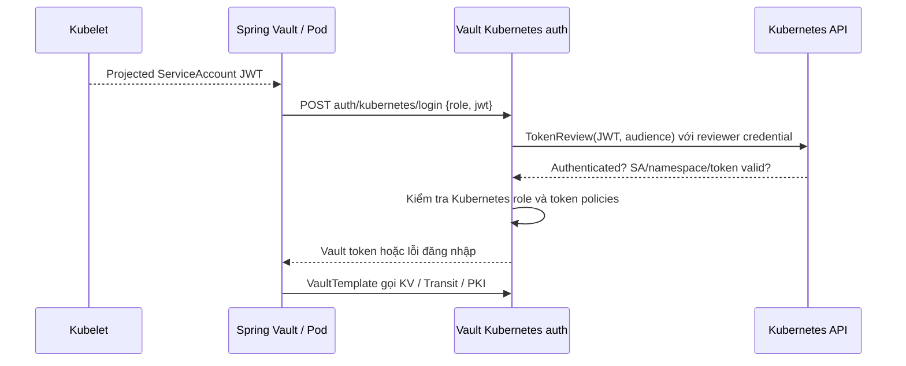
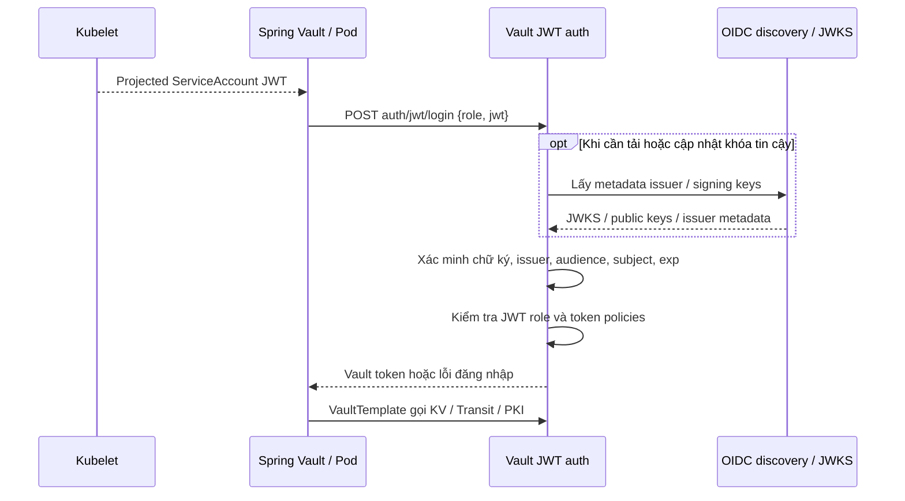

# Phân biệt auth method Kubernetes với auth method JWT

Một ứng dụng Java trong Kubernetes có thể lấy **ServiceAccount JWT** của Pod rồi đăng nhập HashiCorp Vault qua hai auth method khác nhau: **Kubernetes auth** hoặc **JWT auth**. Đầu vào có thể là cùng một JWT, nhưng cách Vault xác minh, phụ thuộc hạ tầng, khả năng nhận biết token đã bị thu hồi và cấu hình role **không giống nhau**. Vì vậy, việc đổi `KubernetesAuthentication` thành `JwtAuthentication` trong Spring Vault không đủ để chuyển phương thức xác thực.

Bài thuộc chương **Kubernetes và JWT** của mô-đun **SPRING_VAULT**. Mục tiêu chung là dùng danh tính workload và chính sách phân quyền để ứng dụng Java truy cập Vault qua `VaultTemplate`, từ KV secrets đến Transit encryption hoặc PKI, đồng thời hiểu vòng đời token và lease. Ở đây ta tập trung vào **quyết định chọn auth method** và cách triển khai an toàn, rồi kiểm chứng bằng các tình huống thực tế.

Sau bài này, bạn có thể:

1. Phân biệt chuỗi xác thực **TokenReview** của Kubernetes auth với kiểm tra **chữ ký JWT qua OIDC/JWKS/public keys** của JWT auth.
2. So sánh audience, issuer, ràng buộc ServiceAccount/namespace, yêu cầu reviewer, khả năng phát hiện JWT bị thu hồi và phụ thuộc mạng.
3. Cấu hình cùng một Pod Java cho hai phương án Vault role/policy nhưng chỉ kích hoạt **một** phương án auth tại một thời điểm.
4. Viết cấu hình Spring Vault dùng `KubernetesAuthentication` hoặc `JwtAuthentication`, đồng thời đọc lại projected JWT khi kubelet xoay vòng.
5. Chọn phương án phù hợp và chẩn đoán lỗi theo tầng xác thực thay vì thay đổi policy một cách phỏng đoán.

## 1. Đầu vào giống nhau, người xác minh khác nhau

Giả sử Pod `orders-api` chạy trong namespace `apps` với ServiceAccount `orders-api`. Kubelet cấp cho Pod một JWT thông qua Kubernetes TokenRequest API, có các claim điển hình:

```json
{
  "iss": "https://issuer.k8s.example.internal",
  "sub": "system:serviceaccount:apps:orders-api",
  "aud": ["vault"],
  "iat": 1764000000,
  "nbf": 1764000000,
  "exp": 1764003600,
  "kubernetes.io": {
    "namespace": "apps",
    "serviceaccount": {"name": "orders-api", "uid": "sa-uid-demo"},
    "pod": {"name": "orders-api-demo", "uid": "pod-uid-demo"}
  }
}
```

Đây là **payload minh họa**, không phải token thực tế. JWT là `header.payload.signature`; chỉ giải mã Base64URL để xem payload **không** chứng minh chữ ký, issuer, audience, hạn sử dụng hay danh tính hợp lệ.

| Thành phần | Ý nghĩa |
| --- | --- |
| `iss` (*issuer*) | Bên phát hành JWT; với ServiceAccount token hiện đại, do Kubernetes API server cấu hình. |
| `sub` (*subject*) | Danh tính workload, thường là `system:serviceaccount:<namespace>:<serviceaccount>`. |
| `aud` (*audience*) | Bên nhận mà JWT được cấp cho, ví dụ `vault`. |
| `exp`, `nbf` | Khoảng thời gian JWT có hiệu lực. |
| `kubernetes.io` | Metadata về Pod, ServiceAccount, namespace và UID tùy loại token/phiên bản Kubernetes. |

**Kubernetes auth** hỏi **Kubernetes API server** xem JWT có còn được chấp nhận hay không, thông qua `TokenReview`. **JWT auth** hỏi **bộ kiểm tra chữ ký và claim trong Vault** xem JWT có hợp lệ theo trust source/role đã cấu hình không. Cả hai có thể cấp Vault token giống policy và TTL, nhưng xác minh danh tính trước khi cấp token theo hai cách khác nhau.

## 2. Hai luồng xác thực nhìn cạnh nhau

### Kubernetes auth: Vault gọi TokenReview



1. Pod gửi JWT đã được kubelet gắn vào filesystem cho `KubernetesAuthentication`.
2. Vault gọi `TokenReview` tới Kubernetes API, cần truy cập mạng, xác minh TLS và có credential đủ quyền `create tokenreviews.authentication.k8s.io`.
3. Vault đối chiếu tên ServiceAccount, namespace, audience và các ràng buộc của role tại `auth/kubernetes/role/...`.
4. Nếu hợp lệ, Vault cấp **Vault token** có policy và TTL theo role. Các request `VaultTemplate` sử dụng Vault token đó.

Điểm mạnh là **Kubernetes xác nhận trạng thái hiện tại của token/danh tính**. Với projected JWT gắn với Pod hoặc ServiceAccount, một token có thể bị từ chối ở lần login mới khi đối tượng bị xóa, ngay cả trước thời điểm `exp`. Việc phát hiện phụ thuộc quy tắc và thời gian xử lý của Kubernetes TokenReview; điều đó **không** tự thu hồi Vault token đã được cấp.

### JWT auth: Vault tự kiểm tra chữ ký và claims



1. Pod vẫn gửi JWT và tên role, nhưng đến `auth/jwt/login` qua `JwtAuthentication`.
2. Vault xác minh bằng **OIDC discovery**, **JWKS URL** hoặc **public keys** đã cấu hình cho JWT auth mount (các cách chọn nguồn khóa phụ thuộc phiên bản Vault).
3. Vault kiểm tra các claim theo role, thường gồm `bound_audiences`, `bound_subject` và `bound_claims` khi cần.
4. Nếu hợp lệ, Vault cấp Vault token. **Không có TokenReview ở bước login**, nên việc xóa Pod hoặc thu hồi JWT tại Kubernetes **không tự làm JWT hết hiệu lực trước `exp` trong mắt JWT auth**, trừ các cơ chế kiểm soát bổ sung khác.

JWT auth không phải là “OIDC login trên trình duyệt” trong ví dụ này. Vault có cùng auth plugin hỗ trợ **role kiểu `jwt`** (client gửi JWT trực tiếp) và **role kiểu `oidc`** (thường dùng luồng trình duyệt/redirect). Với Java workload có sẵn ServiceAccount JWT, ta dùng **`role_type=jwt`**.

## 3. Bảng so sánh để quyết định

| Tiêu chí | Vault Kubernetes auth | Vault JWT auth dùng ServiceAccount JWT |
| --- | --- | --- |
| Auth mount mẫu | `auth/kubernetes` | `auth/jwt` |
| Spring Vault client | `KubernetesAuthentication` | `JwtAuthentication` |
| API login | `POST /v1/auth/kubernetes/login` | `POST /v1/auth/jwt/login` |
| Cách xác minh token | Kubernetes `TokenReview`, cộng ràng buộc role trong Vault | Chữ ký bằng key tin cậy + claim/role trong Vault |
| Kết nối từ Vault | Cần đến Kubernetes API **lúc login**, TLS và reviewer hợp lệ | Không gọi TokenReview; có thể cần kết nối tới issuer/JWKS khi tải, làm mới khóa |
| Reviewer JWT / Kubernetes RBAC | Thường cần ServiceAccount reviewer có quyền `system:auth-delegator` | Không dùng reviewer cho TokenReview |
| Giới hạn SA/namespace | `bound_service_account_names`, `bound_service_account_namespaces` | `bound_subject` hoặc `bound_claims` tương ứng, tùy token |
| Audience | `audience` trong Kubernetes auth role | `bound_audiences` trong JWT role |
| Issuer | TokenReview kiểm tra; cấu hình issuer bổ sung của plugin đã deprecated từ Vault 1.9 | Vault xác minh theo OIDC discovery và/hoặc các ràng buộc issuer tương ứng với nguồn key |
| Thu hồi token bound-to-Pod trước `exp` | TokenReview có thể từ chối login mới | JWT có thể được chấp nhận đến `exp` nếu chữ ký và claims còn hợp lệ |
| Xoay vòng signing key | Kubernetes API xử lý xác minh theo cấu hình cluster | Phụ thuộc cập nhật JWKS/OIDC hoặc rotation public key được quản lý |
| Nhiều Kubernetes cluster | Thường thiết kế mount/cluster và TokenReview riêng | Có thể cấu hình nhiều nguồn khóa theo khả năng plugin, nhưng phải tách trust domain/issuer/claims thật chặt |
| Sau khi login | Vault token mang policy, TTL riêng | **Giống nhau**: Vault token mang policy, TTL riêng |

**Kết luận kỹ thuật trọng yếu:** nếu yêu cầu xác thực còn hiệu lực với trạng thái Pod/ServiceAccount hiện tại là ưu tiên chính, Kubernetes auth mang lại cơ chế TokenReview. Nếu Vault không thể truy cập Kubernetes API nhưng có thể xác minh chữ ký/issuer bằng khóa tin cậy, JWT auth có thể phù hợp, với điều kiện chấp nhận rủi ro thu hồi sớm và giới hạn JWT TTL.

## 4. Chuẩn bị nguồn JWT giống nhau cho cả hai phương án

Tách **nguồn credential** khỏi **auth method** giúp ví dụ dễ so sánh. Pod sau xin projected JWT riêng cho Vault, không phải JWT mặc định dành cho Kubernetes API. Namespace `apps` phải tồn tại; image và hostname Vault là placeholder cần thay trước khi triển khai.

```yaml
apiVersion: v1
kind: ServiceAccount
metadata:
  name: orders-api
  namespace: apps
automountServiceAccountToken: false
---
apiVersion: apps/v1
kind: Deployment
metadata:
  name: orders-api
  namespace: apps
spec:
  replicas: 1
  selector:
    matchLabels:
      app: orders-api
  template:
    metadata:
      labels:
        app: orders-api
    spec:
      serviceAccountName: orders-api
      automountServiceAccountToken: false
      containers:
        - name: app
          image: registry.example.com/orders-api:1.0.0
          env:
            - name: VAULT_URI
              value: "https://vault.vault.svc:8200"
            - name: VAULT_AUTH_ROLE
              value: "orders-read"
          volumeMounts:
            - name: vault-identity
              mountPath: /var/run/secrets/vault
              readOnly: true
      volumes:
        - name: vault-identity
          projected:
            sources:
              - serviceAccountToken:
                  path: jwt
                  audience: vault
                  expirationSeconds: 3600
```

Kubelet yêu cầu JWT cho `apps/orders-api` qua TokenRequest và gắn vào `/var/run/secrets/vault/jwt`. `audience: vault` sẽ xuất hiện trong claim `aud`; cả hai role ở các mục sau phải yêu cầu giá trị tương ứng. Kubelet có thể thay JWT trước khi hết hạn. Spring Vault nên dùng một **supplier đọc lại file khi cần login**, không cache JWT lúc container khởi động. Đặc biệt không mount file projected bằng `subPath` vì mount đó không nhận được các bản cập nhật token của projected volume.

Sự khác nhau giữa hai auth method **không nằm ở tệp JWT được gắn vào Pod**; khác nhau ở cấu hình server và lớp xác thực client.

## 5. Policy Vault dùng chung để minh họa quyền ít nhất

Hai auth method có thể được cấu hình để cấp **cùng một policy** cho ứng dụng. Giả sử operator đã có KV v2 mount tên `kv` và tạo secret thử nghiệm:

```bash
# Chỉ chạy lệnh enable nếu mount kv chưa tồn tại.
vault secrets enable -path=kv kv-v2

vault kv put -mount=kv apps/orders/config \
  service-mode="sandbox"
```

File `orders-read.hcl`:

```hcl
path "kv/data/apps/orders/config" {
  capabilities = ["read"]
}
```

Nạp policy:

```bash
vault policy write orders-read orders-read.hcl
```

`kv/data/apps/orders/config` là endpoint API của **KV v2**. Khi ứng dụng dùng `VaultTemplate`, đường dẫn tương đối là `apps/orders/config` tại mount `kv`. Nếu muốn dùng Transit encryption hoặc phát hành PKI certificate, operator phải cấp các capability tương ứng trên đường dẫn Transit/PKI riêng; xác thực thành công không tự cấp các quyền đó.

**Cùng policy không có nghĩa cùng cơ chế bảo đảm danh tính.** Ràng buộc JWT/SA trước khi cấp Vault token vẫn quyết định ai có cơ hội sử dụng policy `orders-read`.

## 6. Phương án A: cấu hình Vault Kubernetes auth

### 6.1. Bật mount và cấu hình TokenReview

Trong sandbox chưa có mount:

```bash
vault auth enable -path=kubernetes kubernetes
```

Vault cần tới Kubernetes API. Nếu Vault chạy **trong cùng Kubernetes cluster** bằng ServiceAccount `vault-auth` thuộc namespace `vault`, operator có thể cấp quyền TokenReview cho **SA chạy Vault**:

```bash
kubectl create clusterrolebinding vault-token-review \
  --clusterrole=system:auth-delegator \
  --serviceaccount=vault:vault-auth
```

Giả định Pod Vault thực sự đang chạy với SA `vault/vault-auth` và token/CA cục bộ được mount. Vault hỗ trợ có thể dùng reviewer JWT của Pod và đọc lại sau khi kubelet xoay vòng; tính năng đọc lại local reviewer token được HashiCorp mô tả cho **Vault 1.9.3 trở lên**. Ví dụ cấu hình tối thiểu trong trường hợp này:

```bash
vault write auth/kubernetes/config \
  kubernetes_host="https://kubernetes.default.svc:443"
```

Đây là **cấu hình mẫu**, không phải câu lệnh áp dụng nguyên trạng lên Vault production. Với Vault ngoài cluster, cần cấu hình `kubernetes_host`, CA tin cậy và reviewer credential phù hợp. Với Vault trong cluster nhưng không có token SA cục bộ, cũng cần cấu hình theo thực tế. Nếu không cung cấp reviewer JWT và Vault không dùng local token, plugin có thể dùng **JWT client** để gọi TokenReview; khi đó mỗi client có thể phải có quyền `system:auth-delegator`, làm tăng phạm vi Kubernetes RBAC và chi phí vận hành. Thông thường nên dùng danh tính reviewer riêng có quyền tối thiểu.

Với auth mount mới từ **Vault 1.9**, Kubernetes plugin mặc định đặt `disable_iss_validation=true`: vì Kubernetes TokenReview đã xác minh issuer nên không cần plugin kiểm tra issuer hai lần. Field này cùng `issuer` ở plugin đã deprecated; auth mount cũ có thể giữ giá trị trước đó. **Điều này không tắt xác minh token**: TokenReview vẫn kiểm tra tính hợp lệ trong Kubernetes.

### 6.2. Role Kubernetes ràng buộc tên SA, namespace, audience

```bash
vault write auth/kubernetes/role/orders-read \
  bound_service_account_names="orders-api" \
  bound_service_account_namespaces="apps" \
  audience="vault" \
  token_policies="orders-read" \
  token_ttl="15m" \
  token_max_ttl="1h"

vault read auth/kubernetes/role/orders-read
```

Vault nhận JWT thông qua `POST auth/kubernetes/login` và đối chiếu:

- TokenReview xác thực JWT có thật, còn hợp lệ trong cluster, đúng audience theo ngữ cảnh review.
- Tên ServiceAccount phải là `orders-api`.
- Namespace phải là `apps`; SA tên `orders-api` ở `staging` **không** được dùng role này.
- Role yêu cầu audience `vault` khớp JWT.
- Sau login, Vault token chỉ mang policy `orders-read` và các policy mặc định/identity được Vault gắn theo cấu hình; việc cấp chính sách cụ thể phải được kiểm soát ở server.

Không cấp quyền Kubernetes `get secrets` cho Pod chỉ để đăng nhập Vault. Đọc secret trong Vault là quyền Vault policy, **không liên quan trực tiếp tới Kubernetes RBAC đọc Kubernetes Secret**.

## 7. Phương án B: cấu hình Vault JWT auth với Kubernetes là OIDC issuer

### 7.1. Chọn nguồn tin cậy để kiểm tra chữ ký

Khi dùng JWT auth, Vault cần khóa công khai và metadata tin cậy. Các lựa chọn thường gặp:

| Nguồn xác minh | Phù hợp khi | Trách nhiệm vận hành |
| --- | --- | --- |
| `oidc_discovery_url` | Kubernetes issuer phục vụ OIDC discovery/JWKS và Vault có thể truy cập. | Tin cậy TLS CA, issuer metadata và việc fetch/refresh signing keys. |
| `jwks_url` | Có JWKS endpoint tin cậy nhưng không dùng toàn bộ OIDC discovery. | Cấu hình issuer/claim constraints thích hợp và giám sát việc xoay vòng khóa. |
| `jwt_validation_pubkeys` | Vault không truy cập được discovery/JWKS tại runtime nhưng operator có public keys hợp lệ. | Cập nhật khóa khi Kubernetes thay signing key, không để hết hiệu lực. |

Một auth mount JWT cần được cấu hình nguồn xác minh phù hợp. Một số phiên bản Vault mới còn có tùy chọn nhiều JWKS pairs, nhưng không vì thế mà bỏ qua phân tách issuer/trust domain giữa các cluster.

Kiểm tra issuer của cluster bằng API discovery (chỉ trả metadata công khai, không đọc JWT của Pod):

```bash
kubectl get --raw /.well-known/openid-configuration
```

Ví dụ metadata công khai có thể chứa:

```json
{
  "issuer": "https://issuer.k8s.example.internal",
  "jwks_uri": "https://issuer.k8s.example.internal/openid/v1/jwks"
}
```

URL ở trên chỉ là **ví dụ**, phải thay bằng URL thực có thể truy cập và xác minh TLS từ nơi chạy Vault. Cấu hình một mount JWT riêng:

```bash
vault auth enable -path=jwt jwt

vault write auth/jwt/config \
  oidc_discovery_url="https://issuer.k8s.example.internal"
```

Trên môi trường thực, Vault có thể cần `oidc_discovery_ca_pem` và cấu hình truy cập endpoint OIDC discovery/JWKS từ trong hoặc ngoài cluster. Không tự mở công khai Kubernetes API chỉ vì muốn triển khai JWT auth; đánh giá khả năng xuất bản discovery endpoints theo mô hình bảo mật của tổ chức. Cũng không dùng một URL của cluster khác, dù các ServiceAccount có cùng tên.

**Điểm khác reviewer:** `auth/jwt/config` không cần `token_reviewer_jwt` hoặc `system:auth-delegator`, vì Vault không gửi JWT đến TokenReview để xác thực login. Tuy nhiên, nếu Vault cần tải/cập nhật JWKS qua mạng, lỗi kết nối tới endpoint khóa vẫn có thể khiến xác thực JWT bị gián đoạn.

### 7.2. Role JWT ràng buộc subject và audience

```bash
vault write auth/jwt/role/orders-jwt-read \
  role_type="jwt" \
  user_claim="sub" \
  bound_subject="system:serviceaccount:apps:orders-api" \
  bound_audiences="vault" \
  token_policies="orders-read" \
  token_ttl="15m" \
  token_max_ttl="1h"

vault read auth/jwt/role/orders-jwt-read
```

So với Kubernetes role:

| Kubernetes auth field | JWT auth field / cách diễn đạt tương đương |
| --- | --- |
| `bound_service_account_names="orders-api"` | `bound_subject="system:serviceaccount:apps:orders-api"` (hoặc `bound_claims` chặt chẽ). |
| `bound_service_account_namespaces="apps"` | Namespace được mã hóa trong subject ở ví dụ; phải tự ràng buộc khi thiết kế JWT role. |
| `audience="vault"` | `bound_audiences="vault"`. |
| `token_policies="orders-read"` | `token_policies="orders-read"`. |
| TokenReview và reviewer | Xác minh signature/issuer/claims bằng OIDC/JWKS/public keys. |

Từ **Vault 1.17**, role kiểu `jwt` phải khai báo `bound_audiences` khớp **ít nhất một giá trị** trong claim `aud` nếu JWT có claim này; với projected ServiceAccount JWT, đây là tình huống thường gặp. Không đổi `audience` thành `bound_audiences` ở **Pod**: Pod vẫn khai báo `serviceAccountToken.audience`, chỉ cú pháp role của Vault khác nhau.

`user_claim="sub"` quyết định identity alias của JWT auth. `bound_subject` buộc chính subject được phép dùng role. Tên SA và namespace trùng nhau có thể xuất hiện ở **nhiều cluster**; vì thế phải kiểm soát issuer, signing keys và tách auth mount/trust domain để tránh nhầm danh tính xuyên cluster.

Không sao chép `bound_service_account_names` hoặc `bound_service_account_namespaces` từ Kubernetes role vào JWT role: JWT auth không hiểu chúng như các trường tương đương. Ngược lại, `bound_claims` ở JWT auth cũng không tự chuyển thành namespace selector của Kubernetes auth.

## 8. Spring Vault: hai cấu hình Java thay thế nhau

Đối với Spring Vault core, cả hai cách đều cần `ClientAuthentication` và `VaultClient`. Với **Spring Vault 4.1.x**, constructor nhận `VaultClient` được hỗ trợ cho cả `KubernetesAuthentication` và `JwtAuthentication`. Trường hợp dùng Spring Vault 3.x có thể dùng overload khác theo API của phiên bản đó.

### 8.1. Khi chọn Kubernetes auth

```java
import java.net.URI;
import org.springframework.beans.factory.annotation.Value;
import org.springframework.context.annotation.Configuration;
import org.springframework.vault.authentication.ClientAuthentication;
import org.springframework.vault.authentication.KubernetesAuthentication;
import org.springframework.vault.authentication.KubernetesAuthenticationOptions;
import org.springframework.vault.authentication.KubernetesServiceAccountTokenFile;
import org.springframework.vault.client.VaultEndpoint;
import org.springframework.vault.config.AbstractVaultConfiguration;

@Configuration
public class VaultKubernetesConfig extends AbstractVaultConfiguration {

    @Value("${VAULT_URI}")
    private URI vaultUri;

    @Override
    public VaultEndpoint vaultEndpoint() {
        return VaultEndpoint.from(vaultUri);
    }

    @Override
    public ClientAuthentication clientAuthentication() {
        KubernetesAuthenticationOptions options =
            KubernetesAuthenticationOptions.builder()
                .path("kubernetes")
                .role("orders-read")
                .jwtSupplier(new KubernetesServiceAccountTokenFile(
                    "/var/run/secrets/vault/jwt"))
                .build();

        return new KubernetesAuthentication(options, vaultClient());
    }
}
```

Endpoint đăng nhập là `auth/kubernetes/login`. `path("kubernetes")` chính là tên **auth mount của Vault**, không phải Kubernetes namespace. Spring Vault chỉ gửi role và JWT; Vault/Kubernetes tự xác minh các ràng buộc ở server.

### 8.2. Khi chọn JWT auth

```java
import java.net.URI;
import org.springframework.beans.factory.annotation.Value;
import org.springframework.context.annotation.Configuration;
import org.springframework.vault.authentication.ClientAuthentication;
import org.springframework.vault.authentication.JwtAuthentication;
import org.springframework.vault.authentication.JwtAuthenticationOptions;
import org.springframework.vault.authentication.KubernetesServiceAccountTokenFile;
import org.springframework.vault.client.VaultEndpoint;
import org.springframework.vault.config.AbstractVaultConfiguration;

@Configuration
public class VaultJwtConfig extends AbstractVaultConfiguration {

    @Value("${VAULT_URI}")
    private URI vaultUri;

    @Override
    public VaultEndpoint vaultEndpoint() {
        return VaultEndpoint.from(vaultUri);
    }

    @Override
    public ClientAuthentication clientAuthentication() {
        JwtAuthenticationOptions options = JwtAuthenticationOptions.builder()
            .path("jwt")
            .role("orders-jwt-read")
            .jwtSupplier(new KubernetesServiceAccountTokenFile(
                "/var/run/secrets/vault/jwt"))
            .build();

        return new JwtAuthentication(options, vaultClient());
    }
}
```

Endpoint đăng nhập là `auth/jwt/login`. Hai lớp `VaultKubernetesConfig` và `VaultJwtConfig` là **hai phương án**, không kích hoạt đồng thời dưới cùng một ứng dụng bằng cách giữ cả hai `@Configuration`. Chọn một trong hai theo server role đang triển khai; nếu nhiều cấu hình cùng tạo `VaultTemplate`, `SessionManager` hoặc `ClientAuthentication` có thể dẫn tới bean không rõ ràng.

**Điểm chung đáng giữ:** `KubernetesServiceAccountTokenFile` đọc projected token từ filesystem **khi cần credential**, giúp lần re-login sử dụng JWT mới sau kubelet rotation. Không dùng `JwtAuthenticationOptions.jwt(jwtAtStartup)` hoặc `jwtSupplier(() -> jwtAtStartup)` nếu JWT chỉ được đọc một lần: lần đăng nhập lại sau khi JWT hết hạn sẽ thất bại. Cũng không đặt JWT vào log, biến môi trường tĩnh hoặc resource được build vào JAR.

### 8.3. Phần VaultTemplate không phải đổi khi chuyển auth method

Sau khi xác thực, cả hai đều cấp Vault token cho session manager. Mã nghiệp vụ dùng `VaultOperations` có thể giữ nguyên:

```java
import java.util.Map;
import org.springframework.stereotype.Service;
import org.springframework.vault.core.VaultOperations;
import org.springframework.vault.support.Versioned;

@Service
public class OrdersSettings {
    private final VaultOperations vault;

    public OrdersSettings(VaultOperations vault) {
        this.vault = vault;
    }

    public String serviceMode() {
        Versioned<Map<String, Object>> version =
            vault.opsForVersionedKeyValue("kv").get("apps/orders/config");

        if (version == null || version.getData() == null) {
            throw new IllegalStateException("Missing Vault configuration");
        }
        Object mode = version.getData().get("service-mode");
        if (!(mode instanceof String)) {
            throw new IllegalStateException("Missing service-mode");
        }
        return (String) mode;
    }
}
```

Ứng dụng đọc KV v2 qua mount `kv`; Vault policy quyết định quyền trên `kv/data/apps/orders/config`. Tương tự, khi dùng Transit hay PKI, các endpoint cần policy riêng. **Không** gửi ServiceAccount JWT trong header `X-Vault-Token`: header đó dùng **Vault token** được cấp từ lần login.

## 9. Ranh giới tin cậy và vòng đời token

### Hai loại token có hai thời hạn

| Đối tượng | Nguồn cấp | Ai làm mới/quản lý? | Ảnh hưởng khi hết hạn |
| --- | --- | --- | --- |
| **Kubernetes ServiceAccount JWT** | Kubernetes TokenRequest API | Kubelet thay file projected; Spring Vault đọc lại khi cần login | Lần đăng nhập Vault mới không dùng được JWT hết hạn. |
| **Vault client token** | Vault, sau login | Spring Vault session manager có thể renew/re-login tùy khả năng token | `VaultTemplate` không gọi được API nếu phiên Vault hết hiệu lực và chưa đăng nhập lại. |
| **Secret lease** | Vault secrets engine, nếu thao tác tạo lease | Lease manager/ứng dụng và Vault engine | Dynamic credential/chứng chỉ có thể hết hạn hoặc bị revoke độc lập. |

Kubelet xoay vòng JWT **không tự động tạo login Vault mới**, và việc Pod bị xóa **không tự thu hồi Vault token đã cấp**. Muốn giảm hậu quả khi lộ credential, cả hai auth method đều cần policy ít quyền nhất, Vault token TTL hợp lý và cơ chế revoke khi xử lý sự cố.

### Tình huống xóa Pod trước khi JWT hết hạn

```text
Thời điểm T0: Kubernetes phát hành JWT cho Pod A, exp=T0+1 giờ.
Thời điểm T1: Pod A bị xóa, trước exp.
Thời điểm T2: Ai đó thử dùng lại JWT A để login Vault.

Kubernetes auth:
  Vault gọi TokenReview. Kubernetes có thể từ chối JWT bound-to-Pod
  vì Pod A không còn hợp lệ.

JWT auth:
  Vault không gọi TokenReview. Nếu chữ ký/issuer/aud/sub/exp còn khớp,
  JWT A có thể vẫn được chấp nhận cho đến exp.

Trong cả hai:
  Vault token đã cấp ở T0 có TTL/revoke riêng; phải xử lý độc lập.
```

Đây là một lý do quan trọng để dùng **JWT ngắn hạn** nếu chọn JWT auth. Không dựa vào việc xóa ServiceAccount hoặc Pod như cơ chế revoke tức thì với token đã được phát hành từ JWT auth.

### Trong trường hợp nhiều cluster

Với Kubernetes auth, xác thực thông qua TokenReview của một cluster cụ thể; vì vậy mỗi auth mount nên được ràng buộc vào Kubernetes API/trust domain dự kiến. Với JWT auth, role sử dụng `sub=system:serviceaccount:apps:orders-api` có thể gặp chuỗi subject giống nhau ở nhiều cluster. Nếu nguồn key hoặc auth mount được dùng chung, hãy xác minh issuer và bound claims chặt chẽ hoặc tách mount. Tránh chỉ ràng buộc `sub` và tin rằng nó duy nhất trên toàn hệ thống.

## 10. Chọn auth method theo tình huống thực tế

| Tình huống | Cân nhắc lựa chọn | Lý do và điều kiện |
| --- | --- | --- |
| Vault có đường mạng ổn định tới Kubernetes API, muốn kiểm tra trạng thái SA/Pod tại mỗi lần login | **Kubernetes auth** | TokenReview kiểm tra JWT với trạng thái Kubernetes; cần reviewer RBAC, TLS và vận hành credential reviewer. |
| Vault ngoài cluster, không thể gọi Kubernetes TokenReview nhưng truy cập được issuer/JWKS | **JWT auth** | Không cần TokenReview; cần cấu hình issuer, signature keys, bound claims chặt và JWT TTL ngắn. |
| Mạng đến Kubernetes API tạm ngắt nhưng Vault đã cache các signing keys hợp lệ | **JWT auth có thể giảm phụ thuộc tại thời điểm login** | Không đồng nghĩa offline hoàn toàn; discovery/JWKS hoặc key rotation vẫn là phụ thuộc vận hành. |
| Cần giảm nguy cơ JWT bound-to-Pod bị dùng lại sau khi Pod bị xóa | **Kubernetes auth** | TokenReview có khả năng phát hiện token không còn hiệu lực trước `exp`; Vault token đã cấp vẫn cần giới hạn TTL/revoke. |
| Nhiều Kubernetes cluster có SA cùng tên | **Thiết kế trust domain trước khi chọn** | Với JWT auth phải tách issuer/key/claims; với Kubernetes auth ràng buộc API cluster và roles tương ứng. |
| Ứng dụng Java đã dùng `VaultTemplate` để đọc KV | **Cả hai** | Mã nghiệp vụ có thể giữ nguyên; phần auth config/mount/role cần đổi đồng bộ. |

Không có phương án đúng cho mọi hệ thống. **Sự khác biệt mang tính quyết định là ai xác minh JWT và trạng thái thu hồi**; sau đó mới đến yêu cầu network, RBAC, issuer/JWKS và vận hành signing keys.

## 11. Sai lầm thường gặp khi chuyển từ Kubernetes auth sang JWT auth

1. **Chỉ đổi class Java, giữ auth mount cũ:** `JwtAuthentication` gửi tới `auth/jwt/login`, không hoạt động nếu Vault chỉ bật `auth/kubernetes`.
2. **Đổi mỗi tên role mà không tạo JWT role:** JWT role có trường `bound_audiences`, `user_claim`, `bound_subject`, khác Kubernetes role với `audience` và `bound_service_account_*`.
3. **Nhầm `jwt` role type với `oidc` role type:** trường hợp Java gửi SA JWT trực tiếp cần role kiểu `jwt`; không cần chuyển trình duyệt để OIDC login.
4. **Không cấu hình nguồn signing key đáng tin:** JWT auth bắt buộc xác minh chữ ký bằng issuer/JWKS/public keys; không có TokenReview để thay thế.
5. **Chỉ kiểm tra subject mà bỏ issuer:** nhiều cluster có thể có cùng subject; ký số/trust source và issuer phải được giới hạn tương ứng.
6. **Bỏ `bound_audiences`:** Vault 1.17+ yêu cầu JWT role khai báo audience khớp khi JWT có claim `aud`.
7. **Cho rằng việc xóa Pod thu hồi JWT trong JWT auth:** chữ ký và `exp` còn hợp lệ có thể khiến JWT vẫn login được tới lúc hết hạn.
8. **Cache JWT lúc khởi động:** projected token được kubelet xoay vòng, lần login sau phải đọc lại file.
9. **Trộn nghĩa TTL:** TTL của ServiceAccount JWT, Vault token và secret lease độc lập.
10. **Sửa Vault policy khi login thất bại:** lỗi tại `auth/.../login` cần kiểm tra auth method và role/credential trước; policy KV chỉ được xét sau khi nhận Vault token.

## 12. Ma trận kiểm thử hai auth method

Để kiểm chứng công bằng, thử cùng Pod có JWT thật từ Kubernetes và audience `vault`, cùng policy `orders-read`, với hai auth mount/role được cấu hình như trên. Thực hiện trong **sandbox**; không dùng JWT có payload giả để suy ra logic vì token giả sẽ thất bại ngay khi xác minh chữ ký.

| Kiểm thử | Kubernetes auth | JWT auth |
| --- | --- | --- |
| SA `apps/orders-api`, audience `vault`, token còn hạn | Login thành công nếu TokenReview và role hợp lệ | Login thành công nếu issuer/key và role hợp lệ |
| SA `staging/orders-api` | Từ chối do namespace bound | Từ chối do `bound_subject` khác |
| SA `apps/other-api` | Từ chối do tên SA bound | Từ chối do `bound_subject` khác |
| JWT có audience `other-service` | Từ chối do `audience` không khớp | Từ chối do `bound_audiences` không khớp |
| JWT quá `exp` | Từ chối | Từ chối |
| JWT của Pod đã xóa, chưa quá `exp` | TokenReview có thể từ chối | Có thể chấp nhận đến `exp` |
| Vault mất quyền TokenReview | Login mới thất bại | Không bị ảnh hưởng trực tiếp bởi RBAC TokenReview |
| JWKS signing key bị xoay nhưng Vault chưa cập nhật nguồn khóa | Kubernetes API sẽ theo cấu hình key cluster | JWT login có thể thất bại do key không được tin cậy |
| Login thành công nhưng KV path ngoài policy | 403 tại Vault KV | 403 tại Vault KV |

### Quy trình thực hành có kiểm soát

1. **Khởi tạo:** chuẩn bị policy `orders-read`, role `orders-read` tại `auth/kubernetes`, role `orders-jwt-read` tại `auth/jwt`, reviewer cho Kubernetes auth, issuer/JWKS cho JWT auth.
2. **Positive test:** chạy `apps/orders-api` với JWT `aud=vault`. Chọn một cấu hình Java; xác nhận login thành công và đọc `kv/apps/orders/config`.
3. **Negative test namespace/name:** thay SA hoặc namespace của Pod thử nghiệm, giữ audience. Cả hai phương án phải từ chối login đúng ràng buộc role.
4. **Negative test audience:** đổi `audience` của projected token sang `other-service` rồi rollout Pod mới; xác minh đều từ chối.
5. **Revocation behavior:** chỉ trong sandbox, hủy Pod tạo JWT nhưng token chưa đến `exp`; thử đăng nhập lại theo chính sách an toàn của môi trường để hiểu giới hạn TokenReview so với kiểm chữ ký. Không xuất JWT ra log hoặc ticket.
6. **Sự cố mạng:** mô phỏng Vault không gọi được Kubernetes API để quan sát Kubernetes auth; riêng JWT auth, thử sự cố JWKS/issuer hoặc signing key rotation có kiểm soát.
7. **Policy check:** login hợp lệ nhưng thử ghi lên path chỉ được `read`; cả hai phải nhận `permission denied` tại Vault API.
8. **Rotation check:** để kubelet thay projected JWT; khi Spring Vault cần re-login, supplier đọc file mới, không giữ JWT từ lúc khởi động.

Khi đánh giá kết quả, ghi **endpoint lỗi**: `auth/kubernetes/login`, `auth/jwt/login` hay `kv/data/...`. Không xem một mã 403 chung chung là đủ để kết luận sai Vault policy.

## 13. Chẩn đoán lỗi và quan sát vận hành

| Dấu hiệu | Lớp cần kiểm tra |
| --- | --- |
| `auth/kubernetes/login` báo 403 | Reviewer/TokenReview, namespace/name bound, audience, JWT hết hạn, CA hoặc network tới Kubernetes API. |
| `auth/jwt/login` báo lỗi chữ ký / unknown key | OIDC/JWKS/public keys chưa đúng hoặc signing key Kubernetes đã xoay vòng. |
| `auth/jwt/login` báo lỗi issuer | Discovery issuer URL hoặc ràng buộc issuer/claim không khớp; phân biệt issuer JWT với TLS CA. |
| `auth/jwt/login` báo audience mismatch | `bound_audiences` không trùng `aud`; nhớ yêu cầu Vault 1.17+. |
| Đăng nhập lỗi sau một giờ uptime | Cache JWT từ startup, projected volume qua `subPath`, reviewer JWT tĩnh hết hạn hoặc session re-login chưa lấy token mới. |
| Cả hai method login thành công, `VaultTemplate` đọc KV 403 | Policy không cấp `read` tại `kv/data/apps/orders/config`; auth method đã làm xong việc. |
| Một cluster login được, cluster khác không | Issuer/keys/trust domain, TokenReview endpoint theo cluster, subject/role, audience. |

Lệnh quan sát an toàn:

```bash
# Kiểm tra danh tính SA của Pod đang chạy (không đọc JWT).
kubectl -n apps get pod -l app=orders-api \
  -o custom-columns=NAME:.metadata.name,SA:.spec.serviceAccountName

# Chỉ xem mount và sự kiện Pod, không in nội dung token.
kubectl -n apps describe pod <pod-name>

# Xem cấu hình Vault với quyền admin/read phù hợp.
vault auth list
vault read auth/kubernetes/role/orders-read
vault read auth/jwt/role/orders-jwt-read
vault read auth/kubernetes/config
vault read auth/jwt/config

# Xem issuer public mà cluster công bố.
kubectl get --raw /.well-known/openid-configuration
```

Các lệnh đọc `auth/jwt/...` chỉ áp dụng khi JWT auth mount đã tồn tại. Với Pod, kiểm tra file JWT **tồn tại/đọc được** qua `test -r /var/run/secrets/vault/jwt`, không in giá trị JWT. Số liệu nên tập trung vào login successes/failures theo mount, nguyên nhân lỗi, latencies, retries, Vault token TTL/renew, trạng thái TokenReview hoặc JWKS connectivity; không lưu JWT, Vault token hay giá trị KV trong log.

## 14. Câu hỏi tự đánh giá

1. Nếu Vault JWT auth đã xác minh chữ ký và `exp` của JWT, vì sao một Pod đã xóa vẫn có thể đăng nhập được?
2. Tại sao Kubernetes auth cần reviewer token và `TokenReview`, còn JWT auth thì không?
3. Với cùng JWT `aud=["vault"]`, khác gì giữa `audience="vault"` của Kubernetes role và `bound_audiences="vault"` của JWT role?
4. Nếu Vault bên ngoài cluster không gọi được Kubernetes API, nên cân nhắc JWT auth trong điều kiện nào? Khi đó signing keys cần được cập nhật ra sao?
5. Vì sao `user_claim="sub"` và `bound_subject` phải được ghép với issuer/key trust domain khi nhiều cluster có ServiceAccount giống tên?
6. Nếu `VaultTemplate` vẫn đọc KV được sau khi kubelet thay JWT nhưng không có login mới, đó có nhất thiết là lỗi?
7. Vì sao chuyển từ `KubernetesAuthentication` sang `JwtAuthentication` không thể chỉ đổi một dòng Java?
8. Vì sao `bound_audiences` có thể là điều kiện bắt buộc khi sử dụng Vault 1.17+?

## 15. Tài liệu chính thức

- [HashiCorp Vault — Kubernetes auth method](https://developer.hashicorp.com/vault/docs/auth/kubernetes): TokenReview, reviewer token, issuer validation, short-lived ServiceAccount JWT và hành vi đọc lại local reviewer.
- [HashiCorp Vault — Kubernetes auth API](https://developer.hashicorp.com/vault/api-docs/auth/kubernetes): `auth/kubernetes/config`, role constraints và `audience`.
- [HashiCorp Vault — JWT/OIDC auth](https://developer.hashicorp.com/vault/docs/auth/jwt): các nguồn xác minh chữ ký, `role_type=jwt`, `bound_audiences` và ràng buộc claim.
- [HashiCorp Vault — JWT auth API](https://developer.hashicorp.com/vault/api-docs/auth/jwt): `bound_subject`, `bound_claims`, `user_claim`, `bound_audiences`.
- [HashiCorp Vault — Use Kubernetes for OIDC authentication](https://developer.hashicorp.com/vault/docs/auth/jwt/oidc-providers/kubernetes): thiết lập Kubernetes làm issuer, discovery/public keys và giới hạn thu hồi trước `exp`.
- [Spring Vault — Authentication Methods](https://docs.spring.io/spring-vault/reference/vault/authentication.html): `KubernetesAuthentication` và `JwtAuthentication` dùng `ClientAuthentication`.
- [Spring Vault — JwtAuthenticationOptions builder](https://docs.spring.io/spring-vault/reference/api/java/org/springframework/vault/authentication/JwtAuthenticationOptions.JwtAuthenticationOptionsBuilder.html): `path`, `role` và `jwtSupplier`.
- [Spring Vault — KubernetesAuthentication API](https://docs.spring.io/spring-vault/reference/api/java/org/springframework/vault/authentication/KubernetesAuthentication.html) và [JwtAuthentication API](https://docs.spring.io/spring-vault/reference/api/java/org/springframework/vault/authentication/JwtAuthentication.html): constructor client theo Spring Vault 4.1.
- [Kubernetes — Configure Service Accounts for Pods](https://kubernetes.io/docs/tasks/configure-pod-container/configure-service-account/): TokenRequest, projected ServiceAccount JWT, audience và rotation.
