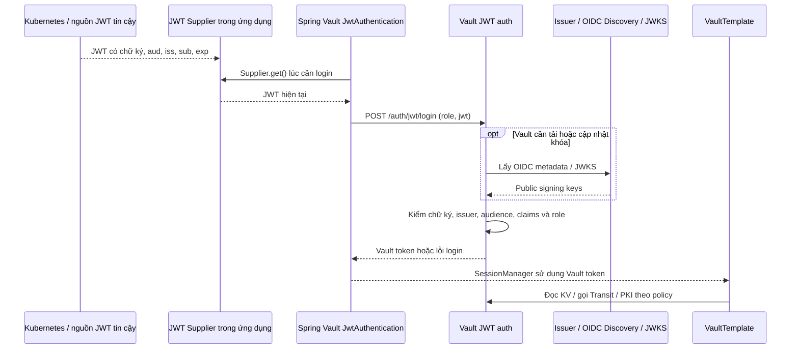
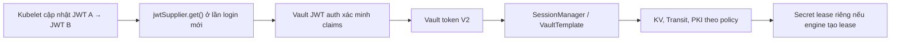

# JwtAuthentication và JwtAuthenticationOptions

Khi ứng dụng Java cần đăng nhập HashiCorp Vault bằng một **JSON Web Token (JWT)**, Spring Vault cung cấp `JwtAuthentication` để thực hiện yêu cầu đăng nhập và `JwtAuthenticationOptions` để cấu hình **auth mount**, **role** và **nguồn cung cấp JWT**. Hai lớp này giải quyết phần giao tiếp của client với **Vault JWT auth method**; việc xác minh chữ ký, issuer, audience và quyền truy cập thuộc trách nhiệm của Vault.

Trong mô-đun **SPRING_VAULT**, JWT authentication là một lựa chọn để xác thực theo *workload identity*. Ứng dụng có thể lấy JWT ngắn hạn từ Kubernetes ServiceAccount, hệ thống CI hoặc một identity provider đáng tin cậy, nhận **Vault token**, rồi sử dụng `VaultTemplate` truy cập KV secrets, Transit encryption, PKI hoặc các engine khác theo **Vault policy**. Bài thuộc chương **Kubernetes và JWT** và tập trung vào cách dùng chính xác hai API Java này, đặc biệt khi JWT trong Pod được kubelet xoay vòng.

**Sau bài học, bạn có thể:**

1. Phân biệt `JwtAuthentication`, `JwtAuthenticationOptions`, `ClientAuthentication`, `Vault token` và `JWT`.
2. Cấu hình `path(...)`, `role(...)`, `jwt(...)` và `jwtSupplier(...)` đúng mục đích.
3. Đăng nhập Vault bằng ServiceAccount JWT được mount trong Kubernetes mà không giữ token hết hạn trong bộ nhớ.
4. Ghép cấu hình Spring Vault với auth mount, JWT role, issuer, audience và policy ở Vault.
5. Sử dụng `VaultOperations`/`VaultTemplate` sau login, hiểu giới hạn session manager và lease manager.
6. Kiểm thử nguồn JWT động, xử lý lỗi 400/403, sự cố khóa xác minh và triển khai an toàn.

## 1. JwtAuthentication nằm ở đâu trong kiến trúc Spring Vault?

Spring Vault định nghĩa interface `ClientAuthentication` cho các cơ chế lấy token đăng nhập Vault. `JwtAuthentication` triển khai interface này và sử dụng JWT đã có để gửi một request đến **JWT auth method**, mặc định là `POST /v1/auth/jwt/login`.



Các lớp và đối tượng không được đánh đồng:

| Thành phần | Chức năng | Không phải |
| --- | --- | --- |
| `JwtAuthenticationOptions` | Giá trị cấu hình: tên auth mount, tên role, `Supplier<String>` cấp JWT. | Nơi cấu hình khóa ký hoặc policy trên Vault. |
| `JwtAuthentication` | Gọi login với `role` và `jwt`, nhận `VaultToken` / `LoginToken` từ Vault. | Bộ xác minh chữ ký JWT tại client. |
| `ClientAuthentication` | Hợp đồng đăng nhập cho Spring Vault. | Token phiên hay secrets engine. |
| JWT đầu vào | Credential được issuer tin cậy ký, dùng để **xin đăng nhập Vault**. | Vault token dùng cho các request API tiếp theo. |
| Vault JWT role | Kiểm tra `aud`, `sub`, claim khác và quyết định policy/TTL của Vault token. | Kubernetes ServiceAccount hay role trong Spring Bean. |
| `SessionManager` | Tái sử dụng, renew hoặc đăng nhập lại để cung cấp Vault token hợp lệ. | Bộ làm mới JWT của Kubernetes hoặc secret lease. |
| `VaultTemplate` / `VaultOperations` | Thực hiện thao tác Vault đã xác thực. | Nơi tự quyết định role/policy của người dùng. |

JWT có thể có `iss` (issuer), `aud` (audience), `sub` (subject), `nbf`, `iat`, `exp`. Spring Vault **chuyển JWT đến Vault**; bên Vault JWT auth xác minh chữ ký bằng public keys, JWKS hoặc OIDC discovery và áp các bound constraints. Việc giải mã payload JWT ở Java không tương đương với xác minh chữ ký.

> **Ranh giới quan trọng:** `JwtAuthentication` đăng nhập vào **Vault JWT auth method**, thường mount `auth/jwt`. Nó **khác** `KubernetesAuthentication`, vốn đăng nhập qua `auth/kubernetes` và để Vault gọi Kubernetes `TokenReview`. Cả hai có thể tiêu thụ Kubernetes ServiceAccount JWT nhưng yêu cầu cấu hình server khác nhau.

## 2. Các API quan trọng của JwtAuthenticationOptions

`JwtAuthenticationOptions` là một đối tượng cấu hình **immutable sau khi được build**, có từ **Spring Vault 3.1**. Tạo đối tượng bằng builder:

```java
JwtAuthenticationOptions options = JwtAuthenticationOptions.builder()
    .path("jwt")
    .role("orders-jwt-read")
    .jwtSupplier(jwtSupplier)
    .build();
```

Các phương thức cần nắm:

| Phương thức | Cấu hình | Lưu ý |
| --- | --- | --- |
| `path(String)` | Tên **Vault auth mount** chứa JWT backend, ví dụ `jwt` hoặc `jwt-prod`. | Không phải file JWT, Kubernetes namespace, hay endpoint có tiền tố `/v1/auth/`. Mặc định là `jwt`. |
| `role(String)` | Tên role tại `auth/<mount>/role/<role>`. | Client chỉ **yêu cầu** role; Vault kiểm tra claims và quyết định có cấp token hay không. |
| `jwt(String)` | Một **JWT cố định**. | Javadoc mô tả JWT được sử dụng như singleton; không phù hợp với token tự xoay vòng. |
| `jwtSupplier(Supplier<String>)` | Nguồn động có thể trả JWT hiện tại khi cần đăng nhập. | Phù hợp với projected ServiceAccount token hoặc credential được làm mới bên ngoài. |
| `build()` | Tạo đối tượng `JwtAuthenticationOptions`. | Options không tự login; `JwtAuthentication` mới sử dụng options khi có yêu cầu. |

Các accessor `getPath()`, `getRole()`, `getJwtSupplier()` giúp xem **cấu hình** trong test. `getRole()` có thể trả `null` khi không cấu hình, dùng cho các tình huống Vault đã có `default_role` phù hợp; trong ứng dụng production nên khai báo role rõ ràng để tránh thay đổi mặc định ở server ngoài ý muốn.

### Cách 1: JWT cố định cho một luồng ngắn hạn

```java
String externallyIssuedJwt = obtainJwtFromSecureCaller();

JwtAuthenticationOptions options = JwtAuthenticationOptions.builder()
    .path("jwt")
    .role("short-lived-job")
    .jwt(externallyIssuedJwt)
    .build();
```

`obtainJwtFromSecureCaller()` là **hàm giả định**, thể hiện credential được môi trường chạy cấp trong bộ nhớ; không đặt JWT thật trong source code. Cấu hình `jwt(String)` thích hợp nếu token được cấp riêng cho một công việc ngắn và không dự kiến re-login sau khi hết hạn. Với dịch vụ chạy liên tục, `jwt(String)` là nguồn cố định: session manager không thể tự biến chuỗi này thành JWT mới.

### Cách 2: JWT động cho workload chạy lâu dài

```java
import java.util.function.Supplier;
import org.springframework.vault.authentication.JwtAuthenticationOptions;

Supplier<String> jwtSupplier = () -> readCurrentJwtFromSecureSource();

JwtAuthenticationOptions options = JwtAuthenticationOptions.builder()
    .path("jwt")
    .role("orders-jwt-read")
    .jwtSupplier(jwtSupplier)
    .build();
```

`readCurrentJwtFromSecureSource()` cũng là **hàm minh họa**: hệ thống thật phải cung cấp một `Supplier<String>` đọc credential tin cậy và xử lý lỗi. Dùng `jwtSupplier(...)` không có nghĩa Spring Vault sẽ tự phát hành hoặc tự xoay vòng JWT. Supplier chỉ **đọc credential tại thời điểm được gọi**, còn issuer/kubelet chịu trách nhiệm cấp token mới.

Không đặt cả `jwt(...)` và `jwtSupplier(...)` trong cùng builder rồi kỳ vọng một cơ chế fallback. Hãy chọn **một nguồn JWT rõ ràng**.

## 3. Trường hợp Kubernetes: đọc projected ServiceAccount JWT

Ứng dụng `orders-api` chạy trong namespace `apps` có thể sử dụng **projected ServiceAccount token** với audience `vault`. Manifest sau là ví dụ có thể điều chỉnh cho sandbox; namespace `apps` phải có sẵn, image/URL Vault là placeholder:

```yaml
apiVersion: v1
kind: ServiceAccount
metadata:
  name: orders-api
  namespace: apps
automountServiceAccountToken: false
---
apiVersion: apps/v1
kind: Deployment
metadata:
  name: orders-api
  namespace: apps
spec:
  replicas: 1
  selector:
    matchLabels:
      app: orders-api
  template:
    metadata:
      labels:
        app: orders-api
    spec:
      serviceAccountName: orders-api
      automountServiceAccountToken: false
      containers:
        - name: app
          image: registry.example.com/orders-api:1.0.0
          env:
            - name: VAULT_URI
              value: "https://vault.vault.svc:8200"
            - name: VAULT_JWT_ROLE
              value: "orders-jwt-read"
            - name: VAULT_JWT_FILE
              value: "/var/run/secrets/vault/jwt"
          volumeMounts:
            - name: workload-jwt
              mountPath: /var/run/secrets/vault
              readOnly: true
      volumes:
        - name: workload-jwt
          projected:
            sources:
              - serviceAccountToken:
                  path: jwt
                  audience: vault
                  expirationSeconds: 3600
```

Giải nghĩa những trường liên quan tới `JwtAuthenticationOptions`:

- `serviceAccountName: orders-api` và namespace `apps` xác định `sub`, thông thường `system:serviceaccount:apps:orders-api`.
- `audience: vault` yêu cầu JWT có `aud` chứa `vault`, để khớp `bound_audiences` trong Vault JWT role.
- `expirationSeconds: 3600` yêu cầu JWT có TTL khoảng 1 giờ; thời hạn thực tế do Kubernetes API server quyết định.
- `mountPath` kết hợp `path: jwt` thành file `/var/run/secrets/vault/jwt` — đây là **đầu vào cho Java supplier**, không phải giá trị `JwtAuthenticationOptions.path(...)`.
- `automountServiceAccountToken: false` tắt tự mount token dành cho Kubernetes API; projected token khai báo rõ ràng vẫn được mount.

**Kubelet làm mới** token từ TokenRequest API trước khi nó hết hạn và cập nhật nội dung projected volume. Không cache chuỗi JWT ở startup, không dùng `subPath` mount riêng file token, không sao chép file sang image/env var cố định. Thông thường, Spring Vault chỉ cần **đọc lại file khi đăng nhập Vault lần tiếp theo**, không phải nghe mọi sự kiện thay đổi file.

### Dùng supplier có sẵn của Spring Vault

Spring Vault có `KubernetesServiceAccountTokenFile`, triển khai `Supplier<String>` và đọc ServiceAccount JWT từ file:

```java
import org.springframework.vault.authentication.KubernetesServiceAccountTokenFile;
import org.springframework.vault.authentication.JwtAuthenticationOptions;

JwtAuthenticationOptions options = JwtAuthenticationOptions.builder()
    .role("orders-jwt-read")
    .path("jwt")
    .jwtSupplier(new KubernetesServiceAccountTokenFile(
        "/var/run/secrets/vault/jwt"))
    .build();
```

Tên lớp bắt đầu bằng **Kubernetes** vì nó đọc token file của ServiceAccount, nhưng supplier vẫn có thể dùng với **Vault JWT auth** qua `JwtAuthentication`. Constructor kiểm tra file tồn tại và có thể ném `IllegalArgumentException` nếu mount sai; mỗi lần `get()` đọc credential từ nguồn file, phù hợp với token được thay bên dưới cùng đường dẫn.

Đừng gọi `cached()` trên nguồn credential nếu JWT được kubelet xoay vòng: việc cache có thể khiến lần login lại dùng một JWT cũ đã hết hạn. Với token có nguồn khác Kubernetes, dùng `Supplier<String>` tương ứng; tránh tự tạo thread liên tục poll file chỉ vì sử dụng `JwtAuthentication`.

## 4. Cấu hình Vault JWT auth tương thích với Pod

**Spring Vault không tự tạo JWT auth mount, trust source, role hay policy.** Những đối tượng này phải được cấu hình ở Vault bởi operator. Mô hình ví dụ:

```text
Kubernetes ServiceAccount JWT
   iss=https://issuer.k8s.example.internal
   sub=system:serviceaccount:apps:orders-api
   aud=["vault"]
          |
          v
Vault auth/jwt/config
   oidc_discovery_url=https://issuer.k8s.example.internal
          |
          v
Vault auth/jwt/role/orders-jwt-read
   role_type=jwt
   user_claim=sub
   bound_subject=system:serviceaccount:apps:orders-api
   bound_audiences=vault
   token_policies=orders-read
          |
          v
Vault token -> policy orders-read -> KV v2
```

### 4.1. Chuẩn bị nguồn xác minh chữ ký và issuer

Trong sandbox chưa có auth mount:

```bash
vault auth enable -path=jwt jwt

vault write auth/jwt/config \
  oidc_discovery_url="https://issuer.k8s.example.internal"
```

`https://issuer.k8s.example.internal` là **URL giả**, phải thay bằng issuer discovery URL của cluster thật. Có thể xem metadata công khai trên Kubernetes:

```bash
kubectl get --raw /.well-known/openid-configuration
```

Vault phải truy cập được issuer/JWKS endpoint qua TLS đáng tin cậy để lấy khóa xác minh. Trong môi trường cần CA nội bộ, cấu hình `oidc_discovery_ca_pem` phù hợp. Ngoài `oidc_discovery_url`, JWT auth có các phương án xác minh bằng `jwks_url`/`jwks_pairs` hoặc `jwt_validation_pubkeys` tùy phiên bản Vault. Các lựa chọn đó có quy trình quản lý key/issuer khác nhau; không cấu hình đồng thời nhiều cơ chế không tương thích trên cùng mount.

JWT auth **không gọi Kubernetes `TokenReview` khi login**. Điều này giảm phụ thuộc trực tiếp vào Kubernetes API nhưng có hệ quả: JWT bound-to-Pod có thể tiếp tục được chấp nhận sau khi Pod bị xóa **cho tới khi `exp`**, nếu chữ ký và claims còn hợp lệ. Nếu yêu cầu kiểm tra trạng thái thu hồi qua TokenReview, cần dùng Vault **Kubernetes auth** thay vì JWT auth.

### 4.2. Viết Vault policy cho KV v2

Giả sử Vault đã có mount KV v2 tên `kv`. Trong sandbox chưa có mount và cần dữ liệu kiểm thử:

```bash
# Chỉ chạy enable nếu vault secrets list chưa có mount kv/.
vault secrets enable -path=kv kv-v2

vault kv put -mount=kv apps/orders/config \
  mode="sandbox" \
  region="ap-southeast-1"
```

Tạo file `orders-read.hcl`:

```hcl
path "kv/data/apps/orders/config" {
  capabilities = ["read"]
}
```

Nạp policy:

```bash
vault policy write orders-read orders-read.hcl
```

`kv/data/apps/orders/config` là endpoint của **KV v2** trong Vault policy. API Java `opsForVersionedKeyValue("kv").get("apps/orders/config")` dùng đường dẫn tương đối với mount, không đưa `kv/data/` vào tham số `get(...)`.

### 4.3. Tạo JWT role đúng audience và subject

```bash
vault write auth/jwt/role/orders-jwt-read \
  role_type="jwt" \
  user_claim="sub" \
  bound_subject="system:serviceaccount:apps:orders-api" \
  bound_audiences="vault" \
  token_policies="orders-read" \
  token_ttl="15m" \
  token_max_ttl="1h"

vault read auth/jwt/role/orders-jwt-read
```

| Trường Vault JWT role | Tác dụng |
| --- | --- |
| `role_type="jwt"` | Chọn login bằng JWT được client gửi trực tiếp; không phải OIDC authorization-code redirect. |
| `user_claim="sub"` | Chọn claim định danh cho Vault Identity alias. |
| `bound_subject` | Giới hạn subject là đúng ServiceAccount thuộc namespace `apps`. |
| `bound_audiences="vault"` | Chỉ chấp nhận JWT có `aud` khớp `vault`. |
| `token_policies="orders-read"` | Gắn policy vào **Vault token sau login**. |
| `token_ttl`, `token_max_ttl` | TTL Vault token; độc lập với thời hạn Kubernetes JWT. |

Từ **Vault 1.17**, JWT role kiểu `jwt` cần `bound_audiences` khớp **ít nhất một** phần tử của claim `aud` nếu JWT có claim `aud`. Chẳng hạn JWT có `aud=["vault"]` sẽ không khớp `bound_audiences="kubernetes"`. So khớp audience là so chuỗi cụ thể; `vault` khác `Vault` hoặc `https://vault.example`.

Với nhiều cluster có ServiceAccount cùng tên và namespace, claim `sub` có thể **giống nhau**. Do đó ngoài `bound_subject` còn phải kiểm soát **issuer, signing keys và trust domain** của auth mount. Không chỉ dựa vào tên ServiceAccount để cho các cluster khác nhau dùng chung policy.

**Lưu ý:** nếu Vault chưa có mount `jwt` hoặc role `orders-jwt-read`, ứng dụng gọi `JwtAuthentication` sẽ thất bại. Tên role trong Java **không tạo role trên server**.

## 5. Cấu hình Java hoàn chỉnh với Spring Vault core

Trong ứng dụng sử dụng **Spring Vault 4.1.x**, cấu hình `AbstractVaultConfiguration` để Spring quản lý `VaultTemplate` và session manager; dùng biến môi trường cho địa chỉ, role và đường dẫn token. Maven dependency (phiên bản cần đồng bộ với Spring Framework/BOM đang dùng):

```xml
<dependency>
    <groupId>org.springframework.vault</groupId>
    <artifactId>spring-vault-core</artifactId>
</dependency>
```

Ví dụ cấu hình:

```java
import java.net.URI;

import org.springframework.beans.factory.annotation.Value;
import org.springframework.context.annotation.Configuration;
import org.springframework.vault.authentication.ClientAuthentication;
import org.springframework.vault.authentication.JwtAuthentication;
import org.springframework.vault.authentication.JwtAuthenticationOptions;
import org.springframework.vault.authentication.KubernetesServiceAccountTokenFile;
import org.springframework.vault.client.VaultEndpoint;
import org.springframework.vault.config.AbstractVaultConfiguration;

@Configuration
public class VaultJwtConfig extends AbstractVaultConfiguration {

    @Value("${VAULT_URI}")
    private URI vaultUri;

    @Value("${VAULT_JWT_ROLE:orders-jwt-read}")
    private String role;

    @Value("${VAULT_JWT_FILE:/var/run/secrets/vault/jwt}")
    private String jwtFile;

    @Override
    public VaultEndpoint vaultEndpoint() {
        return VaultEndpoint.from(vaultUri);
    }

    @Override
    public ClientAuthentication clientAuthentication() {
        JwtAuthenticationOptions options = JwtAuthenticationOptions.builder()
            .path("jwt")
            .role(role)
            .jwtSupplier(new KubernetesServiceAccountTokenFile(jwtFile))
            .build();

        return new JwtAuthentication(options, vaultClient());
    }
}
```

Lưu ý về phiên bản:

- `JwtAuthentication` và `JwtAuthenticationOptions` có từ Spring Vault **3.1**.
- Constructor `new JwtAuthentication(options, vaultClient())` với `VaultClient` có từ **Spring Vault 4.1**.
- Spring Vault 4.0 có constructor nhận `RestClient`; overload nhận `RestOperations` có ở các phiên bản cũ và đã được đánh dấu **deprecated từ 4.1**. Nếu dự án dùng 3.x/4.0, chọn constructor được hỗ trợ trong Javadoc đúng phiên bản.
- `VaultEndpoint.from(vaultUri)` xác định nơi gửi request tới Vault, không phải URL issuer; cấu hình TLS trust chain của Vault trong client/JVM, tuyệt đối không vô hiệu hóa TLS verification để xử lý lỗi issuer.

Hai khái niệm `path` dễ nhầm:

```text
JwtAuthenticationOptions.path("jwt")
    -> Vault auth mount: POST /v1/auth/jwt/login

KubernetesServiceAccountTokenFile("/var/run/secrets/vault/jwt")
    -> Đường dẫn FILE trong container để đọc JWT
```

Khi admin mount auth method tại `auth/workload-jwt`, thay `path("jwt")` thành `path("workload-jwt")` và đảm bảo role tạo tại `auth/workload-jwt/role/...`. Không thay file path chỉ vì đổi auth mount.

### Sử dụng VaultOperations sau login

`VaultTemplate` triển khai `VaultOperations`. Mã đọc KV v2 không cần biết JWT auth hay Kubernetes auth đã được dùng:

```java
import java.util.Map;

import org.springframework.stereotype.Service;
import org.springframework.vault.core.VaultOperations;
import org.springframework.vault.support.Versioned;

@Service
public class OrdersSettings {
    private final VaultOperations vault;

    public OrdersSettings(VaultOperations vault) {
        this.vault = vault;
    }

    public String mode() {
        Versioned<Map<String, Object>> secret =
            vault.opsForVersionedKeyValue("kv").get("apps/orders/config");

        if (secret == null || secret.getData() == null) {
            throw new IllegalStateException("Missing Vault KV configuration");
        }

        Object value = secret.getData().get("mode");
        if (!(value instanceof String)) {
            throw new IllegalStateException("Invalid Vault KV configuration");
        }
        return (String) value;
    }
}
```

`SessionManager` cung cấp **Vault token** cho `VaultTemplate`. JWT nguồn chỉ được dùng để **đăng nhập Vault**, không đưa trực tiếp vào header `X-Vault-Token`. Policy trên Vault quyết định API path nào được phép; đối với Transit/PKI phải cấu hình thêm policy tương ứng, không vì JWT hợp lệ mà tự có quyền mã hóa/giải mã hoặc phát hành certificate.

## 6. Vòng đời JWT, Vault token và secret lease



| Đối tượng | Được cấp bởi | Điều gì xảy ra khi hết hạn? |
| --- | --- | --- |
| **ServiceAccount JWT** | Kubernetes TokenRequest API, kubelet quản lý projected file. | Token cũ không thể dùng cho lần **login mới** khi `exp` đã qua. |
| **Vault client token** | Vault sau `auth/jwt/login`; Spring Vault session manager quản lý phiên. | Có thể renew hoặc đăng nhập lại với JWT mới, tùy token/session config. |
| **Secret lease** | Secrets engine phù hợp như dynamic database/PKI; có TTL/revoke riêng. | Secret/certificate có thể hết hạn hoặc bị revoke; cần lease management riêng khi ứng dụng sử dụng dynamic secrets. |

`LifecycleAwareSessionManager` của Spring Vault có thể tái sử dụng hoặc renew Vault token và re-login sau khi token chạm giới hạn. Nó **không phát hành lại ServiceAccount JWT**; kubelet làm việc đó. Khi session manager cần gọi `JwtAuthentication.login()` lần mới, supplier động phải lấy JWT đang còn hiệu lực. Cũng không cần cưỡng ép login Vault ngay khi file JWT thay đổi; Vault token cũ có thể vẫn còn hạn.

Nếu ứng dụng chỉ dùng `jwt(jwtAtStartup)`, việc re-login sau vài giờ sẽ tiếp tục sử dụng JWT cũ: dù kubelet đã cập nhật file, chuỗi trong options không đổi. Nếu dùng `jwtSupplier(new KubernetesServiceAccountTokenFile(...))`, lần đăng nhập tiếp theo đọc file cập nhật. Việc đăng nhập vẫn có thể thất bại nếu issuer, signature key, audience, subject hoặc Vault role không còn khớp.

Lưu ý **JWT auth không gọi Kubernetes TokenReview**. Một projected JWT bound-to-Pod từng hợp lệ có thể tiếp tục được JWT auth chấp nhận trước `exp` dù Pod đã bị xóa. Vì vậy nên yêu cầu TTL JWT ngắn, policy ít quyền, TTL Vault token phù hợp và quy trình revoke token khi xử lý sự cố; nếu phải kiểm tra tình trạng Pod/SA ở từng lần login, cân nhắc **Kubernetes auth**.

## 7. Kiểm thử nguồn JWT động với JUnit 5

Có thể kiểm thử đơn vị phần **đọc lại file** mà không cần một JWT thật hoặc Vault server. Mục tiêu chỉ là chứng minh `JwtAuthenticationOptions` giữ một supplier và supplier đọc giá trị mới ở cùng đường dẫn.

```java
import static org.junit.jupiter.api.Assertions.assertEquals;

import java.nio.charset.StandardCharsets;
import java.nio.file.Files;
import java.nio.file.Path;
import java.nio.file.StandardCopyOption;

import org.junit.jupiter.api.Test;
import org.junit.jupiter.api.io.TempDir;
import org.springframework.vault.authentication.JwtAuthenticationOptions;
import org.springframework.vault.authentication.KubernetesServiceAccountTokenFile;

class JwtAuthenticationOptionsTest {

    @Test
    void supplierReadsUpdatedJwtFile(@TempDir Path directory) throws Exception {
        Path jwtPath = directory.resolve("jwt");
        Files.writeString(jwtPath, "jwt-A", StandardCharsets.UTF_8);

        JwtAuthenticationOptions options = JwtAuthenticationOptions.builder()
            .path("jwt")
            .role("orders-jwt-read")
            .jwtSupplier(new KubernetesServiceAccountTokenFile(
                jwtPath.toString()))
            .build();

        assertEquals("jwt", options.getPath());
        assertEquals("orders-jwt-read", options.getRole());
        assertEquals("jwt-A", options.getJwtSupplier().get());

        Path replacement = directory.resolve("jwt-new");
        Files.writeString(replacement, "jwt-B", StandardCharsets.UTF_8);
        Files.move(replacement, jwtPath, StandardCopyOption.REPLACE_EXISTING);

        assertEquals("jwt-B", options.getJwtSupplier().get());
    }
}
```

`jwt-A` và `jwt-B` là **chuỗi giả**, không phải JWT có chữ ký. Test không chứng minh login Vault thành công; nó xác nhận phần nguồn credential có thể cập nhật. Trong Kubernetes thật, kubelet thay dữ liệu projected volume bằng cơ chế symlink/atomic update; việc đọc lại đường dẫn logic là điều quan trọng. Không dùng JWT thật trong unit test hay lưu nó trong assertion message/log.

### Một phản ví dụ cần tránh

```java
// KHÔNG phù hợp với Pod chạy lâu: đọc JWT đúng một lần lúc khởi động.
String startupJwt = Files.readString(Path.of(
    "/var/run/secrets/vault/jwt"), StandardCharsets.UTF_8);

JwtAuthenticationOptions badOptions = JwtAuthenticationOptions.builder()
    .path("jwt")
    .role("orders-jwt-read")
    .jwt(startupJwt)
    .build();
```

Khi token trên file đã đổi, `badOptions` vẫn giữ `startupJwt`. Không khắc phục bằng cách tạo `VaultTemplate` mới mỗi khi file đổi; chỉ cần nguồn JWT phù hợp và session manager có vòng đời đúng.

## 8. Kiểm thử tích hợp với Vault và Kubernetes

Một bài kiểm thử integration có ý nghĩa cần **JWT được issuer thật ký**, Vault auth mount/role/policy và ứng dụng Java chạy được trong môi trường sandbox. Thực hiện theo chuỗi:

1. **Kiểm tra issuer/key trust:** đọc endpoint OIDC discovery của cluster (metadata, không phải JWT), xác minh Vault kết nối được issuer/JWKS qua TLS.
2. **Kiểm tra role đúng:** `auth/jwt/role/orders-jwt-read` có `role_type=jwt`, `user_claim=sub`, `bound_subject=system:serviceaccount:apps:orders-api`, `bound_audiences=vault`.
3. **Happy path:** Pod `apps/orders-api` nhận JWT `aud=vault`; Spring Vault login thành công; `VaultOperations` đọc được `mode` tại `kv/apps/orders/config`.
4. **Sai audience:** đổi projected token của một Pod thử nghiệm thành `aud=other-service`; login vào role yêu cầu `vault` phải bị từ chối.
5. **Sai subject:** Pod cùng namespace nhưng dùng ServiceAccount khác, hoặc cùng tên SA ở namespace khác; phải bị từ chối bởi bound subject.
6. **Sai issuer/khóa ký:** sử dụng một token được issuer không tin cậy phát hành trong sandbox; xác nhận không login được dù audience/subject giống nhau.
7. **JWT hết hạn và rotate:** để kubelet thay projected JWT, xác nhận lần re-login sau đó sử dụng token hiện tại mà không cần restart Pod.
8. **Policy boundary:** sau khi login thành công, thử ghi lên path chỉ có quyền `read` hoặc đọc KV path khác; Vault API phải trả `permission denied`.
9. **Revocation behavior:** đánh giá token gắn Pod đã xóa nhưng chưa hết `exp`, ghi nhận rằng JWT auth không thực hiện TokenReview. Đừng coi xóa Pod là cách lập tức thu hồi mọi Vault token đã cấp.

Không cần gọi thủ công `auth/jwt/login` kèm JWT thật trong shell nếu kiểm thử bằng Spring Vault đã đáp ứng nhu cầu; việc đưa token lên command line có thể khiến nó xuất hiện trong process list, lịch sử shell hoặc CI log. Chỉ ghi kết quả xác thực, loại lỗi, role, request ID và mã phản hồi an toàn.

## 9. Chẩn đoán lỗi JwtAuthentication theo đúng tầng

| Hiện tượng | Nguyên nhân thường gặp | Hướng xác minh |
| --- | --- | --- |
| Khởi động lỗi `IllegalArgumentException` từ `KubernetesServiceAccountTokenFile` | File token không tồn tại, mountPath/path sai, Pod tắt auto mount nhưng không khai báo projection. | Kiểm tra `serviceAccountName`, `volumes`, `volumeMounts`, quyền đọc file; không in JWT. |
| Vault trả 404 hoặc unsupported path khi login | `path("jwt")` không khớp auth mount đã bật trên Vault. | Dùng quyền phù hợp xem `vault auth list` và tên mount. |
| Login báo lỗi signature/JWKS | JWT được ký bằng key Vault không tin cậy, JWKS URL lỗi hoặc signing key đã luân chuyển. | Kiểm tra `auth/jwt/config`, issuer discovery/JWKS và TLS/network từ Vault. |
| Login báo issuer mismatch | `iss` không khớp issuer được Vault tin cậy hoặc cấu hình `bound_issuer`/OIDC discovery. | So issuer metadata của nguồn token với Vault config; không nhầm issuer JWT với CA TLS. |
| Login báo audience mismatch | `aud` của JWT không khớp `bound_audiences`; Vault 1.17+ yêu cầu ràng buộc khi token có `aud`. | Xem projected `audience` và JWT role; sửa hai đầu tương thích. |
| Login báo subject/bound claim mismatch | SA/namespace khác, claim không tồn tại hoặc role ràng buộc sai. | Đối chiếu ServiceAccount thực và `bound_subject` hoặc `bound_claims`. |
| Login được lúc đầu, thất bại sau một giờ | Dùng `jwt(String)`/supplier cache, file token dùng `subPath`, hoặc kubelet không cập nhật credential. | Chuyển sang supplier đọc file, kiểm tra rotation và các giới hạn mạng/TTL. |
| Login thành công nhưng `VaultTemplate` nhận 403 ở KV | Vault token không có policy `read` trên `kv/data/apps/orders/config`. | Xem policy và API path; lỗi này xảy ra **sau** khi JwtAuthentication làm xong việc. |
| Thường xuyên login lại hoặc tăng tải Vault | Tự gọi `clientAuthentication.login()` cho mỗi lần đọc secret thay vì dùng SessionManager. | Để `VaultTemplate`/session manager quản lý phiên và đo login rate. |

Đối với lỗi auth, mã HTTP có thể là **400, 403 hoặc mã khác** tùy điểm thất bại và phiên bản Vault; nên xác định endpoint, thông báo lỗi và audit event, không chỉ suy luận từ status code.

Một số lệnh kiểm tra **không in credential**:

```bash
# Metadata của Pod; không hiện JWT.
kubectl -n apps get pod -l app=orders-api \
  -o custom-columns=NAME:.metadata.name,SA:.spec.serviceAccountName

# Kiểm tra volume/token projection và sự kiện Pod.
kubectl -n apps describe pod <pod-name>

# Đọc cấu hình Vault bằng tài khoản có quyền tương ứng.
vault auth list
vault read auth/jwt/config
vault read auth/jwt/role/orders-jwt-read
vault policy read orders-read

# Issuer metadata công khai; không lấy token Pod.
kubectl get --raw /.well-known/openid-configuration
```

**Quan sát production:** theo dõi login successes/failures, độ trễ auth endpoint, lỗi supplier I/O, lần renew/re-login Vault token, kết nối tới issuer/JWKS và 403 ở từng Vault API path. Không ghi JWT, Vault token, nội dung KV, plaintext của Transit hay dữ liệu PKI nhạy cảm vào log; không bật verbose token logging trên Vault production. Giới hạn retry bằng backoff/jitter và phân biệt lỗi cấu hình cố định với lỗi mạng nhất thời.

## 10. Các quyết định thiết kế cần nhớ

| Quyết định | Lựa chọn nên ưu tiên | Lý do |
| --- | --- | --- |
| Token nguồn cho Pod chạy lâu | `jwtSupplier(new KubernetesServiceAccountTokenFile(...))` | Lần login sau lấy JWT hiện tại. |
| Tên Vault auth mount | `path("jwt")` hoặc mount thực tế | Điều khiển endpoint login, độc lập với đường dẫn file. |
| Role | `role("orders-jwt-read")`, có bound claims | Gắn danh tính workload với quyền Vault cụ thể. |
| Trust source | OIDC discovery/JWKS/public keys đã xác minh | JWT auth tự kiểm tra chữ ký và claims. |
| Audience | Projected `audience=vault` khớp JWT role `bound_audiences=vault` | Ngăn token cấp cho dịch vụ khác được sử dụng để login. |
| Subject và nhiều cluster | Ràng buộc `sub`, issuer và signing keys đúng trust domain | Không nhầm SA giống tên ở hai cluster. |
| Vault token/secret lease | Dùng session/lease management phù hợp | TTL của JWT, Vault token và lease không đồng nhất. |
| Cần TokenReview/thu hồi sớm | Xem xét `KubernetesAuthentication` thay vì JWT auth | JWT auth không xác minh trạng thái Pod/SA trực tiếp ở mỗi login. |

**Câu hỏi tự kiểm tra:**

1. Khi nào dùng `jwt(String)`, khi nào dùng `jwtSupplier(Supplier<String>)` và vì sao?
2. `path("jwt")` có liên quan gì đến `/var/run/secrets/vault/jwt` không?
3. Vì sao `JwtAuthentication` có thể nhận token của Kubernetes nhưng không được nhầm với `KubernetesAuthentication`?
4. Vì sao role cần `bound_audiences`, `bound_subject` và trust source?
5. Khi `VaultTemplate` đọc KV báo 403 nhưng login thành công, nên kiểm tra lớp nào?
6. Kubelet đã xoay vòng JWT trong Pod, vì sao ứng dụng vẫn có thể tiếp tục dùng Vault token cũ?
7. Vì sao unit test với chuỗi `jwt-A` và `jwt-B` chưa chứng minh JWT auth tích hợp hoạt động?

## 11. Tài liệu chính thức để tra cứu API theo phiên bản

- [Spring Vault — Authentication Methods](https://docs.spring.io/spring-vault/reference/vault/authentication.html): `ClientAuthentication`, JWT authentication, quản lý token/session.
- [Spring Vault — JwtAuthenticationOptions](https://docs.spring.io/spring-vault/reference/api/java/org/springframework/vault/authentication/JwtAuthenticationOptions.html) và [JwtAuthenticationOptionsBuilder](https://docs.spring.io/spring-vault/reference/api/java/org/springframework/vault/authentication/JwtAuthenticationOptions.JwtAuthenticationOptionsBuilder.html): `path`, `role`, `jwt`, `jwtSupplier`, immutable options.
- [Spring Vault — JwtAuthentication](https://docs.spring.io/spring-vault/reference/api/java/org/springframework/vault/authentication/JwtAuthentication.html): `ClientAuthentication`, `login()` và constructor theo phiên bản.
- [Spring Vault — KubernetesServiceAccountTokenFile](https://docs.spring.io/spring-vault/reference/api/java/org/springframework/vault/authentication/KubernetesServiceAccountTokenFile.html): supplier cho ServiceAccount token file.
- [HashiCorp Vault — JWT/OIDC auth method](https://developer.hashicorp.com/vault/docs/auth/jwt): nguồn khóa xác minh, bound claims và yêu cầu audience.
- [HashiCorp Vault — JWT/OIDC auth API](https://developer.hashicorp.com/vault/api-docs/auth/jwt): `auth/jwt/config`, role, `bound_subject`, `bound_audiences` và login request.
- [HashiCorp Vault — Kubernetes as OIDC provider](https://developer.hashicorp.com/vault/docs/auth/jwt/oidc-providers/kubernetes): ServiceAccount JWT, OIDC discovery và giới hạn xác thực chữ ký không có TokenReview.
- [Kubernetes — Configure Service Accounts for Pods](https://kubernetes.io/docs/tasks/configure-pod-container/configure-service-account/): projected token, audience, rotation và vòng đời ServiceAccount JWT.
