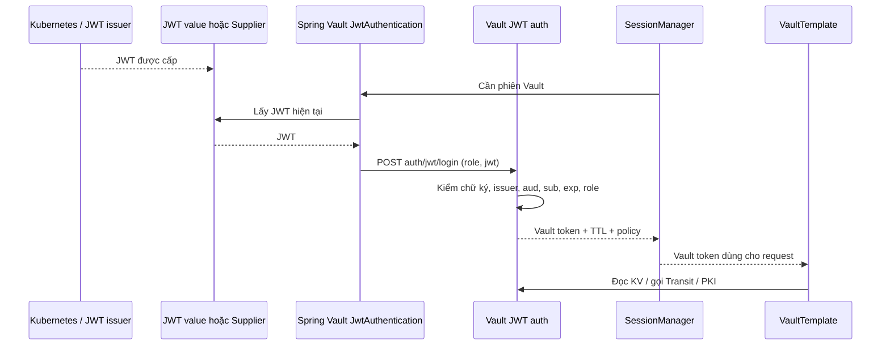
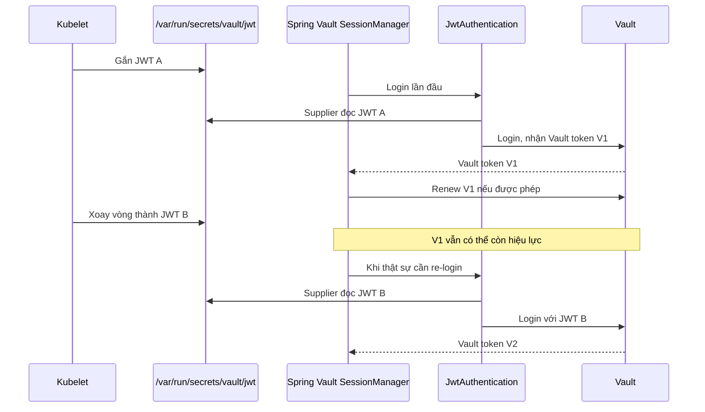

# Cung cấp JWT bằng giá trị hoặc supplier

Ứng dụng Java có thể đăng nhập HashiCorp Vault bằng một **JSON Web Token (JWT)** do Kubernetes, hệ thống CI hoặc nhà cung cấp danh tính tin cậy phát hành. Khi dùng **Spring Vault**, câu hỏi triển khai quan trọng là: **JWT này được cấp một lần cho một tác vụ ngắn, hay có thể thay đổi khi ứng dụng đang chạy?**

`JwtAuthenticationOptions` hỗ trợ hai cách cung cấp JWT:

- `jwt(String)` nhận **một giá trị cố định**, được sử dụng lại trong các lần đăng nhập Vault tiếp theo.
- `jwtSupplier(Supplier<String>)` nhận **một hàm cấp credential**; mỗi lần Spring Vault cần JWT để đăng nhập, nó có thể lấy giá trị hiện tại từ nguồn đã chọn.

Hai cách này đều dùng `JwtAuthentication` để đăng nhập **Vault JWT auth method**, nhận **Vault token** rồi sử dụng `VaultTemplate` truy cập KV secrets, Transit encryption hoặc PKI theo Vault policy. JWT nguồn, Vault token và secret lease vẫn có **vòng đời độc lập**. Đây là bài học thuộc chương **Kubernetes và JWT** trong mô-đun **SPRING_VAULT**, với trọng tâm là lựa chọn nguồn JWT đúng cho workload.

Sau bài học, bạn có thể giải thích ý nghĩa của hai phương thức, viết cấu hình Java với JWT cố định hoặc supplier, đọc projected ServiceAccount JWT khi kubelet xoay vòng, kiểm thử hành vi đổi credential, và chẩn đoán lỗi đăng nhập lại mà không làm lộ token.

## 1. Hai token xuất hiện trong một lần đăng nhập Vault

JWT là **đầu vào** của đăng nhập Vault JWT auth. `JwtAuthentication` gửi tên role và JWT đến `POST /v1/auth/jwt/login`; Vault kiểm tra chữ ký, issuer, audience, subject và những ràng buộc claim khác theo cấu hình auth mount/role, sau đó có thể cấp **Vault token**.



| Thực thể | Ai phát hành hoặc quản lý? | Chức năng |
| --- | --- | --- |
| **JWT nguồn** | Kubernetes TokenRequest, CI, OIDC issuer hoặc hệ thống identity khác. | Chứng minh danh tính để **đăng nhập** Vault. |
| **Vault JWT role** | Operator cấu hình trong Vault. | Quy định claim nào được chấp nhận và policy/TTL nào gắn cho Vault token. |
| **Vault token** | Vault cấp sau khi đăng nhập thành công. | Xác thực các request `VaultTemplate` gửi đến Vault. |
| **Secret lease** | Secrets engine khi cấp dynamic secret hoặc một tài nguyên có lease. | Theo dõi TTL, renew/revoke riêng; không đồng nhất với JWT hay Vault token. |

Đừng đặt JWT nguồn vào header `X-Vault-Token` của request đọc KV: header đó nhận **Vault token** đã được cấp sau login. Việc client có JWT hợp lệ cũng không tự cho phép đọc tất cả bí mật; quyền được quyết định bởi Vault policy trên API path tương ứng.

> `JwtAuthentication` và `KubernetesAuthentication` khác nhau. Lớp thứ nhất dùng **Vault JWT auth** để Vault tự xác minh JWT bằng issuer/JWKS/public keys; lớp thứ hai dùng **Vault Kubernetes auth**, trong đó Vault gọi Kubernetes `TokenReview`. Cùng một Kubernetes ServiceAccount JWT có thể làm đầu vào cho cả hai, nhưng cách cấu hình role/server khác nhau.

## 2. So sánh `jwt(String)` và `jwtSupplier(Supplier<String>)`

`JwtAuthenticationOptions` là cấu hình được xây bằng builder và không thay đổi sau khi `build()`. Hai lựa chọn cấp token quyết định *nguồn credential* mà lần login sẽ sử dụng.

| Tiêu chí | `jwt(String)` — giá trị cố định | `jwtSupplier(Supplier<String>)` — nguồn động |
| --- | --- | --- |
| Đầu vào Java | Một chuỗi JWT. | Đối tượng triển khai `Supplier<String>`. |
| Mỗi lần login Vault | Dùng lại **chuỗi ban đầu**. | Gọi `Supplier.get()` để lấy JWT. |
| JWT thay khi ứng dụng đang chạy | **Không** cập nhật trong options. | Có thể cập nhật nếu supplier thực sự đọc nguồn mới. |
| Phù hợp | Job ngắn hạn, token chắc chắn sống đủ lâu cho mọi lần login cần thiết. | Pod, service chạy lâu, OIDC client hoặc hệ thống có token rotation. |
| Độ phức tạp | Ít; cần quản lý TTL tránh hết hạn giữa tác vụ. | Cần thiết kế nguồn JWT, lỗi I/O/network và cơ chế refresh của issuer. |
| Rủi ro chính | Lần re-login sử dụng token đã hết hạn hoặc bị thu hồi. | Supplier trả token cache cũ, trả rỗng, ném lỗi, hoặc lấy token không phù hợp role. |
| Tác động tới `SessionManager` | Session manager vẫn quản lý **Vault token**, không đổi JWT cố định. | Session manager vẫn quản lý Vault token; JWT mới chỉ được lấy **khi cần đăng nhập**. |

### API builder liên quan

```java
import org.springframework.vault.authentication.JwtAuthenticationOptions;

JwtAuthenticationOptions options = JwtAuthenticationOptions.builder()
    .path("jwt")
    .role("inventory-read")
    .jwt("illustrative-jwt-only")
    .build();
```

Đoạn mã trên chỉ minh họa cú pháp; chuỗi `illustrative-jwt-only` **không phải JWT hợp lệ**. Không để JWT thật trực tiếp trong source code, tài liệu, test fixture hoặc repository.

Các phương thức builder:

| API | Ý nghĩa |
| --- | --- |
| `path("jwt")` | Tên **Vault JWT auth mount**, tương ứng login tại `/v1/auth/jwt/login`. Không phải đường dẫn file JWT. |
| `role("inventory-read")` | Tên JWT role đã tồn tại trong Vault, nơi ràng buộc audience, subject/claim và policy. |
| `jwt(String)` | Định nghĩa JWT dùng lại như một giá trị singleton. |
| `jwtSupplier(Supplier<String>)` | Định nghĩa cách lấy JWT ở thời điểm cần credential. |
| `build()` | Tạo `JwtAuthenticationOptions` có `getPath()`, `getRole()` và `getJwtSupplier()`. |

Trong Spring Vault, `JwtAuthenticationOptions` có từ phiên bản **3.1**; `JwtAuthentication` triển khai `ClientAuthentication`. Ví dụ tích hợp với `VaultClient` ở phần sau theo **Spring Vault 4.1.x**. Dự án dùng 3.x/4.0 cần đối chiếu overload constructor phù hợp với phiên bản của mình.

## 3. Khi chọn `jwt(String)`

Phương thức này có ích khi một tác vụ **ngắn hạn** đã nhận JWT từ một kênh an toàn, có thời gian chạy được kiểm soát và dự kiến kết thúc trước khi JWT hết hạn.

Ví dụ một batch job khởi chạy theo yêu cầu:

```java
import java.util.Objects;
import org.springframework.vault.authentication.JwtAuthenticationOptions;

// Giá trị do môi trường chạy cấp an toàn, không lưu trong source code.
String jwtForThisJob = Objects.requireNonNull(
    System.getenv("WORKLOAD_JWT"),
    "Missing WORKLOAD_JWT"
);

JwtAuthenticationOptions options = JwtAuthenticationOptions.builder()
    .path("jwt")
    .role("inventory-batch")
    .jwt(jwtForThisJob)
    .build();
```

Các điều kiện để cách này hoạt động đúng:

1. JWT phải được issuer Vault tin cậy phát hành; `iss`, `aud`, `sub` và thời hạn phải khớp JWT role.
2. Biến môi trường chỉ là **nguồn đầu vào** tại thời điểm tạo options. Đổi credential trong Secret hoặc hệ thống upstream **không tự thay** chuỗi đã giữ trong bộ nhớ.
3. Nếu Vault token sau lần login đầu cần đăng nhập lại khi JWT cũ hết hạn, lần login đó **vẫn dùng JWT cũ** và có thể thất bại.
4. Tác vụ cần xử lý trường hợp JWT hết hạn hoặc job kéo dài bất thường: thất bại rõ ràng, nhận một JWT mới qua quy trình tin cậy rồi tạo **cấu hình phiên mới** thích hợp; không tự nối thời hạn bằng cách sửa claim `exp`.

**Không nên dùng** `jwt(String)` cho dịch vụ Pod chạy nhiều ngày với projected ServiceAccount JWT có TTL một giờ. Việc giữ một chuỗi vào lúc startup không liên quan đến việc kubelet đã thay nội dung file token sau đó.

### Sai lầm “gói supplier quanh chuỗi cố định”

```java
String jwtAtStartup = loadJwtOnce();

// Dù dùng jwtSupplier(...), giá trị vẫn cố định!
JwtAuthenticationOptions looksDynamic = JwtAuthenticationOptions.builder()
    .path("jwt")
    .role("inventory-read")
    .jwtSupplier(() -> jwtAtStartup)
    .build();
```

`loadJwtOnce()` là hàm giả định. Lambda trên luôn trả lại **cùng một chuỗi** nên có hành vi tương tự `jwt(jwtAtStartup)`. Chọn API `jwtSupplier(...)` **chưa đủ**; phải bảo đảm logic phía trong supplier thực sự nhìn thấy credential mới.

## 4. Khi chọn `jwtSupplier(Supplier<String>)`

Java `Supplier<T>` là một functional interface có phương thức `get()`. Với Spring Vault, `Supplier<String>` cung cấp **JWT ở thời điểm cơ chế xác thực yêu cầu**.

Có ba dạng nguồn động phổ biến:

| Nguồn | Mẫu supplier | Ai làm mới credential? |
| --- | --- | --- |
| File token Kubernetes được kubelet chiếu vào Pod | `new KubernetesServiceAccountTokenFile(path)` | **Kubelet**, qua TokenRequest API và projected volume. |
| Token trong bộ nhớ được một quy trình an toàn cập nhật | `currentJwt::get` với `AtomicReference<String>`. | Bộ phận nhận token từ issuer rồi cập nhật reference. |
| OIDC / workload identity client cấp JWT mới | `() -> tokenClient.obtainCurrentJwt()`. | Client hoặc service chuyên trách cấp/refresh token; cần giới hạn request và retry. |

Spring Vault **không tự ký JWT mới** chỉ vì có `Supplier`. Nó cũng không bắt buộc gọi supplier mỗi khi truy cập `VaultTemplate`. Thường supplier chỉ được dùng **khi đăng nhập Vault**, còn request KV/Transit/PKI sử dụng **Vault token** qua session manager.

### Ví dụ supplier với `AtomicReference`

Đoạn code sau thể hiện một nguồn JWT mới có thể được cập nhật trong bộ nhớ bởi thành phần nhận token riêng:

```java
import java.util.concurrent.atomic.AtomicReference;
import org.springframework.vault.authentication.JwtAuthenticationOptions;

AtomicReference<String> currentJwt =
    new AtomicReference<>("jwt-version-A");

JwtAuthenticationOptions options = JwtAuthenticationOptions.builder()
    .path("jwt")
    .role("inventory-read")
    .jwtSupplier(currentJwt::get)
    .build();

// Ở ví dụ mô phỏng, một thành phần cấp token đáng tin đã nhận JWT mới.
currentJwt.set("jwt-version-B");
```

`jwt-version-A`/`jwt-version-B` chỉ là **chuỗi giả cho minh họa**, không thể dùng để login. `AtomicReference` cung cấp phép đọc/cập nhật tham chiếu an toàn giữa các thread, nhưng **không xác thực token, không làm mới `exp` và không kết nối với issuer**. Nếu updater ngừng hoạt động hoặc nạp JWT hết hạn, supplier vẫn có thể trả credential không dùng được.

Trong ứng dụng thực, nếu một JWT mới chỉ được lấy qua HTTP, không nên âm thầm gọi issuer quá thường xuyên mỗi lần đọc KV. Hãy đặt vòng đời refresh ở một thành phần có timeout, retry giới hạn và bảo vệ token; supplier có thể đọc credential mới nhất từ nơi thành phần đó quản lý.

## 5. Kubernetes projected JWT: ví dụ điển hình của supplier

Một Pod chạy bằng ServiceAccount `apps/inventory-api` có thể nhận **projected token** chỉ dành cho Vault. Kubernetes API server phát hành JWT và kubelet tự làm mới file khi cần. Ứng dụng chỉ phải **đọc lại đường dẫn ổn định** lúc đăng nhập Vault.

```yaml
apiVersion: v1
kind: ServiceAccount
metadata:
  name: inventory-api
  namespace: apps
automountServiceAccountToken: false
---
apiVersion: apps/v1
kind: Deployment
metadata:
  name: inventory-api
  namespace: apps
spec:
  replicas: 1
  selector:
    matchLabels:
      app: inventory-api
  template:
    metadata:
      labels:
        app: inventory-api
    spec:
      serviceAccountName: inventory-api
      automountServiceAccountToken: false
      containers:
        - name: inventory-api
          image: registry.example.com/inventory-api:1.0.0
          env:
            - name: VAULT_URI
              value: "https://vault.vault.svc:8200"
            - name: VAULT_JWT_ROLE
              value: "inventory-read"
            - name: VAULT_JWT_FILE
              value: "/var/run/secrets/vault/jwt"
          volumeMounts:
            - name: vault-jwt
              mountPath: /var/run/secrets/vault
              readOnly: true
      volumes:
        - name: vault-jwt
          projected:
            sources:
              - serviceAccountToken:
                  path: jwt
                  audience: vault
                  expirationSeconds: 3600
```

Đây là manifest mẫu: namespace `apps` phải có, URL Vault cần truy cập được qua HTTPS với CA tin cậy và image cần được thay bằng bản build thật. Các trường quan trọng:

| Trường | Tác dụng |
| --- | --- |
| `serviceAccountName: inventory-api` | Xác định danh tính Kubernetes của Pod. Claim `sub` thường là `system:serviceaccount:apps:inventory-api`. |
| `audience: vault` | JWT dành cho Vault, phải khớp `bound_audiences` của Vault JWT role. |
| `expirationSeconds: 3600` | Yêu cầu TTL 1 giờ; API server có thể quyết định thời hạn thực tế. |
| `path: jwt` + `mountPath` | Kết hợp thành đường dẫn `/var/run/secrets/vault/jwt` trong container. |
| `automountServiceAccountToken: false` | Không tự thêm token mặc định của Kubernetes API; projected volume khai báo riêng vẫn hoạt động. |

Kubelet bắt đầu **thử** xoay vòng ServiceAccount token nếu nó đã qua **80% TTL** hoặc có tuổi trên **24 giờ**, theo tài liệu Kubernetes. Không nên giả định file thay chính xác tại phút thứ 48; tính sẵn sàng của API server và TTL thực tế có thể ảnh hưởng. Kubelet cập nhật projected volume bằng cơ chế thay dữ liệu dưới đường dẫn ổn định.

**Hai điều cần tránh:**

1. Không dùng `subPath` để mount riêng file token: projected volume được mount qua `subPath` không tự nhận cập nhật; supplier mở lại file cũng có thể vẫn thấy JWT cũ.
2. Không đọc file một lần khi ứng dụng khởi động rồi nạp JWT vào `@Value`, biến môi trường tĩnh hoặc `String final`. Cần supplier đọc file hiện hành khi có lần login mới.

## 6. Spring Vault cung cấp sẵn file supplier

`KubernetesServiceAccountTokenFile` là một `CredentialSupplier` của Spring Vault và cũng là `Supplier<String>`. Nó lấy ServiceAccount JWT từ file, ví dụ:

```java
import org.springframework.vault.authentication.JwtAuthenticationOptions;
import org.springframework.vault.authentication.KubernetesServiceAccountTokenFile;

JwtAuthenticationOptions options = JwtAuthenticationOptions.builder()
    .path("jwt")
    .role("inventory-read")
    .jwtSupplier(new KubernetesServiceAccountTokenFile(
        "/var/run/secrets/vault/jwt"))
    .build();
```

Đây là cách **ưu tiên** cho Pod dùng projected token. Lớp đọc file theo đường dẫn nguồn vào lúc `get()`, vì vậy có thể nhận nội dung đã được kubelet cập nhật ở lần đọc sau. Constructor cần file tồn tại tại thời điểm khởi tạo; nếu Pod chưa mount volume, cấu hình có thể thất bại ngay khi start. Đảm bảo permission của process Java cho phép đọc file token.

Giao diện `CredentialSupplier` còn có `cached()`:

```java
import org.springframework.vault.authentication.CredentialSupplier;
import org.springframework.vault.authentication.KubernetesServiceAccountTokenFile;

CredentialSupplier fileSupplier =
    new KubernetesServiceAccountTokenFile("/var/run/secrets/vault/jwt");

// Chỉ mô tả một anti-pattern: cached() giữ credential ban đầu.
CredentialSupplier staleSupplier = fileSupplier.cached();
```

Theo API Spring Vault, `cached()` lấy credential sớm rồi **tái sử dụng** ở các lần `get()` tiếp theo. Với projected JWT được kubelet rotate, nó có thể làm lần đăng nhập sau sử dụng JWT đã hết hạn. Đừng gọi `cached()` cho nguồn token có vòng đời ngắn, trừ khi đã chủ động kiểm soát việc thay thế cả supplier/session theo cách khác.

### Có cần tự viết file supplier?

Thông thường không. Nếu dự án cần giới hạn kích thước, cách ném lỗi hay đo metric đọc file chuyên biệt, có thể triển khai `Supplier<String>` để **mỗi lần get mở lại file**:

```java
import java.io.IOException;
import java.io.UncheckedIOException;
import java.nio.charset.StandardCharsets;
import java.nio.file.Files;
import java.nio.file.Path;
import java.util.function.Supplier;

public final class ReloadingJwtFileSupplier implements Supplier<String> {
    private final Path tokenPath;

    public ReloadingJwtFileSupplier(String file) {
        tokenPath = Path.of(file);
    }

    @Override
    public String get() {
        try {
            String jwt = Files.readString(tokenPath, StandardCharsets.UTF_8).trim();
            if (jwt.isEmpty()) {
                throw new IllegalStateException("JWT source file is empty");
            }
            return jwt;
        } catch (IOException ex) {
            // Không log đường dẫn kèm nội dung file; không log JWT.
            throw new UncheckedIOException("Cannot read JWT source file", ex);
        }
    }
}
```

Code chỉ thực hiện **đọc credential**, không phát hành JWT mới. `Files.readString` mở file theo đường dẫn tại lần gọi `get()`, tránh giữ mã thông báo trong bộ nhớ lâu hơn cần thiết. Với projected volume, nên mount **toàn thư mục** để đường dẫn logic có thể trỏ vào dữ liệu mới do kubelet thay thế. Trong môi trường đặc biệt, lỗi quyền đọc file hoặc filesystem sẽ được báo thay vì âm thầm fallback sang token đặc quyền.

Không đưa nguyên token vào exception message, log, metric label hoặc công cụ debug trực tuyến. Supplier có thể ném lỗi khi file không tồn tại, không đọc được, rỗng hay khi hệ thống identity bên ngoài gián đoạn; ứng dụng phải xử lý lỗi ở lớp login/session, có timeout và retry phù hợp, tránh vòng lặp liên tục.

## 7. Ghép supplier với `JwtAuthentication` và `VaultTemplate`

Ví dụ Spring Vault **4.1.x** dùng `spring-vault-core` và `AbstractVaultConfiguration`. Ứng dụng chạy trong Pod từ mục 5:

```xml
<dependency>
    <groupId>org.springframework.vault</groupId>
    <artifactId>spring-vault-core</artifactId>
</dependency>
```

Phiên bản dependency nên được quản lý bởi BOM hoặc cấu hình dependency management tương thích với Spring Framework/Boot của dự án.

```java
import java.net.URI;

import org.springframework.beans.factory.annotation.Value;
import org.springframework.context.annotation.Configuration;
import org.springframework.vault.authentication.ClientAuthentication;
import org.springframework.vault.authentication.JwtAuthentication;
import org.springframework.vault.authentication.JwtAuthenticationOptions;
import org.springframework.vault.authentication.KubernetesServiceAccountTokenFile;
import org.springframework.vault.client.VaultEndpoint;
import org.springframework.vault.config.AbstractVaultConfiguration;

@Configuration
public class VaultJwtConfiguration extends AbstractVaultConfiguration {

    @Value("${VAULT_URI}")
    private URI vaultUri;

    @Value("${VAULT_JWT_ROLE:inventory-read}")
    private String role;

    @Value("${VAULT_JWT_FILE:/var/run/secrets/vault/jwt}")
    private String jwtFile;

    @Override
    public VaultEndpoint vaultEndpoint() {
        return VaultEndpoint.from(vaultUri);
    }

    @Override
    public ClientAuthentication clientAuthentication() {
        JwtAuthenticationOptions options = JwtAuthenticationOptions.builder()
            .path("jwt")
            .role(role)
            .jwtSupplier(new KubernetesServiceAccountTokenFile(jwtFile))
            .build();

        return new JwtAuthentication(options, vaultClient());
    }
}
```

Ở đây có **hai đường dẫn** cần phân biệt:

```text
JwtAuthenticationOptions.path("jwt")
    -> tên auth mount tại Vault, endpoint POST /v1/auth/jwt/login

KubernetesServiceAccountTokenFile("/var/run/secrets/vault/jwt")
    -> đường dẫn tệp trên filesystem trong Pod, đọc JWT khi login
```

Nếu operator mount auth backend thành `auth/workload-jwt`, sửa `path("workload-jwt")` và role tương ứng trên Vault; **không cần** đổi file path của Kubernetes. Ngược lại, khi mount JWT sang file khác trong Pod, sửa `jwtFile`; tên role ở Vault không tự thay đổi.

`JwtAuthentication` có từ Spring Vault 3.1. Constructor nhận `VaultClient` là API của **Spring Vault 4.1+**; các phiên bản cũ dùng overload nhận `RestClient` hoặc `RestOperations` theo đúng phiên bản. Không áp nguyên mã cho bản 3.x rồi giả định `vaultClient()` có sẵn.

### Mã nghiệp vụ với VaultTemplate

`VaultTemplate` triển khai `VaultOperations`. Sau khi JWT auth thành công, mã đọc secret KV v2 không cần tự thao tác với JWT:

```java
import java.util.Map;

import org.springframework.stereotype.Service;
import org.springframework.vault.core.VaultOperations;
import org.springframework.vault.support.Versioned;

@Service
public class InventorySettings {
    private final VaultOperations vault;

    public InventorySettings(VaultOperations vault) {
        this.vault = vault;
    }

    public String region() {
        Versioned<Map<String, Object>> secret =
            vault.opsForVersionedKeyValue("kv").get("apps/inventory/config");

        if (secret == null || secret.getData() == null) {
            throw new IllegalStateException("Vault KV config missing");
        }
        Object region = secret.getData().get("region");
        if (!(region instanceof String)) {
            throw new IllegalStateException("Vault KV region is missing");
        }
        return (String) region;
    }
}
```

Session manager của `AbstractVaultConfiguration` cung cấp Vault token cho các request của `VaultTemplate`. Mỗi lần đọc `get("apps/inventory/config")` **không tự login lại**; token đang dùng có thể được tái sử dụng hoặc renew. `jwtSupplier.get()` chỉ cần cấp JWT khi cơ chế đăng nhập Vault được kích hoạt.

## 8. Cấu hình Vault JWT auth để ví dụ Java chạy được

`jwt(...)` hay `jwtSupplier(...)` chỉ chọn **cách client cung cấp JWT**. Vault vẫn phải có JWT auth mount, nguồn xác minh chữ ký, role và policy. Đoạn ví dụ này dành cho **sandbox** đã có Vault và issuer Kubernetes phục vụ OIDC discovery/JWKS qua HTTPS tin cậy.

### 8.1. Xác minh nguồn JWT và tạo auth mount

```bash
# Kiểm tra mount hiện có trước khi bật mới.
vault auth list

# Chỉ chạy lệnh này nếu mount jwt/ chưa tồn tại.
vault auth enable -path=jwt jwt

# Đường dẫn issuer dưới đây là placeholder, thay bằng issuer thật.
vault write auth/jwt/config \
  oidc_discovery_url="https://issuer.k8s.example.internal"
```

Kubernetes cho phép đọc thông tin issuer discovery (metadata công khai) qua:

```bash
kubectl get --raw /.well-known/openid-configuration
```

Vault JWT auth có thể cấu hình chữ ký bằng **OIDC discovery**, **JWKS URL** hoặc **public keys** tin cậy, tùy phiên bản. Nếu issuer/JWKS không truy cập được từ Vault hoặc CA không tin cậy, login thất bại dù Java cung cấp JWT đúng. JWT auth **không** gọi Kubernetes `TokenReview` trong mỗi lần đăng nhập, nên không tự phát hiện Pod đã bị xóa trước `exp` khi chỉ dựa vào xác minh chữ ký/claims. Nếu cần hành vi TokenReview, chọn Vault Kubernetes auth và `KubernetesAuthentication`.

### 8.2. Policy KV v2 và JWT role

Giả sử mount `kv` là KV v2. Dùng dữ liệu **giả** cho thực hành:

```bash
# Chỉ bật KV v2 khi mount chưa tồn tại.
vault secrets enable -path=kv kv-v2

vault kv put -mount=kv apps/inventory/config region="demo-region"
```

Lưu file `inventory-read.hcl`:

```hcl
path "kv/data/apps/inventory/config" {
  capabilities = ["read"]
}
```

Nạp policy và role:

```bash
vault policy write inventory-read inventory-read.hcl

vault write auth/jwt/role/inventory-read \
  role_type="jwt" \
  user_claim="sub" \
  bound_subject="system:serviceaccount:apps:inventory-api" \
  bound_audiences="vault" \
  token_policies="inventory-read" \
  token_ttl="15m" \
  token_max_ttl="1h"
```

Giải nghĩa:

| Role field | Ý nghĩa |
| --- | --- |
| `role_type="jwt"` | Sử dụng JWT được client gửi trực tiếp. Không yêu cầu redirect/OIDC browser flow. |
| `user_claim="sub"` | Chọn claim làm định danh cho Vault Identity alias. |
| `bound_subject=...` | Giới hạn đúng `apps/inventory-api`. |
| `bound_audiences="vault"` | Chỉ chấp nhận JWT có `aud` phù hợp. Với Vault 1.17+ và JWT có claim `aud`, ràng buộc này là bắt buộc đối với role kiểu `jwt`. |
| `token_policies="inventory-read"` | Policy cấp cho Vault token sau login. |
| `token_ttl`, `token_max_ttl` | TTL của Vault token, **không** thay `expirationSeconds` của Kubernetes JWT. |

Ở KV v2, đường dẫn **policy API** `kv/data/apps/inventory/config` khác đường dẫn tương đối `apps/inventory/config` trong `VaultOperations.opsForVersionedKeyValue("kv").get(...)`. Khi login thành công nhưng đọc KV trả 403, kiểm tra policy/API path, không tự sửa JWT supplier.

Một ServiceAccount cùng tên/namespace ở cluster khác vẫn có thể có cùng claim `sub`. Role cần được đặt trong **trust domain** của issuer và public signing keys phù hợp; nếu auth mount tin cậy nhiều cluster, phải thiết kế ràng buộc issuer/claim và policy đủ chặt.

## 9. Vì sao supplier động không nhất thiết được gọi liên tục?

Giả định Pod nhận JWT A với TTL khoảng 1 giờ, Vault cấp Vault token V1 với TTL 15 phút và có khả năng renew:



Điểm quan trọng:

- JWT A không phải Vault token V1. `jwtSupplier.get()` trả JWT để đăng nhập, chứ không được gọi để làm mới từng request đọc KV.
- JWT B xuất hiện trong file **không** buộc Vault token V1 bị thu hồi. V1 có TTL và khả năng renew riêng.
- Khi re-login diễn ra, `jwt(String)` vẫn dùng A; supplier đọc lại file dùng B.
- Một dynamic secret hoặc certificate từ secrets engine còn có **secret lease** riêng, không thể suy từ TTL của JWT hay Vault token.

Nếu ứng dụng tự gọi `JwtAuthentication.login()` mỗi lần lấy secret, nó có thể tăng tải Vault không cần thiết. Thường nên để `SessionManager` và các cơ chế Spring Vault lifecycle/lease quản lý token/lease. Ngược lại, không giả định session manager làm mới **JWT nguồn**: nhiệm vụ đó vẫn thuộc issuer, kubelet hoặc thành phần quản lý credential riêng.

## 10. Kiểm thử trực tiếp khác biệt giá trị và supplier

Kiểm thử đơn vị có thể xác nhận logic cấp credential **mà không cần gọi Vault**. Các chuỗi `fake-jwt-A`, `fake-jwt-B` trong test chỉ là dữ liệu giả, không hợp lệ để đăng nhập thực.

### 10.1. Test cố định và động với JUnit 5

```java
import static org.junit.jupiter.api.Assertions.assertEquals;

import java.util.concurrent.atomic.AtomicReference;
import org.junit.jupiter.api.Test;
import org.springframework.vault.authentication.JwtAuthenticationOptions;

class JwtSourceOptionsTest {

    @Test
    void fixedJwtDoesNotChangeWhenUpstreamValueChanges() {
        AtomicReference<String> upstream = new AtomicReference<>("fake-jwt-A");

        JwtAuthenticationOptions fixed = JwtAuthenticationOptions.builder()
            .path("jwt")
            .role("inventory-read")
            .jwt(upstream.get())
            .build();

        upstream.set("fake-jwt-B");

        assertEquals("fake-jwt-A", fixed.getJwtSupplier().get());
    }

    @Test
    void supplierReadsUpdatedValue() {
        AtomicReference<String> upstream = new AtomicReference<>("fake-jwt-A");

        JwtAuthenticationOptions dynamic = JwtAuthenticationOptions.builder()
            .path("jwt")
            .role("inventory-read")
            .jwtSupplier(upstream::get)
            .build();

        assertEquals("fake-jwt-A", dynamic.getJwtSupplier().get());
        upstream.set("fake-jwt-B");
        assertEquals("fake-jwt-B", dynamic.getJwtSupplier().get());
    }
}
```

Kết quả chứng minh bản chất của `JwtAuthenticationOptions`: `jwt(String)` được cố định tại lúc tạo options, `jwtSupplier(...)` tiếp tục gọi supplier. Test này **chưa** chứng minh Vault xác minh JWT thành công, vì mọi JWT đều là chuỗi giả và không có request mạng.

### 10.2. Test supplier đọc lại file

Khi dùng projected file, có thể thay nội dung tại một đường dẫn logic trong thư mục tạm và xác minh supplier lấy giá trị mới:

```java
import static org.junit.jupiter.api.Assertions.assertEquals;

import java.nio.charset.StandardCharsets;
import java.nio.file.Files;
import java.nio.file.Path;
import java.nio.file.StandardCopyOption;
import org.junit.jupiter.api.Test;
import org.junit.jupiter.api.io.TempDir;
import org.springframework.vault.authentication.KubernetesServiceAccountTokenFile;

class JwtFileSourceTest {

    @Test
    void readsFileAgainAfterReplacement(@TempDir Path directory) throws Exception {
        Path jwtFile = directory.resolve("jwt");
        Files.writeString(jwtFile, "fake-jwt-A", StandardCharsets.UTF_8);

        KubernetesServiceAccountTokenFile supplier =
            new KubernetesServiceAccountTokenFile(jwtFile.toString());
        assertEquals("fake-jwt-A", supplier.get());

        Path nextFile = directory.resolve("jwt-next");
        Files.writeString(nextFile, "fake-jwt-B", StandardCharsets.UTF_8);
        Files.move(nextFile, jwtFile, StandardCopyOption.REPLACE_EXISTING);

        assertEquals("fake-jwt-B", supplier.get());
    }
}
```

Test mô phỏng việc nội dung ở cùng đường dẫn thay đổi, **không tái hiện đầy đủ** cách Kubernetes atomic writer chuyển symlink `..data`. Với kiểm thử tích hợp trong cluster, cần xác minh Pod không dùng `subPath` và nhận được file cập nhật qua kubelet rotation thật.

## 11. Các lỗi đặc trưng và cách xử lý

| Triệu chứng | Nguyên nhân có thể | Kiểm tra/khắc phục |
| --- | --- | --- |
| Login lần đầu thành công, vài giờ sau thất bại | Dùng `jwt(String)` hoặc supplier trả JWT đã đọc lúc startup. | Kiểm tra nơi tạo options, chuyển sang supplier nhận token hiện tại khi re-login. |
| Đã dùng supplier nhưng vẫn trả JWT cũ | Lambda đóng trên biến cố định, gọi `cached()`, hoặc file mount qua `subPath`. | Xác minh logic `get()` và volume mount; bảo đảm mở file tại lần đọc mới. |
| Ứng dụng không khởi động khi tạo file supplier | File không tồn tại, sai `mountPath`/`path`, quyền đọc token không đủ. | Kiểm tra Pod spec, projected volume và quyền filesystem; không in JWT. |
| `Supplier.get()` ném lỗi I/O | File tạm thời không đọc được, Pod/volume bị thay đổi, permission sai. | Theo dõi loại lỗi, retry có giới hạn nếu thật sự nhất thời; không fallback token đặc quyền. |
| Supplier trả JWT B nhưng login vẫn 403 | Audience, issuer, signature, bound subject/claims không khớp hoặc JWT B hết hạn. | Kiểm tra Vault JWT role, trust source/JWKS và identity workload. |
| JWT auth mount không tồn tại | `path("jwt")` không khớp mount thật; Vault chưa bật JWT auth. | `vault auth list` và `auth/<mount>/role/...`. |
| JWKS/issuer network lỗi | Vault không thể truy cập signing key endpoint hoặc TLS CA sai. | Kiểm tra kết nối **từ Vault** tới issuer/JWKS; không tắt TLS verification. |
| Login thành công nhưng đọc KV nhận 403 | Vault token thiếu policy `read` tại đường dẫn KV v2. | Xác minh `kv/data/apps/inventory/config`, phân biệt lỗi login với lỗi Vault API. |
| Sau rotation Pod, ứng dụng đọc được KV nhưng không thấy lần login mới | Vault token cũ còn hiệu lực/được renew; đây có thể là bình thường. | Quan sát vòng đời session Vault thay vì coi thiếu login là lỗi JWT. |

Khi có nhiều lỗi login cùng lúc, cần phân biệt **hạ tầng issuer/JWKS**, **role/claims**, **cơ chế JWT supplier** và **Vault token session**. Ghi lại loại lỗi, mã HTTP, auth mount và request ID phù hợp; không ghi JWT, Vault token, header `X-Vault-Token`, dữ liệu KV hoặc plaintext Transit.

### Kiểm tra an toàn trong cluster

```bash
# Xác minh Pod đang sử dụng ServiceAccount nào.
kubectl -n apps get pod -l app=inventory-api \
  -o custom-columns=NAME:.metadata.name,SA:.spec.serviceAccountName

# Xem projected volume và sự kiện Pod, không in JWT.
kubectl -n apps describe pod <pod-name>

# Chỉ kiểm tra file tồn tại và có quyền đọc.
kubectl -n apps exec <pod-name> -c inventory-api -- \
  sh -c 'test -r /var/run/secrets/vault/jwt && echo readable'

# Kiểm tra cấu hình JWT auth role bằng tài khoản Vault có quyền.
vault auth list
vault read auth/jwt/role/inventory-read
vault read auth/jwt/config
vault policy read inventory-read
```

Nếu image ứng dụng tối giản không chứa `sh`, đừng giả định lệnh `exec sh` hoạt động; thay vào đó dùng kiểm tra health/metrics được thiết kế sẵn hoặc debug container trong sandbox. Không dùng `cat`, `head` hoặc website JWT decoder để in/đăng tải credential thật.

## 12. Kiểm thử tích hợp và tiêu chí nghiệm thu

Sau khi có JWT role, issuer/JWKS và KV policy đúng trong **sandbox**, kiểm thử:

1. **Cố định trong job ngắn:** cấp một JWT thật có TTL phù hợp, tạo options bằng `jwt(String)`; login thành công và đọc đúng KV. Không ghi token vào fixture, log hay lịch sử shell.
2. **Supplier từ projected file:** chạy Pod `apps/inventory-api` có JWT `aud=vault`; dùng `KubernetesServiceAccountTokenFile` đăng nhập JWT auth và đọc `apps/inventory/config`.
3. **Token rotation:** để kubelet thay JWT trong Pod; khi Vault token cần đăng nhập mới, supplier đọc file cập nhật và login vẫn thành công.
4. **Nguồn cố định hết hạn:** trong bài kiểm thử riêng, thử re-login với JWT snapshot đã hết `exp`; xác nhận lỗi đúng ở `auth/jwt/login`.
5. **Audience không khớp:** tạo Pod khác với JWT `aud=other-service`; role `bound_audiences=vault` phải từ chối.
6. **Sai danh tính:** dùng ServiceAccount khác hoặc namespace khác; `bound_subject` phải từ chối.
7. **Mất kết nối JWKS:** thử sự cố có kiểm soát khi Vault cần tải signing keys; xác nhận timeout/retry/metrics phù hợp và phục hồi.
8. **Policy ít quyền:** login hợp lệ nhưng thử ghi KV hoặc đọc secret nằm ngoài policy; nhận `permission denied` tại Vault KV, không phải lỗi JWT.
9. **Giới hạn thu hồi sớm:** hiểu rằng JWT auth không gọi Kubernetes TokenReview. Token gắn Pod đã xóa nhưng chưa hết `exp` có thể tiếp tục hợp lệ cho JWT auth, trong khi Vault token có vòng đời riêng.

Tiêu chí đạt: nguồn cố định không đổi sau startup; nguồn supplier nhận credential mới; projected file được đọc sau rotation; login chịu ràng buộc issuer/audience/subject; request Vault sử dụng Vault token với policy tối thiểu; log/metric không chứa credential.

## 13. Câu hỏi tự đánh giá

1. `jwt(String)` và `jwtSupplier(Supplier<String>)` khác nhau ở thời điểm JWT được lấy như thế nào?
2. Vì sao `jwtSupplier(() -> jwtAtStartup)` không giải quyết được lỗi JWT hết hạn?
3. Vì sao `KubernetesServiceAccountTokenFile` có thể dùng với `JwtAuthentication` dù tên lớp bắt đầu bằng Kubernetes?
4. Vì sao `CredentialSupplier.cached()` không phù hợp cho projected JWT xoay vòng?
5. `path("jwt")` và `/var/run/secrets/vault/jwt` là hai loại đường dẫn gì?
6. Khi kubelet đổi JWT nhưng Vault token hiện tại vẫn còn hiệu lực, Spring Vault có nhất thiết login lại ngay không?
7. Supplier trả JWT mới nhưng Vault vẫn từ chối: các yếu tố issuer, audience, subject và policy được kiểm tra ở đâu?
8. Nếu một JWT bound-to-Pod bị thu hồi trước `exp`, vì sao JWT auth và Kubernetes auth có thể khác nhau khi login mới?
9. Kiểm thử `AtomicReference` chứng minh điều gì, và chưa kiểm chứng được điều gì?

## 14. Tài liệu chính thức

- [Spring Vault — Authentication Methods](https://docs.spring.io/spring-vault/reference/vault/authentication.html): `JwtAuthentication`, `JwtAuthenticationOptions` và cách cấu hình token/supplier.
- [Spring Vault — JwtAuthenticationOptions](https://docs.spring.io/spring-vault/reference/api/java/org/springframework/vault/authentication/JwtAuthenticationOptions.html) và [JwtAuthenticationOptionsBuilder](https://docs.spring.io/spring-vault/reference/api/java/org/springframework/vault/authentication/JwtAuthenticationOptions.JwtAuthenticationOptionsBuilder.html): `jwt(String)` là singleton và `jwtSupplier(Supplier<String>)` dành cho credential thay đổi.
- [Spring Vault — JwtAuthentication](https://docs.spring.io/spring-vault/reference/api/java/org/springframework/vault/authentication/JwtAuthentication.html): constructor theo phiên bản, giao diện `ClientAuthentication` và `login()`.
- [Spring Vault — CredentialSupplier](https://docs.spring.io/spring-vault/reference/api/java/org/springframework/vault/authentication/CredentialSupplier.html): `get()` và cảnh báo `cached()` có thể dùng lại token hết hạn.
- [Spring Vault — KubernetesServiceAccountTokenFile](https://docs.spring.io/spring-vault/reference/api/java/org/springframework/vault/authentication/KubernetesServiceAccountTokenFile.html): nguồn JWT của ServiceAccount từ file.
- [HashiCorp Vault — JWT/OIDC auth method](https://developer.hashicorp.com/vault/docs/auth/jwt) và [JWT auth API](https://developer.hashicorp.com/vault/api-docs/auth/jwt): trust source/JWKS, role, `bound_audiences`, `bound_subject` và login.
- [HashiCorp Vault — Kubernetes as OIDC provider](https://developer.hashicorp.com/vault/docs/auth/jwt/oidc-providers/kubernetes): xác thực Kubernetes JWT bằng JWT auth, giới hạn thu hồi trước `exp`.
- [Kubernetes — Configure Service Accounts for Pods](https://kubernetes.io/docs/tasks/configure-pod-container/configure-service-account/) và [Projected Volumes](https://kubernetes.io/docs/concepts/storage/projected-volumes/): token audience, projected file, kubelet rotation và hạn chế `subPath`.
