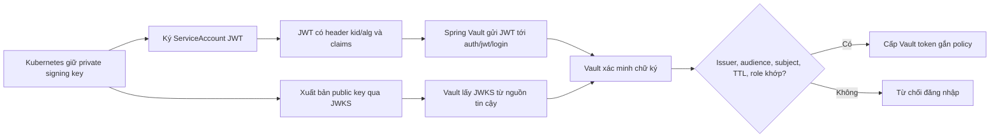
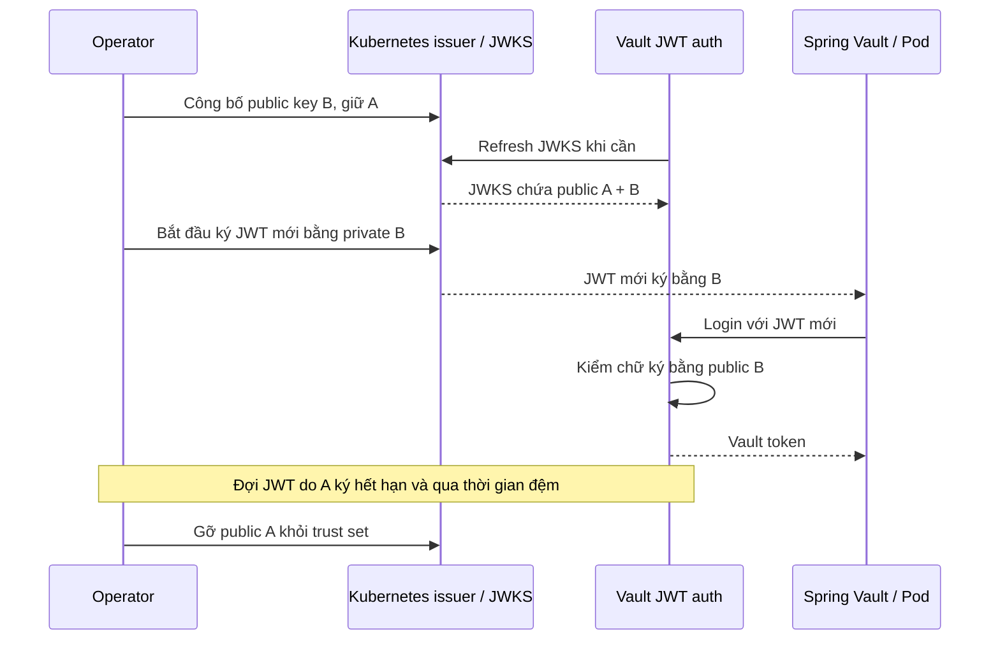

# JWKS, khóa công khai và nguồn xác minh danh tính ở phía Vault

Một JWT có thể ghi rằng nó thuộc về ServiceAccount `apps/orders-api`, có audience `vault` và chưa hết hạn. Nhưng **ai chứng minh nội dung JWT thực sự do Kubernetes phát hành và chưa bị sửa?** Với **Vault JWT/OIDC auth method**, câu trả lời nằm ở **chữ ký số**, **khóa công khai được lấy từ nguồn tin cậy**, **issuer** và **các ràng buộc claim của role**. Vault không thể chỉ giải mã JWT rồi tin vào trường `sub`.

Trong chương **Kubernetes và JWT** của mô-đun **SPRING_VAULT**, bài này đi sâu vào **JWKS (JSON Web Key Set)**, cách Vault tìm public key để xác minh JWT và cách lựa chọn nguồn tin cậy. Sau khi xác thực, Spring Vault nhận **Vault token** để `VaultTemplate` truy cập KV secrets, Transit encryption và PKI theo policy. Vòng đời JWT đầu vào, Vault token và secret lease vẫn là ba cơ chế riêng biệt.

Sau bài học, bạn có thể:

1. Giải thích vai trò của chữ ký JWT, `kid`, `alg`, JWK và JWKS; phân biệt public key với private signing key.
2. Mô tả đường đi từ Kubernetes **ServiceAccount issuer** đến OIDC discovery, `jwks_uri` và bộ kiểm tra chữ ký trong Vault.
3. Phân biệt bốn lựa chọn cấu hình xác minh ở Vault JWT auth: **OIDC discovery**, **JWKS URL**, **static public keys** và **JWKS pairs**.
4. Cấu hình `bound_issuer`, `bound_audiences`, `bound_subject`, `jwt_supported_algs` và hiểu ranh giới tin cậy nhiều cluster.
5. Kết nối Spring Vault `JwtAuthentication` bằng supplier đọc JWT mới, sau đó sử dụng `VaultTemplate` với policy tối thiểu.
6. Lập kế hoạch xoay vòng signing key, chẩn đoán lỗi khóa/issuer/audience và thiết kế kiểm thử tích hợp.

## 1. JWT được ký và xác minh như thế nào?

Một **JSON Web Token** dạng JWS thường có ba phần ngăn cách bằng dấu chấm:

```text
BASE64URL(header).BASE64URL(payload).BASE64URL(signature)
```

Header xác định thuật toán ký và có thể chứa `kid` (key ID). Payload chứa các claim như `iss`, `sub`, `aud`, `iat`, `nbf`, `exp`. Với thuật toán bất đối xứng, chữ ký do **private key của issuer** tạo; Vault dùng **public key tin cậy** để kiểm tra chữ ký tương ứng với hai phần đầu.

Ví dụ minh họa (không phải JWT thật, các timestamp chỉ là dữ liệu mẫu):

```json
{
  "header": {
    "typ": "JWT",
    "alg": "RS256",
    "kid": "k8s-signing-key-2026-11"
  },
  "payload": {
    "iss": "https://issuer.k8s.example.internal",
    "sub": "system:serviceaccount:apps:orders-api",
    "aud": ["vault"],
    "iat": 1764000000,
    "nbf": 1764000000,
    "exp": 1764003600
  }
}
```

| Trường | Dùng để làm gì? | Không được suy luận |
| --- | --- | --- |
| `alg` | Mô tả thuật toán chữ ký, ví dụ `RS256` hoặc `ES256`. | Không được chấp nhận mọi thuật toán chỉ vì JWT tự khai. |
| `kid` | Gợi ý chọn public key trong JWKS. | Không chứng minh danh tính, không phải secret, không tự chứng minh chữ ký. |
| `iss` | Issuer khai báo phát hành token. | Chuỗi `iss` trông đúng chưa đủ nếu chữ ký và nguồn key chưa được kiểm tra. |
| `sub` | Chủ thể token, ví dụ ServiceAccount. | Không tự cấp quyền Vault KV hoặc PKI. |
| `aud` | Bên nhận dự kiến, ví dụ `vault`. | Chữ ký đúng không có nghĩa JWT được cấp để dùng tại Vault. |
| `exp`, `nbf` | Khoảng thời gian token có hiệu lực. | Token còn hạn vẫn có thể bị từ chối vì issuer, audience hoặc role. |

Với RSA/ECDSA, issuer **giữ kín private key** và có thể công bố **public key** mà không làm lộ quyền ký JWT. Vault phải lấy public key từ nguồn **do operator cấu hình** và xác minh kết nối tới nguồn đó bằng TLS/CA phù hợp; tuyệt đối không dùng URL tùy ý do JWT của người gửi chỉ định.



**Giải mã không phải xác minh.** Bất kỳ ai cũng có thể tạo payload giống định dạng JWT chứa `sub=system:serviceaccount:apps:orders-api`. Chỉ khi chữ ký được kiểm tra bằng key tin cậy và các claim thỏa ràng buộc role, Vault mới có cơ sở cấp Vault token.

## 2. JWK, JWKS và ý nghĩa của kid

**JWK (JSON Web Key)** là biểu diễn khóa ở dạng JSON. **JWKS (JSON Web Key Set)** là một object JSON có mảng `keys`, chứa một hoặc nhiều JWK. Public JWK của RSA thường có cấu trúc:

```json
{
  "keys": [
    {
      "kty": "RSA",
      "kid": "k8s-signing-key-2026-11",
      "use": "sig",
      "alg": "RS256",
      "n": "DEMO_BASE64URL_MODULUS_NOT_A_REAL_KEY",
      "e": "AQAB"
    }
  ]
}
```

Đây là **schema minh họa**: trường `n` không phải modulus hợp lệ để xác minh chữ ký.

| Field JWK | Diễn giải |
| --- | --- |
| `kty` | Loại key, ví dụ `RSA` hoặc `EC`. |
| `kid` | Tên nhận diện khóa trong bộ key; JWT header có thể mang cùng `kid`. |
| `use` | Mục đích sử dụng, ví dụ `sig` cho xác minh chữ ký. |
| `alg` | Thuật toán liên quan nếu được công bố. |
| `n`, `e` | Modulus và exponent công khai của RSA dưới dạng Base64URL. |
| `crv`, `x`, `y` | Các tham số public key của EC, tùy thuật toán. |

**`kid` chỉ giúp tìm ứng viên khóa.** Kể cả `kid` khớp, Vault vẫn phải kiểm tra chữ ký mật mã thật sự. Việc chọn khóa khi một set có nhiều key, thiếu `kid` hoặc key trùng ID phụ thuộc thư viện xác minh; không thiết kế một quy tắc bảo mật dựa duy nhất vào `kid`.

JWKS có thể công khai vì chứa **public keys**, nhưng **tính toàn vẹn của nguồn JWKS** là vấn đề bảo mật. Nếu kẻ tấn công kiểm soát endpoint JWKS mà Vault tin tưởng, họ có thể thay key và ký JWT giả bằng private key của họ. Bảo vệ TLS, DNS, CA và quyền quản trị issuer quan trọng không kém việc kiểm tra `sub`/`aud`.

Không lấy `jku`, `x5u` hoặc một URL bất kỳ trong JWT header làm JWKS URL động. Vault phải xác minh bằng **endpoint hoặc public keys do operator cấu hình**, tách biệt dữ liệu do người gửi JWT kiểm soát.

## 3. Kubernetes công bố issuer và JWKS ở đâu?

Kubernetes API server phát hành ServiceAccount JWT dựa trên thiết lập **`--service-account-issuer`** và signing key của cluster. Khi issuer phù hợp OIDC discovery, Kubernetes công bố metadata và public keys tại các endpoint thường gặp:

```text
GET /.well-known/openid-configuration
GET /openid/v1/jwks
```

Trong một cluster có quyền truy cập API discovery, có thể xem **metadata công khai**, không cần đọc JWT của Pod:

```bash
kubectl get --raw /.well-known/openid-configuration
kubectl get --raw /openid/v1/jwks
```

Ví dụ discovery document đã rút gọn:

```json
{
  "issuer": "https://issuer.k8s.example.internal",
  "jwks_uri": "https://issuer.k8s.example.internal/openid/v1/jwks"
}
```

Các URL trên **chỉ là ví dụ**, issuer, đường dẫn JWKS, thuật toán và khả năng truy cập thay đổi theo cấu hình cluster. Kubernetes mô tả các endpoint như **OIDC compatible**, không bảo đảm đủ mọi chức năng của một OIDC provider chung.

Điểm cần phân biệt:

- **Claim `iss`** trong JWT: định danh issuer Kubernetes khai báo.
- **Trường `issuer`** trong discovery metadata: định danh bên phát hành mà cơ chế OIDC kiểm tra.
- **`jwks_uri`**: địa chỉ cung cấp public keys của issuer.
- **`--service-account-jwks-uri`**: cờ Kubernetes có thể thay URI JWKS quảng bá trong discovery.
- **Kubernetes API host**: có thể khác hostname issuer/JWKS mà Vault truy cập.

`https://kubernetes.default.svc` có thể truy cập từ **bên trong** cluster, nhưng URL issuer/JWKS có thể chỉ phục vụ **ngoài** cluster hoặc ngược lại. Việc `kubectl get --raw` thành công trên máy quản trị không chứng minh Vault cũng truy cập được URL đó; phải kiểm tra mạng **từ nơi Vault chạy**.

## 4. Bốn nguồn xác minh chữ ký trong Vault JWT auth

Vault có **JWT/OIDC auth method** dùng JWT do client cung cấp. Operator chọn nguồn khóa/metadata ở **`auth/jwt/config`**; ứng dụng Spring Vault không tự chọn public key hoặc thay cấu hình server.

| Phương án | Trường cấu hình | Ưu điểm | Trách nhiệm / giới hạn |
| --- | --- | --- | --- |
| **OIDC discovery** | `oidc_discovery_url`, tùy chọn `oidc_discovery_ca_pem` | Vault tìm issuer metadata và JWKS theo discovery, áp các điều kiện OIDC liên quan. | Discovery URL/TLS phải đúng và truy cập được. |
| **JWKS URL** | `jwks_url`, tùy chọn `jwks_ca_pem` | Chỉ định trực tiếp nguồn public keys. | Tự ràng buộc issuer/claims thích hợp và giám sát fetch/rotation. |
| **Static public keys** | `jwt_validation_pubkeys` | Không cần tải JWKS trong lúc xác thực. | Operator phải cập nhật key khi signing key xoay vòng. |
| **JWKS pairs** | `jwks_pairs` nếu phiên bản hỗ trợ | Có thể thử nhiều nguồn JWKS/CA đã định cấu hình. | Mở rộng trust domain; không dùng chung với `bound_issuer`. |

**Không trộn các phương án tùy tiện.** Tài liệu Vault yêu cầu một phương pháp xác minh nhất quán cho một auth mount: `oidc_discovery_url`, `jwks_url` và `jwt_validation_pubkeys` loại trừ lẫn nhau. `jwks_pairs` là lựa chọn riêng có những ràng buộc tương thích của API. Nếu hai issuer cần policy khác nhau, việc tách auth mount thường dễ kiểm soát hơn.

### Phương án A — OIDC discovery

Giả sử cluster có issuer `https://issuer.k8s.example.internal` và Vault truy cập được discovery/JWKS qua TLS hợp lệ. Trong sandbox chưa bật JWT auth:

```bash
vault auth enable -path=jwt jwt

vault write auth/jwt/config \
  oidc_discovery_url="https://issuer.k8s.example.internal" \
  jwt_supported_algs="RS256"
```

`oidc_discovery_url` là **base URL**, không thêm thủ công `/.well-known/openid-configuration` vào giá trị. Vault lấy metadata, bao gồm issuer và `jwks_uri`. `RS256` chỉ là ví dụ nếu issuer thực tế dùng thuật toán đó; kiểm tra thuật toán ký của cluster trước khi đặt allowlist. Với CA nội bộ, cấu hình `oidc_discovery_ca_pem` phù hợp thay vì vô hiệu hóa TLS verification.

### Phương án B — JWKS URL trực tiếp

Nếu biết endpoint public keys tin cậy và muốn dùng nó:

```bash
# Phương án THAY THẾ cho cùng auth mount.
# Không chạy cùng cấu hình discovery phía trên mà không chủ động chuyển nguồn.
vault write auth/jwt/config \
  jwks_url="https://issuer.k8s.example.internal/openid/v1/jwks" \
  bound_issuer="https://issuer.k8s.example.internal" \
  jwt_supported_algs="RS256"
```

Vault kiểm tra chữ ký bằng keys tải từ URL này. `bound_issuer` ràng buộc claim `iss` khi không dùng OIDC discovery tự cung cấp ngữ cảnh issuer; hạn chế chỉ JWT đến từ issuer dự kiến. Phải khớp **chính xác** giá trị `iss`, kể cả scheme, hostname và dấu phân cách URL. Nếu JWKS dùng CA nội bộ, operator cấu hình `jwks_ca_pem`.

CA tin cậy cho kết nối **Spring → Vault** và CA cho **Vault → JWKS** là hai cấu hình khác nhau. Không thay CA của Vault HTTPS để sửa lỗi JWKS TLS ở phía server.

### Phương án C — Public key tĩnh

Nếu Vault không thể tải JWKS lúc vận hành, operator có thể cung cấp public keys hợp lệ dưới dạng PEM. Ví dụ **mang tính minh họa**:

```bash
# File PEM giả định do quy trình quản trị key tạo và xác minh
# từ JWKS/issuer tin cậy trước khi dùng.
vault write auth/jwt/config \
  jwt_validation_pubkeys=@issuer-public-keys.pem \
  bound_issuer="https://issuer.k8s.example.internal" \
  jwt_supported_algs="RS256"
```

`issuer-public-keys.pem` là **placeholder cho public key PEM thật**, không phải file đã được tạo trong bài. Với nhiều key, cấu hình danh sách `jwt_validation_pubkeys` theo API Vault. Không đưa **private signing key** của Kubernetes vào Vault hoặc JAR ứng dụng; Vault chỉ cần public key.

Public keys tĩnh phải được cập nhật **trước** khi issuer bắt đầu ký bằng key mới. Nếu gỡ key cũ quá sớm, JWT cũ chưa hết hạn vẫn có thể bị từ chối. JWKS/OIDC có thể giảm thao tác cập nhật thủ công nhưng vẫn cần giám sát cache và kết nối.

### Phương án D — JWKS pairs và nhiều cluster

`jwks_pairs` cho phép danh sách JWKS URL kèm CA (với phiên bản/plugin hỗ trợ). Tài liệu API Vault quy định **`bound_issuer` không được dùng chung với `jwks_pairs`**; `jwks_pairs` cũng không dùng chung với `jwks_url`/`jwks_ca_pem`. Khi dùng nhiều issuer, nếu hai cluster có cùng subject, cấu hình chung dễ mở rộng phạm vi tin cậy ngoài dự kiến.

Ví dụ tổ chức có hai cluster với ServiceAccount trùng tên `apps/orders-api`:

```text
auth/jwt-prod/     -> issuer / signing keys của Kubernetes production
auth/jwt-staging/  -> issuer / signing keys của Kubernetes staging
```

Mỗi auth mount có role, policy và audit riêng, Java dùng `JwtAuthenticationOptions.path(...)` đúng mount. Nếu sử dụng `jwks_pairs` thật sự, cần xây các ràng buộc bổ sung và kiểm tra rủi ro từ việc chấp nhận nhiều signing authorities.

## 5. Public key đúng chưa đủ: Vault phải kiểm tra role và claims

Xác minh chữ ký chứng minh JWT được ký bởi private key tương ứng với tập public keys tin cậy và phần header/payload chưa bị sửa. Nó **không tự quyết định** token được phép nhận Vault policy nào.

Giả sử JWT do Kubernetes cấp:

```text
iss = https://issuer.k8s.example.internal
sub = system:serviceaccount:apps:orders-api
aud = ["vault"]
exp = thời điểm trong tương lai
```

Operator tạo role:

```bash
vault write auth/jwt/role/orders-jwt-read \
  role_type="jwt" \
  user_claim="sub" \
  bound_subject="system:serviceaccount:apps:orders-api" \
  bound_audiences="vault" \
  token_policies="orders-read" \
  token_ttl="15m" \
  token_max_ttl="1h"

vault read auth/jwt/role/orders-jwt-read
```

| Kiểm tra | Nằm ở đâu? | Hệ quả |
| --- | --- | --- |
| **Chữ ký** | Vault JWT auth với keys của `auth/jwt/config`. | JWT giả hoặc key không tin cậy bị từ chối. |
| **Issuer** | OIDC discovery hoặc `bound_issuer` tùy nguồn key. | Không nhận JWT từ issuer ngoài phạm vi. |
| **Algorithm** | JWT `alg` và `jwt_supported_algs`. | Chỉ chấp nhận thuật toán được operator cho phép. |
| **Audience** | `bound_audiences` của role. | JWT cấp cho dịch vụ khác không được dùng để login Vault. |
| **Subject** | `bound_subject`/`bound_claims` của role. | Chỉ workload phù hợp mới dùng được role. |
| **Thời gian** | `exp`, `nbf` của JWT. | JWT quá hạn hoặc chưa hiệu lực bị từ chối. |
| **Vault policy** | `token_policies` của role. | Token được cấp chỉ có quyền theo cấu hình Vault. |

Từ **Vault 1.17**, khi JWT có claim `aud`, role kiểu `jwt` phải có `bound_audiences` khớp **ít nhất một** giá trị `aud`. Đây là trường hợp thông thường với ServiceAccount projected token. `aud=["vault"]` không khớp `bound_audiences=["kubernetes"]`; so khớp là so chuỗi cụ thể.

`user_claim="sub"` quyết định Vault Identity alias. Nó không thay thế `bound_subject` hay bound claims để xác định người được phép đăng nhập. Nếu nhiều cluster có cùng `sub`, bảo đảm issuer, signing keys và auth mount tương ứng với đúng trust domain.

## 6. Ví dụ từ Kubernetes Pod tới VaultTemplate

### 6.1. Pod với ServiceAccount JWT dành riêng cho Vault

Namespace `apps` phải tồn tại và image ứng dụng là placeholder:

```yaml
apiVersion: v1
kind: ServiceAccount
metadata:
  name: orders-api
  namespace: apps
automountServiceAccountToken: false
---
apiVersion: apps/v1
kind: Deployment
metadata:
  name: orders-api
  namespace: apps
spec:
  replicas: 1
  selector:
    matchLabels:
      app: orders-api
  template:
    metadata:
      labels:
        app: orders-api
    spec:
      serviceAccountName: orders-api
      automountServiceAccountToken: false
      containers:
        - name: orders-api
          image: registry.example.com/orders-api:1.0.0
          env:
            - name: VAULT_URI
              value: "https://vault.vault.svc:8200"
            - name: VAULT_JWT_ROLE
              value: "orders-jwt-read"
            - name: VAULT_JWT_FILE
              value: "/var/run/secrets/vault/jwt"
          volumeMounts:
            - name: vault-identity
              mountPath: /var/run/secrets/vault
              readOnly: true
      volumes:
        - name: vault-identity
          projected:
            sources:
              - serviceAccountToken:
                  path: jwt
                  audience: vault
                  expirationSeconds: 3600
```

Kubelet xin JWT qua TokenRequest API, mount tại `/var/run/secrets/vault/jwt` và làm mới trước khi hết hạn. `expirationSeconds: 3600` chỉ là **TTL yêu cầu**, thực tế tùy API server. Mount **cả thư mục**, tránh `subPath` vì mount đó không nhận cập nhật projected token.

JWT có issuer của **cluster đang chạy Pod**; Vault phải tin cậy nguồn key và issuer đó. `audience: vault` cần khớp `bound_audiences="vault"` nhưng không đủ nếu chữ ký, issuer hoặc subject sai.

### 6.2. Tạo secret và Vault policy ít quyền nhất

Giả sử Vault có mount KV v2 là `kv`:

```bash
# Chỉ chạy enable khi chưa có mount kv/ trong sandbox.
vault secrets enable -path=kv kv-v2

vault kv put -mount=kv apps/orders/config \
  mode="sandbox"
```

File `orders-read.hcl`:

```hcl
path "kv/data/apps/orders/config" {
  capabilities = ["read"]
}
```

Nạp policy:

```bash
vault policy write orders-read orders-read.hcl
```

`kv/data/apps/orders/config` là API path KV v2. Mã Java dùng đường dẫn tương đối `apps/orders/config` tại mount `kv`. Nếu cần Transit hoặc PKI, operator cấp policy tương ứng; xác thực đúng danh tính không tự cấp quyền mã hóa hay phát hành certificate.

### 6.3. Kết nối Spring Vault bằng JWT supplier

Ví dụ Spring Vault **4.1.x** với dependency `org.springframework.vault:spring-vault-core` do BOM/dependency management quản lý:

```java
import java.net.URI;
import org.springframework.beans.factory.annotation.Value;
import org.springframework.context.annotation.Configuration;
import org.springframework.vault.authentication.ClientAuthentication;
import org.springframework.vault.authentication.JwtAuthentication;
import org.springframework.vault.authentication.JwtAuthenticationOptions;
import org.springframework.vault.authentication.KubernetesServiceAccountTokenFile;
import org.springframework.vault.client.VaultEndpoint;
import org.springframework.vault.config.AbstractVaultConfiguration;

@Configuration
public class VaultJwtConfiguration extends AbstractVaultConfiguration {

    @Value("${VAULT_URI}")
    private URI vaultUri;

    @Value("${VAULT_JWT_ROLE:orders-jwt-read}")
    private String vaultRole;

    @Value("${VAULT_JWT_FILE:/var/run/secrets/vault/jwt}")
    private String jwtFile;

    @Override
    public VaultEndpoint vaultEndpoint() {
        return VaultEndpoint.from(vaultUri);
    }

    @Override
    public ClientAuthentication clientAuthentication() {
        JwtAuthenticationOptions options = JwtAuthenticationOptions.builder()
            .path("jwt")
            .role(vaultRole)
            .jwtSupplier(new KubernetesServiceAccountTokenFile(jwtFile))
            .build();

        return new JwtAuthentication(options, vaultClient());
    }
}
```

`path("jwt")` là **tên Vault auth mount**, không phải file JWT. `KubernetesServiceAccountTokenFile(jwtFile)` cung cấp giá trị hiện tại khi Spring Vault cần đăng nhập mới. Không dùng `jwt(jwtAtBoot)` với JWT chỉ được đọc một lần cho workload chạy lâu. `vaultClient()` trong constructor này áp dụng cho Spring Vault 4.1.x; kiểm tra API theo phiên bản nếu dự án sử dụng 3.x hoặc 4.0.

Đọc KV v2:

```java
import java.util.Map;
import org.springframework.stereotype.Service;
import org.springframework.vault.core.VaultOperations;
import org.springframework.vault.support.Versioned;

@Service
public class OrderSettings {
    private final VaultOperations vault;

    public OrderSettings(VaultOperations vault) {
        this.vault = vault;
    }

    public String mode() {
        Versioned<Map<String, Object>> result =
            vault.opsForVersionedKeyValue("kv").get("apps/orders/config");
        if (result == null || result.getData() == null) {
            throw new IllegalStateException("Vault KV setting not found");
        }
        Object value = result.getData().get("mode");
        if (!(value instanceof String)) {
            throw new IllegalStateException("Invalid Vault KV setting");
        }
        return (String) value;
    }
}
```

`JwtAuthentication` gửi JWT đến Vault rồi nhận **Vault client token**. Session manager dùng Vault token này cho `VaultTemplate`; không đưa Kubernetes JWT trực tiếp vào header `X-Vault-Token`. Với token và lease: kubelet thay JWT của Kubernetes, Spring Vault session manager quản lý Vault token, và lease manager/engine quản lý secret lease nếu có dynamic secrets.

## 7. Signing key rotation: hệ thống đang chạy có thể lỗi login ra sao?

Khi Kubernetes thay **signing key**, JWT mới có thể được ký bằng private key B thay vì A. JWKS nên công bố cả public key A và B trong giai đoạn chuyển tiếp nếu cần tiếp tục xác minh cả JWT cũ và mới.



Thứ tự vận hành mong muốn:

1. Công bố public key B **trước** khi dùng private B để ký JWT.
2. Đảm bảo Vault fetch/refresh được JWKS và nhận B; kiểm thử JWT do B ký.
3. Chuyển signing key cho JWT mới sang B.
4. Giữ public key A đủ lâu cho JWT cũ chưa hết `exp` còn xác minh được, trừ trường hợp phải thu hồi khẩn vì lộ khóa.
5. Gỡ A theo kế hoạch và quan sát login failures.

Với **static public keys**, operator phải cập nhật khóa thủ công. Với **JWKS URL/OIDC discovery**, Vault có cơ chế lấy khóa nhưng thời điểm refresh phụ thuộc cache, mạng và phiên bản; không giả định mọi Vault instance nhìn thấy key mới ngay tức thì.

**Key rotation khác token revocation.** Nếu dùng JWT auth, một JWT ký bằng key còn tin cậy có thể được chấp nhận đến `exp` dù Pod đã bị xóa: Vault **không gọi Kubernetes TokenReview**. Nếu private key bị lộ, quy trình ứng cứu có thể cần loại bỏ key khỏi trust set và revoke Vault tokens liên quan.

## 8. TLS, JWKS và issuer: ba ranh giới tin cậy

| Đường kết nối | Ai gọi ai? | Kiểm tra |
| --- | --- | --- |
| **Java → Vault HTTPS** | Spring Vault gọi Vault API. | TLS certificate/hostname/CA của Vault, network policy, auth mount. |
| **Vault → JWKS/OIDC HTTPS** | Vault tải public keys/metadata. | Endpoint tin cậy, DNS, TLS/CA, tính sẵn sàng và rotation. |
| **Issuer ký JWT → Vault xác minh** | Kubernetes/IdP phát JWT. | Chữ ký, `alg`, `iss`, `aud`, `sub`, `exp` và role. |

Một lỗi `x509: certificate signed by unknown authority` khi Vault tải JWKS **không** chữa bằng cách sửa `bound_subject` hoặc tắt xác minh issuer. Cần sửa CA/TLS ở đường **Vault → JWKS**. Tương tự, cấu hình Java tin cậy CA của Vault chỉ giải quyết kết nối **Java → Vault**, không xác minh JWT của Kubernetes.

Không dùng `jwks_url` từ giá trị do JWT hoặc người dùng gửi; không tải signing key từ repository không đáng tin. Giới hạn `jwt_supported_algs` theo thuật toán thực tế của issuer; API Vault cho phép thuật toán mặc định của JWT roles rộng hơn OIDC roles, nên cấu hình allowlist khi có thể.

**Đối với nhiều cluster**, một JWT của cluster A và B có thể có cùng `sub=system:serviceaccount:apps:orders-api`. `jwks_pairs` chấp nhận nhiều nguồn khóa nhưng không đi cùng `bound_issuer`; nếu mức tin cậy khác nhau, tách auth mounts, roles và nguồn public keys.

## 9. Phân biệt JWKS/JWT auth với Kubernetes TokenReview auth

| Thuộc tính | Vault JWT auth với JWKS/public keys | Vault Kubernetes auth |
| --- | --- | --- |
| Login API | `auth/jwt/login` | `auth/kubernetes/login` |
| Spring Vault client | `JwtAuthentication` | `KubernetesAuthentication` |
| Kiểm JWT | Chữ ký/issuer/claims từ khóa và role. | Vault gọi Kubernetes `TokenReview`. |
| Nguồn tin cậy | OIDC discovery, JWKS, static public keys. | Kubernetes API host, TLS CA và reviewer credential. |
| Audience | `bound_audiences` của JWT role. | `audience` của Kubernetes role. |
| Danh tính | `bound_subject`/`bound_claims`. | `bound_service_account_names` và namespace. |
| Pod/SA còn tồn tại khi login | Không có TokenReview; JWT có thể hợp lệ đến `exp`. | TokenReview có thể từ chối token bound-to-Pod đã bị thu hồi. |
| Phụ thuộc mạng | Có thể cần fetch/refresh JWKS, không gọi TokenReview. | Phải gọi được Kubernetes API để TokenReview. |

Kubernetes auth có thể có cấu hình public keys ở phía server nhưng cơ chế cốt lõi vẫn là **TokenReview**; không nhầm public key cấu hình trong Kubernetes auth với việc bật một JWT auth method. Nếu yêu cầu xác nhận trạng thái Pod/SA ở từng lần login, JWT auth xác minh chữ ký **không thay thế** được TokenReview.

## 10. Ma trận kiểm thử JWKS và role

Kiểm thử trên sandbox có **issuer thực**, JWKS và role đúng. JWT có payload tự dựng nhưng không ký bằng private key tin cậy sẽ thất bại ngay bước chữ ký; không dùng kết quả đó để suy ra role bound audience đã hoạt động.

| Tình huống | Kết quả mong đợi | Tầng |
| --- | --- | --- |
| JWT của issuer tin cậy, key có trong JWKS, `aud=vault`, `sub` đúng, còn hạn. | Login thành công, nhận Vault token. | Chữ ký, claim, JWT role. |
| JWT có `kid` mới nhưng Vault chưa tải key tương ứng. | Login mới có thể lỗi tới khi JWKS được cập nhật/refresh. | JWKS fetch/cache. |
| JWT bị sửa payload sau khi ký. | Từ chối. | Chữ ký. |
| JWT do private key ngoài trust set ký. | Từ chối. | Chữ ký/key source. |
| Chữ ký hợp lệ nhưng `iss` khác issuer đã ràng buộc. | Từ chối. | Issuer validation. |
| Chữ ký hợp lệ nhưng `aud=["other-service"]`. | Từ chối role yêu cầu `vault`. | `bound_audiences`. |
| Chữ ký hợp lệ nhưng `sub` khác SA. | Từ chối. | `bound_subject`. |
| JWT quá `exp` hoặc chưa đến `nbf`. | Từ chối. | TTL. |
| JWKS endpoint lỗi TLS hoặc mất mạng lúc cần tải khóa. | Login có thể lỗi tùy trạng thái cache. | Vault → JWKS. |
| Login thành công nhưng KV path ngoài policy. | Vault API trả permission denied. | Vault policy. |
| JWT bound-to-Pod chưa hết `exp`, Pod đã bị xóa. | JWT auth vẫn có thể chấp nhận, không có TokenReview. | Giới hạn revocation. |

### Bài kiểm thử signing key rotation

1. Cấp JWT thực từ issuer A, đảm bảo JWKS công bố public A và login thành công.
2. Công bố public B, chuyển việc ký JWT trong sandbox sang private B sau khi Vault đã nhận B.
3. Kiểm tra login bằng JWT mới do B ký.
4. Kiểm tra JWT do A ký nhưng chưa hết hạn vẫn có thể login trong giai đoạn cùng tin cậy A và B.
5. Gỡ A sau khi thời gian chuyển tiếp hoàn tất, kiểm tra hành vi token cũ theo chính sách.
6. Mô phỏng JWKS URL/CA lỗi rồi phục hồi, quan sát tác động tới các lần login cần fetch khóa.

Không dùng private key production hoặc JWT thật làm test fixture. Chỉ log **loại lỗi**, request ID, auth mount, key ID sau khi xác định phù hợp về bảo mật và các chỉ số thành công/thất bại; không log toàn bộ JWT, Vault token hoặc nội dung KV.

## 11. Chẩn đoán lỗi theo dấu hiệu

| Dấu hiệu | Nguyên nhân thường gặp | Hướng xử lý |
| --- | --- | --- |
| `failed to verify signature`, không tìm thấy key hoặc `kid` không khớp (thông báo tùy phiên bản) | JWKS chưa có key phù hợp, key mới chưa refresh, sai URL hoặc key cluster khác. | Kiểm tra endpoint tin cậy, key rotation, kết nối. |
| Lỗi TLS/x509 khi Vault fetch JWKS | `jwks_ca_pem`/`oidc_discovery_ca_pem` sai hoặc chứng chỉ endpoint lỗi. | Cấu hình CA/TLS đúng cho Vault → JWKS. |
| Issuer mismatch | `iss` khác discovery issuer hoặc `bound_issuer`. | Đối chiếu metadata issuer và config. |
| Audience mismatch | Projected audience khác `bound_audiences`. | Đối chiếu Pod JWT projection và role, lưu ý Vault 1.17+. |
| Chữ ký hợp lệ nhưng không dùng được role | `bound_subject`/`bound_claims` sai hoặc role thuộc mount khác. | Kiểm tra `auth/jwt/role/...` và `path` của client. |
| Login mới lỗi sau signing key rotation | Key mới chưa vào JWKS hoặc static keys của Vault. | Công bố/refresh key trước khi thay signing key. |
| Login tốt nhưng sau một giờ bị từ chối | JWT Java cache cũ, projected volume qua `subPath`, token hết `exp`. | Dùng supplier đọc file và mount cả thư mục. |
| Login thành công, KV đọc nhận 403 | Vault token thiếu policy ở `kv/data/...`. | Đối chiếu Vault policy, không sửa issuer/JWKS vô cớ. |

Lệnh quan sát **không in JWT**:

```bash
# Issuer metadata và public keys Kubernetes công bố.
kubectl get --raw /.well-known/openid-configuration
kubectl get --raw /openid/v1/jwks

# Cấu hình Vault, cần quyền đọc tương ứng.
vault auth list
vault read auth/jwt/config
vault read auth/jwt/role/orders-jwt-read
vault policy read orders-read

# Pod đang chạy bằng SA nào, không đọc credential.
kubectl -n apps get pod -l app=orders-api \
  -o custom-columns=NAME:.metadata.name,SA:.spec.serviceAccountName
```

JWKS gồm **public keys** nên có thể công bố, nhưng phải bảo vệ tính toàn vẹn nguồn và giới hạn metadata nội bộ không cần thiết. JWT của Pod là **credential nhạy cảm**: không đưa lên website decode JWT, log, ticket hoặc CI. Nếu cần kiểm tra JWT có tồn tại trong Pod, dùng phép kiểm tra file có quyền đọc mà không in nội dung.

## 12. Câu hỏi tự kiểm tra

1. Vì sao Vault không thể tin một JWT chỉ vì `sub` đúng SA và `exp` còn hạn?
2. JWKS công bố public key có đồng nghĩa ai cũng ký JWT hợp lệ được không?
3. `kid` có vai trò gì và vì sao `kid` khớp vẫn chưa đủ để cấp quyền?
4. Khác gì giữa `oidc_discovery_url` và `jwks_url`? Khi nào cần `bound_issuer`?
5. Vì sao `jwks_pairs` có thể mở rộng trust domain và đôi khi cần tách mounts?
6. Thứ tự công bố public B, dùng private B và gỡ public A nên như thế nào?
7. Sau login JWT thành công nhưng `VaultTemplate` đọc KV 403, nên kiểm tra policy hay JWKS trước?
8. Vì sao JWT auth không biết Pod bị xóa như Kubernetes auth qua TokenReview?
9. Trên Vault 1.17+, JWT có `aud=["vault"]` nhưng role thiếu `bound_audiences` thì sao?
10. Tại sao dùng `jwtSupplier(...)` phù hợp hơn một chuỗi JWT đọc một lần ở startup?

## 13. Tài liệu chính thức

- [HashiCorp Vault — JWT/OIDC auth method](https://developer.hashicorp.com/vault/docs/auth/jwt): static keys, JWKS, JWKS pairs, OIDC discovery; issuer/algorithm/audience và vận hành.
- [HashiCorp Vault — JWT auth API](https://developer.hashicorp.com/vault/api-docs/auth/jwt): `oidc_discovery_url`, `jwks_url`, `jwks_pairs`, `jwt_validation_pubkeys`, `bound_issuer`, `jwt_supported_algs`, role.
- [HashiCorp Vault — Kubernetes as OIDC provider](https://developer.hashicorp.com/vault/docs/auth/jwt/oidc-providers/kubernetes): discovery/JWKS Kubernetes và xác minh ServiceAccount JWT.
- [HashiCorp Vault — Kubernetes auth method](https://developer.hashicorp.com/vault/docs/auth/kubernetes): khác biệt TokenReview và giới hạn revocation của JWT auth.
- [Kubernetes — Configure Service Accounts for Pods](https://kubernetes.io/docs/tasks/configure-pod-container/configure-service-account/): issuer discovery, JWKS, TokenRequest và projected token.
- [Kubernetes — Authenticating](https://kubernetes.io/docs/reference/access-authn-authz/authentication/): các cờ `--service-account-issuer`, `--service-account-jwks-uri`, `--api-audiences`.
- [Spring Vault — Authentication Methods](https://docs.spring.io/spring-vault/reference/vault/authentication.html): `JwtAuthentication`, `ClientAuthentication` và `SessionManager`.
- [Spring Vault — JwtAuthenticationOptions Builder](https://docs.spring.io/spring-vault/reference/api/java/org/springframework/vault/authentication/JwtAuthenticationOptions.JwtAuthenticationOptionsBuilder.html): `role`, `path`, `jwtSupplier`.
- [Spring Vault — JwtAuthentication](https://docs.spring.io/spring-vault/reference/api/java/org/springframework/vault/authentication/JwtAuthentication.html): login và constructor theo phiên bản.
