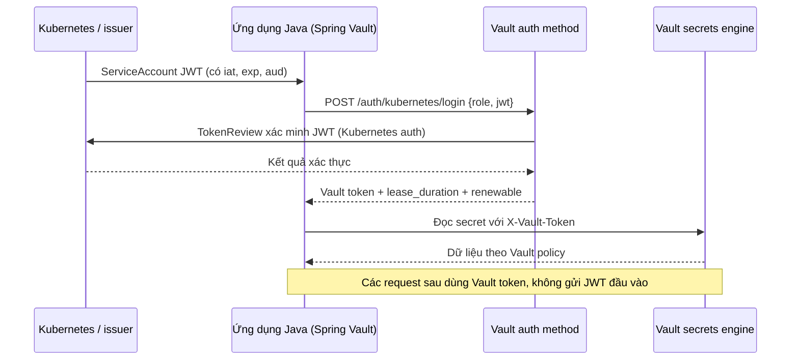

# Phân biệt TTL của JWT đầu vào với TTL của Vault token

## 1. Bối cảnh và mục tiêu

Trong một ứng dụng Java chạy trên Kubernetes, Spring Vault có thể dùng **Kubernetes ServiceAccount JWT** để đăng nhập HashiCorp Vault, sau đó dùng **Vault token** nhận được để gọi `VaultTemplate` và đọc KV secrets, truy cập Transit, PKI hoặc các secret engine khác theo policy. Hai token này nằm ở **hai giai đoạn xác thực khác nhau** và có **hai đồng hồ hết hạn độc lập**.

Khi triển khai `SPRING_VAULT`, nhầm lẫn phổ biến là: “JWT dùng để đăng nhập Vault chỉ sống 15 phút, vậy Vault token cũng chỉ sống 15 phút?” Câu trả lời thông thường là **không**. TTL của JWT đầu vào xác định **cửa sổ dùng JWT để đăng nhập**; TTL của Vault token xác định **khoảng thời gian phiên đăng nhập đã được Vault cấp có thể sử dụng**. Vault còn có cơ chế gia hạn, giới hạn TTL, thu hồi token và cấp lại phiên.

Bài học thuộc chương **Kubernetes và JWT** này giúp bạn:

- Nhận diện JWT đầu vào, Vault token đầu ra và thời gian sống của từng loại.
- Hiểu vì sao JWT hết hạn không mặc nhiên làm Vault token đã cấp hết hạn ngay.
- Phân biệt `exp` trong JWT với `auth.lease_duration` và `renewable` trong kết quả đăng nhập Vault.
- Cấu hình projected ServiceAccount token, Vault auth role và Spring Vault để ứng dụng đăng nhập lại bằng JWT đã xoay vòng.
- Thiết kế xử lý TTL, gia hạn/đăng nhập lại, giám sát và kiểm thử tích hợp mà không ghi lộ JWT hoặc Vault token.

> Các con số và tên role/path bên dưới chỉ mang tính **minh họa**. TTL thực tế phụ thuộc Kubernetes API server, Vault auth role, auth mount, Vault server và trạng thái token tại thời điểm quan sát.

## 2. Hai token, hai mục đích



Với **JWT auth method** (`/auth/jwt/login`), Vault xác minh chữ ký và các claim của JWT bằng cơ chế JWT/OIDC/JWKS đã cấu hình; phương thức này **không gọi Kubernetes TokenReview**. Với **Kubernetes auth method** (`/auth/kubernetes/login`), Vault dùng TokenReview để xác minh ServiceAccount token. Cả hai cách đăng nhập đều có thể trả về Vault token để Spring Vault dùng tiếp.

| Tiêu chí | JWT đầu vào | Vault token đầu ra |
| --- | --- | --- |
| Ai phát hành? | Kubernetes TokenRequest/issuer hoặc nhà cung cấp định danh được Vault tin cậy | HashiCorp Vault khi xác thực thành công |
| Dùng ở bước nào? | Gửi đến auth method để **đăng nhập hoặc đăng nhập lại** | Đính kèm các request Vault sau đăng nhập, thường qua `X-Vault-Token` |
| Thông tin thời hạn | Thường có claim `exp` là thời điểm Unix epoch; thời gian còn lại phụ thuộc đồng hồ hiện tại | Vault trả `auth.lease_duration` (giây) khi login và có thể tra `ttl`, `expire_time` khi lookup |
| Ai quyết định thời hạn? | Kubernetes API server/issuer và chính sách cấp JWT | Vault role, auth mount, giới hạn TTL, loại token, khả năng gia hạn |
| Cách gia hạn/thay thế? | Kubernetes kubelet thường **xoay vòng** projected token; không “renew” chính chuỗi JWT cũ | Vault token có thể được **renew** nếu `renewable=true` và còn trong giới hạn; nếu không, client đăng nhập lại |
| Hết hạn ảnh hưởng gì? | Không thể dùng JWT đã hết hạn để đăng nhập mới; JWT không được gửi cho mỗi lần đọc KV | Request Vault dùng token hết hạn sẽ bị từ chối; các lease phụ thuộc token có thể bị thu hồi |
| Hình thức bảo mật | Bearer credential đầu vào, phải kiểm tra signature, issuer, audience, expiry và ràng buộc workload | Bearer credential truy cập Vault theo policy; phải bảo vệ và thu hồi khi cần |

**Không coi Vault token là JWT.** Vault token thông thường là một giá trị bearer do Vault phát hành, không nhất thiết có ba đoạn dạng `header.payload.signature`. Không cố giải mã Vault token như JWT để tìm `exp`.

## 3. `exp` trong JWT không phải `lease_duration` của Vault

Một Kubernetes ServiceAccount JWT có thể có payload tương tự ví dụ *minh họa* sau (đã bỏ chữ ký và các claim Kubernetes phụ):

```json
{
  "iss": "https://issuer.example.internal",
  "sub": "system:serviceaccount:apps:orders-api",
  "aud": ["vault"],
  "iat": 1795606800,
  "nbf": 1795606800,
  "exp": 1795607700
}
```

- `iat`: thời điểm JWT được cấp.
- `nbf`: trước thời điểm này JWT không có hiệu lực, nếu claim được phát hành.
- `exp`: **mốc hết hạn tuyệt đối**, biểu diễn bằng số giây từ Unix epoch.
- `aud`: hệ thống nhận dự kiến; phải khớp cấu hình audience phía Vault.
- `iss` và `sub`: issuer và danh tính, cần được xác minh theo auth method.

Với ví dụ `exp - iat = 900` giây, JWT dự kiến có thời hạn 15 phút kể từ lúc phát hành. Nhưng **thời gian còn lại khi ứng dụng gửi login** là `exp - thời_điểm_login`, có thể chỉ còn vài giây. Không thể suy ra token “còn 15 phút” chỉ vì projected volume đặt `expirationSeconds: 900`. Giá trị trong YAML là thời hạn *yêu cầu*, còn JWT thực tế cần xem claim và chính sách issuer.

Một response đăng nhập Vault rút gọn:

```json
{
  "auth": {
    "client_token": "<REDACTED>",
    "token_type": "service",
    "policies": ["default", "kv-orders-read"],
    "lease_duration": 1800,
    "renewable": true
  }
}
```

`auth.lease_duration: 1800` là **TTL khởi đầu 30 phút** của Vault token vừa được cấp, không có nghĩa JWT đầu vào có thêm 30 phút sống. `renewable: true` cho biết token *có thể* được đề nghị gia hạn; Vault vẫn xét các giới hạn lifetime, loại token, policy và trạng thái hiện tại.

Khi muốn biết Vault token thực sự còn bao lâu, dùng lookup token ở phía Vault hoặc dựa vào thông tin renewal/session manager, không đọc lại `exp` của JWT cũ.

### Tại sao Vault token có thể sống lâu hơn JWT?

Vault xác thực bằng JWT **tại thời điểm login**. Nếu thành công, Vault cấp token với chính sách và TTL do Vault quản lý. Các request truy cập secret tiếp theo dùng Vault token đã cấp; chúng không yêu cầu gửi lại JWT ban đầu và thông thường không kiểm tra lại `exp` của JWT đó.

Do vậy:

- JWT đã hết hạn **không tự động thu hồi** Vault token được cấp trước đó.
- JWT hết hạn sẽ chặn **login mới** bằng chính JWT cũ.
- Vault token vẫn có thể bị thu hồi sớm bởi Vault, hết TTL, hết hạn tối đa hoặc bị vô hiệu hóa do lý do khác.
- Nếu cần ngăn một workload tiếp tục truy cập Vault ngay sau sự cố danh tính Kubernetes, phải xử lý **Vault token đã phát hành**, không chỉ xóa Pod/ServiceAccount hoặc chờ JWT hết hạn.

Với Kubernetes auth, TokenReview giúp phát hiện token Kubernetes không còn hợp lệ tại *lần login*. Với JWT auth, Vault xác minh JWT theo chữ ký/claim và thường không nhận biết việc token Kubernetes bị thu hồi trước `exp`; do đó cần JWT ngắn hạn và giới hạn TTL Vault token theo mức rủi ro.

## 4. Dòng thời gian thực tế

Giả sử:

- `09:00`: Kubernetes phát hành JWT A, `exp=09:15` (TTL 15 phút).
- `09:03`: Spring Vault dùng JWT A để đăng nhập.
- Vault role trả Vault token V1 với TTL khởi đầu `30 phút`, `renewable=true`.
- Chưa có gia hạn, thu hồi, lỗi Vault hoặc thay đổi policy.

| Thời điểm | Trạng thái JWT A | Trạng thái Vault token V1 | Điều ứng dụng có thể làm |
| --- | --- | --- | --- |
| 09:03 | Còn 12 phút | Vừa cấp, còn 30 phút (hết lúc 09:33) | Đọc KV bằng V1 |
| 09:10 | Còn 5 phút | Còn 23 phút | Đọc KV bằng V1 |
| 09:15 | Đã hết hạn | Còn 18 phút | Vẫn dùng V1 nếu chưa bị thu hồi |
| 09:20 | Đã hết hạn | Còn 13 phút | Đọc KV bằng V1; đăng nhập bằng **JWT A cũ** sẽ lỗi |
| 09:30 | Đã hết hạn | Còn 3 phút | Cần gia hạn V1 hoặc chuẩn bị đăng nhập lại |
| 09:33 | Đã hết hạn | Hết TTL nếu chưa gia hạn | V1 không thể dùng cho request mới |
| 09:40 | Đã hết hạn | V1 hết hạn | Muốn đăng nhập mới phải lấy **JWT còn hiệu lực** (ví dụ JWT đã được kubelet xoay vòng) |

```mermaid
gantt
    title Hai thời hạn riêng biệt nếu chưa gia hạn Vault token
    dateFormat HH:mm
    axisFormat %H:%M
    section JWT A
    JWT A hợp lệ                :a, 09:00, 15m
    section Vault token V1
    V1 hợp lệ từ lúc login      :b, 09:03, 30m
```



Sơ đồ chỉ thể hiện thời gian của **một JWT cụ thể** và **một Vault token cụ thể**. Trong thực tế, kubelet thường xoay vòng JWT trước khi hết hạn, còn Spring Vault có thể gia hạn hoặc đăng nhập lại để bảo đảm phiên Vault tiếp tục hoạt động. Hai hành vi này diễn ra ở **hai lớp khác nhau**.

### Nếu Vault token được gia hạn thì sao?

Giả sử role cho phép `token_ttl=30m` và `token_max_ttl=2h`, không cấu hình periodic token. Nếu Vault chấp nhận renewal khi V1 gần hết TTL, `ttl` còn lại được gia tăng từ thời điểm renewal và bị giới hạn bởi lifetime tối đa phù hợp. Không được suy rằng mỗi lần renew đều cộng thêm 30 phút vô hạn: với token thông thường, Vault xét tuổi từ lúc cấp và giới hạn TTL hiệu lực. Đến ngưỡng không thể gia hạn thêm, ứng dụng cần đăng nhập lại để có V2.

**Gia hạn Vault token không cần dùng JWT đầu vào**, vì đó là thao tác renewal dành cho token V1 đang còn hợp lệ, với điều kiện V1 renewable và Vault cho phép. **Đăng nhập lại** để lấy V2 mới cần JWT đầu vào còn hiệu lực tại thời điểm re-login.

> Ngoại lệ cần hiểu riêng: periodic token có quy tắc lifetime khác token thông thường; nếu có `token_explicit_max_ttl` thì giới hạn cứng này vẫn áp dụng. Không nên suy mô hình periodic từ một response chỉ có `renewable=true`.

## 5. Cấu hình thời gian sống ở đúng nơi

### 5.1 Kubernetes quyết định TTL của ServiceAccount JWT

Một projected ServiceAccount token có thể được khai báo trong Pod template của Deployment như sau:

```yaml
apiVersion: apps/v1
kind: Deployment
metadata:
  name: orders-api
  namespace: apps
spec:
  replicas: 1
  selector:
    matchLabels:
      app: orders-api
  template:
    metadata:
      labels:
        app: orders-api
    spec:
      serviceAccountName: orders-api
      automountServiceAccountToken: false
      containers:
        - name: app
          image: example.invalid/orders-api:demo
          volumeMounts:
            - name: vault-jwt
              mountPath: /var/run/vault-auth
              readOnly: true
      volumes:
        - name: vault-jwt
          projected:
            sources:
              - serviceAccountToken:
                  audience: vault
                  expirationSeconds: 900
                  path: token
```

Đây là ví dụ hình thức triển khai; image `example.invalid` không phải image có thể kéo về để chạy. ServiceAccount `orders-api` phải tồn tại trong namespace `apps` và Vault phải được cấu hình chấp nhận audience `vault`.

Trong cấu hình trên, kubelet cung cấp JWT tại `/var/run/vault-auth/token` với thời gian sống *yêu cầu* 900 giây. Đối với projected token, Kubernetes chủ động **xoay vòng tệp token** khi gần hết hạn; ứng dụng phải **đọc lại nội dung tệp lúc cần login** thay vì chụp giá trị một lần khi khởi động. Tệp volume được mount bằng `subPath` sẽ không nhận cập nhật projected token như cách mount thư mục thông thường.

Thời gian `expirationSeconds` có giới hạn và có thể bị API server điều chỉnh. Giá trị này **không cấu hình TTL Vault token**.

### 5.2 Vault auth role quyết định TTL của Vault token

Ví dụ cấu hình role cho Kubernetes auth method đã được enable và thiết lập TokenReview:

```bash
vault write auth/kubernetes/role/orders-reader \
  bound_service_account_names=orders-api \
  bound_service_account_namespaces=apps \
  audience=vault \
  token_policies=kv-orders-read \
  token_type=service \
  token_ttl=30m \
  token_max_ttl=2h
```

Role này yêu cầu danh tính ServiceAccount/namespace và audience phù hợp, gán policy `kv-orders-read` cho Vault token và yêu cầu TTL khởi đầu 30 phút, max TTL 2 giờ theo các giới hạn áp dụng. Vault có thể cấp TTL **ngắn hơn** nếu auth mount/server hoặc quy tắc khác ràng buộc.

Ở các version Vault/API cũ, tài liệu mẫu role có thể dùng tên tham số `ttl`/`max_ttl`; các tham số token hiện đại thường có tiền tố `token_`. Hãy đối chiếu schema đúng phiên bản Vault đang vận hành.

Các yếu tố cần tách bạch:

| Cấu hình | Nơi áp dụng | Ý nghĩa |
| --- | --- | --- |
| `expirationSeconds` | Projected ServiceAccount JWT trong Kubernetes | Yêu cầu thời hạn của **JWT đầu vào** |
| JWT `exp` | Claim do issuer ký trong JWT thực tế | Thời điểm JWT hết hạn, có thể sử dụng để đánh giá cửa sổ login |
| `token_ttl` | Vault auth role | TTL mong muốn cho **Vault token được cấp** |
| `token_max_ttl` | Vault auth role | Giới hạn lifetime khi Vault xét renewal của token thông thường |
| `token_explicit_max_ttl` | Vault auth role | Giới hạn cứng gắn với Vault token nếu được cấu hình |
| `token_period` | Vault auth role | Thiết lập periodic token theo quy tắc riêng, nếu được dùng |
| `default_lease_ttl` / `max_lease_ttl` | Cấu hình/tuning Vault mount và giới hạn liên quan | Ảnh hưởng TTL thực tế; không phải field của JWT |

**Không có công thức chung** `TTL Vault token = min(TTL JWT, token_ttl)`. Thông thường Vault dùng JWT để xác thực tại một thời điểm, sau đó tính TTL của Vault token dựa trên cấu hình Vault; đó không phải phép lấy min với số giây còn lại của JWT.

### 5.3 Policy điều khiển quyền truy cập, không thay thế TTL

Policy ví dụ cho workload chỉ đọc một KV v2 secret:

```hcl
path "kv/data/apps/orders" {
  capabilities = ["read"]
}
```

JWT có `aud=vault` và được xác thực thành công **không tự động** cho phép đọc mọi secret. Quyền đọc phụ thuộc Vault policy gắn với Vault token. Ngược lại, khi Vault token hết hạn, policy còn tồn tại cũng không giúp token đó tiếp tục được sử dụng. Kiểm tra **cả xác thực, TTL và phân quyền** khi điều tra lỗi.

## 6. Tích hợp với Spring Vault và `VaultTemplate`

Spring Vault tách thành hai khâu:

1. `ClientAuthentication` dùng JWT/role để **login** và nhận Vault token.
2. `SessionManager` duy trì token để `VaultTemplate` gọi API. `LifecycleAwareSessionManager` có thể gia hạn token và đăng nhập lại khi cần, tùy thuộc trạng thái token, auth method và cấu hình.

Một cấu hình Java dựa trên `AbstractVaultConfiguration`:

```java
import java.io.IOException;
import java.io.UncheckedIOException;
import java.net.URI;
import java.nio.charset.StandardCharsets;
import java.nio.file.Files;
import java.nio.file.Path;

import org.springframework.context.annotation.Configuration;
import org.springframework.vault.authentication.ClientAuthentication;
import org.springframework.vault.authentication.KubernetesAuthentication;
import org.springframework.vault.authentication.KubernetesAuthenticationOptions;
import org.springframework.vault.client.VaultEndpoint;
import org.springframework.vault.config.AbstractVaultConfiguration;

@Configuration
public class VaultKubernetesConfig extends AbstractVaultConfiguration {

    private static final Path JWT_FILE =
            Path.of("/var/run/vault-auth/token");

    @Override
    public VaultEndpoint vaultEndpoint() {
        // Bắt buộc cấu hình VAULT_ADDR tới Vault tin cậy, có TLS phù hợp.
        return VaultEndpoint.from(URI.create(
                System.getenv("VAULT_ADDR")));
    }

    @Override
    public ClientAuthentication clientAuthentication() {
        KubernetesAuthenticationOptions options =
                KubernetesAuthenticationOptions.builder()
                        .path("kubernetes")
                        .role("orders-reader")
                        // Đọc lại JWT từ projected volume ở mỗi lần login.
                        .jwtSupplier(VaultKubernetesConfig::readCurrentJwt)
                        .build();

        return new KubernetesAuthentication(options, vaultClient());
    }

    private static String readCurrentJwt() {
        try {
            return Files.readString(JWT_FILE, StandardCharsets.UTF_8).trim();
        } catch (IOException e) {
            // Không chèn nội dung JWT vào thông báo lỗi.
            throw new UncheckedIOException("Cannot read current Kubernetes JWT", e);
        }
    }
}
```

Ví dụ sử dụng overload `KubernetesAuthentication(options, vaultClient())` theo API Spring Vault hiện đại; ở các phiên bản Spring Vault cũ, constructor nhận `RestOperations` thay cho `VaultClient`. Khi triển khai, dùng bộ API và dependency đúng phiên bản dự án. Cần cấu hình TLS/CA và môi trường tương ứng trước khi chạy thực tế.

Cơ chế `jwtSupplier(...)` đặc biệt quan trọng khi JWT ngắn hạn: mỗi lần Spring Vault thực hiện **login mới**, supplier đọc tệp hiện tại do kubelet xoay vòng. Nếu thay bằng `jwt("<một chuỗi cố định>")` hoặc đọc token một lần trong constructor, lần đăng nhập đầu có thể thành công nhưng **lần re-login sau khi JWT cũ hết hạn** sẽ thất bại.

Trong cấu hình `AbstractVaultConfiguration`, `VaultTemplate` và session manager được tạo theo hạ tầng Spring Vault. Việc dùng `LifecycleAwareSessionManager` đúng cách giúp ứng dụng duy trì Vault token trong vòng đời service, nhưng không có nghĩa ứng dụng được phép bỏ qua cấu hình TTL hoặc xử lý lỗi login/renewal.

Một service đọc KV v2 (minh họa cho việc API dùng Vault token phía sau `VaultTemplate`):

```java
import org.springframework.stereotype.Service;
import org.springframework.vault.core.VaultTemplate;
import org.springframework.vault.core.VaultKeyValueOperations;
import org.springframework.vault.support.VaultResponseSupport;
import org.springframework.vault.core.VaultKeyValueOperationsSupport.KeyValueBackend;

@Service
public class OrdersSecretReader {

    private final VaultKeyValueOperations kv;

    public OrdersSecretReader(VaultTemplate vaultTemplate) {
        this.kv = vaultTemplate.opsForKeyValue("kv", KeyValueBackend.KV_2);
    }

    public VaultResponseSupport<?> readOrdersSecret() {
        return kv.get("apps/orders");
    }
}
```

Đoạn code đọc secret không cần truyền JWT hoặc Vault token bằng tay: Spring Vault thực hiện xác thực/quản lý session theo cấu hình. Với ứng dụng thật, ánh xạ dữ liệu secret thành DTO phù hợp, quản lý null/error và hạn chế trả nội dung secret ra API hoặc log.

### Nếu dùng JWT auth thay cho Kubernetes auth

Trong trường hợp dùng `auth/jwt/login`, Spring Vault có `JwtAuthentication`/`JwtAuthenticationOptions`. Khác biệt chủ yếu ở **cách Vault kiểm tra JWT đầu vào**; việc tách TTL vẫn giữ nguyên:

```java
JwtAuthenticationOptions options = JwtAuthenticationOptions.builder()
        .path("jwt")
        .role("orders-reader")
        .jwtSupplier(VaultKubernetesConfig::readCurrentJwt)
        .build();

return new JwtAuthentication(options, vaultClient());
```

Snippet JWT auth là phần thay thế cho phương thức `clientAuthentication()` phía trên; cần import các class tương ứng, cấu hình JWT/OIDC issuer, JWKS/public keys và role `role_type=jwt` ở Vault. Khi JWT từ Kubernetes, hãy cân nhắc khác biệt quan trọng: JWT auth **không dùng TokenReview**, nên khả năng phát hiện ServiceAccount bị thu hồi trước `exp` khác với Kubernetes auth.

## 7. Phân biệt gia hạn, đăng nhập lại và lease secret

Ba vòng đời dễ bị lẫn:

| Cơ chế | Thao tác | Cần JWT mới? | Điều được gia hạn/thay thế |
| --- | --- | --- | --- |
| Kubernetes projected JWT rotation | Kubelet thay JWT trên volume | Kubelet lấy JWT mới từ Kubernetes, ứng dụng chỉ đọc tệp | **JWT đầu vào** |
| Vault token renewal | Token đang tồn tại gọi renewal nếu được cho phép | **Không**, trong một renewal thông thường | **Thời hạn sử dụng Vault token hiện có** |
| Vault re-login | Spring Vault gọi auth method lần nữa | **Có**, với Kubernetes/JWT auth, cần JWT còn hợp lệ | **Cấp Vault token mới** |

Ngoài ra, một số Vault secrets engine tạo **dynamic secrets** có `lease_id` và `lease_duration` riêng, chẳng hạn database credentials hoặc PKI certificate. Đây là **TTL của secret/lease**, không phải TTL JWT hay TTL của Vault token. Hết hạn/thu hồi Vault token có thể ảnh hưởng đến các lease mà token sở hữu; cơ chế renew lease secret không thay thế cho renew Vault token. Với KV v2 tĩnh, thao tác đọc KV thông thường không tự sinh một dynamic secret lease như trường hợp database credentials.

### Giới hạn thực tế của renewal

- Một response `renewable=true` cho phép **thử gia hạn**, không bảo đảm gia hạn thành công mãi mãi.
- Với non-periodic service token, max TTL chịu ảnh hưởng role/mount/system và tuổi token kể từ lúc phát hành.
- Token không renewable, token đã bị revoke hoặc token chạm ngưỡng lifetime cần **login mới** nếu workload vẫn được phép truy cập.
- Nếu JWT trên file đã hết hạn, bị từ chối theo `aud` hoặc ServiceAccount không còn hợp lệ, login mới sẽ thất bại dù trước đó Vault token từng chạy bình thường.
- App cần theo dõi kết quả renewal/re-login; không dựa vào giả định rằng “Vault token luôn sống bằng JWT”.

## 8. Quan sát TTL mà không làm lộ credential

### 8.1 Kiểm tra JWT đầu vào

Trong ứng dụng có thể đọc claim `exp` để dự báo thời điểm hết hạn, nhưng **giải mã payload JWT không phải là xác minh chữ ký**. Quyết định tin cậy JWT thuộc Vault auth method, Kubernetes TokenReview hoặc hệ thống xác minh chữ ký được cấu hình chính thức. Không viết code tự chấp nhận JWT chỉ vì `exp` còn trong tương lai.

Các kiểm tra vận hành nên quan sát **giá trị tổng hợp** như “JWT còn bao nhiêu giây”, “lần cuối tệp được xoay vòng” và “login thất bại vì token expired”; không log chuỗi JWT thô hay đưa JWT vào URL, trace hoặc dashboard.

### 8.2 Kiểm tra Vault token đã cấp

Với token kiểm tra được quyền tra cứu chính nó, trong môi trường lab:

```bash
# VAULT_TOKEN chứa token thử nghiệm; lọc output để chỉ lấy field cần thiết.
vault token lookup -format=json |
  jq '.data | {
    ttl,
    renewable,
    creation_time,
    expire_time,
    explicit_max_ttl,
    path,
    policies
  }'
```

Giá trị `ttl` từ lookup là **thời gian còn lại tại thời điểm đọc**, giảm dần theo thời gian. Nó không cần và thường không bằng `exp - now` của JWT đầu vào. `expire_time` có thể thay đổi sau renewal. Nếu renewal thất bại hoặc auth response không renewable, cần kiểm tra Vault token type, giới hạn lifetime, auth role/mount và trạng thái phiên.

Tại HTTP login response, chỉ log các trường không nhạy cảm đã cho phép như `auth.lease_duration` và `auth.renewable`. Không ghi `auth.client_token`, token accessor nếu không có nhu cầu/audit policy phù hợp, hoặc toàn bộ response auth ra log ứng dụng.

### 8.3 Các số liệu nên giám sát

- Số lần **login** và kết quả theo auth method (`kubernetes`/`jwt`), loại lỗi `expired`, `audience`, `TokenReview`.
- Thời gian còn lại của Vault token, thành công/thất bại khi **renew**, số lần **re-login**.
- Trạng thái tệp projected JWT: còn tồn tại, có đọc được và có được cập nhật khi kubelet xoay vòng.
- Lỗi `permission denied` sau đăng nhập: thường là **policy** thay vì hết hạn.
- Lỗi khi Vault/Kubernetes API không khả dụng và thời gian ứng dụng có thể tiếp tục bằng Vault token hiện còn hiệu lực.

Không xuất raw JWT/Vault token, response secret hoặc đầy đủ auth header vào telemetry.

## 9. Các tình huống lỗi thường gặp

| Triệu chứng | Khả năng chính | Kiểm tra và xử lý |
| --- | --- | --- |
| Login đầu tiên bị từ chối với JWT expired | JWT đầu vào đã hết `exp` hoặc sai lệch đồng hồ | Xem thời điểm phát hành/hết hạn ở claim và clock sync; lấy token mới |
| Login đầu tiên lỗi audience/issuer | `aud`/`iss` không khớp Vault role hoặc auth config | Đối chiếu projected `audience`, auth role và cấu hình issuer/JWKS |
| App chạy 1–2 giờ rồi re-login thất bại | Client giữ chuỗi JWT lúc khởi động; file thực tế đã được xoay vòng | Dùng `jwtSupplier` đọc từ tệp **mỗi lần đăng nhập**; không cache JWT lâu hạn |
| Renew Vault token thất bại gần max TTL | Token không được renew, max TTL/explicit max đã chạm hoặc token bị thu hồi | Kiểm tra `renewable`, role/mount, lookup, rồi login mới nếu hợp lệ |
| Vault token còn TTL nhưng KV trả 403 | Policy không có quyền với path KV; hoặc token bị revoke | Kiểm tra ACL và tình trạng token; phân biệt 403 policy với lỗi auth |
| Pod bị xóa nhưng một Vault token cũ vẫn dùng được | Vault token đã cấp không mặc nhiên bị hủy khi JWT Kubernetes mất hiệu lực | Thu hồi token Vault tương ứng theo quy trình và dùng TTL ngắn phù hợp |
| JWT auth vẫn chấp nhận token đã bị Kubernetes revoke trước `exp` | JWT auth xác minh chữ ký/claim, không TokenReview | Ưu tiên TTL JWT ngắn hoặc Kubernetes auth nếu cần kiểm tra thu hồi qua TokenReview |
| Kubernetes auth login mới hỏng dù JWT client hợp lệ | Token reviewer JWT hết hạn, quyền TokenReview thiếu hoặc Kubernetes API không truy cập được | Kiểm tra Kubernetes auth config và cơ chế cấp reviewer JWT |
| JWT không được cập nhật trong container | Mount projected volume bằng `subPath` hoặc workload tự copy JWT sang nơi khác | Mount thư mục projected volume trực tiếp và đọc lại path thực tế |

Sự cố “JWT hết hạn” và “Vault token hết hạn” có thể biểu hiện ở **hai thời điểm khác nhau**: login mới thất bại ở auth method khác với request đọc secret bị từ chối sau khi Vault token hết TTL. Cần quan sát đúng endpoint và thời điểm thất bại.

## 10. Thiết kế TTL và vận hành an toàn

Một cấu hình xuất phát để thảo luận (phải điều chỉnh theo yêu cầu tổ chức):

- JWT projected `expirationSeconds=900` (15 phút) để giảm cửa sổ lộ JWT; bảo đảm kubelet xoay vòng và ứng dụng dùng supplier đọc lại.
- Vault auth role `token_ttl=30m` và `token_max_ttl=2h` để có khoảng hoạt động ngắn nhưng cho phép renewal theo chính sách.
- Vault policy tối thiểu, giới hạn ServiceAccount và namespace, audience rõ ràng.
- Spring Vault session manager chịu trách nhiệm renewal/re-login; giám sát các lần thất bại và kiểm thử cả lúc token hết hạn.
- Quy trình revoke Vault token khi workload hoặc danh tính bị xâm phạm, song song với thu hồi Kubernetes ServiceAccount/Pod nếu cần.

Các con số trên là **ví dụ lựa chọn**, không phải khuyến nghị TTL chung cho mọi môi trường. Hệ thống phụ thuộc tần suất rotate, RTO khi mất kết nối Vault, thời gian khởi động lại, latency TokenReview, mức độ nhạy cảm secret và cách tổ chức thu hồi token.

### Quy tắc khi token bị lộ

Nếu JWT đầu vào bị lộ, kẻ tấn công có thể lợi dụng nó **để đăng nhập Vault trong thời gian còn hiệu lực**, tùy audience/role/binding và khả năng xác minh. Nếu Vault token đầu ra bị lộ, kẻ tấn công có thể dùng **trực tiếp Vault token** cho các API được policy cho phép đến khi nó hết hạn hoặc bị revoke. Vì thế cần xử lý và thu hồi từng loại token ở đúng hệ thống, đồng thời điều tra các secret/lease đã truy cập.

## 11. Kiểm thử tích hợp

Để kiểm chứng đúng hai loại TTL, chuẩn bị môi trường thử nghiệm gồm Kubernetes, Vault đã enable Kubernetes auth (hoặc JWT auth), role/policy riêng cho test, và một ứng dụng Spring Vault test. Kiểm thử TTL có thể phải chờ theo đồng hồ thực; trong CI nên rút ngắn thời hạn qua cấu hình lab, không chỉnh đồng hồ máy sản xuất.

| Kịch bản | Bước kiểm tra | Kết quả đúng |
| --- | --- | --- |
| JWT 15 phút, Vault token 30 phút | Login khi JWT còn hợp lệ; để JWT A hết hạn; đọc KV bằng V1 trước khi V1 hết hạn | **V1 vẫn đọc KV được** nếu chưa bị revoke/policy không đổi |
| Re-login bằng JWT A cũ | Sau `exp`, cố ý gọi login bằng chính JWT A | **Thất bại** vì JWT không còn hợp lệ |
| Re-login bằng projected JWT mới | Đợi kubelet cập nhật tệp; supplier đọc file lại rồi login | **Thành công** nếu role/binding, audience, reviewer hợp lệ |
| Vault token hết TTL, không renew | Đợi V1 hết TTL, thử đọc KV bằng V1 | Request với V1 bị từ chối; login mới phải dùng JWT hợp lệ |
| Renew token trước khi hết TTL | Dùng token renewable, yêu cầu gia hạn và lookup | `ttl` được Vault điều chỉnh trong giới hạn phù hợp; không cần JWT A trong request renew |
| Role giới hạn max TTL | Liên tiếp gia hạn token thông thường gần max lifetime | Không thể kéo dài vô hạn; khi hết khả năng renew phải login mới |
| Sai `aud` | Dùng JWT có audience khác role Vault | Login bị từ chối |
| Sai ServiceAccount/namespace | Đăng nhập bằng token của workload không được bound | Kubernetes auth không cho cấp Vault token |
| JWT auth và Kubernetes auth khi ServiceAccount bị xóa | So sánh login với JWT chưa hết hạn trên môi trường được cô lập | Hành vi khác nhau do JWT auth không dùng TokenReview; cần xác minh phiên bản/cấu hình |
| Ứng dụng cache JWT khởi động | Chụp JWT A một lần rồi để kubelet rotate | Re-login bằng JWT A thất bại; chuyển sang `jwtSupplier` đọc file thì vượt qua lỗi stale JWT |

Không kiểm tra bảo mật bằng cách in JWT/Vault token vào log test. Dùng token giả, isolated namespace, Vault policy test; chỉ so sánh trạng thái login, lookup TTL và hành vi đọc một secret thử nghiệm. Kiểm thử "JWT đã hết hạn nhưng Vault token còn dùng được" nên cố định một V1 và **tắt/kiểm soát tự re-login** trong test đo vòng đời, tránh session manager tự cấp token mới làm sai kết luận.

### Câu hỏi tự đánh giá

1. JWT A còn hiệu lực 2 phút và Vault role có `token_ttl=30m`. Nếu login thành công lúc này, TTL khởi đầu của Vault token sẽ phụ thuộc hai phút JWT hay cấu hình Vault?
2. JWT A đã hết hạn nhưng V1 còn `ttl=10m`. Truy cập KV bằng V1 có nhất thiết thất bại không? Vì sao?
3. Vì sao `jwtSupplier` đọc lại tệp hữu ích hơn cấu hình một chuỗi JWT cố định trong Pod?
4. Token có `renewable=true` có đồng nghĩa “renew vô hạn” không? Điều gì quyết định lúc phải re-login?
5. Tại sao xóa ServiceAccount không bảo đảm mọi Vault token cũ đã cấp bị thu hồi ngay?
6. TTL của credential từ database secrets engine có phải TTL của Vault token đăng nhập không?

**Gợi ý đáp án:** (1) Vault quyết định TTL cấp phát trong các giới hạn role/mount/server; (2) không, V1 đã cấp có TTL riêng; (3) kubelet có thể xoay vòng JWT; (4) không, còn max/explicit lifetime và điều kiện renewal; (5) Vault token có vòng đời riêng; (6) không, đó là secret lease TTL riêng.

## 12. Ghi nhớ

- JWT `exp` xác định **thời điểm JWT đầu vào hết hiệu lực để xác thực**, không trực tiếp xác định lúc Vault token đã cấp phải hết hạn.
- Vault `auth.lease_duration`/`ttl` xác định **thời gian còn lại của Vault token**; giá trị được Vault tính từ auth role và các giới hạn.
- **Vault token renewal** và **Vault re-login** khác nhau: renewal thường không cần JWT, re-login cần JWT đầu vào còn hợp lệ.
- Kubernetes projected ServiceAccount token được xoay vòng; trong Spring Vault nên dùng `jwtSupplier` để đọc JWT hiện tại tại **mỗi lần login**.
- Kubernetes auth có TokenReview; JWT auth dùng xác minh chữ ký/claim và không kiểm tra Kubernetes TokenReview. Hai cách này ảnh hưởng đến phát hiện thu hồi JWT trước hạn.
- Bên cạnh TTL cần kiểm soát Vault policy, revoke, audit, lỗi kết nối và TTL của các dynamic secret leases. `VaultTemplate` dựa vào session manager để sử dụng Vault token phù hợp với vòng đời ứng dụng.

## Tài liệu tham khảo

- [HashiCorp Vault — Kubernetes auth method](https://developer.hashicorp.com/vault/docs/auth/kubernetes)
- [HashiCorp Vault — Kubernetes auth HTTP API](https://developer.hashicorp.com/vault/api-docs/auth/kubernetes)
- [HashiCorp Vault — JWT/OIDC auth HTTP API](https://developer.hashicorp.com/vault/api-docs/auth/jwt)
- [HashiCorp Vault — Kubernetes as OIDC provider for JWT auth](https://developer.hashicorp.com/vault/docs/auth/jwt/oidc-providers/kubernetes)
- [HashiCorp Vault — Tokens, TTL và renewal](https://developer.hashicorp.com/vault/docs/concepts/tokens)
- [Kubernetes — Projected volumes và serviceAccountToken](https://kubernetes.io/docs/concepts/storage/projected-volumes/)
- [Spring Vault — Authentication Methods và Token Lifecycle](https://docs.spring.io/spring-vault/reference/vault/authentication.html)
- [Spring Vault — Introduction to VaultTemplate](https://docs.spring.io/spring-vault/reference/vault/imperative-template.html)
- [Spring Vault — KubernetesAuthenticationOptions API](https://docs.spring.io/spring-vault/docs/current/api/org/springframework/vault/authentication/KubernetesAuthenticationOptions.KubernetesAuthenticationOptionsBuilder.html)
